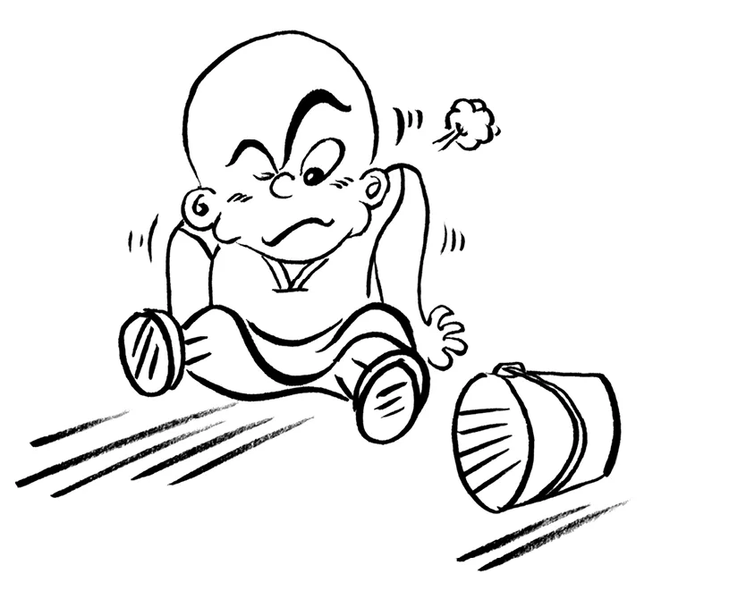

# 小心

昨晚下了一夜的小雪，外面雪风飞扬。旁边院子的小喇嘛去提水，老喇嘛大声地告诫他：“路很滑，要小心！”小喇嘛把话当为耳边风，飞也似的跑出去，刚出门，就摔了一跤，痛得嗷嗷直叫。

善良的人们在别人遇到危险时，时常提醒他人：“要小心谨慎！”但还是有很多人因不小心，而引来无穷后患。

上师们讲到修行时，也常谆谆教诲弟子：“要小心翼翼！”就是要弟子在行持佛法时，时时警策，检点三门。行、住、坐、卧以正念摄持，驱除非理作意。如果弟子对上师的话不加理会，散乱放逸，就会丧失正念，失去方寸。若因此而走上歧途，就悔之晚矣。

薛暄云：“成大事业者，从战战兢兢之小心来。”弘一法师云：“青天白日之节义，自暗室陋屋中培来，旋干转坤之经纶，自临深履薄处得力。”也就是说，像青天一般高尚的节操，是在简陋昏暗的房屋中培养出来的；而足以扭转乾坤的才华胆识，却是从如临深渊、如履薄冰的小心中来。

我们应当像前辈一样，时时保持如临深渊、如履薄冰、战战兢兢的戒备心理。只有这样，才能知惭有愧，才能作到谨慎而不放逸，才能成就最终之目标。

小心脚下的绊脚石！

壬午年九月初九

2002年10月14日
