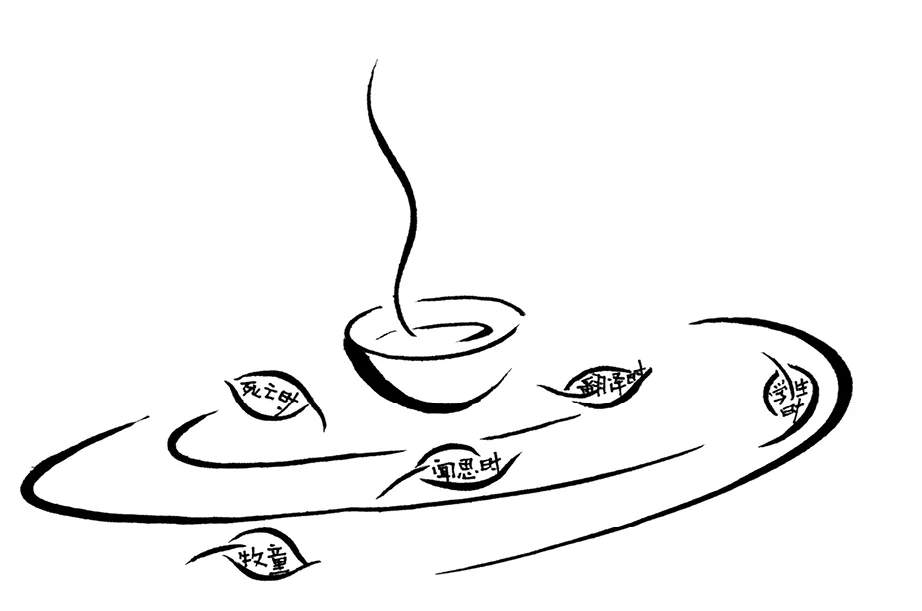

# 时代

哎哟，别偷懒了，还是翻译吧！

泡上一杯香茶，翻开经书，提笔翻译。脑海里却如同银幕般浮现了我此生的一幕幕场景。

牧童时代：蓝天中点缀着几朵白云，无忧无虑的我光着脚丫奔跑于草原上，与其他牧童一起哼唱着欢乐的歌，几百头牦牛都是我们亲密的伙伴，我们一起在无垠的旷野中尽情地撒野。

学生时代：如同阿里巴巴打开了四十大盗的宝藏，背上书包走入校门的我和同学一起，在知识的宝库里尽情地采集着无穷的珍宝。

闻思时代：披上袈裟，与成百上千的道友一起，依止上师，闻思经论，遨游在佛法的海洋中，荡涤着身心的障垢。

翻译时代：与汉地的众生接上特殊的因缘后，深感藏地佛法精髓的不可多得，拿起笔、翻开书，在冥思苦想中度过了许多时日。

现在应该进入修行时代了，记得阿底峡尊者来藏时，曾询问仁钦热沃译师能否帮助翻译，译师回答说：“我的头发都已经白了，不应再翻译，应该修行了。”尊者赞同地说：“的确应该修行了！”如今，我的头发已白了许多，却每天停留在词句的表面，并未将所了知的进行实修，使法融入相续。如果再这样下去，马上就进入死亡时代，并最终成为历史时代了。

壬午年五月二十一日

2002年6月30日
