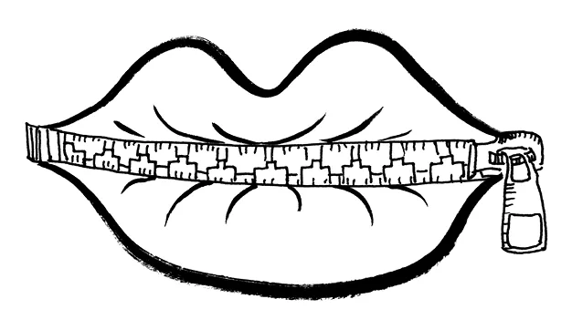

# 沉默

人人都希望有很好的谈吐，于是拼命地练习口才，以备将来能在人前施展，从而赢得艳羡的目光。殊不知，语言往往会招致大祸。

战国时期的苏秦因具有游说六国、合力抗秦的口才，才引起齐人的担心而招来杀身之祸。古人常常告诫别人：“祸从口出，而口则有唇，合之可以防祸也。”语言如风，无足而行，无翼而飞，出言不当，驷马不能追。先圣们都奉行“当言而惧，发言而忧，如蹈水火临危险也”的古训，我们更应闭住自己的双唇，不要让它招致是非。

往往动笔，都是在深思熟虑之后；但常常在言语脱口而出之后，人们才会思维这句话的对错。所以，古人才会总结出“意在笔先，慧生牙后”的精辟结论。

作为修行人更是应自顾调心，莫道他人短长。若是为了引导众生趋入正法，可以适当地说一些柔和语、具义语。在其他情况下，就应管住自己的嘴。寡言少语，无人认为你愚笨；若乘兴而谈，总会露出自己的浅薄。《维摩诘经》云：“防意如城，守口如瓶。”我们天生的两只耳朵、一张嘴，就是让我们要多听、少说。

当你不知道说什么时，千万不要信口雌黄，沉默是最好的语言。

壬午年七月二十七日

2002年9月4日
