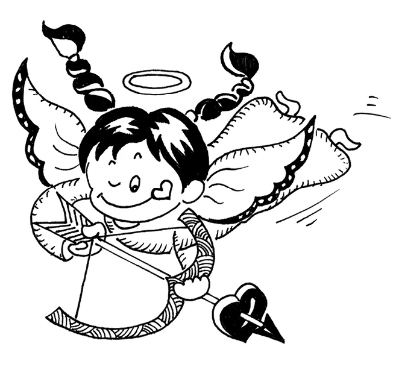

# 爱箭

藏族有句谚语：“草地上中了箭，很容易拔除；心中了爱箭，就难以自拔了。”

爱欲，是会给人带来痛苦的利箭。佛在《出曜经》中云：“犹如自造箭，还自伤其身，内箭亦如是，爱箭伤众生。”

难怪西方人也将爱情比喻为丘比特的箭，虽然无数文人用美文嘉言赞叹褒颂过它，但只要是箭都会有危害的。《本师传》云：“从爱生忧患，从爱生怖畏。离爱无忧患，离爱无怖畏。”爱不重不生娑婆，爱恋是产生痛苦的根源。且不论爱别离苦，即使形影不离的恋人，也会因彼此执著而引生无穷痛苦。美色如霞转瞬空，弦歌似水弹指灭。世间情感如同朝露，转瞬即逝。深陷爱河而难以自拔，只会徒增烦恼的牵绊。

如何才能得以逃脱呢？佛经中的一段公案将此答案告诉了我们：曾有一驯象人将千辛万苦驯服的大象献予国王，当他与国王骑着大象去到森林里时，大象因嗅到母象气息而狂奔不已。国王责怪驯象者，他回答说：“它的贪心增长，铁钩及绳索皆无能为力，我只能调伏它的身体，却不能调伏它的心。”“那么此等众生的身心何人皆能调伏呢？”“唯有佛陀！”

的确，牵缠俗缘溺爱河，唯有佛陀拯救之。《华严经》也有“入大爱河，令汝解脱”之说。要逃离爱河，免中爱箭，解除怖畏，唯有修习佛陀的教言。

苏轼也有诗云：“欲平苦海浪，先干爱河水。”欲救众生于轮回之苦海，必须先斩断儿女情长之束缚。

在漫长的人生中，遭受爱箭痛苦的人有多少呢？

壬午年四月初五

2002年5月17日
