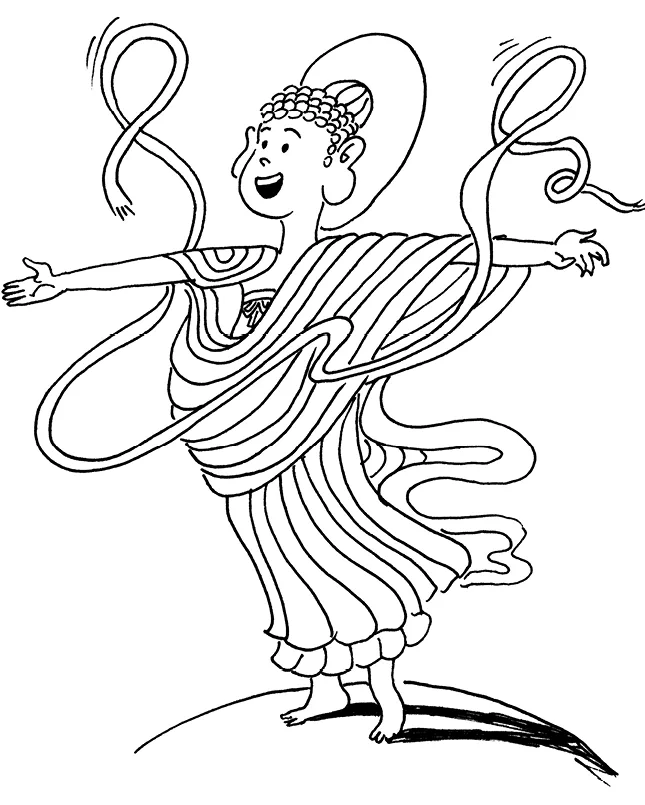

# 真乐

什么是真正的快乐？对于这个问题，不同的人有不同的诠释。贪财的人认为财富是真正的快乐；逐誉的人认为名声是真正的快乐；恋欲的人认为情爱是真正的快乐；有智的人认为修行是真正的快乐……真可谓五花八门，各说不一。

其实，如果善加分析，以世间名利妙欲为目标的人，是永远也得不到真正的快乐的。

麦彭仁波切说：“被分别念波涛冲卷的人，修行得不到快乐的机会。”

侨居美国的噶罗仁波切也告诫西方人：“你们西方人财富如同天人一般，其实就像睡在荆棘上面，无论如何翻身，也始终没有快乐。内心烦恼没有息灭的人，是毫无快乐可言的。”

世间的所谓快乐，不过是轮回的因。对这种如幻之乐越贪执，只会被轮回漩涡裹得越紧。

只有彻底放下我执，方能获得永恒之真乐！

壬午年三月三十日

2002年5月12日
