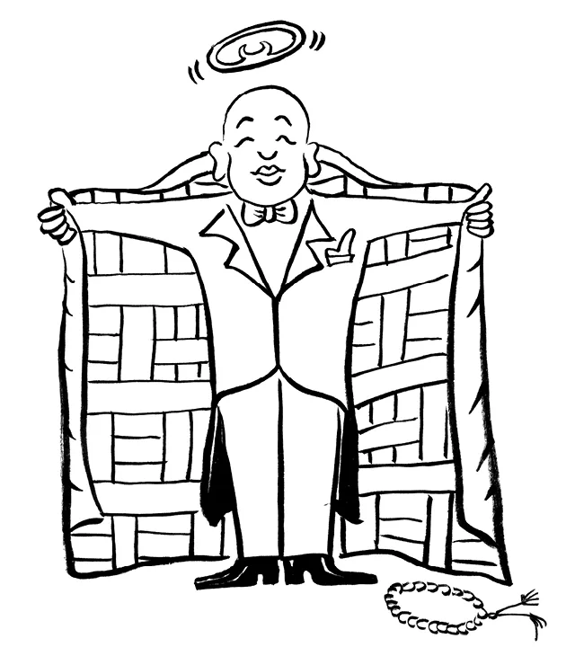

# 还俗

十分不想写下这个标题！但在这个五欲增盛的浊世，还俗已成为不得不面对的残酷现实。与其避重就轻地逃避这个题目，不如勇敢地正视它。

今天，听到一位出家十几年的人，为烦恼所缠，已还俗好几个月了。听到这个消息，心里像吃了一只苍蝇般不是滋味。记得在他出家初期，也可算得上是闻思精进、戒律清净、智慧日益增上的典范。他曾说过：“我只要活一天，决不还俗。让我还俗，还不如死掉。”这样一位下了很大决心的人，却食言还俗，十分令人痛心。

他在电话中闭口不谈佛法，却无休止地言及他的生意。当问到他生意如何时，他像饱含了一大堆苦水，忙不迭地向我倾倒：“如今的生意太难做了！每天8小时，却挣不到十元钱。想起以前出家时无忧无虑的生活，真像在天堂一样啊！唉！！”听了他的苦恼，我真不知该如何应答。

不过令我庆幸的是，他的见解至今尚未改变，对三宝的信心也没有退减，忏悔心恒时不离左右。虽忙于生意，却不离念诵。

喇拉曲智仁波切曾有一位很有名的弟子因故还俗，但别人毁谤他时，仁波切却说：“毁谤别人是错误的，他的身体虽然还俗了，心却没有还俗。”

佛经云：“宁可毁尸罗，切莫坏正见。”《中观四百论》中也说：“宁毁犯尸罗，不损坏正见。”如果见解毁坏，不行忏悔，反而责怪上师三宝，即使身体没有还俗，其内心却已无可救药了。

壬午年三月十九日

2002年4月30日
