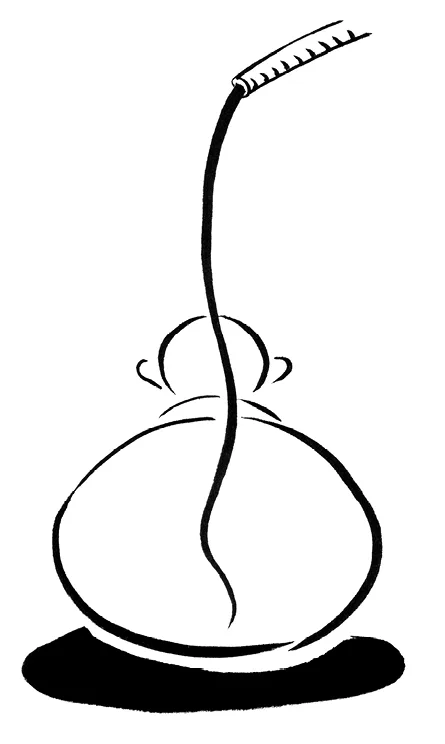

# 鞭策

一位刚从印度归来的堪布，向我讲起了他在印度哲蚌寺四年的修学生涯及体会。

在那里，聚集了三千多名僧众，每天凌晨五点，起床的钟声就把他们从美梦中惊醒，一天繁重的功课从此开始，除了短暂的休息，直至晚上十一点，一直处于高强度的学习中，若有想偷睡懒觉或不听从管教者，无情的皮鞭就会抽打在身上。

所有的僧众都接受着非常严格而有序的教育，第一年学习因明基础《心类学》及《因类学》，然后是《现观庄严论》七年，《中观》三年，《俱舍论》及戒律共四年，《释量论》则贯穿于整个修学课程。其间每年都必须背诵60篇以上的长颂词，若不能完成，则取消参学资格。在所有的显宗课程结束后，经过严格的考评，方可进入密宗的修习。

“桃李不言，下自成蹊”。由于这种几近苛刻的管理，致使该寺聚集了各路精英，培养了一大批出类拔萃的僧才。

听了他的讲述，令我对该寺的管理体制钦佩不已，多年以来，由于缺乏外力的鞭策，致使我的惰性与日俱增，想看的书、想做的事，常常因为懈怠与散乱而放弃。对于我这种缺乏自制力的人，实在需要外力的鞭打，使我精进、令我警醒、促我进步。

壬午年五月二十三日

2002年7月3日
