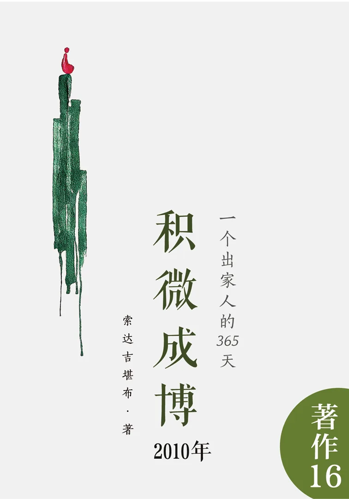

一个出家人的365天

开博时间

铁虎年天降日

2010年10月29日

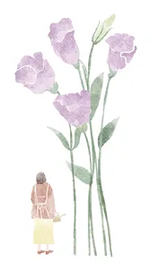

当今是一个信息时代，我利用网络的便利，偶尔将自己的一点体会、感想发给大家，愿与你们分享！

开博

今天是“天降日”，也是佛陀上天为母说法后回到人间的日子。现在学院在开极乐法会，若能念佛等行持善法，功德极大！

我今天开通微博了，但愿以此利益有缘者！

学院的雪景很美，我窗前的树下正躲着两只小鸟，很可爱……

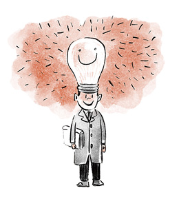

2010-10-29

快乐

喇嘛钦！

我们现在最耽著的财产、地位、名声、感情等世间的一切，再过二三十年就会化为云烟。唯有生前所作的善法，会永远跟随着心识，让我们获得真正的快乐。

2010-10-31

善恶

哦，我突然想起了《正法念处经》的一颂：“善人行善易，恶人行善难。恶人造恶易，善人作恶难。”

很喜欢这个教证，文字简单，却意义深刻。不知你对此有何感触？

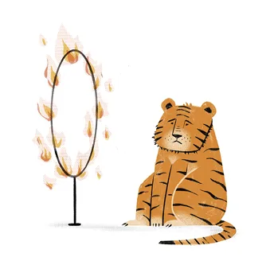

2010-11-2

净土

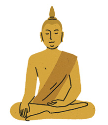

昨天睡得好舒服，还做了一个好梦，今天万里无云，让人心情舒畅。

今晚就要开讲《阿弥陀经》了，此经云：“若有众生，闻是说者，应当发愿，生彼国土。”让我们大家来共同发愿吧！

2010-11-4

人际

世间有本畅销书中说：对不起！请原谅！谢谢你！我爱你！这十二个字，可化解许多人所面临的各种问题，彻底宽容自我和他人，忏悔你曾经的过错，消除所有负面信念。

这一点与大乘教义有异曲同工之处，我们也可以用这种大爱的心态和话语，去面对一切！

2010-11-6

抱歉

最近偶尔看了大家的评论，本该有所回复，但因平时特别忙，故实在抽不出时间。请原谅！对不起！

但我经常看着你，同时也默默祈祷三宝加持：愿你的善根与日俱增！

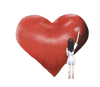

2010-11-7

点金

开心是工作的动力，利他是人生的目标，

知足是轻松的财富，和睦是相处的根本。

2010-11-9

自己

我在看一本叫《和平》的书，里面有段话很精彩：

“人一旦想到自己，心胸就会变得很狭窄，在这狭窄的空间里，即便是小问题，也会变得很大。然而，只要你开始想到别人，心中的视野就会变得宽阔，你自己的问题也就显得微不足道了。”

2010-11-10

佛陀

我们只能爱自己所爱的人，而佛陀，却能将最恨自己的敌人，与最爱自己的亲人一视同仁，并且不舍任何一个众生，帮助他（它）们获得真实的快乐。

这就是佛陀的伟大，你能做到吗？

2010-11-12

考试

今天我通过各种途径了知，很多地方的学员参加了考试，这种对上师三宝的法供养，是极为难得的！

《华严经》也说：“诸供养中，法供养最。”不管你考得好不好，只要积极参与了，我都感到非常高兴！

相信你也花了不少心血，我们也为此付出了很多，唯一的目的就是为了佛法驻世，利益众生。望每个人好好回向！

2010-11-14

心量

我曾看过一句话：“一个人心量有多大，事业就有多大；一个人心能容多少，成就就有多少。”

你觉得有道理吗？你在工作中的不顺，是否跟自己的心量有关呢？

2010-11-16

自在

一个真正的修行人，内心非常洒脱自在，对苦乐逆顺都不会过于萦怀。

正如寒山大师云：“秋到任他林落叶，春来从你树开花，三界横眠无一事，明月清风是我家。”

无门禅师也说：“春有百花秋有月，夏有凉风冬有雪，若无闲事挂心头，便是人间好时节。”

哈哈~

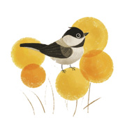

2010-11-17

情绪

有些人的情绪就像春天的天气，时而晴空万里，时而乌云密布，一个小小的因缘，就可以让他高兴不已或痛苦万分，给周围的人带来诸多不便。

记得《修心七要》云：“不喜怒无常。”

所以，我们应当保持稳重的人格，给身边的人一种“安全感”。

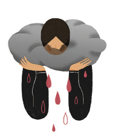

2010-11-19

无常

佛经中说：“万法无常如秋云，众生生死如观戏。”我很喜欢这个教证，并经常思维它的意义。

你呢？

2010-11-22

心镜

上至达官贵人，下至贩夫走卒，人人身上都有亮点，都有值得自己学习的地方。但如果我们心的明镜上有污点，再美的鲜花映出来也会有缺陷。

殊不知这并非是外境的问题，而是我们的心出了毛病。

2010-11-24

感恩

感恩一切传承上师！

因您智悲加持的阳光，遣除了我们心灵的黑暗，我代表芸芸众生感恩您！

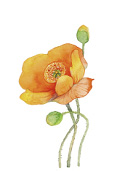

2010-11-25

华严

我边品尝普洱茶，边翻阅《华严经》，不禁神游到了大唐王朝——

那时的清凉国师，将这部具有三四万偈颂的佛经巨著，在一生中讲了五十多遍，几乎每年都讲一遍。

实在是了不起！

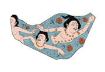

2010-11-27

发愿

美好的回忆：

20年前的今天（1990年11月29日），我和上师如意宝一起在印度金刚座发愿。

其愿文《愿海精髓》的精髓，就是“无垢圣教兴盛常住世，无偏众生享受胜利乐，心中所愿恒时唯有此，祈赐谛语加持成办之”。概而言之，即要弘扬佛法、利益众生。

希望大家将此铭刻于心，常常也要如是发愿！

2010-11-29

幸福

人人都在追求幸福的人生，那你认为：真正的幸福，是建立在什么基础上？

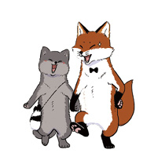

2010-12-1

虽然每个人的价值观不同，对幸福的理解也是见仁见智，但我觉得，最究竟的幸福，是建立在无我利他基础上的。

如《入行论》云：“所有世间乐，悉从利他生。一切世间苦，咸由自利成。”

2010-12-2

醒世

许多人虽知道死亡无常，

但总是不肯学、不肯修，真是麻烦！

不禁让我想到了状元禅师的

《醒世诗》：

急急忙忙苦追求，寒寒暖暖度春秋，

朝朝暮暮营家计，昧昧昏昏白了头。

是是非非何日了，烦烦恼恼几时休，

明明白白一条路，万万千千不肯修。

2010-12-3

多少

作为一个大乘行人，根据经论中所说：利益众生的话，事情越多越好；为了自己的话，琐事越少越好。

在这个如梦似幻的人生中，我们每个人当以此观察自己的言行！

2010-12-6

逆境

你的蔑视，是我的阳光；

你的谩骂，是我的音乐；

你的羞辱，是我的福分；

你的损害，是我的顺缘。

感恩一切心怀恶念的人和非人！

2010-12-7

明理

如果你懂得了万法无常之理，现在所拥有的人生，就会显得尤为灿烂；对于世间的名利，你也不会去疯狂追逐；就算遭遇到不幸，也不会感到一片绝望。

信不信由你！

2010-12-9

金钱

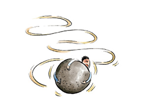

对于金钱的态度，不仅佛教中可谓俯仰皆拾，红楼梦的《好了歌》中，也有一句是：“世人都晓神仙好，唯有金银忘不了。终朝只恨聚无多，及到多时眼闭了。”

总是抱怨钱不够多，成天为此奔波劳碌，等到多时却大限已至，这难道不是有些人的真实写照吗？

嗡玛呢巴美吽~

2010-12-11

推荐

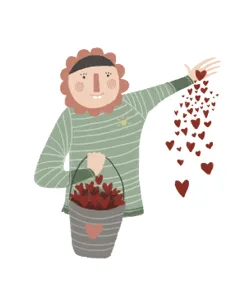

好多人常问“大乘佛法要学什么”。要我推荐的话，最好的论典莫过于寂天菩萨所造的《入行论》。它完整系统地介绍了大乘一切教义，是八万四千法门的心髓总汇，我本人从中也受益匪浅。

我曾用了201节课，对此详细作了诠解。假如你对大乘佛教有兴趣，不妨到“智悲佛网”上，去下载并学习。

相信你绝对不虚此“学”！

2010-12-13

保暖

学院下雪了，温度一下子陡然直降，屋外滴水成冰。听说近来寒潮席卷各地，大家也要注意防寒保暖。

当然，除了身体的保暖，如今在浊世修行，违缘磨难此起彼伏，内心也倍感寒冷，故大家心里也要穿上正法的“保暖衣”啊！

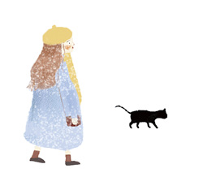

2010-12-15

圆满

经过一个多月时间，到今天，已顺利圆满地传授了无垢光尊者的三大休息（《心性休息》念的传承）！

对我来讲，时间虽不长，但却是个大工程。能无有任何违缘，完全是上师护法的加持，内心极为欢喜。

诸大德说过，末法越黑暗，密法日轮越炽亮，尤其是大圆满，极相应众生根基。望有缘修持者，务必要正面取舍！

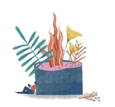

2010-12-17

七年

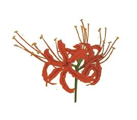

上师：

您离开我们已经七年了，总是在寂静独处时，泪水涟涟。您的教诲甘露，恒时滋润着心田。

明天又到了您七周年忌日，回想当年随您一起周游世界，您的温暖慈悲历历再现。

喇嘛钦！祈祷您的智悲加持融入心性，修行圆满，弘法顺利，利乐有情！

2010-12-20

偶然

在某种机缘的聚合下，有时候，不经意听到的一句话，也可以改变一生的命运。

就如同一朵白云也可以点缀苍穹的伟岸；一滴水也可以维持小草的生命。

在历史上，大名鼎鼎的舍利子和目犍连，身为外道时也就是因马胜比丘的一偈，从而弃暗投明，皈入佛教获得了解脱。

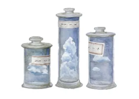

2010-12-23

圣诞

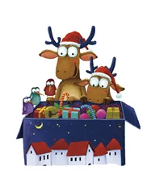

今天是西方的圣诞节，我不禁想起了2001年的今天——开始动笔翻译《释尊广传》。

当时我正在厦门住院，窗外的树花争奇斗艳，许多人都在欢度圣诞。我就自我安慰将这喜庆场面，当作翻译该论的奠基大典。

后来我历经100多天将它译了出来，自认为做了一件很有意义的事。但如今九年过去了，不知你们看了没有？

2010-12-25

随缘

不少人常抱怨生活压力大、感情不顺利、事业不成功，其实真正观察其根源，这一切多来自于强求。

若能像达摩祖师所说“得失从缘，心无增减”，那所有苦恼自然会消于无形。

就算你暂时没有这种境界，但只要经常琢磨这两句话，心境也会大不相同。试试吧！

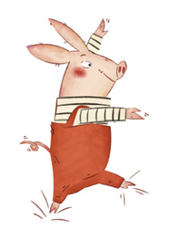

2010-12-26

网络

网上不少人对出家人用微博颇有微词。其实任何事都不能一概而论，《宝积经》中说：“有智者依方便得解脱，无智者依方便得束缚。”这段话很适合对使用网络的取舍问题。

不管是什么身份，只要能对别人有利，手段并无一定之规。

作为出家人，每个人的因缘也不相同，儒家说：“穷则独善其身，达则兼济天下。”这话应该可以引起你的深思吧！

2010-12-27

误传

马上就要过元旦了！

很多人在与亲友欢聚一堂、推杯换盏时，常爱把济公的“酒肉穿肠过，佛祖心中留”挂在嘴边，成为可以肆意吃肉喝酒的铁证。却不知在这句话后面，济公还说了一句：“世人若学我，如同进魔道。”

济公的高深境界，绝非我们所能企及，故万不可乱学表面行为，以免自欺欺人、自误误人！

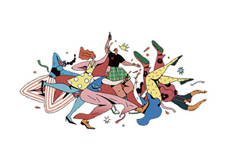

2010-12-28

皈依

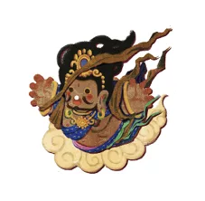

上等皈依，是为了一切众生究竟解脱；

中等皈依，是为了自己脱离轮回；

下等皈依，是为了求得来世的人天福报。

而为了今生健康安乐去皈依三宝，

连下等皈依也算不上。

扪心自问，你属于哪一种呢？

2010-12-30
