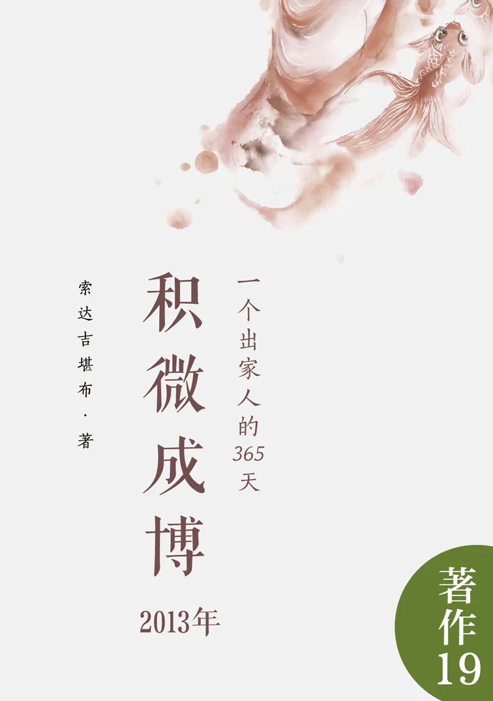

一个出家人的365天

莲师

新年开始的第一天，祈祷诸佛菩萨非常重要。

尤其按照古大德的传统，若能念莲师心咒“嗡啊吽 班匝儿格热巴玛色德吽”至少100遍以上，以此可保佑在新的一年里，遣除一切违缘、魔障，增上顺利吉祥、健康长寿。

希望大家为了自己或家人，今天多祈祷莲师！

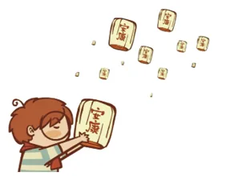

2013-1-1

珍惜

我们得这个人身，非常难；有缘听闻佛法，也非常难；遇到真正的善知识，更是难上加难。

善知识的一句教言，往往可以改变我们的一生，比任何金银珠宝都珍贵。但善知识陪伴我们的时间，通常不会太长。

所以，在有缘遇到真正的善知识时，务必要好好珍惜！

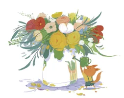

2013-1-2

心量

一个人的心量，是被磨难撑大的。

2013-1-3

因缘

我们身上发生一些不顺心的事情，比如突然生病了、飞机误点了，这些看似偶然，背后实则有必然的复杂因缘。明白了这一点后，不管遇到什么逆境，都不必太抱怨。

2013-1-5

真相

我们眼睛看到的东西，实在太有限了！且不说更深奥的层面，单是身边的事物，也常常见不到它的真相。这是沙子在250倍放大率下的美丽世界，每一颗沙子的独特个性，让人不得不惊叹“一沙一世界”。

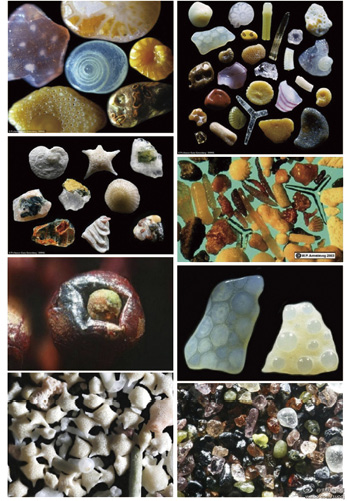

2013-1-7

打坐

金字塔，有一种不为人知的神奇力量，仅仅按它的比例做一个小模型，也能让里面的刀具变锋利，食品保鲜久，幼苗长得快，伤口迅速愈合……其实，人体打坐的形状，就是一个典型的“金字塔”，它能汇聚高层次的能量到人体。

长期打坐不但会令身体健康、头脑清醒、心情放松，还能开发意想不到的智能、潜能。

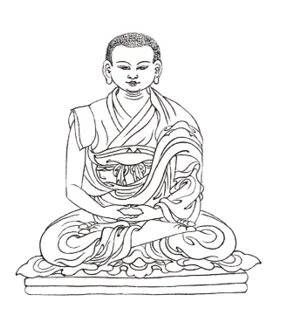

2013-1-8

幻相

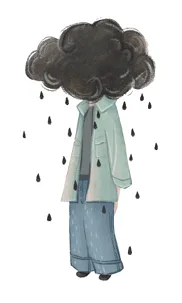

当我们生起愤恨等负面情绪时，应当下观察它的来处、去处、颜色、形状……

若能了悟其本体了不可得，这颗不安分的心便会荡然无存，一切幻相也会依此粉碎。

2013-1-9

揭示

佛陀不是神，也不是造物主。他只是揭示了万法的规律，让我们去照做。

假如不照做，也不是佛陀在惩罚你，而是规律在惩罚你，就像不怕火便会被烧伤一样。

2013-1-10

物极

不要总让自己去追求完美。

月亮一旦圆了，就要变缺；杯里的水满了，就要溢出；树上的苹果熟了，就要掉落。

太完美了只能物极必反，还不如给自己留个空间，虽然多一点欠缺，但也少一点遗憾。

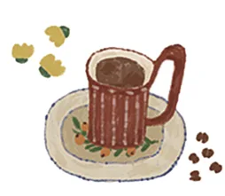

2013-1-11

研讨

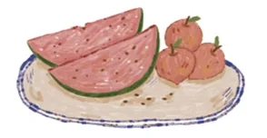

2012年7月，“第二届世界青年佛学研讨会”在香港召开，来自世界各国的许多著名教授、年轻学子，不管是否信仰佛教，都各抒己见表达了自己对佛教的认识、对心灵的探索。

非常随喜他们的正见，以及对真理的追求！视频

2013-1-12

加持

昨天，我朝拜了一座南传佛教的寺院，看见一位小沙弥正在为排队的信众作加持。

见到这一幕，让人不禁产生恭敬心、欢喜心。我也默默排在队伍后面，对他恭敬地合掌、顶礼，接受他的洒水、念咒、加持，得到一条加持绳。

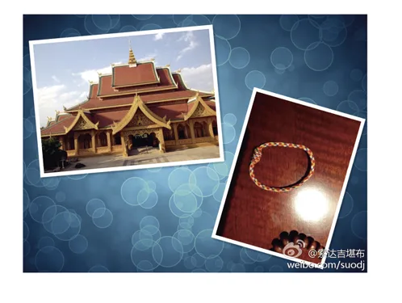

2013-1-12

个性

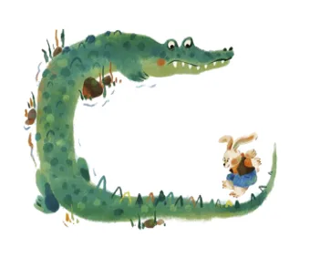

现在这个时代，许多人都标榜要“做自己”，听起来似乎很有个性，走自己的路，就让别人说去吧。

但你有没有想过，如果你选的路越走越危险，甚至只有死路一条，可你仍不顾别人的眼光而义无反顾，这只能是一种愚笨，没什么可炫耀的。

所以，“做自己”也要有智慧，方向选对了倒没问题，但若是选错了呢？

2013-1-13

感言

我看了莫言得诺贝尔文学奖的获奖感言。他平实的语言中，透露着对人生的反思，大家有必要看一下。

他还在其中提道：“我对佛教经典并没有深入研究，对佛教的理解自然十分肤浅……我觉得佛教的许多基本思想，是真正的宇宙意识。人世中许多纷争，在佛家的眼里，是毫无意义的。”网页链接

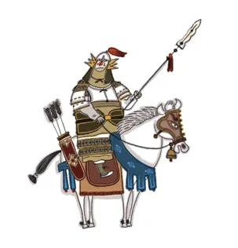

2013-1-14

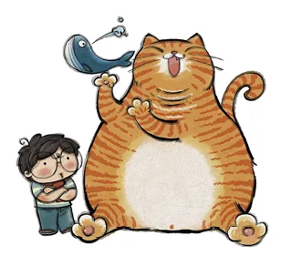

智愚

智者经常观察自己的过失，愚者老是挑剔别人的毛病，正如藏族谚语所说：

“自己脸上有大牦牛都发现不了，

别人脸上有小虱子也能看得见。”

2013-1-17

长期

用金钱帮人，用完就没了，只能解决一时的问题；用真理指引人，常会改变他的一生，使其终身受益。

但有些人往往喜新厌旧，对没听过的道理兴趣盎然，对已听过的却从不深入挖掘。

其实，有用的话语哪怕只有一句，也应长期琢磨，不要听时挺有感觉，却转头就忘。

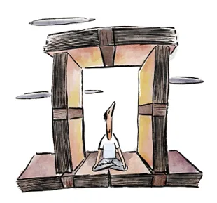

2013-1-18

源泉

上师啊，

昔日我扶过您的手，至今还留有您的味道；

曾经我得过您的法，至今还在血液中流淌；

过去我听过您的教言，至今还在耳畔回荡。

虽然您的色身离开了我，但您的智慧法身从未远去，仍如当日一般，是我一切的源泉。

2013-1-19

怀念上师

作词：丹增嘉措活佛

多么怀念您我的上师

您匆忙地走进遥远的世界

将可怜的弟子留在人间

回头看看我眼中的依恋

多么怀念您我的上师

千言万语也无法表达我的心

如果能让时光倒流

真想回到那当初的岁月

再次向您祈求大乘妙法

如果能长出翅膀

我真想飞飞到您的世界

与您彻底融为一体

多么怀念您我的上师

虽然跨越了时空

相信您并未走远

我用无声的呼唤感动您

感动您

愿在法界中与您重逢……

怀念上师视频

2013-1-19

系统

佛法并不是一大堆教条，而是有许多解除困惑、减轻压力的实用方法。

这些方法的除苦效果不可思议，你只有依靠网络等途径，系统学习一些佛典的内容，才能对此深有体会。

否则，只是依止一位师父，跟他偶尔聊聊天、诉诉苦，这样的学佛，不可能从根本上解决问题。

2013-1-20

悲心

曾有一位老堪布叫贡噶旺秋，“文革”期间他被关进监狱，受尽折磨20多年。

被释放后，有人问他：“你在监狱里，最害怕的是什么？”

他回答说：“我最怕的，就是对伤害我的人失去慈悲心。”科技发达时代的佛法教育--香港科技大学演讲

——香港科技大学演讲：科技发达时代的佛法教育

2013-1-21

自在

愿一切众生身心自在！

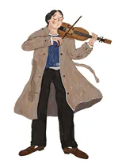

2013-1-21

咸淡

一把盐放入一杯水中，会咸得发苦，而撒进一个湖里，会没什么味道。

同样，我们生命中的痛苦是盐，它的咸淡，也取决于盛它的容器。

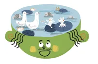

2013-1-22

光盘

有一种节约叫光盘，有一种公益叫光盘！所谓光盘，就是吃光你盘子中的食物。

2000亿元，是中国人一年在餐桌上浪费掉的粮食价值；2亿人，是一年倒掉的食物可以解决口粮的人数。“舌尖上的浪费”触目惊心，令人痛心。

一粥一饭，当思来之不易。从今天开始，做个“光盘族”吧！

2013-1-24

意义

现在许多人整天一直忙忙碌碌，忙得不知身在何方，也许到了生命穷尽的那一天，还不知道生命的意义。

真心希望每个人在生活中能找到生命的真相！

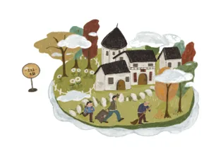

2013-1-25

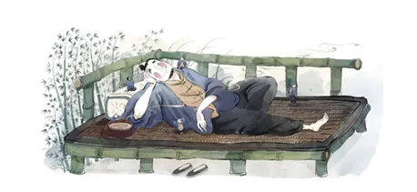

上品

万般皆下品，唯有利他高。

2013-1-26

不听

我们不应该听的语言有三种：

一、不要听别人赞叹自己的功德；

二、不要听喜新厌旧之人的挑唆；

三、不要听愚者的教诲。

——华智仁波切《自我教言》

2013-1-27

反对

演一部戏，需要正面和反面的人物，同样，我们人生这出戏，也需要有支持力和反对力。

不管怎么样，我们都要感恩他们，因为若没有他们的参与，人生或许会变得毫无精彩之处。

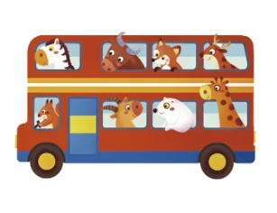

2013-1-28

善终

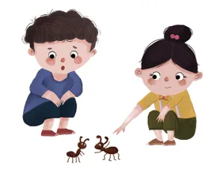

我们不管是做一件事，还是修一个法，最好能善始善终，不要像蝌蚪一样头大尾小；

也不要开头、结尾只做个仪式，中间过程如何却毫不关心，就像蚂蚁一样头尾大、腰很细。

2013-1-29

誓言

我不曾远离那些信仰我、

甚至不信仰我的人，

虽然他们没有看到我，

但我的这些孩子们，

将永远受到我慈悲心的保护！

——莲花生大士在一千多年前许下的誓言

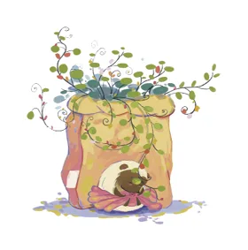

2013-1-30

无常

昨天不小心弄坏了手机，通讯录里的电话，现在一个也没有了。要联系的人，一个都联系不上了。

刚开始有点傻眼，但转念一想也是个好事，这也是提醒自己不要过于依赖手机，外在的一切确实是无常的、不可靠的！

手机族们，你说是吗？

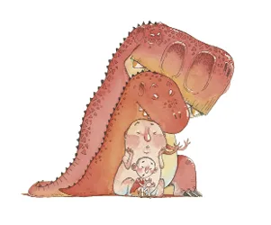

2013-1-31

积极

在生活中遇到痛苦、失望、不顺，有些人什么都不做，只是整天悲伤、找人哭诉，或者拼命酗酒，用酒精一直麻痹自己。

当然，有这种情绪很正常，但不能让它时时刻刻折磨你，而应把注意力转到积极的事物上，提升正能量来控制你的心，自己学会慢慢站起来！

2013-2-1

光明

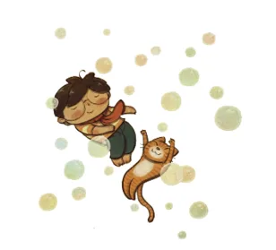

当你的生活遇到挑战，迷茫找不到方向时，若以无比的恭敬心，祈祷自己最有信心的佛菩萨，比如念“南无观世音菩萨”。

当圣者的加持与你的信心融为一体，自然会出现一条光明之路。

这，就是甚深缘起的不可思议。

2013-2-2

做到

人被赋予两个眼睛、两个耳朵、两只手，只有一张嘴。

就是在提醒我们要多看、多听、多做，而少说废话。

这个道理虽然很多人都懂，但你真正做到了吗？

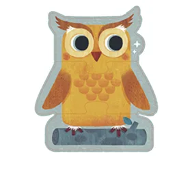

2013-2-3

趣味

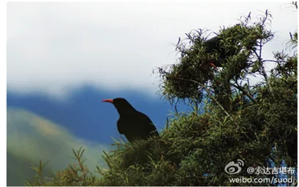

我家木屋的屋檐下，五六只红嘴山鸦在此安家。它们作息极有规律，每天按点起床，准时睡觉。

小山鸦挺调皮，偶尔早上赖床，或想在外多玩会儿，大山鸦就发出尖厉的大叫，直到它乖乖听话为止。

它们会在阳光下梳理羽毛，又会在夜幕降临时，飞回各自固定的寝室。有了这群小邻居为伴，生活还是别有一番趣味！

2013-2-4

名利

对真正的修行人来讲，除非是为了利益众生，否则，世间的名利福报完全是一种毒药。

正如古大德所说：美誉是魔鬼给你下的毒，恭敬也是束缚你的绳索，一切福报都是解脱的绊脚石，所以不要把毒药当妙药！

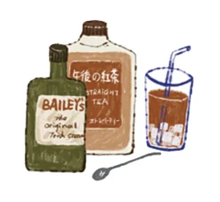

2013-2-5

傲慢

有傲慢心之人，自认为智慧出类拔萃、傲视群雄。

但只要认真去观察，就会明白这些根本不值一提。在一段时期内，或特定的小范围里，你的才华或长相等各方面，或许有过人之处，但不要忘了：

在这世上，还有无数人千百万倍地超胜于你。

——法王如意宝

2013-2-6

罗汉

去过寺院的人都会发现，在佛陀身边，常有十六位形态各异的阿罗汉。

他们是遵循佛陀嘱咐，在佛涅槃后一直住于世间、护持正法的圣者。

若经常祈祷他们，有助于十方高僧大德长久住世，利益众生的教法得以广弘。

今晚7:30，我们来一起学习《十六罗汉礼供文》。

2013-2-7

心经

今天是除夕的前一天，在藏历中，最好在今天的黄昏念9遍《心经》。

此经中说：“能除一切苦，真实不虚。”依靠般若空性的强大威力，可以遣除我们往年的一切不顺、烦恼、障碍，迎接来年的顺利、圆满、吉祥！

2013-2-8

传承

你若有时间，今晚7：30可以到法音频道来，跟僧众一起共诵9遍《心经》。

同时，我也会给大家传授《心经》的传承。法音频道：网页链接

2013-2-8

心经

唐玄奘·译

观自在菩萨，行深般若波罗蜜多时。照见五蕴皆空，度一切苦厄。舍利子，色不异空，空不异色，色即是空，空即是色，受想行识，亦复如是。舍利子，是诸法空相，不生不灭，不垢不净，不增不减，是故空中无色，无受想行识，无眼耳鼻舌身意，无色声香味触法，无眼界，乃至无意识界。无无明，亦无无明尽，乃至无老死，亦无老死尽。无苦集灭道，无智亦无得。以无所得故，菩提萨埵，依般若波罗蜜多故，心无挂碍。无挂碍故，无有恐怖，远离颠倒梦想，究竟涅槃。三世诸佛，依般若波罗蜜多故，得阿耨多罗三藐三菩提。故知般若波罗蜜多，是大神咒，是大明咒，是无上咒，是无等等咒，能除一切苦，真实不虚。故说般若波罗蜜多咒，即说咒曰：揭谛揭谛，波罗揭谛，波罗僧揭谛，菩提萨婆诃。

吉祥

祝福你在新的一年里，身心自在，家庭和乐，事事如意，福泽绵长！

愿昼吉祥夜吉祥，三宝加被恒吉祥，护法龙天除灾障，一切圆满大吉祥！

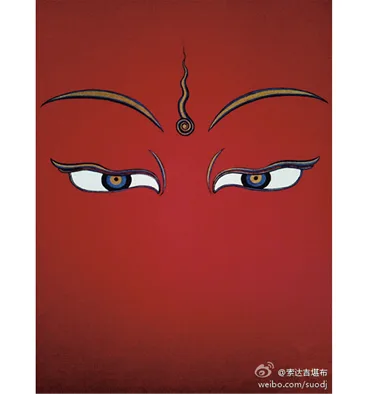

2013-2-9

计划

俗话说：“一年之计在于春，一日之计在于晨。”

新年的第一天，我们对今年要做的有意义的事情，应该有个计划、打算，并将此作为一年的动力，而不能让人生白白空过！

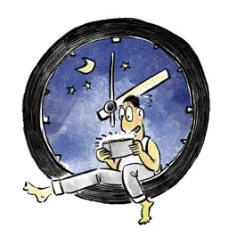

2013-2-10

持明

现在是“神变月”（公历2.11—3.12），每一天都是吉祥日，行持任何善法，功德均会成十亿倍增长，故望大家切莫散乱。

同时，从2月11日起，我们佛学院将开15天的持明大法会，僧众共诵九本尊心咒，为全世界和一切众生祈福。你若想参与但又不会念此心咒，也可以念怀业祈请文，或观音心咒“嗡玛呢巴美吽”。

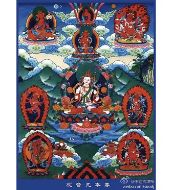

2013-2-10

明白

我们的人生中，充满着喜怒哀乐、悲欢离合、起伏不定……这些现象对每个人来说，虽然都是实实在在的，但它并不是究竟真相。只有通达了一切本来无“我”，才会明白人生到底是什么，才会拥有一种超越的人生。

2013-2-12

遗憾

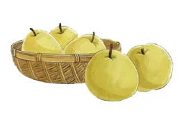

“出家人不打诳语”，这是影视中刻画出家人时，出现频率最高的一句话。其实，出家人又岂止不能说谎这么简单？在家人说谎就理所应当吗？佛教如今已被渲染得面目全非，倘若你没有学习佛教的典籍，只是从荧幕上听了几句话，就认为这是佛教的全部，实在是有点遗憾！

2013-2-13

沮丧

瑞典有一句谚语：“无论你转身多少次，你的屁股还是在你后面。”是什么意思呢？就是无论你怎么做，都会有人说你不对。

若能明白这一点，听到跟自己相反的声音，不要让沮丧、恼怒左右你的心情，而应觉得这很正常。反而，如果没有这些，才不正常。

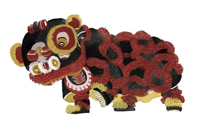

2013-2-14

捍卫

任何一个宗教，都难免有良莠不齐的现象，为什么其他宗教的很少报道，佛教的却常见诸报端，任人调侃？佛教还能被肆意歪曲，无底线地娱乐？

因为在有些人看来，佛教以慈悲为怀，似乎怎么践踏都没危险。但实际上，慈悲并非像石头一样不懂取舍，佛教的神圣性，我们也有责任捍卫，因为它是全人类的心灵财富！

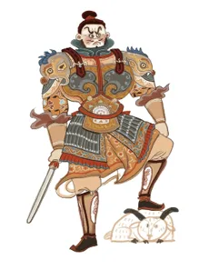

2013-2-16

毁掉

佛教中讲究“慈悲为本，方便为门”，但若没以智慧摄持，则容易导致“慈悲多祸害，方便出下流”。

所以，我在此双手合掌请求：今后你若有机会参与佛教题材的创作或传播，请先了解一下它的真实教义，否则，也许你一不小心，就毁掉了许多人的善根。或许你可以辩称自己并非故意，但因果不会因此就一笑了之。

2013-2-16

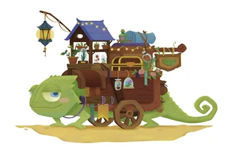

看病

问：我痛苦的时候祈祷佛，为什么不起作用？答：这就像去医院看病，有些病能完全治好，有些病则效果不大。既然有些病治不了，我们还要不要看病呢？还是要看。祈祷佛也是这个道理。

——香港科技大学问答

2013-2-18

翻译

佛教与科学之间到底有什么关系？截至2012年，国外已有超过8000名的前沿科学家，投入到了这一研究中。

为了与大家分享这些研究成果，用科学的眼光重新认识佛教，2011年11月我们成立了“智悲翻译中心”，迄今已将100多篇文章译成了中文。网页链接

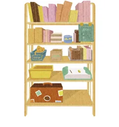

2013-2-20

困境

我们遇到坎坷困境，用不着拼命想方设法逃避，它可能是通往成功的基石；

时时一帆风顺，也不一定就是好事，它常会令人增长傲慢，迷失自己。

2013-2-21

佛经

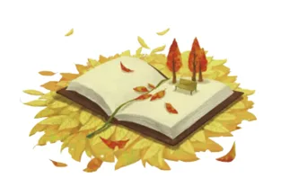

许多人在学佛的过程中，常会出现很多问题和疑惑，不知道该如何抉择。

其实，佛陀是真实语者，他的智慧无与伦比，在给我们留下的《大藏经》中，对各类问题也几乎都有答案。

所以，我们在遇到问题时，若按照佛经中的佛陀教言来作取舍，远比凡夫人的想象臆造更为可靠。

2013-2-22

人心

风水对我们有没有影响？确实有，但并非一成不变。

据说范仲淹曾因一念善心，死时要求儿子将其葬于凶地，结果当晚雷电交加、地动山摇，凶地变成吉地。

古来最能拥有风水宝地者，莫过于皇帝，但也并非每一位皇帝都福厚、命长。所以，风水的根本在于人心，心善，坏风水也能变好；心恶，好风水也会变差。

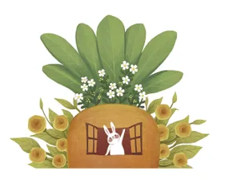

2013-2-23

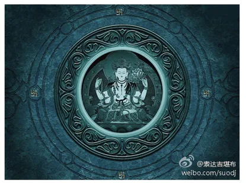

元宵

在新年的第一个月圆之日，

愿你的智慧、善心、福德，

如今晚的月亮一样圆满！

元宵节快乐！

2013-2-24

情绪

十分见效的美容秘笈——佛陀告诉我们：喜欢发脾气的人，今生会长得越来越难看，来世还会投生为丑陋者。

所以，若想长得漂亮，光用昂贵化妆品是不够的，还应学会控制自己的情绪，不能乱发脾气，也不能动不动就口不择言地伤人。

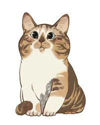

2013-2-25

烦恼

用石头打狗，狗不追人而反咬石头；用石头打狮子，狮子不追石头而直接攻击人。

同样，在遇到痛苦、打击时，愚者只知一味怨恨外境，从来不往内观察，看自己有何不足；智者却明白痛苦并非来自怨敌，而是源于自己的烦恼，若没有烦恼，怨敌再厉害也无济于事。

所以，不一样的智慧，成就不一样的人生。

2013-2-26

开悟

如果你把追女人或赚钱这类让你分心的时间，抽出十分之一用来修行，几年内包管你开悟！

——印度圣者拉玛克里胥那

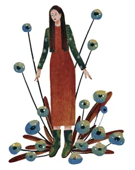

2013-2-28

观察

若想选择一位佛法的老师，之前务必要长期、再三地观察，而不能不加辨别就草率依止。

在观察的时候，最主要是看他有没有真正的大悲心。有了这颗心，就算其他法相不具足，也可以依止；但若没有大悲心，哪怕具足百般功德，也不算是大乘的善知识。

2013-3-1

愉快

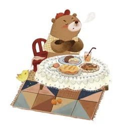

“心情愉快法”——双目直视虚空，不执著一切而自然放松，心胸尽量放大，在这样的境界中坦然安住。

然后念诵“达雅他 嗡 措姆迷勒那 德卡踏母索哈”，这个咒语念7遍、108遍都可以。

如此观修，有助于我们天天好心情，人际关系趋于改善，许多不顺迎刃而解。

2013-3-2

痴呆

随着中国步入老龄化，“老年痴呆”这一疾病日益凸显，有专家称：未来几十年，中国将成为“痴呆大国”。其实，佛法所传输的圣能量，能够开智慧、安心神，对预防此病极有帮助。

我身边有许多七八十岁的学佛老人，头脑非常清晰，思维非常敏捷，也足以证明这一点。附：日本研究——抄佛经可防老年痴呆

2013-3-3

痛苦

我们总会遇到痛苦，但痛过了，有些人就故意淡忘了，不愿正视它，更不愿提起它。

其实，痛苦也是人生的一种“维他命”，认真反思它的人，可以找出苦的根源，痛过一次就够了；而不愿正视它的人，会接二连三犯同样的错误，遭受同样的“痛”与“苦”。

2013-3-4

看书

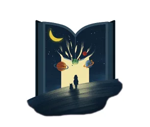

老子、孔子，年轻时都当过图书馆的管理员。

因寄身于浩瀚的书海中，整日与书香为伴，久而久之，造就了自己的广闻博学。

谁都不可能一生下来就是圣贤，所以，我们应当多看书，看好书，把学到的知识为我所用！

2013-3-5

有钱

“钱”字，从字形来看，一边是金，一边是二“戈”。双方拿着兵器，为了金子争得你死我活，这应该就是钱的本意。

所以，有了钱不一定就真的幸福，不信的话，你可以问问现在的有钱人。对他们来讲，或许内心的平静才是最大的奢侈品。

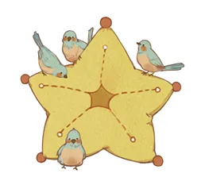

2013-3-6

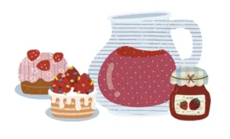

美好

照相机的镜头干净了，才能拍出栩栩如生的美景，同样，我们的心清净了，才能看到生活中的美好。

2013-3-7

女人

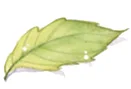

淡定的心，让她不再浮躁；

自在的心，让她不再寂寞；

轻松的心，让她不再忙碌；

解脱的心，让她不再苦恼……

祝普天下的女人节日快乐！

2013-3-8

免疫

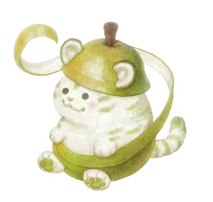

研究证明：80%的人体免疫力，受情绪的影响。

恐惧、忧郁、压力、悲观等负面情绪，会造成免疫力紊乱；而快乐的情绪，能使大脑分泌一些有益健康的物质，激活人体免疫功能。

所以，哪怕是为了身体的健康，学会调心也非常重要！

2013-3-9

祈祷

“人如果做了坏事，向神祈祷，就可以得到幸福吗？”

这个问题一直困惑着许多人。那么，身为佛教教主的佛陀，到底是怎么说的呢？让我们看看《中阿含经》的精彩小故事吧——《中阿含经（卷3）》伽弥尼天子拜访释迦牟尼佛

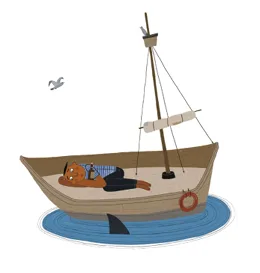

2013-3-10

忏悔

罪业不是实有不变的，它依因缘而生，故也可依因缘而灭。

但灭罪的因缘，并不是我们想得那么简单，后悔、求饶就可以了。

它需要对以往的过错真心忏悔，并发誓永不再犯，然后修持专门的灭罪法门，比如观修金刚萨埵，念一定数量的佛号或心咒……

如此，未来的苦果才会减至最小，乃至不会出现。

2013-3-11

说空

从来没有实地修持过空性，只是口头上会说“一切皆空，什么都不要执著”，这就像平民自称为国王一样，只是逞口头之利，终究没有什么益处。

诚如禅宗六祖所言：“终日说空，心中不修此行，恰似凡人自称国王，终不可得。”

2013-3-12

爱情

若有人问佛陀：“应当如何对待爱情？”

佛陀不会劝所有人出家，也不会让所有人学佛。

佛陀会说：对感情不要太执著了，否则一定会带来痛苦，这些痛苦不是别人强加给你的，完全是自作自受、作茧自缚。

——厦门大学演讲《问佛陀情为何物》

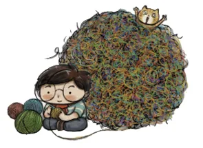

2013-3-13

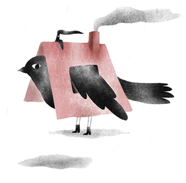

心灵

所有的历史，当其外壳被除去之后，都是属于心灵的历史。

——著名历史学家汤因比（Arnold Toynbee）

2013-3-14

信仰

每个优秀的宗教，都有对身心的高层教育，让信众自觉约束自己的行为。

有了信仰的人，内在的自律远比外在的法律要管用得多；而没有信仰的人，做事往往没有底线，为了蝇头小利就无恶不作。

所以，一个和谐社会的建立，不能单单依赖于法律，信仰也是必不可少的。

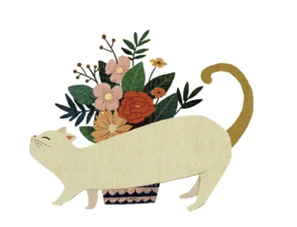

2013-3-15

宗教

据美国民调机构皮尤研究中心（Pew Research Center），在2010年发表的《全球宗教景观》报告中说：在全球69亿人口中，有58亿多人有宗教信仰，10亿多人没有宗教信仰——可见，有宗教信仰的人，在这个世界上还是占绝大多数。

2013-3-16

无常

今天身体康健，明朝也许会身染重病；

今天花容月貌，明朝也许会仙姿不再；

今天荣华富贵，明朝也许会穷困潦倒；

今天誉满天下，明朝也许会遭人唾骂……

不要总以为这些只发生在别人身上，

它随时可能在你身上呈现。

这就是我们生活中的“无常”！

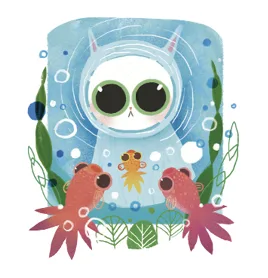

2013-3-17

心理

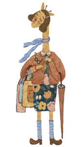

现在许多人都认为自己“心理健康”，但实际上，若想达到这个标准，也没有那么简单。

且不说别的，仅仅在生活中，你处事乐观、极少抱怨吗？遇到缺陷和挫折，能迎难而上、积极面对吗？在处理人际关系时，能既认清自己，又包容别人吗？……

所以，只有具备了化解外界刺激的良好心态，才是真正的“健康”。

2013-3-18

幸福

“幸福”是人人都渴望的，但怎样才能得到幸福，思考它的人并不多。

其实，幸福的根本是心，只要心满足了，哪怕是粗茶淡饭，也会怡然自得；若是心不满足，即便是金玉满堂，也依然悲戚愁苦。

今天是“国际幸福日”，趁这个吉祥的日子，祝愿每个人都能找到幸福的方法，得到真正的幸福！

2013-3-20

心安

面对同样的失去，有些人内心豁达，不会纠结很久，遇到什么都能随遇而安，心安了也就自在了；有些人则耿耿于怀，难以面对，要么愤世嫉俗，要么自暴自弃，给自己和他人都带来了困扰。

所以，外境好坏并不是苦乐的来源，真正的始作俑者，就是我们的心。

2013-3-21

不变

从小到大，我们了解的“幸福”，全来自于外在。

比如有钱了就幸福，没钱了就痛苦；有人爱就幸福，失恋了就痛苦……但实际上，这一切并不稳定，随时可能发生变化。

而佛教所揭示的“幸福”，建立在内心的基础上，这是人人平等具有的，只是很少人懂得该怎样挖掘。

可一旦你认识了它，才知道何为不变的幸福。

2013-3-21

捷径

常有人说：“这个说起来容易，做起来难！”

话虽如此，但你从不试着去做的话，那永远都做不到。就像你从家里步行去拉萨，虽然目标遥不可及，但路就在你脚下，只要一步一步走，就会一点一点接近。

不要总抱着投机的心理，奢望人生中会出现“捷径”，让自己不费力气就一步登天，那只是小说中才有的情节。

2013-3-24

慈悲

当我们习惯了冷漠，遇到事情只想保护自己，对身边的人不闻不问，对社会也没有责任感，那终究会为此而付出代价。

其实，每个人的心中都潜藏着慈悲，只是它被覆盖了而已，若能将其挖掘出来，这一定会成为你人生中的无价之宝，于人、于己都将受益无穷。

2013-3-25

时光

我们的人生中，能用得上的时间特别少！年幼时代少不更事，年老时代身心衰退，这期间都做不了什么；而青壮年时代就算有体力、有能力，时间也多被忙碌、散乱、睡眠占据了，剩下来留给自己的，可谓寥寥无几。

所以，我们应该把握当下，不要虚耗时光，人活了一辈子，至少要做一件让自己感觉有意义的事！

2013-3-26

知足

你现在拥有的一切，实际上就已经很幸福了。

但欲望越大，幸福感越小；知足越大，幸福感越多。

2013-3-27

逆境

在平坦的大路上开车，看不出每个司机有什么不同，可一旦遇到了紧急情况，他们的技术即见分晓。

同样，在平稳安乐的生活中，每个人的修行似乎都不错，可一旦遇到了逆境，他们的境界立见高下。

2013-3-28

后世

经常听到有种说法是要“关心下一代”，其实不仅仅要关心下一代，我们还要“关心下一世”。

假如从不考虑这个问题，所作所为就会非常可怕，正如佛陀在经中所言：“不见后世，无恶不造。”网页链接及问答网页链接

——西北大学演讲《来世生命及往生净土》

2013-3-29

未来

有人说：“人做什么都要考虑后世，那多累啊！把握这一世才最重要。”

其实，你今天做的，难道不用考虑明天吗？你年轻时做的，难道不用考虑晚年吗？如果不考虑，那今天就把存款挥霍一空多好，干嘛还要顾忌那么多？

所以，有理智的人，不管眼前做什么，永远都在为未来打算，只不过这个“未来”有近有远而已。

2013-3-30

理性

一个人修学佛法，需要理性、感性两种智慧。

若没有理性的智慧，就会人云亦云，不能明辨真假，遭受挫折容易放弃；若没有感性的智慧，对于不可思议的超胜境界，就不会心向往之，进而去争取。

2013-3-31

踏实

许多成功人士在接受采访时，都说自己没想到会有今天，一开始只是踏踏实实把分内事做好，让大家满意。

久而久之，事业竟然慢慢变大，“十年寒窗无人问，一旦成名天下知”。

然而可惜的是，如今许多人不懂这一点，他们总觉得自己怀才不遇，却从来不愿从小事做起，如此只能让人觉得他眼高手低，不敢重用！

2013-4-1

佛性

佛性，是人人本自具足的。

所谓“夜夜抱佛眠，朝朝还共起”，我们每天夜里都抱着它入睡，清晨又与它一同醒来，从来没有远离过。

不过，虽未远离，我们却不认识，这也是最悲哀的地方。网页链接

——香港大学演讲《自心宝藏的探索》

2013-4-2

清明

今天是“清明节”。

汉地许多地方都有烧纸钱的习俗，这对生者是一种慰藉和缅怀，但光是烧了很多纸，亡人能否真得到“钱”也不好说。

假如大家在烧纸钱时，至少念108遍观音心咒“嗡玛呢巴美吽”，则绝对会给亡人带来利益！

2013-4-4

不离

整整20年了！当我重新踏上您20年前走过的路，当年的一切竟变得如此清晰。

如今，最敬爱的您虽已不在身边，您的笑容和言教却一直陪着我，从来没有一刻舍离……

2013-4-5

放松

从前，一个不会游泳的人，不慎跌进了池塘。

他用四肢死命地划动、大声呼救，但越是挣扎，身体下沉得越快。到了最后，他想死就死吧，索性把心一横，全身放松，结果竟浮了起来。

我们在生活中也是如此，遇到事情越是紧张，越容易坏事；越不执著，反而容易成功。

2013-4-7

禅修

在西方，人们越来越发现，钱财换不回内心的自在。

于是许多人宁愿每天禅修5分钟以上，从佛教中寻找心灵的宁静、快乐。

他们不仅认为这种习惯很“酷”，是一种时尚，而且从中得到了真正的受益。

2013-4-8

欲望

我们需要竭力改变的，是自己的欲望，而非世界的秩序。

——著名法国哲学家笛卡尔

2013-4-9

恃才

俗话说：“善泳者死于水，善武者死于斗。”越是自己擅长的东西，越容易让自己栽跟头。

所以，我们即便在某方面有一技之长，也不应自以为是，恃才而骄。

2013-4-10

良医

怎样才算是好医生？

当看到每一个病人时，都很自然地将他当成自己的骨肉至亲，这才是一位真正的好医生。

否则，哪怕医术再精湛高明，恐怕也不算是一名良医。

2013-4-14

生命

曾有一个50多岁的德国男子，开着法拉利回家的路上，发现一只刺猬正在横穿马路。

他来不及刹车，只好向公路的护栏撞去。人和刺猬没有受伤，但法拉利严重受损，维修费用约人民币30万元。

事后记者问他为什么这样做，他说：“没有什么东西比生命更珍贵，哪怕是一只小刺猬，也值得我为它让路……”

2013-4-16

行善

天道无亲，常与善人，

但行好事，莫问前程。

2013-4-19

祈祷

得知雅安地震了！希望大家多念“南无救苦救难观世音菩萨”，为生者与亡者祝福、祈祷！

2013-4-20

法本

前两天，我在哈佛大学图书馆，看到那里的藏文书多得不得了，于是随手抽取几本，翻开一看，竟然是：《入中论》《释尊广传》《缘起赞》，以及一部我最喜欢的密法。都是自己特别熟悉的法本，非常亲切！非常开心！

2013-4-22

小事

大事，一定要从小事开始。

不追求有大的成就，才有大的成就。

等把小事都做好了，大事也就自然成功了。

2013-4-24

痛苦

一提到“痛苦”，许多人唯恐避之不及，却不知它也有功德的一面：痛苦能挫败你的优越感，打消你傲气十足；能让你对其他的受苦众生心生悲悯；能让你慢慢看清事情的真相，明白什么该做、什么不该做……

故痛苦也并非一无是处，关键看你懂不懂从中提炼“养分”。

2013-4-29

轻信

常有人戴着佛法的假面具，自称是佛菩萨的化身，到处招摇撞骗，以此给佛教、众生造成很大的损害。

虽然在藏传佛教中，是有“视师如佛”的传统，即把具德的上师当成真佛来依止，但这是很高级的修法，并不适合一切人，尤其是初学者。

所以，在依止上师之前，一定要用智慧仔细观察，不要轻信各种“广告”！

2013-4-30

木屋

回佛学院的感觉真好！这次去欧美交流，虽然也见到不少豪华的建筑，住过一些高档的宾馆，但在我心中，确实不如自己的小木屋舒适。

在这样简单的环境里，信心、悲心、修行很容易增上，就算什么都不做，只是静静地待着，心也是无比的自在、快乐！

2013-5-3

密意

古往今来，关于《金刚经》的著述比比皆是，这本书虽不敢说带给你完全与众不同的感受，但至少，你可以从另一个角度了悟该经的密意。

2013-5-4

心中

当你心中充满善念，周围无一不是好人；

当你心中充满恶意，周围无一不是敌人；

当你心中充满坚强，一切遭遇都是通往成功的大道！

2013-5-5

嗔心

佛经中说，我们的心一旦被嗔心之箭射中了，当下就会处于“无心”的状态，所作所为极不明智，连自己都不知道在干什么，直到事后冷静下来，才开始后悔不已。

嗔心之箭令人防不胜防，所以我们平时一定要警惕！

2013-5-7

当真

人的情绪就像天空中的云，不知道突然从哪里来，也不知道突然就到哪里去了。

一会儿还因为一点小事耿耿于怀，怎么想都想不通，但一会儿这种心态就没有了，想找也找不回来了。

所以，我们的心真的很无常，不要总把一些烦恼当真！

2013-5-8

生死

如今，许多人都在追求如雷贯耳的名声、腰缠万贯的财富，可这一切在面对生死时，真的一文不值！

生死大事唯有修行才能解决，假如你从来没有做过准备，死到临头肯定很可怜，有再大的名、再多的财，也换不来真正的安乐！

2013-5-10

母亲

今天是母亲节！在许多国家的语言中，“妈妈”的发音是完全一样的，她是最原始的呼唤，是一切的来源；在大乘佛教中，了知母恩、忆念母恩，也是最重要的修法。

如果你母亲还健在，请平时多打打电话，有空陪陪她、关心她；假如她已不在了，那请多念观音心咒回向她离苦得乐！

2013-5-12

了解

年轻人学佛，不应该止于一种简单的信仰。

信佛不像崇拜神一样，你若要真正相信佛，就一定要先全面了解佛的思想。

2013-5-14

道德

对动物残忍，就会对人类残忍。

善待动物，无疑有助于人类道德的提升，真正促进世界和平。

2013-5-15

灌顶

今天是四月初八，汉地释迦牟尼佛圣诞日。

在我们喇荣，明天就开金刚萨埵法会了，今天门措上师刚给大家灌了顶，非常殊胜，鹅毛大雪一直下到现在，全学院都变成了金刚萨埵的颜色……

2013-5-17

共修

从今天起，喇荣五明佛学院召开为期8天的金刚萨埵法会，每天念金刚萨埵心咒“嗡班匝儿萨埵吽”5万遍，从早上7点到晚上7点。

我们每个人都曾造过各种不同程度的恶业，为了忏悔，希望大家珍惜机会，与僧众共修此法门！

2013-5-18

过高

正确评价自己，不要过高要求自己。

做可以胜任的事，不要承诺做不到的事。

2013-5-20

过客

许多人都误以为“房子是我的，存款是我的，轿车是我的”，自认为是这一切的主人，却不知自己只是一个过客。

一旦无常降临到了自己头上，这些身外之物没有一样带得走。

那什么可以带走呢？只有现在所造的善恶业，才与自己如影随形，正所谓“万般带不走，唯有业随身”。

2013-5-22

散乱

散乱，是世人安慰痛苦的唯一方法，但也是最大的痛苦。

——法国哲学家布莱斯•帕斯卡尔

2013-5-23

自我

“子非鱼，焉知鱼之乐？”用自以为是的目光，否定别人的幸福，这是错误的。

2013-5-26

挽救

无论发生什么意外，只要有挽救的机会，哪怕只有一点点，我们也要抓住不放。

但如果有些结局真的无法避免，我们也要理智地告诉自己：不要白费力气！

2013-5-28

智慧

无论我们做什么事，都必须要有智慧。

如果自己缺乏这方面的能力，就应向有头脑的人请教，在权衡得失之后，方可付诸行动。

——全知麦彭仁波切

2013-5-30

偈颂

六祖的“无相颂”中有这么一句：“佛法在世间，不离世间觉，离世求菩提，恰似觅兔角。”

其实，它有不同层次的解释方式，你是怎么理解的呢？

2013-5-31

儿童

今天是六一儿童节，祝愿普天下的孩子拥有一个充满爱心和智慧的童年，节日快乐！

2013-6-1

想说

昨天和今天，我分别在我的两所小学——上罗科玛小学、下罗科玛小学，跟孩子们共渡“六一儿童节”。

我想跟孩子们说的话，就是这些2013-05-31说给孩子第二季 索达吉堪布

2013-6-2

违缘

智悲光尊者说：我们在修行过程中遇到的违缘、挫折，应把它看成是上师和佛法的慈悲加持，是自己修行的一种成功！

2013-6-4

代价

多行不义之人，自以为聪明，所作所为神不知鬼不觉，但却不知因果丝毫不爽，自己所做的一切，早晚都要为它付出代价。

2013-6-5

聊天

人与人之间聊天，如果交流的内容是慈悲、智慧，那确实是一种享受；而如果是经济、私利方面的话题，那确实是一种难受。

2013-6-6

自己

汉地有一句俗话：“师傅领进门，修行在个人。”

佛陀也曾说：“我为汝说解脱法，解脱依赖于自己。”

所以，不管做什么事情，总指望别人是不行的，关键还得要自己来。

2013-6-7

苦难

苦难，对于天才是一块垫脚石，对能干的人是一笔财富，对弱者是一个万丈深渊。

——巴尔扎克

2013-6-9

回声

听到别人不悦耳的话语，应将之观为空谷回声。

如此自己不会因之不乐；没有不乐，就不会有嗔心；没有嗔心，就有从中解脱的机会。

2013-6-11

端午

今年藏地的夏天姗姗来迟，我的院子里只开了一处小花。

供养你们，祝端午节快乐！

2013-6-12

盐水

不少人认为：只要满足几次欲望，让自己不再有新鲜感了，欲望就可以减轻。

这种想法很天真，无始以来我们在轮回中，满足了无数次欲望了，为什么现在仍烦恼深重呢？

其实，满足欲望就像喝盐水来止渴一样，只会让自己越喝越渴，只有依靠佛法从根本上断除执著，才能一劳永逸。

2013-6-14

顺利

如果常以“己所不欲，勿施于人”的心态来为人处世，生活中的抑郁、纠结、焦虑、烦躁就会一扫而光，不但这些区区小事不在话下，甚至更大的事业也可以顺利成功。

2013-6-15

有缘

常有人问：“你觉得我跟佛有缘吗？”

其实，每个众生皆具佛性，到了一定时候就会苏醒，因此，可以说人人都跟佛有缘。

只不过，对有些人来讲，这种因缘暂时还没成熟而已。

2013-6-17

养生

吃素，不仅仅如佛教中所说，可以保护小动物的生命，而且从养生的角度而言，也可以让心情舒畅，身体轻安，促进睡眠……尤其对年轻人喜爱的美容、减肥大有帮助。

所以，即使你不能长期茹素，也最好能一周吃一次，或者一个月吃几次。

2013-6-19

勇气

痛苦的时候，逃避现实、麻痹自己很容易，但若想认清真相，有时候需要一定的勇气！

2013-6-20

坚持

做一件事情，要让人人都说好，这个要求太高了，连佛陀也做不到。

所以，凡事只要问心无愧就好，不管别人怎么说，只要自己发心清净，就应该坚持到底。

2013-6-21

乱学

现在很多人在与亲友共聚一堂、推杯换盏时，常爱把济公的“酒肉穿肠过，佛祖心中留”挂在嘴边，成为可以肆意吃肉喝酒的铁证。却不知在这句话后面，济公还说了一句：“世人若学我，如同进魔道。”

济公的高深境界，绝非我们所能企及，故万不可乱学表面行为，以免自欺欺人、自误误人！

2013-6-22

宽容

人生在世，注定要受许多委屈。而一个人越是成功，他所遭受的委屈也越多。

要使自己的生命获得价值和炫彩，就不能太在乎委屈，不能让它们揪紧你的心灵、扰乱你的生活。

要学会一笑置之，要学会超然待之，要学会转化势能。

智者懂得隐忍，原谅周围的那些人，在宽容中壮大自己。

——莫言

2013-6-23

理性

一提到佛教，不少人就认为要青灯古佛、绝情绝爱。

但实际上，佛陀并没有要求每个人一学佛就出家，他只是告诉了我们情爱的真相，通过一些理性的分析，让你放弃非理性的执著！

2013-6-24

缘聚

家人和朋友，是命中注定的，也是你自己选择的。

既然有缘聚在了一起，就应该对他们好一点，不要整天挑三拣四、无事生非。

否则，这样充满火药味的生活，自他都不会感到快乐。

2013-6-26

见性

禅宗大德常说要见自己的本来面目，那么，这个“本来面目”到底是什么？所谓明心见性，“见”的究竟又是什么？网页链接

——厦门大学演讲《“如来藏”思想》

2013-6-27

颠倒

许多人常抱怨外境不公平，别人对自己不好。

其实心若是摆正了，一切现象都会摆正；心若是颠倒了，别人再怎么做，在你眼里也是颠倒的。

如《宗镜录》云：“心若正，万法皆正；心若邪，万法亦邪。”

2013-6-29

草原

昨天带僧众们去草原上放松了一天，在藏地，这俗称“耍坝子”。

来回五六个小时的路程，走起来虽然不轻松，回来的途中还突逢大暴雨，把每个人淋成了落汤鸡，但在遍满鲜花的草地上野炊，互相分享自己的快乐，空气中到处都是野花和青草的芬芳……

大家再累也甘之如饴。

2013-6-30

人生

当你走过一段遥远的路，就会见到沿途的各种风光，有鲜花小溪，也有荆棘坎坷；

同样，当你走在人生漫长的大路上，也会遇到这样那样的痛苦、快乐，但不管它是什么，都请记住：

这只是通往目的地的一小段必经之路，不要因为快乐而放弃了行进，也不要因为痛苦而倒在地上、爬不起来……

2013-7-1

空性

学习佛法，布施、供养等修积福报也很重要，但最重要的是，应当通达空性智慧，认识心的本性。

否则，福报再大也会消尽，无法从根本上断除痛苦！

2013-7-2

院子

我的院子里，不知道从何时起，长了很多菜：路边突然冒出来的小白菜，以前放牛时最爱吃的大黄，还有一种不知名的野菜……

看起来很好吃，怎么办？

2013-7-3

放低

佛菩萨不是高高在上，而是把自己放在最低位，承载着一切众生的苦乐。

所以，无论你外在的地位是高是低，若想与佛菩萨相应，内心就也要放低自己。放得越低，佛菩萨越容易住进你的心里。

2013-7-4

心灵

一位老教授问自己的一个学生：“你心中最美好的事物是什么？”

学生想了很久，列出一张清单：健康、才能、金钱、爱情、事业、权利、名誉。

教授扫了一眼，说：“你忽略了最重要的一项！没有它，即使得到了上述种种，也只会带来痛苦。”

随后用笔把学生清单上的事物一笔勾销，在纸上写下了：心灵的宁静。

2013-7-5

常吃

别忘了经常吃素！

2013-7-5

发愿

若想参与者，需发愿在100天内，念满莲师心咒“嗡啊吽 班匝儿格热巴玛色德吽”1万遍，即平均每天100遍。

从今日起，我也发愿跟大家一起念诵，以此遣除一切众生的违缘，祈愿世界和平，大家心想事成！

2013-7-7

不同

这个世界正因为不同，才变得更加精彩。

所以，当我们遇到跟自己不一样的人，听到不一样的声音时，用不着排斥、烦恼、生气，而应把这一切视为理所当然，心怀宽容地接受它。

2013-7-8

标志

自以为不需要修行了，

是更加需要修行的标志。

——无等塔波仁波切

2013-7-10

塌方

昨天下山遇到了暴雨，路上处处都是塌方，坐了15个小时的车，还是没有到目的地。

只好更换路线，不知今天能否如期到达……

2013-7-11

生日

今天是我生日，一大早就搭乘飞机，匆匆忙忙赶往某地讲课。虽然没人送我生日蛋糕，但很多人纷纷发来了有形无形的各种祝福，并为此做了大量放生，对我而言，这是最好的生日礼物！

尽管无法——回应大家，但我内心感受得到你们的情意，非常感恩！

祈愿跟我结上善缘、恶缘的一切众生，皆能离苦得乐！

2013-7-12

高尚

爱因斯坦说：“我们切莫忘记，仅凭知识和技巧，并不能给人类的生活带来幸福和尊严。人类完全有理由把高尚的道德标准和价值观的宣道士，置于客观真理的发现者之上。在我看来，释迦牟尼、摩西和耶稣对人类所作的贡献，远远超过那些聪明才智之士所取得的一切成就。”

——《爱因斯坦谈人生》

2013-7-13

骨气

一个人活着，要有原则、有骨气、有脊梁。

古人说：“宁可清贫，不守浊富。”我们宁可选择简单而平凡的生活，也不要为了五斗米折腰。

2013-7-15

天地

《吕氏春秋》云：“天无私覆也，地无私载也，日月无私烛也，四时无私行也。”因此，人要想放宽心量，就应该效法天地，去除私心。

——兰州商学院演讲《心底无私天地宽》

2013-7-16

会歌

今天，第三届世界青年佛学研讨会在香港拉开帷幕，各地年轻学子们济济一堂，共唱《世界青年佛学研讨会会歌》。音乐

2013-7-16

世界青年佛学研讨会会歌

作词：索达吉堪布

乘着理想的羽翼，我们来自各地，

追求慈悲与真理，我们欢聚在一起。

普降爱的甘霖雨，传播智慧真谛，

为了同一个使命，遍布南北东西。

没有疆域的慈爱，让世界更美丽，

源远流长的智慧，让生命更甜蜜。

啦啦啦……

慈悲智慧，慈悲智慧，

永恒新鲜的话题，永恒新鲜的话题。

快乐

佛教的慈悲，是最高层次的爱。

在这种爱的面前，我们不但能接受别人的缺陷和不完美，而且面对他们无有理由的伤害，自己也可以坦然受之。

那这样会带来痛苦吗？不，只会给自他带来无限的快乐。

2013-7-17

心咒

许多人常被失眠、焦虑、压力、情绪等困扰，生活质量大大下降。

近期美国科学家发现：声音对改善并治疗这些有显著效果，尤其是出声念佛菩萨的名号或心咒，疗效竟然更为明显——将此方法推荐给你，不管你是否信佛教，它都有效！

2013-7-18

选择

昨天听一欧洲留学生说：她从国内飞往欧洲的途中，13个小时的路程让自己又累又困，但机上一个小孩的哭声，让她烦躁不已。

后来皈依、学佛之后，回国的飞机上，又遇到一个小孩大哭，这次她对孩子生起悲心，默默念经给他回向，结果一路上哭声对自己没有任何影响。

可见，面对同样的逆境，学佛是不错的选择。

2013-7-19

圆满

这一届的世界青年佛学研讨会圆满了！它为期5天，有来自美、英、德、荷、澳等13个国家的116位教师，394位大学生，113位各界人士，以及佛教、天主教、伊斯兰教、道教、儒教等八大宗教的人士参与，以“可持续发展”为主题，讨论了跨宗教、佛教价值观、藏传佛教的修学、为什么利他等内容，大家受益良多！

2013-7-21

磨难

磨难，对坚强的人来说，能转化为成功的推动力；对脆弱的人而言，只能令其怨天尤人、一蹶不振。

犹如狂风，可以助燃森林大火，却也能吹灭小小的灯火。

2013-7-22

蜜蜂

人生恰似采花蜂，

飞南飞北飞西东，

采得百花成蜜后，

一场辛苦一场空。

2013-7-23

幽默

有记者问英国前首相邱吉尔，遇到烦恼时如何面对？

他幽默地说：“如果我碰到烦恼，就会想起一个老人临终时说的话——他说自己大半辈子都活在烦恼之中，可是大部份烦恼的事从未发生过。”

2013-7-25

礼物

在淘宝大学讲座之后，他们给我送来了一个特殊的礼物，据说是独一无二的，像我吗？哈哈！

2013-7-25

惜福

俗话说：“台上一分钟，台下十年功。”

许多事情看似绚丽多姿，其实隐藏着许多人的默默付出；我们当下所享受的任何一个美好，背后也有很多不为人知的艰辛。

所以，我们应时常有惜福、感恩之心！

2013-7-26

有用

年轻人应该了解一下佛教，

这对你们真的有用！视频

2013-7-27

崇高

人生在世，还是要尽量行一些善，为未来多做点准备。

日本“商圣”稻盛和夫，是佛学造诣很深的大企业家，他曾说：“人为什么来到这个世上？是为了比出生时有一点点的进步，或者说是为了带着更美一点、更崇高一点的灵魂死去。”

2013-7-29

例外

无常如此的明显，为什么人们却视而不见，总认为自己会有例外？

2013-7-30

青春

青春，为何经常让人感到无助不安？到底情为何物？为什么自己活得不如人？如何才能得到想要的一切？这本书也许会给你一点点启示。

《残酷才是青春》，献给正在年轻的你，或年轻过的你！

2013-7-31

黄金

世人结交须黄金，黄金不多交不深。

纵令然诺暂相许，终是悠悠行路心。

——唐朝进士张渭对世人重金钱、轻承诺的描述

2013-8-2

淡泊

当今社会给人们带来的痛苦林林总总，究其根源，主要来自于竞争、奢侈。

假如我们像古人那样具有淡泊知足的美德，吃饭能果腹就好，穿衣能蔽体就行，那又岂会经常“自讨苦吃”？

2013-8-5

光头

近日，美国前总统老布什突然剃了个光头。

他的发言人透露，保安团队一位成员的两岁小孩患上白血病，在治疗中头发掉光了。听说患病小孩要来，怕孩子害羞，老布什赶紧把头发剃了，其他随从也都剃成光头，老布什告诉小宝贝儿：我们都是天生光头党。你要好好治疗哦。

2013-8-6

营养

问：每天花两个小时念经磕头，不闻佛法不读佛书；每天花两个小时听闻佛法阅读佛书，不念经磕头，哪一个更有功德？

答：每天吃饭不吃菜，或者每天吃菜不吃饭，哪一个更有营养？

2013-8-8

转机

许多人特别害怕生病，一得病就抱怨连天。其实，只要有这个身体在，就一定随时有病。

正如佛经所说：“身不离病，病不离身。”

所以，一旦我们患了重病，也没必要痛苦万分、如临大敌，用放松的心来面对它，病情或许会有意想不到的转机。

2013-8-9

监狱

曼德拉曾被关押27年，受尽虐待。他就任总统时，邀请了三名曾虐待过他的看守到场。

当曼德拉起身恭敬地向看守致敬时，在场的所有人乃至整个世界都静了下来。

他说：“当我走出囚室、迈过通往自由的监狱大门时，我已经清楚：若不能把悲痛与怨恨留在身后，那么我仍在狱中。”

2013-8-11

上师

现实生活中，有人遇到上师特别冲动，一上来就把上师看作佛：“上师您是佛，太了不起了！”

其实，在最初依止上师时，不要急着视师如“佛”，最好先把上师看作是一个“人”。初学者不应视师如佛

2013-8-12

妈妈

“妈”字，是“女”和“马”组成的，也就是说，在我们的生命中，有个女人一辈子在给自己当牛做马，她就是妈妈。所以，母亲的恩德无法言喻。

今天恰逢中国的情人节，当你对所爱的人传递爱意时，请不要忘了这个最爱你的女人。

假如，她已不在这个人间了，请用观音心咒“嗡玛呢巴美吽”祝福她！

2013-8-13

贪婪

豆腐渣、地沟油、PM2.5……让无数人连走路、吃饭、呼吸都没了安全感。

培根在《论贪婪》中说：“贪婪者为了煮熟自己的一颗鸡蛋，不惜烧掉邻居的一座房子。”

所以，人的贪欲若不加控制，这个世界将变得极其可怕。

2013-8-14

弥补

道德常常能弥补智慧的缺陷，然而，智慧却永远填补不了道德的空白。

——意大利文艺复兴著名诗人但丁

2013-8-15

梦想

十多年来，我一直有个小小的梦想——建一所中学。

经过长期努力，因缘终于成熟了，今天实在是一个特殊的日子。当然，做这件事，现在只是迈出了第一步，下面还有筹资、规划、测评、勘察、招聘、监工、招生、管理等许多复杂的程序，自己也面临着诸多压力。

但只要能让贫困孩子学到知识，付出一切我也愿意。

2013-8-16

深入

现在许多年轻人喜欢佛教，但若只停留在表层的形象上，没有触及更深、更广的佛教智慧，那实在有点可惜！

最近，世界青年佛学研讨会倡导年轻人学习《金刚经》，若能深入了解佛教的般若空性，对万事万物的真相定会有新的认识。网页链接

2013-8-18

明确

没有正确的方向，人生是盲目的、迷茫的。

许多人忙了一辈子，到头来却一事无成，甚至苦不堪言，原因就是他们没有明确人生追求，从来没思考过：到底什么最重要？

这些自以为最重要的东西，是不是真的有价值？

2013-8-19

言行

作为一个大乘行人，根据经论中所说：利益众生的，事情越多越好；为了自己的，琐事越少越好。

在这个如梦似幻的人生中，我们当以此观察自己的言行！

2013-8-20

善心

每个人都渴望幸福，并希望这种感觉不断加强。

如今研究者发现，在我们的成长中，有三个因素可以为幸福加分——感恩、慷慨、换位思考。

所以，不要总抱怨得不到幸福，若能培养自己的这些善心，幸福就会离你不远！

2013-8-21

改命

印光大师告诉我们改变命运的窍诀——

心好命又好，富贵直到老；

命好心不好，福变为祸兆；

心好命不好，祸转为福报；

心命俱不好，遭殃且贫夭。

2013-8-23

心髓

“诸行无常，是生灭法，生灭灭已，寂灭为乐。”

这一偈是过去、现在、未来诸佛的心髓，是释迦牟尼佛因地时用生命换来的珍贵教言。它有无比殊胜的密意。

即使你不懂其中意思，若能写在办公桌的便签上，贴在显眼的地方常看看，或做成手机墙纸、电脑桌面，或把它写下来供于佛堂，也能带来无穷的加持和利益。

2013-8-24

爱情

爱情，就是人性自私中的最高境界！所有爱情都是“我”爱你，因为有“我”，才有爱，所有一切都是为了“我”，不是为了爱。

——南怀瑾

2013-8-25

开示

冈波巴大师的开示：十件会弄错的事

（一）信心与欲望会被弄错。

（二）慈悲与贪爱会被弄错。

（三）所知本体的空与心意造作的空会被弄错。

（四）法界与断见会被弄错。

（五）证悟与觉受会被弄错。

（六）敦肃大德与伪装清净者会被弄错。

（七）灭惑与被附魔会被弄错。

（八）成就者与骗子会被弄错。

（九）利益他人与利益自己会被弄错。

（十）善巧方便与谄诳愚迷会被弄错。

2013-8-26

自作

若有人问佛陀：“应该如何对待爱情？”

佛陀并不会劝所有人出家，也不会让所有人学佛。

佛陀只会说：对爱情不要太执著了，否则一定会活得很苦，而且，这些苦不是别人强加给你的，完全是自作自受。

——《残酷才是青春》

2013-8-27

自在

放下一点自私的执著，就会减轻一点痛苦；而放下了全部执著，就会获得最自在的快乐。

因为，自私自利的执著，总是与痛苦绑在一起，不离不弃。

2013-8-29

不得

转载：没钱的养猪，有钱的养狗。没钱的想结婚，有钱的想离婚。没钱的假装有钱，有钱的假装没钱。

说股票是毒品，都在玩；说金钱是罪恶，都在捞；说美女是祸水，都想要；说高处不胜寒，都在爬；说烟酒伤身体，都不戒；说天堂最好，都不去。

2013-8-30

不要

不要在一帆风顺的时候，装成修行人；

不要在遇到挫折的时候，变回普通人。

2013-8-31

开学

昨天我们的中学招了180多名贫困学生，今天，是他们上课的第一天！

建筑虽然只是刚刚动工，但为了不耽误孩子学习，我们临时搭建了板房。看着他们一个个兴奋的眼神，看着他们一点点接近自己的梦想，什么疲倦都忘到九霄云外了……

（照片是在小学院内的全体合影）

2013-9-2

进退

调，不能定得太高，高了难以和声。

事，不能做得太绝，绝了难以进退。

2013-9-3

忘我

忘我，才能找到真正的自我。

2013-9-4

时代

这是一个最好的时代，

这是一个最坏的时代。

无论怎样，这是我们的时代，

我们得爱它。

——狄更斯

2013-9-5

神秘

将近100年前，大成就者德钦朗巴在一个山洞中，开取了大鹏仪轨的伏藏。

今天因为种种缘起，我要去寻找这个山洞。其实在这世上，除了我们眼睛看到、耳朵听到的事物以外，还有很多不可思议的神秘现象存在，关键看你有没有兴趣去挖掘它。

2013-9-6

山洞

喇嘛钦！

2013-9-7

问答

总感觉自己太苦了，有没有办法改变下半辈子的命运？既然诸法是空性，又何必执著于幸福？如何克制不清净的念头？我妈妈患了癌症，有什么方法能帮助她？……

答案详见《上海交通大学问答》网页链接

2013-9-8

智者

现在很多人的爱情、家庭、合作……有时候就因为对方不经意的一句话，而宣告彻底破裂。其实，这是没有智慧的表现。

萨迦班智达说过：智者之间的关系，很难被人分开，即使分开了也能很快复合；愚者则与之恰恰相反。

所以，我们要学会运用智慧观察，不能只盯着一句话的表面，轻易就改变自己的初衷。

2013-9-9

老师

一转眼，我已经当了28年的佛教老师了！

一大早接了好多电话，可没有一个提到“教师节”，放下电话后，我只好对着自己说：教师节快乐。

也祝福天下的老师节日快乐，把我写的这首歌送给你们，就当是礼物了。

2013-9-10

感恩老师

作词：索达吉堪布

感恩你我的老师 你却默默留下

无论走到哪里 安于清淡的人生

荣华还是贫穷 在荒芜的心田播种

永远不能忘怀 老师

是你的身影 是一支油灯

感恩 你我的老师 为我照亮航程

无数日落日出 无怨的燃烧生命

春夏秋冬 老师

永远陪着我们 慈悲的使者

是你的笑容 你是我的骄傲

人们都在追名逐利 如山的恩情

青春

聪明反被聪明误，巧什么？

实际上，“笨”也有一种正能量——详见凤凰网连载之《残酷才是青春》网页链接

2013-9-11

变损

我们享受的每一次美好，终究会烟消云散，并给自己带来痛苦。

这是什么原因呢？佛陀告诉我们，万事万物皆为无常，无常一定会带来变损，变损就不是真正的安乐。

因此，凡是被“无常”笼罩的事物，皆为苦。

2013-9-12

身边

它在YOUTUBE上被点击了数百万次。据说素材全都来源于行车记录仪，而并非精心导演。

短短5分钟的视频，看一次，就感慨一次：所谓的“正能量”，不在于嘴上的夸夸其谈，而在于身边的点点滴滴。Aerowing的优酷视频

2013-9-13

恩情

面对同一份恩情，不同的人，

态度可谓天差地别：

有人是滴水之恩，粉身以报；

有人却如石沉大海，杳无音讯，

再相见时已是路人。

2013-9-14

包容

无论在什么环境中，都会存在不同的声音。即使它与自己的意见相左，也不要急着否定、排斥。

用大一点的心量去包容它，或许，它对你更有利。

2013-9-15

确定

日子怎么样才算美满？事业怎么样才算成功？爱情怎么样才算甜蜜？……你确定你想要的是什么吗？故事一则

很久之前，有一个美国博士，散步到河边，看到一个渔夫在用渔网捕鱼，他说：渔夫你好你一天捕鱼多少时间啊。

渔夫说：一两个小时。

博士说：那你为什么不捕鱼一天呢？

渔夫说：已经够吃了，没事还可以晒晒太阳，和孩子们玩玩。

博士说：你如果现在捕鱼一天的话，一年下来，就可以买更大的渔船，再捕鱼几年，再买船……我相信不用20年，你就能拥有千万，到时候你就可以颐养天年。

渔夫说：我现在不是过得很好吗？晒晒太阳，和孩子们玩玩，不是在颐养天年吗？为什么还要去花20年，到头来过一样的生活呢？

2013-9-16

心声

我在生活中随笔写下的心声，著名音乐人浮克、郭乔伊把它变成了动听的歌声。

愿这张《佛赞》专辑，能给热浪滔天、滚滚红尘中的人们带来一丝宁静、自在、清凉！

当当网页链接 京东网页链接 亚马逊 佛赞（CD）

2013-9-17

看法

在欧洲，总的来说，对于佛教的看法是：佛教是非常先进、非常理性和非常复杂的。所以，当我来到亚洲，发现这里的许多人认为佛教是过时的、非理性和与封建迷信过从甚密的宗教时，着实使我大吃一惊。

【洋博士看到东方人把佛教当迷信大惑不解——西方人普遍认为佛教非常科学先进】网页链接：【洋博士看到东方人把佛教当迷信大惑不解——西方人普遍认为佛教非常科学先进】

2013-9-18

中秋

你我虽然相隔千里，但今夜举头，却可以看到同一个月亮。

当你瞧见它时，就会在上面看见我的祝福——愿你的利他心如上弦月般渐渐增上，终似今晚的月亮一样圆满，中秋快乐！

2013-9-19

立即

做善事不要拖延，因缘具足时，要立即行动不然，机会很容易稍纵即逝。

2013-9-21

平等

在生命的天平上，人和动物是平等的，谁也没有权利杀谁。

倘若违背了这一规律，就会给自己带来各种不顺。

当然，这并不是什么在作怪，而是规律在惩罚你。

2013-9-23

共同

当今时代，越来越需要人心向善的正能量。

我们若偏执于“我的宗教”“我的民族”……你的东西我很排斥，我的东西你不接受，就无法携手为人类的未来共同努力。

只有放下狭隘的包装，着眼于共同的善念、真理，我们的明天才有希望。

2013-9-25

醒悟

人生是一场梦，有人在死的那一刻会醒来，有人这辈子永远醒不过来，有人依靠殊胜因缘当下醒悟。

不管怎么样，真相不会因我们不知道而不存在。我们的不知道，只会让自己因为执著受苦。

2013-9-26

预告

10月3日14:00-16:00，上海汽车会展中心，【一个女人和她的钻石项链——金钱与无常】，到时见！

2013-9-26

分享

【《残酷才是青春》：没信仰的人不可靠】

如今许多刚出校门的年轻人，不缺知识、不缺文凭，看上去似乎样样具足。

但他们最缺的是什么呢？（分享自腾讯网网页链接）

2013-9-27

分享

【《做才是得到》：做人要厚道】

一句话会伤天地和气，一件事会酿成终身祸患。

我们平时说话时，一定要心存厚道、口下留情，不能想什么就说什么。（分享自凤凰网连载网页链接）

2013-9-27

珍惜

昨天，看到一个腿脚不便的人，艰难地一步一步挪动。我担心他见我走路正常很羡慕，就默默地跟在后面，不忍心超过他。

跟很多人相比，我们拥有的东西已经很多了，不要总抱怨得不到什么，珍惜当下的一切吧！

2013-9-28

强大

我们对爱自己的人心怀感恩，却忽略了害自己的人也恩重如山，他让你不断强大，强大到足以承受各种风雨；我们愿意接受诸般赞美，却忘了诽谤声也功不可没，它让你的心沉静下来，面对一切宠辱不惊。

再丑恶的东西也能转为正能量，关键在于你的心。

2013-9-30

祈祷

当你出现违缘时，应祈祷莲花生大士，

他加持的飓风会吹散障碍你的厚云；

当你被迷茫的黑暗笼罩时，应祈祷文殊菩萨，

他智慧的阳光会为你指引方向；

当你内心卷起粗暴的热浪时，应祈祷观音菩萨，

他慈悲的甘霖会让你的心得以清凉。

2013-10-1

兴盛

有些人以慈悲心来对待一切。即使别人因嫉妒而伤害他，让他暂时心里生起一点厌烦，但究竟来讲，他不但不会倒下，事业反而会越来越兴盛。

——法王晋美彭措

2013-10-2

重要

知道自己迟早会死，这是没用的，随时为死亡做好准备，才是最积极的活法。

假如明天死亡就降临，今天你会做什么呢？还会因一些小事耿耿于怀吗？还会不计一切地争名夺利吗？……

只有明白了什么对自己最重要，才会把不重要的东西从生命中轻易剔除。

2013-10-3

年轻

佛法，不能等老了再修学。它是一种甚深的智慧，年纪大了的话，身体脆弱无力，心智大不如前，很难体会到其中真谛。

所以，我们应趁年轻就开始接触、深入探索，如此才能品尝到常人难以企及的洒脱与自在。

2013-10-4

家人

留一点时间给家人吧，有些东西是钱买不到的。儿子花20美元购买父亲一小时

2013-10-5

内心

洞察100次外在的事物，

不如审视1次自己的内心。

2013-10-6

利益

弘扬佛法，不是为了招揽信徒，希望更多的人都来皈依。

而是想帮助普天下的每一个众生，即使他们不是佛教徒，也渴望他们全都离苦得乐，发掘人生的真相，得到眼前和长远的利益。

2013-10-8

谦和

一个人的性格如果咄咄逼人，就算才华再超群、智慧再尖锐，也难有一展抱负的余地，如同太硬的木头最容易折断。

所以，我们要懂得谦和、忍让、与人为善。

2013-10-9

教言

我的大恩上师法王晋美彭措，在临终前留下教言“莫舍己道，勿扰他心”。

今晚8点，我想给大家讲讲其中的涵义。（法音频道：网页链接）

2013-10-9

欲望

许多人百思不得其解：“为什么我总是得不到幸福？为什么我总是痛苦不堪？”

原因非常简单：一是心里的欲望太大，二是所有的努力奋斗都是为了自己。

如果能放弃过多的欲望，从为自己奋斗转变为利益他人，幸福就会随之而来。扎根于内心的财富

——清华大学职业经理训练中心演讲

2013-10-10

善恶

没有慈悲，纵然微笑也是恶；

怀有慈悲，即使怒目也是善。

2013-10-11

随缘

有人抱怨生活压力大、感情不顺利、事业不成功，究其根源，这些痛苦多来自于强求。

若能做到一切随缘，像达摩祖师说的“得失从缘，心无增减”，苦恼自会消于无形。

就算没有这种境界，经常念这两句话，心境也会大不相同。

2013-10-12

调伏

心如果被烦恼缠缚，身处愉悦的环境中，也感受不到快乐；心若是清净柔和，人际关系极其恶劣，也依旧安之若素。

所以，外在的一切没那么重要，调伏内心才是安乐的源泉。

2013-10-13

面对

面对死亡，这些行为来自教育？还是人性？泰坦尼克号--不为人知的秘密

2013-10-15

攀比

有些人认为，追逐名牌是一种品味，以此可体现自己不凡。但在外表奢华的同时，往往忽略了内心修养。

各种名牌堆砌下的，不是高贵的灵魂，是一颗攀比之心。

他们忘了香奈儿女士（香奈儿CHANEL创始人）的一句话：真正的奢华，是内外兼修。

2013-10-16

苦乐

有人说，杀动物跟杀人不同，因为它们不会说话，也没有人类这么高的心智。

对此，英国哲学家边沁是这样回答的：问题不在于动物是否有心智，或是有没有说话的能力，而在于它们是否有感受苦乐的能力。百岁老人叶曼我已吃素90年

2013-10-17

白衣

下大雪了，我院子里的树，全换上了白衣。

2013-10-18

解决

遇到问题时，很多人常选择换个环境。但没有问题的地方是不存在的，另一个环境中，你仍会碰到其他问题。

所以，与其回避，不如解决。很多事情当你去解决时，也许并没有那么难。

你觉得很难，有时候，只是“你觉得”而已。

2013-10-19

耐心

并不是每一份努力都会得到回报，

并不是每一次坚持都有人看到，

并不是每一点付出都能得到公正待遇，

并不是每一个善意都能被理解……

这就是人生。

很多时候，我们需要一点耐心、勇气。

2013-10-21

拥有

身体健康的可贵，没病时不觉得，病了才知道；

心理健康的难得，没烦恼时不觉得，生了烦恼才清楚。

有些东西直到没了，才发现自己曾拥有过。

套句俗话说，这叫“身在福中不知福”。

2013-10-22

修行

面对人生，修行人有另一种解读：

念身不求无病，交友不求利己，

环境不求舒适，处世不求无难，

谋事不求易成，究心不求无障。

这种心态源自什么，你知道吗？

2013-10-24

傲慢

如果为了突出自己，经常把长处挂在嘴边，不由自主地贬低别人，这无形之中，就会给自己设置许多障碍，增加与人交往的难度，到头来，终会因傲慢吃下苦头。

2013-10-25

心量

一个人心量有多大，快乐就有多大；

一个人的心能容多少，成就就会有多少。

2013-10-27

不是

学佛，

不是为了保佑自己，而是为了舍弃自己；

不是让佛保佑自己多发财，

而是保佑自己断除对财物的执著；

不是让佛保佑自己长命百岁，

而是保佑自己不要贪爱这个身体；

不是让佛帮忙铲除自己遇到的鬼魔，

而是加持自己对鬼魔不要起嗔心，

要以大悲心对待他们。

2013-10-28

种子

很多人想通过各种方法发大财、赚大钱。

其实，佛陀告诉我们，致富之因不是勤奋、不是知识、不是管理、不是供财神……就像庄稼的成长，阳光、水分、土壤只是助缘，种子才是主因。

若无种子，无论怎样浇水施肥也没有结果。播种财富也是同样的道理，这个种子就是布施。

2013-10-29

机会

不放过每一个能帮助别人的机会

一篇小文章

2013-10-30

闻法

常有人抱怨自己烦恼很多，问我如何才能遣除？

方法虽有，但并非是寥寥几句。若想让自己的心寂静欢喜，就应系统听闻佛法、深入学习佛法，此外，并没有其他“秘诀”可言。

佛陀在《正法念处经》中也说：“若离闻法，无有一法能调伏心。”

2013-11-1

随心

环境好坏，常常随心而变。心若调伏了，周遭的环境自会安静。哪怕身居闹市，也可如如不动。

陶渊明就说：“结庐在人境，而无车马喧，问君何能尔？心远地自偏。”

2013-11-2

时间

不管你是多忙的人，

其实都可以修行、可以利他，

关键看自己如何挤时间而已。

2013-11-4

舍得

有“舍”，才有“得”

前世界首富洛克菲勒的人生

2013-11-5

了解

世人选择终身伴侣，尚不可能在街上随便抓个人就结婚，需要用几个月或几年的时间，了解一下对方的家庭背景、性格等。

那希求生生世世的解脱比这更重要，依照佛典中的标准，观察上师是否具备资格更是必不可少了。

2013-11-6

讨好

无论你多么优秀，总有人不喜欢你。若想人见人爱，一味地讨好，只可能适得其反。

画眉在森林开演唱会，动物们都说它唱得好，乌鸦却说：“你唱的一点也不好，没我好！”画眉为了让所有动物都喜欢，就拜乌鸦为师。不久又开演唱会，它就用了乌鸦的叫声。

结果，动物们都走了，只剩下乌鸦说它唱得好。

2013-11-8

尊重

父母为子女规划人生时，应在反复考量的基础上，尽量尊重“他们喜欢什么”，不是“你觉得他们需要什么”。

巴菲特的儿子，就没有继承“股神”衣钵，而成了一名音乐家。

他说：“父母希望我和我的兄弟都能找到热爱的事业。假使我宣布我生活的乐趣是捡垃圾，父母看到我整天待在垃圾车上，也会高兴。”快乐是一种志向

2013-11-10

泰国

今天，我到了心中向往的佛国——泰国。

14年前我也来这儿待了七天左右，还把当时的见闻写了一部《泰国游记》。网络连接

2013-11-11

充电

一个人的福报，源于自己往昔的善业，就像手机充电，今天的电是昨天充的。而电用尽就没了，明天若想打，就要今天充。

所以，佛陀告诉我们：未来的安乐，来自于当下的断恶行善。

2013-11-12

追求

我们信仰的东西，如果除了金钱、物质以外，没有更高的心灵追求，那是不是就跟“牦牛眼里只有草”区别不大了？

2013-11-13

善事

我们如果想做一些善事，

有了机缘一定要做，

不必瞻前顾后、担心太多，

只要动机是好的，肯定有极大功德。

2013-11-15

因果

许多人在遭受挫折时，要么埋怨亲友没有本事，要么抱怨环境没提供足够的机遇，却不知苦乐的根源是自己。

打个比方，如果脸上没有污渍，在镜子中也照不出来；同样，我们往昔若从未造过引生“苦”的恶业，如今绝不会无缘无故感召痛苦。

——法王晋美彭措《不离》

2013-11-17

反思

柬埔寨洞里萨湖的湖里，有几万的越南难民。因为战争的缘故，他们回不了越南，也无法登陆柬埔寨，一辈子没有人身自由，只能在船上度日，以吃活鱼、喝湖水为生……

你若看到他们的悲惨境遇，就会感到：在陆地上自由地活着，就是幸福！

2013-11-18

交换

有人问雅典的执政官梭伦：“为什么作恶的人往往富裕，善良的人却往往贫穷？”

梭伦回答：“我们不愿拿自己的道德与财富交换，因为道德是永远的，而财富每天都在更换主人。”

2013-11-19

极乐

11月20日（藏历九月十八）至11月27日（藏历九月二十四），喇荣五明佛学院将举办为期8天的“极乐法会”。

按法会要求，每人需圆满30万阿弥陀佛心咒“嗡阿弥得瓦阿依斯德吽舍”。

若有时间，于此天降月中参加此法会，你将获得与全体僧众共修一样的功德。

2013-11-20

戏剧

生命中的喜剧、闹剧、悲剧，只不过是一场“戏”，没有必要太较真。

有了这些不同的元素，人生才更加耐人寻味。

如果从头到尾全是笑、笑、笑……如此枯燥单一，这样的戏又有谁喜欢？

2013-11-21

一生

人在做事之前，很多时候，总是先考虑对自己有没有好处。

这种心态应该调整。人活在世上，要怀着一颗善心，为他人做点有利的事情，把善良当成一生的信念。

2013-11-22

良机

今天是“天降日”，无论作何善行，功德皆会成千上万倍增长。

望大家把握良机，有条件的话，多放生、供佛、吃素、念《普贤行愿品》等，尽量断恶行善、切莫散乱！

2013-11-24

微博

开博三周年寄语：微博小朋友，今天你满三岁了！

谢谢你给了我这个神奇的空间，让我结识这么多新朋友，跟大家分享生命中的每一天，生日快乐！

2013-11-24

启发

许多人常问我：你为什么出家？你会生气吗？怎么看待当今佛教的一些现象？什么是最适合城市白领的修行方法？如何面对“剩男”“剩女”现象？怎样避免“信息焦虑症”“手机强迫症”？面对雾霾，如何调整心态？……

前不久我做客凤凰网时，对此逐一作了回答，希望对你有一点启发。视频

2013-11-25

迷失

当我们过于依赖外在的一切，

内心就会迷失自己。

2013-11-26

忽略

发明机器，本想拥有更多休息时间，结果人越来越累；

发明手机，本想交流越来越多，结果人越来越孤单；

发明网络，本想让人更有智慧，结果智慧日益迟钝……

我们猜到了开始，却猜不到这结果，这是因为忽略了什么？

2013-11-28

不离

《不离》，字字句句是法王如意宝的珍贵教言。不要轻言你懂，静下心来，你将发现：它的加持力完全不同。

通过这本书，愿你成为法王的有缘人，远离一切痛苦，获得一切幸福。

当当网页链接 京东网页链接 亚马逊网页链接 淘宝网页链接

2013-12-1

利乐

有人问大哲学家亚里士多德：“你和一般人有什么不同？”

亚里士多德回答：“他们活着是为了吃饭，我吃饭是为了活着。”

只追求物质之乐，不如追求智慧之乐、利他之乐。

2013-12-3

拥抱

你抱过妻子，抱过丈夫，

抱过孩子，抱过母亲吗？

拥抱母亲

2013-12-5

做起

我们感觉社会冷漠，但吝于付出一个笑脸；埋怨环境污染，又不愿意捡一片垃圾；感叹道德下降，却不愿身体力行去做一件善事……抱怨、咒骂，不可能把人心骂善，把雾霾骂走，把道德水平骂上来。

一切的改变必须用行动，让我们从小事做起！从现在开始！

2013-12-6

处世

只想着一己私利，不照顾他人，自己也会不顺。

肯替别人想，是为人处世第一等学问。

2013-12-7

命运

命运掌握在你的手里：

心好命又好，富贵直到老。

命好心不好，福变为祸兆。

心好命不好，祸转为福报。

心命俱不好，遭殃且贫夭。

——印光法师

2013-12-8

了解

生命的延续，我们都需要了解——视频-探索发现-前世今生-轮回的故事

2013-12-11

需求

两个人非常渴，喝同一口井水时，一个用金杯，一个用泥杯。

前者觉得自己富贵，后者认为自己贫贱；前者得到了虚荣的满足，后者陷入无谓的烦恼中。

他们都忘了，自己需要的是“水”，而不是“盛水的杯”。

我们在生活中也是如此，不要被自己不需要的东西所烦恼。

2013-12-12

长久

一本好书，一天可以看完，

却需要一辈子回味；

一对夫妻，一天可以结婚，

却需要一辈子磨合；

一颗善心，一天可以发起，

却需要一辈子实践。

无论做什么，

短时间是不够的，

需要长期。

2013-12-13

人生

没智慧的信心是迷信，

没智慧的爱变成困兽，

没智慧的仁义容易被利用，

没智慧的坚持是顽固，

没智慧的果决是武断，

没智慧的勇气叫莽夫……

人生最值得追求的，

是智慧。

2013-12-14

回途

回去之路，白雪茫茫。

2013-12-15

助人

凡真心助人者，最后没有不帮到自己的。

卡罗斯.古铁雷斯的故事

2013-12-16

此刻

一旦认识到自己的心散乱了、迷失了，

就在这一刻，心已经回来了。

2013-12-17

莲师

今明两天，喇荣五明佛学院的僧众共修莲师心咒，旨在为一切众生遣除身心上的痛苦，增上福德与安乐。

你若想参与共修，也可发愿念1万遍以上莲师心咒“嗡阿吽 班匝儿格热巴玛色德吽”，届时僧众将共同回向。

（PS：这两天若念不完，尽快完成即可）

2013-12-18

原谅

我们在生活中要学会原谅，这是受到伤害后显露的一种无私的爱。没有它，仇恨会耿耿于怀很久；有了它，可以发现自己的不足，让执著无所遁形。

每一次打击，是考验自己的机会；每一次原谅，是一次进步。

2013-12-19

重要

佛教，会给每个人带来不同程度的快乐。

如果它没有这个作用，我们不必弘扬和修行，但事实证明：它可以。

在压力过大的今天，或许它比钱更重要。

2013-12-22

适合

食草动物与食肉动物，在生理结构上有很大不同：前者的牙齿是宽、平，后者的牙齿是尖、弯；前者的唾液是弱碱性，后者的是强酸性；前者的肠子比较长，后者的很短。

巧的是，人类的牙齿、唾液、肠子，跟食草动物都一样，这说明什么？

人类天生适合吃素。

2013-12-23

贤齐

总拿自己的长处跟别人的短处比，自己会永远在原地踏步。

如果随时从每个人身上发现比自己强的地方，才能让自己不断完善，日新月异。

2013-12-25

心态

拿破仑拥有世人梦寐以求的一切：权力几乎控制整个欧洲；财富在当时无人能及，他却说：“在我的一生中，从来没有过快乐的日子。”

海伦•凯勒是一个又盲又聋又哑的残疾人，生活本应与痛苦相伴，可她说：“生活是多么美好啊！”

所以，你能否快乐，不在老天，在你自己。

2013-12-26

真爱

真正的爱，不是自私的贪执，是建立在利他的基础上。

做到了，就能给自己和对方带来快乐。

2013-12-28

做到

看过一些好书，听过一些道理，这远远不够，有时候它会让你傲慢，甚至变成“老油条”。

知道一点就做一点，才能让它属于自己，这才是最要紧的。

2013-12-29

想念上师

作词：索达吉堪布

上师我在喇荣的天空下想您

我在色达的草原上想您

安坐或行走都不能自已

随时随地

上师此刻银岭上已漫天碧绿

幻觉中又能和您走在一起

您温暖的笑容一如往昔

亲切低语

父母给了我一时的身躯

上师给了我永恒的智慧真谛

人间恩情如夜空的繁星

上师是明月照我路途万里

若不是此生有幸遇到了您

得到您大悲心的无量摄持

我会继续在黑暗中流转

无明无智和解脱之路失之交臂

上师在迷失的人群之中

我找到了自己

我是幸运的幸福快乐的

我知道报答您的方式

唯有利益众生的利益

上师我在喇荣的天空下想您

我在色达的草原上想您

2013-12-30

启示

《幸好有烦恼》，许多人一听到佛教，马上就想到：剃发出家。谁说在家不能学佛？我采访过31位高级知识分子，个个都是在家人。我记录了发生在他们身上的故事，也许，对你的人生有一点启示。

2013-12-30

相处

一个人的气质，从外在举止中就看得出来。

而一个人的智慧，必须与之长期相处、深入交谈，才能心里有数。

2013-12-31
