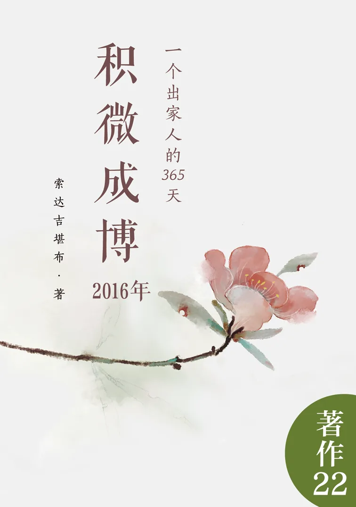

一个出家人的365天

元旦

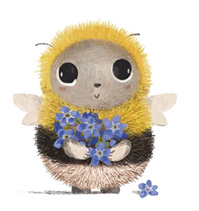

元旦快乐！和平的钟声——索达吉堪布元旦祈愿

今天是非常特殊的日子，每一个人都有许多美好的愿望，也觉得在新的一年当中能实现。尤其大乘佛教的基本理念，是希望每个众生能生起大慈大悲、清净智慧、无上菩提心。

从佛教的观点来看，世界上的所有冲突、仇恨、矛盾，来源主要是自己的心。我们要调伏内心，应该从自己做起，经常观察自身：每天吃饭的时候，尽量减少餐桌上的杀戮；平时跟人交往的时候，尽量不要发脾气，息灭自己的嗔恨心；每一天尽心尽力地想，哪怕是一点点小事，也要去帮助别人。

元旦期间，我在香港，正在祈祷世界和平祈祷度母为主的一切诸佛菩萨，减少世界上的各种冲突、战争，包括一些恐怖袭击等等。

今年也准备在泰国举行“和平之路”的活动，通过各种方式，减少许许多多血腥的行为，增加美好、快乐、和谐、慈悲的力量。希望在新的一年当中，每一个人都身心健康、快快乐乐、一切顺利。

谢谢大家。

Chimes of Peace,

Khenpo Sodargye's New Year Message

At this very beginning of a new year, people gen-

erate many good wishes, expecting to fulfill them

during the new year.

Teaching from Mahayana Buddhism wishes every sentient being could arouse great compassion, pure wisdom and supreme bodhicitta in their mind. From Buddhism's point of view, all the conflicts, hatred and contradiction happening in this world are basically the manifestation of our mind.

In order to tame our mind, we should start from daily behaviour and constantly examine ourselves. At dining table, we should try to reduce the amount of animals slaughtered as our food. When interacting with others, we should try not to lose our temper so as to extinguish the anger inside us. Every day. we should do our bit not to neglect those trivial things to help others.

I am now in Hong Kong over the New Year, praying for world peace, praying to all the Buddhas and Bodhisattvas, particularly Taras, to reduce all these conflicts and wars in the world including terrorist attacks.

This year, we are going to hold an event named "The Way of Peace". By all these means, we wish violent confrontations be decreased; power of kindness, happiness, harmony and compassion be strengthened.

I wish all of you a very healthy, happy and prosperous new year in 2016!

Thank you.

2015-12-31

闭关

独自闭关、翻译的生活，从今天开始~

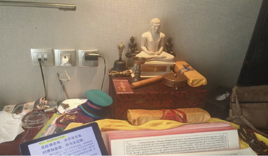

2016-1-6

不动

即使被全世界赞叹，也不应该欣喜，或许赞叹会带来不利；即使被全世界诋毁，也不应该沮丧，或许诋毁会带来好处。

2016-1-7

生日

门措上师是当今公认的女性大德。藏历木羊年十二月初二（公历2016年1月11日），是门措上师的生日，希望大家在这一天尽量放生吃素，多行持善法。  
门措空行母——色达喇荣五明佛学院院长

2016-1-8

了解

“我们科学家去了解佛教修行，佛教的修行者也要开始了解科学。”【独家专访】中科院院士朱清时：我没有盲从佛法而是一直在求证

2016-1-9

长期

现在很多人学佛比较表面，仅仅是依止一位上师，参加两三天法会，听几次佛教开示，办个精美的皈依证……这都无法动摇自己根深蒂固的习气，用不了多久，那些善念就会随环境改变而淡化、消失。

若能对佛法典籍长期熏习，信心会更加坚固，智慧更加深入，慈悲更加广泛，一切修行才会水到渠成。

2016-1-10

分寸

我们做人做事，既要柔和，也要坚强；既要随顺他人，也要有自己的主见。

不过，这中间的分寸很难拿捏，如果没有智慧，该柔和的时候坚强，该随顺的时候固执，这也是一种麻烦。

2016-1-11

观心

电脑不如人脑，人脑不如人心。常观自心，会看到更多精彩的节目哦！

2016-1-12

重要

古人说：“天之道，利而不害；圣人之道，为而不争。”

所以，做人一定要尽量利他，同时不要与人竞争。不争与利他，在我们人生中真的很重要。

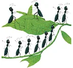

2016-1-14

平衡

很多人都希望，工作、家庭、修心之间可以找到一种平衡。但平衡不能只是一个中心思想，也要体现在各种细节中。

若能善巧应对同事的嫉妒、上司的刁难、家人的过度关心，每次遇到事情，尽量从对方的角度思考，你才能接近你想要的。不然，平衡只是一句空话。

2016-1-18

坚持

很多人的心不稳定，不管做世间、出世间的事，都像蜻蜓点水，缺少一种长期的耐心。

其实，做任何事都不可能顺顺利利，如果你得不到利益就不断换，舍弃之前的积累，一切又从零开始，最后很可能一事无成。

所以，除非你走投无路了，否则，一旦是自己选中的事，最好不要半途而废，只有坚持才能接近成功。

2016-1-20

认识

要想征服自己的妄念，不能靠打压念头，而要靠认识念头。

当我们认识到心念在生起的一刹那，当下即灭，各种执著会自动瓦解，各种不忿会烟消云散。这是消除痛苦最强大的武器。

2016-1-23

深夜

看到夜深人静的星空，会让人身心清净，妄念当下寂灭；看到水中倒映的月影，会让人认清虚幻，不为物欲所累。

2016-1-25

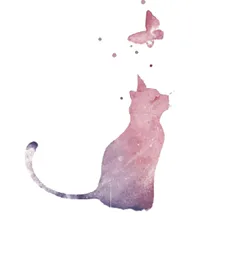

三时

回忆过去有意义，关心未来也重要，活在当下更美好、幸福。

2016-1-27

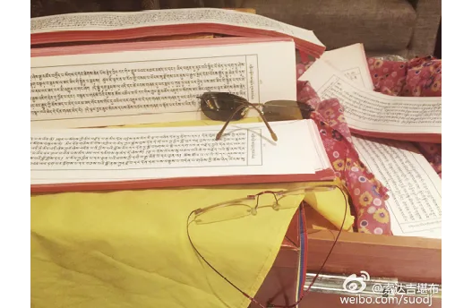

书海

最快乐的生活，是远离烦躁的尘埃，在智慧的书海里游泳。

2016-1-27

深入

不管是学佛还是学知识，放假期间都不能把它丢在一边，否则，过段时间再捡起来会有点麻烦。

我们不要把学习当成包袱，如果深入了解会发现，它是人生最大的享受。

2016-1-30

境界

最高的境界是什么？索达吉堪布：度母温暖世界最高的境界是什么？

2016-1-31

执著

强烈的爱与强烈的恨，在世人眼里，前者应当拥有，后者应当舍弃。而在佛教眼里，这二并没有什么不同，都是一模一样的执著，都会给自己带来巨大的苦，所以都需要避开。

2016-2-1

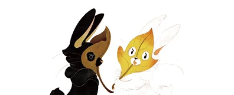

修行

做好事容易，做好人难；说好话容易，存好心难。但就算再难，也要努力地存好心、做好人，这就是修行。

2016-2-5

拜年

金猴年吉祥！这才是真正的过年——索达吉堪布拜猴年三句话，为新年减负

2016-2-5

地震

台湾高雄发生地震了，嗡玛呢巴美吽，嗡玛呢巴美吽，嗡玛呢巴美吽……

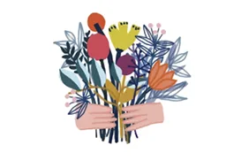

2016-2-6

新年

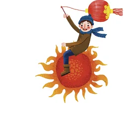

新年来临，祈祷佛菩萨非常重要。

按照古大德的传统，若在今天念满九遍《心经》，并诵莲师心咒“嗡啊吽 班匝儿格热巴玛色德吽”100遍以上，可护佑自己在新的一年里，远离宿怨、违缘、道障，增上顺利、平安、健康。若为亲人朋友祈福，也可依此行持。

祝福大家猴年快乐，吉祥如意！索达吉堪布“莲师七句祈祷文”原声贺岁

2016-2-7

原声

这是法王如意宝的原声祈祷文。一年的第一天若多听、多念，会带来无尽的吉祥。“怀”念 怀业祈祷文查看图片

2016-2-8

过年了

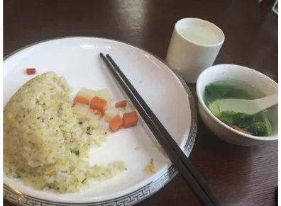

2016-2-8

适度

做什么事情都要掌握分寸。太松不行、太紧也不行，没有观察不行、观察太过分也不行，倘若过于极端，事情不会圆满成功。

2016-2-10

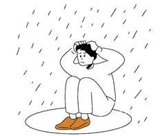

钱权

人活在世上，有钱有权虽会得到一些便利，但对大多数人而言，当钱越来越多、权越来越大时，对取舍也会越来越麻木，不经意就会下造各种业，毁坏自己的未来。

2016-2-11

答复

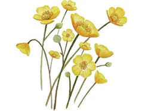

什么是金刚乘？

佛教与其他宗教最大的区别是什么？

叙利亚难民问题，佛教怎样看待？

什么情况下你可以打骂另一个人？

一个佛教徒应如何面对嗔怒？

非佛教徒如何化解生命中遇到的嗔怒、争执或压力？

佛教有没有负面的部分？

佛法到底有多酷？……

这是我对此的简单答复，或许，能给你带来一点启发。不是矛盾，是不同——奥地利ATV电视台采访索达吉堪布

2016-2-12

恒爱

人们很执著爱。世间的爱是，你爱我，我就爱你，你不爱我了，我就恨你；而出世间的爱是，你爱我，我也爱你，你不爱我了，我仍然爱你。但这对一般人来讲很难做到。

2016-2-14

生活佛教

“生活佛教”，会给我们每个人都带来快乐。在这特殊时代，你是一个特殊的人——索达吉堪布谈“生活佛教”

2016-2-16

深广

佛教不但要广，也要深。在这特殊时代，你是一个特殊的人——索达吉堪布谈大乘八宗

2016-2-18

翻译

经过这段时间白天晚上的努力，今年的翻译终于完成了。其实，学习一本书容易，但翻译一本书还是有点难，需要翻阅大量相关资料，保证很多词句、意义的准确性。

从今天开始，我在一段时间内，要以另一种形式闭关，可能不能发微博了，特此请假，请大家谅解。

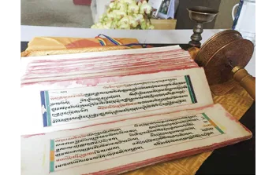

2016-2-19

起止

这是修心的起点，也是终点。索达吉堪布著名译作《大圆满前行》隆重上市

当当；京东；亚马逊；文轩大圆满前行 华智仁波切著 索达吉堪布译 释修…；博库正版现货 大圆满前行：普贤上师言教 华智仁波…这是修心的起点，也是终点

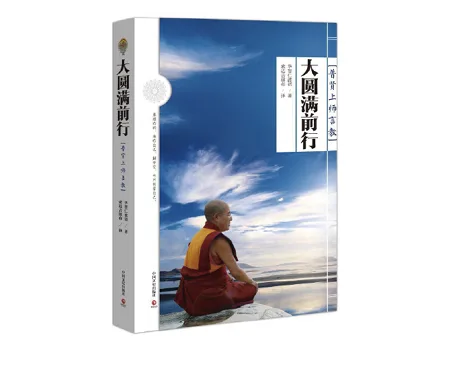

2016-3-14

交融

有人认为，东方是“陆地农夫”文化，西方是“海洋渔夫”文化。

当这两种文化开始交融时，我们要有什么样的心态呢？法国巴黎演讲：东方智慧和西方生活（节录）东方智慧和西方生活——索达吉堪布法国巴黎演讲（摘录）

2016-3-21

发现

佛法所讲的一切，不是佛陀发明的，而是佛陀发现的。

它不会因佛陀圆寂而减少，也不会因佛陀降生而增加。

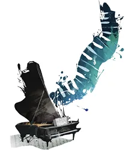

2016-3-22

是梦

人们特别羡慕和追求的爱情、钱、官位，得不到时日思夜想，一旦得到了就会发现，它并不像预期那样给自己带来巨大的快乐，反而会平添许多烦恼，让自己动不动就患得患失。

更让人伤心的是，不但拥有它的过程如此煎熬，而且到头来，什么都不会长久，一切都是一场梦。

2016-3-23

淡定

修行人在生老病死面前应该淡定。佛法中有很多内容，是训练我们如何面对生死。如果遇到这些就手忙脚乱，说明你的修行不深入。

所以，不管面对自己的生死，还是亲友的生死，都应看作检验修行的一面镜子。

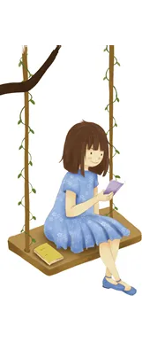

2016-3-24

偶遇

我们在生活中，经常依靠一个偶然的机会，改变了命运。意大利都灵公开演讲：生命中的偶遇（节录）看不见的缘分——索达吉堪布带你看命运的星空（节录）

2016-3-27

母亲

母亲给我打电话说，我们有四个多月没见面了。

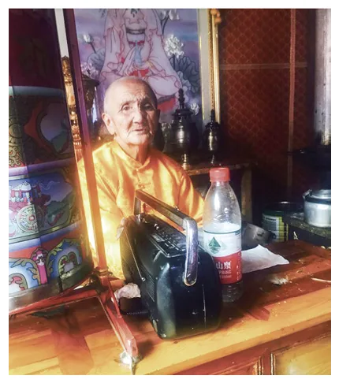

2016-4-2

超度

嗡玛呢巴美吽~穿越迷雾森林 索达吉堪布超度日本“自杀圣地”【清明】带你穿越一座迷雾森林——索达吉堪布超度全球著名的“自杀圣地”

2016-4-3

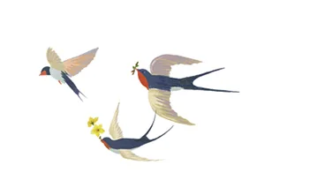

清明

清明节，也是感恩节。我们不但应追念已故去的先人，也应感念那些仍活着的恩人。

2016-4-4

教育

现在的教育，是以自我为中心，让人精于自我成功、自我宣传，但有“我”一定是痛苦。

佛陀的教育，是以无我为中心，让人认识到“我”只是虚假的概念，没有“我”，何来“我”的痛苦？

2016-4-5

辨别

一个人要胸怀宽大，但宽大不是狂妄；要心思细腻，但细腻不是琐碎；要品味清雅，但清雅不是单调。

2016-4-7

空性

在佛教中，用空性可对治实有，但最后，空性也是空性的。就像洗衣服时，用洗衣粉可去掉污渍，但最后，洗衣粉也不能留。

2016-4-8

冲动

刚开始学佛不能太冲动不负如来不负卿——索达吉堪布巧谈在家学佛

2016-4-9

希望

我希望：当绚烂的阳光照耀大地时，我的智慧融入阳光，消除所有生命的无明黑暗；当清凉的月光遍撒大地时，我的悲心融入月光，遣除所有生命的烦恼酷热。

2016-4-10

记住

做人要记住一个字：稳

做事要记住两个字：分寸

修行要记住三个字：菩提心

2016-4-11

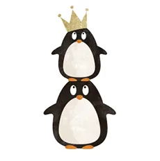

大小

你的心越大，有些事就越小。

以前折磨你的，现在就烦不着你了。

2016-4-14

虚幻

不管醒来或是梦中，本质都是一场虚幻。

所以，做一个噩梦没什么关系，醒来后另一种梦就开始了；做一个好梦没什么意义，醒来后另一种梦又继续了。

梦中忆梦，梦里说梦，何时才能彻底清醒？

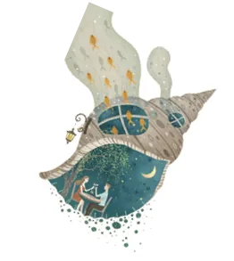

2016-4-17

基础

修行要建立在善良的基础上，若连基本的人格都没有，更高的境界无从谈起。

就像没有良田不可能出生庄稼，人都做不好，甚深的修行根本谈不上。

2016-4-19

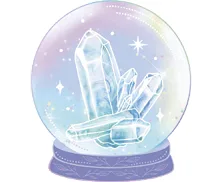

鲜活

不管我们活多久，这都是新鲜的话题，永不过时。荷兰鹿特丹公开演讲：慈悲与智慧你不爱我，我依然爱你——索达吉堪布教你如何爱

2016-4-20

欲望

我们因欲望而生烦恼，因欲望而生恐惧。若能从欲望中解脱，就会没有烦恼，也没有恐惧。

2016-4-22

孩子

每个孩子纯净的天空里，都有一个美丽的梦想。我们应该帮他们实现~@索达吉藏文化《卓玛的祈祷》朱倭拉姆卓玛

2016-4-24

人心

人心要虚，不然很难容纳别人的意见；

人心要实，不然很难抵挡外在的诱惑。

人心要硬，不然很难扛住人生的风雨；

人心要软，不然很难生起真正的悲心。

2016-4-26

改签

人在气头上，往往控制不住情绪，所做的事、所说的话，事后非常后悔。

所以，我想给大家一个方法：如果你特别想吵架，不管跟谁，能不能先缓缓，让自己明天再吵？

若能把“今天吵”改签成“明天吵”，有些事也许就不一样了。

2016-4-28

读书

万般皆下品，惟有读书高。

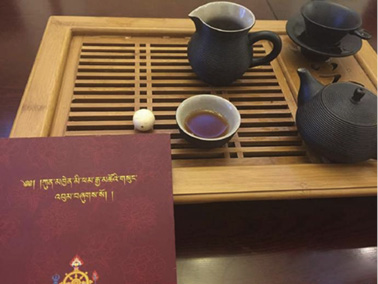

2016-4-29

听法

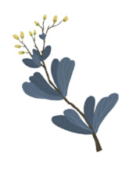

听法功德，于一切功德，最胜最上。

——《正法念处经》

2016-5-2

财富

不少人认为，所有的幸福建立在金钱上，只要有钱，快乐就没有任何问题。

是这样吗？奥地利维也纳公开演讲：什么是最大的财富每个人都富可敌国——索达吉堪布教你点金术

2016-5-4

献花

今天看到一池莲花，很美，献给你，让你开心笑一下

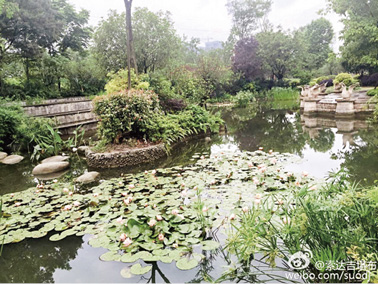

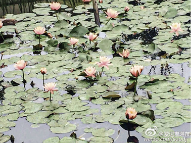

2016-5-6

说话

说话是个技术活儿，平时跟别人交流，要懂得“点到为止”。

自己在乎的事情，不管是好是坏，都不能喋喋不休一直讲，丝毫不在乎对方感受。说话能否让人舒服，是对情商的一个考验。

2016-5-7

问候

美国历史上第一次以总统名义给全球佛教徒发的佛诞节问候

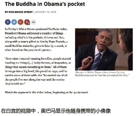

2016-5-8

祈祷

南无本师释迦牟尼佛

南无善名称吉祥王如来

南无宝月智严光音自在王如来

南无金色宝光妙行成就如来

南无无忧最胜吉祥如来

南无法海雷音如来

南无法海胜慧游戏神通如来

南无药师琉璃光如来

2016-5-10

药师七佛

十年

十年。【索达吉堪布】时代微纪录 十年回家路

2016-5-11

忏悔

5月14日至21日（藏历四月初八~十五），喇荣五明佛学院将举办为期8天的金刚萨埵法会。

念修金刚萨埵心咒“嗡班匝儿萨埵吽”，是忏悔业障最有力、最灵验的法门。若能念诵40万遍，即便是最难忏悔的罪业，也能得以清净。任何人想参与都可以，即使8天内无法念完，尽快完成即可。

2016-5-13

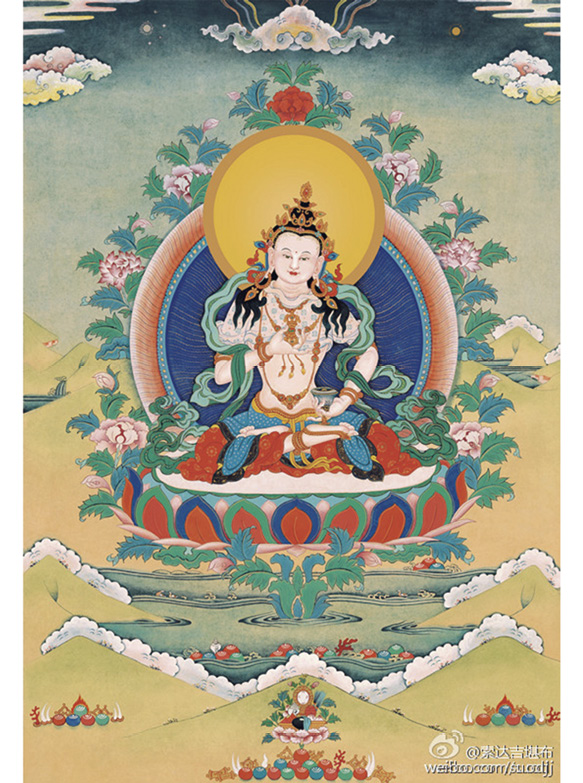

金刚萨埵

细节

现在很多人看了一些影视剧，就开始学着里面人物的样子，察言观色。结果变得非常多疑、敏感。

其实，透视一些细节窥测人心，虽然有道理，但也不是完全准确，弄不好的话，很容易把一个大象尾巴当成整头大象。

所以，我们最好不要总盯着别人的一些细节，否则，这种不正常的习惯会让别人痛苦，自己也痛苦。

2016-5-15

参与

明天（5月21号）是“金刚萨埵法会”最后一天，佛学院全体僧众将共诵《药师七佛经》，网上也会同步直播，欢迎大家参与共修。

2016-5-20

四座

第一座07：00-09：00，第二座10：00-12：00，第三座14：00-16：00，第四座17：00-19：00（大回向）

2016-5-21

不实

在我们眼里的一些天大的事情，如果换一个角度，或者换一个人来看，也许微不足道，甚至根本不存在。

所以，痛苦并非实有，只不过是执著产生的。

2016-5-23

利生

真正的学佛，应该是利益众生，而不是变得神神叨叨；应该让自己成为周围环境中最好的那个人，而不是最奇怪的那个人。

2016-5-25

安忍

修安忍必须依靠众生，没有众生的损害，对谁生起安忍之心？

所以，如果有人伤害你，这是修安忍的最好机会，不能以牙还牙。

2016-5-27

情绪

胜爱论师在《百论》中说，有些人的性格，就像秤杆，因为一点点重量，就忽高忽低。这样的人，自己不幸福，周围的人也反感。

所以，我们要善于控制自己的情绪，不要因为一些微不足道的小事，就让生活大起大落。

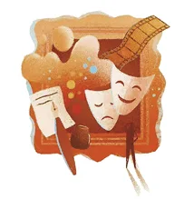

2016-5-28

净土

现在的喇荣，心中的净土。

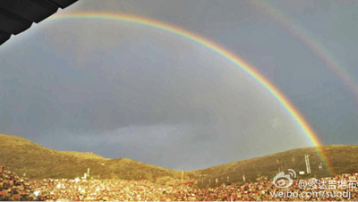

2016-5-28

修禅

若能长期修禅，心性就会寂静，即使发生再大的事，也不会觉得天塌地陷，更何况是区区小事了。

2016-5-30

随行

如影随形~一则小故事

师父说：“我从来没离弃过你……”徒弟疑惑地说：“可在我最生不如死的日子里，梦里明明只有我自己的一排脚印啊。”师父说：“在你生不如死、最软弱的日子里，的确只有一排脚印。那一排脚印不是你的，是我的。在那些日子里，是我把你背在我背上，扛着你走那段最难走的路的……”

2016-5-31

过节

在我的人生中，第一次过儿童节是16岁。因为上学晚，我这个已算不上儿童的儿童，混迹于一群真正的儿童中，在学校得到了一份让人兴奋的礼物：一碗酸奶、两颗糖。到了晚上，我跟同学们围着篝火跳着舞。

当时没什么化妆品，我就用炭在脸上随便一画，登台给大家献歌，“我们是同一学校，丫丫几所……”如今，这一份记忆依然崭新。不知你的儿童节过得如何？祝每一个曾经的儿童和现在的儿童吉祥快乐！

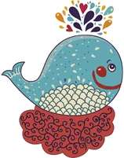

2016-6-1

足矣

清风明月，山川河流，

日月星辰，都是免费的。

人生不需要太多，身心自在，足矣。

2016-6-2

离世

我的大恩母亲仁措，今早8时离开了这个世界。请有缘者为她念百遍以上观音心咒“嗡玛呢巴美吽”或放点生。

2016-6-5

传法

今天我开始传讲“经中之王”——《妙法莲华经》。

希望大家有条件的话，尽量听受圆满。即使条件不具足，哪怕听一节课也可以，因为这部经功德极大，对你的利益不可思议。

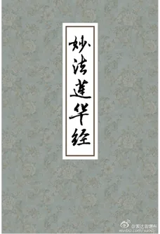

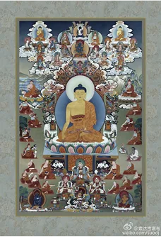

2016-6-6

完美

每个人都在追求完美，却不知在获得完美的这条路上，有无数的荆棘、野兽。

如果你对此没有心理准备，不考虑如何面对“苦”，只想着如何享受“乐”，那你最终得到的，一定不是你想要的。

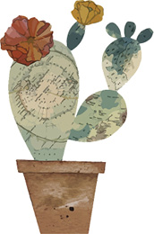

2016-6-9

立场

人必须要有自己的立场，凡事不能人云亦云。

即使全世界的人都赞叹，我们也应保持冷静；即使人人都提出非议，我们也不要沮丧。

2016-6-10

天葬

天葬，嗡玛呢巴美吽~

2016-6-11

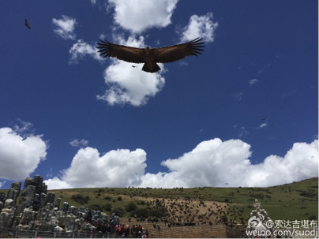

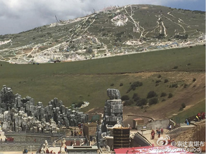

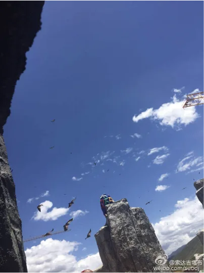

无憾

因为爱，所以用最好的方式去爱。此生无憾 索达吉堪布最后一次听阿妈说

2016-6-14

计较

为人处世，不可为“我”斤斤计较，有时放下“我”反而能解决问题。

2016-6-19

换位

生活中的很多纠纷，都因为只站在“我”的角度去看问题。

若能换位成“你”的角度，甚至更高一点——超越“你”“我”的范畴，换成“道”的角度，一切都会豁然开朗，万里无云。

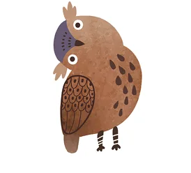

2016-6-25

今天的喇荣

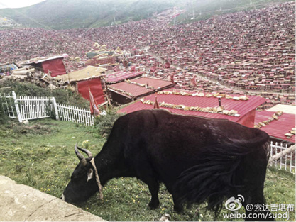

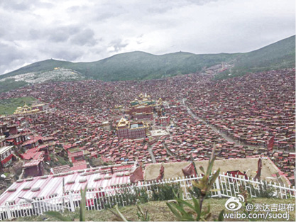

2016-7-7

声明

非常随喜汉地各位大德的护教之心！这次法华版本之辩，无意引起诸多争论，如果大家对我有很多意见，在此真诚地忏悔。既然大家对根据藏文版调整的《法华经》有争议，我可以一字不动，按照鸠摩罗什的原版传讲，之前的版本不再流通。

弘扬八宗，本无轻毁汉传各派之心。我本人学修宁玛派，但也曾传讲格鲁、噶举、萨迦、觉囊等诸派教典，从未敢认为对方教中无人，唯我一人能讲法。汉传弘扬藏传，藏传弘扬汉传，本属正常，但如果汉地诸大德认为我弘扬八宗不妥，我也可以退出。

网上信息真真假假，希望大众身心清净，把宝贵的人身用来闻思修行、弘法利生，不要在我这个微不足道的人身上浪费时间。

索达吉顶礼

2016.7.8

2016-7-8

在哪

过去的你，已经消失了；

未来的你，还没有出现；

现在的你，刹那都在变化。

真正的你，到底在哪里？

2016-7-9

生活

英国作家萨克雷说：“生活就是一面镜子，你笑，它也笑；你哭，它也哭。”

2016-7-16

当真

广阔的天空中，乌云不会停留太久，它来自于天空，也消失于天空。

同样，一切烦恼也并非实有，它来自于法界，也消失于法界。之所以能带来痛苦，是因为你把它当真了。

2016-7-21

岁月

在新加坡大众佛学会，看到了20多年前我随上师如意宝一起来新加坡的照片。岁月~

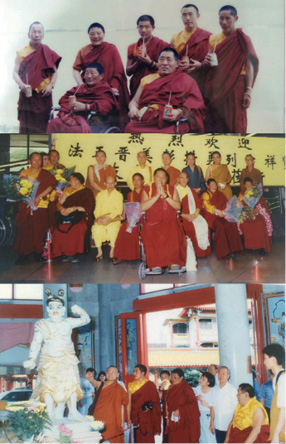

2016-7-21

木屋

又回到自己的小木屋

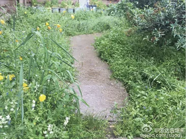

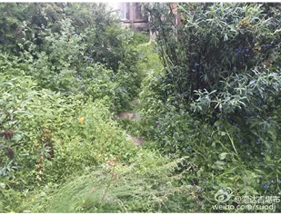

2016-7-24

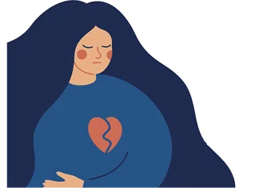

希忧

一切的痛苦，来自希望和担忧。

这两者又来自我们的心。

心的本体到底是什么呢？

2016-7-26

想换

当我们在新闻里看到一个人的痛苦遭遇，或仅从别人口中听到时，只感慨几句“他太可怜了”，这是远远不够的。

我们应该把自己想象成那个人，试着去体会他所经历的一切绝望与恐惧，哪怕你的想象力有限。通过这样再三的练习，我们这颗冰冻的心才会开始融化，解放出它本有的爱与慈悲。

2016-8-1

地藏

8月3日-10日佛学院在举办“地藏法会”。若虔敬祈祷地藏菩萨，念诵“南无地藏菩萨”或地藏心咒，有助于增长财富、寿命、福报、智慧等，容易实现一切所愿。

其中8月6日（藏历六月初四）是释迦牟尼佛初次传法的纪念日，行善功德不可思议。望大家尽量用最适合自己的方式，如放生、茹素、念经、持咒等，积累善法功德，并请不要伤害任何一个众生。

2016-8-5

地藏菩萨

境界

人一忙起来，值得欢喜和痛苦的事都忘了，什么病痛和烦恼都没了，这是一种境界吗？

2016-8-3

戒律

戒律是保护自己的最好工具。

没有它的话，你今天太自由了，明天可能就不自由。而今天暂时不自由，明天也许会很自由。

2016-8-8

誓言

我不曾远离那些信仰我、甚至不信仰我的人，虽然他们没有看到我，但我的这些孩子们，将永远受到我慈悲心的保护！

——莲花生大士一千多年前许下的誓言

2016-8-13

离苦

快乐与痛苦，是永远都分不开的伴侣。如果你追求快乐，痛苦必定买一送一，免费赠送。

只有懂得随缘，断除了“一定要快乐”的念头，这才是远离痛苦的开始。

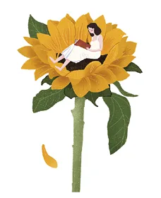

2016-8-16

梦见

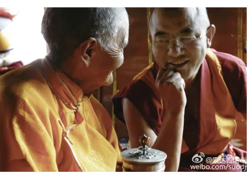

见到了好久不见的妈妈，她用温暖的手摸着我的脸，亲切地跟我说着话……就这样醒了，原来是一场梦。

妈妈，很想在现实中再见您一面，我还有好多话没有说。嗡玛呢巴美吽~

2016-8-18

上师

时时不忘祈祷上师，喇嘛钦

2016-8-23

智慧

有智慧的人，不但知道自己要什么，更知道自己不要什么。

越是懂得哪些是不需要的，让自己不受诱惑干扰，才越有把握找到真正想要的东西。

2016-8-26

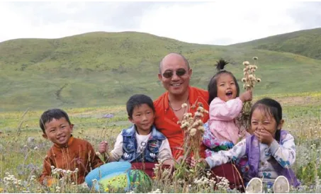

今秋

秋天，今天……

2016-08-28

日食

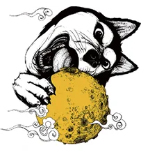

明天（9月1日，藏历六月三十）有日食，北京时间为14：13-20：00。

《时轮金刚》中说，出现日食或月食时，无论作何善行，功德均增长成千上万倍。望大家把握机会多行善法，如供灯、放生、念经、闻法、修行等，为利益众生而积累资粮。

2016-8-31

组合

人生有成功，就会有失败。人们追求向往的成功，往往是磨难、挫折的组合体，只不过很多人看不到罢了。

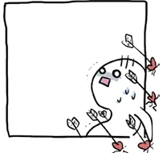

2016-9-4

善恶

人，可以沦为至恶，也可以成为至善。怎么选择，决定权在你。当然，不管你以前选了什么，只要想改变，一切还来得及。

2016-9-6

星现

据佛典记载，药王星每年会出现7天，此时依靠它放光和药师佛的加持，江河湖海等一切水源皆具药性，若用来沐浴，对遣除疾病、身心健康有极大利益。藏地大德历来对此比较提倡。

今年9月8日～9月14日，正值药王星当空，望大家勤洗澡、多淋雨，观想药随水流下来，病障、业障顺着全身毛孔排出去。同时，多念“南无药师琉璃光如来”或药师心咒。

2016-9-8

上师

在家庭的乐园里，父母是第一任老师；

在学校的乐园里，师长是我们的老师；

在社会的乐园里，智者是我们的老师；

在心灵的乐园里，上师是我们的老师。

感恩您们一路上的指点、开导，

教师节快乐！想念上师

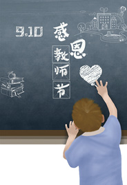

2016-9-10

仲秋

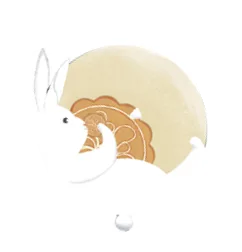

你我虽然相隔千里，今夜一抬头，却可看到同一个月亮。

当你看到它时，希望可以看见我的祝福——愿你的智慧、慈悲、福德、安乐，如上弦月般日渐增上，终似今晚月亮一样圆满。仲秋节快乐！

2016-9-15

讲闻

两个人在一起时，做什么事情功德很大？

一个讲法，一个听法。

《大法炬陀罗尼经》云：“若人常说法，若人常来听，如是二种人，咸得无量福。”

2016-9-17

道歌

今天是法王如意宝撰写《胜利道歌》20周年的纪念日。胜利道歌

胜利道歌

法王如意宝晋美彭措·著

索达吉堪布·译

怙主诸佛智慧身，文殊室利童子尊，

恒住八瓣莲蕊心，所言愿利诸有情。

甚深光明大圆满，仅闻词句断有根，

六月修要得解脱，唯此铭刻于心中。

遇此胜法善缘众，前世累劫积资果，

与普贤王同缘分，诸道友当生欢喜。

为沉恐怖轮回众，获得永乐之佛果，

当负利他之重任，舍弃爱自如毒食。

以此可阻恶趣门，亦可获得善趣乐，

趋至究竞解脱地，切莫散乱修此要。

于诸轮回之盛事，不起羡慕之心念，

当持人天供养处，殊胜严饰之净戒。

一切增上定胜乐，悉皆依此而生故，

倘若破戒堕恶趣，切莫迷惑当取舍。

言行恒时随顺友，秉性正直心善良，

若欲长久利已者，暂时利他乃窍诀。

此乃清净人规法，三世诸佛方便道，

亦为四摄之精华，诸位弟子切莫忘！

以此善根愿诸众，超越轮回之深渊，

令诸心子皆欢喜，往生西方极乐刹。

2016-9-21

脆弱

现在很多人有点脆弱，被在乎的人冤枉一下、质疑一句，就认为对方不信任自己。其实别人是否信任你，哪有这么容易判断？

通过一句话就知道别人心的，是电视里的场景。何况人心随时在变，他都不一定信任自己，今天想的明天就后悔了，又怎么可能完全相信别人。

所以，不要因为一句话就上纲上线，有玻璃心的人会很痛苦。

2016-9-29

教言

击中要害的批评，是最殊胜的教言。指摘弟子过失的师父，是最好的上师。

——阿底峡尊者

2016-9-30

开心

开

2016-10-1

语音

要辨别一个人，不能单凭他的语言。不要因为他很会说，就认可他的一切；因为他不会说话，就不采纳他的意见。

愚笨者讲的话，偶尔也是对的；聪明人讲的话，有时也是错的。孔子也说：“不以言举人，不以言废人。”

2016-10-15

调心

通过佛陀的方法调节内心，最终不是要把我们变成一个无情无欲、不哭不笑、什么念头都没有的木头怪人，而是让我们看清每个念头的的本质，从此不再受控于它，甚至还可以跟它一起游戏。

2016-10-19

念头

没有一个敌人在折磨你，真正折磨你的，是你自己。

准确说，是你的念头。

2016-10-21

结缘

10月15日，朵芒寺的阳塘活佛示现圆寂。他是这个时代非常难得的修行人、大成就者，寺院正在举行49天的祈祷法会，祈愿他早日乘愿再来。

望大家也多念《普贤行愿品》，行持放生、供灯等相关善法，与之结上殊胜因缘。

2016-10-24

采访一

一次难忘的“采访”消失的“砖头”——“记者”索达吉堪布采访校长朱清时①

2016-10-30

采访二

冰毯在身上烤干了冰毯在身上烤干了——“记者”索达吉堪布采访校长朱清时②

2016-10-31

采访三

一只生死未卜的猫一只生死未卜的猫——“记者”索达吉堪布采访校长朱清时③

2016-11-1

闭关

从今天开始，色达喇荣五明佛学院的全体僧众，进行为期一个月的闭关。

去年闭关修的是三根本中的上师，今年开始修本尊，随喜功德。

2016-11-1

不离

今天翻译了法王如意宝的一段教言，供养大家：

乐时一起笑、苦时一起哭的兄弟姐妹，请不要伤心，我们不管怎么样都很快乐。

要想到誓言的金线把我们连在一起，情意把我们如水乳般融在一起，无论感受怎样的苦乐，以业缘相会的师徒永不分离。将文殊菩萨的密语记在心里，一处又一处地观赏轮回的幻化城市，这是多么幸福啊！

土兔年藏历元月一日，以某因缘触动，阿旺罗珠宗美（晋美彭措）即兴而唱。愿吉祥。

索达吉译于2016年11月2日

2016-11-2

拜见

今天我们拜见了门措上师，聊了许多事情，很开心

2016-11-3

特质

有了坚定的心，不会半途而废，逐渐会有好的结果；有了宽容的心，不会斤斤计较，恒常给自他带来快乐；有了精进的心，不会一曝十寒，做事长期会保持激情。

我很欣赏这三种特质，但凡这世上成功的人，应该都离不开它。

2016-11-4

采访四

读取命运的U盘读取命运的U盘——“记者”索达吉堪布采访校长朱清时④

2016-11-6

忍受

有人对米拉日巴尊者说：“您一生闭关，能忍这么多的苦行，真不容易啊！”

尊者回答：“你们更能忍啊。我只是忍这一生，你们却能忍受生生世世。”

2016-11-9

再见

来也匆匆去也忙再见松花江

2016-11-13

采访五

马克思到底怎么说？马克思到底怎么说？——“记者”索达吉堪布采访校长朱清时⑤

2016-11-14

才智

身体的美，若不与聪明才智相结合，是某种动物性的东西。

——古希腊哲学家德谟克利特

2016-11-15

力量

每个人心里潜伏着无穷的力量，只要自己不颓废绝望，不断酝酿内在的智慧、善良、慈悲，今生就没有到不了的目标，迟早会成为心灵上的“土豪”。

2016-11-16

长期

修行需要花大量的时间和精力沉淀。如果没有长期闻思的底子，一时热情起得很快，落得更快，遇到一点逆境，什么境界都会一扫而光。

2016-11-17

采访六

剧毒的珍宝药丸剧毒的珍宝药丸——“记者”索达吉堪布采访校长朱清时⑥

2016-11-19

贤善

法王在《教诲甘露明点》里讲过，人格贤善有七个方面：心地善良、无狡诈、性格好、有远见、稳重、包容、智慧。

2016-11-19

天降

今天是“天降日”，希望大家念108遍释迦牟尼佛心咒：嗡 牟尼牟尼 玛哈牟尼耶索哈。

2016-11-20

发心

发过菩提心的人，至少应无条件承担弘法利生的一两件事。一般人为了自己的蝇头小利，尚且能披星戴月辛劳忙碌，利益众生的大事就更值得付出了。

倘若以各种借口从发心中退下来，或者从来也不愿发心，这种人除了在懈怠无聊中度日，闻思修上也没有发现更大的进步。

2016-11-21

镜子

这是一面镜子，希望我们每个人都照一照——

有一次，苏格拉底趟水过河，脚一滑，落水了。他拼命地挣扎，大喊救命。不远处有个钓鱼者，不仅不帮助苏格拉底，反而转身就走。最后是他的学生救了他。

后来，那个钓鱼者趟水过河，也落水了，他拼命地挣扎，大喊救命。苏格拉底和他的学生正巧在河边散步，便用竹竿把他救了上来。

当学生知道救上来的人就是上次那个钓鱼者时，非常后悔，苏格拉底却说：“不，应该救他。这正是我们和他的区别。”

2016-11-23

正反

很多人认为，幸福生活不能有任何负面的东西。

但实际上，万事万物是由正反两方面所组成，苦与乐、成与败都是幸福生活的一部分，如果追求一个，却排斥另一个，就如同只要白天、不要黑夜一样，这样的幸福根本不存在。

因此，我们要学会接受生活的全部。

2016-11-24

偷闲

忙中偷闲，与书对话~

2016-11-27

对准

用显微镜对准自己的过失，用放大镜对准别人的功德，别常常对错哦~

2016-11-28

家务事

十年前见到本焕老和尚，那是我们第一次见面，也是最后一次。

老和尚一句“弘法是我们的家务事”，多年来言犹在耳，一直回荡在我心里。网页链接

2016-11-29

荐书

这是一本很有意思的小书。你平时想不通的问题，也许在这里就有现成答案，让你在思考事情时多个角度。推荐大家看一看。

2016-12-1

承诺

让我们一起共同承诺，终生学习，终生修行，终生利他。乃至生生世世。

2016-12-2

采访七

假如释尊还在人间假如释尊还在人间——“记者”索达吉堪布采访校长朱清时⑦

2016-12-3

最佳

给后代留下精神财富，是最佳的选择。捐出3600亿家产！这位佛教徒的大愿，是要建立一个没有疾病的世界

2016-12-4

体会

今天对照藏文的《教王经》，看了一遍其汉文版本的《如来示教胜军王经》，自己有三个体会：

1．不管是什么身份的领导，都要如法行持，不能做非法；

2．一切都是无常的；

3．死时什么也带不走。强烈推荐每个人看一遍，并结合自身潜心体会。

2016-12-5

佛经

近来翻译了一部佛经，法王如意宝当年极为推崇，望大家依此修行。圣大乘临终智慧经

2016-12-6

互动

与九零后的互动最新视频抢鲜看！索达吉堪布仁波切VS九零后“小鲜肉”

2019-12-8

放生

2016年“智悲百日大放生”，今天圆满了！

这次放生，大家按照科学化、合理化、小型化、规范化、清净化的原则，做得很如法，我很欢喜，非常随喜大家的功德。

届时，放生总数将会请僧众进行回向，祝愿世界和平、众生安乐。

2016-12-9

选择

如果选择君子之道，纵然命运多舛，这种遭遇也不会长久；如果选择小人之行，即使一直走大运，这种福报也不会延续。

自然规律即是如此，古人也说：“君子不长衰，小人无久运，道之故也。”

2016-12-10

融入

我们跟不同的人说同样的话，可能有人很反感，有人却说有内涵。可见，每个人的心是不一样的。

如果你凡事只以自己的标准为标准，对自己不喜欢、不熟悉的东西一概贬低，那生存空间会越来越窄。

所以，面对“不同”，即使你无法理解，但也应学会融入。

2016-12-12

上师

上师，您在我身边时，我的眼一直系在您色身的微笑上；您不在我身边时，我的心一直系在您法身的微妙上。

您从来没有离开过我，不离~

2016-12-13

传承

昨天我回到藏地，因为时间关系，连夜听了《大方广善巧方便经》等几部经的传承。

《大方广善巧方便经》所讲的是利根者的境界，一般人很难通达，对密宗行为难以接受的人，值得研究和学习一下。佛说大方广善巧方便经

2016-12-16

修学

轮回中的孩子，跟他一起，用他喜欢的玩具来玩，他一定会很开心。

但长期这样，并没有这么多时间。为了大家早日成熟，还是需要深入修学。

2016-12-16

痛苦

太执著自己，会产生痛苦；太执著于自己的方式，也会产生痛苦。

2016-12-19

金子

免费送你金子啦~圣大乘金子经

2016-12-20

圣大乘金子经

索达吉堪布·译

顶礼诸佛菩萨！

如是我闻，一时佛在衹树给孤独园。

尔时具寿阿难白佛言：当如何观菩提心？

佛告言：具寿阿难，当观菩提心如金子自性。犹如金子自性清净，菩提心亦自性清净；犹如金子虽经巧匠不同打造而自性不变，菩提心虽现种种殊胜功德，而胜义菩提心如如不动，自性不变。

尔后佛说偈言：清净菩提心，精勤自他利，观修无实性，信解生慧因。

佛说此经已，具寿阿难及众眷属，天人、非天、乾达婆等，一切大众随喜称叹世尊所说。

圣大乘金子经竟

想念

跟上师德巴堪布在一起的生活，多么美好！想念上师！

2016-12-21

福报

铃儿响叮当，福报一大筐。快乐这世界的快乐——索达吉堪布送福报

2016-12-25

相遇

与香港卫视的一次相遇：我们的时代网页链接

2016-12-29

本质

认清万法的本质是空性，现象是虚幻，就会对世间一切快乐不起羡慕，一切痛苦不受折磨。

2016-12-30
