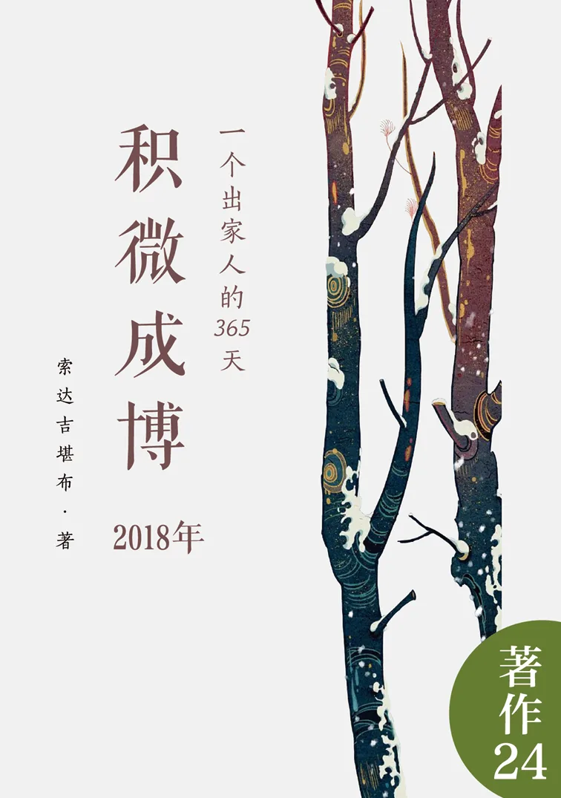

一个出家人的365天

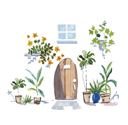

新年

今天是2018年公历第一天，按照藏地传统，一年之始若诵若听《圣八吉祥颂》，可为这一年增上吉祥。

元旦快乐！《圣八吉祥颂》原声首发 索达吉堪布新年祝福查看图片

2018-1-1

上师

上师，您离开已经整整14年了！

您的笑容，时时浮现在我眼前，

您的妙音，时时回荡在我耳边，

您的加持，时时在滋润我心田，

喇嘛钦……

2018-1-1

初心

前不久在挪威看到一个纪念品。一打眼很好看，让我产生强烈的购买欲，甚至想一辈子带在身边。但买下来后，过几天又不喜欢了。

人心就是这么无常，得不到时，特别想要，一旦拥有，感觉并没有那么好，甚至觉得很后悔。

所以，有些时候，初心不一定可靠。

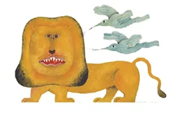

2018-1-9

念诵

藏历有各种不同算法，按照其中一种，今天是年末29日。若能在黄昏念9遍《心经》（或《心经回遮仪轨》），可以解除下一年以死亡为主的难关。

2018-1-15

闭关

最近我以闭关方式在修行。佛法的伟大不是停留在语言文字上，必须通过亲修实证，才可品出其中真味。

许多人也曾承诺一年根据自己的情况闭关3天、7天、30天、100天等，希望大家不要忘记。

《华严经》中说：

比如聋乐师，能令他众乐，然自听不见，

不修法亦然。河中大海上，具船之舟子，

能度载他众，然自葬其中，不修法亦然。

比如糖甜味，说不能感受，咀嚼可品味。

如是空性味，说不能感受，以修可品味。

2018-1-16

生日

今天是门措上师的生日，请大家多行善法，祈愿上师法体安康，利乐有情。网页链接

2018-1-18

梦幻

人生，就像看一场电影，大悲大喜后，终要曲终人散。不要妄图从一些片段中抓住永恒，有生必有灭，有高就有低，一切都是梦幻泡影。

2018-1-24

幸福

认识到幸福并非永恒存在，这是最大的幸福。

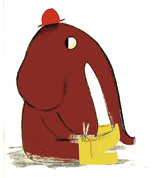

2018-1-25

祈祷

今天我看了阿底峡尊者的传记，他为了依止金洲上师获得菩提心的修法，在海上漂泊了13个月，经历千难万险、九死一生。

有一次，尊者遇到海难，船眼看着要被巨浪掀翻。他一心祈祷度母，突然出现21位女性，救了所有人，然后又不见了。

这个度母祈祷文是：

འཇིགས་པ་བརྒྱད་སྐྱོབ་མ་ལ་ཕྱག་འཚལ་ལོ། །བཀྲ་ཤིས་དཔལ་འབར་མ་ལ་ཕྱག་འཚལ་ལོ། །ངན་སོང་སྒོ་འགེག་མ་ལ་ཕྱག་འཚལ་ལོ། །མཐོ་རིས་ལམ་འདྲེན་མ་ལ་ཕྱག་འཚལ་ལོ། །རྟག་ཏུ་ཁྱེད་ཀྱི་སྡོང་གྲོགས་བྱས། །ད་དུང་ཐུགས་རྗེས་བསྐྱབ་ཏུ་གསོལ། །

我把它翻译成汉文，就是：

“顶礼救护八难母，顶礼吉祥炽燃母，

顶礼免堕恶趣母，顶礼引导善趣母，

祈愿时时予护佑，不舍慈悲恒救度。”

我从小是听着这个祈祷文长大的，父母在家经常念，藏地家家户户也都会念。不管什么人，当遇到一些困难时，以此祈祷度母，加持力非常不可思议。

2018-1-26

好坏

当你成功的时候，人人都会赞美，其实你不一定那么好；

当你失败的时候，人人都会轻贱，其实你不一定那么差。

2018-1-27

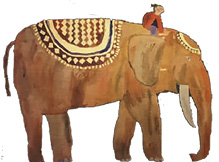

修行

为什么我们迷茫，因为没有好好学习；

为什么我们烦恼，因为没有好好修行。

2018-1-29

念诵

今晚19：48-23：12是月全食，修行功德极大，希望我们每人至少念一千遍观音心咒、一遍《普贤行愿品》。如果你愿意参与共修，请给这条微博点赞，届时我会一起回向。

2018-1-31

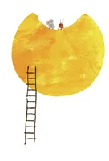

回向

随喜功德，回向善根，如你所愿~

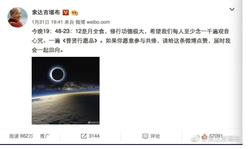

2018-2-1

真正

真正的修行人，一人独处也可以，身体坐得住，心能专注所缘；与人共处也可以，让每个人觉得很舒服，跟什么人都合得来。

2018-2-3

目的

我们修行的根本，就是证悟般若空性。

其他的包括禅修、念经、供灯、朝圣、闻思修，都是它的助缘，不是目的。

2018-2-4

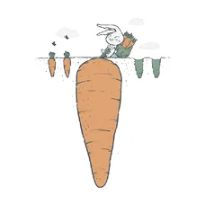

坚持

藏族有句俗话：从多康到拉萨，要经过一座一座山，不管上山还是下山，都在接近拉萨的路上。

修行也是一样，若能努力修行、坚持不懈，无论身处顺境还是逆境，都在通往觉悟的路上。

2018-2-10

除灾

今天按照藏历正式算法，是十二月二十九，农历也是除夕的前一天。依照藏传佛教的习俗，今天黄昏若能念诵9遍《心经》，除非是寿量已尽者，否则明年的18种横死等灾祸都能遣除。

民间也有种说法是，阎罗卒会在今天登记下一年死亡者的名单，自己的死难，以《心经》的般若之力即可解除。

现在，朵芒寺僧众正在举办新春祈福法会。如果你能念9遍《心经》，请在微博下点赞，届时我会请僧众一起回向。

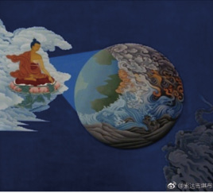

2018-2-14

心经

唐玄奘·译

观自在菩萨，行深般若波罗蜜多时，照见五蕴皆空，度一切苦厄。

舍利子，色不异空，空不异色，色即是空，空即是色，受想行识亦复如是。

舍利子，是诸法空相，不生不灭，不垢不净，不增不减。是故空中无色，无受想行识，无眼耳鼻舌身意，无色声香味触法，无眼界乃至无意识界，无无明亦无无明尽，乃至无老死，亦无老死尽，无苦集灭道，无智亦无得，以无所得故。

菩提萨埵。依般若波罗蜜多故，心无挂碍，无挂碍故，无有恐怖，远离颠倒梦想，究竟涅槃。

三世诸佛，依般若波罗蜜多故，得阿耨多罗三藐三菩提。

故知般若波罗蜜多，是大神咒，是大明咒，是无上咒，是无等等咒，能除一切苦，真实不虚。

故说般若波罗蜜多咒，即说咒曰：揭谛揭谛　波罗揭谛　波罗僧揭谛　菩提萨婆诃。

除夕

请客啦~我们一起守望除夕，新年快乐！除夕夜，有比抢红包更好的活动吗？——听索达吉堪布帮你“策”

2018-2-15

长寿

新年好！这是法王如意宝的“长寿灌顶”。通过法王的妙音加持，祝福你们在未来，健康长长久久，善念长长久久~长寿灌顶

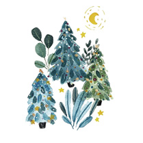

2018-2-19

唐卡

这是我最有信心的唐卡，从1990年一直保存到现在。希望依此照片，加持对佛陀有信心的有缘者。顶礼本师释迦牟尼佛！

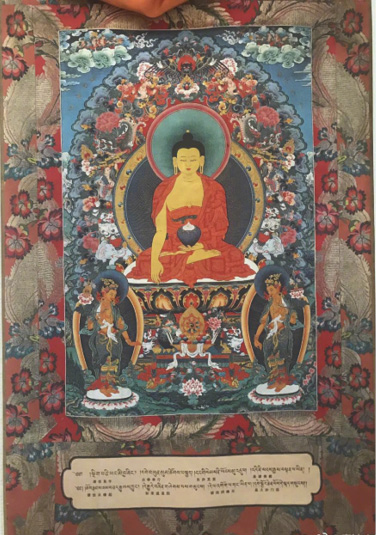

2018-2-19

追求

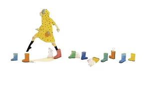

追求现在很多人追求的东西，只是为了让别人羡慕，不是为了满足自己。如此一来，纵然你得到想要的一切，也不一定活得快乐。

王尔德说：“生活中只有两种悲剧：一种是没得到我们想要的，另外一种是，得到了我们想要的。”

若能不受别人影响，认识到自己需要什么，这才是真正的自由。

2018-2-22

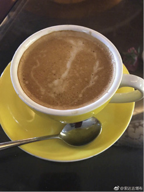

孤独

当你一个人的时候，不要寂寞，不要孤独。

因为每个人来到这个陌生的世界，都是一个人；以后去往另一个陌生的世界，也是一个人，谁都没办法陪着你。

——独自喝咖啡有感

2018-2-24

距离

这个网络时代，表面上看，很多人都在用手机上网，全世界似乎被同一种模式同化了，人与人的差距应该越来越小。但实际上，仔细研究就会发现，现实恰恰相反——

不同的人会形成不同的圈子，犹如一座座孤岛，互相之间毫无交集。很多人只找自己的圈子对号入座，只跟三观合得来的人一起玩，除此之外，与自己兴趣无关的人或事，他根本不重视也不关心，以至于就算是最亲的家人，有时候也不是一个世界的人，彼此间的距离可谓咫尺天涯。

所以，有些人之间，看似很近，实则很远；有些人之间，看似很远，实则很近。

2018-2-27

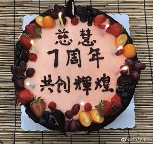

感谢

慈慧7岁了！

一路走来很不容易，感恩大家的付出和支持！未来漫漫长路，让我们一起继续加油！

2018-2-28

共修

从今天起，寺院僧众将共修“普获悉地祈祷文”，每人一万一千遍。

大家若想参与，可于1个月内圆满此数，并请给这条微博点赞报名，届时僧众会将功德一起回向。

2018-3-16

最初

1985年我刚来的时候，喇荣五明佛学院就是这样。没有电，没有公路，远远看，只是个空旷的山谷。

那个白色建筑是我们的经堂；红色的两层楼是桑耶塔，也是我1987年以后给汉族佛子讲课的地方；法王就住在最西边的房子里。

想念上师，感恩您一路的加持！祈愿生生世世不离师，生生世世利众生！

2018-4-5

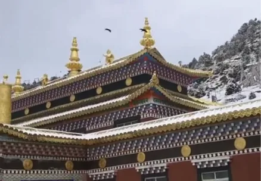

学院

朵芒佛学院，海螺法音唤醒迷梦人索达吉堪布的秒拍视频

2018-4-11

春雪

新年都未有芳华，二月初惊见草芽。

白雪却嫌春色晚，故穿庭树作飞花。

——韩愈《春雪》

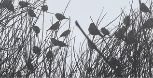

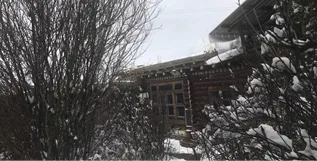

2018-4-14

岁月

1986年，我和堪布齐美仁真朝拜古屋神山，无忧无虑的岁月~

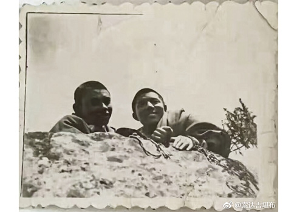

2018-4-20

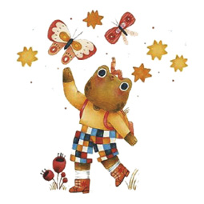

取悦

太执着于让别人喜欢，希望从他人身上得到认可和欣赏，这是现在很多人的通病。这种执念，会让你焦虑抑郁、患得患失、害怕错过，对身心弊大于利。

其实，这个世界的真相是：不可能每个人都喜欢你。与其一直取悦别人，倒不如提升自己更有力量。花开蝴蝶自然来。

2018-4-21

银色

今天的喇荣，银色的世界，心净国土净

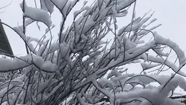

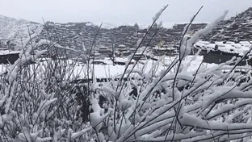

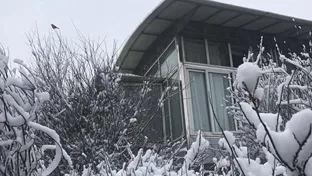

2018-4-24

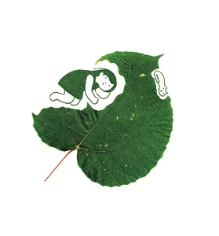

无常

无常，可以给你带来“黑暗”，

也可以让你抵达“光明”。

这一切如何转换，全在于你的心。

2018-4-26

父母

父母在世时，对他们要多关心、联系、探望、承侍；如果父母不在世了，想念他们的时候，多念观音心咒“嗡玛呢巴美吽”

2018-4-28

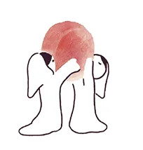

苦乐

有些痛苦，会带来痛苦，有些痛苦，会带来快乐；

有些快乐，会带来快乐，有些快乐，会带来痛苦。

2018-4-29

小树

在院子里种了几棵树，不知道会不会长~

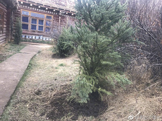

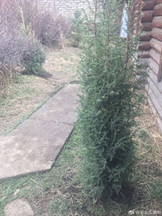

2018-4-30

读书

黑暗的原因，是没有出现阳光；

迷茫的原因，是没有读过好书。

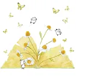

2018-5-2

发言

Today, I would like to take this opportunity and to say something about animal right. Please pay more attention on animal issue.

My name is Tomy and I am five years old. I am just ordinary dog, but I am taking responsibility for all universal animals.

On behalf of all animals I should say that you human beings never look down and don't kill us. Reason why? Because we are same social animal, we all want happiness and any one don't want suffer in any time. You know, every living being has a equal right to live on this planet and it is illegal of law of nature if you kill animal and to eat us. Nothing to say any more.

Thank you.

Animals bless you all!

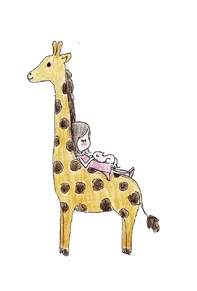

今天，我想借此机会谈谈动物权利。请多关注动物问题。

我叫汤姆，今年五岁。我只是普通的狗，但我对所有的动物都负有责任。

我代表所有的动物说，你们人类永远不要看不起我们，也不要杀我们了。原因何在？因为我们是同一种社会动物，我们都想要快乐，任何生命任何时候都不想受苦。要知道，每个生命都有平等的生存权，如果你杀了动物和吃掉我们，这是违反自然规律的。没什么可说的了。

谢谢。

动物保佑你们！

2018-5-5

爱恨

爱是错觉，若执为实有，往往会生出恨。

恨是假象，若解开心结，慢慢会转成爱。

2018-5-7

听从

听从内心，并不是无限度的，否则，内心充斥着各种欲望、烦恼、邪见，也许会带领你从一个黑暗走向另一个黑暗。

2018-5-17

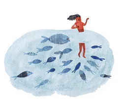

真假

苦与乐、美与丑、好与坏等一切，在胜义中都是平等空性，在世俗中都是假的。

那什么时候才是真的呢？

2018-5-19

颂咒

从5月22日开始，又到每年念修金刚萨埵心咒“嗡班匝儿萨埵吽”的日子了，一人40万遍。如果你也想参加，有时间的话，可于一个月内完成；没时间的话，可于一年内完成，并请给此微博点赞报名，届时僧众会一起回向。

直播：

1·新浪show：智悲讲堂九（房间号：491337）。

2·YY：智悲讲堂九（频道号：73553690）。

2018-5-21

上师

今天，是上师德巴堪布圆寂三周年的纪念日，这是他老人家的祈祷文~

མི་ཕམ་རྒྱ་མཚོའི་བྱིན་རླབས་སྙིང་ལ་ཞུགས།།ཀུན་བཟང་བླ་མའི་བཀའ་ལུང་གནད་དུ་སྨིན།།འཇིགས་མེད་བླ་མའི་མན་ངག་ཡིད་ལ་སུམ།།འཇམ་དབྱངས་གྲུབ་པའི་བློ་གྲོས་ལ་གསོལ་བ་འདེབས།།

德巴堪布祈祷文：

麦彭上师加持入心间，根桑上师教传无二得，

晋美上师窍诀融于意，祈祷嘉扬智比罗珠尊。

2018-5-25

卫塞

按照印度传统和国际惯例，今天是释迦牟尼佛诞生、成佛、涅槃的日子，也是佛教最重要的节日。

据记载，佛陀于5月的月圆之日出生；35年后又在5月的月圆之日于菩提树下悟道；后来涅槃那天，也是5月月圆之日。于是，后世便订下在每年公历5月的月圆日（通常是农历四月十五），举办卫塞节以纪念佛陀。

卫塞Vesak，在印度古梵语的意思就是“月圆”。作为与佛陀有缘的我们，也应在这样的吉祥日忆念佛陀，于佛像前供灯、供花等，以各种善良清净的言行，感恩佛陀给人间留下的慈悲与智慧，给万物带来的吉祥与解脱。

同时，希望大家多念“南无本师释迦牟尼佛”，或释迦牟尼佛心咒“达雅塔，嗡牟尼牟尼玛哈牟尼耶索哈”，把吉祥的气息撒遍整个天地。

我也会为大家默默祈愿：依靠释迦牟尼佛的加持，依靠佛吉祥日的加持，愿你们一切越来越吉祥！

2018-5-29

卫塞

朵芒佛学院，卫塞节，纪念本师释迦牟尼佛~传说妙法，广利有情索达吉堪布的秒拍视频

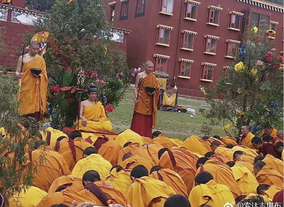

2018-5-30

母亲

今天是母亲离开两年的日子，看到昔日我们母子一起放生、一起野餐的镜头，有种说不出的感觉。嗡玛呢巴美吽……

希望有缘者方便的话，也能为她念108遍观音心咒“嗡玛呢巴美吽”。索达吉堪布的秒拍视频

2018-6-5

阿妈

“快三十年了，从来没有扰乱过任何一个人的心，也没有伤害过任何众生，连杀一只小虫的恶业也没有造过。以前腿脚好的时候去转塔，可能踩到过。现在我应该往生净土了。”此生无憾：索达吉堪布最后一次听阿妈说

2018-6-5

容纳

什么能产生快乐？就是你会容纳他人。

越大的慈悲，自己就越小，越多的智慧，考虑别人就更多。

慢慢习惯了总想别人，自己的执着会日益减少，痛苦也一天比一天淡，最后完全消灭。

2018-6-24

出生

这是我出生的地方，叫佐当给。如今每年六七月，当地很多藏民都在这里耍坝子

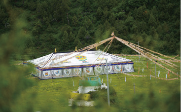

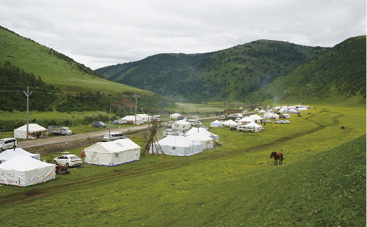

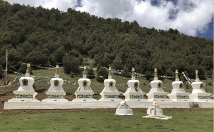

2018-6-28

开花

院子里花都开了，大黄也长了

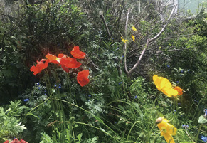

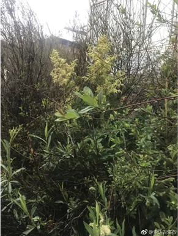

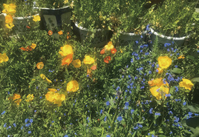

2018-7-6

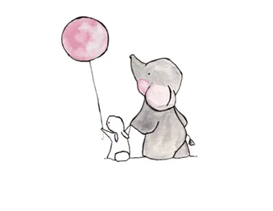

生日

今天是我的生日，各个地方的朋友们为此做了大量善事，给我送了很多祝福。

虽然我无法一一回应，但内心非常感激。你们所有的心意我都感受到了，感恩大家~

2018-7-16

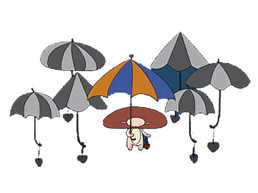

蚂蚁

是给“蚂蚁”吃的，还是帮它找到家？我们值得深思。查看图片（他说爱的根本宗旨，是要给被爱的人，找到一条光明，灿烂的路子）

2018-7-18

智慧

怎样才能成为名副其实的智者？

怎样获得无误抉择万法的智慧？

怎样从一切恶见的愚昧中解脱出来？

翻开这本书，通达其中的十法，也许你会找到答案。（当当．京东．亚马逊：网页链接）

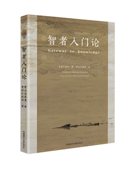

2018-9-10

老师

无偏把智慧甘霖洒向人间，

无私把精神财富灯灯相传，

无怨把育人重担一肩挑起，

老师，

您是我们生命中最重要的人。

您的笑容、妙音、慈悲，

滋润了一颗颗干涸的心，

感恩您！教师节快乐！

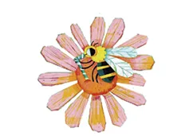

2018-9-10

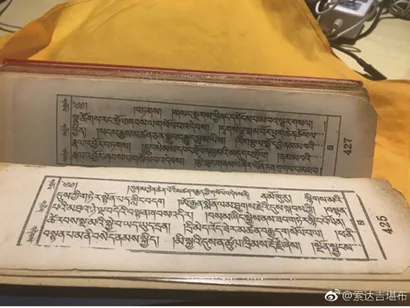

不要

作为佛教徒，再忙也不要忘记每天的课诵，再累也不要中断每天的修行，再烦也不要随意跟人吵架。

2018-9-14

度母

从今天起，超强台风“山竹”登陆华南沿海，或将成为今年以来的最强台风，阵风最强达17级以上。

以前阿底峡尊者遇到台风、海啸时，曾一心祈祷21度母，后感得21度母现身，平息了灾难，救了所有人。

这个度母祈祷文是：

འཇིགས་པ་བརྒྱད་སྐྱོབ་མ་ལ་ཕྱག་འཚལ་ལོ།།བཀྲ་ཤིས་དཔལ་འབར་མ་ལ་ཕྱག་འཚལ་ལོ།།ངན་སོང་སྒོ་འགེག་མ་ལ་ཕྱག་འཚལ་ལོ།།མཐོ་རིས་ལམ་འདྲེན་མ་ལ་ཕྱག་འཚལ་ལོ།།རྟག་ཏུ་ཁྱེད་ཀྱི་སྡོང་གྲོགས་བྱས།།ད་དུང་ཐུགས་རྗེས་བསྐྱབ་ཏུ་གསོལ།།

“顶礼救护八难母，顶礼吉祥炽燃母，

顶礼免堕恶趣母，顶礼引导善趣母，

祈愿时时予护佑，不舍慈悲恒救度。”

为了减少“山竹”台风带来的恐惧、灾难，希望大家念此度母祈祷文108遍、莲师心咒1000遍以上。

2018-9-16

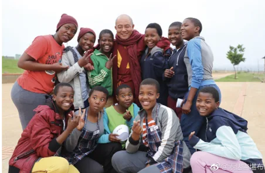

非洲

在非洲，处处能看到生大悲心的对境，比在山洞闭关的感触还深。

2018-9-23

中秋

在同一片蓝天下，祝仲秋快乐！

2018-9-24

心灵

高墙下的囚犯，也有灿烂的笑容。在这里，我教他们念观音心咒“嗡玛呢巴美吽”……

2018-9-28

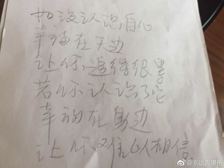

认识

如没认识自心，幸福在天边，让你追得很累。

若你认识了它，幸福在身边，让你难以相信。

2018-10-11

非洲

非洲之行红·尘——2018索达吉堪布在非洲

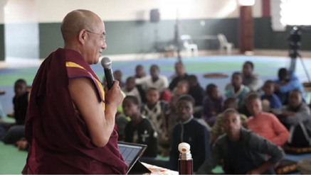

2018-10-16

真相

真相，一开始让你痛苦，最后会令你快乐。

虚幻，一开始让你快乐，最后会令你痛苦。

2018-10-22

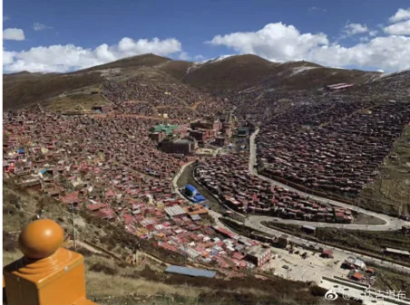

喇荣

今天的喇荣。闭关、禅修、宁静、法乐~

2018-10-24

修法

从今天开始，我们将用一周的时间（10月27日-11月3日）共修“阿弥陀佛修法”。每个人需念30万遍阿弥陀佛心咒“嗡阿弥得瓦阿依斯德吽舍”。一周内若实在不能完成，延至一个月也可以。最后僧众会一起总回向。

机会极为难得，万望大家珍惜！若想报名，请在下方点赞。

附：阿弥陀佛修法仪轨网页链接仪轨讲解网页链接

2018-10-27

年老

面对年老，一般人很难接受自己风采不再、受人冷落，不惜一切想抓住年轻的尾巴，但却无法拦阻时间的车轮。而修行人越老越身心自在，什么都已准备好了，胸有成竹地等待那一刻的到来。

2018-10-28

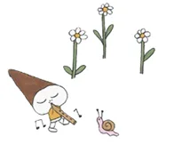

沉醉

佛教中说，人生一切如梦幻泡影。

我们常以为“梦幻泡影”就是虚幻，却忘了它还有另一层意思——

能吸引人，让人沉醉不愿醒。

2018-10-29

天降

10月31日（明天），是一年一度的“天降日”。

此日行持任何善法，所带来的吉祥安乐，将增上无量倍。

希望大家念释迦牟尼佛心咒“嗡 牟尼牟尼 玛哈牟尼耶索哈”以及佛号“南无本师释迦牟尼佛”，至少108遍。

2018-10-30

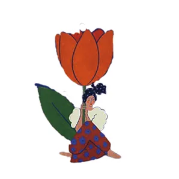

九岁

微博9岁了！不知不觉，不离不弃，感恩有你，让我们继续。加油~

2018-10-31

照片

法王如意宝的各种照片，我近期准备搜集一下。如果你有的话，能不能提供给我呢（请发至邮箱fawangruyibao9@163．com）？谢谢

2018-11-6

麻雀

这两天学院突然降温，跑出去玩了一夏天的小麻雀们，在大雪天全部回来了，叽叽喳喳提醒我它们饿了。

我赶紧把它们最爱待的地方扫净积雪，撒上它们最爱吃的小米。它们毫不客气地享用美餐，不时发出兴奋的叫声，作为对我的奖励。

隔着窗户，也挡不住它们的欢快，一个堪布给我打电话时，好奇地问：“你在什么地方啊？这么多小鸟在叫……”

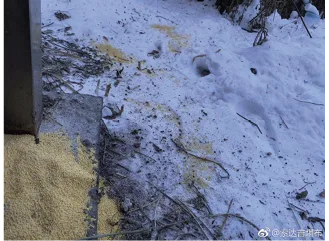

2018-11-9

双11

11.11，我们“要”发愿，“要”积资，“要”净障，“要”往生极乐世界！

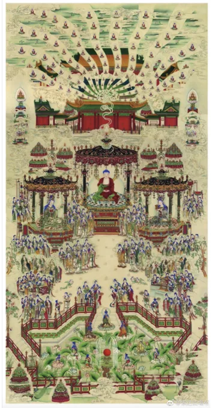

2018-11-11

法乐

甚深的佛法，快乐的心情~

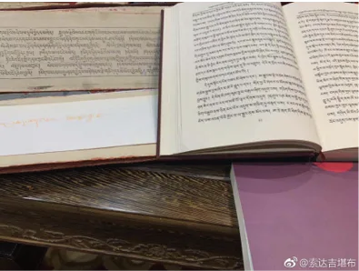

2018-11-16

客人

雪花中的小客人，欢迎光临~索达吉堪布的秒拍视频

2018-11-18

躲雪

吃饱了，躲雪，禅修~索达吉堪布的秒拍视频

2018-11-18

伤心

下大雪不要伤心，过两天会好的；遇到苦不要伤心，过两天会好的。

人生跟天气一样，没有永远好，没有永远坏。

2018-11-19

推荐

大家若想认识佛法，推荐学习这部小论典，内容不多，但涵摄一切——《菩提道次第摄颂》浅释网页链接

2018-11-19

金钱

很多人总说，有了钱就有了自由。

实际上，钱只能帮你摆脱旧的不自由，取而代之的，是另一种新的不自由。

自由，只属于心，如果想从钱上寻找，到头来，也许只会南辕北辙。

2018-11-22

圆满

《孝经》，我从2018年4月4日开始讲，到12月8日讲完，历时16个课时，今天圆满了。

这个时代，学学传统文化，很有必要！

2018-12-8

殊胜

噶举派冈波巴尊者的《胜道宝鬘论》，今天传讲圆满了。

我于2017年10月24日动手翻译，2018年2月6日翻译完。2018年3月7日，听了《胜道宝鬘论》的传承。2018年3月12日开讲，12月12日讲完，历时28个课时。

这部法确实非常殊胜，作者冈波巴尊者说：“将来若得见我所著的《胜道宝鬘论》及《解脱庄严论》等诸论，与亲见我无有差别。”

2018-12-12

上师

上师如意宝已离开15年了，没有一天不想念上师。

他老人家来到人间，唯一的希望，就是开启众生本具的智慧，让他们远离烦恼、痛苦。

为了更好地报答上师恩德，也为了与更多人分享上师的智慧，从明年开始，我打算每天在微博上发一段上师教言、一张上师照片，祈愿能令见闻者受益，增上安乐、自在解脱。

喇嘛钦……

2018-12-22
