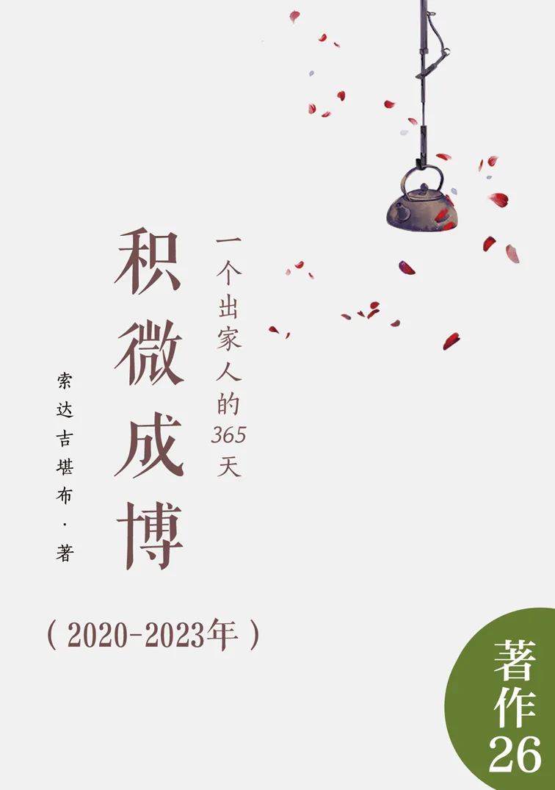

一个出家人的365天

元旦

祝大家元旦快乐，身心自在，六时吉祥！

2020-1-1

修习

如人水所漂，惧溺而渴死，于法不修习，

多闻亦如是。如人设美膳，自饿而不食，

于法不修习，多闻亦如是。如人善方药，

自疾不能救，于法不修习，多闻亦如是。

如人数他宝，自无半钱分，于法不修习，

多闻亦如是。如聋奏音乐，悦彼不自闻，

于法不修习，多闻亦如是。

——《华严经》

2020-1-2

自信

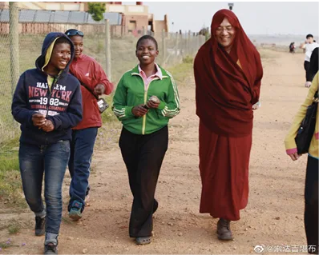

不管是什么样的人，都会有或多或少的自卑，有的比较明显，有的隐藏得很好。这种情绪会不断扰乱自己，使自己没有安全感。

如果你想从根本上解决它，方法非常简单：利用你自己的优势去帮助别人。

这样，你会充满成就感，也会渐渐自信起来。

2020-1-3

愿望

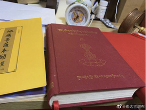

今年我给自己布置的作业是：

1．将《地藏菩萨本愿经》翻译成藏文；

2．将荣索班智达的《入大乘论》翻译成汉文；

3．继续校对已翻译好的《如意宝藏论》《杰珍大圆满》；

4．重新编辑并校对《喇荣课诵集》。

依靠这个多病的躯体，希望给后人多留一点宝贵“财富”。祈请上师三宝、护法空行予以加持，如果未来因缘具足，我很想给有缘者传授《地藏经》《入大乘论》等。

2020-1-4

噩梦

如果我们经常做关于鬼魂或死人的噩梦，梦里有许多可怕的场景，根据《地藏经》，这是前世眷属亲友堕在恶趣，通过托梦，希望我们以福力救拔。若能在佛像面前读三遍或七遍《地藏经》，他们就会获得解脱，这样的噩梦也不会带来不吉祥。

2020-1-6

纪念

1月10日（藏历十一月十五），是法王晋美彭措圆寂16周年的纪念日。所以，从明天1月8日，直至1月14日，僧众将在7天之内进行共修。

续部说：“何人俱胝劫，修十万本尊，不如一剎那，忆念上师胜。”您如果有条件、有意乐，也可以参与念修《上师供》、《上师瑜伽》、金刚萨埵仪轨及心咒、《普贤行愿品》等。特别是在法王圆寂日当天，更应该好好发愿，珍惜这难得的修行机会。

2020-1-7

不离

བླ་མ་མཁྱེན།喇嘛钦~生生世世不离师视频

2020-1-7

依师

依止您19年了，离开您16年了。

您在的时候，没扰乱过一次您的心；您不在了，没产生过一次邪见。您在的时候，跟随您，尽心尽力承侍；您不在了，随学您，尽量传播正法。

此生无憾。

上师，很想念您！祈祷您的不断加持……

2020-1-8

值遇

1984年冬天，22岁的我，披上了梦寐以求的红黄僧衣。

当天，德巴堪布手里拿着这张法王的照片，阳光透过窗户照在上面。这是我第一次看到法王如意宝的法相，激动不已，泪流满面，从此改变了我的一生。

2020-1-9

上师

88年前，上师的色身在这里降生。16年前，上师的色身融入了法界。然而，事实上，上师并没有真正离开。正如佛经所说，“正法无隐没，佛陀无涅槃”，当我们忆念上师时，他的加持无处不在。

2020-1-10

思念

如果是亲人离世，每过一年，思念会减轻一分。如果是上师离世，每过一年，思念会强烈一分。

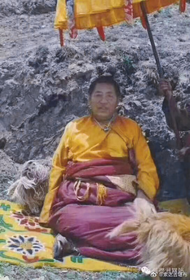

2020-1-11

不忘

我第一次见到法王如意宝，是在1985年春天的一个下午。他坐在一把旧椅子上，慈爱地摸着我的头，念了一遍莲师七句祈祷文和莲师心咒、文殊心咒对我加持，并告诉我：“好好闻思，别乱跑。”我永远不会忘记这一幕。

我最后见到法王如意宝，是在2003年的冬天。上师因病要去医院，我问：“要不要像以前一样陪您一起去？”上师说：“这次就不用了吧。”然后慈爱地摸了摸我的头，为我加持。第二天，天空飘着清雪，上师在离开时，拉下车窗向我挥手。从那以后，我再也没有见过上师。

2020-1-12

时光

这是喇荣第一条水泥路，从法王的闭关房通往甘多拉经堂。每天下午，法王讲完课，都会沿着这条小路回去。有时候小狗还会在前面带路。

那段时光，是我闻思修行最精进的时光，也是人生中最有意义的时光。

2020-1-13

回忆

有一次跟法王朝圣时，法王在中途有点累了，说：“休息一下，再继续赶路。”如今想起这一幕，让人回味无穷。

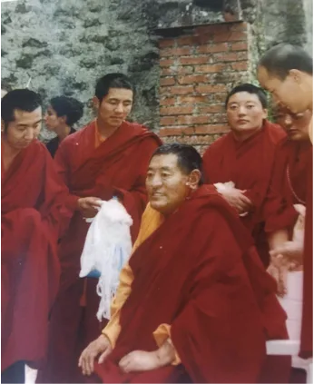

2020-1-13

何处

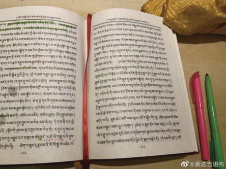

心不调伏，身在何处都是地狱；心调伏了，身在何处都是天堂。

2020-1-16

窍诀

要生孩子的人，应提前看看这段窍诀，并如是去做。这样则母子平安，也不会得“产后抑郁症”——

《地藏经》云：“是阎浮提人初生之时，不问男女，或欲生时，但作善事，增益舍宅，自令土地无量欢喜，拥护子母，得大安乐，利益眷属。或已生下，慎勿杀害，取诸鲜味供给产母，及广聚眷属，饮酒食肉，歌乐弦管，能令子母不得安乐。何以故？是产难时，有无数恶鬼，及魍魉精魅，欲食腥血。是我早令舍宅土地灵祇，荷护子母，使令安乐，而得利益。如是之人，见安乐故，便合设福，答诸土地；翻为杀害，聚集眷属，以是之故，犯殃自受，子母俱损。”

2020-1-17

秘密

“我给你说，密法好珍贵哦！”

2020-1-18

临终

一个人在临终之时，对他最有利的是什么？

《地藏经》云：“世尊，如是阎浮提男子、女人，临命终时，神识昏昧，不辨善恶，乃至眼耳更无见闻。是诸眷属，当须设大供养，转读尊经，念佛菩萨名号。如是善缘，能令亡者离诸恶道，诸魔鬼神悉皆退散。世尊，一切众生临命终时，若得闻一佛名、一菩萨名，或大乘经典一句一偈，我观如是辈人，除五无间杀害之罪，小小恶业，合堕恶趣者，寻即解脱。”

2020-1-19

印记

今天我去朝拜了一座寺庙，30年前我随上师去过那里，有很多上师的气息。

如今，虽然上师不在身边，但上师的法一直在我心里，生生世世……

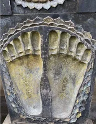

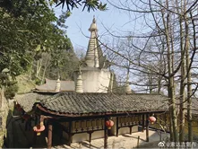

2020-1-19

嘱咐

快过年了，最好不要杀生~

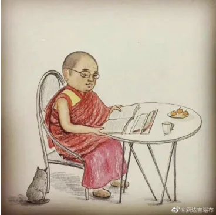

2020-1-20

推荐

听到地藏菩萨的名号，见到地藏菩萨的塑像、画像，将会得到什么利益呢？

大家可以看看《地藏经》，或是这个动画片地藏菩萨见闻利益品

2020-1-23

祝愿

今天是大年三十了，真心祈祷三宝：祝你新春吉祥，身体安康，疾横不临，善念增上，解脱自在~

2020-1-24

除夕

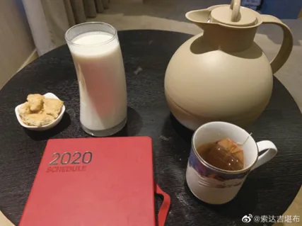

吃年夜饭咯~

2020-1-24

年初

一年之初，一切吉祥网页链接

2020-1-25

心经

《心经》

观自在菩萨，行深般若波罗蜜多时，照见五蕴皆空，度一切苦厄。

舍利子，色不异空，空不异色，色即是空，空即是色，受想行识亦复如是。

舍利子，是诸法空相，不生不灭，不垢不净，不增不减。是故空中无色，无受想行识，无眼耳鼻舌身意，无色声香味触法，无眼界乃至无意识界，无无明亦无无明尽，乃至无老死，亦无老死尽，无苦集灭道，无智亦无得，以无所得故。

菩提萨埵。依般若波罗蜜多故，心无挂碍，无挂碍故，无有恐怖，远离颠倒梦想，究竟涅槃。

三世诸佛，依般若波罗蜜多故，得阿耨多罗三藐三菩提。

故知般若波罗蜜多，是大神咒，是大明咒，是无上咒，是无等等咒，能除一切苦，真实不虚。

故说般若波罗蜜多咒，即说咒曰：揭谛揭谛　波罗揭谛　波罗僧揭谛　菩提萨婆诃。

2020-2-4

呼唤

喇嘛钦。嗡玛呢巴美吽……

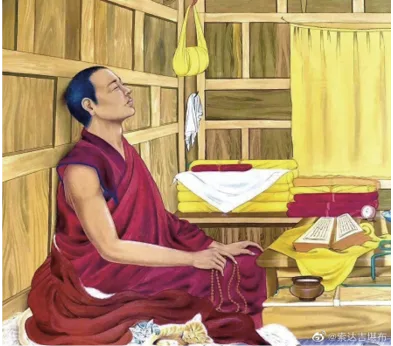

2020-2-6

想念

上师，您的色身是一时的，智慧身是永恒的。不间断在利益众生。想念您~

2020-2-13

苦乐

快乐，表面上让人喜欢，但依此或许会沉迷堕落；痛苦，表面上让人害怕，但依此或许可感悟人生。

2020-2-17

回遮

今天是藏历12月29日。按照传统，若能在黄昏念9遍《心经》进行回遮，可以遣除下一年以死亡为主的不吉祥。

附：

心经回遮

无可言思般若度 不生不灭虚空体

各别自证智行境 三世佛母我敬礼

观自在菩萨。行深般若波罗蜜多时。照见五蕴皆空。度一切苦厄。舍利子。色不异空。空不异色。色即是空。空即是色。受想行识亦复如是。舍利子。是诸法空相。不生不灭。不垢不净。不增不减。是故空中无色。无受想行识。无眼耳鼻舌身意。无色声香味触法。无眼界。乃至无意识界。无无明。亦无无明尽。乃至无老死。亦无老死尽。无苦集灭道。无智亦无得。以无所得故。菩提萨埵。依般若波罗蜜多故。心无挂碍。无挂碍故。无有恐怖。远离颠倒梦想。究竟涅槃。三世诸佛。依般若波罗蜜多故。得阿耨多罗三藐三菩提。故知般若波罗蜜多。是大神咒。是大明咒。是无上咒。是无等等咒。能除一切苦。真实不虚。故说般若波罗蜜多咒。即说咒曰。揭谛揭谛。波罗揭谛。波罗僧揭谛。菩提萨婆诃。

南无敬礼师，敬礼佛，敬礼法，敬礼僧，敬礼大佛母般若波罗蜜多。我之一切真实语，当愿成就。如昔时天王帝释思维大佛母甚深般若波罗蜜多义，依止念诵而遣除魔王波旬等一切违缘，如是我亦思维大佛母甚深般若波罗蜜多义，依止念诵，魔王波旬等一切违缘，愿皆遣除，愿成无有，愿成寂灭，愿极寂灭。

不生亦不灭 不常亦不断

不来亦不去 不一亦不异

能说是因缘 善灭诸戏论

我稽首礼佛 诸说中第一

2020-2-22

吉祥

这个月是“神变月”（2.24-3.24），每一天都是吉祥日，行持任何善法，功德均会成千上万倍增长。希望大家在这样的日子里，尽量不要散乱，并发愿尽可能做些帮助别人的事。

2020-2-24

精进

有时候跟众生广泛交流、利益群生，有时候独自静修、内观自心，这两者都是大乘佛教的殊胜行为。不要空耗难得的暇满人身，要精进！

2020-2-25

师恩

今天是您的生日，我的上师。

您曾来到这个人世间，降下了无比的智悲甘霖，又悄无声息地离开。

昔日师徒间的欢愉如此短暂，好似美梦一场。未来和您相见只能在梦中，重温陪伴在您身边的那种美好。

祈祷您加持我们这些还在轮回中的众生~

2020-2-26

真谛

散乱堕迷惘，静修见真谛。

2020-2-29

何时

痛苦的时候，因为痛苦而不修行；

快乐的时候，因为快乐而不修行；

不苦不乐的时候，因为忙碌而不修行。

那么，什么时候才会修行呢？

2020-3-5

女性

女性历来是一个非常伟大的群体，在家庭和工作中付出的，往往比男性多。尤其是在这次疫情中，大多数医护人员是女性，她们的利他精神、爱的力量，深深让人动容。

在这里，我祝福天下所有女性节日快乐，像度母一样美丽，像观音一样慈悲。

2020-3-8

终生

终生学习终生修行终生利他

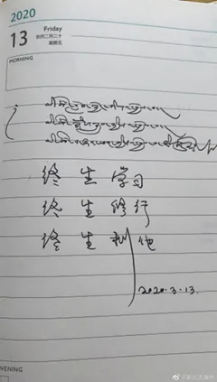

2020-3-13

珍爱

为了我们，也为了它们，让我们珍爱每一个生命，让这世界变成野生动物的天堂。

2020-3-15

好坏

好的也会变坏，坏的也会变好，这才是无常的真谛。

2020-3-17

闭关

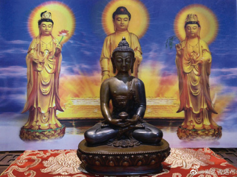

由于疫情的原因，喇荣今年秋季的闭关计划，提前到现在。从今天到阳历的四月下旬，请有缘者在各自的所在地，继续念修阿弥陀佛名号，并闻思佛法。

我也在尽最大的努力精进念佛，希望早日完成发过的誓愿。

2020-3-17

难得

今生获得这么难得的人身，遇到这么难得的大乘佛法和善知识，如果不精进修行就太可惜了！所以这辈子一定要好好修行，争取获得解脱。否则，茫茫轮回苦海中，以后基本不可能再有这样的机会了！！！

2020-3-20

道场

上等修行人，寂静处、红尘中，无一不是道场。

中等修行人，只有寂静处才是道场。

下等修行人，哪里都不是道场。

2020-3-21

学习

作为佛弟子，应当学习一下《赞僧功德经》。我也准备将此翻译成藏文。网页链接

2020-3-21

歇息

当全球人类都在“闭门思过”时，地球可以歇息一会儿。天也蓝了，水也清了，鸟也多了……

2020-3-22

坚持

没完没了的琐事，纵然免不了，但持之以恒的修行，依然不能忘。

2020-3-25

禅修

第二世敦珠法王在向大家传授禅修方法时，以直视鼻尖、舌抵上腭等毗卢七法坐式，身体自然放松，心不执一切，自然安住。安住一段时间后再出定。

他说：“这样的禅修叫做入定。在出定后，不离这种境界而行住坐卧、念经等，叫做后得。如果后得时能不离入定的境界，这种禅修将得以稳固。”

“入定禅修时，心自然放松，不为执着所动摇，就像湖水没有被风搅动一样……”视频

2020-3-26

积累

修行不好也没关系，毕竟我们普通人难免会受到外境影响。但是无论如何，都不要把修行彻底放下，即使是一点一滴积累，也可以。

2020-3-27

迷失

“你”和“你所拥有的”其实是两个概念。你所拥有的钱财不是“你”，你所拥有的名声不是“你”，你所拥有的权力不是“你”，你所拥有的美貌不是“你”……但许多人常会混淆二者的界限，结果弄丢了自己，迷失了人生。

2020-3-29

不变

随着节气的不同，天气冷热有变化，但广大无边的虚空没有变化；

随着因缘的不同，情绪苦乐有变化，但明空无二的心性没有变化。

2020-3-30

无常

壮年不久停，盛色病所侵，命为死所吞，无有法常者。

——《大般涅槃经》

2020-3-31

学习

世亲论师所造的《往生论》，被净土宗归入“五经一论”，希望有缘者好好学习。我也正在将其翻译成藏文。

附：《往生论》（原文）网页链接

2020-4-9

习惯

如果我们把自律当成习惯，按时吃饭、按时睡觉、按时做事、按时学习、按时修行，就能减少烦恼，健康长寿，身心喜乐。

2020-4-10

自学

由于疫情尚未结束，上半年应该不开课，望各自在家学修~

2020-4-10

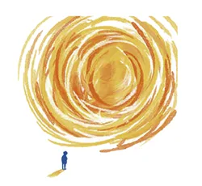

有无

看似“有”，实则“无”；看似“无”，实则“有”。这是难以置信的真相。

2020-4-13

因缘

诸法因缘生，诸法因缘灭，吾师大沙门，常作如是说。

2020-4-15

心性

我们的心性犹如虚空，偶尔会被苦乐的浮云遮挡，但并不会有损它一丝一毫。

2020-4-22

乐观

生活中，我们身边有许多不开心的事，其实每个人都会有。此时不要丧，不要觉得好多事情过不去。只要以强大、开朗的心态面对，相信一切都会过去的。

2020-4-23

念咒

如果每天念1万遍金刚萨埵心咒，“嗡班匝儿萨埵吽”，不到两个月，就能完成40万遍。我决定了，从明天开始念~

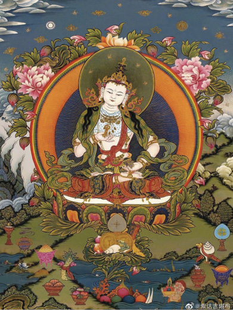

2020-4-25

修持

理论的通达很重要，更重要的是实地修行。若能深入修持正法，逐渐就会照见万法真相。那时，世间再巨大的苦痛，对你也是小菜一碟。

2020-4-28

柠檬

有一句俗话：“When life gives you lemons, make lemonade.（假如生活给了你一颗柠檬，那就榨杯柠檬汁吧）”所以，当我们生活不如意时，直接接受痛苦是很难的，但如果把痛苦以榨汁的方式进行剖析，再兑些修行的法水、窍诀的蜂蜜，就能把它转化成一杯美味。

2020-5-1

殊胜

ༀ་ཧྲཱིཿཥྚྭཱིཿཝི་ཀྲྀ་ཏཱ་ན་ན་སརྦ་ཤ་ཏྲཱུཾ་ནཱ་ཤ་ཡ་སྟྭམྦྷ་ཡ་ཧཱུྃ་ཧཱུྃ་ཕཊ་ཕཊ་སྭཱ་ཧཱ།

嗡 舍智沃哲达纳纳 萨瓦夏中纳夏雅 东吧雅 吽吽帕的帕的索哈

若能念大威德心咒一万遍以上，极为殊胜。

2020-5-1

法华

这是很古老的藏文版《妙法莲华经》，其加持不可思议，愿见闻忆触此经的众生皆得解脱~

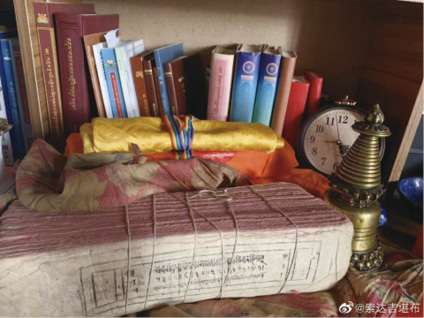

2020-5-4

涂鸦

我今天的涂鸦，你看得懂吗？

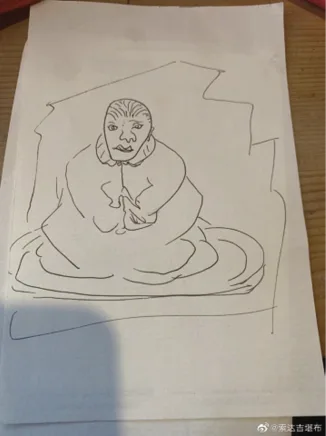

2020-5-5

梦幻

དཀོན་བརྩེགས་ལས ། ཆོས་རྣམས་ཐམས་ཅད་རྨི་ལམ་སྒྱུ་མ་འདྲ། །ངོ་བོ་ཉིད་ཀྱིས་སྟོང་ཞིང་བདག་མེད་ལ། །བྱིས་པས་ཡོད་དམ་མེད་ཅེས་སོ་སོར་རྟོག །ཅེས་གསུངས།

《宝积经》：

一切诸法如梦幻，体性空性无有我，凡愚分别谓有无。

2020-5-6

劝告

当佛教徒遇到一些重要的事情时，不要到处打卦算命、占卜吉凶，应该秉持佛法的根本教义“诸恶莫作，诸善奉行，自净其意”。这一点特别重要，每个人务必要清楚！

2020-5-7

妈妈

今天是母亲节。在许多国家的语言中，“妈妈”的发音完全一样，它是最原始的呼唤，是所有生命的来源。在大乘佛教中，了知母恩、忆念母恩，也是最重要的修行。如果您的母亲还健在，请平时多嘘寒问暖，有空就陪陪她。如果她已不在了，请多念观音心咒回向她，愿她离苦得乐、自在解脱。

2020-5-10

白雪

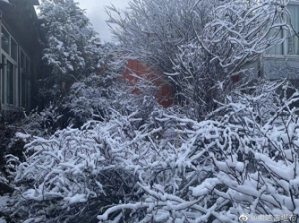

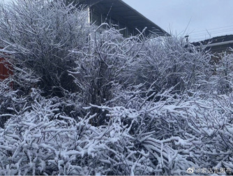

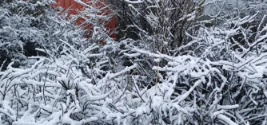

早上发现，院子里长满了银树。在藏地，真是“夏有白雪冬有雪，春夏秋冬皆有雪”

2020-5-11

有感

独自望夕阳，沉思见光明。

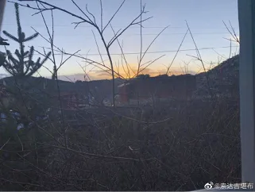

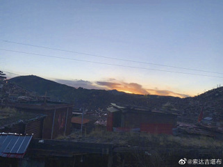

2020-5-14

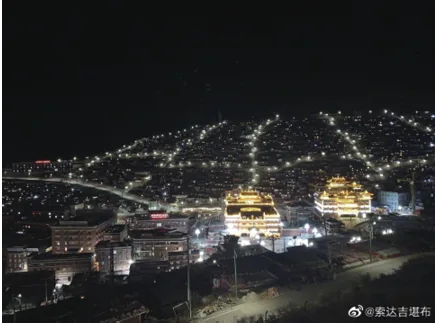

夜晚

星斗坠山寺，非幻亦非真。

2020-5-14

过失

一个佛教团体经常说是道非，说明它的闻思修行气氛很弱。一个佛教徒整天看别人的过失，说明他的内在修行很差。

就像一个戴灰色太阳镜的人，看到的一切都是灰色。如果眼镜戴了很长时间，他会抱怨世界太灰暗，却忘了这是他自己的问题。

2020-5-16

真假

当你童年天真无邪时，看什么都是“真”的。

当你刚步入社会上当受骗时，看什么都是“假”的。

当你有一定的生活阅历时，知道“真”“假”可以共存。

当你看尽了人间荣辱得失时，就会不计较孰“真”孰“假”。

2020-5-17

菩提

如果能像爱自己一样爱别人，甚至是所有生命，这才是真正的爱，也是大乘的菩提心。所以，在这充满爱意的520，让我们也大声对所有众生说一句，“我爱你”。

2020-5-20

纯真

风雨里，要像个大人；天晴时，要像个孩子。

——莎士比亚《仲夏夜之梦》

2020-5-27

圣训

一生都是修来的，求什么？

今日不知明日事，愁什么？

不礼爹娘礼世尊，敬什么？

兄弟姐妹皆同气，气什么？

儿孙自有儿孙福，忧什么？

岂可人无得运时，急什么？

人世难逢开口笑，苦什么？

补破遮寒暖即休，摆什么？

食过三寸成何物，谗什么？

死后一文带不去，悭什么？

前人田地后人收，占什么？

得便宜处失便宜，贪什么？

举头三尺有神明，欺什么？

荣华富贵眼前花，傲什么？

他家富贵前生定，妒什么？

前世不修今受苦，怨什么？

赌博之人无下梢，耍什么？

治家勤俭胜求人，奢什么？

冤冤相报几时休，结什么？

世事如同棋一局，算什么？

聪明反被聪明误，巧什么？

虚言折尽平生福，谎什么？

是非到底见分明，辩什么？

谁能保得长无事，诮什么？

穴在人心不在山，谋什么？

欺人是祸饶人福，卜什么？

寿自护生爱物增，杀什么？

一旦无常万事休，忙什么？

——济公和尚《圣训歌》

2020-5-22

雨天

天降甘霖，打开窗户，

倾听雨声，悠然自得~视频

2020-5-23

福祸

一帆风顺时，不一定是好事，“福兮，祸之所倚”；

一蹶不振时，不一定是坏事，“祸兮，福之所伏”。

这世上，没有绝对的好，也没有绝对的坏，因为万法皆为无常。

2020-5-26

萨迦

今年的5月23日-6月21日，是藏历的“萨迦月”，在此期间若能忏悔、吃素、念咒、绕塔、禅修等，身语意行持任何善法，都有无量功德。每个人应根据自己的情况，尽量不浪费时间精进修行，并将善根回向一切众生，祈愿世界和平、众生安乐。

嗡班匝儿萨埵吽……

2020-5-29

六一

儿童节快乐！祝愿每个孩子拥有一个充满爱心、懂得感恩的童年。

2020-6-1

惭愧

很惭愧~发愿念的金刚萨埵心咒还没念完，ཨོཾ་བཛྲ་ས་ཏྭ་ཧཱུྃ།嗡班匝儿萨埵吽

2020-6-9

增长

《苦乐道用》：当我们遭到有情与非有情的损恼时，如果心里习惯性存着唯一都是痛苦的想法，那么即使一个微乎其微的对境外缘，也会给我们心理上带来巨大刺痛。

串习苦乐的任何想法，它就会越来越增长，这是一种自然规律。

Whenever we are harmed by sentient beings or anything else, if we make a habit out of perceiving only the suffering, then even the most insignificant matter will cause enormous anguish in our mind. This is the nature of any perception or idea; be it happiness or sorrow, is to grow stronger and stronger the more we become accustomed to it.

2020-6-11

悠然

钟鼎山林都是梦，人间宠辱休惊，只消闲处遇平生。

——辛弃疾

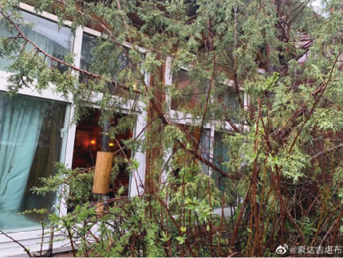

2020-6-16

日食

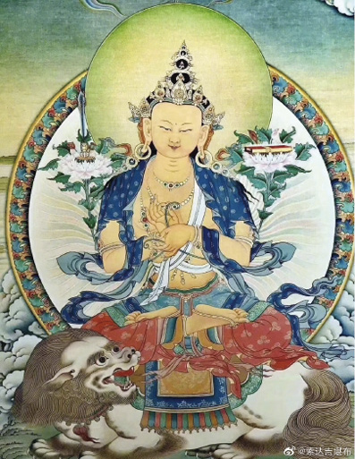

今天14：33-16：59有日环食，是精进修行的好时机。

2020-6-21

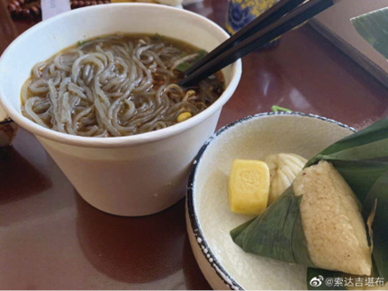

端午

端午节快乐，来吃饭啦

2020-6-25

夏天

夏天的草原，人间的乐土，蜜蜂的欢笑，蝴蝶的舞场，你可以闻到花香吗？

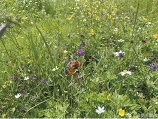

2020-7-2

期限

有些人认为学习佛法三五年就够了。事实上，他充其量只触及了佛法的皮毛。

如果是世俗的知识，要连续九年才能达到初中毕业的基础水平，那么诠释深广实相的佛法智慧，更不可能短短几年就完全掌握。

假如你真的想品尝佛法美味，方法只有一个——活到老，学到老。

2020-7-5

缅怀

当时的自己，跟上师一起喝饮料、看大海，是多么幸福。

现在，唯一只能靠照片来缅怀。在护持上师传承教法的过程中，一次又一次感受上师的气息。

2020-7-10

不忘

数劫中祈祷文殊菩萨、普贤菩萨、弥勒菩萨、观音菩萨等，不如短短片刻祈祷地藏菩萨一次利益大，这在《地藏赞》中有宣说。说者不是别人，就是大悲释迦佛。

大的方面，想获得最高成就佛果，要往生西方极乐世界；小的方面，为了吃的、喝的、穿的应有尽有，为了运气亨通、心想事成，也没有比祈祷地藏菩萨更好的了。

祈祷地藏菩萨，今生能长寿无病、拥有财富、如愿以偿，对后世来讲，也是命终后能即刻同与自己结缘的一切众生往生极乐世界的不共近因。

——法王晋美彭措《不忘》

2020-7-22

脚印

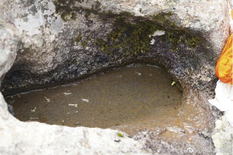

今天，我爬了很长时间的山，走了14250步，专门去朝拜了法王如意宝在石头上留下的这个脚印。

这是法王1986年在古屋神山示现神变留下的，当时我也在场。如此难以想象的不可思议境界，给我留下了深刻印象。

现在，34年过去了，脚印还是这么清晰……

2020-7-31

记忆

30年前的今天，我和上师如意宝在印度的拉鲁巴赫公园（སྐྱེད་ཚལ་དམར་པོ，Lalbagh Garden），当地人称其为“红色花园”。

美好的回忆~~喇嘛钦！

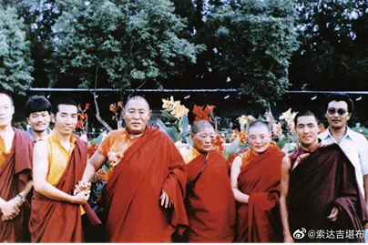

2020-8-12

修学

《诸法集要经》：

一切乐有尽，一切爱有离，

一切命有终，未死当修学。

2020-8-14

福报

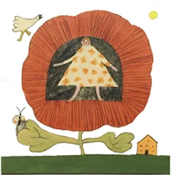

《大乘悲分陀利经》：

人天福报，譬如疾风，

无有住时，如水中月。

2020-8-18

逆境

逆境往往让人坚强成功，顺境往往让人迷失堕落。

2020-8-23

幽静

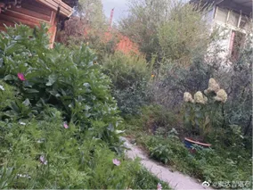

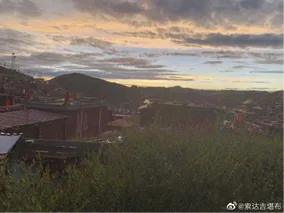

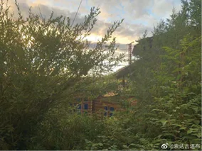

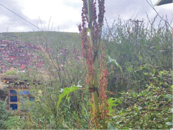

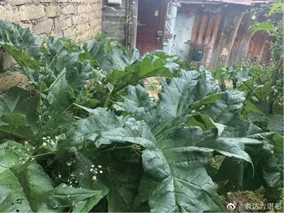

“曲径通幽处，禅房花木深。”

2020-8-23

儿时

这是我儿时放牛的地方。漫山遍野，都是我光脚放牛的足迹~

2020-8-25

明月

梦中的上师，心中的明月，不断赐予清凉的甘霖……

2020-8-26

欢喜

佛欢喜日，节日快乐！来，晒晒太阳吧~

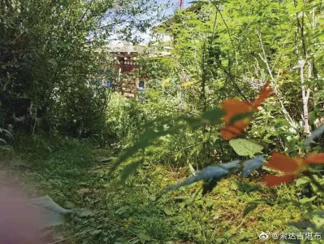

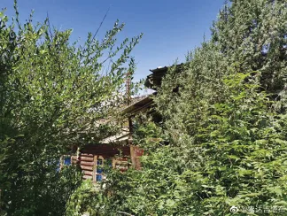

2020-9-2

教师

人生中，无论是世间的老师，还是出世间的老师，对我们的恩德都非常大。

如果没有他们，我们看不清这个世界的缤纷。永远感恩他们的付出。

教师节快乐！

2020-9-10

时光

早年，在法王新房子的门口。

这是当时的我们，一眨眼，快30年了~

2020-9-11

轮回

在轮回中，别太乐观，再好的荣华也抵不过无常变化；别太悲观，再差的境遇也抵不过恶趣痛苦。

2020-9-30

变苦

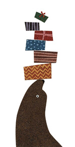

能给你带来深度快乐的东西，

必定能给你带来深度痛苦。

得不到，心心念念；得到了，患得患失。

这就是佛陀所讲的，“有漏皆苦”。

2020-10-10

关机

整天玩手机，不好好修行，也不好好学习，宝贵人身就这么浪费了。再这样下去，眼也坏了，心也乱了。

我们可以每天白天关机两个小时吗？

2020-10-15

信心

只要我们有信心，伟大上师们的爱和加持永远不会消失。它会一次又一次把我们从迷梦中唤醒，直至证悟菩提。

2020-10-16

罕见

几天前，喇荣佛学院一位默默无闻的堪布旺钦，非常安详地示现圆寂。

值得随喜的是，他是在传讲六部论典时离开人间的。我特意了解了一下他正在讲的法——

1．他给般若班、医学班讲了法王如意宝的《续释日藏论》，讲到“非以勤作而撰著，唯一入定之结果，极深三传密意精，无勤慧界如是现”这一颂时圆寂的。

2．他给下戒律班讲了益西加村的《誓言明然论释·净镜论》，讲到“一切三世诸佛以此誓言而出现”时圆寂的。

3．他给上中观班讲了荣索班智达的《窍诀见鬘论释》，讲到“因殊胜悉地等同于无上菩提，故未另外宣说”时圆寂的。

4．他给上戒律班讲了卓玛桑竹多杰的《续部纲要·宝焰幕》，讲到“以诸多教证明示：此乃教量说”时圆寂的。

（以上是他给喇嘛传讲的法。下面是给觉姆传讲的法。）

5．他给因明班讲了格孜班智达的《生起次第双运穗》，讲到“五智慧镜住于灿然五光之中”时圆寂的。

6．他给戒律班也讲了卓玛桑竹多杰的《续部纲要·宝焰幕》，讲到“顿时解脱道在第六品、第九品、第十一品、第十二品、第十九品里有明说”时圆寂的。

这些密法还没讲完，他就离开了。看起来非常遗憾，实际上真的很了不起。在这个时代，同一时间传讲这么多密法是极其罕见的。

2020-10-18

天降

今年的天降月，是从公历10月17日-11月15日。

每一年，我们都会在此期间修净土法门，发愿往生极乐世界。

每个人最好能念诵阿弥陀佛心咒“嗡 阿弥得瓦 阿依斯德吽舍”30万遍。

2020-10-19

心愿

曾经日日期待拜见您，现今夜夜期待梦见您，

时时刻刻加持我，生生世世利众生！视频

2020-10-20

温暖

冬天的天气越来越冷，修法的内心越来越暖。

2020-10-24

性空

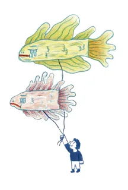

看到彩虹时，奋力去追逐它，结果了不可得；感受痛苦时，用智慧去分析它，同样了不可得。

这就是佛教中所说的“显而无自性”。

2020-10-25

闭关

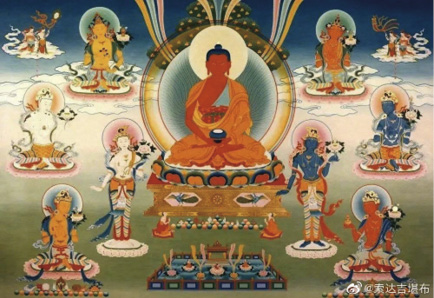

从明天开始，我准备闭关一周，观修净土法门。

在此天降月，若能闭关至少七天来修法，则非常殊胜。我们只有通过实修，才能品尝到妙法甘露的美味。

2020-10-26

改期

本来闭关七天的口粮和资具都准备好了，但临时有一些事情又要延缓。计划没有变化快，闭关只能过几天再说。世间唯一不变的，就是无常，哈哈~

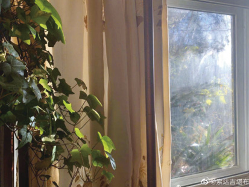

2020-10-26

玩偶

轮回里的爱也好，恨也好，都是前世业力的重演。

我们所坚持的是非对错，不过是当局者迷。却没有察觉到，自己只是业力的玩具。

2020-10-27

成功

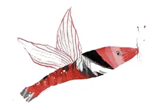

许多人崇拜的成功人士，其标配是金钱、名声、权势、美貌。

但事实上，最成功的人，应该是利益他众者。哪怕只能利益一个人。

2020-10-30

资粮

古德说，若想健康、幸福、长寿，并且将来往生极乐世界，最好念三十万遍阿弥陀佛心咒“嗡 阿弥得瓦 阿依斯德吽舍”（ཨོཾ་ཨ་མི་དྷེ་ཝ་ཨ་ཡུ་སིདྡྷི་ཧཱུྃ་ཧྲཱིཿ）。

2020-11-1

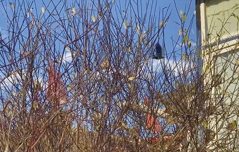

大声

好大声啊~你们是不是在念“嗡 阿弥得瓦 阿依斯德吽舍”？视频

2020-11-2

转角

许多人认为，人生的道路是单行线。但如果擦亮眼睛一看，原来它四通八达，只不过转弯时需要抉择路线。

2020-11-16

无别

如果经常观修根本上师与本尊无二无别，并时时加以恭敬祈祷，以此缘起，可以开启自己的本俱智慧，修行不容易退失，并能自然而然利益众生。

2020-12-14

加持

根本上师圆寂之后，如果在他的圆寂日进行祈祷，弟子会得到更多加被。

如今，上师如意宝已离开我们17个年头了，若想获得意传加持，大家应该多祈祷上师。

གནས་ཆེན་རི་བོ་རྩེ་ལྔའི་ཞིང་ཁམས་སུ། །

内钦热卧贼诶央堪色 自大圣境五台山

འཇམ་དཔལ་ཐུགས་ཀྱི་བྱིན་རླབས་ཡིད་ལ་སྨིན། །

将华特吉辛拉耶拉门 文殊加持入心者

འཇིགས་མེད་ཕུན་ཚོགས་ཞབས་ལ་གསོལ་བ་འདེབས། །

晋美彭措雅拉所瓦得 祈祷晋美彭措足

དགོངས་བརྒྱུད་རྟོགས་པ་འཕོ་བར་བྱིན་གྱིས་རློབས། །

恭杰多巴颇瓦辛吉洛 证悟意传求加持

2020-12-26

上师

明天是法王如意宝的圆寂日。

如果在佛堂或其他地方，于法王的法像前陈设供品，自己一个人或是与有缘者一起，念诵《上师瑜伽》《上师供》《普贤行愿品》等，必定会得到传承上师不可思议的加持。

根据许多经续教证，修行人若想明心见性，唯一依赖于上师的加持。因此，希望大家珍惜这个难得的机会，精进修行。

2020-12-28

教言

莫舍己道，勿扰他心。

——法王晋美彭措

2020-12-29

依师

我的至尊上师也曾经亲口说过：“众生怙主金刚持我的至尊上师的确是圆满正等觉大金刚持，为饶益众生化现为补特伽罗的形象而降临世间，这并非是我以虔诚的信心与恭敬心作赞叹的。如果你们能够修持、祈祷，那么在我的上师与你们之间除了我以外再没有其他传承隔断。我也是从最初幸遇金刚持上师之后，一直依教奉行以三欢喜依止上师，从来没有做过任何不称上师心意的事，甚至让上师斜视一眼的事也没有做过，可以说，传承的金线没有被破誓言的锈所污染，因此传承的加持与众不同。”

——华智仁波切

2020-12-29

不离

上师的色身会示现无常，而他的智慧永不消失，会融入每个具有信心、清净心、虔敬心的有缘者的心中。

2020-12-31

师徒

具德上师与具相弟子的关系，或许超过了父母与子女等世间亲密关系。

这一点，通过上师的直指，当你了悟万法实相时，自会明白其中的奥秘。

2021-1-1

陪伴

作为法王如意宝的弟子，假使所有人都抛弃了你，也不必感到孤独、寂寞、伤心。因为法王赐予的正法一直在你身边，不离不弃。

2021-1-2

欲望

很多时候，我们的不自由，是由欲望引起的。如果可以减少欲望，则无论是时间、物质、心灵哪方面，都可以重获自由。

2021-1-4

稀有

当你彻悟心性原本无来无去、无苦无乐时，会发现众生将一切执为实有是多么稀有、可笑！

2021-1-8

安忍

从前，华智仁波切的弟子若萨华给有一个心爱的银碗。后来，一个觊觎银碗的人想抢走它。华给生起了无法控制的愤怒，捡起一块大石头要与他拼命。此时，华智仁波切发现了，淡淡地提醒他：“安忍，安忍……”华给听后，止住了他的怒气，慢慢将那块大石头放下，并扔到了地上。

无论你是什么样的人，只要被严重的嗔心所控制，情绪就会完全失控，与疯狂的人无二无别，所做的事可能自己也无法想象。

因此，嗔恨在佛教中被称为“毒”，它可以侵骨蚀髓，让你变得面目全非。而要想治愈它，最好的妙药就是安忍。

2021-1-13

生日

祝门措上师生日快乐，长久住世，广利有情

2021-1-14

业力

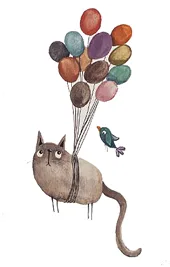

轮回中的凡夫众生，所作所为都被业力所支配着，并不是通过自己努力就可以心想事成。

尽管努力也会起到一定的作用，但这只是一小部分外缘，远远抵不过业力的巨大影响。

2021-1-22

幻觉

我们每一个人，都有共同显现的业力、不共感受的业力。

前者造就了外在的世界，后者造就了内在的苦乐。

但这都是我们坚固习气的一种幻觉。

2021-1-30

公平

我们每个人每天都有相同的时间。但是有些人争分夺秒，把时间用于自利利他；有些人得过且过，把时间变成各种散乱；有些人损人害己，利用时间去做尽坏事。

时间对每个人都是平等的，关键看你怎么利用。这就成了你的人生。

2021-2-2

自心

乐观的人，可以在任何时间、任何地点、任何情况下找到理由，让自己过得很快乐；悲观的人，与此恰恰相反。

所以，外在环境对我们的影响，并没有想象中那么大。说到底，只有自己的心，才能决定自己的苦乐。

2021-2-5

散乱

一些人每天与散乱为伴——

生性喜欢散乱，随时制造散乱，时时沉迷散乱，一生以散乱度日，最终以散乱离世。

人生只有这么一点点，几乎被散乱占满了。怎么会有修行的时间呢？

2021-2-7

心经

今天是藏历十二月二十九日。按照传统，若能在黄昏念9遍《心经》进行回遮，可以遣除下一年以死亡为主的各种不吉祥。

附：

心经回遮仪轨

无可言思般若度 不生不灭虚空体

各别自证智行境 三世佛母我敬礼

观自在菩萨。行深般若波罗蜜多时。照见五蕴皆空。度一切苦厄。舍利子。色不异空。空不异色。色即是空。空即是色。受想行识亦复如是。舍利子。是诸法空相。不生不灭。不垢不净。不增不减。是故空中无色。无受想行识。无眼耳鼻舌身意。无色声香味触法。无眼界。乃至无意识界。无无明。亦无无明尽。乃至无老死。亦无老死尽。无苦集灭道。无智亦无得。以无所得故。菩提萨埵。依般若波罗蜜多故。心无挂碍。无挂碍故。无有恐怖。远离颠倒梦想。究竟涅槃。三世诸佛。依般若波罗蜜多故。得阿耨多罗三藐三菩提。故知般若波罗蜜多。是大神咒。是大明咒。是无上咒。是无等等咒。能除一切苦。真实不虚。故说般若波罗蜜多咒。即说咒曰。揭谛揭谛。波罗揭谛。波罗僧揭谛。菩提萨婆诃。

南无敬礼师，敬礼佛，敬礼法，敬礼僧，敬礼大佛母般若波罗蜜多。我之一切真实语，当愿成就。如昔时天王帝释思维大佛母甚深般若波罗蜜多义，依止念诵而遣除魔王波旬等一切违缘，如是我亦思维大佛母甚深般若波罗蜜多义，依止念诵，魔王波旬等一切违缘，愿皆遣除，愿成无有，愿成寂灭，愿极寂灭。

不生亦不灭 不常亦不断

不来亦不去 不一亦不异

能说是因缘 善灭诸戏论

我稽首礼佛 诸说中第一

2021-2-10

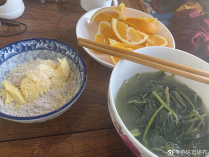

新年

一个人过年，自己做的美味早餐。祝大家新年快乐！

2021-2-12

怀业

怀业红光遍一切，一切幻化融自身~

视频-观音九本尊心咒

2021-2-15

自在

一切得自在~

视频-怀业祈祷文

2021-2-17

家务

做点家务，比如做饭、炒菜、扫地，可以念诵咒语、消除傲慢、锻炼身体。

这是一种很好的动中禅。

2021-2-19

莲师

今天是莲师会供日。祈祷莲师非常重要！

༄༅། །བར་ཆད་ལམ་སེལ་བསྡུས་པ།

除障略文

根桑严槃旺布尊者·著

索达吉堪布·译

ཨོ་རྒྱན་རིན་པོ་ཆེ་ལ་གསོལ་བ་འདེབས། །

哦坚仁波切拉所瓦得 祈祷莲师尊

འགལ་རྐྱེན་བར་ཆད་མི་འབྱུང་ཞིང༌། །

嘎锦瓦恰门炯样 远离违缘障

མཐུན་རྐྱེན་བསམ་པ་འགྲུབ་པ་དང༌། །

腾锦三巴哲巴当 成就顺缘意

མཆོག་དང་ཐུན་མོང་དངོས་གྲུབ་སྩོལ། །

窍当腾蒙乌哲作 赐予二悉地

ཅེས་པ་འདི་ཡང་ཀུན་བཟང་གཞན་ཕན་དབང་པོས་ཙ་རི་ཏྲ་ནས་ཨོ་རྒྱན་རིན་པོ་ཆེའི་ཞལ་མངོན་སུམ་དུ་མཇལ་སྐབས་གསོལ་བ་བཏབ་པ་དགེའོ། །མངྒ་ལཾ༎ ༎

此文乃根桑严槃旺布于匝热札神山亲见莲花生大士时所祈祷。

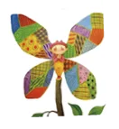

2021-2-22

菩提

谁具有菩提心，谁就会永远爱你。否则，一旦触及到自己的利益，那种“爱”就容易变质。

2021-2-24

智慧

如果一天念三遍，一定能开启你的智慧。

༄༅།། འཇམ་དཔལ་ཡེ་ཤེས་ཡོན་ཏན་བཟང་པོ་

ཞེས་བྱ་བའི་བསྟོད་པ།

妙吉祥智慧贤赞

阿阇黎金刚刃·著

索达吉堪布·译

༄༅།། རྒྱ་གར་སྐད་དུ། ཤྲཱི་ཛྙཱ་ན་གུ་ཎ་ཕ་ལ་ནཱ་མ་སྟུ་ཏིཿ

梵语：西尔嘉那格那帕拉那玛德德

བོད་སྐད་དུ། འཇམ་དཔལ་ཡེ་ཤེས་ཡོན་ཏན་བཟང་པོ་ཞེས་བྱ་བའི་བསྟོད་པ།

藏语：华耶西云丹桑波益夏沃多巴

བཅོམ་ལྡན་འདས་མགོན་པོ་འཇམ་དཔལ་དབྱངས་ལ་ཕྱག་འཚལ་ལོ། །

炯丹迪滚波将华央拉香擦洛

顶礼出有坏怙主文殊

གང་གི་བློ་གྲོས་སྒྲིབ་གཉིས་སྤྲིན་བྲལ་ཉི་ལྟར་རྣམ་དག་རབ་གསལ་བས། །

刚格洛珠 哲尼准抓 涅达南达Ra萨瓦

彼智远离 二障云雾 如日净光明

ཇི་སྙེད་དོན་ཀུན་ཇི་བཞིན་གཟིགས་ཕྱིར་ཉིད་ཀྱི་ཐུགས་ཀར་གླེགས་བམ་འཛིན། །

杰涅敦根 杰银惹协 涅杰特嘎拉万怎

如实照见 尽所有义 胸前持经函

གང་དག་སྲིད་པའི་བཙོན་རར་མ་རིག་མུན་འཐུམས་་སྡུག་བསྔལ་གྱིས་གཟིར་བའི། །

刚达哲波 尊Ra玛热 门屯德阿吉惹沃

于轮回狱 无明障蔽 苦逼有情众

འགྲོ་ཚོགས་ཀུན་ལ་བུ་གཅིག་ལྟར་བརྩེ་ཡན་ལག་དྲུག་ཅུའི་དབྱངས་ལྡན་གསུང་། །

卓措根拉 沃吉达贼 沿拉哲吉央丹松

爱如独子 具足六十 梵音之妙语

འབྲུག་ལྟར་ཆེར་སྒྲོགས་ཉོན་མོངས་གཉིད་སློང་ལས་ཀྱི་ལྕགས་སྒྲོག་འགྲོལ་མཛད་ཅིང་། །

哲达且卓 纽蒙涅隆 类杰嘉拙卓匝匠

震响如雷 唤醒惑眠 解开业桎梏

མ་རིག་མུན་སེལ་སྡུག་བསྔལ་མྱུ་གུ་ཇི་སྙེད་གཅོད་མཛད་རལ་གྲི་བསྣམས། །

玛热门色 德阿涅格 杰涅久匝Ra哲南

驱无明暗 斩尽苦苗 拿持宝剑者

གདོད་ནས་དག་ཅིང་ས་བཅུའི་མཐར་སོན་ཡོན་ཏན་ལུས་རྫོགས་རྒྱལ་སྲས་ཐུ་བོའི་སྐུ། །

多内达匠 萨吉塔松 云丹利作 嘉这特悟格

本净究竟 十地德圆 佛陀长子身

བཅུ་ཕྲག་བཅུ་དང་བཅུ་གཉིས་རྒྱན་སྤྲས་བདག་བློའི་མུན་སེལ་འཇམ་དཔལ་དབྱངས་ལ་འདུད། །

吉察吉当 吉尼坚追 达路门色 将华央拉德

相好庄严 除我意暗 文殊尊前礼

གང་ཞིག་ལྷག་པའི་བསམ་པ་རྣམ་པར་དག་པས་གཅིག་དང་བདུན་དང་། ཉི་ཤུ་རྩ་གཅིག་དང་། བརྒྱ་དང་། སྟོང་ལ་སོགས་པ་དག་ཉིན་རེ་བཞིན་དུ་སྒྲོགས་པ་དེ་ནི་གོ་རིམས་ཇི་ལྟ་བ་བཞིན་དུ། སྒྲིབ་པ་འདག་པ་དང་། ཐོས་པ་འཛིན་པ་དང་། སྤོབས་པ་དང་། མི་བརྗེད་པའི་གཟུངས་དང་། ཕྱིར་རྒོལ་བ་ཐམས་ཅད་འཇོམས་པའི་ཤེས་རབ་ཀྱི་དབང་པོ་དང་སྟོབས་ལ་སོགས་པ་ཡོན་ཏན་དཔག་ཏུ་མེད་པ་དང་ལྡན་པར་འགྱུར་རོ།། གང་ཞིག་ཉིན་རེ་བཞིན་དུ་ལན་གསུམ་དུ་བསྟོད་པ་བྱེད་པ་དེ་ནི་ཇི་སྐད་བཤད་པའི་ཡོན་ཏན་དེ་དག་དང་ལྡན་པས་ཤེས་རབ་དང་སྙིང་རྗེ་ལམ་དང་ས་རྣམས་རིམ་གྱིས་བགྲོད་དེ། གོང་ནས་གོང་དུ་ཆེས་ཆེར་འཕགས་ནས་མྱུར་དུ་རྣམ་པ་ཐམས་ཅད་མཁྱེན་པའི་གྲོང་ཁྱེར་དུ་ཕྱིན་ནས་འགྲོ་བ་མ་ལུས་པ་འཁོར་བ་ལས་སྒྲོལ་བའི་དེད་དཔོན་ཆེན་པོར་འགྱུར་རོ། །

何人以清净殊胜意乐每天诵此一遍、七遍、二十一遍、百遍、千遍等，将依次净除障碍，受持听闻，具足辩才、不忘陀罗尼、摧破反方之智慧、威力等无量功德。何人每天诵此三遍，也将具足如是所说之功德，次第经行智悲地道，日益增上，胜进跨越，迅速抵达遍知城而成为救度无余众生脱离轮回之商主。

དཔལ་ཡེ་ཤེས་ཡོན་ཏན་བཟང་པོ་ཞེས་བྱ་བའི་བསྟོད་པ། སློབ་དཔོན་རྡོ་རྗེ་མཚོན་ཆས་མཛད་པ་རྫོགས་སོ།། །།

此妙吉祥智慧贤赞，阿阇黎金刚刃撰写圆满。

རྒྱ་གར་གྱི་པཎྜིཏ་འབུམ་ཕྲག་གསུམ་པ་དང་། བོད་ཀྱི་རྔོག་ལོ་ཙཱ་བས་བསྒྱུར་བའོ། །

印度三十万（人名）班智达与藏地鄂译师由梵译藏。

2021-2-25

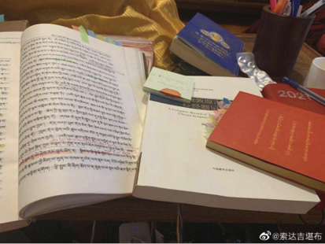

勤奋

修行，不是靠一位上师的加持就高枕无忧了，而是需要我们自己的勤奋学习。

如果你想全面了解道次第，应该主要修学《大圆满心性休息》；如果你想对本师释迦牟尼佛生起不退转的信心，那就要认真研读《释迦牟尼佛广传·白莲花论》。

2021-3-7

无憾

如果一生中修完五加行、学完五部大论，再尽量修持大圆满，发愿往生极乐世界，那么死也无憾。

2021-3-9

未完

我的寒假作业还没有做完

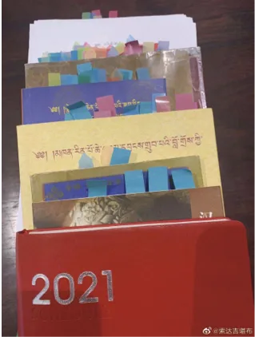

2021-3-9

学法

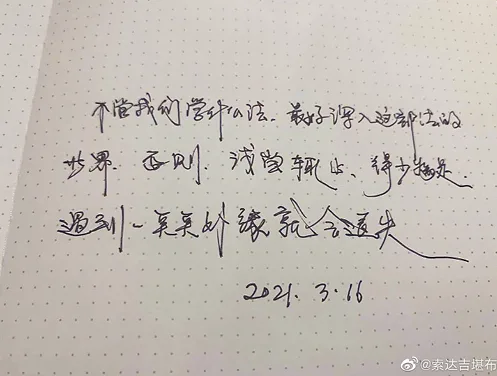

2021-3-16

福慧

有福报的人，无论接触什么样的人、修什么样的法、住什么样的地方，不仅适应性很强，还会依此增长善根。对于没有福报的人来说，情况正好相反。

所以，为了今生和来世的利乐，积累福慧资粮是很重要的。

2021-3-19

常念

观音心咒“嗡玛呢巴美吽”的功德不可思议，我们应该经常念~视频

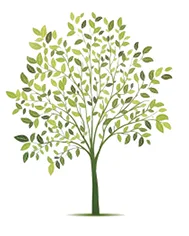

2021-3-31

喜欢

如果喜爱参禅打坐，就不会整天东奔西跑；如果喜爱念经诵咒，就不会总说别人过失；如果喜爱明观心性，就不会被烦恼痛苦所左右。

2021-4-2

不得

“贪婪者，永远不会满足；

嗔恨者，跟谁也合不拢；

愚痴者，做事难以成办；

嫉妒者，心里不会快乐；

傲慢者，看不到别人的功德；

怀疑者，见不到事物的真相。”

2021-4-19

娱乐

“毁掉我们的，不是我们所憎恨的东西，而恰恰是我们所热爱的东西。”

——《娱乐至死》

2021-4-20

梦醒

贪心如萎莲，嗔心如蜜蜂，痴心如糠秕，心性如虚空，证悟如梦醒。

2021-4-27

母亲

世界上最美丽的，就是母亲的笑容；世界上最温暖的，就是母亲的怀抱。

在今天这样的日子里，更加想念母亲、感恩母亲。

感恩世上每一位伟大的母亲！

2021-5-9

佛经

大家方便的话，应该看看这部佛经——

称赞大乘功德经

大唐三藏法师玄奘奉诏译

如是我闻。一时薄伽梵。住法界藏诸佛所行众宝庄严大功德殿。与无央数大声闻众大菩萨俱。及诸天人阿素洛等无量大众前后围绕。

尔时会中有一菩萨。示为女相名德严华。承佛威神从座而起。稽首作礼而白佛言。何等名为菩萨恶友。新学菩萨知已远离。

尔时佛告德严华言。我观世间。无有天魔梵释沙门婆罗门等。与新学菩萨。于无上菩提为恶知识。如乐声闻独觉乘者。所以者何。夫为菩萨。必为利乐诸有情故。勤求无上正等菩提。乐二乘人志意下劣。惟求自证般涅槃乐。以是因缘。新学菩萨不应与彼同住一寺。同止一房。同处经行。同路游适。若诸菩萨。已于大乘具足多闻得不坏信。我别开许与彼同居。为引发心趣菩提故。若彼种类善根未熟。不应为说大乘法教。令生诽谤获罪无量。

新学菩萨但应亲近久学大乘多闻菩萨。为于无上正等菩提。所种善根速成熟故。不应亲近乐二乘者。所以者何。彼障菩萨菩提心故。彼令弃舍菩提心故。彼令亏损菩提心故。彼令毁犯菩萨行故。菩萨宁当弃舍身命。不应弃舍大菩提心。发起趣求二乘作意。若诸菩萨劝诸有情。舍菩提心趣二乘地。若诸菩萨劝诸有情。舍菩提心造诸恶业。俱堕地狱受诸剧苦。菩萨宁守大菩提心。造五无间受地狱苦。终不弃舍大菩提心。而欲趣求预流果证。菩萨宁守大菩提心。百千大劫受地狱苦。终不弃舍大菩提心。而欲趣求一来果证。菩萨宁守大菩提心。受傍生身或作饿鬼。终不弃舍大菩提心。而欲趣求不还果证。菩萨宁守大菩提心。造十恶业堕诸恶趣。终不弃舍大菩提心。而欲趣求无生果证。菩萨宁守大菩提心。入大火坑救诸含识。终不弃舍大菩提心。而同怯贼投涅槃界。

菩萨哀愍一切有情。于生死中轮转无救。初发无上菩提心时。一切天人阿素洛等皆应供养。已能映夺一切声闻独觉极果。已能摧伏一切魔军。诸恶魔王皆大惊怖。

时德严华闻佛语已。重请佛言。何谓魔军。惟愿世尊哀愍为说。

佛告德严华。若有闻说大乘法教。不生随喜不乐听闻。不求悟入不能信受。反加轻笑毁訾凌蔑。离间谤讟捶打驱摈。应知此等皆是魔军。是则名为乐非法者。性鄙劣者。求外道者。行邪行者。坏正见者。应知此等谤毁大乘。当堕地狱受诸剧苦。从彼出已生饿鬼中。经百千劫常食粪秽。后生人中。盲聋喑痖支体不具。其鼻匾[匚@虒]。愚钝无知形貌矬陋。如是渐次罪障消除。流转十方。或遇诸佛亲近供养。复闻大乘闻已或能随喜信受。因此便发大菩提心。勇猛精勤修菩萨行。渐次进学。乃至菩提。

诸佛世尊无别作意。为有情类说五乘法。由本愿力依法界身。于一切时。从诸毛孔任运流出无量法光。以一妙音等澍法雨于一众会无量有情。昔来信乐声闻乘者。闻佛为说声闻乘法。昔来信乐独觉乘者。闻佛为说独觉乘法。昔来信乐无上乘者。闻佛为说无上乘法。昔来信乐种种乘者。闻佛为说种种乘法。昔来信乐人天乘者。闻佛为说人天乘法。傍生鬼等。亦闻如来以随类音而为说法。若有昔来未闻法者。彼惟见佛处众默然。曾闻大乘而诽谤者。经无量劫堕大地狱傍生饿鬼及天人中备受苦已。闻大乘法即能随喜深生净信。便发阿耨多罗三藐三菩提心。

时德严华闻佛说已。重请佛言。何谓大乘。此大乘名为目何义。

世尊告曰。善哉善哉。汝能乐闻大乘功德。谛听谛听。善思念之。吾当为汝分别解说。此大乘名所目诸义。此乘综摄。笼驾弘远无所遗漏。故曰大乘。此乘功德甚深微妙过诸数量。故曰大乘。此乘坚固虚妄分别不能倾动。故曰大乘。此乘真实穷未来际无有断尽。故曰大乘。此乘寥廓该罗法界邈无边际。故曰大乘。此乘如海吞纳蕴积功德宝聚。故曰大乘。此乘如山作镇区域邪徒不扰。故曰大乘。此乘如空包含一切情非情类。故曰大乘。此乘如地普能生长世出世善。故曰大乘。此乘如水等润一切令无枯槁。故曰大乘。此乘如火焚灭诸障令无余习。故曰大乘。此乘如风扫除一切生死云雾。故曰大乘。此乘如日开照群品成熟一切。故曰大乘。此乘如月能除热恼破诸邪暗。故曰大乘。此乘尊贵。天龙八部咸所敬奉。故曰大乘。此乘恒为诸健达缚歌咏赞美。故曰大乘。此乘恒为四王梵释礼敬尊重。故曰大乘。此乘恒为诸龙神等敬事防守。故曰大乘。此乘恒为一切菩萨精勤修学。故曰大乘。此乘任持诸佛圣种展转增盛。故曰大乘。此乘圆满具大威德映夺一切。故曰大乘。此乘周给一切有情令无匮乏。故曰大乘。此乘威力犹如药树救疗众病。故曰大乘。此乘能害一切有情诸烦恼贼。故曰大乘。此乘能转无上法轮饶益一切。故曰大乘。此乘微妙甚深秘密不可宣说。故曰大乘。此乘神用绍三宝种能使不绝。故曰大乘。此乘能显世俗胜义理趣究竟。故曰大乘。此乘能显诸菩萨行无不具足。故曰大乘。此乘能显佛地功德无不备悉。故曰大乘。此乘利乐一切有情尽未来际。故曰大乘。此乘至功能建大义妙用无尽。故曰大乘。此乘幽玄下劣意乐不能信受。故曰大乘。此乘平等增上意乐方能信受。故曰大乘。此乘广大下愚不测而为轻笑。故曰大乘。此乘尊高上智能达常所宝玩。故曰大乘。此乘超过独觉乘等最上无比。故曰大乘。

佛说如是大乘名义体用殊胜诸功德时。于此三千大千世界六种震动。空中天乐百千万类。不鼓自呜。诸妙天花缤纷乱堕。无量天子无数声闻。闻此法音睹斯瑞应。皆发阿耨多罗三藐三菩提心。百千俱[并*氐]新学菩萨。同时证得无生法忍。

尔时阿难即从座起。合掌恭敬而白佛言。今此法门甚为希有。能普利乐一切有情。当以何名奉持流布。

佛告阿难。此经名为称赞大乘功德。亦名显说谤法业障。以是名字汝当奉持。

时薄伽梵说此经已。阿难陀等无量声闻。德严华等无数菩萨。及诸天人阿素洛等一切大众。闻佛所说皆大欢喜。信受奉行。

2021-5-13

忏悔

今年5月12日-6月10日，是藏历的“萨迦月”。佛陀诞生、成道、涅槃，都发生在这个神圣的月份。这个月，无论做任何善事，功德都会以几何倍数增长。

为了忏悔自己和他人过去、现在、未来的一切业障，让我们一起来完成40万金刚萨埵心咒吧，“嗡班匝儿萨埵吽”……

2021-5-15

礼物

早上打开门，惊喜地发现满院子一片晶莹洁白。

这场雪，在藏人眼里是布谷鸟的礼物，大地母亲要从寒冷中苏醒了……

2021-5-16

佛陀

今天是释迦牟尼佛的圣诞日，希望大家一心一意祈祷佛陀，至少念“南无本师释迦牟尼佛”108遍。

“天上天下，唯我独尊，虚空有尽，我愿无穷。”

2021-5-19

卫塞

卫塞节快乐~

南无本师释迦牟尼佛，愿佛陀保佑你一切吉祥~

2021-5-26

五年

您已经离开我们儿女5年了，ཨོཾ་མ་ཎི་པད་མེ་ཧཱུྃ།嗡玛呢巴美吽~

2021-6-5

空性

如果想证悟空性，最好能多念“南无虚空藏菩萨”，或者藏文的“བྱང་ཆུབ་སེམས་དཔའ་སེམས་དཔའ་ཆེན་པོ་ནམ་མཁའི་སྙིང་པོ་ལ་ཕྱག་འཚལ་ལོ་མཆོད་དོ་སྐྱབས་སུ་མཆིའོ།།”（香且森华森华钦波 南m克酿波拉 香擦洛 窍多嘉森且奥）。

2021-6-17

本师

南无本师释迦牟尼佛~

2021-7-14

祈祷

河南郑州等地出现暴雨等自然灾害，请大家多祈祷度母，“嗡 达热 德达热 德热 索哈”。

2021-7-21

读书

两耳不闻窗外事，一心只读圣贤书~

2021-9-8

思念

感恩您，我的老师！我日日夜夜思念您~网页链接

2021-9-10

邻居

今天天气不错，我屋檐下的小邻居们，也出来晒太阳了~视频

2021-9-20

伙伴

小伙伴们也出来聊天、玩耍了~视频

2021-9-20

法王

གནས་ཆེན་རི་བོ་རྩེ་ལྔའི་ཞིང་ཁམས་སུ།།

内钦热卧贼诶央堪色 自大圣境五台山

འཇམ་དཔལ་ཐུགས་ཀྱི་བྱིན་རླབས་ཡིད་ལ་སྨིན།།

将华特吉辛拉耶拉门 文殊加持入心者

འཇིགས་མེད་ཕུན་ཚོགས་ཞབས་ལ་གསོལ་བ་འདེབས།།

晋美彭措雅拉所瓦得 祈祷晋美彭措足

དགོངས་བརྒྱུད་རྟོགས་པ་འཕོ་བར་བྱིན་གྱིས་རློབས།།

恭杰多巴颇瓦辛吉洛 证悟意传求加持

2022-1-17

虎年

祝大家虎年平安喜乐，家兴百和，身心安康~~

2022-1-31

真爱

2022年2月22日22点，此时此刻，千载难逢，爱爱爱爱爱爱爱爱，愿我们每个人都能领悟爱的真相~

2022-2-22

悠然

小家伙们有的在聊天，有的在晒太阳，有的在打扮，有的在禅修~视频

2022-4-20

安住

今年因为防疫的缘故，喇荣寺将不举办“金刚萨埵法会”，请大家安住于自家，多念金刚萨埵心咒“嗡班匝儿萨埵吽”。

2022-6-4

母亲

您离开已整整六年了，嗡玛呢巴美吽~

2022-6-5

生日

这次，很多人以种种方式祝贺我的生日，并行持了很多善法。我也祈祷三宝，将所有善根回向菩提，愿一切众生离苦得乐。感恩大家！

2022-8-2

修行

为了整个世界吉祥平安，为了一切众生消灾解难，从今天开始，我们闭关修行15天。每天修两座以上的菩提心，同时，每人发愿念诵七句祈祷文一万遍、金刚铠甲心咒十万遍、除疫莲师心咒一遍，并在座前座后念诵《普贤行愿品》等发愿回向文。

有缘者也应安住在自己所在地，随力随缘参与修行。

2022-9-2

闭关

在闭关的时候，要以强烈的恭敬心和欢喜心祈祷上师三宝。

身体不能乱跑，要好好安住；语言不能乱说，要好好禁语；心不能乱想，要好好禅修。

入座期间，有头有尾。下座期间，善念勿失。

2022-9-4

静夜思

举头望明月，低头思上师，心性如虚空，妄念是彩虹~祝大家节日快乐！

2022-9-10

雪

喇荣，下了第一场雪

2022-10-10

天降月

这个月是天降月，如果有条件的话，每个人最好念30万遍阿弥陀佛心咒“嗡 阿弥得瓦 阿依斯德吽舍”（ཨོཾ་ཨ་མི་དྷེ་ཝ་ཨ་ཡུ་སིདྡྷི་ཧཱུཾ་ཧྲཱིཿ）。愿一切吉祥~

2022-11-22

2023年

2022年终于过去了，为了2023年一整年的顺利吉祥，让我们一起共诵莲师心咒“嗡啊吽 班匝儿格热巴玛色德吽”108遍。元旦快乐！

2023-1-1

上师

上师如意宝的色身融入法界已经19年了，但其实他一刻也没有离开过我们。

我们每次纪念上师，通过念修金刚萨埵心咒净化自心，就可以看到内在的上师。

嗡班匝儿萨埵吽~

2023-1-3

合十

དཔལ་ལྡན་བླ་མའི་རྣམ་པར་ཐར་པ་ལ།། 于具德上师诸行，

སྐད་ཅིག་ཙམ་ཡང་ལོག་ལྟ་མི་སྐྱེ་ཞིང་།། 不生刹那许邪见，

ཅི་མཛད་ཆོས་སུ་མཐོང་བའི་མོས་ཀྱིས།། 所做视善具敬信，

བླ་མའི་བྱིན་རླབས་སེམས་ལ་འཇུག་པར་ཤོག། 上师加持入我心。

2023-1-7

需求

我最近需要法王如意宝1993年6月-10月欧美传法的相关照片和影音资料。如果谁有，可否提供到fawangruyibao9@163.com，非常感谢~

2023-1-12

回遮

明天是农历虎年的最后一天。按照传统，若能在黄昏念9遍《心经》进行回遮，可遣除下一年以死亡为主的各种不吉祥。

附：

《心经回遮仪轨》

无可言思般若度 不生不灭虚空体

各别自证智行境 三世佛母我敬礼

般若波罗蜜多心经

顶礼般若佛母！

观自在菩萨。行深般若波罗蜜多时。照见五蕴皆空。度一切苦厄。舍利子。色不异空。空不异色。色即是空。空即是色。受想行识亦复如是。舍利子。是诸法空相。不生不灭。不垢不净。不增不减。是故空中无色。无受想行识。无眼耳鼻舌身意。无色声香味触法。无眼界。乃至无意识界。无无明。亦无无明尽。乃至无老死。亦无老死尽。无苦集灭道。无智亦无得。以无所得故。菩提萨埵。依般若波罗蜜多故。心无挂碍。无挂碍故。无有恐怖。远离颠倒梦想。究竟涅槃。三世诸佛。依般若波罗蜜多故。得阿耨多罗三藐三菩提。故知般若波罗蜜多。是大神咒。是大明咒。是无上咒。是无等等咒。能除一切苦。真实不虚。故说般若波罗蜜多咒。即说咒曰。揭谛揭谛。波罗揭谛。波罗僧揭谛。菩提萨婆诃。

南无 顶礼师、顶礼佛、顶礼法、顶礼僧

顶礼般若波罗蜜多大佛母 愿我成就谛实语

如昔天王帝释依于思维甚深般若波罗蜜多之义、念诵词句而回遮魔王波旬等一切违缘，愿我亦依于思维甚深般若波罗蜜多之义、念诵词句而回遮、空无、寂灭、善灭魔王波旬等一切违缘。

不生亦不灭，不常亦不断，

不一亦不异，不来亦不去。

能说是因缘，善灭诸戏论，

我稽首礼佛，诸说中第一。

平息八万魔障类，远离损害之违缘，

圆满成办诸顺缘，依此吉祥今吉祥。

修行菩提时，内外诸危害，

一切诸障碍，悉皆得息灭。

2023-1-19

兔年

愿所有的开心都轰轰烈烈向你奔来，愿所有的不开心都彻彻底底留在过去。兔年快快乐乐，平平安安！

2023-1-21

神变月

今天是藏历兔年的第一天，也是神变月的开始。为了让这个世界更和平、更吉祥，为了让我们的内心更柔软、更慈悲，希望大家多念观音心咒“嗡玛呢巴美吽ཨོཾ་མ་ཎི་པད་མེ་ཧཱུཾ།”，在最短的时间内完成一万遍。新年快乐，扎西德勒！

2023-2-21

清净

法王晋美彭措说：每个人若能念40万遍金刚萨埵心咒“嗡班匝儿萨埵吽”，则一生中所造的最大罪业也可以清净。

2023-5-27

祝福

今天是六一儿童节，祝愿普天下的孩子拥有一个充满爱心和智慧的童年，节日快乐！

2023-6-1

地藏

南无地藏王菩萨～

2023-7-18

莲师

莲师心咒之功德

莲花生大士  伏藏

噶玛朗巴大师 取藏

索达吉堪布  翻译

顶礼上师、本尊、空行！

益西措嘉女子我，供养外、内、密大曼茶罗而呈白：“奇哉！莲花生大士，对我们西藏的一切众生，今生来世作了广大利益。胜过您深恩厚德者，以前未曾出现过，以后也不会出现。您已恩赐了如醍醐般的修法，我虽是女流，却无有怀疑，而未来的众生三心二意，刚强野蛮，对妙法起邪见，尤其会诽谤无上密法，到那时，一切众生前疾疫、饥馑、刀兵频起，尤其汉、藏、蒙如同毁坏蚁穴一般，到了西藏百姓受苦的时刻。您已宣说众多扭转之方便，而未来的人们无有空闲修行，个别想修行之人也是违缘重重，众生意愿不一，不具足财物，行为不如法，如此恶时极难阻挡。于如此之时，唯一依靠莲师的修法心咒，有什么利益？为利未来浅慧者，请求宣说。”

尔后，莲花生大士告言：“噢，具有信心的女子，您所陈述千真万确，于未来如是时刻对众生必定有暂时究竟利益的不可估量窍诀修行，许多已隐蔽成地伏藏、水伏藏、岩伏藏、虚空伏藏等。恶时之际，有缘者的方便缘起极难聚合，这是众生福德穷尽之相。然而在如此之时，这一‘嗡啊吽班则革日班玛斯德吽’，在圣地或寺院或高山之巅或大河之畔，鬼神魑魅猖獗的沟头沟尾等处，具足誓言的咒师、具足戒律的僧众、具足信心的士夫、具足法相的女子等，如果在广大发心的状态中尽可能念诵百、千、万、十万、千万、一亿遍等，则功德利益威力不可思议。于一切地方，能遣除疾疫、饥馑、刀兵、战乱、天灾、凶兆、厄运，能令风调雨顺，农牧丰裕，诸地吉祥。在今生、来世、中阴，上根者直接、中根者于觉受中、下根者于梦中屡屡见到我，次第圆满地、道以后，必定于妙拂洲刹土趋入男女持明行列。

即使（每天）不间断念诵一百遍，也会使他人悦意，在无勤中获得食品、财物受用；

如果念诵千、万遍等，则能慑服、加持他心，无碍成就威力；

倘若念诵十万、百万遍等，则能怀柔三界，慑服三有，役使鬼神，无碍成就四种事业，能行持一切众生所想的无量利益；

如若能念诵三千万或七千万遍等，则与三世诸佛不相分离，与我无二无别，所有天龙八部言听计从，交口称赞，成办所嘱托之事。

上根者于即生成就虹身，中根者在临终时认识母子光明，下根者也会在中阴面见我而显现解脱于自地，往生妙拂洲刹土，利益无量众生。”

（益西措嘉空行母呈白：）“大士啊，宣说如此无量广大功德威力，恩德实大。莲师心咒逐字解释的功德威力虽然不可估量，但为利益未来众生，请求摄略宣说。”

尔后莲花生大士告言：“噢，善女子，‘嗡啊吽班则革日班玛斯德吽”并不是我独有的心咒，它是四续部本尊、九次第乘、八万四千法蕴的命根，此中俱全三世诸佛、上师本尊空行护法等的心咒。俱全的原因何在呢？请认真谛听，铭记在心，当念诵、当缮写、当于未来众生讲说。

嗡啊吽班则革日班玛斯德吽，

其中‘嗡啊吽’是诸佛身语意的心咒；

‘班则’是金刚部的心咒；

‘革日’是珍宝部的心咒；

‘班玛’是莲花部的心咒；

‘斯德’是事业部的心咒；

‘吽’是善逝部的心咒。

嗡啊吽班则革日班玛斯德吽，

‘嗡’圆满五方佛报身；

‘啊’圆满无变法身；

‘吽’圆满化身莲师；

‘班则’圆满黑日嘎之尊众；

‘革日’圆满上师持明尊众；

‘班玛’圆满空行本尊坛城；

‘斯德’是财神、伏藏主之命脉；

‘吽’是无余一切护法之命脉。

嗡啊吽班则革日班玛斯德吽，

‘嗡啊吽’是三传承之命脉；

‘班则’是律藏、经藏之命脉；

‘革日’是论藏、事续之命脉；

‘班玛’是行续、瑜伽续之命脉；

‘斯德’是玛哈、阿努之命脉；

‘吽’是大圆满阿底之命脉。

嗡啊吽班则革日班玛斯德吽，

以‘嗡啊吽’清净三毒障；

以‘班则’清净嗔心障；

以‘革日’清净我慢障；

以‘班玛’清净贪心障；

以‘斯德’清净嫉妒障；

以‘吽’清净烦恼障。

嗡啊吽班则革日班玛斯德吽，

以‘嗡啊吽’获得法、报、化身；

以‘班则’获得大圆镜智；

以‘革日’获得平等性智；

以‘班玛’获得妙观察智；

以‘斯德’获得成所作智；

以‘吽’获得一切智慧任运成就。

嗡啊吽班则革日班玛斯德吽，

以‘嗡啊吽’调伏天、鬼、人；

以‘班则’胜伏寻香、火神诸魔；

以‘革日’胜伏阎罗、罗刹诸魔；

以‘班玛’胜伏水神、风神诸魔；

以‘斯德’胜伏夜叉、自在天神诸魔；

以‘吽’胜伏恶曜、地神诸魔。

嗡啊吽班则革日班玛斯德吽，

以‘嗡啊吽’成就六波罗蜜多；

以‘班则’成就一切息业；

以‘革日’成就一切增业；

以‘班玛’成就一切怀业；

以‘斯德’成就一切事业；

以‘吽’成就一切诛业。

嗡啊吽班则革日班玛斯德吽，

以‘嗡啊吽’回遮僧人苯教橛诅咒；

以‘班则’回遮（他人所迎请）智慧本尊的诅咒；

以‘革日’回遮天龙八部诅咒；

以‘班玛’回遮世间鬼神诅咒；

以‘斯德’回遮龙类、地神诅咒；

以‘吽’回遮天、鬼、人诅咒。

嗡啊吽班则革日班玛斯德吽，

以‘嗡啊吽’摧毁五毒之魔军；

以‘班则’摧毁嗔心之魔军；

以‘革日’摧毁我慢之魔军；

以‘班玛’摧毁贪心之魔军；

以‘斯德’摧毁嫉妒之魔军；

以‘吽’摧毁天、鬼、人之魔军。

嗡啊吽班则革日班玛斯德吽，

以‘嗡啊吽’获得身语意悉地；

以‘班则’获得寂猛本尊悉地；

以‘革日’获得持明上师悉地；

以‘班玛’获得空行护法悉地；

以‘斯德’获得殊胜共同悉地；

以‘吽’无余获得一切所求悉地。

嗡啊吽班则革日班玛斯德吽，

以‘嗡啊吽’往生本来刹土；

以‘班则’往生东方现喜刹土；

以‘革日’往生南方具德刹土；

以‘班玛’往生西方极乐刹土；

以‘斯德’往生北方事业刹土；

以‘吽’往生中央不动刹土。

嗡啊吽班则革日班玛斯德吽，

以‘嗡啊吽’获得三身持明；

以‘班则’获得住地持明；

以‘革日’获得寿自在持明；

以‘班玛’获得大手印持明；

以‘斯德’获得任运持明；

以‘吽’获得异熟持明。

嗡啊吽班则革日班玛斯德吽，

念诵一遍莲师之心咒，

彼若有色世界也难容，

见闻忆念此之诸众生，

必定置于男女持明列。

无欺莲师心咒谛实语，

若未如其所愿而成办，

莲生我已欺惑诸有情，

决定无欺依教而修行。

此咒作成幡旗飘顶巅，

风触众生无疑得解脱，

抑或刻写土木石面上，

予以开光设置道路旁，

谁见清净疾疫诸魔障，

住于彼地鬼神皆远离，

金粉书于蓝纸系带身，

一切魔障鬼王不能害。

如若命终不离尸体焚，

彩虹萦绕定生极乐国，

缮写讽诵功德不可量，

为利未来有情隐藏彼，

愿诸具缘之子得值遇。”

萨玛雅！印！印！印！于邪见者保密！印！印！印！交付与具誓言者！印！印！印！化身噶玛朗巴开取伏藏而由黄纸中抄录。

2009年8月26日译

2023-8-16

需求

我最近需要法王如意宝1995年东南亚传法（香港、新加坡、马来西亚）的相关照片和影音资料。如果谁有，可否提供到fawangruyibao9@163.com，非常感谢~

2023-8-31

山林

在寂静山林中~

2023-9-6

感恩老师

感恩生命中遇见的最重要的引导者，我的老师们！

教师节快乐~

2023-9-10

怨与怨

怨怨不休息，自古有此法，

无怨能胜怨，此法终不朽。

——《增一阿含经》

2023-9-19

乃琼护法神

乃琼护法神祈祷文

梅龙益西让当扎比杰，圆镜智相护法尊，

乃琼加波阔当央阔杰，乃琼王及眷属前，

索罗确多吉巴冈久吉，祈祷供养令欢喜，

刚就陈雷托美涅珠作。嘱托事业顺速成。

为满足位于美丽海岛之乃琼寺内以喇嘛罗桑顿单为主的众弟子的祈请，阿旺洛珠宗美（法王晋美彭措）欢喜撰写，善哉！1993年6月19日

2023-9-22

坚固

如果信心的山王坚固不变，上师本尊的加持光芒，将会永远不离。视频

2023-9-26

中秋

天上的皎月圆圆满满，心中的正法圆圆满满，利他的事业圆圆满满，祝大家中秋快乐！

2023-9-29

文殊

法王如意宝生前最提倡的，就是念诵文殊心咒“ༀ་ཨ་ར་པ་ཙ་ན་དྷཱིཿ嗡阿Ra巴匝那德”。自20世纪80年代以来，几乎所有法王的僧俗弟子都发愿念文殊心咒一亿遍。

最近，喇荣全体僧众将闭关念修文殊心咒100万遍。我自己也发愿，要在一年内完成这个数字。

如果您也想参与这项广大善事——2024年11月1日之前念完100万遍文殊心咒，可以点赞这条微博。届时，所有参与者可获得共修文殊心咒千百亿遍的功德，僧众也会将此功德进行回向。

嗡阿Ra巴匝那德，嗡阿Ra巴匝那德……

2023-10-12

心咒

阿弥陀佛心咒：

ཨོཾ་ཨ་མི་དྷེ་ཝ་ཨ་ཡུ་སིདྡྷི་ཧཱུྃ་ཧྲཱི༔

嗡 阿么得瓦 阿耶色德 吽舍

2023-10-31

附录

索达吉堪布原创歌曲

1．我的金刚上师

2．感恩老师

3．放生歌

4．佛赞

5．慈慧歌

6．启动爱心

7．想念上师

8．世青会会歌

9．希望之声（藏文）

我的金刚上师

作词：索达吉堪布

我的金刚上师是晋美彭措，

我的故乡是五明佛学院，

我修的法是无上大圆满。

是无上大圆满！

祝愿大家证得菩提证得大圆满！

我的金刚上师是晋美彭措，

源源不断的妙法植入我心田，

传授我们

脱离轮回的无上大圆满，

祈请上师乘愿再来度众生！

祈请上师慈悲加持长我智慧，

度化众生同生西方极乐国！

感恩老师

作词：索达吉堪布

感恩您我的老师 您却默默留下

无论走到哪里 安于清淡的人生

荣华还是贫穷 在荒芜的心田播种

永远不能忘怀 老师

您的身影 是一支油灯

感恩您 我的老师 为我照亮航程

无数日落日出 无怨的燃烧生命

春夏秋冬 老师

永远陪着我们 慈悲的使者

是您的笑容 你是我的骄傲

人们都在追名逐利 如山的恩情

放生歌

作词：索达吉堪布

一只只小鸟回归蓝天

欢乐的歌声弥漫天际

天王感动降下了福喜

山川河流祥和安逸

一条条小鱼回归沧海

自由的舞姿摇动海域

龙王感动撒播出甘霖

花草树木快乐生息

嗡玛呢巴美吽 嗡玛呢巴美吽

站在路口的人们啊 你要去向哪里

一边是永恒的黑暗 一边是光明福祉

请随我同声唱啊 同唱嗡啊吽

放飞你心中的爱 拥抱蓝天大地

嗡玛呢巴美吽 嗡玛呢巴美吽

一群群牛羊 回归草原

安闲的身影 装点雪域

护法感动 赐予了幸福

白云绿草 充满生机

嗡玛呢巴美吽 嗡玛呢巴美吽

站在路口的人们啊 你要去向哪里

一边是永恒的黑暗 一边是光明福祉

请随我同声唱啊 同唱嗡啊吽

放飞你心中的爱 拥抱蓝天大地

站在路口的人们啊 你要去向哪里

一边是永恒的黑暗 一边是光明福祉

请随我同声唱啊 同唱嗡啊吽

放飞你心中的爱 拥抱蓝天大地

嗡玛呢巴美吽 嗡玛呢巴美吽 嗡玛呢巴美吽

佛赞

作词：索达吉堪布

一朵白云往南飞去

飘飘荡荡如烟如絮

它承载着我的心意

共同追随佛的足迹

嗡牟尼牟尼 玛哈牟尼耶索哈

蓝毗尼园示现化身

天上天下唯我独尊

菩提伽耶降伏众魔

启明星时彻悟光明

鹿野苑中敲响法音

启示正途照亮尘世

拘尸那罗教化无常

涅槃雷鸣震动天地

嗡牟尼牟尼 玛哈牟尼耶索哈

嗡牟尼牟尼 玛哈牟尼耶索哈

蓝毗尼园示现化身

天上天下唯我独尊

菩提伽耶降伏众魔

启明星时彻悟光明

鹿野苑中敲响法音

启示正途照亮尘世

拘尸那罗教化无常

涅槃雷鸣震动天地

您的大悲您的智慧

世间智者何人能及

若以信心稍作随念

绵绵加持流入心间

嗡牟尼牟尼 玛哈牟尼耶索哈

嗡牟尼牟尼 玛哈牟尼耶索哈

慈慧歌

作词：索达吉堪布

每一个生命 慈爱最真 喜舍最美

都需要关爱 奉献让心闪闪发光

每一个角落 爱 慈润万物

都需要关怀 善 慧耀万代

献一丝微笑 授人玫瑰手有余香

说一句爱语 给予换来幸福绵长

伸一双援手 慈爱最真 喜舍最美

春暖花开 奉献让心闪闪发光

授人玫瑰手有余香 奉献让心闪闪发光

给予换来幸福绵长

启动爱心

作词：索达吉堪布

芳草茵茵的花园里

有绚烂盛开的花儿

也有枯萎凋零的落叶

枯萎凋零的落叶

人人都歌颂追逐着鲜花

却忘了落叶的挣扎

枯枝的痛楚

朋友啊

请不要忽略落叶的呻吟

听不到枯枝的悲鸣

没有落叶的陪衬

哪来鲜花的缤纷

嗡玛呢巴美吽…

物欲横流的世界中

有高朋满座的富豪

也有孤苦伶仃的众生

孤苦伶仃的众生

人人都赞美奉承着富豪

却忘了病人的无助乞丐的艰辛

朋友啊

请不要吝啬哪怕一句安慰

哪怕是一个微笑

没有众生的福田

哪来菩提的芳芬

朋友啊

请不要吝啬哪怕一句安慰

哪怕是一个微笑

没有众生的福田

哪来菩提的芳芬

嗡玛呢巴美吽…

想念上师

作词：索达吉堪布

上师

我在喇荣的天空下想您

我在色达的草原上想您

安坐或行走都不能自已

随时随地

上师

此刻银岭上已漫天碧绿

幻觉中又能和您走在一起

您温暖的笑容一如往昔

亲切低语

父母给了我一时的身躯

上师给了我

永恒的智慧真谛

人间恩情如夜空的繁星

上师是明月照我路途万里

若不是此生有幸遇到了您

得到您大悲心的无量摄持

我会继续在黑暗中流转

无明无智和解脱之路失之交臂

上师

在迷失的人群之中

我找到了自己

我是幸运的幸福快乐的

我知道报答您的方式

唯有利益众生的利益

上师

我在喇荣的天空下想您

我在色达的草原上想您

རེ་བའི་འབོད་པ།

希望之声

ཚིག མཁན་པོ་བསོད་དར་རྒྱས།

作词：索达吉堪布

སྲིད་པ་བརྒྱུད་ནས་ཡང་ཡང་རྙེད་དཀའ་བ། །

世世辗转复难得

ངེས་ལེགས་ནོར་བུའི་གཞི་གྱུར་མཐོ་རིས་རྟེན། །

决定胜源人身宝

ཆོས་ལྡན་ལུས་འདི་ཡུན་རིང་འཚོ་བའི་ཕྱིར། །

为此修行身长存

འཕྲོད་བསྟེན་ཚེ་ཡི་བདུད་རྩི་རྒྱུན་དུ་བསྟེན། །

当依健康寿甘露

རབ་དཀར་ཁ་བའི་ལྗོངས་སུ་ཉེར་འཁྲུངས་པའི། །

诞生洁白之雪域

མ་ཡུམ་གངས་དཀར་ལྷ་མོའི་གཅེས་ཕྲུག་ཚོ། །

雪山天女诸爱子

ནད་ཀྱི་རྒྱུ་གྱུར་དེང་གི་བཟའ་བཏུང་རིགས། །

远离病原今饮食

རིང་དུ་སྤོངས་ལ་ལུས་སེམས་བདེ་ཐང་མཛོད། །

体安康心安乐

དོན་གཉིས་དཔལ་གྱུར་ཆོས་སྲིད་ནོར་བུའི་མཛོད། །

二利二法珍宝藏

སེམས་ཀྱིས་འཚོ་ཞིང་ལུས་ཀྱིས་སྲུང་དགོས་པས། །

需以心育以身护

མི་རེ་བཞིན་དུ་འཕྲོད་བསྟེན་ཉམས་བཞེས་ཏེ། །

人人卫生付实践

ཀུན་ཀྱང་ལུས་སེམས་བདེ་ཐང་ཡོང་བར་གྱིས། །

众人身心得安宁

རྒན་དར་གཞོན་པའི་སྐྱེ་བོ་སུ་ཡིན་ཡང་། །

无论年老年幼人

རང་གི་ལུས་སེམས་རང་གིས་ཉེར་སྲུང་ལ། །

自当爱护自身心

འདི་ཕྱི་དགེ་བའི་ལས་ལ་ཀུན་ཏུ་འབོད། །

普行今生来世善

རང་གཞན་བདེ་བའི་རྒྱུ་ལ་གཅིག་ཏུ་བརྩོན། །

同力自他安乐因
