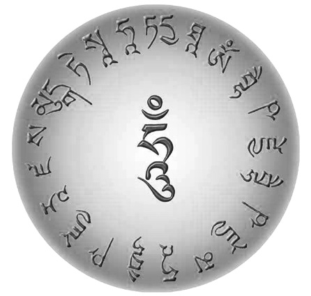
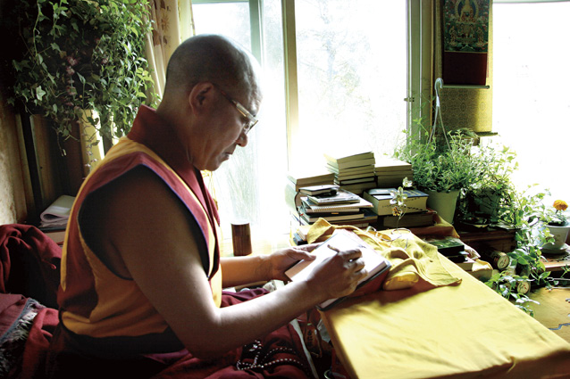

# “忍”要经得起考验

有些人在修安忍时，过了一段时间，感觉修行不错，好像到了一定的境界，就开始沾沾自喜起来。其实，你没必要高兴过早，有时候，这种境界不一定经得起考验。

以前有一位老人，他脾气不太好，为了让自己不生嗔，就在客厅写下“百忍堂”三个大字，以此来提醒自己要安忍。

过了不久，他自认为安忍修得不错，对此相当满意，逢人便开始夸耀。

一天，有个乞丐为了试探他，故意来到客厅里，装作不知道地问：“这三个字怎么读？”

他微笑着回答：“百忍堂。”

“噢，百忍堂。”乞丐重复念了一遍，然后就出去了。

过了一会儿，乞丐又回来问：“实在抱歉，我忘了它叫什么，您可不可以再说一遍？”

老人有点不耐烦，没好气地说：“百忍堂。”

“好好好，谢谢你。”

过一会儿，他又回来，再次问同样的问题。

老人特别生气，吼道：“难道三个字都记不住吗？是百忍堂！”

乞丐听了，笑笑说：“噢——原来是不忍堂！”

可见，安忍是最难修的，别人稍不中意的语言或行为，就能让自己的嗔心一触即发。

还有一个故事，也讲了同样的道理：

有位久战沙场的将军，已厌倦战争，专程到宗杲禅师处要求出家。禅师说：“不要着急，慢慢来。”

将军祈求道：“我现在什么都放得下，妻子、儿女、家庭都不是问题，请您即刻为我剃度吧！”

禅师劝他：“慢慢再说吧。”将军没有办法，只好回去。

某日，将军起了个大早，跑到寺院里礼佛。宗杲禅师一见他，便问：“将军为何这么早就来拜佛？”

将军说：“为除心头火，起早礼师尊。”

禅师开玩笑地回道：“起得这么早，不怕妻偷人？”

将军一听非常生气，骂道：“你这老怪物，讲话太伤人！”

禅师哈哈一笑：“轻轻一拨扇，性火又燃烧。如此暴躁气，怎算放得下？”

从上面的故事可以看出，凡夫人不能过早地说大话，自认为一切都看得破、放得下，可是一碰到违缘，什么境界都一扫而光了。

药师佛咒轮

此咒轮可以治病、消灾、祈福、求愿、解怨释结、增长善缘，能灭身中过去生死一切重罪，不再经历三恶道，远离九种横死。常佩带此咒轮，可获极大感应。

要想除掉旷野中的杂草，

最好的办法就是在上面种庄稼。

要想遣除内心的苦恼，

唯一的方法就是用利他的美德去占据它。

