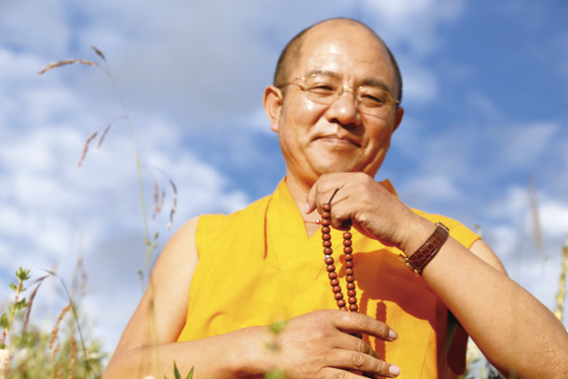

# 不图回报反而有大回报

在利他的过程中，有些人虽然不图任何回报，但有时因缘不可思议，也会出现意想不到的收获。

往昔，佛陀在因地时，每次布施身体、财产、王位、妻儿，帝释天问他是为了什么，他都回答：“唯一想让众生获得快乐，此外没有其他希求。”

我们虽然无法做到佛陀那样，但也应尽量无条件地利益众生。在此过程中，有些人虽然不图任何回报，但有时因缘不可思议，也会出现意想不到的收获。

以前有个大学生，他读书时没有钱，只好利用课余时间打工，挨家挨户地推销商品。

有一天中午，他肚子特别饿，就去敲一家的门，想要点儿东西吃。

开门的是一个小女孩。大学生有点不好意思，但已经到了门口，没办法只好开口说：“我很饿，可不可以给我一点食物？”

小女孩给他拿来一杯开水、几块面包。

他狼吞虎咽地吃完后，问她要多少钱？小女孩说，家里的食物很多，不要他的钱。

很多年后，小女孩长大成家了。有一天，她突然得了非常怪的病，在一家医院做手术花了很多钱，但是根本没有效果。

有人建议她去某某医院，那里有位医术高明的医生，或许能治她的病。于是，她就到那个医院去，果然治疗效果不错，住院的时间也比较长。

出院时，她觉得住了这么长时间，医疗费肯定是个天文数字。以前治病花了很多钱，现在钱也没有了，所以结账时根本不敢看。

后来，她鼓起勇气看了一眼，账单上写的竟然是：“一杯开水、几块面包，足以支付你所有的医疗费。”

那个医生，就是她帮助过的大学生。

孟子说：“爱人者，人恒爱之；敬人者，人恒敬之。”其实，生命就像是空谷回声，你送出什么，它就送回什么；你播种什么，就收割什么；你给予什么，就得到什么。因果是丝毫不爽的，只要你付出了，就必定会有收获，只不过是时间早晚而已。

痛苦的根源，就是执著。

即便只有针尖那么小的执著，

也会引来绵绵不绝的痛苦。

对于自己执著的，得到了，患得患失；

得不到，伤心欲绝。

如果没有执著，这一切得失又与你何干？

