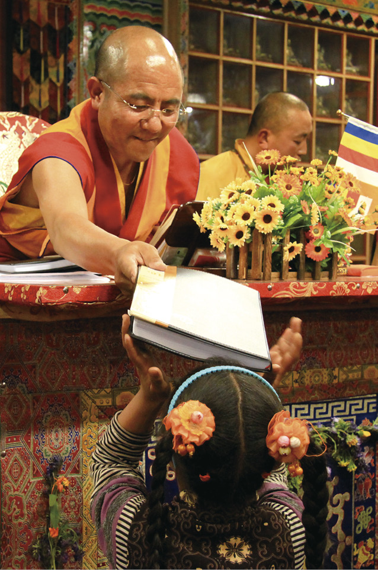

# 为别人着想是最大的利己

不管你是做什么的，如果始终想着自己，别人不一定看得上你，但若尽心尽力地帮助别人，大家就会对你另眼相看。所以，一个人若想自己得利益，就要先为别人着想。

倘若没有做好人，想成佛是不可能的。

当然，每个人对“好人”的定义不相同：有人认为脾气好、性格好、做事勤快，就是人格贤善；有人认为长得漂亮，就具有人格魅力；有人认为心比较软，就是人格很好；有人认为个性坚强，肯定是好人……但我的上师并没有这么认为，他老人家说，想做好人的话，就要在这几点上下功夫：

一、“言行恒时随顺友”

言行举止经常随顺他人，对上者恭敬，对中者和睦，对下者关爱，跟谁都合得来，不会动辄横眉怒目，处处与人作对，不论到哪个团体都搅得鸡犬不宁。

当然，随顺他人，也不是没有原则的。别人生贪心你也随顺，生嗔心你也随顺，不是这个意思。随顺并不等于一味地投其所好，而是对如理如法的行为，才应当去随顺。

人与人在一起难免磕磕碰碰，任何团体都会有许多矛盾，但人格好的话，跟谁接触都十分融洽，而不是别人说上去、自己偏要下去，别人说做稀饭、自己偏要吃干饭，什么都要特立独行。就像藏地有个比喻说：“一百头牦牛上山的时候，嘎巴牛（牦牛中的败类）非要往下跑。”这种说法还是很形象的。人格不好的人，在任何地方都惹是生非，就算坐车去往某地，一路上也会跟好多人吵架。这样的人离开之后，大家都觉得很舒服，好像祛除了眼翳一样，得吃顿饭庆祝庆祝。

不过，人格的好坏，在表面上也看不出来。有些人言行举止很不错，但接触一段时间后，大失所望；有些人刚开始似乎比较顽劣，结果越接触越觉得他好，很让人信任。所以，“路遥知马力，日久见人心”，这句话确实说得在理。

二、“秉性正直”

不管说话还是做事，心都要正直，不包庇自方、嗔怪他方，而是以客观事实为准，不偏袒任何一个人。

有些人性格非常直，看不惯马上说出来，想什么就说什么，认为这就叫做“正直”。其实不然，这只是把心里想的，从嘴里吐出来而已。所谓的正直，是以良心作证，遇到事情时既不偏向自己，也不偏向他人，无论对方高低贵贱，是高官抑或乞丐，只要符合客观事实，就当仁不让地站在那一边。

这样的人如黄金般难得，众所周知，包公斩驸马就是正直的典型。包公为了伸张正义，宁愿触怒皇室，哪怕丢掉乌纱帽，也不违背正理公意。海瑞亦是这样，他为官清廉、刚正不阿，为了正义宁可罢官。而有些人并非如此，说起话来天花乱坠，但私底下完全不是这回事。现在狡猾的人实在太多了，我们一定要学会正直，若能做到这一点，别人冤枉误解也好、诽谤诋毁也罢，自己都问心无愧，始终会像纯金一样发出真实善良的光，不被任何黑暗所覆盖。

三、“心善良”

假如能做到随顺别人、为人正直，但心肠狠毒的话，人格也好不到哪儿去。现在有些人，话讲得头头是道，可背后却包藏害人之心，那做什么都徒劳无益。因为心是一切之根本，宗喀巴大师也说：“心善地道亦贤善，心恶地道亦恶劣。”心善的话，一切都是光明的；心恶的话，只能趋往黑暗了。

这三点做人的道理非常重要！

上师还进一步说，倘若你想利益自己，利他是最好的窍诀。作为凡夫俗子，完全不考虑自己是不可能的，但考虑自己的过程中，若是损害其他很多人，自己的事业也不会成功。

有一次乘飞机，我旁边坐了个年轻人，看起来很有才华。他是一个企业的总经理，平时不信佛教，但我们聊起来还是有共同语言。他说：“应该做好人、多帮人。实际上，任何企业若想成功，一定要帮助周围的人，这样才有生存空间。假如我一味地顾着自己，别人也是很聪明的，谁都能感觉得到，最后我也不会有什么成果。”他讲得挺有道理。确实，不管你是做什么的，如果始终想着自己，别人不一定看得上你，但若尽心尽力地帮助别人，大家就会对你另眼相看。所以，一个人若想自己得利益，就要先为别人着想。

上师也曾开玩笑说：“我通过多年的生活经验发现，如今很多人不会做人，每天自私自利只想自己，这不一定就能得偿所愿。比如，有的年轻人喜欢某个人，就把对方束缚得死死的，拼命地占为己有，结果往往适得其反；而有的人喜欢对方，就全心全意地支持他、帮助他，对方毕竟也是人，最后会接受这种心意的。”

只可惜，很多人不懂这个道理。

假设你可以活80岁，一年365天算下来，

你一生才2万9千多天，不到3万天。

所以，人生真的很短，你还舍得浪费吗？

