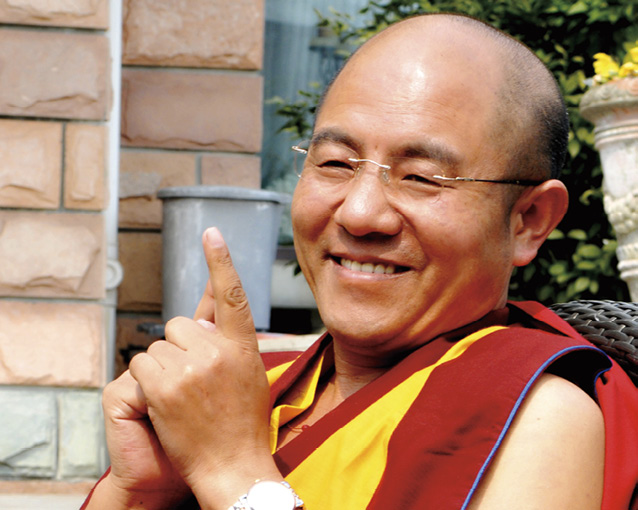

# 人80%的痛苦都与金钱息息相关

这个世界上，80%的幸福与金钱无关，80%的痛苦却与金钱息息相关。

在佛教中，对金钱如何看待呢？

它既不是善也不是恶，既不是美也不是丑，它能给人们带来痛苦，也能带来快乐，关键要看用它的人怎么用。

在唐朝，一位政治家、文学家叫张说，他撰写了一篇不到两百字的《钱本草》，其中就以草药为喻，说明金钱既不是好东西，也不是坏东西。用好了，就像草药可以治病一样，能济世救人、自利利他；用不好，就像草药会变成毒一样，能伤人性命、自害害他。

但可惜的是，如今许多人都没有把它用好，以至于这个世界上80%的幸福与金钱无关，80%的痛苦却与金钱息息相关。

有些人拥有的钱越多，痛苦就越大。正如华智仁波切所说：“有一条茶叶，就会有一条茶叶的痛苦；有一匹马，就会有一匹马的痛苦。”

佛陀在《大宝积经》中也说：“财物如幻亦如梦，愚痴众生被诳惑，刹那时得刹那失，何有智者生爱心？”钱财的本质如梦如幻、极其虚妄，愚痴的众生没有认识到，就容易被它欺惑。其实，钱财可以很快得到，也能很快就失去，看清了这一点后，智者又岂会拼命地贪执它？

唐朝有一位庞蕴居士，将家中的金银细软用船装着，全部扔到了湘江里。有人问他为什么这样做，庞蕴唱了一首偈子：“世人多重金，我爱刹那静。金多乱人心，静见真如性。”

当然，完全看破金钱，对大多数人来讲，是根本不现实的。所以，佛陀在经中说，通过正当的途径积累财富，也是允许的。

比如，《杂阿含经》《善生子经》中都提到了，我们所赚的钱应该分为四份：一份用于衣食温饱；两份用于投资营利；还有一份要储蓄起来，以备不时之需。

可见，佛陀并没有要求把所有钱财全部抛弃，因为我们不可能像蚯蚓一样，天天吃土就可以了。尤其是作为在家人，若不赚钱养家糊口，生活就没办法过下去。

但即便如此，对金钱也不能过于崇拜。其实，金钱不像有些人想得那样“无所不能”。世人也说：“钱可以买到房屋，却买不到温暖；钱可以买到药品，却买不到健康；钱可以买到书本，却买不到智慧；钱可以买到床铺，却买不到睡眠……”

当然，金钱也并非一无是处。法国作家小仲马在《茶花女》中，就曾说：“钱财是好奴仆、坏主人。”如果把钱仅仅视为一种工具，有也可以、没有也可以，多也可以、少也可以，自己会活得非常自在；但若把钱当成人生的全部，明明已经衣食无忧，却仍不知满足、欲壑难填，这样绝不会有真正的快乐。

然而遗憾的是，现在很多人却偏偏选择后者，把金钱当成“主人”，自己成了金钱的奴隶。他们有一栋房子，还想再买一栋；有一辆轿车，还想再买一辆……为了这些可有可无的东西，耗尽了自己的一生，也错过了本该拥有的幸福。

昨天之前发生的一切，是昨晚的梦；

明天之后发生的一切，是明晚的梦；

现在的一切，正在做梦。

