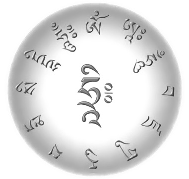
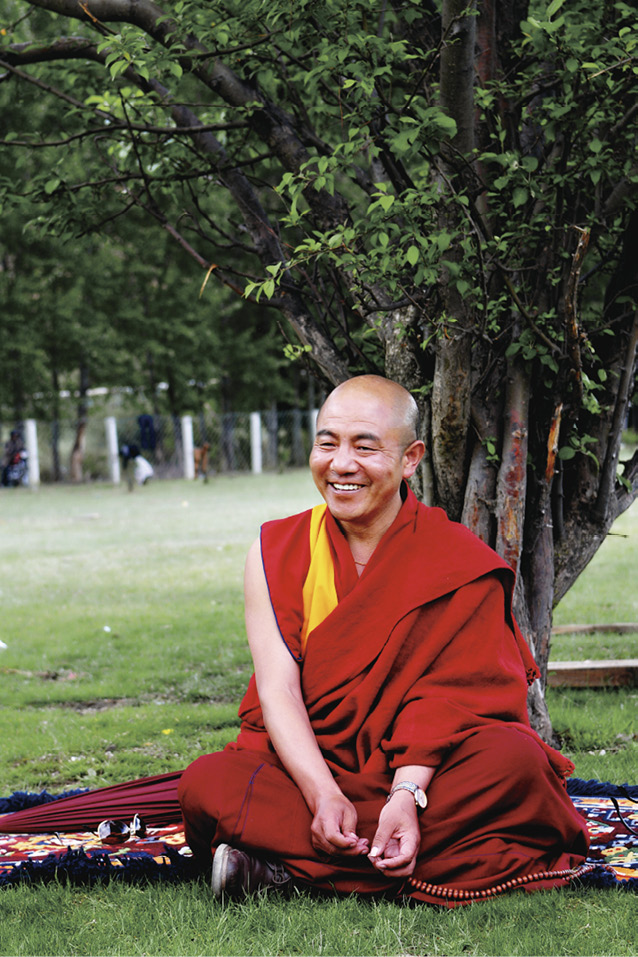

# 哪些“闲事”必须管

在过失方面，与自己无关的闲事，就不要管；但在利他方面，即使与己无关，还是应该去关心。

有些人在吵架时，常会说别人：“狗拿耗子，多管闲事！”意思是，跟你无关的事，就不要多管，以免惹祸上身。

古人也讲过：“不在其位，不谋其政。”你在什么位置上，做好本分的事即可，不要越俎代庖，去管你不该管的事情。

话虽如此，但“不要管闲事”也不能理解得太片面。

有些人觉得，不管是什么事，只要和自己无关，就不必瞎操心，应当视若无睹、充耳不闻。其实这是不对的。

1964年，美国发生了一起令人震惊的杀人案：当时38人目睹了一女子被陌生人刺杀，但在持续半小时、来回三次的刺杀过程中，竟无一人救助或报警。这种见死不救的行为，正是“不要管闲事”的真实写照。既然人人都抱着“事不关己，高高挂起”的理念，又怎么会去见义勇为呢？

我还看过一则新闻：一个中年妇女同一个男子经过江边时，听见有人落水喊“救命”。男子准备去救人，那个妇女阻止道：“少管闲事，我们走路要紧，过一会儿他会自己浮起来。”结果，淹死的正是她的亲生女儿。

如今世态炎凉，很多人都只顾自己，不愿多管闲事，就怕惹上不必要的麻烦。常看到有新闻报道：某某小孩不慎坠楼，刚开始没有死，但附近的路人从他身边经过时，一个个视而不见，谁都不把他送医院，最后一个小生命就这样断送了；某某老人在街上犯了心脏病，辗转痛苦了很长时间，若有好心人送他去医院，肯定有存活的机会，可是，在“不要管闲事”的想法下，没有一个人伸出援手……

所以，假如片面地理解“不要管闲事”，只会让人心变得越来越冷漠。孟子曾说：“以天下兴亡为己任。”天下的兴衰、众生的痛苦，每个人都责无旁贷，并不是看似与己无关，就不必去管了。

总而言之，在过失方面，与自己无关的闲事，就不要管；但在利他方面，即使与己无关，还是应该去关心。

莲花生大士心咒咒轮

莲花生大士为藏密开山祖师，是释迦牟尼佛、阿弥陀佛、观世音菩萨身口意三密之金刚化身。至诚持诵、供奉、佩带此咒轮，可清净疾疫、魔障，一切鬼魔、非人不能损害，获得一切殊胜功德。

真正的随缘，并非什么都不做，一味地等着老天安排，

而是要全心全力地付出，对结果如何却不太在意。

所以，随缘是一种洞彻万法的智慧，而不是一种消极逃避的心态。

