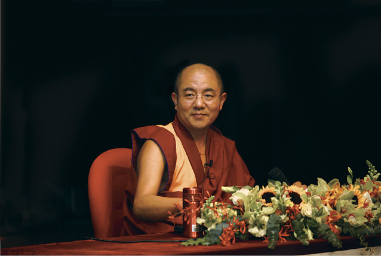

# 大欢喜

——索达吉堪布开示录

多年来，索达吉堪布常在不同场合，为大众传讲佛法，并抽出一些时间让大家随机提问，当场回答。针对现代人的内心困惑，本书特摘录了一些常见问题，以飨读者。

感情

问：我一个朋友今年31岁了，但是还没有对象，她想建立一个佛化家庭，如何才能忏悔业障，感召一个如意的眷属呢？

堪布答：她想找一个理想的伴侣，最好能念一下《地藏经》。若是没有前世特殊的业障，那么念了《地藏经》、祈祷地藏王菩萨的话，实现这个愿望并不难。

确实，建立一个佛化家庭，妻子也学佛、丈夫也学佛，夫妻之间就没有太多冲突了。否则，妻子学佛，丈夫不学甚至反对，那么天天都会热战、冷战不断，自他也会特别痛苦。

但她最终能不能实现自己的愿望，还要看自己的因缘和福分。当然，通过祈祷也能解决一些问题。

问：我过去遇到感情上的挫折，一直困扰着现在的心情，该怎样摆脱呢？

堪布答：在我们藏地，很多年轻人因为有信仰，也懂得佛教的无常观，所以在遇到感情问题时，一般不觉得这种痛苦特别大，但汉地的人好像不是如此。

其实，爱一个人，往往是建立在占有的基础上。一旦他对你不好，或者他变心了，自己无法再拥有他了，这时候才特别痛苦。假如你对他的爱无有条件，只要他好，你就觉得幸福，那彼此之间的关系再怎么样，你也不可能受到刺激或创伤。所以，爱情到底是爱自己，还是爱对方？这个需要好好观察一下。

爱情虽说是年轻人很难过的关，但你再过10年、20年回顾人生，可能就会一笑置之。现在你对感情的执著，相当于孩童时代对玩具的执著一样，小时候玩具一旦被别人抢了，自己就哭得天崩地裂，可当你长大之后，回想当年的幼稚无知，就会觉得特别可笑。

如今很多年轻人，一直陷于感情的迷网中，无力自拔，非常可怜。其实你们再过一段时间，有一些人生历练之后，就会觉得这真的没什么，只是某个年龄段的一时迷惑罢了。所以，随着年龄的成熟，或当你有了正确的信仰时，这种执著就会越来越淡，慢慢地，便不会再受它的困扰了。

问：我信仰佛教，觉得爱情是无常的，对恋爱也没有太大兴趣，那我要不要为了结婚而结婚？婚姻的基础一定是爱情吗？

堪布答：要不要结婚，最好由你自己决定。我作为一个出家人，来决定可能不太合适。（众笑）

婚姻也好、爱情也好，刚开始是会有一种感觉，大多数年轻人也非常向往，觉得这是通往幸福的阶梯。但从我们佛教的眼光来看，一旦你结婚以后，自由的钥匙就交给对方了，从此之后，你就被困在无自由的空间里了……

当然，世间人也有另一种解释方法。这种解释方法，尤其是一些老年人都有经验，可以让他们来回答。

报应

问：在生活中，我们经常会看到，有些人做了很多好事，却没有得到相应的善报；有些人做了很多坏事，却没有受到恶报。于是许多人就认为：“善有善报、恶有恶报”只是一种心理安慰、精神鸦片。因果报应真的不存在吗？

堪布答：因果报应肯定存在，对此我是深信不疑。

但为什么行善得不到好报，造恶得不到恶报呢？因为不管是什么样的业，并不是造了马上就会成熟。就像一个贫穷的农民，他以前没有种庄稼，所以如今特别贫穷；但现在他勤勤恳恳地种地，以后尽管不会再穷了，可还没到秋天收割之前，他的生活仍然改变不了，但我们不能因此就说他种庄稼没用。

佛教里也专门讲了，我们所造的业要成熟，需要一定的时间。有些业力会现世现报；有些业力在下一辈子才感受；有些业力要再过好几世才现前。所以，因果并不是那么简单的，它是非常复杂的一个概念，必须通过系统的学习才能了达。

当然，你产生这样的怀疑也很合理。但就如同你现在上学，就算现在很爱学习，也不一定马上会出现它的果，它有一个时间在里面。

问：好多人总是在生命的尽头，回顾人生，才明白自己的遗憾。那我们今世的人生，主要任务是什么呢？怎样才能拥有真正的人生意义？

堪布答：确实，不仅仅是普通人，包括历史上的一些著名人物，也会在临死时，才发现一辈子做了很多错事。在生命的长河中，有些人能及时反省这种错误，而有些人从来也没有这种机会。但不论是哪一种人，如果你真想对自己负责，就应该学会善待生命。

善待生命有几种方式：上等的，是用自己的一生为一切众生造福；中等的，为了自己而行善积德；下等的，不做损害其他众生的事，毕竟所有的生命都同等珍贵。以这些方式，可以弥补往昔所造的很多罪业。当然，这些罪业，还可以通过佛教中的忏悔得以清净。

问：人生是由谁决定的？为什么有些人的人生是快乐的，有些却是苦难、充满困惑的？

堪布答：世间有些宗派认为，人生的苦乐由上帝赐予，或者由大自在天决定。但按照佛教的说法，人生的主宰就是自己，并不是别人来掌控的。否则，真有一个造物主的话，他让谁快乐，谁就快乐；他要谁痛苦，谁就痛苦，这是很不公平的。因为我没有做任何坏事，他就平白让我受苦；我没有做什么好事，他却让我天天快乐，这样的话，造物主可能会常常被大家埋怨。

其实，我们的人生之所以快乐，是由于过去做了善事；之所以痛苦，是因为往昔造了恶业——这个概念乍听起来，恐怕有些年轻人不接受，但它对每个人来讲至关重要。就好比你播下毒药的种子，结出来的果只能是毒药，绝不会是妙药。同样，一旦你造了恶业，未来只能成熟苦果，而不会招致快乐。因此，种瓜得瓜、种豆得豆，这是亘古不变的真理。

所以，如果你想今生快乐、来世快乐，乃至生生世世都快乐，就尽量不要造杀生等诸多恶业。否则，只要造了恶业，它要么会在你今生成熟，要么会在来世成熟，迟早都要感受这种痛苦。这就是为什么有些人的人生充满快乐，有些人却饱尝痛苦，这一切苦乐其实都是自作自受。

藏传佛教有位大德叫智悲光尊者，他对因果曾有一个很好的比喻：就如同大鹏在空中飞翔时，影子虽然暂时看不到，但只要它一落地，影子马上就出现了；同样，一个人造了业的话，这个业力便会一直跟着他，只要因缘成熟，痛苦或快乐即会当下现前。

这是非常深奥的因果道理，希望大家能经常思维。现在很多人没有因果观念，只要肚子填得饱，日子过得舒服，其他什么都不顾，这种社会现象是特别可怕的。

随缘

问：什么叫随缘？如果把它放在学业上或事业上，应该怎么理解？

堪布答：“随缘”这个词，禅宗里也经常讲，世间人也经常说，但不少人都误解了它的定义，以为随缘就是什么都不用做，只等老天来安排一切，这样的话，你就会错过许多机会。真正的随缘，是需要全心全力的付出，但对结果如何却不太在意。

比如，你想得到一份特别满意的工作，在一番努力之后，却没有被录取，这时候你心里若有“随缘”的概念，面对失败就不会特别痛苦。

包括你们对自己的感情，也应抱着这种态度。假如刚开始希望特别大，最后却没有像预期那样美好，也用不着痛不欲生、万念俱灰，甚至想不开非要自杀。在这个时候，你应该要懂得随缘。

要知道，在这个世上，凡事不可能都一帆风顺、尽如人意，任何一件事情的成功，背后都有着错综复杂的因缘。这一点，上学的课本里几乎没讲，但你如果学了佛教的《俱舍论》《百业经》，就会明白自己这辈子的成败，不但有今生的原因，也有前世的原因。若能懂得这个道理，就很容易想得开、放得下，以坦然的心态面对一切，这就是一种积极的随缘。

问：我常劝周围的人在遇到困难时，祈请诸佛菩萨加持。但他们却嗤之以鼻，说：“如果事情变顺利了，你们会说是佛菩萨的加持；如果还不成功，就说是我无始以来的业力。你们佛教就是这样，说什么、做什么都有两面。”对此，我不知道该怎么解释。

堪布答：其实这个很简单，我们世间上也是如此。比如一个人犯了错误，家人托关系、找领导的话，若能把他放出来，就会说是领导的功劳；但如果实在不行，领导也帮不上忙，就会认为他犯的错误太严重了。所以，用这个比喻也很容易解释佛菩萨的加持。

实际上佛陀在有关经典中也讲了，一些特别无缘的众生，纵然佛陀的妙手也无法救护，因此这并不是佛教的过失。

问：佛教中告诉我们，人要有感恩之心、满足之心。但我身为一个大学生，经常和老师做些课题研究时，要有一颗不满足的心，才可以继续坚持下去，往更深的科学领域发展。请问，一个要满足，一个要不满足，这二者的矛盾该如何平衡？

堪布答：佛教所提倡的有满足之心，是指减少一些没有意义的欲望，比如对钱财、对享受，这方面要少欲知足。但在求学方面，是不需要满足的。藏地特别伟大的萨迦班智达，在格言中也说过：即便汇集百川之水，大海也不厌其多，同样，即便学习再多的知识，智者也不会有满足的时候。

所以，你们现在学习知识、研究科学，包括学习佛法，这些方面都不应该满足，不要认为大学毕业就像成佛了一样，从此什么都不用学了，再也不用看书了。其实，世间上一些有意义的知识，越学越对自他有利，所以求学方面不要有满足，这是我们佛教的观点，也是探索科学不可缺少的一种态度。

佛理

问：请问宗教信仰和迷信有什么区别？

堪布答：信仰任何一种宗教，不管是基督教、道教、儒教或是佛教，假如你不懂它的道理，只是流于表面形式，这很容易变成迷信。比如，有些人为了升官发财，就到寺院里烧香拜佛，这虽然也算一种信仰，但你若不知道这样做到底有什么作用、佛和神有什么差别，只是把佛陀当成求财工具，这就成了一种迷信。

如今很多寺院里，天天都有人拜佛，我虽不敢说所有的人都是如此，但有些人确实带有迷信色彩。为什么呢？因为他们连自己为何要拜佛都弄不清楚。

真正的信佛，是通过自己的智慧，看一些前辈大德的文章或书籍，知道释迦牟尼佛曾来过这个世界，他所说的一切符合真理，对解除自他痛苦、解决人生问题有不可磨灭的作用，然后从心坎深处对他诚信不疑，这才是真正的信仰。反之，假如只是表面上信佛，实际上迷迷糊糊的，并不明白其中道理，那就算你是个佛教徒，也仍是一种迷信。

所以，烧香拜佛不一定是真正信佛，若不知道它的功德，单单是外在的一种崇拜，有些人为了打鱼也会这样做。我以前去南方时，就看见很多老百姓出海打鱼前，都会去庙里烧香，让佛保佑他多捕一些鱼，此举完全是一种迷信。

梁启超曾在一本书中也讲了迷信与正信之间的差别，说佛教的信仰是智信而非迷信。但你不懂佛理的话，就很可能不是智信，而是迷信了。

问：佛法浩如烟海、广大无边，您可否用三个字来概括它的真谛？

堪布答：戒、定、慧！

问：在佛教中，佛陀规定犯了什么戒条，就要惩罚多少多少劫，请问这该怎么理解？

堪布答：佛教中之所以制定戒律，并不是非要去惩罚人，表面上它是一种约束，但实际上，这为每个人趋往解脱之路提供了方便。

就像马路上的绿灯、红灯，有了它的话，开车者似乎不太自在，但这却能极大保证他的生命安全。佛教中的戒律也是如此，通过强制性地规定行持善法、断除恶业，就能让众生顺利获得解脱，到达彼岸。

问：藏传佛教的净土，与我们汉传中提倡念阿弥陀佛去西方极乐世界，有没有什么区别？

堪布答：藏传佛教和汉传佛教的净土法门，究竟目标完全相同，可以说是殊途同归。

藏传净土主要讲发菩提心、念佛号、积累资粮，最终能往生极乐世界；而往生极乐世界的主因，则是阿弥陀佛的四十八愿。如此依靠自力和他力往生，汉传净土也是这样提倡，只不过个别传承上师教言的侧重点不同而已。

问：佛教里有很多密咒，比如六字大明咒、金刚萨埵百字明、一切如来心秘密全身舍利宝箧印陀罗尼，佛说每个咒都有很大很大功德，要念多少多少万遍。那我在修行的时候，该选择什么样的密咒呢？

堪布答：我对密咒从小就有信心，只是现在比较忙，念的时间比较少了。我们藏地有句俗话：“孩子会叫妈妈的时候，就会念观音心咒——嗡玛呢巴美吽”。基本上每个藏族孩子都是如此，只不过现在在经济浪潮的冲击下，好多孩子到了外面的学校、城市以后，就不是特别争气了。

密咒的功德，佛陀在不同的经典、续部中都有阐述，至于你该选择哪一个，可能要分两种情况：一、这个密咒与你的传承上师、某些灌顶修法有密切关系，然后你应该发愿念诵。二、可以根据自己的情况，比如造业比较多，觉得业力深重，就念百字明和金刚萨埵心咒；如果要开智慧，想生生世世具足智慧、利益众生，就念文殊菩萨心咒；若想遣除一切魔众违缘，就念莲花生大士心咒……你觉得哪个咒语对自己非常重要，就可以选择这个咒语去念。

念咒语方面，藏地很多修行人确实与众不同。前段时间，我们学院有个老出家人圆寂了，他一辈子念了六亿咒语。而我的上师法王如意宝没有圆寂之前，曾把一生所念的咒语都统计出来，有些咒语像“啊”“吽”只有一两个字，有些咒语长达十几个字，这些长咒和短咒全部加起来，总共有九亿。上师是72岁时圆寂的，在此之前，他一辈子都手持念珠不断在念。

通常来讲，藏地的修行人随时随地都手不离念珠，不管是坐车也好、放牦牛也好、到农田去也好，甚至很多知识分子、干部在办公室里，也是拿着念珠，被领导看到还会挨骂。不过现在比较方便了，拿个计数器一直在念，领导也发现不了。

其实，念咒语不说长远的功德，仅仅是暂时利益的话，分别妄念、痛苦烦恼也会依此而消除，让心安住于清净的状态中。所以，念咒语是非常有意义的！

问：我是德国曼汉姆大学的老师。藏传佛教在西方特别有吸引力，在德国的传播，特别是80年代比较成功，为何它这么容易就能被大家接受呢？

堪布答：藏传佛教如今在德国、英国等西方国家，确实很有吸引力。究其原因，主要是藏传佛教的教义非常实用，它并不完全停留在理论上，也不是搞一种学术或形象化，而是依靠前辈大德的窍诀，有很多断除烦恼的方法，比如修菩提心、大圆满的直指心性，又简单又易行，所以传播的速度比较快。

我那天看了一下，单单在美国波士顿这一个城市，藏传佛教的中心就有三十多所。由于藏传佛教清净的传承、殊胜的窍诀、简单的仪轨，再加上对闻思修行特别重视，故而很容易被人们接受。

相比之下，现在不少地方的佛教，完全成了一种形象。很多人经常问我：“磕头是不是佛教？烧香拜佛是不是佛教？”我说这只是佛教的一种形象，并不是它的真正教义。它的教义是什么呢？就是修菩提心等。学佛要从心上安立，不是表面上办个皈依证，就自认为是佛教徒了；形象上穿个僧衣、剃个光头，就自认为是出家人了。

如今很多人也不是什么傻子，他们还是真实受益了，才愿意接受藏传佛教。包括汉地有些大学生，他们之所以愿意学佛，也是发现佛教对自己真正有利。否则，没有一点利益的话，只是给他们讲些故事，那谁都不需要。

我们作为一个人，难免要面对烦恼、痛苦，倘若通过藏传佛教的菩提心等修法，在生活中切实起到作用，任何人都不会拒绝它的。就像一个包治百病的灵丹妙药，相信没人愿意将它拒之门外。

问：在当今商业经济当道的社会中，您如何看待环保与消费之间的对立矛盾？

堪布答：这个问题，其实我也思考过。现在这个社会，生活节奏越来越快，工作压力越来越大，与此同时，人们的消费也越来越高。在这种情况下，消费与环保之间，有时候是对立的。

不过，我们佛教提倡一种生活观：不能特别奢侈、挥金如土；也不能极度拮据、衣食无着，若像乞丐一样，也会寸步难行。而应当保证基本的生活条件，在此基础上知足少欲，不要纵容自己的欲望，也不要为了竞争而活着。

如今大多数人，购置大量东西并不是因为需要，而是源于竞争。看到他人的房子不错，自己就非要买一栋；瞧见别人的轿车很好，自己也要买辆好轿车，否则，就觉得在别人面前抬不起头来。这样的人活得很累，所以，我们应该随遇而安，根据自己的福分来维持生活，如此才会活得比较开心，自己的消费与环保之间，也不会有很大冲突。

此外，我们平时还要有环保的概念，电水应该节约，不要随便浪费。我以前去新加坡时，他们在这方面就做得很好。但最近在香港，我看到晚上所有高楼的灯几乎都亮着，两三点钟也是如此。其实，这时候很多人都睡了，这些电白白地浪费掉，好像有点可惜。当然，也许是有人要上“夜班”。但很多问题，我们要值得思考。

问：我是佛教徒，但回答不了身边朋友的问题。朋友曾问：“佛教徒用很多时间作经忏，认为念经可以帮助别人，但为什么不将时间实际用于帮助别人？念经究竟如何帮人，只是口头念念就有功效吗？”我该如何回答呢？

堪布答：你虽然学了佛，但我觉得还要继续深入佛法，这样的话，对非佛教徒的问题才可以回答，这是我的一个建议。

你那个提问题的朋友，对佛教不一定很了解。其实，佛教中并没有说，念经后什么事情百分之百都能解决。就像现在的一些中医，并不敢说自己的药能包治百病，但我们不能因此就认为：“你既然不能包治百病，那干吗还要当中医？不如亲自去帮助众生。”要知道，每个众生的病是不同的，对于有些疾病，中医是可以治的。同样，佛教徒用很多时间念经，也可以从某个角度帮助到众生。

这一点，我自己就深有体会。比如，我平时生病了，或者出现违缘了，就赶紧交钱请僧众念经。也许不信佛的人认为这是迷信，但我却对此深信不疑，因为念了经以后，很多事情马上就有好转了。如同药本身有治病的功效一样，念经的话，依靠诸佛菩萨的加持力，与自己清净的发心力，自然也会产生一种不可思议的作用。

当然，念经为什么有这种力量？必须要深入经藏才能彻底明白。

问：动物是有生命的，吃它是一种不好的行为。但植物也是有生命的，我们吃了的话，会不会也像吃动物一样不好呢？

堪布答：佛在《涅槃经》中说：“众生佛性住五阴中，若坏五阴名曰杀生。”所以，五蕴聚合的生命，才有真正的痛苦。动物就有这样的生命，而植物，虽在外境的刺激下会产生某种反应，比如动摇、生长、死亡，但它并没有真实的五蕴。假如认为植物也有动物或人一样的生命，那佛在《楞严经》里说了，若许“十方草木皆称有情，与人无异”，则堕入外道，“迷佛菩提，亡失知见”。

现在很多人觉得植物与动物完全一样，这样的观点大错特错。包括有些学佛多年的人也分不清楚，这是相当遗憾的。按照佛教的观点，你今天割一根草，跟杀一头牛有很大差别。杀牛是摧毁了有情的生命，这有极大过失；而割草的话，并没有杀生的过患。

有些人可能会说：“佛教里不是讲了吗，对动物不能损害，对草木也不能损害。”这种说法虽然是有，但意思并非完全相同。就像你去杀人和砍伐森林，尽管二者在法律上都不允许，但定罪还是有天壤之别。同样，我们杀了动物的话，必定会堕入地狱；而砍一棵树的话，则不会堕入地狱，只是有轻微的过失。

所以，在这个问题上，大家一定要弄明白。为什么我一直强调佛教徒必须要学习佛法？原因也在这里。现在很多人都认为“我吃肉也有过失，吃蔬菜也有过失”，对过失的轻重并没有分。这样的话，你偷金子也有过失，偷针也有过失，所有问题都一概而论的话，这是不合理的。

问：神秀大师说：“身是菩提树，心如明镜台，时时勤拂拭，莫使惹尘埃。”

六祖说：“菩提本无树，明镜亦非台，本来无一物，何处惹尘埃？”

对这两首偈子，您怎么看？

堪布答：禅宗的这些比喻非常好。神秀大师所体会到的，六祖大师所悟入的，都通过比喻很好地表达了。这种方式在藏传佛教中也有，如莲花生大士师徒的对话，用类似的比喻也表达了如是见解。

关于这两首偈子的意义，从抉择空性的角度而言，第一偈的前两句是抉择见解，后两句讲修的光明；第二偈则分别讲行、果。

此外，对《六祖坛经》的解释，我觉得可以有不同方式。尤其是第二品，可从见、修、行、果，或基、道、果方面来讲。也就是说，结合中观的抉择方式来理解，可能更好。

问：为什么念《心经》能遣除违缘？

堪布答：《心经》所讲的是空性精华。我们之所以会遭遇恐怖、灾难、违缘等侵扰，根本在于对人我和法我的执著。倘若证悟了无我空性，断除了人我执和法我执，一切魔障就没有猖狂的余地了。

《心经》宣讲的是最殊胜的般若空性，以此空性的威力，再加上《心经》的加持力，内外密的一切违缘都能被遣荡无余。

所以，佛经中专门有《般若心经回遮仪轨》，里面就说了，往昔帝释天怎样祈祷《心经》，我们也如是祈祷的话，魔王波旬等一切违缘都会化为乌有。

问：作为一个世间人，怎么样将世间法与佛法圆融？

堪布答：严格来说，世间法和出世间法有许多相违之处，真正要做一个非常好的修行人，必须要看破世间后的很多东西。

但若没有这么严格的要求，作为一个在家人，也可以将佛法与日常生活结合起来。比如说，每天对自己有一个要求，尽量念诵一些咒语、做一些观想。同时，无论接触任何人、在任何环境中，皆应以慈悲心来对待。即使遇到一些坎坷不平，也能以佛教的教言提醒自己，看得比较淡，不要特别执著。这样以后，应该就能做到二者的圆融。

现在也有一些非常了不起的修行人，将世间法与出世间法尽量兼顾，一方面自己的修行特别好，另一方面，依靠佛教的慈悲教义，对社会乃至整个人类，也做出了极大的贡献。

问：佛法有一个“空性”的概念，但现代与古代相比，已经发生了很大变化，那么在这样的时代中，空性观怎么能培养起来呢？

堪布答：不管是哪一个时代，佛教的空性观都不受影响。

如果你真想培养佛教的空性观，我建议最好学习一下龙猛菩萨的《中观根本慧论》、月称菩萨的《入中论》、圣天论师的《四百论》。这三部论典学了之后，你对万法皆空会有一定的认识，在这种见解的前提下，面对现实生活是很有帮助的。

我经常在想，现在人们忙忙碌碌，如果对佛教的空性观能有所认识，那不管遇到什么挫折，也不会如此痛苦挣扎。所以，很希望大家在面对生活的同时，也学习一些加持非常大的空性教理。

问：对凡夫俗子而言，我们无法看到前世后世，也无法看到天堂地狱，怎么知道它真实存在呢？如何来建立真正的因果信仰？

堪布答：建立这样的观念，并不是很容易的事。不仅仅是天堂地狱，包括太阳系、银河系、黑洞等天文学的甚深领域，也不是我们肉眼的对境。但肉眼看不到的宇宙奥秘，可以天文学家的发现和理论作为根据。那么同样，佛教所讲的那些真理，完全是以佛的教证为依据，因为我们的肉眼所见非常有限。

以前霍金博士曾来北京作过演讲，但由于他的理论太玄奥，很多清华、北大的学子都没听懂，甚至有人提前退场。在他的发现中，宇宙不单单是原来的三维空间，而且还存在着多维空间，维数可扩展至十一维。这就说明，还有许多我们肉眼看不到的神秘领域存在。

包括爱迪生、伽利略、牛顿等科学巨匠，也都承认有天堂和地狱。这一点，从他们的传记中就看得出来。

所以，诚如佛教因明的《释量论》中所说，我们眼睛看不到的，并不代表一定没有。尤其是有些比较甚深的领域，即使眼睛看不到，也可以通过推理得出它的存在。

问：在一些寺院的旅游景点，常有卖印《心经》的T恤，这些衣服可以穿吗？

堪布答：不可以，有非常大的过失。衣服是用来遮体取暖的，而佛菩萨及经咒是要恭敬顶戴的。佛陀说过：“末世五百年，我现文字相，作意彼为我，尔时当恭敬。”将文字印成的《心经》穿在身上当装饰，可能只有不懂因果的人才敢这样做。

如今这种现象比较普遍，许多厂家为了赚钱，就琢磨现代人求保佑的心理，投其所好，将佛菩萨像、《心经》、咒轮等做成工艺品，或者印在衣服上。以前也有人供养我印《心经》的杯子、笔筒，这些我都不敢用，不知道该怎么处理。

如果这种趋势不改，以后会不会将《心经》印在裤子上也不好说！

问：但穿上这种衣服，走在大街上，可以给看到的人种下善根。

堪布答：种善根可以用其他方法，这样做的话，弊大于利。而且，你穿这种衣服，发心是否完全为利他也不一定。

问：如果有这些衣服或工艺品，应该怎么处理？

堪布答：尽量供在佛堂上，不要自己用。

出家

问：出家人不能喝酒，也不能吃肉，但为什么济公活佛会说“酒肉穿肠过，佛祖心中留”？

堪布答：这句话的后面，济公和尚紧接着还说了一句：“世人若学我，如同进魔道。”

济公和尚是历史上公认的成就者，他“酒肉穿肠过”的话，可以做到“佛祖心中留”。如同一些前辈大德，修行境界特别高时，肉和菜、酒和水对他完全没有差别。古印度就有一位大成就者，喝完酒以后，酒可以变成水，从指尖流出来。同样，济公和尚也有这种非凡的境界，喝酒、吃肉对他并不会有障碍。但我们作为普通的出家人或修行人，千万不能盲目地去模仿。

如今很多影视作品里，经常断章取义，只取这段话的前半部分，以此作为自己可以吃肉喝酒的佐证。甚至好多根本不懂佛法的领导，喝酒时也喜欢把这句话挂在嘴边。我在藏地就有一个朋友，天天喝得烂醉如泥，别人去劝他时，他总拿这句话来搪塞。实际上，当他醉得人事不省时，留在心中的肯定不是“佛祖”，而是“酒肉”。

所以，不管是出家人、在家人，最好不要说大话，你还没达到济公和尚那样的境界之前，切莫用这种话来为自己造恶业找借口。

逆境

问：您说心理学是一门教人幸福的学科，我本身就是心理学专业的，但很不幸，我感觉自己并不幸福。二十多年来，我生活一直不顺利，很小的时候家庭变故，学业上从初中、高中之后，也是几经磨难才进入大学；现在我都大三了，也憧憬过在大学谈一场恋爱，但截至目前，我追过五个女生，却没有一个愿意答应我。

这些不知道是否可以称为“磨难”，但面对它，我没有想过自杀，也没有试过自杀，一直都是耐心忍受的。可我心里一直都不快乐，觉得最大的困惑，就是我不知道为什么来到这个世上，难道只为了经历这些磨难吗？只是为了受苦而来吗？

按照佛教的说法，这应该是我的因果报应，今生经历了这么多磨难，也是自己前世造了很多孽。但我怎样才能在现世就得到一些好报，消除这些磨难给我的负面影响？

堪布答：你说心理学无法给你带来幸福，但荣格的心理学，尤其是佛教中探索心灵的内明学，如果你学了以后，肯定能逐渐找到幸福感；你说自己从小到大，生活中频频发生各种不如意，但我从你的描述中发现，有些也不一定不如意，只不过它好的一面被你忽略了而已。

不过，正如你刚才所说，你今生所经历的一切，都跟前世的业力有关。毕竟有时候由于前世的业力，即生中的努力可能会付之东流。比如，有些人成绩非常好，但往往在考试时不成功；有些人的人品不错，但常常被很多人误解；有些人社会关系很广，但仍然无法做一番事业。业力就相当于一个大网，它广阔无边、遍及一切。如果你们懂得因果的道理，一旦自己遇到很多磨难，就应该好好地忏悔，这样才能弥补前世所造的恶业。

当然，生活中的顺与不顺，也不可能一成不变。只要你心态调整过来了，不顺就可以变成顺缘；但若心态不对的话，就算是顺缘，也可以变成违缘。比如有些人从小历经了各种打击，这种人生看似很苦，却可以让他的内心不断强大起来；有些人从小就被当成小皇帝、小公主，要什么就有什么，生活无忧无虑，但到了社会上以后，特别特别脆弱，一丁点委屈也忍受不了。

因此，我们生命中的苦难，不一定都是不好。若能把它视为磨炼自己的机会，你的人生就会越来越有价值，将来也才会有出息。

放下

问：我之前也读过很多佛学故事，都说不管遇到什么事，要耐心忍受，然后放下、看淡。但我现在的问题是，可能因为自己修养不够，就是放不下、看不开，这个怎么办呢？

堪布答：放下，并不是那么容易的，不是说放下就能放下的。你必须要先懂得道理，然后经过很长时间的修行，才能慢慢放得下来。

就像一个患有胆病的人，明明知道眼前的海螺是白色，可在病没有好之前，看到的一直是黄色。同样，你说很多道理自己都懂，但实际上这不叫懂，只是字面上理解而已。如果你真的懂了，面对任何磨难都不会执著、痛苦。

所以，理解和通达还是有一定的差别。

问：我在生活中遇到一些问题时，通常是以包容别人而收场的，但对方往往不理解，反而认为我很傻，这样我就很郁闷。怎样才能在我包容别人与我不郁闷之间达到一种平衡呢？

堪布答：这种现象在当今比较常见。包括有些人学儒教思想，懂礼貌的话，有些老师和学生就常欺负他。现在这个社会，大多数人对善良都带有蔑视态度，所以，极个别人行持善法、包容他人，不一定会受到认可。但即便如此，我们也不能抛弃自己的善良、包容。

藏地曾有一位伟大的佛学家，叫麦彭仁波切，他就说过：“纵然整个大地遍满恶人行持恶法，我也不会改变自己高尚的行为，要如淤泥中的莲花一样清净。”

在这个过程中，即使别人认为你很傻、很蠢，你也会觉得问心无愧。只有这样，不管你自己还是这个社会，将来才有一点希望。

问：假如有人对一些事情很抱怨，想法也很执著，怎么样才能让他放下呢？

堪布答：有些人常对外境有诸多抱怨，这是不太合理的。为什么呢？因为当他在抱怨时，总是盯着别人的毛病看，却从来没有反省过自己。一件事情不成功了，他就拼命地埋怨别人；一旦成功了，又觉得全是自己的功劳，很多人都有这样的习气，这个特别不好。

其实，我们应该反过来想：当这个事情成功了，都是别人的贡献；失败的时候，则是自己的过失。我们藏地就有一句著名的格言：“亏损失败自己接受，胜利利益奉献他人。”这种精神非常伟大，理应成为我们为人处世的准绳。许多人之所以在生活中跟别人合作时，常常出现一些不愉快的现象，也正是因为这句话没有做到。当然，这一点做起来并不容易，但即便如此，我们还是应该朝这个方向努力。

至于你想让他放下执著，这不是说放下就能放下的，他必须要先懂得道理，然后经过一定的修行，才能做到“收放自如”。要知道，生活中的任何一件事情，当自己特别执著时，肯定放不下来。只有通过各方面观察，发现它也不过如此，放下才会易如反掌。

问：现实社会中，我们因欲望产生很多虚荣心、攀比心，往往忘记了自己是谁，自己真的需要什么。如何才能做到寻求自我、反观自我？

堪布答：现在的人们，虚荣心确实特别强，攀比心也很厉害。在这样一个社会中，我们的内心要想安宁，必须有一种正确的信仰。否则，你就会盲目地追求金钱，内心欲望无有止境，绝不会有快乐可言。

如今有个口号是：“要满足人们的生活需求。”但实际上，“需求”是满足不了的，人心就像是填不满的无底洞，假如不懂得知足的话，想用物质来满足是很困难的。

大家在日常生活中，除了追求必要的物质以外，也不能忽视内心的安宁。而若想做到这一点，释迦牟尼佛的教法中有最完美、最究竟的答案。

问：佛陀当年正是看到众生的苦，为了想办法解决，才出家修行，最终成就了佛果。那我们学了佛以后，尽管也期望有一天能成佛，但现在的心力不像佛陀那么大。在这个过程中，经常遇到痛苦怎么办呢？

堪布答：经常遇到痛苦的话，容易生起出离心，把它变成一种成就的动力，这就叫将痛苦转为道用，此举对我们修行人来讲非常重要。

在藏传佛教中，很多大德并不希望成天顺顺利利，否则，修行就没什么进步了。作为大乘修行人，一旦遇到敌人、生活中出现不顺，绝不会像世间人一样痛苦，而是像拾到了如意宝般开心，以此可检验自己的修行境界如何。

犹如高明的医生，能将山上所有的草，都配成良药，同样，真正有修行的人，不管遇到什么样的痛苦，都可以把它转为道用，变成解脱的一种助缘。

问：5年前我断了韧带，一直很痛苦，这几年没有敢运动。几个月前，我再做运动时，竟然又断了同一条韧带。为什么我这个身体这么弱，好像经常都有病，我该怎么解决呢？

堪布答：任何一种病，都要依靠中医或西医来治疗，这是佛教也很提倡的。然后在这个基础上，再应该调整一下自己的心态。

就我个人而言，10年前得过强直性脊柱炎，很多医生都说这没办法治，一辈子会非常痛苦，同时我还有肝炎、慢性胃炎。曾有一个医生，看了我的检查报告后说：“你这个人很倒霉！这么多难治的病，全部出现在你一个人身上。”

如果我没有学过佛，可能心里会非常痛苦。但因为学了大乘佛法，说实话，我并没有把这些当回事，觉得这个身体再怎么保养，迟早也会腐朽的，不管自己能再活多少天，都应该做些有意义的事情。

所以，当医生看了我的报告后，说我可能活不了很久时，我就赶快在厦门找个地方，以闭关的方式翻译《释迦牟尼佛广传》。这部论没有译完之前，我很担心中途会离开世间，如果能善始善终的话，我就没什么遗憾了，这些我在日记《旅途脚印》中也写过。结果过了这么多年，这几种病奇迹般地全部好了，现在就没有什么了。

因此，我们作为病人，不要老想着自己痛苦怎么办，不要太把它当回事。其实生病也可以，不生病也可以。假如这个病总好不了，那是自己前世的业障，以此可观想代众生受苦。平时有这种心态的话，遇到什么都会快乐。甚至到了一定时候，你的病会不药而愈。

退一步说，就算它好不了，这个世上也不只有你我会死，所有的人最后都会离开。没办法，轮回就是这样！

问：到目前为止，您人生中遇到的最大痛苦是什么？您是怎么面对它的？

堪布答：我是1962年生的，现在快50岁了。回顾自己的人生，我小时候读书很晚，15岁才开始上小学，之前一直是文盲，天天放牦牛。当时我弟弟不肯去学校读书，家人害怕被罚款，实在没办法，就把我送去替弟弟读了。到现在，弟弟也常跟我开玩笑说：“我对你的恩德很大，否则，你一辈子只是山上的牧童，不会有读书的机会。”

我没有上学之前，一直都在放牛，有时候牦牛丢了，或者被狼吃了，我就不敢回家，心里非常地痛苦。

之后，我在学校里读书时，没有评上什么，或者因为一些摩擦，跟别的孩子打架输了，这个时候也很痛苦。

后来，出了家以后，到现在二十多年的时间里，我把全部精力投入学佛，一直看书、一直禅修。在这个过程中，我好像想不起来有什么痛苦。

我在1985年出家，2005年我们师范的同学开了个同学会，在所有的同学中，只有我们两三个出家人。当时每个人讲了自己这20年的经历，有些同学结婚了，有些离婚了，有些结婚了但儿子死了，丈夫死了……这样那样的痛苦特别多，好多女同学都是边哭边讲的。但我们几个出家人，确实没有特别强烈的痛苦，到目前为止仍是如此。

我自身的话，一出家就依止法王如意宝系统闻思，明白了中观空性和大乘佛教的利益，再加上周围的环境也很清净，所以记不起来有什么痛苦。后来，虽然我父亲死了、亲戚死了，但这些在我的人生中，好像没有感觉是一种痛苦。所以，佛教真的对消除痛苦非常有力，这并不只是口头上说说。

皈依

问：佛教中讲的“皈依”是什么意思？

堪布答：所谓皈依，简单来说，需要通过一定的仪式，自己决定从现在开始，投靠依止佛、法、僧三宝，遵循佛陀的教言去做。广而言之，皈依还有共同皈依、不共皈依，以及密宗特殊的皈依等许多分类。

佛教中的皈依，并不是强迫性的，而是出于个人自愿。

问：藏传佛教中强调依止上师，这是否与佛陀要求的“依法不依人”相违？

堪布答：并不相违。佛经中讲“四依”时，是提到了依法不依人。表面上看来善知识是人，好像不能依止，但实际上不是这个意思。

藏地的麦彭仁波切，曾造过一部论典叫《解义慧剑》，我也翻译过，里面对“四依”就讲得比较清楚。其实，依法不依人的意思是，我们在修行的过程中，关键要依止佛法所讲的内容，比如修出离心、菩提心。如果一个人的名声不错、很有财富、粉丝也多，但他讲的却与经论不符，那要听他的还是听经论的呢？肯定要听经论的。

当然，若想真正“依法”，首先要依止一位具法相的善知识，这是必需的一个前提。否则，就会像《华严经》中所说，假如没有善知识的引导，你再怎么样有智慧，也不可能精通佛法的真谛。那么如此一来，有没有依人不依法的过失呢？是没有的。因为甚深的佛法若不依靠上师指点，单凭自己的智慧，肯定无法揭开它的神秘面纱。

现在有些人说：“藏地修皈依时，还要皈依上师。我们汉地就不需要，只是皈依三宝就可以了。”这种说法不合理。其实汉地也有四皈依，像唐朝的《瑜伽集要焰口施食仪》里，就清清楚楚提到了“皈依上师、皈依佛、皈依法、皈依僧”。

汉地不少人皈依以后，特别喜欢办皈依证，我们藏地一般没有这种传统，只要是三宝弟子就可以了，并不需要办什么证。你皈依的对象，可以有三宝总集的上师，也可以直接是三宝。但不管是哪一种，我们都应该明白，佛教就像世间的大学，它的教学内容很重要。这个内容相当于佛法，而佛法依靠谁来指导呢？就是上师。如果没有上师，相当于学校没有老师一样，它的教学内容再好，也没办法让很多人接受。所以，这之间的关系应该这样来了解。

问：作为汉地弟子，皈依上师时，无法像藏地弟子般，有多年的观察，更多是随缘皈依。倘若上师传法皆如理如法，弟子就会对上师深具信心；可有时候，一些弟子知道上师置豪宅等事情后，就会有损对上师的信心。面对如此情况，我们应当怎么办？如何判断上师的显现？

堪布答：我觉得，汉地弟子应该也有观察上师的条件。你们有时间，也有各种因缘，藏人有的，汉人为什么没有？

现在汉地很多人，听说来了个上师，不经观察就马上依止、接受灌顶，这是很草率的。世间人选择终身伴侣的话，也不可能在街上随便抓个人就去结婚，而需要经过几个月或一年的调查，至少了解一下他的家庭背景、性格如何。那希求生生世世的解脱比这更重要，观察上师就更是必不可少了。所以，汉地弟子以前不观察上师的做法，是很不合理的，今后大家应该像藏地弟子一样，对于想依止的上师，要经过多方面的观察。

如果你上师是具德善知识，真正对弘法利生有利，那他对豪宅、财富肯定不执著，而会视如粪土，就像以前蒋扬钦哲旺波的故事一样。我就遇到过一位上师，他在一个城市里，别人供养了很好的房子。我跟他开玩笑说：“你现在有车有房子，跟世间人没什么差别了。”他笑笑回答：“说实在的，我对这栋房子的执著，还不如对我那个牛粪棚的执著大。”我认识这个人，他并不是在说大话。所以，对有些上师来说，不管他有多少钱财，根本不像世间人那样贪执，只是把它当成石头一样。像这种人的话，豪宅再多也无所谓，这个并不是很关键。

但有些所谓的“上师”，根本不具足法相，比一般世间人还差，整天都在为钱财而蝇营狗苟，各种行为完全不是在弘扬佛法。对于这种人，大家就一定要远离。

如今汉地很多城市里，有许多好的上师，令大家有皈依、学佛的机缘，倘若没有他们的话，很多人会永远沉溺在轮回当中；但也有一些不好的上师，到了最后，他们的劣迹会暴露无遗。

所以说，这个世间鱼龙混杂，许多现象要擦亮自己的眼睛去观察。

问：我马上要毕业了，面临着很大的就业压力，那么我现阶段应该把所有精力都放在学习知识上，还是拿出一部分确保每天的修行？哪个对我将来的人生更有意义？

堪布答：这个可能要根据情况而定。一方面学习不能落下，你们作为高年级的大学生，很快就要面临人生的转折点了，辛辛苦苦学了这么多年，到最后应当融入社会、回馈社会，此时最好不要因为学佛，就放弃了自己的学业。

学佛不要影响自己的正常生活，不要为了完成既定的修行数量，就耽误学业和工作。假如你暂时不能完成的话，等以后各方面有条件了，这些可以再补上。

慈悲

问：请问，在汶川地震的时候，王菲曾唱过一首歌叫《心经》，这首歌的要义是什么？唱出来的话，对众生有怎样的利益？

堪布答：王菲唱的《心经》我也听过，并建议大家大力推广。《心经》主要讲了眼耳鼻舌身、色声香味触等一切皆空。我们这个社会有非常多的痛苦、挣扎，万法也有各种各样的不同形象，但这些追究到本源，其实完全是空性。

所以，《心经》的主要精神，就是让我们对万法断除执著，这是一种至高无上、不可思议的境界。释迦牟尼佛在第二转法轮中，就讲了这种般若空性，而般若空性法中最根本的一部经，即是《心经》，这种智慧就像人的心脏一样。

我们平时若能念《心经》、唱《心经》的歌，内心的各种分别念就会减少。

我认识一位老师，她说自己心里特别烦时，念一遍《心经》，心就能安静下来，然后再坐一会儿，原来的痛苦便全部消失了。

问：您在给日本灾难回向的时候，用到了“嗡玛呢巴美吽”。有些大师说“嗡玛呢巴美吽”代表一种无上的智慧，到底这几个字代表什么意思？

堪布答：“嗡玛呢巴美吽”是观世音菩萨的六字真言，功德不可思议，这在有关论典中都有描述。如果给死去的亡人念“嗡玛呢巴美吽”，他即使原本要遭受痛苦，通过这种声音的无上力量，马上也能获得快乐。

尤其是现在灾难频频发生，我们若能祈祷观世音菩萨，念他的咒语，以这种力量就能最大限度地化解灾难。这方面有许许多多的教理可以说明。

总而言之，它不仅是一种无上的智慧，还是非常强大的无形力量。

问：现在网络特别发达，信息也更加公开，可以看到很多不良的社会现象。作为一个知识分子，我们应通过网络去揭示这些不公正的现象，以唤醒更多人的正义感，还是把心放在修行上，让自己能以一颗更清净的心，面对周遭的生活？

堪布答：现在是网络信息时代，跟古时候完全不同，跟20世纪也完全不同。现在任何一件事情传到网上，无数人马上就知道了，所以，网络的力量确实非常强大。我们应在不影响修行的同时，依靠网络这一手段，将真正有价值的知识，与更多的人分享，哪怕你能帮助一个人，这也非常有意义。

如今很多人特别迷茫、痛苦，人生没有方向和目标，整天都在网上寻找心灵的寄托，结果不但找不到，反而遇到了一些邪师，把自己迅速地引入歧途。所以，在这个时代，我们依靠网络来救护他人的慧命或者生命，是至关重要的！

当然，没有利他心的话，那就另当别论了。但你若是有利他心，在修行基本不受影响的同时，应该想方设法地帮助一些众生。甚至就算修行受到了一点影响，也应把众生的利益放在首位。

现在的网络世界，充斥着乌七八糟的负面信息，人心一代一代被染污得不知方向，外在环境也被工业染污得面目全非，连呼吸都没有新鲜的空气。内外都如此不净的话，人活在这个世界上，不要说来世，今生都相当不健康，身体不健康，心理也不健康。

所以，希望大家以后在网络上，尽量弘扬一些正面的传统文化和有利的知识，否则，网络没有被好的思想占据的话，人类的未来确实堪忧。

感情受挫了，事业破产了，

身患重病了，家庭不幸福了，

有些人就万念俱灰，觉得活着了无生趣。

其实，人生又不是只有一条路，

这条路走不通的话，再换一条就是了。

生死

问：我有一个朋友，现在身患绝症，可能没有多长时间了。他也是刚刚得到这个消息，心里非常难受，没办法接受这个现实。我很希望能帮到他，但也无计可施。请问，怎么样用佛法去帮助他呢？他该如何面对剩下的日子？

堪布答：很多人在接近生命最后一刻时，确实会感到非常悲哀。从世间的角度讲，你再有钱、再有地位，死亡来临时，也不可能让自己多活一天。所以，“苹果”创始人乔布斯从17岁起，就把人生的每一天当最后一天过，这也是明白了佛教所讲的“诸行无常”。

现在很多人都有这样的心态：“别人死了，我不会死。”这无疑是在自欺欺人。要知道，我们的身体特别脆弱，谁也无法预料明天会不会出车祸，明年会不会得癌症。所以，每个人应该提前有个心理准备，平时不要浪费生命，而要好好把握当下，为众生、为社会多做些有意义的事情。若能如此，纵然突然面对死亡，你也不会惊慌失措，有很多的遗憾。

乔布斯年轻时就开始学佛了，他经常思考无常的道理，所以死时可以特别坦然。而你的朋友，不一定是学佛的；即使学了佛，也可能没有真正修过，没有把无常时时挂在心上。因此，让我现在告诉他一个窍诀，使他马上就有勇气面对死亡，这可能不太现实。

不过，你也可以跟他讲：死亡，并不是生命的永远终结，而是下一期生命的开始。我们的这个身体，只不过是一个“旅馆”，是暂时的一个住所，没有什么好执著的。面对死亡，恐惧没有任何用处，现在最有用的是，应当抓紧时间多做善事，为来世多做一些准备。

一方面这样开导他，同时，最好让他多念观音心咒、阿弥陀佛圣号。或许依靠三宝的加持，最终出现奇迹也不好说。我就认识一个大学生，她也得了癌症，后来她放下一切，临死之前一心念佛，结果癌症奇迹般地消失了。所以，有时候心的力量非常神奇。

其实，我们每个人都会死亡，只不过是迟早而已。假如死到临头才开始信佛，临时抱佛脚，这不一定能扭转乾坤。

所以，希望大家也能以此为戒，对死亡提前要有所准备。古往今来，不少佛教徒在死时特别安详，这是什么原因呢？就是他们平时经常串习、观修。就像一个军人，平时训练有素的话，一旦真正上了战场，才能做到临危不乱，很多本事才用得上。

问：我有位不信佛的亲友，忽然之间得了癌症，如何以佛教去利益他呢？

堪布答：看他能不能接受佛教的一些理念。如果能的话，最好给他念些阿弥陀佛的名号、释迦牟尼佛的名号，或者让他自己诵一些咒语，与佛教结上善缘。除此之外，可能也没有别的办法了。

如果他实在不能接受，不愿意信仰佛教，那我们可以默默地给他回向，甚至临终时在他耳边念些佛号，这也能起到一定的作用。

问：一个人往生时，若见到有亲人拦阻，怎么办？

堪布答：人死后进入中阴时，若有正见想要往生，途中遇到有人来劝阻：“我是你的某某亲友，不能去啊！”“你应该考虑我们的痛苦，回来啊！”此时应该想“这是我往生的一种障碍，不能听他们的”，然后就勇往直前。

乔美仁波切在《极乐愿文》里有一则比喻：往生极乐世界时，对一切都不要贪恋，应像从网中解脱出来的老鹰一样，义无反顾地冲向天空。

问：人在临死之前，还需要有哪些准备？

堪布答：如果有一些财产，则应尽量舍弃，比如用来供养僧众、供养三宝等。倘若实在来不及，就从内心里放下，这也很重要！

阿弥陀佛的有些修法要诀中说：我们在临终时，里里外外的死相已经出现，自己也知道肯定活不了，那时候不要执著任何财产，也不要执著这样那样的东西。假如来不及舍弃，就在心里想：“我从无始以来于轮回中一直流转，今生终于遇到了往生法，我一定要舍弃对眷属、财产的贪恋，唯一希求往生。”

这就是上师们的教言，是非常重要的教言！

临死时，我们很可能贪著“我的亲人”“我的房屋”“我的存款”等等，如果出现了这些念头，就不可能真正往生。所以，不能贪恋任何事物，要全部放弃。

现在所学的教言，可能有些用在临终时，有些用在中阴时。但不论是临终还是中阴，大家都要尽量忆念这些教言，并真正用上，这是相当关键的！

问：我看到很有名的一本书叫《西藏生死书》，是索甲仁波切写的。但我翻了好几遍，始终都看不进去。我想得到您的一些指点，或者您对那本书有什么看法？

堪布答：《西藏生死书》，你实在看不进去的话，我也想不出什么好的办法。

这本书，实际上在国内外受到很多人的欢迎，我也看过它的汉文本，看了之后的感觉是什么呢？这就是莲花生大士的中阴窍诀，然后再加上作者与根本上师的对话、某某西方人得癌症的故事，穿插一些现代人喜欢听的、比较关心的道理在里面。

1993年，我去法国时，见过索甲仁波切。当时他这本书是用英文写的，正准备要译成中文。他刚开始想让我翻译，我说自己一方面水平不够，另一方面时间特别紧，恐怕没办法，最好还是找比较出名的人。后来他找了台湾的郑振煌教授翻译中文，又请锡金的一位堪布译成藏文。但藏文版目前还没有看到，不知道进度怎么样了。

当时《西藏生死书》英文版的效果很不错，索甲仁波切就又将它译成德文，印了好几个版本。恰好那天法王刚刚到他的道场，他观察缘起非常好，便将德文版的《西藏生死书》给法王一本，给我一本。

索甲仁波切说，当时西方很多人虽相信因果，但对前后世存在、面对死亡的概念比较欠缺，于是他就写了这本书，希望进一步提升他们的生死观。

再后来大家也知道，西方人依靠这本书的引导，对生死确实有了新的认识，中阴窍诀在西方非常受欢迎。因为他们很多人身体不舒服、心情不舒服，尤其是最后面对死亡时，都有一种恐惧感，而中阴窍诀所揭示的道理，正好可以消除这种心态。鉴于此，索甲仁波切把中阴法门的某些内容，与现代人的心理结合起来，然后编成了这本书。

《西藏生死书》，我认为有两个特点：第一，作者对上师有非常大的恭敬心，处处提到了他今生所得到的知识，全部来自于上师的恩赐，从头到尾都在感恩上师，这是最感人的地方；第二，它将佛教的原始教义，融入当前的生活中，然后展现在有缘者面前，这也是相当难得的。

所以，如果你不是特别困难，最好还是能再看看，也许慢慢就看进去了。

修行

问：自从学佛以后，周围人常问我：“你为什么要学佛？它能带给你吃吗？”我不知该如何回答。

堪布答：你可以反问他：“人活在世间上，难道只为了吃吗？”

问：但这样解释的话，他们还是会有疑惑。

堪布答：没事，如果用道理给他们解释，他们应该会明白的。但若连道理都不听，那就没有办法了。

学了佛以后，肯定有人对我们不理解。但通过学佛，自己获得了今生来世的利益，以这种利益去感化别人，让他们接受，应该不是很困难！

问：一个人觉得活着的痛苦大于死亡的痛苦，他该怎么办？

堪布答：叔本华不是说过嘛，该自杀！（众笑）

问：但自杀并不能获得解脱。

堪布答：是不能解脱，但活得那么痛苦也不能解脱啊——开玩笑！要祈祷三宝。若能好好地祈祷，今天虽然这样觉得，也许明天的心态就变了。我们藏族有句俗话：“晚上睡觉时的心态，早上醒来后就没有了。”

问：那为什么有的人会想自杀，这是前世的串习吗？

堪布答：也许是暂时的违缘造成，也许是前世的恶业成熟，有两种可能性。

问：弟子感到心不安，请上师用密宗的方法帮弟子安心。

堪布答：你需要达到什么程度？

问：没有分别念，处于一种光明的状态中。

堪布答：那你学灯泡就可以了！（众笑）

问：如果平时对父母很孝顺，但梦中却恶口谩骂父母，这个有没有罪过？

堪布答：有。

问：那该怎么忏悔？

堪布答：嗡班匝儿萨埵吽。

问：我父亲身体不太好，经常头痛，母亲就每天早上在佛前供杯清水，诵几遍一切如来心秘密宝箧印咒，再把水给父亲喝，父亲顿时觉得头痛缓减了。但未经过上师灌顶的人，是不是不能轻易诵密咒？母亲这样做是否如法？

堪布答：任何密咒，都最好是得过灌顶之后再念。但即使因各方面的原因，没有得到传承和开许，它的作用也是有的，持诵不会犯特别大的过失。

现在藏地也好、汉地也好，很多人念咒语不一定得过传承，但念了以后，还是会有感应、有加持。

问：您以前是怎么修行的？

堪布答：我本人对修行十分有信心。以前刚出家时，不管是背书、辩论，还是自己讲课，在十来年中还是很精进，心中除了学习佛法以外，什么都没有，修行上也一直保持夜不倒单。

但后来修行就比较放松了，主要是因为要管理汉地来的很多修行人，需要给他们翻译。没有翻译的话，他们听不懂藏语；而要翻译的话，对自己精进禅修还是有一定的影响。

问：您在修行的时候，会不会有过怀疑或者动摇？您是如何克服的？您有没有开悟的体验？

堪布答：我自己确实是个凡夫人，但对释迦牟尼佛有虔诚的信心，对生死轮回有不可退转的定解。如果别人说前世后世不存在，我绝对不相信，并且有千百个理由可以破斥他；如果别人说佛教不好，怎么说是他的自由，但我不会有丝毫动摇，因为我从骨髓里对佛的诚挚信，在有生之年是不可能变的。这并不是一种简单的信任，而是通过二十多年闻思修佛法，点点滴滴积累起来的，最后变成了一种“固体”。在我的血液里，这样的信心“固体”不可能轻易融化。

不过，作为一个凡夫人，我看到很多好吃的东西，肚子饿了的话，心还是会动摇。这时候也觉得很惭愧，口口声声给别人讲空性，自己却做不到言行一致。所以，说证悟的话，我不算什么证悟，更没有开悟，只不过对佛教有一颗坚定的信心而已。

问：您说会在空余时间读泰戈尔、莎士比亚的诗，那您会读仓央嘉措的诗吗？您对他的诗怎么看待？

堪布答：我很喜欢仓央嘉措的诗，在读的过程中有两种感受：第一种，仓央嘉措是非常伟大的一位诗人，他用浅显易懂的语言，以人们特别执著的感情为切入点，逐渐将我们引入看破、放下、自在的境界。

还有一种，从仓央嘉措的密传或传记来看，在当时的历史背景下、在那样的生活环境中，他仍洒脱地面对现实。当饱受各种挫折时，不但没有怨天尤人，被痛苦打败，反而还能写出那样的诗歌，描写心里最微妙的境界，如此高尚的情操非常值得赞叹。

仓央嘉措的情歌，实际上有外、内、密三层意思。世间人大多只懂外层的意思，觉得这适合在家男女的心意，却不知它里面还有更深的修行教言。

命运

问：我刚接触佛教，所了解的就是因果论，还有教导人要心平气和，去接受以前的一些事物。但我是大学刚毕业的学生，要为未来的理想去努力、去拼搏、去奋斗，这又是另外一种感觉。这两者之间是不是一种矛盾？如果是的话，那应该怎么去解决？

堪布答：不管你为了什么理想而奋斗，心平气和都不可缺少。假如心浮气躁、心不平静，在这种状态下做事，成功率不会很高。

那怎样才能心平气和呢？佛教中告诉我们，做事之前首先要观察自己的心，心善就可以做，心恶则不要做。什么叫心恶呢？指做事的动机是准备害社会、害别人，此时心肯定不平静。所以，你若要追求自己的理想、实现自己的目标，就应当朝利他的方向迈进，如此才能心平气和，这二者之间也不矛盾。

佛教对待生活的态度，其实不是有些人所认为的，完全是一种消极、一种逃避，不追求现世的成功。当然，追求成功也需要前世的福报，不然，今生中再怎么努力，最终也会事与愿违。

有些人经常抱怨：“我比别人付出得多，但别人已经成功了，为什么我不成功？”这说明你前世没有积福。积了福报的话，做什么都会如愿以偿，很容易成功。这个问题很多人要懂，否则就会怨天尤人，总觉得社会对自己不公平。

问：《贤愚经》中提到无常四际：“聚际必散，积际必尽，生际必死，高际必堕。”请问，此偈对我们生活有什么作用和影响？

堪布答：这些道理特别重要。表面上看来这个偈颂很简单，但实际上，大家若能通达其中奥义，在人生中遇到痛苦时，就有面对的能力。

现在这个社会，经常会有人自杀，自杀的原因若追究起来，不外乎以下几种：一、不懂聚际必散，尤其在感情上缘分尽了，今天两人在一起，明天却分手了，自己就实在接受不了；二、不懂高际必堕，原来高高在上的地位一旦失去，便丧失了活下去的意义；三、不懂生际必死，自己最亲近的人若死了，或者自己得了绝症，拿到病危通知时，完全没有勇气面对；四、不懂积际必尽，辛辛苦苦积累的财富，若是某一天突然没有了，自己就开始痛不欲生。以上这林林总总的痛苦，若能明白无常四际的道理，就会全部迎刃而解。

曾经有一次，我的小学里有三十多个学生毕业，因为就要离开母校了，他们一个个泣不成声、恋恋不舍。于是我专门讲了一个教言，告诉他们“高际必堕、生际必死、聚际必散、积际必尽”，这无常四际务必要好好记住。如果懂了这个道理，面对生活、面对世间时，就能做到一切随缘，不会特别强求。否则，现在很多年轻人在事与愿违时，往往痛苦不已，甚至可能选择自杀，做出非常不明智的选择。

无常四际的这个道理，华智仁波切在《大圆满前行》中有比较广的剖析。大家若想深入了解，有空不妨一阅，这对你的人生乃至修行都会有利。

问：我感觉自己做事优柔寡断，但让勇猛心不断增上的话，又担心变得莽撞冲动、不计后果，给自他带来一些负面影响，这该如何用智慧去辨别呢？

堪布答：我们做任何事情，首先都要用心观察：“做它的后果怎么样？做的过程中会不会出现意想不到的违缘？……”现在好多人没有这种概念，不管是办企业、做事情，只看好的一面，对不好的一面，却从来没有心理准备。甚至有些人连想都不敢想，比如自己死了怎么办？突然生病怎么办？这些表面上看起来不吉祥，但却是每个人必须要面对的，想逃避也是不可能的。

我们平时在处理问题时，不但会看事情的正面，对负面也考虑得比较多。这样一来，提前若有最坏的打算，将来一旦事情真正发生了，到时也有面对的勇气和能力。

因此，不论你做什么事，首先详细观察很重要。藏地著名学者萨迦班智达根嘎嘉村也说：“智者愚者之差别，事后观察即愚者。”一个有智慧的人，在事情发生之前，必定会冷静分析：“我成办这件事的后果如何？期间违缘大不大？用什么途径才能成功？最后的效益怎样回馈社会？……”诸如此类的问题要先考虑清楚。有了这个前提之后，做事既不会优柔寡断，也不会不计后果，而是会走中道。

问：相信很多人都看过《了凡四训》，它告诉我们应该如何改变命运。我的问题就是：人有没有命运？如果有的话，怎么突破？

堪布答：命运是有的。关于改变命运的窍诀，显宗和密宗的说法各有不同，《了凡四训》中也讲了很多。

其实，佛教并不是宿命论，不是说一切全是命中注定，半点都不能改；但也不是说所有的命运都可以改变。

就像世间的法律，如果你犯罪非常严重，必须要判死刑，那怎么搞关系也无济于事；但若没有那么严重的话，有些事情是可以商量的，还有一些缓和的余地。佛教中讲的命运也如此，有些命运通过你做善事，一定可以改变；而个别极为严重的恶业，果报必定要现前，做善事有一些缓减作用，但却不能完全消除。

这个问题，在《俱舍论》的“分别业”这一品中，有非常细致的描述，大家可以了解一下。

总之，按照佛教的观点，命运是存在的，但并非一切都是命中注定，而且做善事是可以改变命运的。即使你必定要感受某些痛苦，做善事对它也绝对起作用。

后记
