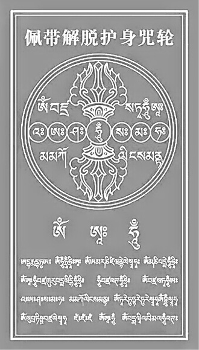

# 安忍的智慧

人生的旅程，不会永远是平坦宽畅、风和日丽，作为善恶业力相杂的人，不可能不遇到一些逆境违缘。现实生活中，许多令人后悔之事的发生，都是因为缺乏安忍的缘故。因此，安忍的智慧对我们来讲，显得尤为重要。

曾有一位叫尽见的大臣，国王给了他500两黄金，委派他去买最好的东西。他走了很多国家，一直都没有买到。

后来，他遇见一个老人在街上喊：“卖智慧，卖智慧！谁要买智慧？”

大臣心想，这个东西我们国家没有，于是问道：“怎么卖？”

“500两黄金，要先付款。”

大臣交出黄金后，老人字正腔圆地说：“这可是真正的人生智慧，一共12个字，你务必要记住：缓一缓，再生气；想一想，再行动。”

大臣听后，心里直喊冤枉、后悔不迭，认为500两黄金可惜了。

他回到家里，已是深夜。走进卧室，见妻子身旁躺着一个人，不由得气愤至极，心想：“这个水性杨花的女人，居然敢红杏出墙，背着我与人通奸！”想到这里，他气不打一处来，立即抽出宝剑向妻子刺去。

忽然，他想起了那12个字，就一边念一边仔细察看，结果发现：在妻子身边躺着的人，竟然是自己的母亲。原来，妻子今天生病了，母亲是特意来照料她的。

大臣这才醒悟过来，觉得那12个字，字字珠玑，若不是它的提醒，自己险些酿成大祸，500两黄金又岂能与妻子和母亲的性命相比！

世人发生一些大事，有时候原因非常简单，“眼里揉不下沙子”，或者意气用事，十分钟之间就能出现可怕的后果。所以，当我们怒不可遏时，千万不要在冲动的情况下，做出任何决定和行为。

要知道，嗔心就像夏天的狂风暴雨，骤然出现时，风云变色，但过一会儿就万里无云了。故而，当你产生严重的嗔心时，请停一停、缓一缓，深吸一口气，在心里默数十个数，给自己一个冷静的机会，这样就不会做出不理智的傻事了。

佩带解脱护身咒轮

此咒轮乃藏传佛教宁玛派祖师——诺那呼图克图亲自组合，集一切诸佛的秘密不共加持力。凡与此碰触之有缘众生，皆能获得大利益。消灾免难遇难呈祥，其应验之例数不胜数。不限信仰。
