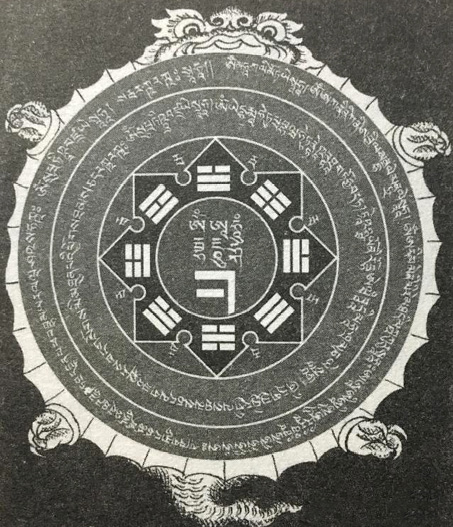

# 尽孝等不得

我们孝养父母的时间，每天都在递减，如果不能及时尽孝，以后定会终身遗憾。

很多人从小对父母的态度比较随意，一直以为父母爱自己是天经地义。父母由于宠溺孩子，也不多加指责。在这种环境中长大的子女，等到想报答父母恩德时，父母可能已离开了人间，正所谓“树欲静而风不止，子欲养而亲不待”。

以前孔子带弟子出游时，忽然听到远处传来悲切的哭声。

孔子说：“快走，前面有贤人。”

他们走到前面一看，原来是皋鱼，他穿着粗布衣服，拥着镰镐在道路旁哭泣。

孔子问：“你又没什么丧事，为何哭得这么悲伤？”

皋鱼说：“我有三个过失啊！我少时好学，曾游学各国，而把父母放在次位，这是第一个错误；为了我的理想，整天侍奉君主，没有很好地侍奉双亲，这是第二个错误；与朋友交情深厚，稍微疏远了亲人，这是第三个错误。如今我想报答父母之恩，可父母却不在了，所以内心悔恨不已，才失声痛哭起来。”

孔子听后，对弟子说：“你们要以此为戒啊！”

对每个人来说，父母的生育之恩、养育之德，是无法用语言描述的。《诗经》中云：“哀哀父母，生我劬劳……欲报之德，昊天罔极。”意思是，我可怜的父母啊，生我、养我多么不容易，而想要报答他们的恩德，这种恩德就像天一样浩瀚无际、广大无边。

所以，趁父母还健在时，子女一定要多尽孝，好好报答他们，千万别等他们不在了，才悔恨得失声痛哭。

文殊菩萨窍诀宝镜护身咒轮

此咒轮为西藏之护身圣物，可佩戴身上、挂于座驾、贴于家宅门窗，能遣除一切因显象、流年运程、风水地理、魔障导致之不详。于出行前，手持此咒轮遍照上下前后各方，能利于出行所做之事及避免危难。
