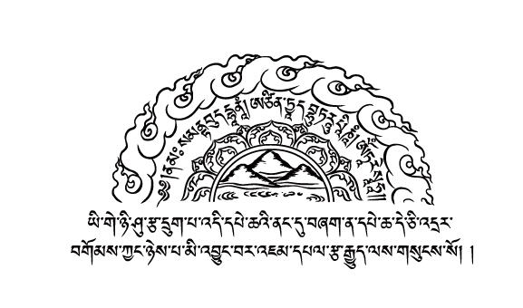

# 忍是世上最难的修行

最难行持的苦行是什么？就是当我们面对无缘无故的羞辱、无中生有的诽谤，或有人以百般手段来折磨自己，这时候还能忍得下来。

忍，是人生中最难修的。俗话说：“忍字高来忍字高，忍字头上一把刀。”《入菩萨行论》中也说：“罪恶莫过嗔，难行莫胜忍。”所有的罪恶中，没有一个像嗔心那么可怕的；所有的苦行中，没有一个像安忍那样难行的。

世上有各种各样的苦行，如外道有绝食等无意义苦行，佛教中有守八关斋戒及为了修法的苦行，但比较而言，这些苦都算不得什么，只是身体受些磨难罢了。最难行持的苦行是什么？就是当我们面对无缘无故的羞辱、无中生有的诽谤，或有人以百般手段来折磨自己，这时候还能忍得下来。

但即便困难，我们也要依靠众多道理，千方百计地努力修安忍。往昔，释迦牟尼佛转生为一仙人，名叫忍力，他发愿永远不对众生起嗔心。当时有一魔王为了摧毁他的修行，故意幻化出一千人，用恶毒的语言诅咒他，用妄语肆意诽谤他，大庭广众中，用难以启齿的言辞羞辱他。当他前往城市时，这些人还把大粪浇在他的头上、衣上、钵里，用扫帚猛击其头……

这些人时时处处加害他，但不管别人如何待他，忍力仙人从未怒目相向，也从未想过以牙还牙，甚至连“我到底做错什么”之类的话也没说。他只是暗自发愿：“以此修安忍的功德，回向无上菩提。等我成佛之后，一定要先度化这些人！”

作为佛陀的随学者，我们也应以此时时提醒自己。

要知道，嗔心与慈悲心直接相违。大乘佛法的主要目标，就是利益众生、帮助众生，可是一旦有了嗔心，不但不愿意利益众生，反而还想伤害他们，此举与大乘教义完全相悖。因此，在所有的罪恶中，再没有比嗔心更严重的了。

话虽如此，可是一旦逆境现前，真正能做到也不容易。日本的白隐禅师，就以安忍而著称于世。曾有位姑娘与一男子有染，生下一子。姑娘怕虔信佛法的父母谴责，就告诉父母，此事乃白隐禅师所为，因父母对禅师一直尊敬有加，她以为这样做可免父母责难。

不明真相的父母，听信了女儿的谎言，抱着刚生下的婴儿扔给禅师，骂道：“你这个败坏佛门的假和尚，以前没看清你的丑恶面目，蒙受你的欺骗，没想到你竟做出如此禽兽不如的事。这是你的儿子，拿去吧！”

禅师淡淡地说了声：“是这样吗？”就默默地接过孩子。

父母更以为没有冤枉禅师，将此事到处传播。不多久，人们都知道了禅师的“丑恶行径”，纷纷白眼相视。

禅师抱着柔弱的婴儿，到刚生过孩子的人家乞求奶水。那些人说：“哼！要不是看在孩子可怜的份上，才不会给你呢！”

时间一天天过去了，姑娘的良心备受煎熬。她不想再看到人们对禅师的不公正待遇，终于向父母坦白了一切。

父母万分羞愧地来到禅师面前忏悔。禅师听后，仍是那句话：“是这样吗？”

试想，假如换作是我们，会这样淡而化之吗？

防跨咒轮

此咒轮是由二十六个字母形式表现，今已不多见。此咒的力量：仅将其挂于房间高处，即可消除一切众生无意中踩、迈、摔、打佛像、经咒、唐卡等之罪业。经典中记载，此咒是蒋扬念杂去印度带回藏地的。能得此殊胜咒轮，也是汉地众生的福报因缘。
