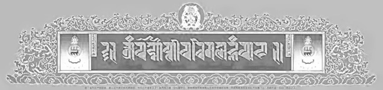

第六章   
父母就是菩萨

我们孝养父母的时间，每天都在递减，如果不能及时尽孝，以后定会终身遗憾。

母心如水  
 子心如石

“霜殒芦花泪湿衣，白头无复倚柴扉，去年五月黄梅雨，曾典袈裟籴米归。”

在这个以自我为中心的当今社会，太多子女纷纷以工作、家庭为借口，将父母拒在自己的世界之外，对他们身体的衰老、内心的孤独不闻不问，忘记了他们养育自己是如何含辛茹苦、任劳任怨。

藏地有一句俗话：“母心如水，子心如石。”孩子的心像石头一样坚硬，对父母总是无所谓；而父母的心，却像水一样柔软，始终惦记着孩子。就算孩子已四五十岁，按理说不需要担心了，可父母还是放心不下。

面对父母，我们为人子女的，理应扪心自问：真正做到“孝顺”了吗？“孝”字的结构，上是“老”、下是“子”，本义是子女应把父母顶在头上，可现在又有几人做得到？

春秋时期的郯子，是孔子的老师。他生性至孝，父母年老患有眼疾，他特别伤心，到处求医。听说鹿乳能治好眼疾，他便披着鹿皮，前往深山，混入鹿群中。

一日，猎人误认为他是鹿，正要举箭射他。他赶紧大叫，并将实情告之。猎人听后非常感动，想办法给他弄来鹿乳，并护送他出山。

古代有这样的孝子，令人非常敬佩。相比之下，现在很多人做得实在太差。且不说别的，单单是父母在家中叫你，好多人就不能一听到便应声，反而慢慢吞吞在做自己的事，将父母的呼唤置若罔闻。甚至即使回应，也是很不耐烦，没有一点恭敬和孝心。

包括一些出家人，可能空性观得“太好”了，把父母也观空了，觉得没什么。但从世间道德而言，对父母的孝敬不能缺少。

唐朝有个懒残和尚，可谓一代高僧。因母亲就生了他一个独子，他责无旁贷地负起孝养母亲的责任。有时他穷得一文钱也没有，为了不让年迈的母亲挨饿，只有把自己的袈裟典当了，买米回来养亲。后来他在诗中也写道：“霜殒芦花泪湿衣，白头无复倚柴扉，去年五月黄梅雨，曾典袈裟籴米归。”

从过去大德的历史来看，他们对父母是有执著，但这种执著并未影响他们成道。而如今有些人，出了家以后，对父母一点孝心也没有，这是极不应理的。

其实，不仅儒教推崇孝道，在佛教中，“孝养父母”也是最基本的善法。像《父母恩难报经》《盂兰盆经》《地藏菩萨本愿经》，都堪称“佛门孝经”，经中详细描述了父母恩重难酬，做儿女的应当如何报答。

佛教不管小乘、大乘，均认为父母是严厉对境，假如对其造业，果报相当严重。尤其是作为出家人，为了孝养父母，甚至可将信众供养自己的钱，给父母使用。佛陀时代就有位阿罗汉，父母非常贫穷，他想以衣食供养，但又不敢，于是请示佛陀。佛陀便召集僧众，并作开许：“假令出家，于父母处，应须供给。”

佛陀还亲口说：“今成得佛，皆是父母之恩。人欲学道，不可不精进孝顺。”

所以，不管是什么样的人，报答父母的恩德都不能忘。

过解脱咒轮

又称如意咒轮、满愿咒轮。此咒轮能消除众生无量深重罪业，与无边众生广结善缘，令其善根福慧增长，功德利益深广不可思量。

有缘得此法宝者，可贴于寺院、佛堂、住宅、商店、办公室之大门上，或天桥、路桥、地下道、河流大桥之横梁上方。

依据建屋经典记载，任何人在此咒下经过一次，即可消除千劫以来的灾难，带来平安好运。
