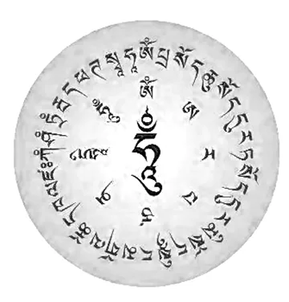

第三章   
得之我幸，不得我命

被众人恭敬、名利双收时，没必要心生傲慢，因为这个会过去的；穷困潦倒、山穷水尽时，也不必痛苦绝望，因为这个也会过去的。

永远快乐的保险你买了吗

现在，不少人为了安度晚年，都要买医疗保险、养老保险，那你死后永远快乐的“保险”，不知道买了没有？

无论是什么样的聚合，最后都会面临分离，这就是无常的规律。

如今，与自己朝夕相处的人，聚在一起只是暂时的因缘，在不久的将来，必定会各分东西。诚如古人所言：“父母恩深终有别，夫妻义重也分离，人生似鸟同林宿，大限来时各自飞。”

我读过一本叫《哈佛心理课》的书，里面讲了一位在哈佛大学商学院任教九年的杰教授，他后来离开学校时，学生们依依不舍、神情悲伤。于是，教授就给他们讲了一个故事：

“IBM公司的总裁汤玛士·华生，原本患有严重的心脏病。一次他旧病复发，医生要求他必须马上住院治疗。华生一听到这个消息，当下毫不犹豫地拒绝道：‘我怎么会有时间呢？IBM可不是一家小公司！每天有多少事情等我去裁决，没有我的话……’

‘我们出去走走吧！’医生没有和他多说，亲自开车邀他出去逛逛。

不久，他们就来到近郊的一处墓地，只见医生指着一个个坟墓说：‘你我总有一天要永远地躺在这儿。没有了你，你目前的工作还是有人接着做。少了谁，地球都照样转。你死后，公司仍然还会照常运作，不会就此关门大吉。’

华生沉默不语。第二天，这位在美国商场上炙手可热的总裁，就向董事会递了辞呈，并住院接受治疗，出院后又过着云游四海的生活。

而IBM也没因此而倒下，至今依然是举世闻名的大公司。”

杰教授讲了这个故事后，所有的学生也都释然了。

可见，无常一旦降临到头上，谁离了谁都可以活，此时没必要悲悲戚戚，坦然接受、勇敢面对才是正途。

其实，无常时刻与我们形影不离，每个人一定要有心理准备。甚至哪怕自己再不愿死亡，死亡也迟早会来临。到了那时，就算是最珍爱的身体，也要万般不舍地留在人间，唯有自己一人随业力而前往后世。对于这一点，只不过有些学唯物论的人持一种逃避的态度，不愿意接受也不愿意这样想而已。

他们总觉得学佛是在逃避，实际上，不承认后世，对下辈子没有任何打算，才真正是一种逃避。你这一世只有短暂几十年，死了以后多少万年、多少世的快乐和痛苦，都取决于这一生的业力。如此重要的事情，你能轻易忽略吗？

佛教最重要的就是要关心后世。然而，现在的大多数人对此没有任何概念，包括一些学佛的人，也把佛教看成是获得今生快乐的捷径、给心理带来安乐的手段，至于最关键的解脱大事，或者生生世世的快乐和痛苦，自己从来也没有考虑过。有时候看这个世间，就像月称论师在《中观四百论大疏》中所说，整个国家的人都发疯了，国王最初是清醒的，但众人看到他与众不同，纷纷指责他是疯子。结果国王也不得不喝下毒水，跟他们一样变成了疯子。

对有智慧的人来说，学佛其实并不消极，也不落后。不管你承认也好、不承认也罢，前世后世都的的确确存在。既然它是肯定存在的，我们又岂能没有一个长远打算？现在，不少人为了安度晚年，都要买医疗保险、养老保险，那你死后永远快乐的“保险”，不知道买了没有？

当然，没有这种信仰的人，不想这些也情有可原。可有些人自称已皈依佛门多年，甚至是大乘佛教徒，对此都根本不考虑的话，这个问题就非常严重了。

如今很多人一提到“死”就退避三舍，给他一讲后世有轮回、地狱，他马上就捂着耳朵：“不要讲！不要讲！我害怕，还是快乐点好，我不愿意听这些。”此举无疑是掩耳盗铃、自欺欺人，但也由此可见，佛教信仰若想深入到每个人的见解中，确实还存在一段距离。

文殊菩萨咒轮

常佩带文殊菩萨咒轮，可增长智慧，辩才无碍，记忆力坚固。此咒轮安于宅中，得大富贵、儿女聪明、灾祸消灭、神鬼护持。
