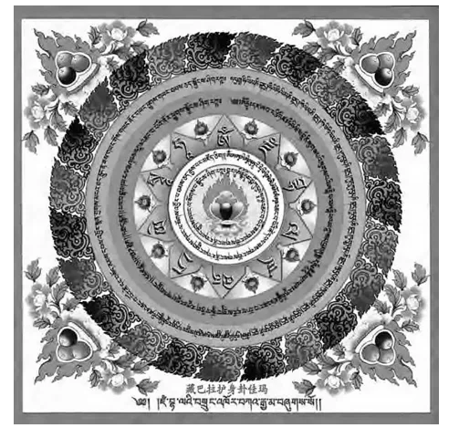

# 苦乐皆由心造

有一位皇帝，在流亡途中，偶尔尝得一种豆腐，感觉如天界甘露。流亡之后他回到皇宫，令御厨仿制，却怎么也做不出当时的美味了。

前不久，与一位十分投缘的朋友一起聊天，从佛法到人生，从分前别后到大江南北，可谓包罗万象、无所不谈。

不知不觉，午饭的时间到了，有人送来了面条。一看汤色，便令人垂涎欲滴，一品味道，更令人叫绝。世人说：“酒逢知己千杯少。”没想到，遇到好朋友，连面条也变得可口起来。心的力量真是不可思议。

记得在我几岁时，一次，父亲带我去炉霍，途经真都小镇，在镇上一间破烂不堪的小面馆，吃了一碗面。实在是太好吃了！

如今几十年过去了，在那以后，我品尝了许多公认的世间美味，却再也找不到那碗面的滋味了。

其实我也清楚，一碗小镇上的面，不可能有什么与众不同的味道，一切皆由心情所致。当时也许是因为难得出门，兴致很高，或者是因为在那个年代，实在没有什么美味可尝。

记得古代有一位皇帝，在流亡途中，偶尔尝得一种豆腐，感觉如天界甘露。流亡之后他回到皇宫，令御厨仿制，却怎么也做不出当时的美味。仅仅因为对豆腐美味的强烈贪执，便导致众多厨师平白蒙冤、身首异处，如果那位皇帝知道“境由心造”之理，也不至于屠杀无辜了。

然而，世间又有几人能明白呢？

黄财神藏巴拉护身卦佳玛坛城

此坛城殊胜功德之处，可具足长寿，祛除疾病，财运亨通，与众和睦，声名远播，增加福报资粮，得享世出世间一切利乐。如将其敬供于佛堂、住宅中，可速疾增倍生财、得财、聚财、护财，如同供奉一枚世间稀有、能满足一切心愿的如意宝一般，速积福报。
