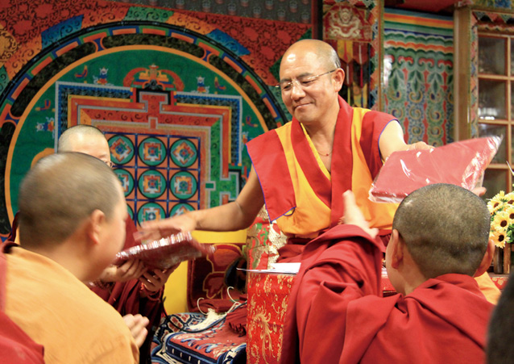

# 你是那个总叫着“我要、我要”的人吗

总是叫着“我要、我要”的人，往往什么都得不到，最后一贫如洗；总是慷慨布施的人，有“舍”才有“得”，财富会自然而然涌现。

现在有些人，拥有一点财产便死抓不放，舍不得用在对今生来世有意义的事上，从来都不愿意布施，还经常跟别人哭穷，说些可怜兮兮的话：“我实在没有钱，太穷了！”这样的人，很容易得到饿鬼的果报。

从前有一则寓言：

两个小鬼要到人间投胎，阎罗王对他们说：“让你们去做人的话，一个要一生布施东西给别人，一个要一生从别人那里获得东西，你们愿意做什么样的人？”

小鬼甲一听，赶紧跪下来说：“阎王老爷，我要做一生从别人那里获得东西的人。”小鬼乙则默默无言，静静听候阎罗王的安排。

阎罗王把抚尺一拍，判道：“令小鬼甲投胎到人间做乞丐，可以处处向人乞讨东西；小鬼乙投胎富裕人家，时常布施周济别人。”

这则寓言，实际上反映了“舍”与“得”的微妙关系：总是叫着“我要、我要”的人，往往什么都得不到，最后一贫如洗；总是慷慨布施的人，有“舍”才有“得”，财富会自然而然涌现。

然而，不懂这个道理的人，由于从不舍得，纵然生前腰缠万贯、富可敌国，死后也会非常可怜。

《增一阿含经》里讲：一个大富翁叫婆提，他特别特别有钱，但因为没有子嗣继承，死后财产都被充公了。

为此，波斯匿王专门风尘仆仆地去拜见佛陀。佛陀问他发生了什么事，为何一大早就赶过来？国王说：“我去没收婆提家财产时，发现不说其他的，单是纯金就有八万斤。但他生前吃的是粗陋饮食，穿的是污垢衣服，乘的是瘦弱老马，这是怎么回事呢？”

佛陀告诉他：“这是因为婆提在世时，心被吝啬所控制，不知布施的缘故。”

波斯匿王就问：“那他命终后会转生何处？”

佛陀回答：“他善根已断，现生于涕哭大地狱。”

波斯匿王又问：“难道他没有一点善根吗？”

佛陀说：“没有。他这一世用尽了往昔的所有善根，却又未造新的，所以现在无有丝毫，只有在地狱中受苦。”

如今也有些人，因为前世的福报，暂时拥有一点钱财和快乐，但今生若没有继续积累福德，后世也会像婆提一样，善根用尽后只有堕落。就像我们手机里的电，今天用的是以前充的，一直用用用，到最后电全都没有了，再不充的话，明天就没办法打了。

所以，为了安乐恒久远，我们务必要抓紧积累福德，否则，违缘到来时，一点资粮都没有的话，佛陀也没办法救护你。

听到别人的恶意中伤，

没必要对此念念不忘，

转头放下便是。

如果一直不停地去想，

就像把别人吐出来的东西，

自己又捡起来吃一样愚笨。

