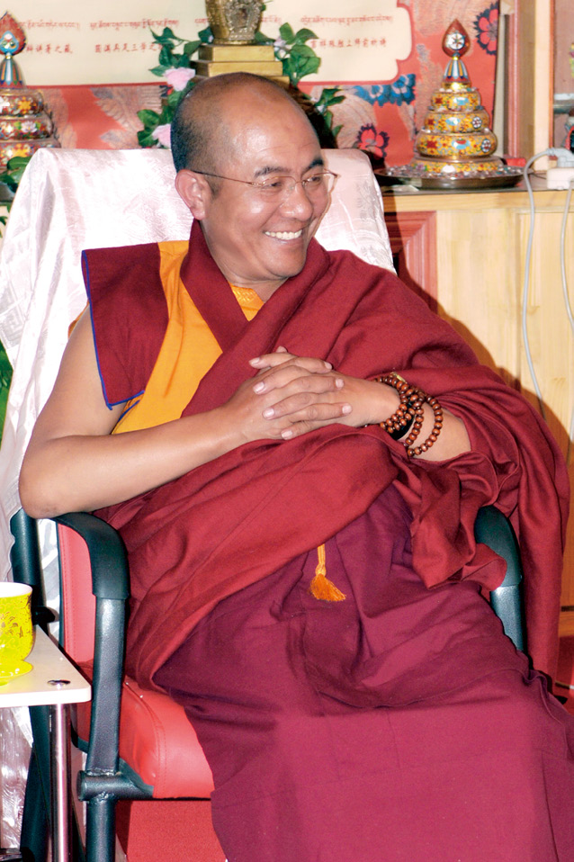

# 多修无常，得佛安慰

佛陀曾这样赞叹观修无常：“多修无常，已供诸佛；多修无常，得佛安慰；多修无常，得佛授记；多修无常，得佛加持。如众迹中，象迹为最，佛教之内，所有修行，观修无常，堪为之最。”

关于修持无常，塔波仁波切从三个层次教诫我们：

开始的时候，害怕生死所逼，务必要像鹿逃出笼子一样义无反顾。若没有这样的出离心，则无法从世间琐事中解脱出来。

中间的时候，务必像农夫辛勤耕耘田地那样，对未来有一定的把握，做到死而无憾。

到了最后，要像大功告成的人一样，自己心安理得。就像法王如意宝在《快乐之歌》中所说：“死也快乐，活也快乐，一切都快乐。”

在未生起这种境界之前，我们务必要唯一观修死亡无常。普穹瓦格西也讲过：早晨若没生起无常之念，那么白天就空过了；晚上若没生起无常之念，那么夜晚就空过了。

有些人平时念头特别多，总喜欢胡思乱想，一会儿想这个、一会儿想那个，老是安住不下来，非常苦恼。其实你若实在喜欢想，那最好想无常：山是无常的，河是无常的，我是无常的，你是无常的……最终我也会死，你也会死，除此之外，再没有更殊胜的教言了。

印光大师当年在佛堂里，就贴了一个大大的“死”字。想到自己要死了，还有什么放不下？哪一样东西能带得去？所以，对修死亡无常特别重视，这也是许多大德修行得力的秘诀。

宋朝有个人叫吴信叟，博学多才，一心向佛，他虽在朝廷身居高位，但深知诸法无常之理，从不贪慕荣华富贵。

他日日夜夜都观修无常，并请人做了一口棺木，晚上就睡在里面。每到天亮时，要求家仆一边敲击棺木，一边唱道：“吴信叟，归去来！三界无安不可住，西方净土有莲胎，归去来！”他一听这个声音，马上就起来念佛。

后有一天，他在念佛的时候，家人听到天乐鸣空。他告诉大家：“金台已到，我也该走了。”说完即安然往生。

我们每个人的生命都很无常，何时会死，谁也无法预料。亲友再缠绵不舍，死后也带不走一个；财富再令人垂涎，死后也全留在人间；身体再万般珍爱，死后也弃如敝屣。所以，明代一元大师告诫我们：“西方急急早修持，生死无常不可期，窗外日光弹指过，为人能有几多时？”

遗憾的是，对大多数人来说，无常明明就在眼前，却反而把一切执为常有；老年明明已经到来，却还以为自己仍然年轻。所以，活得苦不堪言，还不明白怎么回事。

车如果没有刹车，遇到危险的路段，就会出事。

人如果没有控制能力，当自己的烦恼极度爆发时，

就很容易做出不理智的事来。

