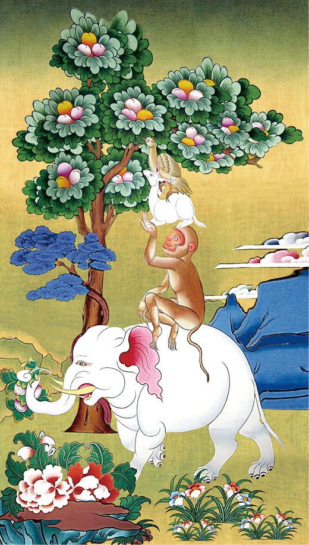

# 尊敬长辈，连动物也懂

对年轻人来说，恭敬长辈就是在积累福德，凌辱长辈就是在损耗福德。

久远之前，在一个森林中生活着羊角鸟、山兔、猴子、大象，它们和睦相处，过着快乐的生活。

一天，四只动物商议：“我们应该恭敬最年长者。”为了分出谁长谁幼，它们便以一棵树为参照进行比较。

大象首先发言：“我小时候就见过这棵树，当时它和我现在一样高。”

猴子紧接着说：“当我小的时候，这棵树就和我现在的身体同样高。”

山兔接过话说：“我小时候，这棵树只有两片嫩叶，我还舔过这叶子上的露水。”

羊角鸟最后说：“我以前吃过一棵树的种子，在这里撒下不净粪，后来树就从中长了出来。”

四只动物遂排出了长幼顺序：最小的是大象，之后是猴子，再后是山兔，年龄最大的是羊角鸟。

自此以后，四只动物无论做什么事，都按照长幼顺序次第相偕。每当途经艰险难行之处，大象身上蹲立猴子，猴子肩扛山兔，山兔头顶羊角鸟。

后来，四只动物又发誓共同持戒行善，在它们的带动下，森林中的动物，乃至整个国家的人，也都开始持戒行善。

这四只动物就是“和气四瑞”。当时的羊角鸟就是后来的释迦牟尼佛，山兔是舍利子，猴子是目犍连，大象是阿难。

所以，有智慧的人应当尊敬长辈。与年轻人相比，老年人具有许多功德，若能对其恭敬承事，虚心听取他们的意见，自己便可避免走很多弯路，人生也会增上吉祥。

和气四瑞
