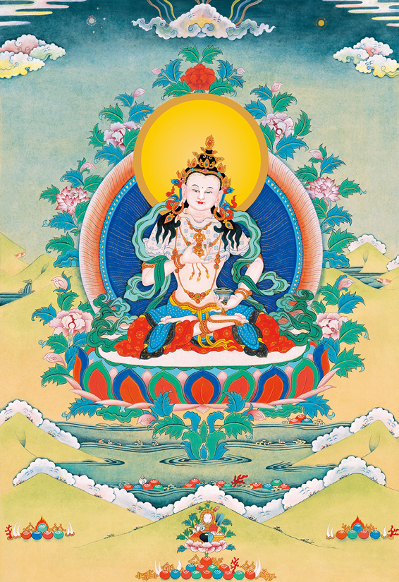

# 想除去负罪感，就念金刚萨埵心咒

金刚萨埵曾于往昔发愿：“凡闻我名号、凡观想我、凡念诵我心咒者，无始以来之罪业悉得清净，若不能者，我不成佛。”

在十方无量的佛陀中，金刚萨埵是百尊之尊。

何谓百尊之尊？中阴法门里有文武百尊，这百尊涵盖了一切佛菩萨，而这百尊又可摄于金刚萨埵一尊。这个关系，就如同太阳与阳光，太阳可以散射无量阳光，而阳光又统统归于太阳。所以，只要你修成了金刚萨埵，也就成就了百尊功德。

尤其是，在忏悔罪障方面，金刚萨埵有非同一般的力量。

阿弥陀佛的大愿，侧重于往生，令听闻其名号者往生极乐世界。而金刚萨埵，侧重于清净罪业，他曾于往昔发愿：“凡闻我名号、凡观想我、凡念诵我心咒者，无始以来之罪业悉得清净，若不能者，我不成佛。”如今，金刚萨埵已现前佛果，所以不论是谁，只要肯观修，念诵金刚萨埵心咒四十万遍，就必定能净除一切罪业。

有些人常说：“我以前造的业太可怕了，坑蒙拐骗，无恶不作，现在有没有忏悔的机会啊？”其实只要有信心，就一定有这种机会。

心的意念非常关键，不仅佛教如此承认，很多科学家也这样认为。比如，美国有个科学家，经多年研究发现：如果用恶语去谩骂一朵鲜花，它很快就凋谢枯萎；而用爱语去赞叹它，它美丽动人，存活时间特别长。日本也有人研究发现，对同样的水，竭力赞叹它，里面会有莲花状的结晶；拼命诽谤它，结晶就现出丑恶的形状。

所以，心的力量不可思议。只要我们真心忏悔，发誓今后不再重蹈覆辙，然后如法念诵金刚萨埵心咒，那么，罪业再重也能得以清净。

金刚萨埵

若想忏悔过去的一切罪业，就念金刚萨埵心咒“嗡班匝儿萨埵吽”。

在念心咒的过程中，具体该如何观想呢？

观想你前方的虚空中云雾缭绕，出现一朵白莲花，莲花上有一圆月坐垫，上面端坐着金刚萨埵：身色洁白，金刚跏趺坐，手持铃杵，以十三种报身服饰严饰全身。金刚萨埵正和颜悦色地面对着你，以慈悲的眼神注视着你。你在他面前虔诚祈祷、忏悔，同时一心念诵金刚萨埵心咒“嗡班匝儿萨埵吽”。

念了一定数量之后，再观想金刚萨埵发光遍布十方，继而他化光融入自身，自己无始以来的罪业全部清净，最后将此功德回向一切众生。

这种修法很简单，对甚深修法没有基础的人，只观想这一点完全可以。

此外，有些人从小因受环境或教育的影响，造过很多杀生的恶业，有些可能至今还历历在目。为了忏悔这些，我还想给大家一点建议：

一、有条件的话，在山上林间悬挂印有金刚萨埵心咒的经旗，或印有观音心咒的经旗。

二、多念诵金刚萨埵心咒和百字明。

三、如果你过去杀过青蛙，以后就多放青蛙；过去捕杀过一些鸟，有生之年就多放鸟。倘若你没有太多钱，也可以劝别人放，数量上尽量超过你所杀生的数目，这是生命的一种补偿。比如，你杀过两只狗，今生至少要放生两只以上。这种补偿方式能否完全抵消罪业，我不敢说，但的确是一种很好的忏悔方法。
