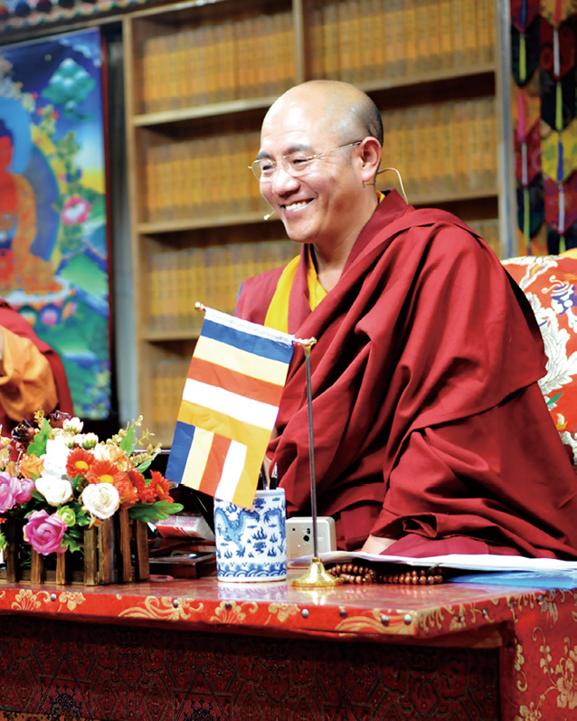

# 父母需要你时，你在哪里

要知道，在这个世界上，从世俗角度而言，比父母更重要的事情是没有的。

在古代，儿女孝顺父母天经地义，可如今，子女在病榻前照顾重病的父母，常常被新闻媒体广泛宣扬，觉得这种行为比较特殊。其实，父母生病时，子女陪着他们输液、打针、拿药是理所当然的。但有些人父母住院了就雇人看护，自己什么也不管，整天说“我工作特别忙”……

要知道，在这个世界上，从世俗角度而言，比父母更重要的事情是没有的。想想你以前生病时，父母是怎么照顾的？他们心急如焚，半夜把你背到医院，衣不解带地看护你，现在他们生病了，你能做到吗？

古人不像我们，就算贵为皇帝，他们对父母也会细心服侍。汉文帝刘恒的母亲生病了，他一直在她身边照顾。药煎好时，他总是自己先尝一下烫不烫，不烫了再端给母亲。母亲病了三年，他就三年中没有离开。

我小的时候，有一次半夜生了重病，母亲抱着我连夜翻过很多山，跌跌撞撞走了几十里路去县城找医生。换成平时，她晚上根本不敢过森林，但为了救我的小命，她什么也不顾了。

想到母亲的恩德，我有时感到很惭愧，自己没有为她做很多事情，也没有很多时间陪在她身边。母亲平时如果生病，或者需要做些事情，我因为实在很忙，确实也做不了什么，只有上课前抽空去看看她，哪怕有时只有短短几分钟，她也觉得是一种安慰。

虽然母亲一个字不认识，但能背诵《极乐愿文》《普贤行愿品》《度母赞》等，在我小的时候，她就教给我了。所以我始终觉得：一个不识字的人，光凭记忆就能记下这些，是不容易的。

老年人的心，跟年轻人的完全不同，他们非常脆弱，亲人偶尔说话重了一点，对他们的刺激会相当大；而简单的一句安慰话，却会让他们开心很久。

如何关心父母，特别是当他们生病了，需要照顾、安慰的时候？我们应该好好想一想。

身体生病了，不能一直拖着，

而要尽快找出病因去医治它。

同样，我们遇到麻烦时，

也不能总想拖延、逃避、推卸，

而应尽快找出它的要害，

然后全力一击把它消灭。

这才是明智之举。

