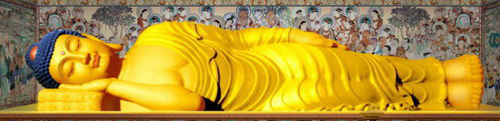

# 睡觉时要吉祥卧

当你结束了一天的忙碌之后，晚上入睡时，姿势应像佛陀涅槃时的吉祥卧一样：右卧而眠，以足压足，右手垫在右脸颊下，左手平放在左腿上。以这种卧式入睡，即使突然离开人间，也不会堕入恶趣中。

吉祥卧，与医学上的正确睡姿是吻合的。现代医学认为：正确的睡觉姿势，应该是向右侧卧，微曲双腿。这样，心脏处于高位，不受压迫；肝脏处于低位，供血较好，有利新陈代谢；胃内食物借重力作用，朝十二指肠推进，可促进消化吸收。同时，全身处于放松状态，呼吸匀和，心跳减慢，大脑、心、肺、胃肠、肌肉、骨骼得到充分的休息和氧气供给。

而在佛教中，据有关论典记载，吉祥卧有四种功德：

第一，身体不会产生不适当的念头和行为；第二，就像百兽之王狮子一样，不会失去正知正念；第三，不会入于深度昏沉，能时刻保持警觉；第四，不起恶梦，经常做吉祥之梦。

假如我们看到有人临近死亡，也应劝他们摆成这种卧式。倘若有能力观想，还应让他们观修慈悲心，通过呼吸修持自他相换；即使没有能力，以这种卧式迎接死亡，就算业力再深重、罪业再大，也不会堕入恶趣。

每天在入睡之前，除了吉祥卧以外，还有四点需要注意：

一、正念想：从开始睡一直到睡着之前，始终要把心拴在善法的柱子上。龙猛菩萨说过：“安乐中入睡，会在安乐中醒来。心地安乐，梦境也安乐。”

以前我在读小学时，住在一个老喇嘛家。我们每天吃完晚饭后，他盖上法衣，把油灯吹熄了，就一直念“嗡玛呢巴美吽，嗡玛呢巴美吽……”，逐渐逐渐睡着了，声音就没有了。

第二天一早醒来，他的声音先是特别浑浊，嗡嗡嗡听不清楚，后来慢慢地，听清是在念百字明：“嗡班匝萨多萨玛雅，玛努巴拉雅，班匝萨多迪诺巴，迪叉哲卓美巴瓦……”一直念到吃早饭之前，这种习惯从来没有间断过。

这些孩童时代的教育，对我一生的影响非常大。尽管自己没有那么精进，但始终都觉得这个很需要、很重要。

二、正知想：在正知中入眠，尽量不产生一些烦恼。

三、光明想：临睡之前，观想释迦牟尼佛或阿弥陀佛等佛菩萨，发光照亮自己的周围，在这样的境界中入睡。即使做不到这样，也应临睡时在佛像前磕三个头，这一点最好不要忘。

另外，平时出门也应带着佛像或唐卡。同时，每天最好还能观想一下佛陀，即使你不会修什么法，在面前摆上释迦牟尼佛、阿弥陀佛的像，看一看观一观，好好地忏悔，好好地念经，这也是一种修行。这种修行谁都会，若能长期如此，所得的利益无法言表。

四、早起想：我们睡前不要想：“明天是星期天，睡到下午也没关系。”如果真的这样想，就很可能一直睡到第二天下午。假如在临睡前想“明天应该早一点起来”，心的力量不可思议，一定可以早起的。

这些窍诀对调心有极大帮助，大家务必要经常练习！

吉祥卧
