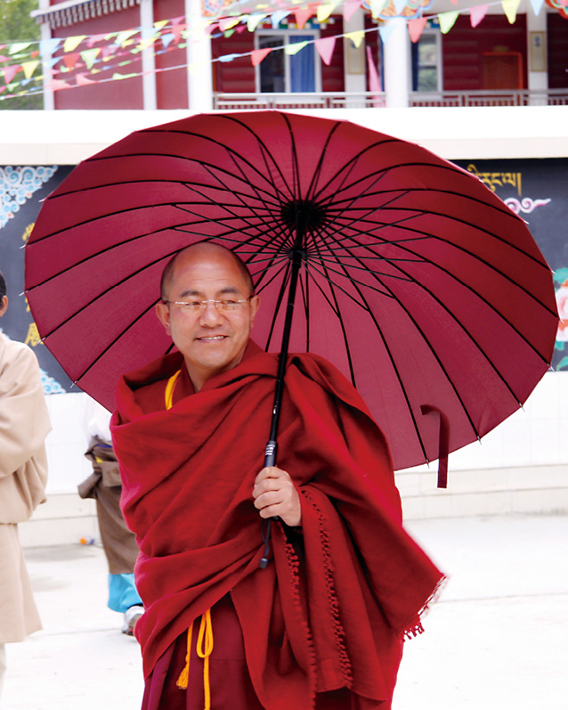

# 转绕佛塔时要有想法

佛塔是十方诸佛菩萨身口意加持的聚合，在转绕的过程中，观想它发出光芒融入自身，净除自己无始以来的一切业障。

清朝时，武昌宝通寺出了一名“摸脑和尚”，不计大病小病，只要经他手一摸，便霍然痊愈。他的手何以有此妙用呢？据说该寺有一座宝塔，他每天到塔下转绕，用手摸着宝塔砖石，心里默诵“大悲咒”。十多年如此，天天不间断，故而有此威力。

青海有一座佛塔，里面藏有赤热巴巾国王（金刚手菩萨的化身）的头发。某次，我们有个很好的机会去转绕，感觉非常殊胜。当时我在转绕时，泪水就默默地流了下来。佛塔里藏有圣者的珍贵头发，我即生中能见到这样的佛塔，是非常有福报的！

其实，佛塔等殊胜的对境哪里都有，只是有时候我们太愚痴了，根本不知道它的价值。

现在的寺院里，拜佛的有，烧香的有，就是转绕的比较少。那天我去朝拜六祖肉身，当时转绕了很多圈，但许多人都不来转。没办法，我就号召：“你们居士来跟着我转吧！”他们就跟我一起转，转了几圈，好多居士又不想转了。他们也不是觉得转绕没有功德，但这个功德的殊胜性，很多人可能不是特别清楚。

其实，汉地有些大德对绕塔也是很重视的。本焕老和尚100岁时，我曾去拜见他，他吃完饭以后说：“我们去转佛像吧！”老人家跑得比较快，我们在后面跟着，有时候都赶不上。

转绕佛塔时，要有一些观想方法。比如说转绕观音菩萨像时，应观想——“外”：诸佛菩萨全部融入于观音像；“内”：传承上师全部融入观音像；“密”：空行本尊全部融入观音像。然后一边念“嗡玛呢巴美吽”，一边转绕。转绕的过程中，想象观音像发出光芒融入自身，自己无始以来身口意所造的一切罪障全部净除。

很多大德都说，转绕佛塔时，能观想得更广当然可以，但不能的话，最好也要观想这一点。比如，你今天转一座佛塔，就想这个佛塔是十方诸佛菩萨身口意加持的聚合，在转绕的过程中，它发光净除自己无始以来的一切业障。

转绕时，如果能念转绕咒语，就应该念诵；如果不能念，念观音心咒、百字明、金刚萨埵心咒也可以。

我转坛城塔的时候，主要是念金刚萨埵心咒，因为自己无始以来造的罪业太多了，应当依此来清净。每次都观想从坛城塔里发光，自己的一切罪业全部得以净除。

绕完了之后，再念一些或长或短的回向文，将功德回向于一切众生离苦得乐，这样的转绕才非常圆满！

当你事事顺利的时候，不要沾沾自喜，

因为这正在用尽你的福报；

当你屡屡受挫的时候，不要怨天尤人，

因为依此可消除你往昔的罪业。

换一种心态看成败，生命就会更加精彩！

