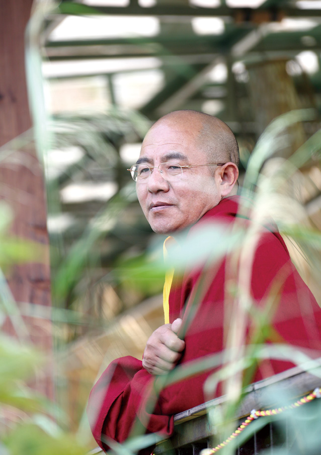

# 啥都有，就是“我”不在了

假如一开始就把人生的目标定在钱财、地位上，真正的“我”都丢失了，那又何谈“我”的幸福？

或许有人会想：“佛法经得起观察倒是好事，但这跟我的生活有什么关系呢？”

现在很多人，只关心自己的生活。我去过很多学校，发现好多老师和同学，既不想听佛教的甚深道理，也不想钻研科学方面的知识。他们特别关心的，只是自己的工作、感情、生活；他们特别喜欢听的，也是能解决当下这些问题的教言。

但实际上，如果我们对人生真理拥有正确见解，那像工作、生活中所遇到的任何问题，肯定可以迎刃而解；反之，假如一开始就把人生的目标定在钱财、地位上，真正的“我”都丢失了，那又何谈“我”的幸福？

从前，一位公差押解一名犯了戒规的和尚去京城。路途很远，负责任的公差每天早晨醒来后，都要清点身边的几样东西：第一样是包袱，他们的盘缠、衣服都在里面，当然不能丢；第二样是公文，只有将这份公文交到京师，才算完成任务；第三样是押解的和尚；第四样是自己。

公差天天都清点一遍：“包袱还在，公文还在，和尚还在，我自己也还在。”这才开始出发上路。

日复一日，偏僻的小路上经常只有他们两个在行走，很是寂寞。久而久之，他们彼此互相照应，关系越来越像朋友了。

有一天，风雨交加，赶了一天路的他们饥寒交迫，遂投宿到一家破庙里。和尚对公差说：“不远处有个集市，我给你打点儿酒吧，今天好好放松一下。”听后，公差没在意，打开枷锁放和尚去了。

一会儿，和尚打酒归来，还捎了不少下酒菜。公差喝得酩酊大醉，沉沉地睡了过去。

一看机会来了，和尚就从怀里掏出一把刚买的剃刀，将公差的头剃得精光。然后扒下公差的衣服换上，又将自己的僧衣裹在公差身上，连夜逃走了。

公差浑然不觉，一觉睡到第二天日上三竿，醒来后一摸手边，包袱还在；再看公文，也在；找和尚，竟然不见了。公差抓挠着头皮想：“和尚哪儿去了呢？”猛然发现自个儿头是光的，身上穿着僧衣，于是恍然大悟，原来和尚也在！

前面三样都在，第四样就该找自己了。公差又在庙里庙外四处找，怎么也找不着，心里就纳闷儿了：“和尚还在，可我到哪儿去了？”

现在世间上的很多人，也像这个公差一样，没日没夜地忙着各种琐事，不知不觉中，将自己变成了囚徒，结果“我”却找不到了。

假如一开始就把人生的目标定在钱财、地位上，

真正的“我”都丢失了，那又何谈“我”的幸福？

