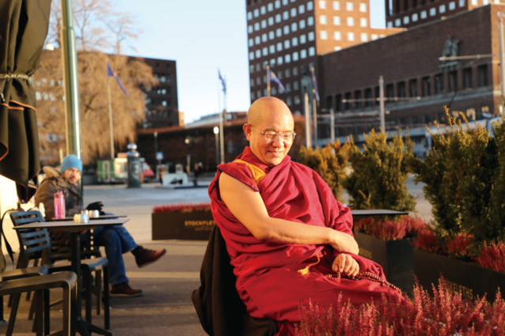

# 很多时候，我们的心思都白费了

> 生前枉费心千万，死后空留手一双。

> 悲欢离合朝朝闹，富贵穷通日日忙。

> 生前费尽心机苦苦谋划，死后却只能两手空空趋入后世。事实上，世间凡愚天天都在上演悲欢离合的闹剧，日日为富贵穷通而忙碌不已。

我们一辈子费尽心机谋求的财富地位，实际上只是身外之物，死时连一根毛都带不走。

就拿钱财来说，《杂阿含经》中讲过：世间的金银财宝并不可靠，要么会被国王没收，要么会被盗贼偷走，要么会被自然灾害吞没……即使没有遇到这些违缘，死时也分文带不走，唯有生前造的善恶业，紧紧跟随着自己。

既然人死后终将一无所有，那现在天天为了钱财、感情、人际关系而不开心，这有什么意思呢？

有些人在生活中，常有许多事情想不开，整天一副苦大仇深的样子，跟别人接触也经常小题大做，把整个团体的气氛都搞坏了。

实际上，我们每个人在世上活不了多久，与他人相处的时间也很短暂，所以没必要今天跟这个人吵、明天跟那个人斗，把自己的一生变成永不停息的“战斗机”。

放眼四周，许多人每天不停地忙着、累着，但到最后这样有什么用呢？罗状元在《醒世诗》中也说：“急急忙忙苦追求，寒寒暖暖度春秋，朝朝暮暮营家计，昧昧昏昏白了头。是是非非何日了，烦烦恼恼几时休，明明白白一条路，万万千千不肯修。”

其实，假如没有修持善法，只为了这个虚幻不实的身体，那忙多少年也是白忙！

当我们遇到逆境时，

要尽量做到“忍一时风平浪静，

退一步海阔天空”，

若能如此，

任何苦难都会逐渐消于无形。

