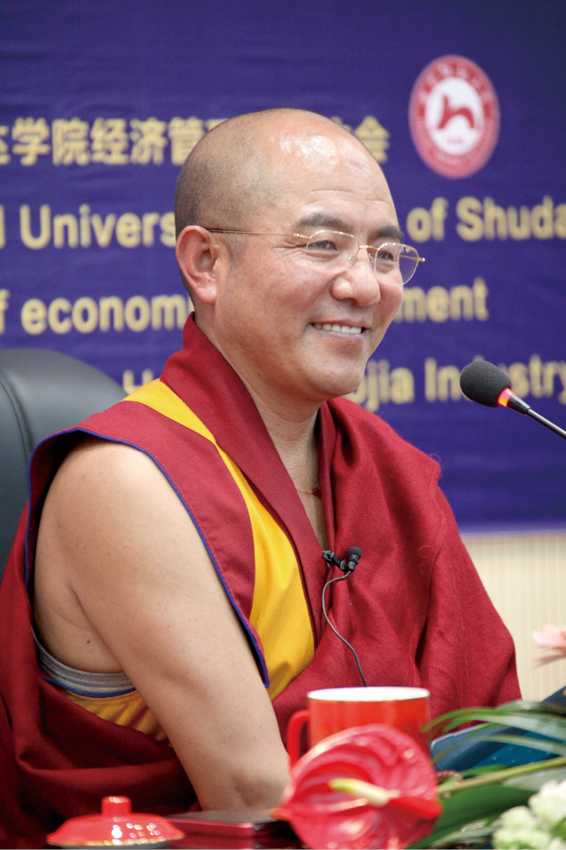

# 懂得四法印，方能直面残酷青春

人生的真相到底是什么？佛陀在四法印中揭示得非常清楚。若能明白这些道理，就知道今后应该如何面对残酷人生。

什么是四法印呢？

第一，有漏皆苦：

在整个世间，无论是外在世界，还是人类社会，痛苦都占大多数，偶尔有一些快乐，也是不稳定的。

再出名的哲学家、再迷人的艺术家、再显赫的政治家，都无法抗拒轮回的痛苦。只有通达了生命的真相，人活着才能找到方向。

第二，诸行无常：

世间的万事万物，如地位、财富、名声、青春等，全部是无常变化的。在我们身边，许多人口头上都会说“一切无常”，但他们从来也没有修过，故而一旦无常现前，自己根本没办法面对。

像牛顿、爱因斯坦、伽利略，他们死时是怎么样的？跟普通人一模一样。而佛教中的修行人，纵然没有很高的学问，但由于生前修过无常，一旦得了绝症，接到医院的病危通知，自己也能坦然面对。这就是修行与学问之间的差别。

其实，假如你认识到了万法无常，且不说别的，就算在人生旅途中遇到一些悲欢离合，也会想得开：“一切都是无常的，一切都在变化，缘聚缘散，这是正常现象！”

第三，诸法无我：

通常而言，每个人都是以自我为中心。尤其是现在有些年轻人，特别特别自私，时时都以自己所想、所要为重，除此以外，别人的一切都显得微不足道。有了这种“天上天下，唯我独尊”的心态，未来等待自己的，除了痛苦还是痛苦。而佛陀谆谆教诫，只有懂得了“我”不存在，才会明白生命的真正意义所在。

有人可能会问：“既然诸法无我，‘我’是没有的，那么谁上天堂、谁下地狱？”

其实这是非常简单的问题。所谓的空性，是从胜义实相来讲的，而并不是说在现相中，也什么都不存在。拿一张桌子来说，用量子力学来分析，桌子就是能量，能量就是桌子。但你即使明白了这一点，也不可能抱怨：“桌子如果是能量，上面怎么放杯子啊？”这种说法，就已混淆了现相和实相的概念。

所以，佛教所说的哪些地方空，哪些地方不空，这个一定要分清楚！

第四，涅槃寂静：

通过抉择万法的本质，证悟了万法皆空，真正通达“我”不存在，这样的境界就叫涅槃，它是最彻底的快乐。

这种快乐，并不是像你买了一栋房子，第一天兴奋得不得了，过两三年就没感觉了；也不是像你买了一辆好车，刚开始特别满足，过不久就没有新鲜感了；或者住在五星级宾馆里，刚进去时，“哇，好舒服”，但过几天就习以为常了。

事实上，世间有漏法所带来的快乐，都是短暂的，不具有稳固性，暂时你可能有一些感觉，但时间长了就消失了，甚至还可能变成痛苦。

通达四法印的道理，对年轻人来讲至关重要。所以，我经常想：现在的学校教育中，应该让大家学一些佛教的知识。当然，这并不需要以皈依为前提，不是一学佛就要成为佛教徒、出家人。但是，既然大家都追求真理，就不妨以广阔的胸怀，看看佛教是否揭示了人生真相。

心善，会聚集许多“正能量”，

投射的外在世界也会非常美好；

心恶，外境就会出现“负能量”，

给自他带来无尽的痛苦。

