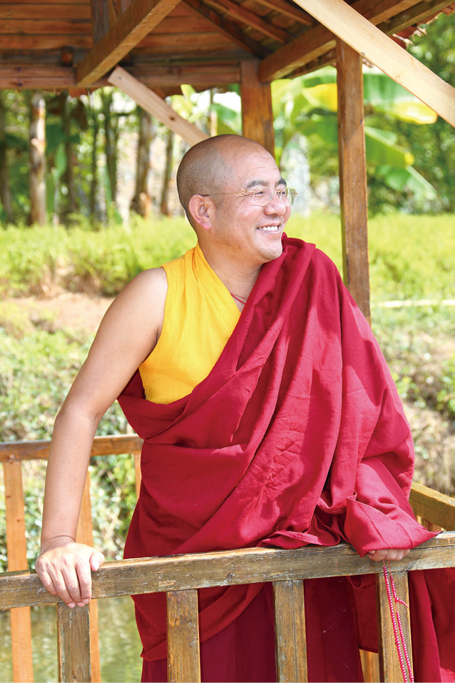

# 改变人生，从改变人生观开始

常有人说，好多道理懂了，但就是做不到。实际上，你做不到，就是因为没有真正懂。假如你真的明白毒药有毒，还会去喝吗？

一个社会若没有因果观，不相信善恶到头终有报，不知道一切苦乐是自作自受，人就没有了任何约束，什么都敢说、什么都敢做，并觉得自己不必为此负任何责任……

关于因果不虚，也许有人会提出疑惑：“如果真是善恶有报，那我如今做了善事，为什么还不现前善果呢？”

这种观点有失偏颇。你做善事是“因”，得快乐是“果”，“因”和“果”之间一定要有时间的间隔。

比方说，农民在春天种庄稼，只会到了秋天才收割，不可能今天刚播种子，明天就丰收果实。

同样，我们今生所造的恶业或善业，下一世、再下一世，乃至许多世后才会成熟。而这些业，正如佛陀在《百业经》中所言，既不会成熟于外境的山河大地，也不会中间无缘无故消亡，必定要成熟于自己的身上。

有些人常做善事，但仍会遭受一些痛苦，这是为什么呢？因为行善虽会有乐果，但若以前造过恶业，这也会成熟苦果。除非用忏悔来消除恶业，否则，善恶因果不能抵消。这就像种瓜会得瓜、种豆会得豆，不可能因为瓜种多了，就不会结豆。

佛教认为，一个人不论造了什么业，百千万劫也不会毁灭，最终一定会自作自受。

这就是佛教的因果观，也应该是我们的人生观。每个人若能认识到这一点，相信人生会有很大的改变。

遗憾的是，如今真正相信因果的人，特别是年轻人，的的确确太稀少了。或许我这么说，大家觉得有点悲观，但了解现实的人对此都明白。

明白人生如梦，并不会让我们变得消极。

只有懂得了这个道理，才知道人生究竟要追求什么。

否则，你对感情、对生活太执著了，

结果会带来什么呢？除了巨大的痛苦，不会有别的。

