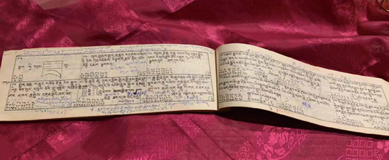
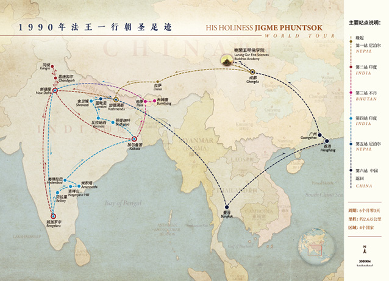

梦尘回忆录

目录

序

我陪大恩上师法王如意宝晋美彭措去过很多地方：

1986年，去过康区的五大神山和七十二座寺院，历时四个多月；

1987年，去过五台山，整整一百天；

1990年，去过印度、尼泊尔和不丹，待了六个多月；

1993年，去过欧美各国，三个月以上；

1995年，去过新加坡和马来西亚，超过一个月；年底在成都陪伴法王，五个月；

1997年，去过鸡足山、普陀山，两个多月；

……

但是，和法王一起去印度、尼泊尔和不丹朝圣，是我印象最深刻的经历，也是法王离世后我最不敢触碰的回忆。

我以为，当年的许多经历已经遗忘。直到2018年某一天，我在整理房间时，不小心看到一本旧藏历，翻开一看，是1990年我出国时随身携带的日历，每天的日期上还用短短几个字标注当天发生了什么。一瞬间，过去的一切被猝不及防地拉回眼前，跟法王在一起的那些日日夜夜，触手可及。

从那时起，写下这段经历的想法，一直萦绕在我脑海中。因为，我自认为永不会忘记的一些事，随着岁月流逝，许多片段已被时间的雨水冲走。曾和法王一起朝圣的人，有些已经不在人世，有些年事已高，如果全部离开，没人知道那时发生了什么。因此，反复考虑之后，我决定写下一些自己仍记得的内容。

在这本书里，我没有着墨太多每个圣地的历史故事和法王的一些超胜境界，只是简单记录了法王于何时何地做过什么、见过谁，就像流水账一样。在写作中，内容没有夸大或捏造，也没有顾忌前后重复，想到哪儿就写到哪儿，尽可能地忠实记录。如果记不清楚某些情节，我会向当年随行的人打听，或是找当地的人再三确认。同时，书中还附上了一些照片，大部分是我当年所拍摄，尽管像素不太高，技术不太好，但毕竟是一份历史见证。

生长在这个时代的人，看到1990年代的一些描述，或许没有太多的代入感。因为在30年前，不要说互联网、智能手机，甚至连电也没有。但就是在那样的环境中，法王为了弘法利生，不畏艰辛、不辞疲劳，其间经历的种种不易，是我们今日根本无法想象的。

这本《梦尘回忆录》，是法王的一段朝圣记录，也是我依止上师的一段自传。非常感谢那本日历，让我在30年后还能把这段珍贵的记忆编辑成文。

假如有一天你也想朝拜那些圣地，不妨带上这本书，沿着法王的足迹，把他老人家去过的地方，再走一遍。

索达吉

法王圆寂十七周年纪念日

铁鼠年十一月十五日（2020.12.29）

30年前的那本藏历

