# 第一站 尼泊尔

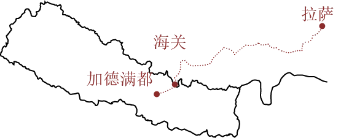

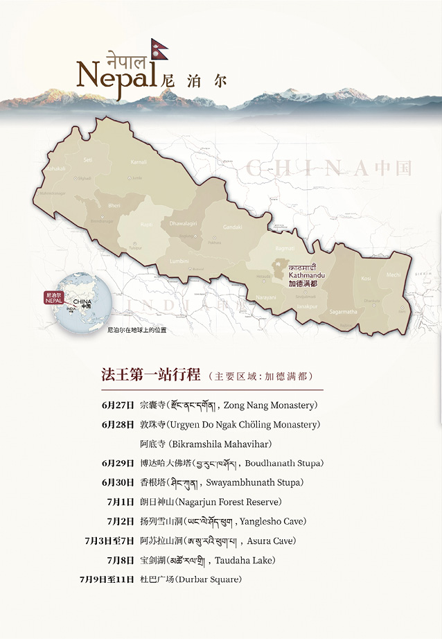

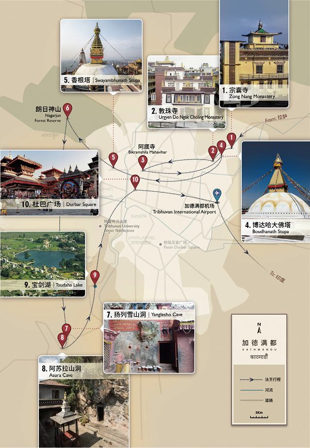

1990年6月27日

这一天，万里无云，非常清朗，我们一大早就去中国海关楼办理过境手续。那里的检查非常严格，所有行李都要过一遍。

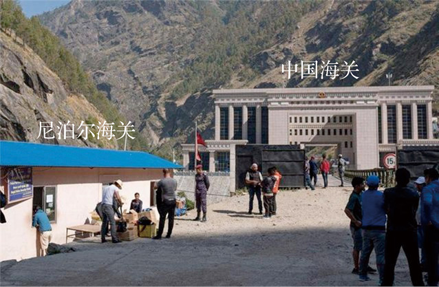

现在的中尼边境

之后，我们从中国海关前往尼泊尔海关。两者之间有一座桥，位于一条大河上。据说有些人偷渡去尼泊尔时，从桥上直接跳入河中，游过去就是尼泊尔境内。

尼泊尔的边境检查不是太严，没有安检仪器，只有几名工作人员查看证件，象征性地检查一下。以前有人提醒我们：检查期间可能会有一些刁难，但塞点钱可以解决。果然，这些工作人员的态度特别凶，我们私下给了一些钱，他们立刻变得和善起来。但是一些没有得到钱的人，还在继续作怪。我们只能再塞钱，大官小官都要打点。当时，人民币与尼泊尔卢比的汇率是1：15，算起来钱也不太多。他们收了钱后，我们就轻松过关了。

记得在等他们检查时，热巴医生顺便给法王量了血压。看到血压计后，一名工作人员非常好奇，围着法王转来转去，说也想尝试这个东西。于是热巴医生也给他量了血压，他很高兴。

法王入境后，尼泊尔各大寺院的代表早已恭候多时。当他们看到法王走出海关时，纷纷上前迎接。一坐上车，我发现司机在右侧驾驶，感觉有点稀有。打听后才知道，尼泊尔曾被印度统治，深受印度的英系驾驶习俗影响，所以方向盘都在右边。

司机告诉我们，拉萨到中尼边境的距离超过800公里，从尼泊尔边境到首都加德满都，大约是100公里。

进入这个国家，我发现每家每户都开着窗大声唱歌，整条街道充满了美妙的旋律。由于宗教文化的融合，尼泊尔和印度之间有许多相似之处，特别是在音乐旋律方面，几乎难分彼此。这两个国家的人都能歌善舞，生活与音乐密不可分。原因可能是当地宗教比较兴盛，为了展示对信仰的虔诚，人们借由歌舞的手势、眼神、身姿来表达，这非常具有感染力。当我第一次听到这种旋律时，就很喜欢它，有一种似曾相识的感觉。后来，我买了一些录音带，当我在屋里放松时就听听，包括在翻译经论时，偶尔也会作为背景音乐。

下午，法王到达加德满都的宗囊寺（རྫོང་ནང་དགོན།， Zong Nang Monastery）。寺院是宁玛派的宗囊仁波切在生前修建的。后来，在尼泊尔逗留期间，法王都住在这里。寺内有六七名僧人，他们对我们的饮食、住处、安排车辆、出行等，照顾得十分周到。

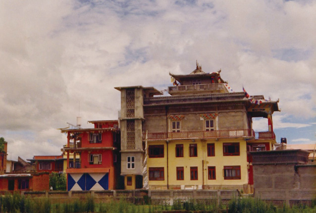

站在宗囊寺的阳台上，环顾四周，加德满都没有一座高楼大厦，只分布着一些小矮楼，城市规划似乎很随意。距离寺院不远的，是著名的博达哈大佛塔，可以在阳台上清楚地看到。

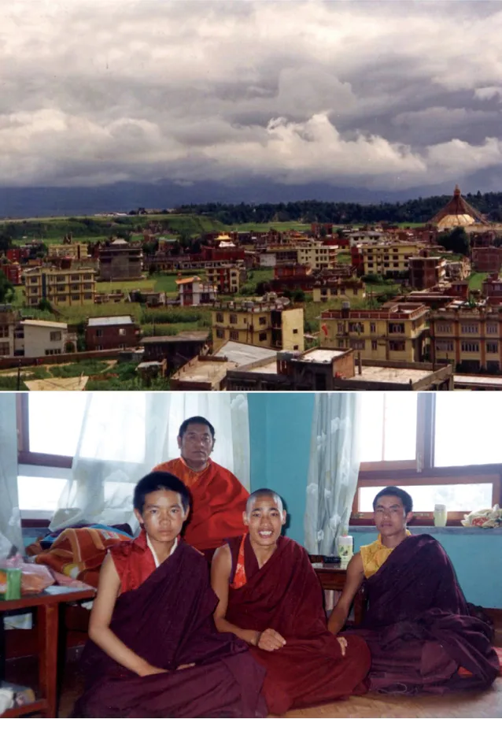

尼泊尔的天气非常炎热，法王逗我们说：“历史上，许多藏族人去印度求学，当他们到达尼泊尔时，因为太热而罹患热病，既无法回藏地，也去不了印度，最后只能死在尼泊尔。所以，大家应该多喝水啊，如果去印度也去不成，回藏地又回不了，白白死在这里就太可惜了。”

在尼泊尔时期，法王的屋里没有空调。因为出汗太多，每天上午和下午都要洗个澡。过去，他老人家不想经常换衣服，但后来每天早上都要换一件衬衣。这次法王带的衣服也相对较薄，而且多带了几套可以换洗。在我的印象中，除了比丘的三衣外，还有一件无袖的长衫嘎让，几件半袖、无袖、长袖的黄色衬衣，以及内裙和披单。

那时，我有幸为法王洗衣服，但白天很忙，只有晚上在法王睡后才有时间。令我印象深刻的是，法王的衣服上有一种美妙的香味，有时像檀香，有时像熏香。律藏中说，戒律清净的人，身体自然会散发香味。法王的妙香可能是一种戒律香，也可能是功德香，周围很多人都能闻得到。每次洗衣服，我的手上都会留下香味，久久不散。

1990年6月28日

法王在尼泊尔待了半个月。因为这里有许多佛教圣地，法王要求趁此机会好好朝圣，所以几乎每天都没闲着，或是在朝圣发愿，或是在闭关修行，或是在讲经说法，没有任何散乱。因为长期在法王身边耳濡目染，所以，我多年后自己出去传法，每一次行程也安排得很满。

在尼泊尔的第一站，法王去了第二世敦珠法王的敦珠寺——邬金显密法林（Urgyen Do Ngak Chöling Monastery），寺内有20多名僧人。法王为僧俗弟子传授了“文殊静修大圆满”灌顶，并朝拜了第二世敦珠法王的肉身塔。

第二世敦珠法王在国外圆寂，法体虹化缩小后被迎回尼泊尔，一直供奉在敦珠寺。肉身塔外有一个玻璃框架，彩虹相经常出现在玻璃上，七彩纷呈、千变万化。朝圣者会根据各自因缘，看到不同的瑞相。

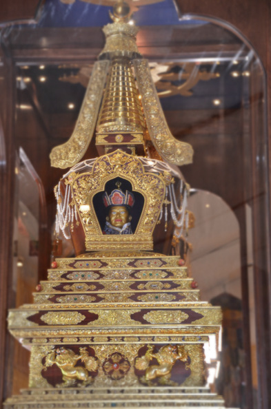

塔中供奉着第二世敦珠法王虹化后缩小的圣体

也许是因为喇荣和第一世敦珠法王因缘深厚，法王对第二世敦珠法王有很大的信心，并一再表示希望见到他。后来，第二世敦珠法王圆寂前有三四年的准备时间，很少与其他人交流。从那时起，法王就对身边的人说：“今生可能见不到了。”当时是20世纪80年代，两位大德没有任何方式可以联系，但事后经过对比，法王打消念头的时候，恰恰是第二世敦珠法王准备圆寂的时候。

离开敦珠寺后，法王去了附近的阿底寺。这座寺庙是尼泊尔国王为供养阿底峡尊者而建造的，也被称为腾布哈日殿堂。寺内供奉有四大函《般若经》，是龙树菩萨去龙宫传法后，龙王为了报答法恩而供养的，之前在人间并没有。尼泊尔政府非常重视这一文物，平时不向公众展示，我们托关系才有幸目睹。之后，朝拜了一尊玛哈嘎拉像，据说是龙树菩萨所造的108尊玛哈嘎拉像之一。

当天我去敦珠寺的时候，遇到了一位堪布。他曾在喇荣求学过，叫益西旺嘉。他一再请求我为寺内僧众传讲《量理宝藏论》，我说这次行程太紧，等下一次吧。但是他求法的心非常切，不断地恳求，我不得不答应下来。

为了不影响法王的行程，我只能减少睡眠时间。每天早上5点前去敦珠寺，传完《量理宝藏论》后，再在6点半前赶回来。从宗囊寺到敦珠寺有一公里多，这条路坑坑洼洼，不太好走。有时候，我也会在法王就寝后，连夜赶去敦珠寺，次日清晨传完法再回来。

白天事情非常多，我也比较累，只有很晚了才有时间备课。每天这样来来去去，还是有点辛苦。但大家闻法的心很切，我传法的意乐也很强，加上我在佛学院曾讲过几次《量理宝藏论》，备课的难度不是很大。所以，在尼泊尔期间，我就这样用十天左右把《量理宝藏论》讲完了。

1990年6月29日

法王在尼泊尔刚安顿好，就让我尽快给佛学院发电报报平安。那时不像现在通讯方便，尤其是出国之后，国际长途很难打得通，只能发国际电报。

一大清早，我请一位长住尼泊尔的藏族人，带我去找可以发电报的地方。他带我在加德满都找了半天，才找到一个很简陋的邮电楼，然后费了好大劲，才接通色达。由于电报无法直接发给佛学院，我只好发给色达县的人，请他们帮忙转达。记得电报上写的是：“我们顺利到尼泊尔，即将去印度等地。若方便再联系，请放心。”

回来后，我禀报上师电报已发，但对方能否收得到也不太确定。

之后，法王去朝拜了博达哈大佛塔（བྱ་རུང་ཁ་ཤོར།，Boudhanath Stupa），藏族人习惯称其为“夏绒卡秀佛塔”。此塔离我们住处有一公里左右，是加德满都的标志性建筑。了解佛教史的人都知道，博达哈大佛塔是莲花生大士、静命堪布、法王赤松德赞前世在尼泊尔转为养鸡妇女的三个儿子时所修建。莲花生大士说：“这座大塔为如意宝珠，令一切祈求及愿望得以实现。”故它又被称为“满愿塔”。

法王在转绕佛塔时，对我们随行的人叮嘱：“发愿是极为重要的。无论做任何善事，都应当广发大愿。转绕此塔，我们要发愿往生极乐世界，千万不要发恶愿，否则，就像昔日修造这座佛塔的那头牛发恶愿，最后变成了朗达玛魔王。”

随后，法王不用人搀扶，亲自绕塔三圈。我们也边发愿边转绕，最后在佛塔前的平台上，大家共同发愿回向。离开之前，法王还主动提出以此塔为背景拍照留念。

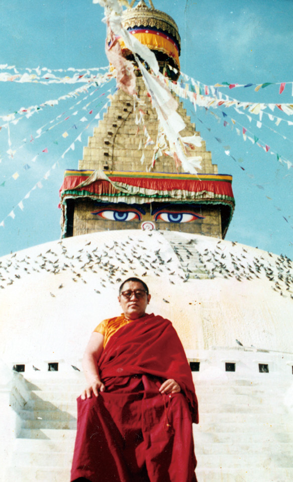

后来在尼泊尔期间，我们陪同人员稍有时间，就会去转绕此塔。来此朝拜、转绕的人，白天晚上络绎不绝。遇到重大节日时，很多乞丐还会在那里排队乞讨。

1990年6月30日

法王去朝拜了香根塔（ཤིང་ཀུན།，Swayambhunath Stupa）。这座佛塔位于加德满都西郊的山丘上，周围环绕着许多小佛塔。

香根塔是世界上最古老的佛塔。关于它的起源，历史资料中有各种各样的记录：据说在人寿一万岁时，它是由诸佛智慧自然形成的水晶塔，后在迦叶佛时代，寂德尊者扩建外形以保护此塔，并成为如今的样子；也有人说加德满都盆地过去是一个大湖，毗婆尸佛在此投下藕根，并长出一朵莲花，后来文殊菩萨用宝剑将湖壁的山岩劈开，湖水泻去，莲花处即为如今的佛塔；也有人说此塔是宝髻佛眉间白毫放光照耀所成……简而言之，这座塔有悠久的历史，并且极具加持，周围有许多圣者留下的神迹。

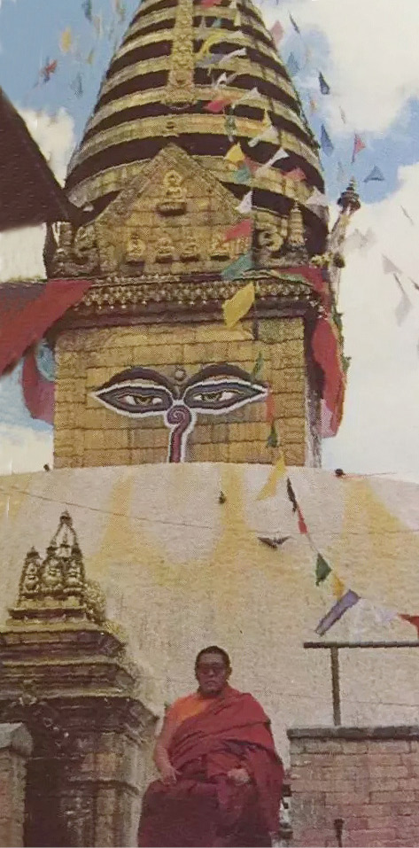

在转绕之前，法王告诉我们：“佛塔是诸佛智慧的代表。世尊亲口说过：‘未来若以清净心、恭敬心供养佛塔，与恭敬供养我没有任何区别。’绕塔可以消除多生累世的罪障，获得无量功德。尼泊尔有很多佛塔，特别是三座著名的佛塔，非常有加持力。赤松德赞法王也曾为朝拜此三塔，专门从藏地来到尼泊尔。我们应该珍惜这次机会。”

离这里不远，是世亲论师的遗塔。该塔相对较小，与其他塔的形状不同——塔顶比较短，没有十三层法轮。

在世亲塔前，法王谈到了小乘声闻塔和大乘菩提塔之间的区别，并讲述了世亲论师圆寂的故事：当世亲论师来到这里时，碰巧见到了一位出家人穿着在家衣服在耕地，随身还挂着一个酒瓶子。他想：“现在真是到了末法时期。”他非常感伤，随即示现圆寂。

法王感慨地说：“我们必须记住这个故事。作为一个出家人，应该以闻思修行为主。被称为第二大佛陀的世亲论师，不也是因见出家人的邪行而厌离示寂的吗？”

1990年7月1日

法王去朝拜了朗日神山（Nagarjun Forest Reserve）。它位于加德满都的西部，佛陀曾在这座山上讲过《朗日山大乘授记经》（གླང་རུ་ལུང་བསྟན།），因此这座山在尼泊尔非常有名。

《朗日山大乘授记经》内容非常殊胜，但没有被翻译成中文、英文，到目前为止，只有藏文译本。该经记载，在迦叶佛时代，果玛萨拉甘达佛塔（གོ་མ་ས་ལ་གན་ད）的附近有一座朗日神山，将来会有藏人、汉人前来朝拜，如果可以读诵《朗日山大乘授记经》，则功德非常大。

经中提到的“果玛萨拉甘达佛塔”，估计是香根塔。

这座山环境清幽，林木茂密。从山顶看，整个加德满都一览无余。山上没有建筑，保持着自然风貌，尼泊尔人和藏人喜欢来这里煨桑、撒风马。

法王向我们介绍了朝拜朗日神山、读诵《朗日山大乘授记经》的功德。之后，他望着远方，面露喜色道：“从这里可以看到藏地的群山。我们也应该在此供养、祈祷藏地的护法神，使白法护神欢喜，成办弘法利生事业。”随后带大家供护法、撒风马。

当撒风马时，法王大喊“拉迦罗[^1]——拉迦罗——”，响亮的声音传遍了整个山谷。此时，突然刮起一股旋风，将大量风马右旋卷起，越卷越高，飘向很远的地方。法王看着风马在空中旋舞，说：“我们弘法利生的事业，在一段时间内不会有违缘，并将一直延续下去。”

这个场面非常令人难忘。风马飘往尼泊尔、印度方向，我很好奇法王的未来事业是否在那边，但慑于法王的威严，不敢多问。

之后，法王带大家念诵了《普贤行愿品》。与法王一起，无论是朝拜圣地还是在三宝所依前发愿，都与弘扬佛法、利益众生有关。这与许多人为了发财、健康、长寿等目的而朝圣不同，对于他老人家来说，利益无边众生是他最大的愿望。

当天，法王的心情非常好。天气也很清朗，在山风的吹拂下，一点都不闷热。我们坐在草地上，拿出随身的食物、水等进行野餐。吃完饭后，还拍了一张很有纪念意义的合照。

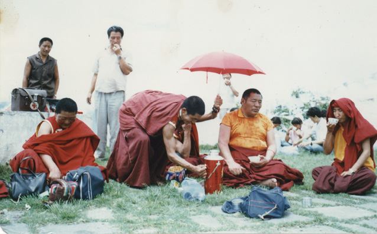

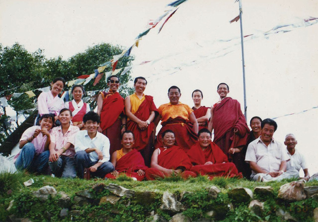

下山时，法王在半山腰休息了一下。法王妹妹下车后不久，脚被山上的吸血虫（འབུ་པད，Leech）咬了一口。尼泊尔人说，这种虫毒性很强，被咬后非常危险。起初，我们有点紧张，回去敷了药后，就没事了。

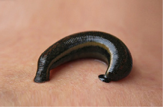

当天，法王坐的是一辆红色轿车。他在尼泊尔逗留期间，大多坐的都是这辆车。据说此车如今被供奉在一个道场中，以纪念法王。

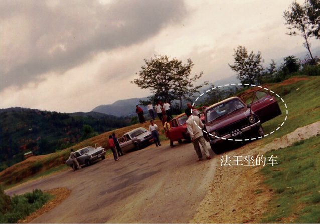

1990年7月2日

法王前往距加德满都21公里、以莲师圣迹闻名的帕平（ཕ་ཕུན།，Pharping）。

在这里，扬列雪山洞（ཡང་ལེ་ཤོད་ཕུག，Yanglesho Cave）是莲师以金刚橛降魔并获得大手印成就的地方，莲师留下了许多圣迹。伏藏大师果吉登持在《七品祈祷文》中也表示：“尼泊尔扬列雪之山洞，修行真实三世精藏时，以金刚橛降伏魔障众，彼处获得大手印成就。祈祷莲师多吉托创匝，祈祷邬金莲花生大士。”

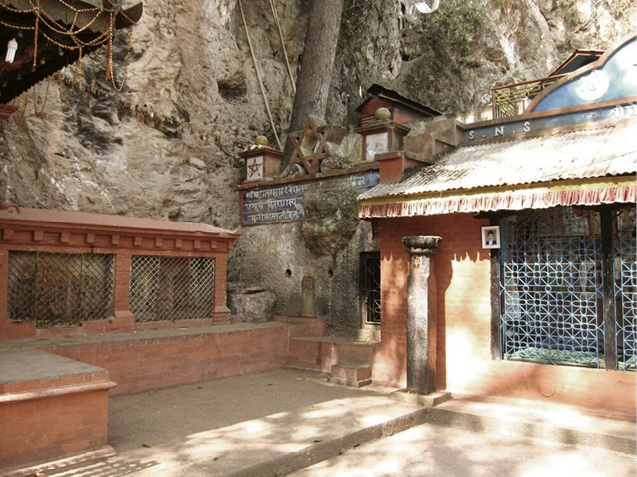

到了这里，法王对所有人说：“今生能够朝拜这样的莲师圣地，非常难得。莲师曾经说过：‘在其他地方修行一百年，不如在寂静圣地修行一日。’因此，我们应以各自的方式精进修行，不要散乱。”

之后，法王来到了山洞旁的一个小闭关房，并以禁语的方式修行了一天。在此期间，除了送饭、送药外，其他人都不得近前。我守在附近念了一些咒语。

离这里不远，有一个水池。许多印度教的信徒，额头上涂着红点，在那里一直供花、唱诵和祈祷。

1990年7月3日

早晨，在法王的光明觉受中，显现出一首开启金刚橛伏藏的道歌：

诸佛事业总集文殊尊，住于心间童子瓶身界，

加持殊胜智慧光永存，祈愿证悟传承之密意。

至尼泊尔扬列雪圣地，不净迷现如虹消法界，

并非有勤修道天尊身，现见了义幻化网本面。

诸法觉空一味清净性，希疑贪执轮涅皆解脱，

无迷乱瑜伽士安睡时，顿启辩才总持慧百门。

希求今生安乐在家众，寻求来世乐果出家者，

犹如金链毛绳缚相等，摆脱此二桎梏有困难。

昔日如敌五毒分别念，今日净住觉空本性中，

徒劳无义四座平等舍，幻瑜伽士欲眠舒适处。

据说往昔莲师于此处，现前大手印之持明果，

如今儿我亦追随父亲，不求其他窍诀自解脱。

此处集聚七轮宝数众，享用先辈持明之佳肴，

如同大鹏至四持明地，成为引导无边众商主。

之后，法王显得很高兴，说：“这次，各方面缘起都比较吉祥，今天一定会有收获。”又补充说：“这首道歌中的‘七轮宝数众’，是指你们随行七人[^2]。希望你们享用持明者的盛宴，就像大鹏翱翔般获得四持明的果位，并引导无数众生趋入解脱。”

由于当年的这种因缘，法王在圆寂前要求全学院念修金刚橛时，让索顿喇嘛、热巴医生和我担任金刚阿阇黎。但是，佛学院里有那么多高僧大德，我们不敢坐在高高的法座上，为了不破坏缘起，只好坐在程控室的话筒前带修。法王给佛学院打电话时，听说了我们的表现后非常满意，说：“他们三个有金刚橛的近传。他们都听话了，很好！”然后在电话里又交代了“莫舍己道、勿扰他心”等教言。这是我最后一次听到法王的声音。从某种意义上说，这可能是一种交付。

这次我写回忆录时，如果有些情节记不清了，还会向索顿喇嘛、热巴医生求证。现在他们都闭关了，而我经常到处传法。我相信除了我以外的其他几个人都修得很好。虽然我没有什么修行境界，只是一个普通的出家人，但我这一生很幸运，得到了法王的许多近传加持和殊胜窍诀。

法王流露出那首道歌后，直接去了阿苏拉山洞（ཨ་སུ་རའི་ཕུག་པ།，Asura Cave）。

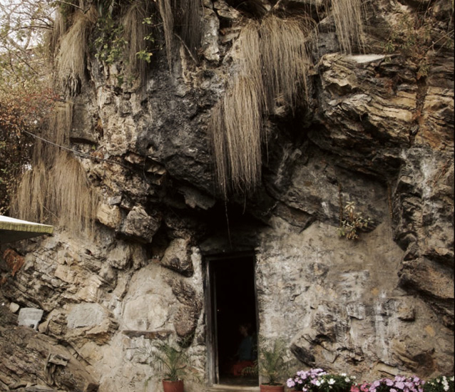

阿苏拉山洞，距离这个小闭关房约半公里。刚到达山洞的入口，法王的境界中清晰浮现出自己前世是尼泊尔大臣则纳莫扎时，莲师在这里赐予他金刚橛法门的情景。之后，意伏藏“项袋金刚橛”的灌顶和仪轨，在法王的智慧海中顿然呈现，我们迅速记录了文字。后来，它被收集在《法王全集》的“项袋金刚橛”法类中。

该法还有一些支分仪轨，例如火供、降伏法等。后来，随着法王去印度、回藏地，这些仪轨陆陆续续呈现出来，最后全部立成文字。

金刚橛法门是末法时期遣除魔障的最殊胜窍诀。过去，莲师曾经授记：“我乃自生莲花生，现将一切金刚橛续部之究竟心要，仅托付予汝——则纳莫扎（法王前世），勿忘修持。未来末法时，汝之化身圣者将现见此法并弘扬之。萨玛雅！”由此可见，法王是开取此法门的伏藏大师。

随后，法王立即给我们传授了“项袋金刚橛”灌顶。

在来之前，我们本来打算在阿苏拉山洞只待一晚。但法王说这个山洞是开取伏藏的圣地，在这里修行特别殊胜，所以决定多住几天，并要求随行人员念1万到10万遍金刚橛心咒。

在此期间，法王没有怎么说话，或安住于等持中，或者一直在念咒语。

1990年7月4日—7月7日

阿苏拉山洞的周边环境非常舒适，花草芬芳，泉水清澈，树木茂盛。山洞内有一些殊胜的圣迹，例如自生度母像、莲师手掌印等，是修行和发愿的殊胜对境。我很开心能够与法王一起在这里修金刚橛，并发愿终身念诵金刚橛仪轨，晚年有机会的话，也想在这样寂静的山洞中闭关。

为了购买法王需要的一些闭关资具，我有时会去下面的扬列雪山洞附近买东西。两个山洞之间有一条小路，路边有五颜六色的野花，天上时常有祥云和彩虹。偶尔，在山林中会听到布谷鸟叫，尽管我离开藏地的时间不长，但听到它的声音后，感到非常亲切。

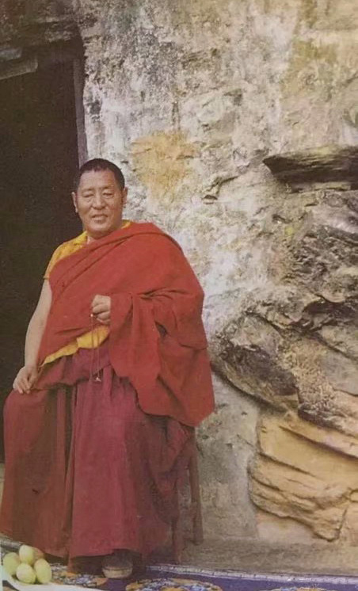

我一边念咒语一边上上下下，就像住茅棚的修行人采买日常必需品一样，非常愉快。在阿苏拉山洞的上面，还有阿难尊者为五百罗汉转法轮的圣地，有一次我还顺路去朝拜了它……现在已经过去三十年了，想起这段经历，一切就像发生在昨天。

当时，法王让我们多念金刚橛心咒，所以，每天除了午餐时有一些简单交流以外，其他时间我们都在禁语念咒。法王通常不与我们一起吃饭，而是将食物送去他那里。但是有一天中午，法王主动与我们共进午餐，并讲了他前世的一些经历，然后和大家聊了一会儿。

有一段教言，我记得很清楚。法王说：“具德上师还在世时，弟子视师如佛的信心非常重要。像莲花生大士，当他在这个山洞里修行时，显现上只是一个披着大氅的在家瑜伽士，在人们的眼里，他最多有一些特殊的神通和智慧，却根本不了解他的真实境界。当他在众生面前示现不同的行为时，有些人甚至还生邪见……”

听了法王的教言后，我心里暗想：“事实上，法王如意宝也是如此。我们弟子与他在一起时，信心不一定那么大，但再过几年，法王的境界会被发现非同寻常。到那时，这个道理可能更加明显。”

和上师一起吃饭，感觉很轻松。虽然我们没有很多食物，但在山洞门口的那顿饭，远远超出了我一生中的所有美味。

当时，有人指着远处的森林告诉法王，距离这里一公里的地方，有一个达克辛卡莉神庙（ལྷ་མོ་ནག་མོ།， Dakshinkali Temple），也被称为“黑天女殿堂”。神庙里供奉的女神卡莉，是历史上被莲师降伏的一个天女，这一点内道、外道都承认。但是印度教把她当作供奉的对境，每逢周二和周六，信徒们都会带着鸡、鸭、羊去那里杀生祭祀。尼泊尔每年十月最盛大的节日，就是达善节（宰牲节），每家必须宰杀至少一只羊以供奉卡莉女神。那时，加德满都的信徒们将来到神庙大肆杀生，然后把神像浸在鲜血中，以满足卡莉女神的嗜血——当然，鲜血中的神像只是替身，神庙里的女神像不能被血染污。据说那天，山谷中的河水都被鲜血染红了。

有人认为，尼泊尔每五年举行一次的最大杀戮节，就是在那里。但事实并非如此，那个祭祀是供奉嘉蒂麦女神（Gadhimai）的，该神庙离博达哈大佛塔约149公里。

听完这一段后，法王特别难过。让我们朝着那个方向，念了很长时间的观音心咒。

1990年7月8日

这次闭关非常圆满。法王本来让我们念1万到10万遍金刚橛心咒，但大家都不分昼夜地念，每个人都念了10万遍。

法王看上去非常高兴，说：“你们的念修已经圆满。我将金刚橛这个法交付给你们，你们可以在将来为别人灌顶、传授。该法可以遣除许多高僧大德的寿障，以及自己在修道中的违缘。它随时都可以修持，非常简单易行。”

此前，法王取“项袋金刚橛”的伏藏时，由于我们是现场记录，字迹相当潦草，所以在过去的两天里，我用藏文正楷字将其工工整整抄在了长条纸上。等回到加德满都后，可以多复印几份。法王前往印度时，许多大德应该需要。

之后，我们依依不舍地离开了阿苏拉山洞。

下山时，经过了许多玛尔巴尊者（米拉日巴尊者的上师）的圣地。根据历史记载，玛尔巴尊者曾多次前往尼泊尔、印度求取密法，前后长达21年。因此，山上有他住过的地方、加持过的地方、示现圣迹的地方，我们一一做了朝拜。

下午乘车返回加德满都。在穿过觉瓦镇的途中，附近有一个宝剑湖（མཚོ་རལ་གྲི།，Taudaha Lake），据说与文殊菩萨有关。过去，加德满都是一个大湖，香根塔位于湖中央，除了有神通的人，没人可以朝拜。后来，文殊菩萨幻化成一个名叫文殊天的金刚上师，从五台山到尼泊尔去朝拜香根塔。为了将来的众生可以朝拜这座塔，文殊天用宝剑劈开了湖旁的山谷，湖水从缺口倾流而出。在四天四夜之后，香根塔显露出来。湖水泄去后，仅剩下一个小湖，即宝剑湖。

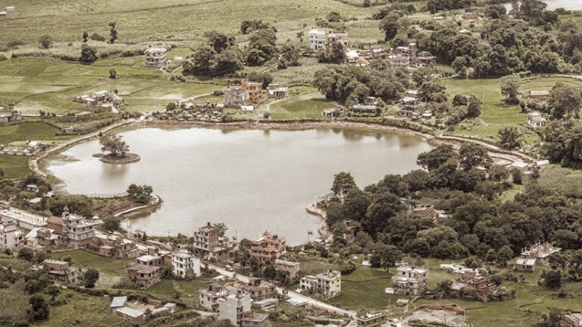

由于法王刚去五台山，与文殊菩萨有甚深渊源，所以听到这个故事很感兴趣，特意带我们去做了礼拜、发愿。

1990年7月9日—7月11日

法王和我们花了几天时间办理去印度的出国手续。

在此期间，因为杜巴广场（Durbar Square）在尼泊尔很有名，来尼泊尔旅游、朝圣的人都会去，所以法王带我们也去了那里。

杜巴广场有不同宗教的庙宇，各个教派的信徒特别多。这里有一尊著名的度母像。据说，当年阿底峡尊者去藏地时，这尊度母像说要和他一起去，但是尼泊尔人不让，就用铁链锁住了度母像。很多人认为，杜巴广场里的就是这尊像；也有人说不是，真正的度母像被藏在后面的殿堂里，普通人很难看到。虽然有不同的说法，不管怎么样，这尊度母像特别灵验，并且有许多神奇的故事。

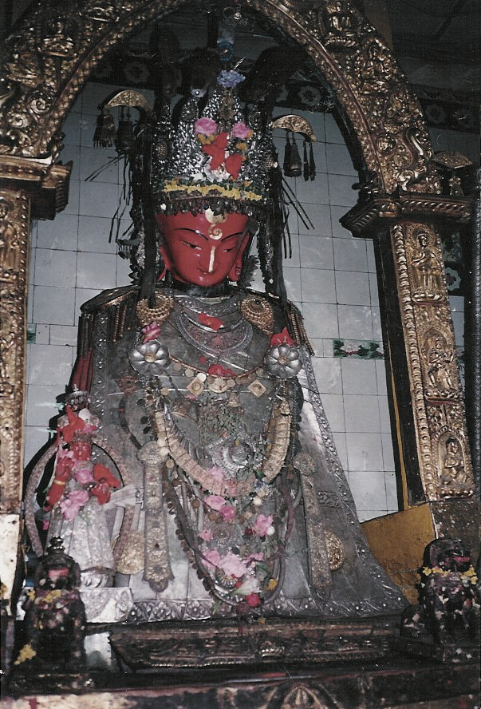

我跪在古老的度母像前，非常虔诚地祈祷，当时感应特别强烈。也许这与我从小就信仰度母有关。我在读小学、中学时，即使那个特殊年代不准有信仰，我也一直默默地祈祷度母。

在藏地，人们历来信奉度母。当我们佛学院遇到一些关键事情时，僧众也会大力祈祷度母。在尼泊尔和印度，度母是一位神圣的本尊，很多人都非常信仰。即使他们不是佛教徒，也会把度母当成天神来礼拜，就像汉地人相信观音菩萨一样。

杜巴广场有许多野鸽子，在佛塔和神庙上自由地飞来飞去。法王拿了一些食物，一边念咒语一边去投喂。有些鸽子会飞到法王的头上、手上，因为法王穿得很薄，我们怕鸽子把法王抓伤，就用手一直挡着……

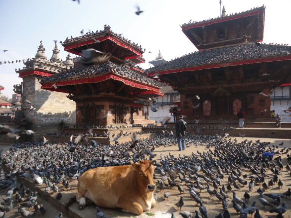

[^1]: 拉迦罗：藏音，意即天人得胜。
[^2]: 随行七人：法王妹妹阿里美珠、侄女门措空行母、印度的南珠堪布、不丹的吾智喇嘛、热巴医生、索顿侍者和我。
