# 第三站 不丹

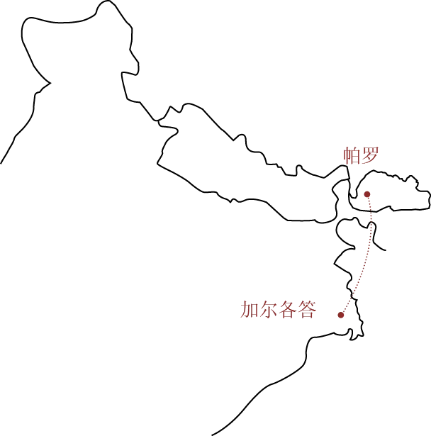

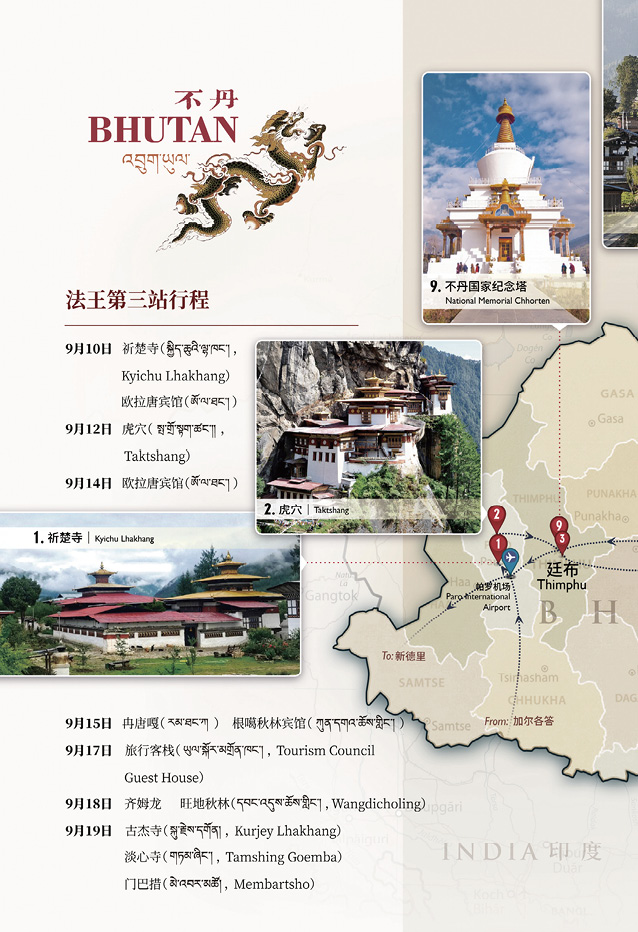

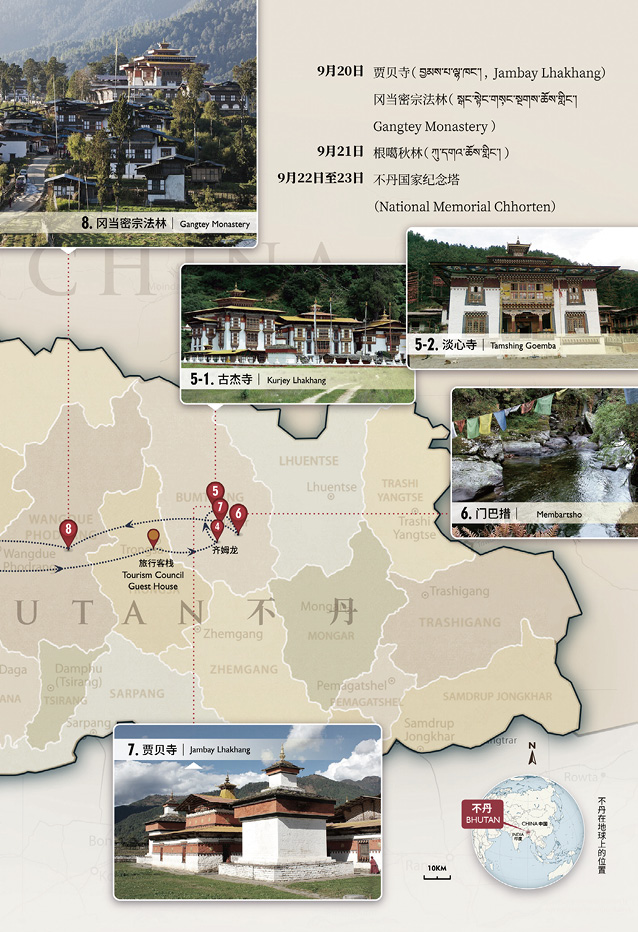

1990年9月10日

从加尔各答登上飞往不丹的飞机。飞机不是很大，但是乘务员非常友好，笑容很亲切，见到出家人会恭敬合掌。

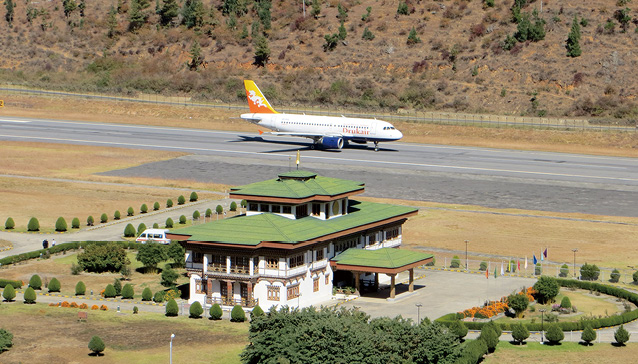

在飞机上，我们听到有人介绍说，不丹的帕罗机场是世界上最危险的机场之一。因为不丹的平地很少，机场只能位于被群峰环抱的山谷中，周围的山高约5500米。机场的形状就像一个口袋，飞行基本上是依据目测，所以只能在白天升降。全球只有八名飞行员可以在这个机场降落。

在我的印象中，不丹只有一架飞机。印度前总理尼赫鲁1958年去不丹时，只能骑马。贝诺法王早年去不丹时，只坐过不丹唯一的汽车。这次法王去，好在还有一架飞机。经过一个多小时、800多公里的航程，我们穿过山脉到达了帕罗机场。

当法王下飞机时，受到不丹王室的隆重欢迎。之后，乘车直接前往祈楚寺（སྐྱིད་ཆུའི་ལྷ་ཁང་།，Kyichu Lhakhang）[^1]。

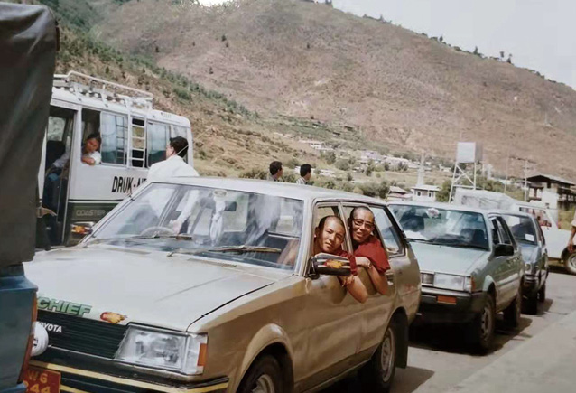

祈楚寺离机场不远。它是松赞干布建造的108座寺庙之一，也是不丹王室举行庆典的重要场所。寺院的建筑是双重寺庙结构，第一座寺庙由松赞干布于638年建造，第二座寺庙是第四代不丹国王的母亲，阿禧格桑·却登旺楚建于1968年，风格与第一座寺庙相同。

当天，祈楚寺正在举行祈福大法会。法王被顶果钦哲仁波切迎请到第一座寺庙，两人坐在妙高法座上，太后、王妃和其他人坐在下方，共修仪轨为不丹祈福。

在此期间，法王应顶果钦哲仁波切的请求，为他本人和太后、王妃等赐予“忿怒莲师[^2]”“项袋金刚橛”灌顶，并传授《文殊大圆满》。

据说从那天起，顶果钦哲仁波切将《忿怒莲师仪轨》放在他的课颂集中，每天观修从不间断，直到圆寂。他说，这个法对遣除修行中的魔障有很大帮助。

之后，法王住在离祈楚寺不远的欧拉唐宾馆（ཨོ་ལ་ཐང་།，Olathang Hotel）。

该宾馆位于一座山上，不丹王室用来招待贵宾。建筑风格古朴、简约，庭院非常洁净，柏树和松树茂密参天，山上空气清新甜美，使人倍感舒适。

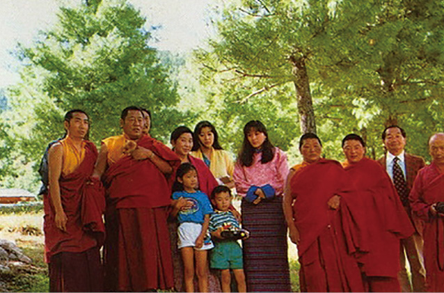

在欧拉唐宾馆与不丹王室合影

那时，我比较精进，每天晚上都会背书。夜幕降临时，我来到宾馆的花园，惊讶地看到树木散发出各种光芒，这是我从未在藏地见过的奇观。仔细观察发现，树丛中藏着许多小灯正在发光。借着这种美妙的灯光，我边散步边背书，不时有虫鸣鸟叫传来，那一夜令人难忘。

1990年9月11日

法王来到祈楚寺。进入寺庙参拜佛像后，法王被邀请到第二座寺庙迎接外宾的佛堂中，不丹国王晋美·森格旺秋正在那里恭候。

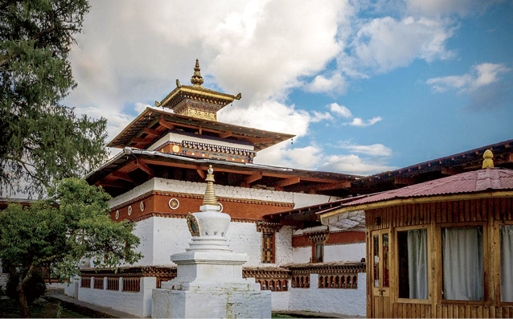

当不丹国王见到法王时，恭敬地献上了白色的哈达，法王回赠他了黄色的哈达。随后，他们两人共坐在长榻上，我们陪同人员和王妃大臣坐在左右两列。当时，我真的很想拍照记录下这一刻，但又觉得有点唐突，不得不放弃这个主意。

不丹国王说，法王可以来不丹，举国上下感到非常荣幸。法王在不丹的所有旅程，都可以由他安排，祈请法王为不丹的佛法兴盛、消除灾祸、国泰民安赐予加持。法王慈悲地点头应允，并做了一些佛法开示和重要授记。

在谈话中，不丹国王提到了藏文化的历史和重要性，并一再强调必须继续保留藏族的优良传统。

在这一点上，不丹实际上做得很好。自古以来，它的独特传统并没有太大改变。例如，就信仰而言，从国王到平民，他们都信仰大乘佛教。甚至王室也手持念珠，并且对高僧大德和三宝所依极为虔诚。在穿着方面，不丹男子被禁止穿长裤。他们一律宽衣肥袖，上半身穿着传统的长袍，下半身是及膝裙和长筒袜。除王妃外，任何女人的头发均不得超过一定长度。国王更是注意仪表，他通常使用黄色披单，其他人只能使用白色或红色，而不会上下错乱。如今，许多国家盲目追求先进和时尚，并将其传统视为过时而抛弃。相反，不丹强调保护其民族传统的确值得学习。

不丹国王虽然是一个国家的君主，却没有任何傲慢的气势，他的言行举止温和谦逊，又不失高贵优雅。他深得人民的爱戴和支持。多年后，他还主动取消了君主的世袭制度，并促进了议会民主，这引起了全世界的关注。他说：“我可以努力做一个爱民的国王，但我不能保证不丹世世代代都有好国王。为了不丹人民的长期幸福，我们必须促进民主。有效的制度比王位更重要。”

当天，法王与不丹国王进行了一个多小时的交谈，气氛非常轻松。回到住处后，法王让我把他对不丹国王的教言立成文字，然后派人送去王宫。

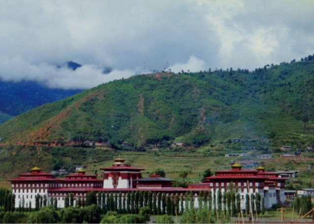

不丹王宫

那段文字，现收在《法王全集》里。翻译过来是：

远来新客歌

总集诸佛一事业，坚勇摧毁浊世衰，

莲师持明传承汝，君王恒时得庇护。

国王威望比天高，民众自在安居业，

普行甚深大乘法，法兴国度令神往。

皑皑雪山妙庄严，苦乐友伴不恒坚，

水神肩负之光芒，长久照耀成汪洋。

三皈总集莲师法，本尊金刚橛依修，

能招悉地云彩伴，巍峨雪山永恒坚。

依昔强力他缘起，命主方能竞争命，

文殊意幻君汝外，人间难得余皈处。

噶举教法金幢顶，系上宁玛如意宝，

发起至上威神力，法政增如上弦月。

愿依无欺三宝谛，自之殊胜净心力，

此域自然普美妙，灭诸违缘皆吉祥！

具轮王七宝数之此颂，于松赞干布所建之祈楚寺会晤不丹国王及其眷属时，阿旺罗珠宗美心中浮现，索达吉堪布立成文字。愿增吉祥！

第十七胜生周铁马年七月二十二日

此文大意是：不丹国王让人们奉行大乘深法、崇尚佛教，实在令人敬佩。然而，外缘不可预测，假如受到邻国的威胁，若一心修持“忿怒莲师”，必将使国政稳如磐石。如果有人以往昔的恶愿伺机谋害国王，唯有文殊意化身的人间如意宝才能救护。在将来，国王应该持撑噶举派的金幢，并镶上宁玛派的宝顶，这样可使国政、佛法如上弦月般日益增上。

后来，不丹的危机迅速解除。近年来，它已成为世界上最幸福的国家，这可能与当年的因缘也有一定关系吧。

1990年9月12日

不丹的虎穴（སྤ་གྲོ་སྟག་ཚང་།།，Taktshang），被称为“巴卓达仓”，是莲师骑着母虎降伏恶魔的山洞。当莲师完成了在藏地的所有事业并准备前往罗刹洲时，他来到这里以多吉卓罗的形象调伏恶魔，然后在山洞里修行了三个月，并埋了许多伏藏。这个圣地的加持是巨大的，如果以信心朝拜，可以消除生活或修行中的违缘和魔障。

当天，法王已准备好朝拜虎穴。此前在印度时，由于天气非常炎热，法王穿着很少的衣服，僧装下只有内衣、内裙，或薄薄的红色嘎让。但是在不丹，气候相对凉爽，虎穴在海拔3000米左右，山上比较冷，法王换上了略厚的紫色嘎让。

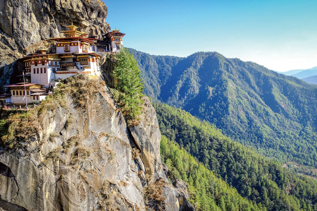

虎穴位于悬崖上。1692年，在山洞附近建造了一座寺庙，即今天的虎穴寺。从山脚到虎穴寺，最快的速度是两个小时，普通人大约需要三个小时。上山的路很难走。当地人可以用马把朝圣者送上一程，但只有一半路程，其余的只能自己爬。如果体力不支，也可以选择坐人力轿。考虑到法王的年龄和身体状况，不丹王室专门安排了一顶黄色的人力轿和数十名年轻有力的轿夫。

虎穴寺的管理非常严格。寺内不留宿外人，也不允许在外面搭帐篷。每天下午，管理人员将要求所有游客离开。但是，由于不丹王室已与虎穴寺交代法王可住在寺内，因此，我们不用赶时间，可以不疾不徐地上去。

山上的风景很美，或是铺满鲜花的山坡，或是陡峭险峻的悬崖，或是青翠高耸的森林……我欣赏着美丽的风景，呼吸着山间的空气，一路走来，感到非常开心。同行的几个不丹人脸上都挂着简单的笑容，尽管语言不通，但当我们眼神接触时，都会互相微笑并感到非常自在。

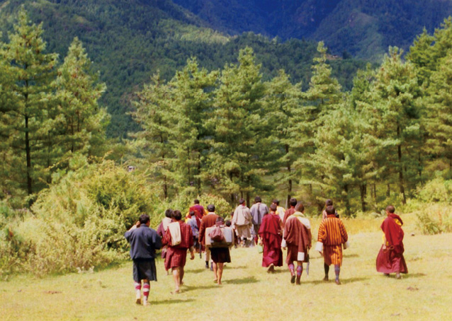

在这条路上，法王几次停下来休息，并没有说太多话。我一直都在观察法王的表情，他看起来情绪激动，似乎安住在一种境界中。当他从山脚下出发时，嘴唇一直在动，不知道在念什么。实际上，每当法王进入莲师圣地时，就会与往常的状态有所不同，这也是伏藏大师的特征。

我们花了三四个小时才到达虎穴。

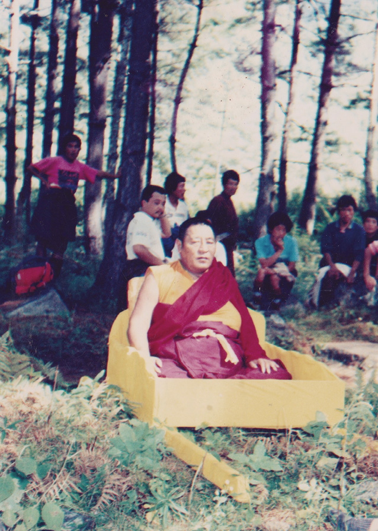

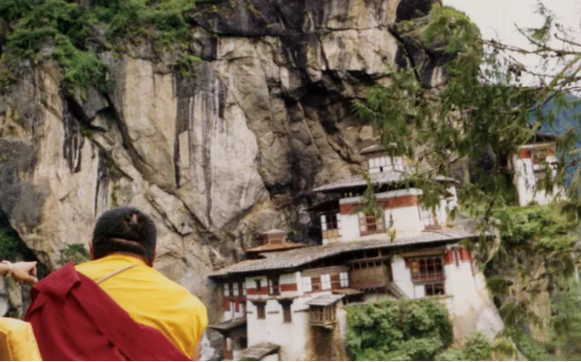

已经是下午了。法王甚至连饭都没吃，就来到虎穴旁边的一个小山洞，直接坐在洞口，让我们所有人离开。我们在远一点的地方等着。大约20分钟后，听到法王轻轻咳嗽，示意我们可以过去。

之后，法王来到了虎穴。虎穴在悬崖上，看上去有些危险，但是当我们进入山洞时，它非常宽敞，可容纳数十人。洞里供奉着一尊骑虎的忿怒莲师像。据说这尊像非常神奇，当它在普纳卡宗修造时，开口说自己不属于普纳卡宗，应该送到虎穴寺。当虎穴寺在一次火灾时，只有这尊像完好无损，被认为是奇迹。

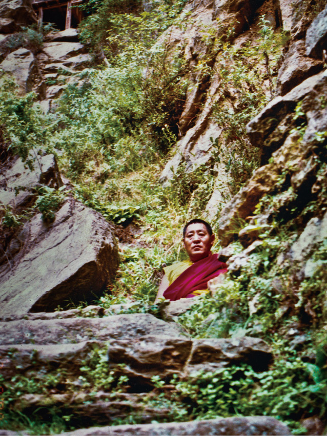

法王一踏入山洞，便开始祈祷并发愿。在这个时候，不仅法王的状态不寻常，而且即便是我，也有一种强烈的觉受。想到莲师在此修行我却无缘得见，想到今生有幸跟随如莲师般的上师来这里发愿，我忍不住泪流满面。这里有一种强大的力量包围着我，与去其他地方的感觉完全不同。

过了一会儿，法王从觉性中流露出意伏藏——

莲师多吉卓罗修法·成就一切事业

那莫革日班玛黑日嘎雅！

顶礼忿怒莲师！

于此，无戏论之行者首先皈依、发心……

吽

器情清净普贤佛母界，普明大悲普贤佛父坛，

双运胜子大乐菩提心，紫黑吽字形相空中现，

放光行持二利复回摄。明观主尊莲师卓吾罗，

红褐一面二臂睁三目，红黄须发眉毛竖上空，

牙关紧咬利齿雪山中，暴风骤雹令鬼魅冤魂，

五蕴网罟消融于法界。右手天铁金刚挥空中，

微小怒尊霹雳降敌头，左手擎起天铁橛之顶，

熊熊炽燃烈火幻化轮，能害魔众无遗焚成灰。

极怖傲然有孕母虎上，双足叉开大力士步姿。

圆满息业装束白内衣，圆满增业装束著法衣，

圆满怀业装束披紫氅，圆诛业装头鬘斜挎肩，

忿怒悍然威猛之身相。彼之头顶莲月层积上，

三传上师加持虹光绕，中间之处四续六续部，

本尊会众悉地雨云布，下方之处三境空行母，

空乐赤光散收明耀耀，周围三部一切护法众，

黑风呼啸成办四事业。一切平等一味一智性，

起现遍布虚空幻网相，本来誓言本智无有二，

显现空乐广大界庄严。主尊眷属普皆传吽声，

一切显现变成吽形相，一切声响变成吽音声，

一切知念等性吽本性，无有希忧执著境界诵：

吽吽吽……

结座诸吽融本尊，眷属收于主尊心，

主尊唯一手印身，明净稳固皆齐全。

平时威仪当行持。萨玛雅！

释迦比丘勒西桑波我，佩有清净戒慧之装饰，

唯一成办弘法利生业。本想甚深真义藏心中，

莲师谛实语及愿力强，部分密语不由脱口出。

我虽已成众深地伏藏，广大密意伏藏之法主，

弘扬深法法器难得故，当舍随意多言之戏论。

祈愿未来多吉土美匝，开取此法弘法利有情。

此甚深地伏藏《集善逝之卓罗广修法》中《身坛城略修》，是朝拜忿怒莲师多吉卓罗无余降伏魔与冤魂之圣地——不丹巴卓达仓山洞（虎穴）时，经空行表示劝请，为利众生而立成文字。愿成为无余摧毁弘法利生违缘障碍之因，愿增吉祥！

第十七胜生周铁马年七月二十三日

当我帮忙记录时，法王讲得比较快，就像平时念经一样。但是我可以跟上法王的语速，并在短时间内写下来。

写完之后，法王的神态开始恢复，似乎很放松。

晚上，我们住在虎穴寺。这座寺庙与虎穴相连。寺内的建筑格局完全取决于山势，没有做过大规模的平整，所以有些地方凹凸曲折。他们为法王安排了一个单独的房间，并为我们随行人员安排了住宿。

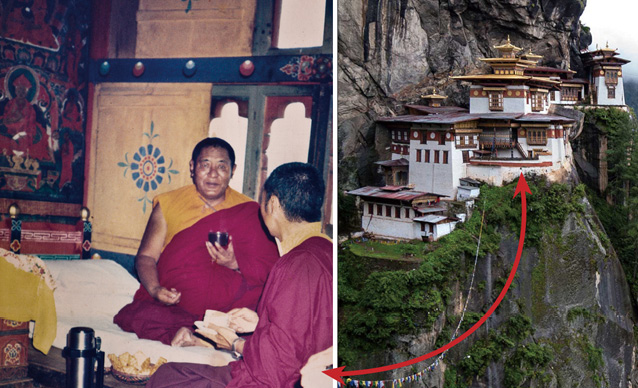

我们在那里待了两天。在此期间，还朝拜过无垢光尊者的一颗牙齿。它用蓝色缎子包裹着，一位喇嘛说它非常珍贵，通常不对外展示。法王带我们在这颗牙齿前发愿，并用它给我们做了加持。

1990年9月13日

法王给我们传授了新取的伏藏“莲师多吉卓罗修法”，并要求大家按照仪轨，念修“吽”字十万遍。

我将近一天都待在虎穴内，以禁语的方式念咒并祈祷莲师。过去，帕丹巴桑吉、玛吉拉准、米拉日巴、龙钦巴、唐东嘉波等前辈大德都在虎穴中修过高深密法，因此，这是一个特别的圣地。当天，我一直处在莲师的加持、莲师的智慧中，包括早年所认识的一些境界，也可以安住其中。那时虎穴的游客不多，环境更适合修行。

在座间，我们朝拜了虎穴附近的一些圣地。例如，华吉桑给和益西措嘉空行母闭关25天的地方、华吉桑给的遗塔，以及长寿洞等一些山洞。附近有一个瀑布，据说是由莲师扯断的念珠形成的。因为它是莲师亲自加持的地方，所以我喝了一点水，还带回一些土。

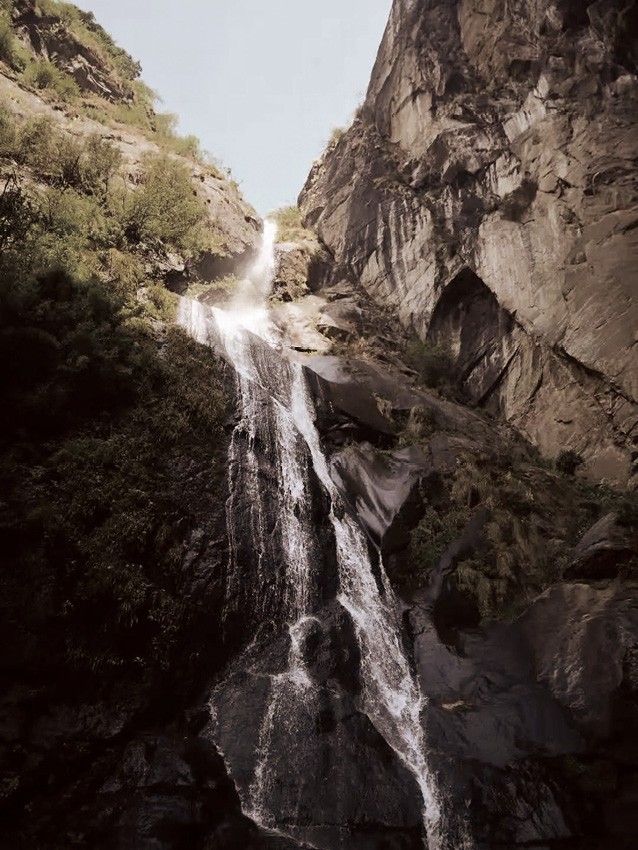

由莲师念珠形成的瀑布

后来，法王对我们说：“本来，在我的境现中，护法交给我《莲师善逝总集广修法》有九大函。但由于此伏藏的法主不在场，加上一些因缘没有具足，所以我只取了甚深的意伏藏，没有取广大的地伏藏。这也很好，此法暂时伏藏起来的话，可以利益不丹的未来众生。今生我暂时不开取，留待下世再取出。”

这个法的加持非常大。当年，我随法王朝圣得到的四个法——“莲师多吉卓罗修法”“项袋金刚橛”“莲师略传”“愿海精髓”，从获得之日起一直在修持，三十年来，从未间断过。

也许有些人不了解伏藏，并认为这令人难以置信。实际上，伏藏是莲师为后人留下珍贵的法宝。莲师将其隐藏在悬崖、湖泊、虚空等处，并清楚地授记何人将于何时何地取出。这样，佛法就不会因为某些特殊原因而被破坏。

藏传佛教的许多经续，都是伏藏大师这样开取的。如果没有专门研究，这种现象不容易理解。在西方，许多科研团队在研究伏藏后，对得出的结论感到非常惊讶。

当然，伏藏并不容易获得。在历史上，许多伏藏大师为开取一个伏藏，不得不翻山越岭，历尽千辛万苦。法王前往不丹时，最重要的目的也是开取伏藏。时机成熟后，有些伏藏必须开取，有些则可以暂时不取。但是，为了不违背护法的交代，法王仍然取了一个简单的仪轨。

令人惊奇的是，法王对自己所取的每个意伏藏，包括“文殊大圆满”“文殊智慧勇识”“项袋金刚橛”“莲师猛修仪轨[^3]”“莲师多吉卓罗修法”，以及法王撰写的与麦彭仁波切修法有关的灌顶和仪轨，无论过了多长时间，都可以倒背如流，就像日常课诵一样熟悉。如果是普通人造论，几年后它的内容就被忘记了，但法王完全不是这样。后来，他在加拿大的哈利法克斯灌顶时，都是背着念出仪轨的。看到这些现象，我深刻地体会到：所谓的意伏藏，不是以分别念随意写的，而是在广大无边的智慧海中，以不变金刚陀罗尼印持的。

1990年9月14日

当天，法王将离开虎穴。在下山之前，他来到了最初打坐的那个小山洞，并留下一条哈达。我们不知道此举的密意，只是猜测法王没有开取的伏藏，也许是埋在那里。

下山时，法王还是乘坐人力轿。但是，下山比上山困难得多。如果山路过于陡峭，坐在轿子上会向前倾斜，人很容易滑落下来。尽管前排轿夫个子高，后排的个子矮，稍微平衡一点，但一些山路又窄又滑，他们走得特别快，让人看着都紧张。

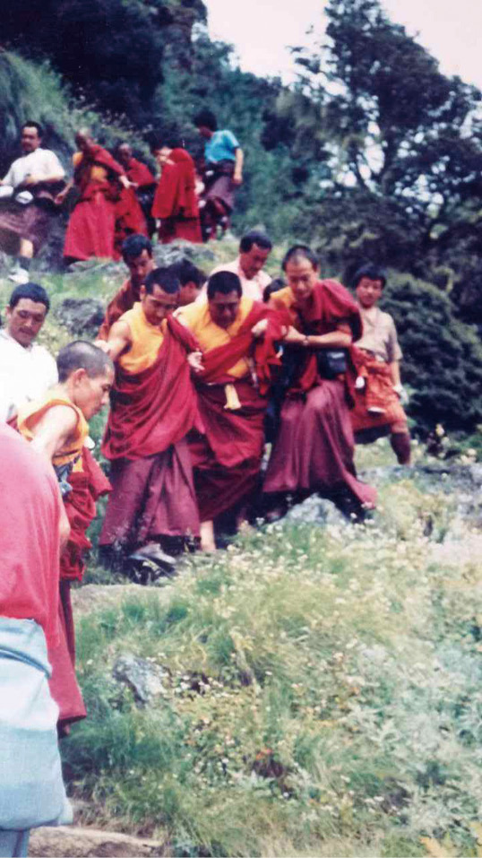

当地人安慰我，说这条路似乎很危险，但是自古以来，从来没有人跌落过悬崖。即便如此，当我看着摇摇晃晃的轿子时，仍然有些不安。如果山路特别难走，法王还会下轿，让人搀扶着走一会儿……花了两个多小时才到达山脚。我松了一口气，回头望着那陡峭而漫长的山路，暗想重返人间的感觉真好。

下午，回到了欧拉唐宾馆。利用法王的休息时间，我们去了周围的村庄。我认为来不丹应该买些纪念礼物，但是逛了很长时间，也没有发现特别合适的，只买了几支圆珠笔。

不丹也被称为“雷龙之国”，可以在大街小巷看到龙的各种图案，甚至连碗上都有。更稀有的是，很多房屋的墙壁上描绘着阳具，男男女女在它面前走来走去，好像一点也不在意。当然，这背后有着神奇的历史。

不丹人的生活相对清贫，但他们的欲望并不强烈，给人的感觉是知足、淡定且对佛教非常虔诚。不丹的社会管理是政教合一。行政长官和大喇嘛通常在同一栋楼里工作，他们双方有着不同的分工，一边管世俗秩序，一边管精神信仰。这种建筑通常被称为“宗”，每个县都有一个宗，这是当地最大的寺庙。但是，也有些寺庙没有行政功能，仅用于朝拜和修行，这就是所谓的“拉康”，例如虎穴寺。

1990年9月15日

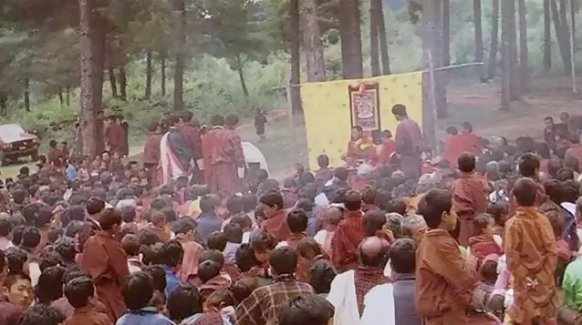

应不丹许多在家信众的祈请，法王来到虎穴寺山脚下的冉唐嘎（རམ་ཐང་ཀ）传法。这个地方经常举办大型法会，周围环绕着高大的树木，中间有大片平整的草地。

因为他们听不懂法王的藏语，所以安排了一个不丹人担任翻译。在听法时，每个人非常认真。

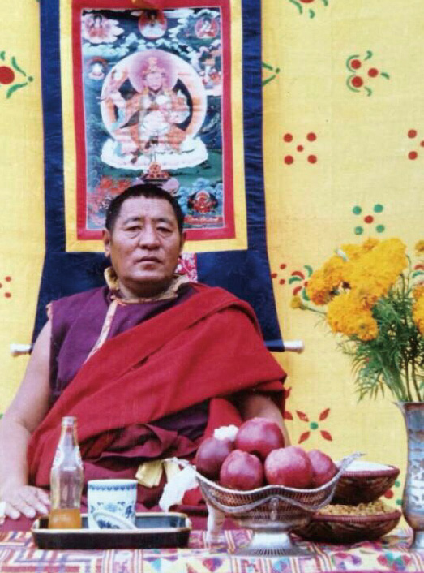

我发现不丹在家人都穿着民族服装。男人披着白色的披单，穿着及膝长袍（帼），里面是一件白色衬衣，袖子折在袍子的外面。女人穿着长裙（旗拉）。他们不带垫子，在地上盘腿而坐，就像藏族的听法方式一样。

不丹的传统习俗，在过去得到了很好的保护。但是近年来，随着越来越多的游客踏上不丹，许多原有的习俗也受到外来文化的影响，并且越来越西化。特别是，不丹的语言主要是英语。从国王到小商贩，都会说一口流利的英语，旅馆、路标、车站用英文标记，年轻人喜欢在西方学习。因此，不丹语是否会慢慢消失，是一个令人担忧的问题。尽管许多人希望保留不丹的信仰和传统，但在全球化时代，这种愿望恐怕很难实现。就像大洪水袭来时，每个角落都难以逃脱，只不过时间有早有晚而已。

在传法之后，法王前往不丹的首都廷布。晚上住在根噶秋林宾馆（ཀུན་དགའ་ཆོས་གླིང་།）。

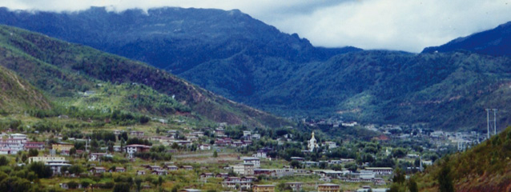

不丹首都廷布

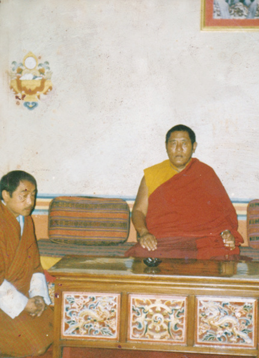

根噶秋林宾馆

1990年9月16日

法王在根噶秋林宾馆会见了一些当地人。其中一位是不丹僧人，他不懂藏语。他请翻译告诉法王：紫玛护法神经常降临在他身上，但是这个过程使他非常痛苦。他希望法王能够加持并阻止护法神的到来。

法王说：“我必须观察一下。如果真的是紫玛护法神，这对弘法利生是有益的，不能制止；如果不是紫玛护法神，而是非人附体，那我也有办法。稍后再看吧。”

法王给了这位僧人一条哈达，以此缘起，他突然降神了。当时，他的神态很不寻常，眼睛不停转动，口中嘶嘶作响，身体开始舞动。我们没有任何准备，看到这种情景，感到非常惊讶。

僧人不懂藏语，但是当他降神时，可以用藏语直接与法王交流，口音有点像康巴语与卫藏语混合。他谈到了他[^4]以前的故事，并特别提到了他在班达霍地的经历。

法王问：“你认识我吗？”

他说：“当然认识。我们许多世都在一起弘法。”

法王似乎想起了什么，表情变得有点悲伤，然后安住了一会儿。

之后，紫玛护法神说：“两天后您去布姆唐（Bumthang）时，请一定要到我的护法殿来，我们还有很多事情需要面谈。现在我该走了。”

然后僧人昏了过去。过了一会儿，他醒了过来，神态恢复如初。

法王告诉他：“这是真正的紫玛护法神，不能阻止。但是我可以给你一些加持品，帮助你打开身脉，减轻降神时的痛苦。”僧人非常感激，法王也为他做了一些加持。

这个僧人有20多岁，身体很瘦，鼻子很高，脸有些长。他平常的行为比较寂静，讲话有些慢，但是一降神就神情大变，声音非常急促，姿态非常威猛，让人感到不可思议。

1990年9月17日

布姆唐，是不丹的二十个宗[^5]之一，拥有许多古老的寺庙和莲师圣地。我们一大早从廷布出发，前往那里。

当天要坐车200多公里。因为路上有山体滑坡，山路很窄，所以晚上11点多到了通萨宗，住在旅行客栈（ཡུལ་སྐོར་མགྲོན་ཁང་།，Tourism Council Guest House）。法王也特别疲倦。

虽然通萨宗不大，但夜景却很美。从山上望去，每家每户窗户里透出的灯光，就像闪烁的群星散落在地上。如今在喇荣，每当我晚上下课回去时，看着山上的木屋和灯光，常常会想起那个夜晚。

1990年9月18日

清晨，在光明梦境中，法王看到了紫玛护法神手下的四大将领，带着铺天盖地的眷属，浩浩荡荡从布姆唐来迎接自己。当紫玛护法神即将出现时，索顿喇嘛去敲法王的门，打断了梦。

事后，索顿喇嘛一脸懊恼地告诉我们：“我今天犯了个大错误！但是没有办法，昨天已定好了出发时间，该吃早餐时，我在门外等了很久，也没听到法王起来，所以才敲了门……会不会破坏什么缘起呀？”

早餐后，法王出发前叮嘱大家：“这次，紫玛护法神肯定会来迎接，我们一定要去他的殿堂。此外，今天路上可能会有一些违缘，需要念一些莲师除障法。”

当穿越蒙地时，法王的境界中突然出现了前世的景象。法王对我们说：“当我前世是丹哲意吾布美[^6]时，曾与格萨尔王一起带兵来蒙地降伏象翅国王，一些非人从中作梗，制造各种违缘。今天，我重新踏上这片土地，这些非人定会心怀报复加以阻挠，因此要倍加提防。”

不出所料，法王刚说完不久，突然乌云滚滚，白天瞬间变成了黑夜。紧接着电闪雷鸣，冰雹急速降下，山上的泥石流滚滚而来，我们的车很快被包围了。这条路几乎被堵住了。

法王立即示现威猛相，厉声高唱金刚歌，并念诵降伏咒。结果，黑云一下子散开了，天空变晴，冰雹消失，泥石流停止，所有恐怖场面都消失了。如果不是身临其境，很难想象它是多么令人难以置信。但可惜的是，法王自然流露的金刚歌，因为情况非常紧急，我们没有来得及记录。

之后，车子顺利地开了过去。快到布姆唐时，经过一座吉嘎啦山（སྐྱིད་གའི་ལ།），法王在山坡上休息了一会儿，说要念个护法，大家就在那里供了护法。随行的不丹僧人带来了一些当地美食，我们享用了简单的午餐。山上的风景很美，我的心情很好，法王看上去也很高兴。

到达布姆唐后，法王直接前往一个名为齐姆龙[^7]的伏藏圣地。由于无法通车，当地尼玛隆寺的僧众用人力轿抬法王过去。这个轿子比去虎穴的更舒适，并且可以遮阳。法王一路上非常高兴，尤其是怀中的小狗，开心地东看西瞧，似乎在欣赏美景。

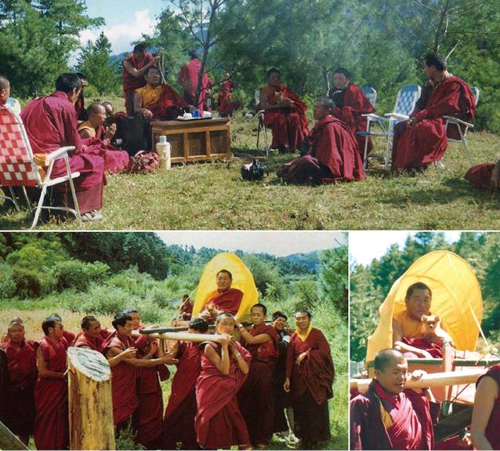

我有时会帮大家抬一下轿子，有时会和当地人一起去探路，前前后后非常忙碌。齐姆龙很远，需要很长时间才能到达。但是那里的风景特别美，如传说中的香巴拉。我到了以后，虽然累得满头大汗，但看到如此迷人的景色，所有疲惫都一扫而光了。如果我有机会再去不丹，还是很想去那里。

齐姆龙有一块巨大的石头，上面布满了好似梵文的字样，法王说这是空行文字。昔日伏藏大师龙声金刚授记，法王将在这里开取伏藏。但是，当法王来到这里时，表情不像那天去虎穴一样，似乎没有要取伏藏的意思。当地人非常希望法王能够取伏藏，还故意创造了一些缘起。但伏藏并不是靠造作就能取出的。

附近有一座殿堂，供奉着伏藏大师酿·尼玛沃日。法王朝拜时，看到了酿·尼玛沃日亲手做的木制金刚橛。法王将其拿在手中，顿时流露出意伏藏“八大法行略修仪轨”。我立即记录在纸上。

记下来后，法王将这张纸放在自己的嘎乌盒中，说此法三年之内不能公开。但是三年后，当我问法王能否公开时，法王说因缘还不成熟。

然后，我们离开那里，继续赶路。经过解脱洲（Tharpaling）时，据说无垢光尊者在那里修行、弘法多年，并在山顶撰写和传授过《七宝藏》，那里还有他建造的一座寺庙。法王很想去朝拜，但是车开不过去，只能步行，而且行程太紧。法王不得不放弃，远远地朝那个方向做了礼拜、发愿。

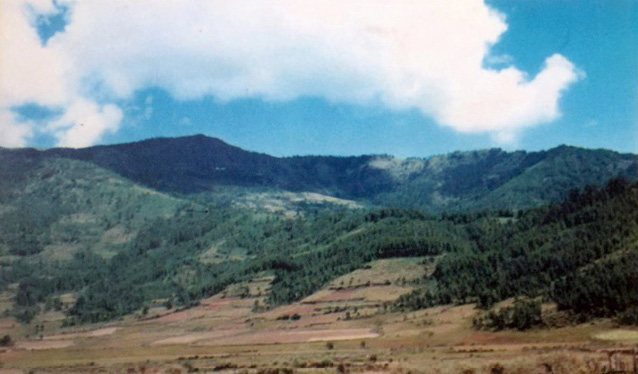

解脱洲

晚上，到达布姆唐的旺地秋林（དབང་འདུས་ཆོས་གླིང་།， Wangdicholing）。我们在那住了两个晚上。

1990年9月19日

布姆唐有很多寺院，彼此之间相距不远，最远的只有几十公里。这些寺院很古老，非常有加持力。看到这么多不可思议的圣地，尽管从廷布赶来一路很辛苦，但我们感到非常值得。

法王的第一站是古杰寺（སྐུ་རྗེས་དགོན།，Kurjey Lhakhang）。该寺是由印度国王在8世纪建造的。莲师在这里闭过关。当他身体向后靠时，陷进了岩石里，留下了整个身体的印记，“古杰寺”以此而得名[^8]。《七品祈祷文》也有这样的描述：“南方蒙卡岩上遗身影，为利吐蕃而留廿五相，佛陀教法弘扬于十方，唯一本尊有情之怙主。祈祷殊胜慈悲之尊主，祈祷邬金莲花生大士。”

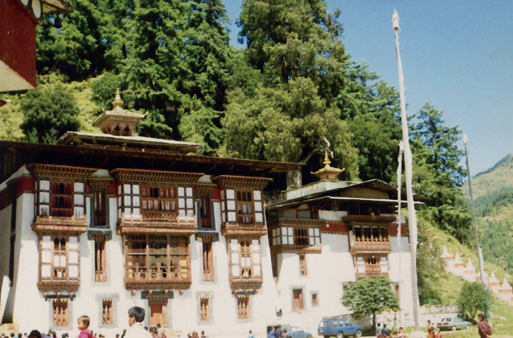

古杰寺由三座庙宇组成。后山有一棵高大的柏树，据说是由莲师的手杖形成的。法王来到寺内，向每一处圣迹敬献了哈达，并带我们念了《普贤行愿品》发愿。

当地人以为法王要在莲师身影处取伏藏，但法王没有这个打算，只是说：“我答应过紫玛护法神，所以要去他的殿堂。”然后，法王去了古老的紫玛护法殿，念了很长时间的护法仪轨。我与法王一起做了祈祷，并向护法像献上哈达。

然后，法王去了淡心寺（གཏམ་ཞིང་།，Tamshing Goemba）。这座寺庙是伏藏大师贝玛朗巴于1501年建造的。贝玛朗巴是莲师授记的五大伏藏王之一，他前世是无垢光尊者，并用无垢光尊者的八大名号造过一个《无垢光尊者祈祷文》，至今在藏地仍广为流传。他在建造淡心寺时，据说有无量空行母前来帮忙，所以主殿的莲师像目光往上、嘴带微笑，就是目送空行母飞去。

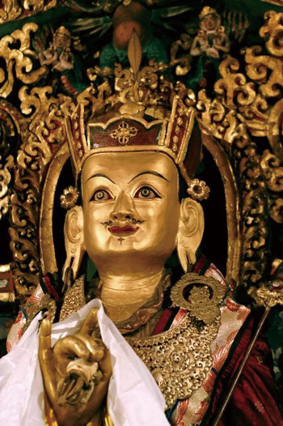

在内堂的过道上，供奉着贝玛朗巴亲手制造的“赎罪衣”。这件衣服是铸铁的，重约25公斤。据说如果身披此衣，转绕大殿三圈，可以消除三世的罪业。法王穿上它，磕了三个头，然后转绕了大殿三圈。

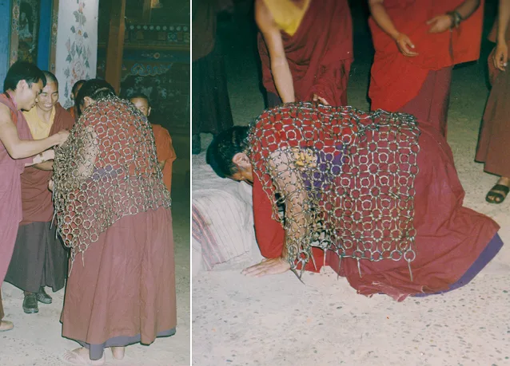

我也一边忏悔，一边穿上了沉重的铁衣。但是，由于时间不够，上师很快就会离开，我只能象征性披一下，没有时间去转绕。

每次法王外出，无论去哪里，都有很多人。考虑到上师的安全，我的心一直在上师身上，密切关注上师的一举一动，因此去许多圣地只是走马观花，没有太多时间可以发愿和参拜。

当法王来到一个圣地，我会立即考虑下一站的事情：车到了没有？如果人太多，从哪个通道出去？下一站的路通不通？法王怎么吃饭？住宿安排得如何？……许多事情会在我心中盘旋。有时法王正在朝拜时，我还会出去看看。

法王朝拜完一个地方后，通常会迅速离开，赶往下一站。作为法王身边的侍者，我不敢有丝毫大意，随时保持高度警惕，否则很容易把“主人”弄丢。

尽管不丹这边也在负责法王的行程，但他们天性洒脱、做事随性，不会提前写下所有的时间表，在习惯方面与我们不同。因此，法王出行的方方面面，我还是会自己预先考虑。经过这么多年的训练，我现在出去传法时，对周围事物的敏感度与其他人不同。“下一站的情况如何？哪些人还没吃饭？……”无论是自己的事还是别人的事，我都会事先考虑和安排，不会到了现场才开始准备。

当天，在朝拜两个寺院之后，已经是黄昏了。看天色有点晚，去不了太远的地方，法王就去了附近的圣湖——门巴措（མེ་འབར་མཚོ།， Membartsho）。

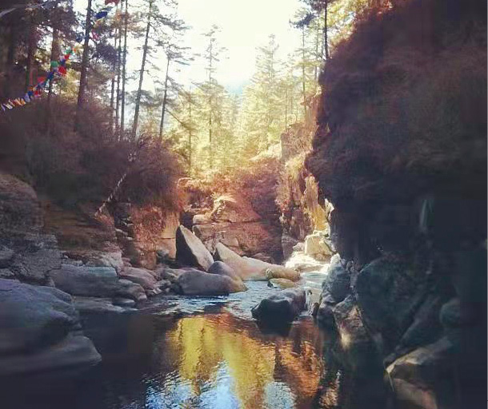

门巴措，也被称为“燃烧湖”，是贝玛朗巴取莲师伏藏的地方。贝玛朗巴所取的伏藏，在藏地非常著名，但是当年他在世时，无数人质疑他的能力和伏藏的真实性。有一次，他取伏藏之前，在此湖边举起燃烧的油灯发愿：“如果我是真正的伏藏师，希望油灯不会熄灭；如果我不是，那就淹死在湖里。”说完纵身跳入湖中。不久之后，当他从湖中出来时，手里拿着伏藏莲师像与宝箧，油灯丝毫无损地在燃烧。从那以后，这个湖被认为是不丹最神圣的地方之一。

1990年9月20日

上午，法王去朝拜贾贝寺（བྱམས་པ་ལྷ་ཁང་།，Jambay Lhakhang）。它也是松赞干布修造的108座寺院之一，建于659年。莲师曾在这里禅修，并请一位国王做了修缮。寺庙的规模很小，壁画斑驳，门槛的铁皮磨光，大殿的地板是老木头，到处都有岁月的痕迹。往昔，许多大成就者都来过贾贝寺，因此，这里的佛殿、佛像，甚至每一个微尘中，都有不可思议的加持。

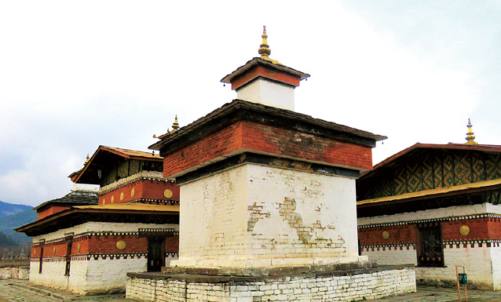

主殿供奉着寺内最大的弥勒菩萨，两侧有巨型的菩萨、护法和空行。当法王向弥勒菩萨抛哈达时，哈达嗖地一下就飞过去了，稳稳地落在弥勒菩萨手中。随后，法王带我们跪下发愿。

和上师一起发愿，让我感觉无比幸福。作为随从，虽然有很多事要忙前忙后，艰辛不为人所知，但无论多么累，内心的喜悦都无法抑制。遗憾的是，那次朝拜的时间太短了，如果将来有机会，我真的很想再去那里，用更多的时间来顶礼、发愿。

中午，法王离开了布姆唐，前往旺杜波德朗宗的冈当密宗法林（སྒང་སྟེང་གསང་སྔགས་ཆོས་གླིང་།，Gangtey Monastery）。途中，许多不丹人站在路边给我们供斋，希望得到法王的加持。

法王坐下休息时，紫玛护法神的降神喇嘛也来了。他以普通人的身份，请法王传授“缘起除障法”灌顶。法王同意后，他当场就降神了。在灌顶时，我和紫玛护法神坐在一起，身体的感应非常强烈。他一直在认真聆听，并重复上师念的灌顶偈，但与常人不同的是，他不停转动的眼睛，从始至终没有眨过。在此过程中，我还收到了来自紫玛护法神的信息，他以意念跟我沟通：“我们今天一起灌顶，以后就是最亲密的金刚道友了。你将来的弘法利生事业，我一定会鼎力护助……”

灌顶结束后，紫玛护法神非常高兴，并对法王的未来作了一些授记：

1．圆满所有行程后，法王最好返回藏地。法王的弘法事业主要在藏地，不适合在印度停留太长时间。否则，有些人会嫉妒并准备制造违缘。

2．我们本来计划去新德里的敏珠林寺。他再三叮嘱这次千万不能去，如果去了，会出一些事情。

3．过两天返回印度后，我们将再次去南卓林。他说不会有违缘，贝诺法王与法王如意宝有很多大愿要共同实现。

4．我们回藏地时，计划经过香港中转。他说没问题，如果有需要，在紧急关头呼唤他，他会立即赶来相助。

原本还有几件事情想问他，比如，为法王长久住世要做些什么、我是否要去敏珠林寺。但紫玛护法神似乎很忙，授记之后说：“我必须走了。”然后，降神的喇嘛就倒下了。

过了一会儿，喇嘛清醒过来，非常感激法王的加持，说这次降神没有以前那么痛苦。

不知道这位喇嘛是否还在世。据说，后来不丹国家遇到重要事情时也会请教他。

此前，我对紫玛护法神就很有信心。在那之后，我一直祈祷并供养他，从未间断。无论是我个人修行还是外出弘法，包括去其他国家时，在关键时刻他都非常灵验，而且常常出现许多稀有之相。但这些都是保密的，没有必要说。

晚上，我们住在冈当密宗法林。这是贝玛朗巴的传承弟子建造的寺院。

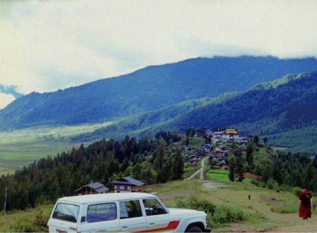

远处为冈当密宗法林

1990年9月21日

清晨，法王从觉性海中流露出紫玛护法神的祈祷仪轨——

紫玛护法神仪轨·怀诛电索

于此陈设食子、血肉等，以“讷哲班匝昂革夏匝”勾招怨魔，以“萨瓦夏吽玛绕雅啪的”降伏，以“让扬康嗡啊吽”加持。

哲

呼唤西方红凶境，凶神恶煞之命主，

携同眷属一切众，降临此入所设座。

西拉哲班匝萨玛雅匝萨玛雅地叉蓝

觉

本体无漏之智慧，形相降伏诸怨魔，

骨肉堆积高如山，血液汇聚如大海。

复有种种余神馐，亲眼可见诸供品，

满足紫玛护神意，满足四部将士意，

满足天龙八部意，忏悔所失违誓言。

祈愿如母爱其子，垂念我等师徒眷，

无碍速成所嘱托，息增怀诛诸事业。

于南方蒙卡岩附近之波塘吉祥源地，夜叉战神王（紫玛护法神）在我为有些具信弟子传授“缘起除障法”灌顶时，承诺成办所嘱托之事业。次日，于班朗寺吉祥冈当密宗法林，依靠细微觉受引发，阿旺罗珠宗美口述，南珠堪布立成文字。愿增吉祥！

第十七胜生周铁马年八月三日

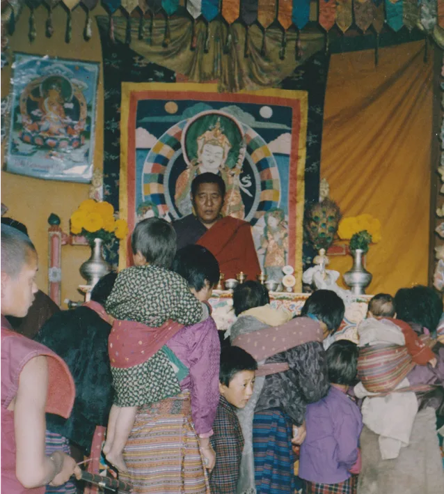

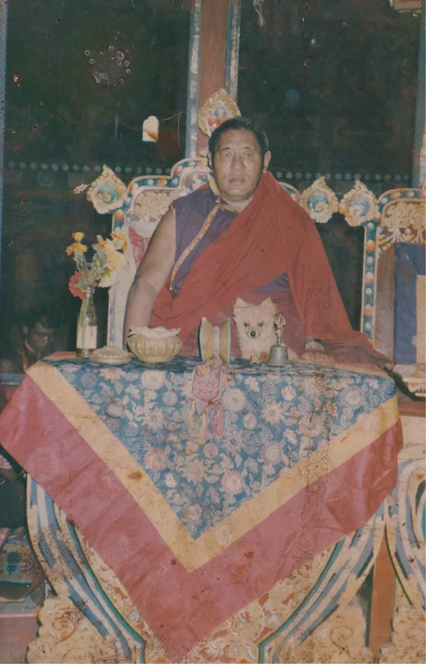

之后，法王给冈当密宗法林的僧众传授灌顶，做了简单的开示，并为佛殿开了光。

至此，布姆唐的朝圣已经圆满。当天，法王乘车回到廷布，晚上住在根噶秋林（ཀུ་དགའ་ཆོས་གླིང་།）。

1990年9月22日—9月23日

法王朝拜了不丹国家纪念塔（National Memorial Chhorten），并带我们在塔下发愿。不丹王室还请法王做了简单的开光仪式。

国家纪念塔是第三代不丹国王在听列诺布仁波切（第二世敦珠法王的长子）指导下建造的。国王于1972年去世，该塔在1974年建成，所以，这座塔具有纪念已故国王、纪念世界和平与繁荣的双重意义。塔内有许多珍贵的佛像和壁画，以及普巴金刚等密宗本尊的坛城。不丹人经常在塔前转绕或者磕大头，以忏悔罪业。如今，它已成为不丹的标志性建筑，凡是去不丹的人，通常都会去转绕它。

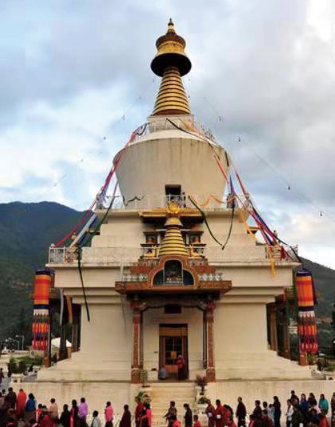

经过近半个月的朝圣，我们的不丹之行即将圆满。虽然还有一些圣地没有去，包括莲师、无垢光尊者和许多伏藏大师亲自加持的地方，但很想将来有机会再去朝拜。在不丹，我也没买什么纪念品，只买了一些具不丹特色的圆珠笔，并带回一些圣地的圣土和圣水。

这次来到不丹，我最大的收获就是得到了莲师的不共加持，而且与紫玛护法神结上了不共的因缘。所以，当我离开时，即使已到达机场，也仍然依依不舍。

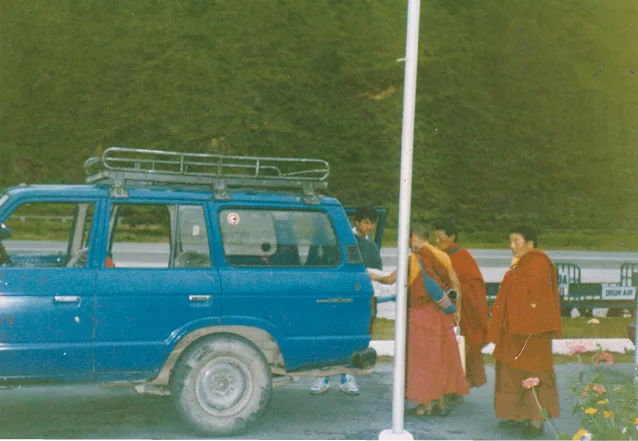

当然，不丹的男女老少也给我留下了特别深刻的印象。他们就像我小时候身边的藏族人一样，非常简单、善良、真诚，脸上带着明亮而纯净的笑容。当我买东西时，他们会热情地带路，给人一种特别亲切的感觉。不丹的出家人对上师三宝也很有信心，据说在许多圣地都有闭关修行者，主要是修持宁玛派和噶举派的法[^9]。

在不丹，全民信奉大乘佛教，依靠佛法的加持，人们生活得知足而快乐。只是，面对席卷当今世界每个角落的西方文化，他们的未来将面临什么，我有点担心。

[^1]: 松赞干布建造过108个寺庙，其中2个位于不丹，一个是贾贝寺，一个是祈楚寺。
[^2]: 1987年法王在桑耶青朴所取之意伏藏。
[^3]: 此伏藏是法王在桑耶青朴所取。
[^4]: 指紫玛护法神。
[^5]: 宗：不丹的“宗”，在藏语中是“县”的意思。
[^6]: 丹哲意吾布美：格萨尔王的大臣。
[^7]: 齐姆龙：意为水泉谷。
[^8]: 古（kur）的意思是身，杰（jey）的意思是印记，古杰是莲花生大士的身印所在处。
[^9]: 不丹的佛教传承，主要是这两大派系。因为历史原因，格鲁派在不丹境内没有。
