# 第二站 印度

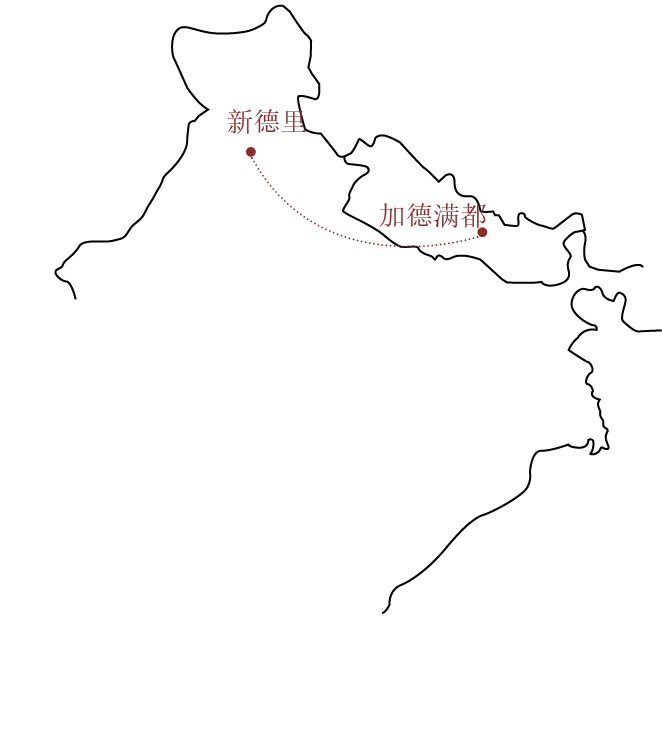

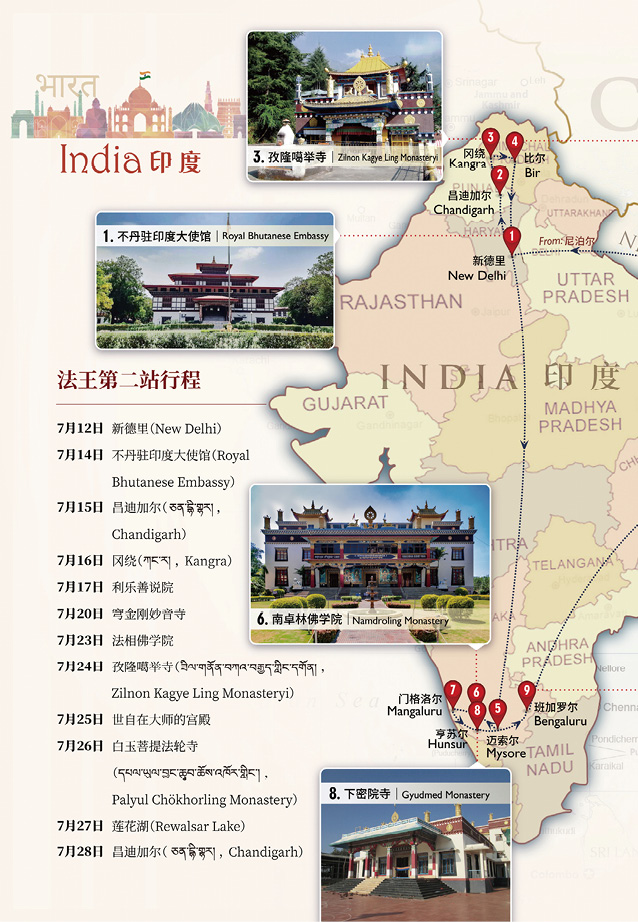

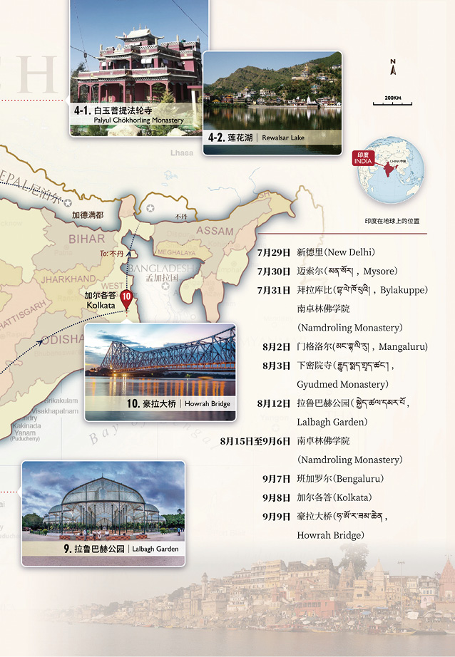

1990年7月12日

当天要从尼泊尔去往印度。一大早，尼泊尔几个寺院的高僧大德及其僧俗弟子把我们送到了加德满都机场，这是尼泊尔唯一的国际机场。临别之前，几位大德提议合影留念，法王满足了所有人的要求。

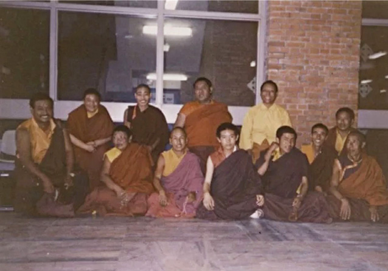

我们乘坐的飞机，是尼泊尔航空公司的。机舱很小，条件不是很好，飞行中没有提供餐饮，只发了几块尼泊尔饼干。有人告诉我，尼泊尔飞机的质量较差，发生过几次空难事件。因此，当法王坐在这样的飞机上，我心里有点紧张。

好在一个多小时后，这架飞机安全抵达印度的德里机场。

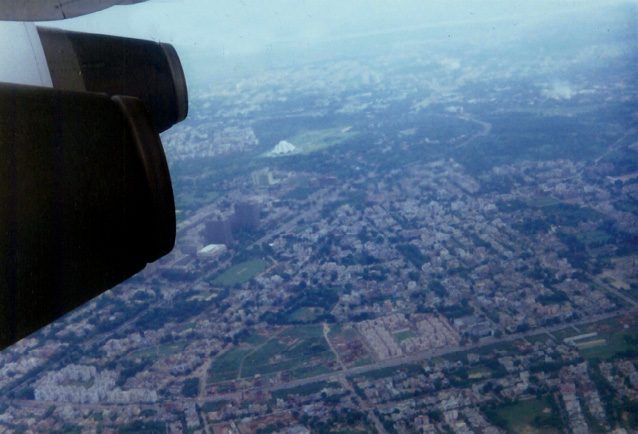

俯瞰印度首都新德里

飞机降落时，我的心也随之落地了。终于来到佛陀的圣地了！之前各种各样的担忧、顾虑，如今一扫而光了。

刚下飞机，我看到印度的藏人代表和许多在家出家信众来隆重迎接法王。他们一一献上洁白的哈达。当我站在法王身边承侍时，发现印度哈达的质量特别好，与藏地的哈达不太一样。

法王坐在机场的椅子上，直视虚空。旁边人介绍一些事情时，法王只说了“哦哦”，此外没有什么反应。我们猜想：印度跟佛陀因缘深厚，会不会是法王有一些特殊境界，或是在忆念佛陀呢？

一段时间后，法王恢复了常态，开始与所有人交谈，然后坐车前往下榻的宾馆。

印度的天气非常热，我坐在空调车里，将手伸出窗外，空气都是发烫的。但印度人似乎习以为常，他们戴着头盔，在烈日下骑着摩托车，非常自在，我忍不住感叹众生的业感太稀有。

印度没有特别好的宾馆。但法王的住处还不错，房间里有一个风扇。我们住的宾馆与法王的住处相隔一条街，没有风扇。大家不停地出汗，只能一直喝水。

我去印度之前，实际上在汉地也领教过所谓的酷热，近年来我还去过非洲，但从来都没有这么热。当时，我一边擦汗一边想：“过去很多藏地的求学者都热死在这里。他们所经历的，就是这么可怕的热吧。”

1990年7月13日

当天，法王待在屋子里，没有出去。

我们下午去给法王送饭时，法王告诉我们，他屋里的风扇声变成了赞叹文殊菩萨的偈颂，持续了一个多小时。我把这个偈颂记录下来。它翻译成中文是：

文殊金刚尊，真诚而祈祷，

加持胜智慧，遍满我相续。

法王说：“这个文殊偈，加持肯定非常大，你们应尽量念诵。”我们不知道它是什么缘起，但感觉非常稀有，因此拼命地念。

到了晚上，法王交代我们，明天将去拜见顶果钦哲仁波切，需要提前准备一些东西。

回到住处后，我想：“这是一次历史性的会晤，如此伟大的两位大德要见面了。如果不留下照片，那太可惜了。”因此，我把相机电池换成新的，装上了新胶卷，为闪光灯也充了电。

我跟随法王出门时，一刻都不敢懈怠：当法王与大德会面时，我要马上递哈达；当法王唱金刚歌时，我要立即录音；当法王吃药时，我要过去倒水；当一些事情突然发生时，我要尽快记下来……

此外，一站行程圆满，我还要提前考虑下一站，例如去哪里、要见谁、他们的身份是什么、要准备什么……关于一些行程的安排，相关联系人只告诉法王不愿对我们说，法王很累，我也不敢问。有时由于事先一无所知，会发生一些措手不及的情况。例如，当法王面见大德时，没有给法王准备哈达。

为了防止这种意外，我每天都会背很多东西，至少带一两条哈达。法王的腿脚不方便，我需要搀扶他老人家，有时候一边背着沉重的包一边小心翼翼扶着法王，这个过程还是很锻炼人。

每晚法王入睡后，我要考虑明天去哪里、可能会发生什么，然后去找人打听相关情况，或是想办法查一些资料。当时没有网络，认识的人也很少，其中艰难不足为人道。但是无论如何，由于准备工作比较充分，当我遇到各种各样的事情时，基本上都可以应付，法王对我也比较满意。

那时，我身体健康，不感到疲倦。除了忙这些事以外，我有空就看华智仁波切的《现观总义》，还背了一些《现观》颂词，每天都过得充实而快乐。

1990年7月14日

上午9点，法王在不丹驻印度大使馆的别墅里，见到了顶果钦哲仁波切。仁波切坐在一张大床上，上半身没有衣服，脖子上有一大串嘎乌盒、天珠等加持物，特别醒目。我以为印度太热了，所以仁波切赤裸上身，但是，当我后来在不丹见到他时，他仍然没有穿上衣，我才意识到此举可能有甚深密意。

法王一进门，就对顶果钦哲仁波切进行顶礼。仁波切使劲劝阻道：“别顶礼！别顶礼！我的脚不好，不能站起来。”但是法王仍然磕了三个头。

此后，两位大德互献哈达，法王坐在仁波切旁边的椅子上。他们二位虽是初次见面，但就像熟悉的老朋友一样，相谈甚欢。顶果钦哲仁波切询问法王从藏地到尼泊尔的旅途状况，法王对此进行了详细描述。之后，法王的妹妹从随身的包里拿出哈达，里面是一些藏人供养仁波切的钱。同时，法王本人也做了一些供养。

这时，我拿出相机准备拍照。首先，我没有打开闪光灯拍了一张，法王没有说什么。房间里的光线有点暗，我认为效果可能不理想，所以打开闪光灯又拍一张，法王瞪了我一眼。但是，这一张有其他人在镜头里，我仍然不满意，所以从另一个角度又拍了一张。这时，法王显得有点不高兴，出声训斥道：“不是让你别拍了吗？你在做什么？”我收起相机，不敢造次。尽管挨了批评，但我仍然很高兴。这张历史性的照片已经被拍下来了，也算是给众生一个交代。

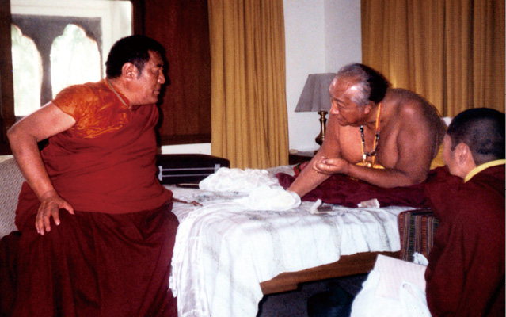

顶果钦哲仁波切问法王：“我写过一封信，劝请您为《大圆满愿文》造一个注释。不知道您是否写好了？”

法王恭敬地回答：“还没有。如果我翻阅很多资料后再写，倒是可以写很多，但这不是很有意义。我想通过祈祷，从觉性中无勤流露出来，所以我一直在等待。到目前为止，只显现了一个科判。此外，其他内容还没有出来。”法王一边说，一边把准备好的科判用哈达包着供养给仁波切。

仁波切非常高兴，并再次祈请：“无论如何，请您一定要造这个注释。”

法王点头说：“好的，我尽量想办法。”

仁波切问：“伏藏宝库的灌顶、传承，您得到过没有？”

法王说：“没有。我年轻的时候，觉得闻思非常重要，得灌顶、传承可以慢慢来。但后来出现了大的变动，许多高僧大德纷纷圆寂、离开，所以没有机会求到这个。我得到的灌顶、传承很少。”

法王还告诉仁波切：“我从小就对麦彭仁波切充满信心。通过长期祈祷，依靠麦彭仁波切的加持，我对大圆满有所证悟。从那时起，我一直在尽心尽力地弘法利生。”

仁波切听完之后，合掌道：“太好了！太好了！”

仁波切又问：“您取过某某伏藏吗？”

法王说：“还没有。尽管我为此去过新龙，但因缘还不具足，我不得不暂时放弃。”

当时，顶果钦哲仁波切身边有一个年轻的西方僧人，我好奇地看了一眼，也没有特别在意。后来，我2017年去欧洲演讲时，遇见了一位名叫马修·理查德的西方僧人，他是畅销书《僧侣与哲学家》的作者。原来，那个年轻侍者就是他。当年，他是顶果钦哲仁波切的英文翻译，我是法王如意宝的中文翻译；他的目光集中在法王身上，我的目光集中在仁波切身上，相互有过一面之缘。当我们28年后再次见面时，谈论起两位上师在过去相遇的场景、他们弘法利生的伟大事迹、我们给上师做侍者的经历……有很多共同语言。如今，我们都继承了自己上师的传承，尽己所能地弘法利生，虽然已不复往日年轻，但对上师的信心并没有随着年龄的增长而变老。

此外，据顶果钦哲仁波切的弟子回忆，当天法王离开后，他们在晚上问仁波切：“您认为晋美彭措法王是什么样的上师？”

仁波切说：“是一位非常不可思议、非常了不起的证悟者。”

弟子问：“他会不会造《大圆满愿文》的注释呢？”

仁波切说：“这取决于众生的福报。如果这部注释造得出来，内容必定非常丰富，篇幅就像《如意宝藏论》《胜乘宝藏论》一样多，其价值与《七宝藏》等同。但我不知道众生有没有这个福报。”

有一位乌金多吉活佛也在场，他几天后邀请法王去他的寺院，所以请顶果钦哲仁波切为法王造一个住世祈祷文。仁波切立即一挥而就并交给他。

但遗憾的是，后来法王去他的寺院时，他正好去了西方弘法，并把祈祷文交给了其他人，我们当时没有看到。

1990年7月15日

法王前往下一站，昌迪加尔（ཅན་དྷི་གྷར།，Chandigarh），距新德里300多公里。我们本来打算乘飞机去，但飞机临时出故障，不得不换成汽车，很晚才到。

途中，我们特意吃了一顿印度餐。在尼泊尔的过去半个月里，我们一直住在宗囊寺，寺内僧人担心法王不习惯当地食物，基本上都做藏地饭菜，因此，我们不知道印度口味是什么样的。

第一次吃咖喱，我似乎并不排斥这种味道，后来在印度期间，还喜欢上了用咖喱煮的食物。但是，法王的饮食习惯相对清淡，除了油和盐，通常不吃葱蒜、辣椒、花椒，因此他只吃了一点咖喱饭，对印度菜很少下筷。

印度人吃饭用手抓，这与藏人的饮食习惯相似。所以，印度餐馆的条件再差，也有可以洗手的地方。人们饭前饭后都会洗手。吃饭时如果想喝水，没有杯子，只有一个长嘴茶壶，将水准确地倒入口中，不会沾到嘴唇。当地人都像这样喝水。

1990年7月16日

法王从昌迪加尔来到冈绕（ཀང་ར།，Kangra），当地寺院的僧众和信徒举行了盛大的欢迎仪式。世自在大师满面笑容，手捧吉祥哈达和释迦牟尼佛金像，迎接法王的光临。

下午，法王向世自在大师授予了两个灌顶，一个是伏藏大师列绕朗巴的“莲师除障法”，另一个是法王在尼泊尔刚取的“项袋金刚橛”。

晚上，法王和我们随行人员住在佛学院。这里的气候凉爽宜人，环境与藏地非常相似，有松树林和山泉，远处可以看到雪山。从酷热难耐的尼泊尔来到这里，就像从热地狱到了清凉世界一样。

1990年7月17日

当天，在一个特殊因缘下，法王从智慧海中流露出世自在大师的住世祈祷文。此祈祷文的加持不可思议，世界各国的佛教徒现在都在念诵。

下午，在利乐善说院的大殿里，举行了隆重的会供。法王如意宝和世自在大师，威严地坐在妙高法座上，令人见而生信。各寺院的大德、僧众在一旁围绕，场面壮观而感人。大家念诵的会供仪轨，是伏藏大师列绕朗巴的《金刚橛·极密宝剑》，它在降伏魔众、弘扬正法方面有不共的加持和缘起。

参加会供的人特别多，而且有来自许多国家的信徒。多年后，他们回想起这一幕，内心的震撼仍然无法言喻。

那天的会供品，我们后来带回来一部分，将其制成甘露丸，直到今天还有。

1990年7月18日

法王与世自在大师再次见面。因为他们前世有殊胜因缘，所以每次见面时，就好似久别重逢的兄弟，喜悦之情很难形容。同时，会有许多普通人难以想象的善妙现象。

当天，法王的觉性中突然显现出金刚橛的支分法类——“金刚橛火供仪轨”，世自在大师立即执笔记录，字迹很漂亮，后来交给了我们。奇妙的是，这个伏藏中的吉祥文，大师早在十几年前就能流利地背诵了。

之后，法王供养世自在大师一些伏藏品：珍藏有 “莲花空行修法”的宝箧；法王去桑耶青朴时，由伏藏护法神亲自交付的空行母益西措嘉的项链；法王去桑耶寺时，在马头明王法座下取出的天眼珠宝箧。以此成就了彼此之间的殊胜缘起。

接着，他们就一些佛法问题交换了意见，对共同密乘、不共光明大圆满的见解、修行、行为、觉受、证悟等，进行了深入细致的辨析，并讨论了佛法未来在世界各国如何弘扬，以使更多众生受益。

1990年7月19日

法王供养世自在大师一尊文殊菩萨像，这是法王从五台山那罗延窟专门为他取的伏藏。世自在大师非常高兴，并供养法王黄金曼茶罗以及自己前一世的专用银元。

法王还向大师传授了“文殊静修大圆满”灌顶，以及《文殊大圆满》的传承与修法。

中午，两位大德一起共进午餐，互叙前世的殊胜宿缘。世自在大师对法王殷切叮嘱：“您是雪域佛法的怙主，如果将来遇到各种违缘，不应该以此止步不前。您要像傲然在风雪中的青松一样，长久住世，广利有情。”随后，他供养法王一尊一尺高的长寿佛像，这是他修持五世达赖《无死长寿五本尊仪轨》[^1]时的所依佛像，并反复祈请法王为利有情要久住世间。

1990年7月20日

上午，应内穹金刚妙音寺的邀请，法王去该寺为僧俗信众传授“项袋金刚橛”灌顶。

当念诵“迎请本尊降临”的仪轨时，金刚称护法神突然降神在了寺内法神喇嘛[^2]的身上。我看到他直挺挺地倒了下去，众人给他穿上天衣、戴上天冠后，他顿时张眼立起，形貌非常可怖，完全变成了另一个人。我是第一次看到这种场面，如果不是亲眼目睹，一般人很难相信。

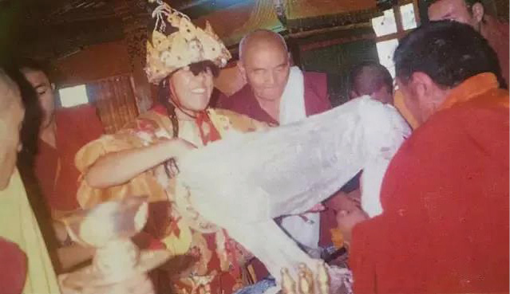

金刚称护法神给法王献哈达

金刚称护法神来到法王面前，讲述起他跟法王的前世——列绕朗巴大师的因缘。这时，法王流下了眼泪，神态与平常完全不同，好像回到了前世一样。之后，护法神授记了法王的未来事业，并说：“莲花生大士在法界中恒时关照、加持您，您当以金刚橛法降伏一切邪道魔众。”

我们在旁边做了录音。法神喇嘛的口音有点难懂[^3]，但基本上可以听得明白。后来，护法神的许多授记都应验了。

金刚称护法神说完之后，吉祥天女等护法神也纷纷降神在不同人的身上，亲口授记法王是真正莲师的幻化身，是浊世众生的慈悲怙主。

随后，法王带全寺僧众举行了大会供。会供仪轨是伏藏大师列绕朗巴从红黑血湖中所取的《金刚橛·精藏宝剑》。

中午，法王在房间里休息时，自然流露出金刚橛的支分法类——“护法神修法仪轨”，我当场记录下来，现收于《法王全集》中。

下午，法王给当地信众做了开示，并用经书给他们一一加持。

之后，法王参加了宗教界、政界、学界有关人士的座谈会，出席的还有法相佛学院、尊胜佛学院的高僧大德。大家从世间、出世间两方面，探讨了当前的重要话题。各代表对法王供养了佛像等缘起物，感谢他从藏地来到印度圣地，为高僧大德遣除了寿障，并向僧俗信众传授了甚深的灌顶和密法。

1990年7月21日

法王和世自在大师用了整整一天的时间来讨论显密教法中的难题。

世自在大师说，他小时候主要研究因明等显宗经论，因为老师们的影响，得到的密法灌顶并不多。后来，他依止一些学修密法的大德，接受了各种灌顶、传承、法要之后，对宁玛派的龙钦巴尊者、麦彭仁波切、竹庆丹毕尼玛仁波切的密法非常有信心。但是其中一些问题和自己的境界，需要得到法王的印证。因此，他从各个方面提出了很多问题。

当天我没有参加。法王中午回来时说：“他老人家的智慧真是超群。没想到他对大圆满的见修行果如此熟悉，对荣索班智达的《入大乘论》也如数家珍……”法王讲了很多内容，但是我现在不记得了。

下午，我向法王请示后，独自一人去了书店。多年来我有个习惯：只要有时间外出，首选就是逛书店。去很多国家时都是如此。因为平时与法王在一起，我需要随时待命，即使没事也不敢离开。当天难得有这样的机会，我坐着三轮车逛了一圈，又去书店买了一些好书。后来，这些书都派上了用场。

那天下午是我最放松的一次。我很晚才回去。夜晚非常美丽，天空和山林中散发出的气息，让人心旷神怡。

1990年7月22日

世自在大师应法王以及我们随行人员的祈请，为少数人传授了五世达赖“净法类”之“意修精藏总集”大灌顶。这是一个莲师修法。

灌顶时间比较长，有驱魔、修护轮、在坛城中供养赞巴嘎花、用红布遮盖眼睛等许多次第。当世自在大师手持莲师像进行灌顶时，我生起了极大的信心和喜悦。

大师说：“我之所以对大圆满有不共信心，主要来自五世达赖的伏藏和传记。详细阅读他的著作后，我才知道密宗有如此殊胜的窍诀。作为他的延续者，我也应该弘扬这些法。”之后，他谈到了自己对莲师的信心，以及如何祈祷、修行的一些教言。

下午，法王在大乘法林殿里，为法相佛学院的全体僧众，传授了“金刚橛·极密宝剑”“项袋金刚橛”灌顶，并念了金刚橛相关修法的传承。

1990年7月23日

上午，法王去法相佛学院的大殿，对佛像举行了开光仪式。

下午，世自在大师应法王的祈请，为“项袋金刚橛”造了一个名为《速赐加持》的传承祈祷文，并给我们念了传承。此法现今收录在《法王全集》的金刚橛法类中。

晚上，法相佛学院各班的僧人们，为法王和世自在大师献上了精彩的辩论，以此作为“善说”法供养。两位大德年轻时都接受过藏传佛教辩论的训练，当他们看到熟悉的辩论场面时，显得格外高兴。

1990年7月24日

上午，法王来到附近的孜隆噶举寺（ཟིལ་གནོན་བཀའ་བརྒྱད་གླིང་དགོན།，Zilnon Kagye Ling Monastery），为该寺僧俗传授“项袋金刚橛”灌顶，并做了一些佛法开示。

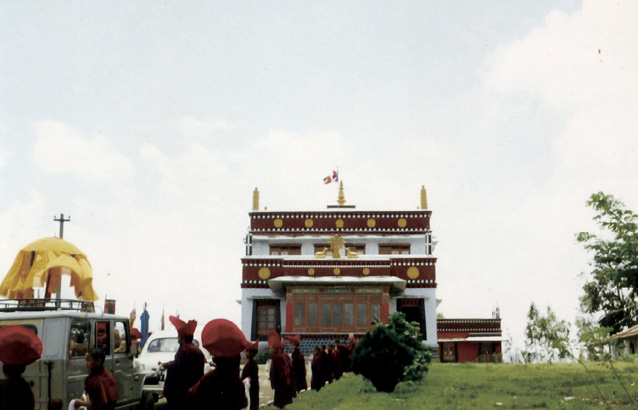

下午，法王向世自在大师传讲了华智仁波切的《大圆满击要三句》。随后，两位大德讨论了密集金刚与时轮金刚、中观自续派与中观应成派之间的异同，并根据不同教典进行了详细的辨析。

在那些日子里，他们每天都沉浸在佛法中，或是互相灌顶，或是互相传法，或是互相答辩，现场非常愉快，令人难以忘怀。对我而言，这是一次珍贵的心灵朝圣之旅。

1990年7月25日

当天恰好是藏历六月初四，释迦牟尼佛初转法轮日。法王和我们来到世自在大师的宫殿，在一尊极有加持的古老观音像“吉众觉沃瓦德桑布”前，大家共发菩提大愿，为利益无边众生念诵《普贤行愿品》。

世自在大师应我们之请，念了他所造的《莲师祈祷文》的传承，并介绍了这个祈祷文的加持等。

此后，大师从观音像前取下了纯金的八吉祥供物，献给法王作为特殊缘起物。此八吉祥的中央，是大大的法轮，法轮上方是海螺。大师说：“祈愿您回到藏地后，常转法轮，广利有情。希望在不久的将来，当我去亨苏尔时，我们能够再次见面。”

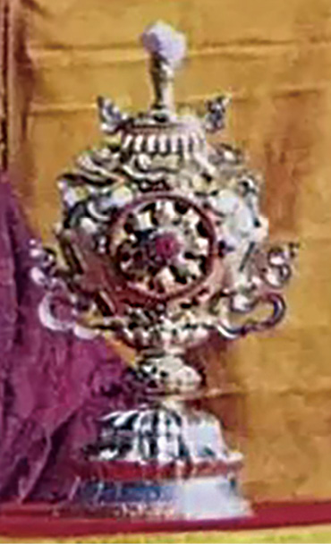

大师给了我们随行人员每人一个释迦牟尼佛唐卡，观音菩萨、金刚橛的甘露丸，以及一些金刚结等加持品。现在已经过去三十年了，那些甘露丸被吃完了，但唐卡仍然保存完好，是我经常顶礼的对境。

十天的行程即将结束。因为第二天要离开，所以我非常不舍。

1990年7月26日

在隆重的告别仪式中，法王和我们坐上世自在大师安排的汽车，离开康绕，前往66公里外的比尔（སྦེ་རི།， Bir）。

那条路很难走，但是途中的风景非常美丽。中午我们在一个景区吃饭，那里的食物比较高档，价格有点贵。一位僧人对法王说：“在我们印度，即使是同一种食物，在不同的餐馆，价格也有很大不同。有些菜在其他地方很便宜，在这里却非常贵。”当时我见识不多，对世间也不了解，所以对此现象感到有些困惑。

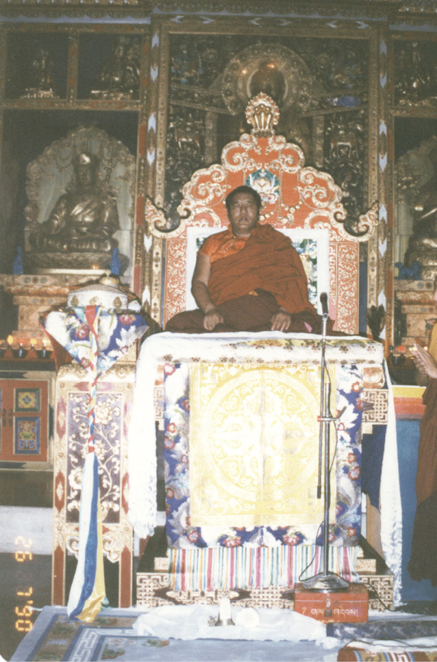

下午，到了白玉菩提法轮寺（དཔལ་ཡུལ་བྱང་ཆུབ་ཆོས་འཁོར་གླིང་།，Palyul Chökhorling Monastery）。热果活佛[^4]带领佛学院几百名僧众，身披黄色袈裟，列队迎接法王的到来。热果活佛对法王很有信心。法王为当地僧俗传授了灌顶，并做了如何闻思修的开示。

这个寺院的建筑有点像四合院，有两三层楼。站在楼顶上，可以清楚地看到萨迦派的帝茹寺（འབྲི་རུ་བསམ་འགྲུབ་བདེ་ཆེན་ཆོས་འཁོར་གླིང་། ས་སྐྱ་འབྲི་རུ་དགོན།，Dirru Monastery）。

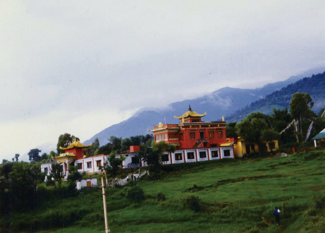

附近还有巴彭希日林（དཔལ་སྤུངས་ཤེས་རབ་གླིང་། སི་ཏུ་རིན་པོ་ཆེའི་དགོན།，Paplung Sherabling Monastery）、才让炯寺（ཚེ་རིང་ལྗོངས། ཁམས་སྤྲུལ་དགོན།，Tsering Dzong Monastery）等几座寺院，建筑规划和环境美化都很好。从远处看着这些寺院，我不禁想到：藏地大德们来到这个他们不熟悉的地方建立道场，应该很不容易。

1990年7月27日

上午，法王去了白玉菩提法轮寺附近的一些寺院。

之后，乘车前往92公里外的莲花湖（Rewalsar Lake）。根据《莲花生大士传记》记载：莲师在萨霍国时，国王把他置于火中焚烧，莲师将熊熊火焰变成了一个湖，自在地坐在水中的莲花上。从此，这个湖就被称为“莲花湖”。

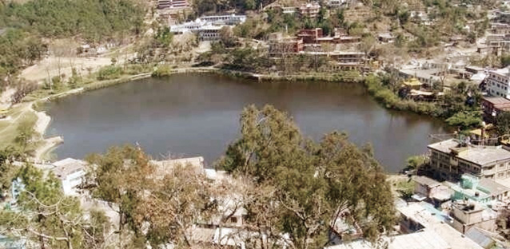

当天，随行的车辆非常多，有些是陪法王前往的，有些是来迎接法王的。我暗暗数了一下，一共有42辆车。

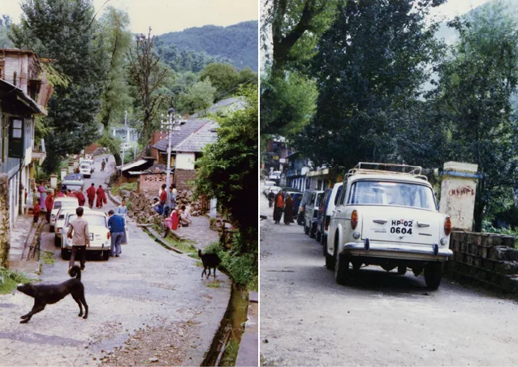

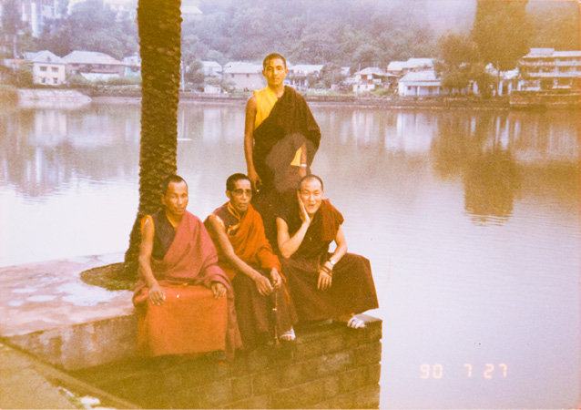

到了莲花湖后，我们先找到一个地方住下。法王突然很急切地说：“莲花生大士来了！我要马上去湖边。”然后连鞋子都没穿，就赶了过去。我们匆忙带上了东西，把法王的鞋子也带了过去——法王在印度穿的鞋子有点像人字拖。刚开始法王不太习惯，但是后来发现这种鞋子又凉快、又跟脚，就入乡随俗，在印度一直穿这种鞋。

到了湖边，只见法王站在那里，即兴唱了一个我们从未听过的莲师祈祷文[^5]——

诶玛吙

祈祷大悲幻化身，无等智慧威力尊，

持明莲师予垂念，加持外内密违缘，

消法界中而现前，法政无余善妙果。

昔日自生莲花生，为萨霍王活烧时，

四大害显觉空严，八功德水湖中央，

叶果严饰莲花蕊，现出相好庄严身。

聚此君臣信心海，涌动无法相容纳，

双手合十之莲花，速于首髻而顶戴。

时魔外道大象群，大力我慢身强健，

伸出恶行之长鼻，空行狮面怒母口，

顿时吞下三有界，以吽啪的声动尊心，

起现降魔大等身，神变教理利齿爪，

享诛反方野兽餐，美名吼声震三有。

彼时上空诸天人，称扬彼名狮子吼，

现量显示尊中尊，大地美女肩难撑，

颤动呻吟相交织。如是无等大上师，

千万寂猛游舞戏，一时展现之圣地，

成为亲见喜宴时，意童欢喜翩起舞，

引吭唱此无伪歌，胜皈处您三界中，

利生事业不越时，亲口金刚之立誓，

劝请速现诸验相。尤其我等诸雪域，

最胜依怙诸民众，不谋而合同一心，

日夜随念莲师尊，悲切深情猛呼唤，

大爱汝岂置不理？今发大悲之威力，

灌顶加持具信我，持教大德久住世，

正法兴盛于十方，众生安乐行正法，

现前一切所求果。

莲花湖中心有一个莲花根，据说是莲师将火海变成湖泊后所坐的莲花的根，形状如一个人那么大，漂浮在水面上的部分就像一堆芦苇。当地人说，莲花根通常下沉在湖底，只有在莲师的特殊节日，它才会浮到水面。

当法王在唱莲师祈祷文时，莲花根奇迹般地浮了上来，并漂到了法王的面前。法王一边唱，一边向它献上哈达。之后，莲花根又漂漂荡荡回到湖心。见到这一幕的人，无不叹为稀有。

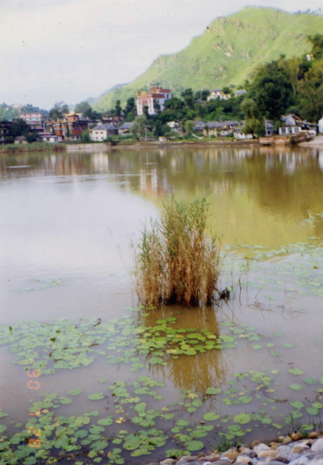

法王告诉我们，无论莲师在哪个刹土，如果以七句祈祷文来祈祷，他都会立即降临。因此，法王带大家念了七句祈祷文，并以《普贤行愿品》做了发愿。

当天，法王显得很高兴。他看到来朝拜的人比较多，主动提议：“这个湖非常有加持，我们来拍个照吧。”因此，大家都很开心地在湖边与法王合影。

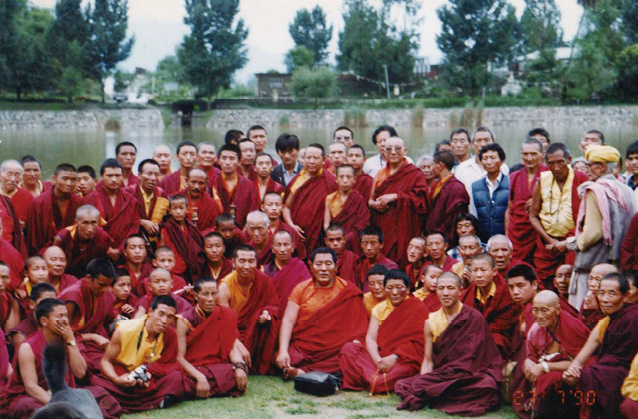

晚上，我们住在莲花湖附近的一家旅馆里。

1990年7月28日

早晨，法王从觉性中流露出贝诺法王的住世祈祷文[^6]。后来，南卓林佛学院将此收录在他们的《日常课颂集》中，每天念诵。

当天，法王还朝礼了莲花湖附近几个具加持力的山洞。莲师曾在那儿修行过，山洞里还有空行母曼达拉娃的手印等圣迹。

朝拜完之后，我们驱车180多公里从莲花湖到昌迪加尔，并在那里过夜。

1990年7月29日

当天，从昌迪加尔乘车前往新德里，全程300多公里。这条路坑坑洼洼，非常颠簸。几乎坐了一天的车，法王和我们都很累。晚上住在新德里。

有时我看到法王为了佛教和众生，不顾年迈四处奔波，心里很感动。尤其是，每当看到法王通过传法利益了那么多众生，甚至他一句玩笑、一个表情也会使某些人心开意解，改变了一生的命运，我禁不住生起无比的信心。这种信心不是暂时的热情。多年来，无论他老人家如何示现，我都从未产生过丝毫分别念或邪见。

1990年7月30日

从新德里出发，飞行了两个多小时，到达了印度南部城市迈索尔（མན་སོར།，Mysore）。

迈索尔的机场很小，飞机也很小，而且航班不是天天都有。但幸运的是，当天正好有一班飞机。

印度航空的乘务员大多是年轻人，不像西方有些国家，空姐基本上是中年人。飞机上提供了甜点、米饭、面包、蔬菜等，法王只吃了一点米饭，并沾着黄油吃了几块面包。我发现法王喜欢吃面包，就尝试跟空姐多要了两三块。至于飞机上的饮料，除了咖啡外，法王一般都可以接受。

晚上住在迈索尔。它是古印度迈索尔王国的首都，拥有众多的文化遗址和庙宇。法王安顿下来后，我们几个随行人员在这座城市中逛了一下。

1990年7月31日

我们一大早从迈索尔出发，坐车100多公里到了拜拉库比（བྷ་ལེ་ཁོ་པུའི།，Bylakuppe）。该镇是印度南部最大的藏族聚居区，附近有近10000名藏人，其中有3000多名僧人。

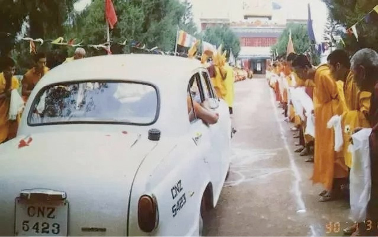

贝诺法王的南卓林佛学院（Namdroling Monastery）就位于这里。贝诺法王是宁玛派第三任掌教法王，他这所佛学院始建于1960年代，是宁玛派规模最大的寺院之一。法王这次来印度，最主要就是受贝诺法王邀请，到南卓林佛学院传法。

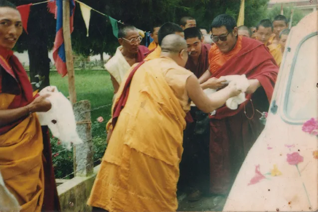

当法王到达这里时，以贝诺法王为首的宁玛、格鲁、萨迦等各派大德以及数千名僧众，披着红黄法衣，非常隆重地列队迎接。然后，按照藏传佛教的传统，僧众们擎着法幢、吹奏法器，将法王迎请到经堂最高的法座上，供养了三宝所依和曼茶罗。法王一一接受之后，享用了献新的食物，然后念了一些经文，就下座休息了。

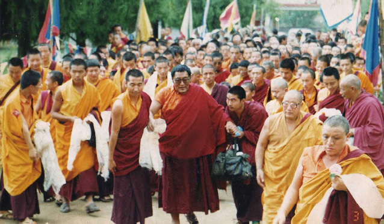

法王被安排在二楼的贵宾室，我们陪同人员住在一楼的高级僧舍，屋里都有风扇。接下来的三个月时间，我们会一直住在这里。

为了照顾法王的饮食，贝诺法王给我们安排了专人做饭。当时，佛学院的条件不是很好，寺院里上千名僧众的生活，全靠贝诺法王一个人维持，而不像藏地僧人有家庭支持。印度的经济状况也不太好，所以僧众吃不到什么有营养的食物，只是每天早上喝一杯甜茶、吃几块印度奶酪，中午吃一个简单的菜，晚上喝一点稀饭。

我们的饭菜要比他们好，但也没有好多少。当我们在藏地时，觉得印度就像天堂，但到了以后发现，这里实在太热了，从藏地带来的糌粑、酥油，很快就坏了。再加上印度食物的口味很重，法王一下子难以适应，所以每天的饭量很少。

为法王做饭的喇嘛，虽然会做藏地的面块，但法王吃的并不多。我们担心法王的身体，有时会偷偷出去买一些印度粉丝，用它当馅来做包子，法王比较喜欢吃。因此，现在每当我看到粉丝馅的包子时，就会不禁想起当年的情景。

佛学院附近有一位来自色达的藏族人，他家里养了牛，每天都会拿新鲜的酥油和酸奶来供养法王。贝诺法王的上师宫那边也有奶牛，经常提供酥油、奶渣、糌粑。但是印度的牛不是牦牛，酥油的味道不太一样；印度的糌粑也不同于藏地，口感有点像面粉；酸奶因为天气太热，没有冰箱，第二天都坏了。因此，法王仍然吃得不好，再加上当时的出行安排比较多，常常要四处传法，所以一段时间下来，法王瘦了很多。

1990年8月1日

在众人的祈请下，法王为贝诺法王以及南卓林寺、南卓林佛学院的数千名僧众，传授了“四臂文殊”大灌顶（འཇམ་དཔལ་རྒྱུད་ལུགས།）。这个灌顶的念诵仪轨、灌顶仪轨，是由麦彭仁波切所造。佛法再弘时期，法王在心宝山灌的第一个顶，也是“四臂文殊”。

对于法王而言，常规灌顶的仪轨，可以自己背诵。但大型灌顶的仪轨，前后次第更为复杂，而法王看不清文字，需要我帮忙提前录音。

我以前虽曾得过“四臂文殊”灌顶，但当时只是跟着大家一起念，不记得仪轨的前后顺序。事到临头，不得不硬着头皮去问法王。问清楚每个环节的细节之后，才回去把它录好。

法王在灌顶后，对所有人说：“修四臂文殊的加持非常大。从喇荣五明佛学院成立到现在，每月的初十，僧众都会以会供方式修四臂文殊，从未间断过。因此，我希望不管是南卓林寺、南卓林佛学院还是你们个人，将来能够多修此法。”[^7]

1990年8月2日

法王以前从未见过海，所以这次想看看海。我们选择去门格洛尔（མང་གྷ་ལི་རུ།，Mangaluru），这是离南卓林最近的沿海城市，濒临印度洋，驱车170多公里。当天与我们同行的，有三辆车。

到了海边时，法王看上去非常高兴。念了几遍大自在祈祷文后，他提着僧裙，光着脚走进海里。法王说：“《毗奈耶经》中讲，海水很咸，不能直接喝。所以我今天要尝一下。”然后，他将海水捧在手中，然后放入嘴里。旁边的一些人见后，急忙提醒不能吞下去。

我也是这辈子第一次看到大海。在海边，我念了经、拍了照，感觉很舒服。但是，印度的海水不是那么蓝。后来，当我去新加坡、加拿大、美国时，发现那里的海水澄清透明，就像一块蓝色的大水晶。不过，那些海再美丽，也没有这次看海给我留下的印象深刻。也许这是我第一次看到大海，也许是因为跟法王在一起。后来，每当我看到大海时，总会想起当年的情景。

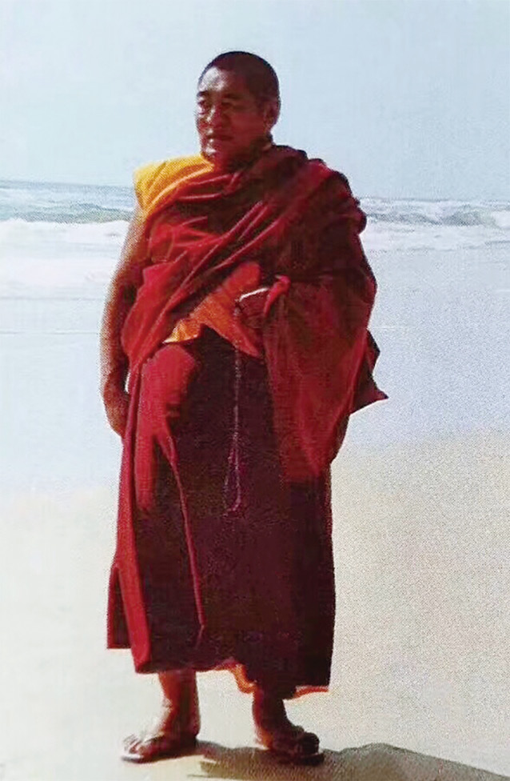

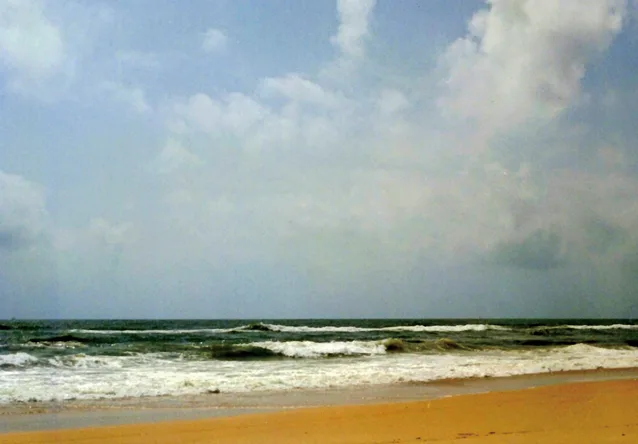

海滩上有一些渔民，看到我们穿着红色僧衣，好奇地走了过来。他们边走边吃鱼。我们本来非常开心，看到这一幕后，心情不是很好了。法王说：“住在海边的渔民真的很可怜。除了吃鱼，没有其他食物。他们一生中不知道要杀多少生。以后业力成熟时，任何人也无力阻挡。”

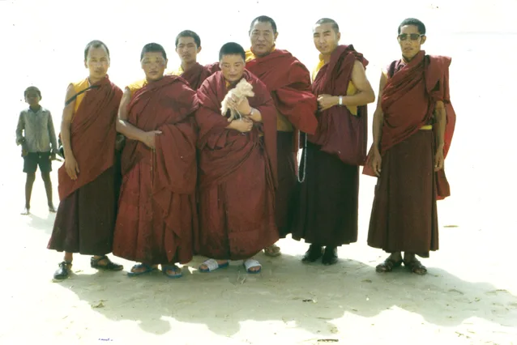

之后，我们回到了南卓林佛学院。

当天，有人供养法王一只小狗。在藏地时，法王就喜欢狗。当他去五台山时，还带了很多狗。中途坐飞机时，狗只能用航空箱办理托运，法王还担心狗受伤，整晚都睡不好。

这次出国，法王没有带狗。有人知道法王喜欢，就特意供养了一只。这只小狗身材娇小、不会长大，非常聪明，很认主人，听话，爱卫生。法王给它起了个名字，叫“布廓”，意思是悟空。因为《西游记》中唐僧去印度取经时，悟空扮演了成办顺缘的角色，法王说，这只小狗也有护法的缘起。

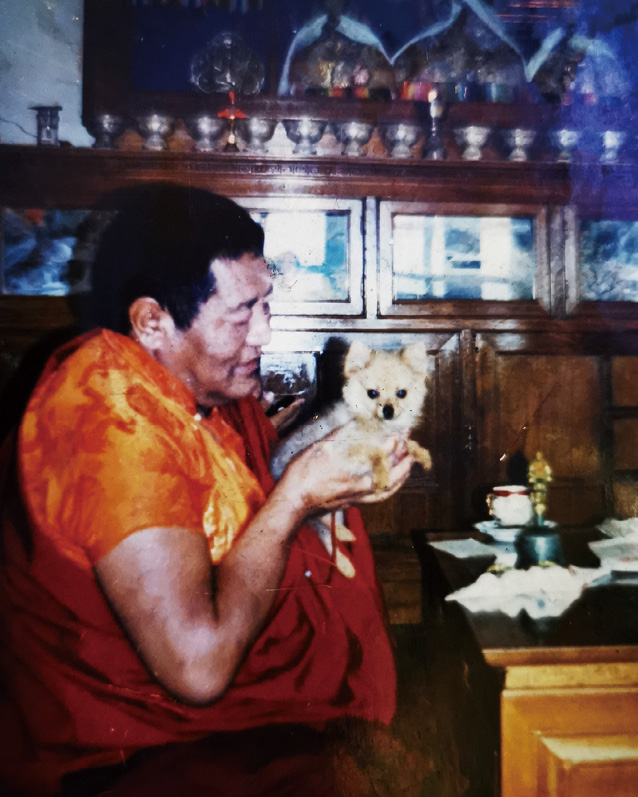

后来在印度，法王去哪里都带着布廓，天气再热也把它放在怀里，因此，布廓在许多重要场合都露面了。我们陪同人员对它都有清净心，但是素不相识的人，尤其是其他教派的一些大德，看到这么伟大的上师还带着一只小狗，有时态度上不太理解。

布廓每晚与法王同睡，除了法王，不让任何人抱。它通常乖巧听话，不会到处撒尿。但是曾经有一次，法王去格鲁派的寺院传法时，有一位格西很讨厌布廓，满脸嫌弃的样子，没想到布廓故意跑到他身边，向他撒了一泡尿。我们都被这个惊人的举动吓到了，从此再也不敢小瞧布廓。

关于法王身边的狗，有很多有趣的故事。例如，有一只叫内悟类的大狗，每当法王传法时，它都登上法座，趴在法王身边，从不到处乱跑。法王传完法后，它才抬起头来，慢慢走下法座回去。

有些人可能不相信，但这正是我亲眼所见。我一直觉得这些狗应该是法王的特殊所化众生。

1990年8月3日

应下密院寺（རྒྱུད་སྨད་གྲྭད་ཚང་།，Gyudmed Monastery）的邀请，再加上世自在大师也要去那里灌顶，法王从南卓林佛学院出发，乘车前往44公里外的亨苏尔（ཧོང་སོར།， Hunsur）。

下密院寺是一所密宗佛学院。它建于1982年，是当地格鲁派专修密宗的道场。历史上，宗喀巴大师为了弘扬密法，要求建立与显宗不同的修学系统，并分别设立了上密院和下密院。1433年，他的大弟子希绕僧格在藏地建立了第一所密宗佛学院。后来，格鲁派延续了这一传统，并保留至今。

下密院寺规模不大，只有四五百人。法王到来后，格西们为我们安排了最好的住处。房屋周围的花朵芬芳，绿树如荫，环境非常清幽。

当天，世自在大师也到了，并住在这个寺院中。

1990年8月4日

来自日本的佛教徒祈请世自在大师，为他们传授巴穆派观音菩萨法门的灌顶。此灌顶仪轨是第七世达赖喇嘛所造。

这个灌顶不向公众开放，但是法王和我们被特别开许，可以加入灌顶行列中。

灌顶分为两天。第一天是预备灌顶，第二天是正行灌顶。

1990年8月5日

上午，法王向世自在大师传授了“长寿佛灌顶·甘露妙瓶”，这是列绕朗巴大师的伏藏。

灌顶结束后，法王供养大师一颗长寿丸，这是莲师获得长寿持明时所制，外面有伏藏大师列绕朗巴的密印。大师看到后很高兴，对身边的侍者说：“把我的嘎乌盒拿来，我也要给他一些宝贝。”

侍者拿来了一个非常大的嘎乌盒。世自在大师打开它之后，送给法王一些加持物：

莲花生大士、法王赤松德赞、空行母益西措嘉三人制作的长寿丸；

法王松赞干布所写的圣旨布片；

空行母益西措嘉所写的《八大法行·善逝集》法本碎片；

酿绕伏藏大师的伏藏品；

格日秋旺的伏藏——《八大法行·秘密圆满》法本的黄纸碎片；

五世达赖的经师德达朗巴的伏藏品——莲师法帽碎片；

仲敦巴尊者的骨灰舍利；

被月称论师翻阅过、后由日称译师译成藏文的《密集金刚》法本的碎片；

米拉日巴尊者禅修带的穗子须；

……

有些加持物，我们陪同人员也分到了一点。

法王所得到的这些宝贝，我一个个地做了文字标记，回来后放在法王的大嘎乌盒里，平时一直帮忙背着它。

下午，世自在大师传授了观音菩萨法门的正行灌顶。

灌顶完成后，我感到非常高兴，并发愿自己也能像观音菩萨一样真正具有慈悲心，将来，通过弘扬观音法门利益有情。

这次灌顶的法本，后来被我带回了佛学院。遗憾的是，法王一直没有给其他人灌过这个顶。

1990年8月6日

下密院寺建造了一个新经堂。当天，是该经堂的开光典礼。

上午，寺内僧众念诵了简短的开光仪轨，我们没有参加。之后，在举行正式的开光大典时，世自在大师和法王都出席了。

典礼在经堂的门前举行。大殿台阶上方是印度官员、各派大德等嘉宾，寺院僧众和各地信众坐在下方。当天人山人海，场面宏大，当地媒体报道说，有两万多人。迈索尔及周边的佛教徒几乎都来了。

世自在大师发表了很长的讲话，特别提到了法王，说他从藏地远道而来，所以这次的因缘非常殊胜。

在接下来的发言中，法王没有说太多。具体内容我现在忘了，但印象中讲得非常精彩。只不过当地大多数人说拉萨藏语，法王讲的是安多藏语，我担心有些人听不懂。

1990年8月7日

从这一天开始，世自在大师向大众传授“密集金刚”灌顶。

首先，是做预备灌顶，包括前行灌顶等。参加灌顶的人主要是印度色拉寺、哲蚌寺、上密院寺、下密院寺的2000多名僧人，此外还有很多在家信众。

在进入灌顶坛城之前，大师再次当众提到了法王。他以赞叹的语气介绍道：“这是第十三世达赖喇嘛的经师——伏藏大师列绕朗巴的化身。他以出家比丘的身份，多年来，不顾身体和生命在弘法利生。我特地邀请他今天来这里，你们可以见到他，应该说有很殊胜的福报。”

在灌顶的过程中，当大师发放灌顶加持物时，也是第一个给法王，其次是甘丹池巴、贝诺法王，以及其他的堪布活佛、高僧大德。

当时，法王在佛教界并不像现在这样出名，因此，世自在大师在不同场合作了特别介绍。本来，按照藏传佛教的传统，各教派通常只接受自己传承的修法，法王则接受了格鲁派最主要的密宗修法“密集金刚”，这也是历史性的超越。尽管贡智云丹嘉措、蒋扬秋吉罗珠等前辈大德主张各教派圆融时，他们也会接受其他教派的修法，但完全接受对方的灌顶、修法和传承，这在历史上仍然比较罕见。

当时，有些人不太接受这一点，一开始持有不同的意见。直至他们看到高大威严的法王，并感受到了他的超群辩才和无碍智慧，不由自主地生起信心，态度发生了180度转变。

我本人一直想获得“密集金刚”的灌顶，因为密续经常提到“父续密集金刚、母续胜乐金刚”，我也读过麦彭仁波切的《密集金刚·五次第注解》，和月称论师、宗喀巴大师关于密集金刚的著述。所以，得到这个灌顶，我感到非常激动。如果未来因缘成熟，我很想翻译并弘扬密集金刚法门。

1990年8月8日—8月9日

世自在大师传授了“密集金刚”的正行灌顶。

在灌顶最重要的环节——“金刚阿阇黎灌顶”时，大师亲自走下法座，来到高僧大德的行列中，把灌顶加持品唯一交付予法王如意宝，其他人的加持品则是传下来的。不知道这是什么缘起。

灌顶圆满之后，大师又应当地僧众的祈请，增加了“白度母·赐寿如意轮”的长寿灌顶，并口传了观音心咒、莲师心咒、度母心咒等咒语。

下午，法王与贝诺法王一同前往世自在大师居住的寝宫。此前，我们问过大师法王是否有寿障，他通过观察，说法王的寿命暂时没有障碍，如果弟子们能不断闻思修行，这对法王来说是最好的延寿佛事。他还提前将这些内容详细地写在纸上，并交给了我们。

之后，他们三位大德进行了一些轻松的对话，并谈了很长时间。

世自在大师对法王说：“这次，密集金刚和观音法门的灌顶非常圆满，我这边出现了一些瑞相。在观音法门预备灌顶的那天晚上，我还做了个梦，梦见一个自称是您派来的形貌可怖的黑人，给了我一个包裹。我不知道是怎么回事，迅速打开了，里面是一颗怨魔的头颅。我想这应该是项袋金刚橛的降魔威力，与金刚称护法神的授记完全一致。因此，无论是这次密法灌顶，还是您传授项袋金刚橛，都应该能对众生有不共的加持。”

大师继续道：“我跟金刚橛法门也有不共的因缘。之前我没有得过列绕朗巴大师‘金刚橛·极密宝剑’灌顶的时候，有一个晚上，在梦境与觉受相融的境界中，有人带来一个用布包着的包裹，我打开后，里面有个狮子头，头上有一段用金字写的偈颂。第二天早上醒来，我还可以背诵它。直到今天都没有忘记。”当时，大师随口念了这个偈颂。我真的很想写下来，但是他念得太快了，我没有时间写，也不敢问。毕竟，在这样的场合中，我一个小僧人这样做会有些冒昧。

只记得这个偈颂与金刚橛有关。此后不久，大师在顶果钦哲仁波切面前，获得了伏藏大师列绕朗巴“金刚橛”的灌顶和传承。从那时起，他的寺院每月定期念诵金刚橛仪轨，并经常举行与此有关的会供。

另外，大师还谈到了一些超胜境界，但不方便立成文字。萨玛雅！

当法王离开时，大师显得有些伤感。他对法王说：“我跟您有前世的因缘，就像亲兄弟一样。面对分离，我很不情愿，但没有办法。明天我将去其他国家传法，不久后您也会回到雪域高原，希望我们将来能再次见面，共享显密如海法要。”

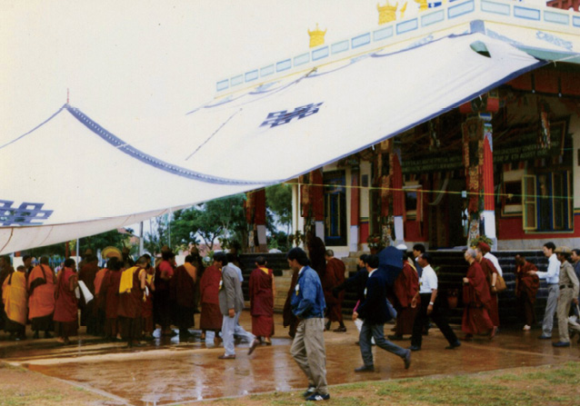

众人恭送大师离开寺院

两位大德离别的场景令人难忘。当他们在一起时，从来不会考虑个人的名利和得失，交流的内容都与众生的利益有关；当他们离别时，也是各自去利益不同的众生。“众生”永远是他们生命的根本。无论做什么、说什么，他们都把利生作为最终目标，许多方面与普通人完全不同。也许这就是他们前世的愿力吧。这些大菩萨的言行，像我这样的人很难用言语形容，即使可以表达，在这个复杂的世界中，其他人可能也不会理解。

当天，大师送了法王一件黄色法衣，这是他穿过很多年的，并给了三万卢比作为法王朝圣的路费，一万卢比作为弘法利生佛事之用。

大师还向我们交代：法王去印度、不丹等圣地时，如果从智慧中流露出对佛法、众生乃至对他个人有利的教言，请尽快立成文字转交给他。

那次见面，我的内心充满了喜悦、激动、伤感，许多复杂的心态交织在一起。从那以后，我再也没有见过大师。有时候想起来，自己还是很有福报，曾见过这位了不起的大德。

1990年8月10日

哲蚌寺、甘丹寺、色拉寺是格鲁派的三大寺。当天，几位格西和堪布代表印度的哲蚌寺、甘丹寺，专程来邀请法王前去传法。

从缘起上，法王对此非常感兴趣，这次他来到印度，也安排时间去格鲁派的色拉寺传法。但我们了解到，哲蚌寺、甘丹寺位于距亨苏尔400多公里的穆恩德戈德，法王早已跟南卓林定好了回去传法的时间，来来回回可能赶不及，所以没办法去。他们也感到特别遗憾。

1990年8月11日

离开藏地后，法王就忙于传法、灌顶、朝圣、赶路，特别疲惫。因此，当天没有任何安排，法王好好休息了一下。

1990年8月12日

班加罗尔（བྷེང་ལོར།，Bangalore）拥有举世闻名的拉鲁巴赫公园（སྐྱེད་ཚལ་དམར་པོ，Lalbagh Garden），当地人称其为“红色花园”。许多人总是向法王讲述这个花园有多好，所以，我们乘车200多公里去了那里。

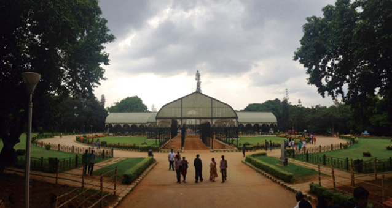

红色花园建于1760年，占地240英亩，其面积之大，我们转了一天也没有转完。

那里到处是花，五颜六色，香气扑鼻，蝴蝶和蜜蜂在花间飞舞，高大的树木直冲云霄，有些甚至有数百年的历史，这让没见过世面的我大开眼界。据说这个花园有各种各样的花草树木，是世界上最大的热带花卉基地。同时，这里也是年轻人谈情说爱的地方，是植物学家和学生研究生态植物的自然课堂。

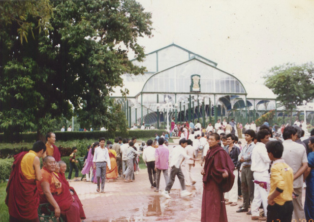

当天的天气，一会儿阳光明媚，一会儿下着小雨。法王的兴致非常不错，在欣赏各种颜色的花朵时，一直念诵经文将此美景供养三宝。他累了的话，就休息一会儿，然后继续走。

法王看到我拿着相机，主动提出在不同的地方拍照。但我的相机质量一般，效果不是很好。多亏司机和另一个小伙子带了更好的相机，留下了很多珍贵照片。

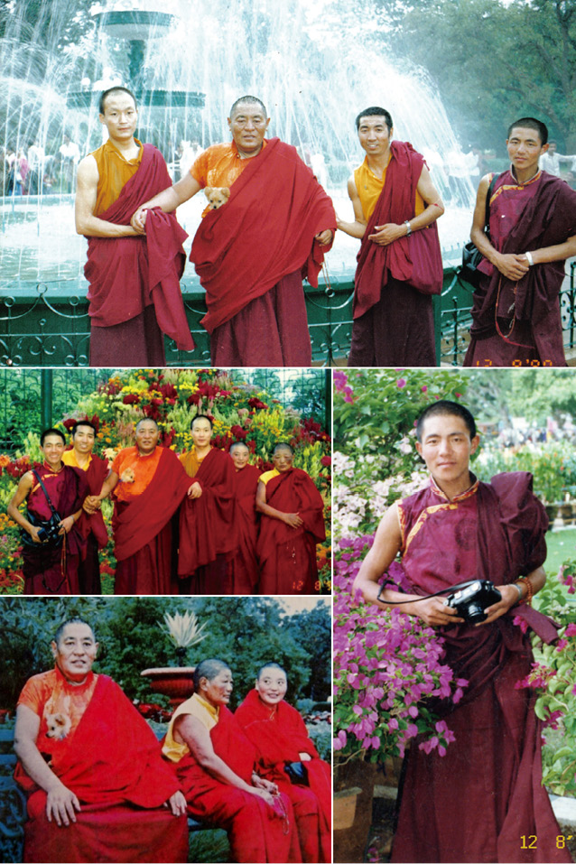

当天，我穿着两层嘎让，还有一个很厚的披单，热得大汗淋漓。但有生以来第一次看到这么多花，还是非常开心。

晚上住在班加罗尔。

1990年8月13日

当地人告诉法王，玛拉雅山的檀香林距离班加罗尔不远，出产的檀香非常有名。由于佛典中经常提到玛拉雅山的檀香林，例如智悲光尊者在《功德藏》中说：“如玛拉雅树林中，漂落普通一节木，枝叶滋润出妙香，依止上师随行彼。”再加上藏族非常重视檀木念珠，老人几乎都有一条红檀念珠。因此，当天法王特意去了卖檀香的商业街。

那条街有很多商店，主要出售檀木雕刻的印度神像和工艺品，佛像很少。逛了一会儿，我们发现藏族使用的念珠不是真正的檀木，它没有印度檀木的特殊香气。因此，法王买了一些白檀念珠，并买了两三个沉香木小茶几，但由于价格高，没有买很多。

法王还请了释迦牟尼佛、妙音天女的白檀雕像。尤其是妙音天女像，请得比较多，回到佛学院后送给好几个堪布，他们至今仍珍藏着。

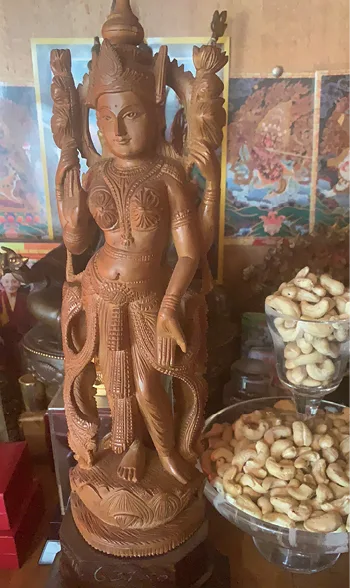

学院堪布珍藏的妙音天女像

此外，法王还请了一尊象鼻天的白檀雕像。法王说象鼻天是印度的财神，但在佛教中，他是护法神。他本来是婆罗门教的凶猛恶神，带领九千八百名大鬼军，后来皈依了佛教并护持三宝。供奉他的话，有利于成办善事、灭除灾祸。后来由于因缘巧合，这尊雕像流转到我的手中。

法王想购买一块白檀原木，带回藏地请人雕刻佛像。但是，印度政府严格控制檀木，不但砍伐檀香树是违法行为，而且禁止将檀木带出国外。因此，我们即使买到了，也无法将其带走，最后只好放弃。

1990年8月14日

法王到了印度后，许多人一直在说服他做全面体检。当天，法王就在班加罗尔的一家医院进行了体检。

检查结果出来后，医生说法王身体没有大问题。听完后我很高兴。但具体检查了哪些项目，没有什么印象了。

1990年8月15日—8月16日

乘车从班加罗尔回到南卓林佛学院。

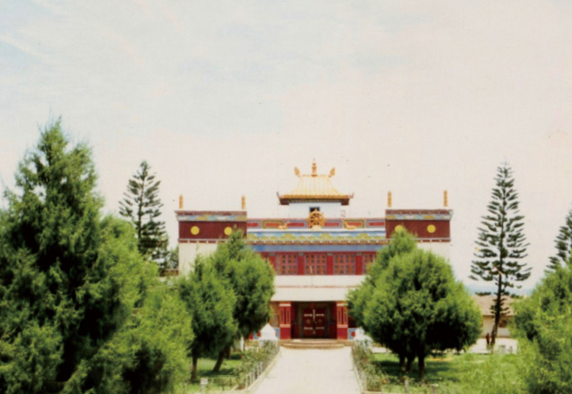

1990年8月17日

法王准备开始对贝诺法王和南卓林数千名僧众进行传法。

南卓林实际上分为佛学院和寺院两部分，他们通常彼此分开，由贝诺法王统一管理。然而，法王在那里传法时，佛学院和寺院的僧众都参加了。

在传法之前，法王应他们的祈请，传授了伏藏大师列绕朗巴“缘起除障法”的大灌顶[^8]。这个灌顶对佛法兴盛和个人修行具有特殊加持和不共缘起。因为仪轨比较复杂，我提前给法王录了音。

之后，法王又传授了“金刚橛”灌顶。在灌顶时，法王从觉性中流露出“项袋金刚橛降伏法·天铁之箭”。其完整仪轨，现收录在《法王全集》中。仪轨最后的结文部分[^9]，记录了当时的情景：

“应世自在大师、金刚称护法神再三劝请，铁马年六月二十七日，我阿旺罗珠宗美在前译极密胜乘南卓林讲修增盛佛学院大殿内的妙高狮子座上，于金刚童子坛城中，将自身观为金刚橛本尊并念诵其咒语时，从觉性界中无勤流露，南珠堪布立成文字。愿一切逆缘彻底遣除，善妙之光恒时炽燃！”

灌顶后，法王还为他们广讲了大幻化网的五条根本誓言——恭敬上师、不舍无上、不间断密咒和手印、慈愍已入正道者、对非法器保守秘密。

1990年8月18日

清晨，法王从觉性中流露出“项袋金刚橛支分酬补忏悔法·普贤云供”。该仪轨最后的结文部分是：

“第十七胜生周铁马年六月二十八日，当早晨的太阳升起时，于前译胜乘南卓林的自室内，顿然从觉性中流露，持藏堪布索达吉立成文字。愿增吉祥！”

中午，法王的觉性中又流露出“金刚橛仪轨支分补充法·珍宝镶嵌”。结文部分是这样写的：

“铁马年六月二十八日，班玛旺青杰比多吉[^10]从觉性中流露。此法包括供养颂、赞叹颂、求取悉地颂、回向颂、吉祥颂，但其文字从后往前倒序呈现[^11]，似具稀有缘起之要。愿增吉祥，善哉！”

这个仪轨也是我记录的。对于偈颂的倒序呈现，我问法王是什么原因，法王说不是特别清楚，让我们观察。但到目前为止，我也不知道是什么缘起。

后来，当它被立成文字时，法王开许按照正常顺序记录。现收录在《法王全集》中。

当天，法王开始正式为南卓林的僧众传法。

1990年8月18日—9月5日

法王传讲的第一部法，是麦彭仁波切的《七句祈祷文释·白莲花》。每天讲一节课，从下午2点开始，至少2个小时。我提前会给法王录好当天所讲的内容。

当时，我对闻思有强烈的意乐，除了听法王讲课外，还经常去僧众辩论和上课的地方，与他们一起探讨法义。

南卓林的僧众每天下午都在辩论。他们的心态非常开放，可以接受各个教派的观点并经常引用它们。那时候我们喇荣还没有辩论，通过这种方式，我学到了很多不同的法义，并进一步了解了每个教派的要点。

当时他们用的是卫藏语，只有我讲安多语，因此，对于我这个藏地来的小僧人，他们最初并不放在眼里。但年纪轻轻的我，记忆力、接受力都比较不错，经过几次辩论，我很快就能融入他们的语言，经常抛出问题，并提出自己的独特见解。他们逐渐开始对我刮目相看，态度变得越来越友好。通过辩论，我与一些堪布和活佛成为好朋友，直到现在仍保持联系，偶然还会交流法义。而且到目前为止，我仍然听得懂卫藏语。

除了白天研讨外，每天晚上，法王休息之后，我还会去找南卓林的堪布们求一些传承、听一些法。当时，我求到了明朗大师《大幻化网注释》的传承，并听受了对华智仁波切《现观总义》的广讲——虽然我在1986年听法王讲过，但一直想知道不同佛学院对五论的不同解释。因此，即使白天事情再多，晚上也尽量抽时间去听。有时候我特别困，但还是想办法坚持。可惜后来时间不够，没有听圆满。

总的来说，在南卓林的学习对我帮助很大。

1990年9月6日

在传法期间，法王突然收到了不丹国王的邀请。

当时，不丹面临外敌入侵的严重威胁。伏藏大师龙声金刚在伏藏品中授记：“未来在羊年和马年交界之际，本国会遭受危害，若能从藏地迎请一位文殊菩萨化身的圣者、大伏藏师前来，依靠他的威力可以化解所有灾难。”不丹国王跟国师顶果钦哲仁波切商议后，得知法王是文殊菩萨的化身，所以特意写了一封信迎请法王。

不丹这一站，并不是原定的行程。然而，为了使不丹众生受益，法王在与贝诺法王讨论后，决定减少南卓林的课程，抽出时间去不丹。

南卓林附近也有机场，但飞往不丹的航班，只能去新德里或加尔各答乘坐。观察之后，法王决定去加尔各答。

我听说要去不丹后，特别兴奋。尽管南卓林的僧众觉得很难请到法王，希望他能留下多传一些法，但对我来说，似乎在法王面前听课，随时都有机会，而去不丹的话，听说这个国家全民信仰大乘佛教，语言和习俗与我们藏族人非常相似，而且还保留了国王的存在……这一切都让我好奇，特别想去看看。

那时，不丹没有与许多国家建立外交关系，但是由于我们受到王室的邀请，签证很快就批下来了。

1990年9月7日

从南卓林出发，驱车238公里到达班加罗尔。晚上住那里。

1990年9月8日

下午6点，登上前往加尔各答的飞机，航程1500多公里。

在我的记忆中，当飞机飞入半空中时，太阳即将落山，晚霞非常美丽，一道金光贯穿天空。法王习惯性地看着窗外，一边看一边念着什么，偶尔看到云海的美景，也会对身边的人说“很好看”“很美啊”。

每次法王坐飞机，都会让人翻译乘机注意事项，以了解不同国家的说法是否相同。有时他会开玩笑说： “如果真在空中出现危险，懂这些也不一定能活下来。这只不过是一种心理安慰。”但是他仍然会遵循建议并系紧安全带。

法王很少在飞机上睡觉，最多只是闭一下眼。当遇到气流颠簸时，我们会感到紧张，经常盯着法王，但是法王的表情很自然，没有任何情绪波动。

当飞机下降时，法王会把他面前的东西收拾好。如果有些面包还没吃完，就让我们放进袋子里带回去。

在印度，机场没有条件安排轮椅。幸好法王当时身体不错，不需要它。后来，当我们去美国、新加坡时，由于在机场要走很长一段路，接待方会安排轮椅，法王也会同意坐。

我特别喜欢在机场为法王推轮椅。每当法王坐下后，我都会立即展开脚蹬，等法王把双脚放好了，我就绕到法王身后去推。推动轮椅时，也不需要太大力气，感觉就像在给法王开车一样，非常开心。有时候不小心推得太快了，法王还会提醒我等等后面的人。

如今，我有时在机场看到有人坐轮椅，经常会想起法王坐在轮椅上的样子，想起我推着法王到处走的样子……

1990年9月9日

在加尔各答可以看到恒河。佛经中经常提到恒河，印度的许多高僧也说它是一种智慧水，饮用可以增长智慧。因此，法王说无论如何，这次都必须看一下恒河。所以我们在加尔各答待了一天。

加尔各答在藏族人口中被称为“嘎拉嘎达”，是印度仅次于孟买和新德里的第三大城市。在殖民时期，从1772年到1911年的140年间，加尔各答是英属印度的首都，因此它也是现代印度教育、科技、文化和政治的中心，并且仍然保留了大量维多利亚式建筑。这座城市在历史上非常辉煌，但当地人说，自1947年印度独立以来，其经济状况一直不太乐观，所以当我们去的时候，整个城市看上去颇为萧条。

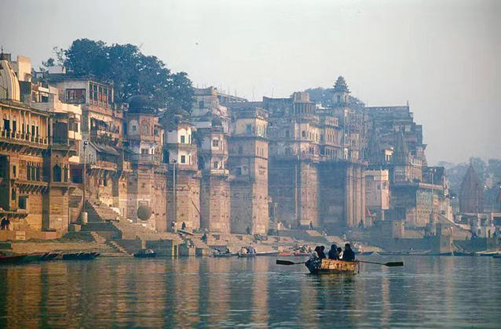

我们坐车去了恒河的岸边，看到许多人在河里沐浴，他们想以此净除罪业。法王感慨地说：“罪业不是用水洗净的。根据佛教，只有忏悔才能彻底清净它。”

我是第一次看到恒河，那种感觉不知道该如何表达。恒河虽然没有想象中那么清澈，但它的河面很宽阔，沙子又细又密，难怪佛经中经常用“恒河沙数”来形容数量之多。我站在岸上，回想过去的佛陀时代，心中不断浮现与恒河有关的教言……

恒河附近有一些专门出售右旋海螺的商店。那个时代不同于今天，这种海螺非常罕见。我们买了一些白色海螺，然后带回了佛学院。

下午，法王参观了横跨恒河的豪拉大桥（ཧ་ཨོ་ར་ཟམ་ཆེན，Howrah Bridge）。它建于1936年，全长705米，是世界上第三长的悬臂桥，也是加尔各答的地标。

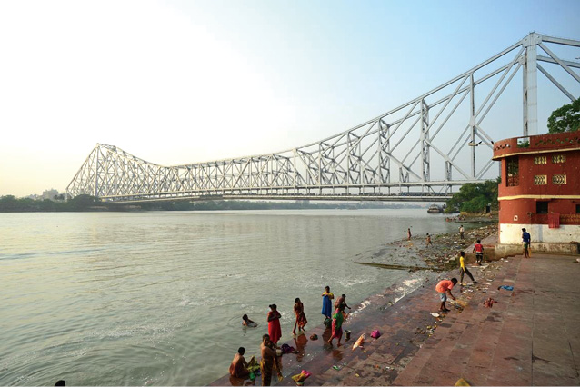

尽管法王是一位传统的藏族僧人，喜欢朝拜佛教圣地，但不同之处在于，即使是与佛教无关的建筑，他也有兴趣了解。无论去哪里，他都会询问当地的历史、宗教、文化、习俗，并了解不同众生的苦乐。跟上师在一起，我每天都学到很多东西。

[^1]: 无死长寿五本尊仪轨：此法属于第五世达赖喇嘛“净法类”中的密印长寿法。
[^2]: 法神喇嘛：许多大寺院有专职的法神喇嘛，即护法神在示现时所附身的喇嘛。
[^3]: 有些人降神后变成另一个人的声音，有些人则保留自己的声音。这次降神的情况属于后者。
[^4]: 据说热果活佛仍健在，至今已70多岁。
[^5]: 此祈祷文又名《莲师略传》。
[^6]: 贝诺法王的住世祈祷文：现收于《法王全集》中。
[^7]: 1987年法王带僧众去五台山朝圣时，德巴堪布在上善财洞的大殿，亲手造过一尊四臂文殊像，至今仍供奉在那里。
[^8]: 此灌顶分为略、中、大三种，这是其中的大灌顶。
[^9]: 所有仪轨最后的结文部分，都是法王当场所述，并非记录者随意添加。
[^10]: 班玛旺青杰比多吉：法王的另一个名字，意即莲花大自在欢喜金刚。
[^11]: 当时呈现的顺序依次是：吉祥颂、回向颂、求取悉地颂、赞叹颂、供养颂。
