# 第五站 尼泊尔

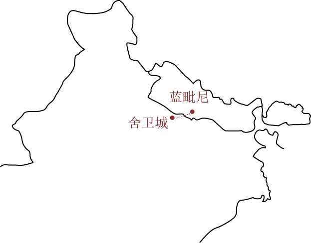

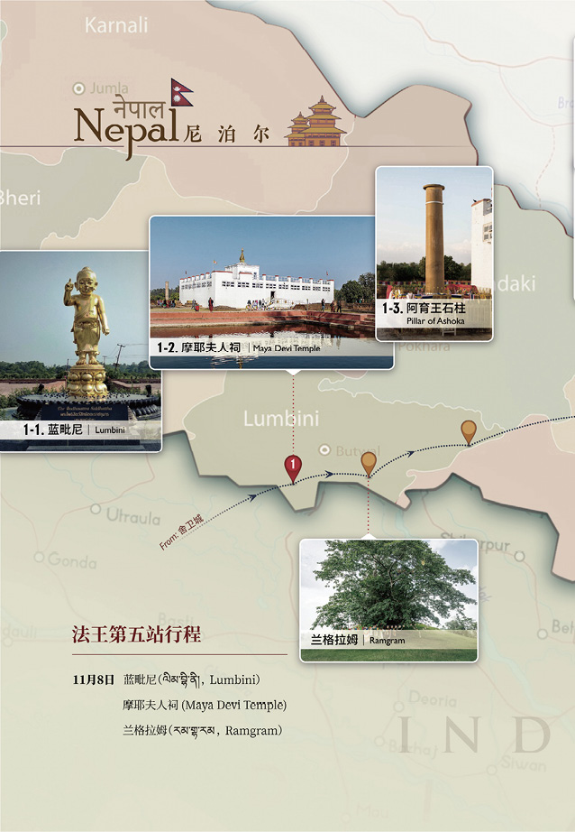

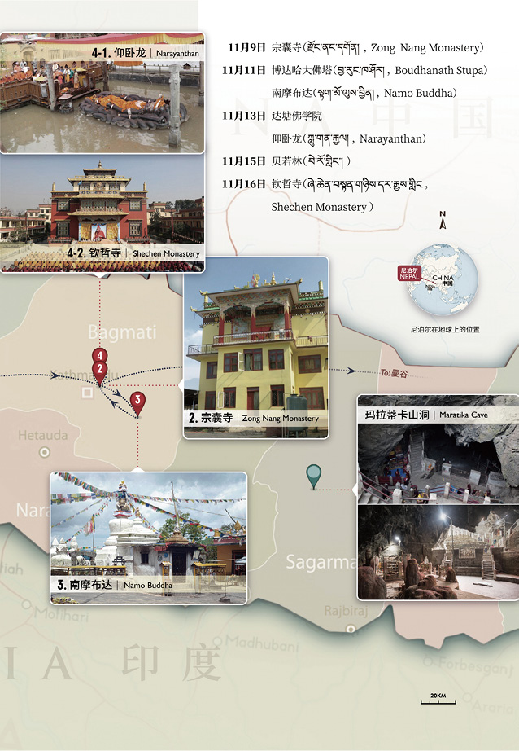

1990年11月8日

印度的所有行程已经圆满。当天要前往尼泊尔。

在印度期间，跟随法王同行的，除了我们以外，还有一些在家出家信众，他们自费和法王一起去各大圣地发愿。看到法王要离开，他们非常不舍，只能在舍卫国跟法王告别。包括秋巴堪布，敏珠林寺的人也来接他，他要代替我去传法。虽然我在印度的费用，一部分是贝诺法王出、一部分是我自己出，不欠敏珠林寺的钱，但毕竟自己承诺在先，后来又食言了，所以有点不好意思。

其实，法王一行的朝圣费用，包括吃饭、住宿、交通，是一笔很大的开支，基本上由贝诺法王提供。那时，他的条件也不太好，南卓林几千名僧人的吃住都是他一人承担，特别不容易，所以我对他非常感激。

当年去印度朝圣，不像现在这么方便，无论是买机票、住旅馆、包车都特别困难。买机票的话，必须先查好是否有票，然后打电话预订，打不通还要亲自去机场，有时候去了也买不到；坐车的话，车内闷热，没有空调，蚊子特别多，道路坑坑洼洼，而且每去一个圣地，都要边开车边打听，比较折腾；吃饭的话，也要四处找饭店。

那个年代，我们应该是国内第一批去印度朝圣的人，没有旅游攻略，也没有GPS导航，有时候虽然有人带路，但他们也经常迷路，坐了很长时间的车，结果方向错了，还要返回去……如今去印度朝圣比较容易，当地为了吸引游客，提供各种便利的交通工具和食宿条件，许多圣地也做了修复，还建有一些展示历史古迹的博物馆。我们当年去的时候，除了鹿野苑之外都没有博物馆，大部分圣地都是废墟，除了菩提伽耶有一些朝圣者，其他圣地非常荒凉，到了那里有一种沧桑感，看到昔日辉煌的佛教圣地变成那样，特别感慨。

当天，佛陀四大圣地的朝拜也接近尾声了。下一站，即最后一站，是位于尼泊尔境内的佛陀降生地——蓝毗尼（ལིམ་བྷི་ནི།，Lumbini）。

蓝毗尼位于印度和尼泊尔的交界处，原本属于印度的北方邦。1857年，印度爆发了反对英国殖民统治的活动，尼泊尔帮助英国解决了暴乱。为了表示回报，英国在划定尼泊尔和印度的边界时，把这一块地方划进了尼泊尔的版图。当时印度人也没有在意，等到了1896年，考古学家在这里发掘出了蓝毗尼遗址时，印度人悔之晚矣。从那时起，两国一直为了佛陀的发源地而争论不休。

离开舍卫城后，我们乘车很长时间才到尼泊尔海关。尼泊尔和印度之间的海关不太正规，两个国家的人来来往往，有些骑着三轮车，有些直接走过去，也没人盘问。但是，边检人员只要看到外国人，为了要钱，就会拦下来检查行李。我们带的行李比较多，所以很“幸运”地被拦住了，必须每个人交钱才能放行。实际上，他们要的钱也不多，最多两百卢比。但为了这点钱，他们啰嗦半天，刁难很久，所以，我们在那里耽搁了好几个小时。

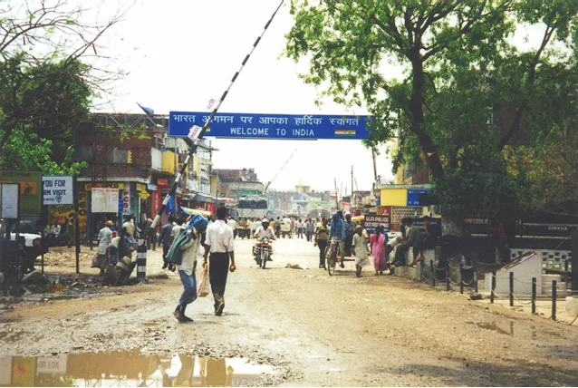

入境之后立即赶往蓝毗尼，那里虽然离得不远，但到的时候已是下午。蓝毗尼比印度的圣地还荒凉，但有一种神奇的加持力，使人自然对佛陀充满信心，那种感觉很难用语言来形容。

一进蓝毗尼，迎面就是摩耶夫人祠（Maya Devi Temple），它是一个小小的白房子，非常破旧。祠内有一黑一白两块石雕。白色浮雕上刻有摩耶夫人右手攀着无忧树，佛陀从其右胁出生；黑色浮雕已残缺不全，但仍可辨认出摩耶夫人手扶树枝的形状。

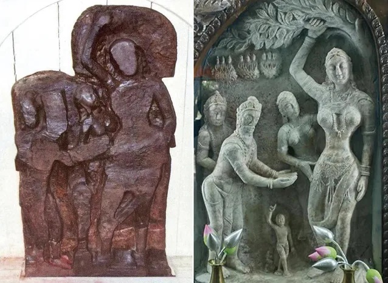

摩耶夫人祠前面有一个水池，是佛陀诞生后沐浴的地方。祠旁有一棵巨大的无忧树，佛陀就在此树下降生。站在树下，法王情不自禁地诵出“天地此界多闻室，释宫天处十方无，丈夫牛王大沙门，寻地山林遍无等”“天上天下，唯我独尊”等赞佛偈，以及关于佛陀十二相成道的祈祷文，并带我们念了《普贤行愿品》。念完之后，我偷偷拍了几张照片，不敢让法王看到。但我们离开后不久，20世纪90年代末，当地官员将树卖给了日本人，现已不知所踪，如今以菩提树替代无忧树供人礼拜。

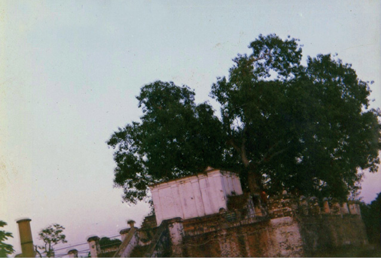

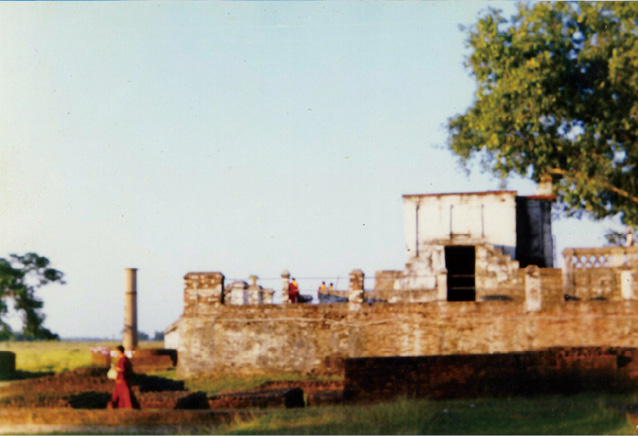

1990年的摩耶夫人祠和无忧树

蓝毗尼有一个破损的阿育王石柱，柱上刻着此为佛陀降生处的字迹，是阿育王在公元前318年所立。据说石柱曾被雷电劈掉一段，顶部的标志性雕塑——马头从此遗失。佛教在印度衰亡的几百年里，蓝毗尼便从人们的视野中消失了。直到19世纪末，西方考古学家才发现这个阿育王石柱，确认这里是蓝毗尼。

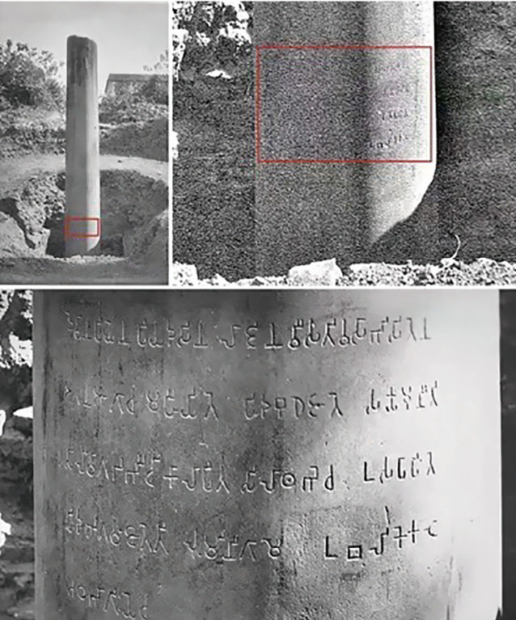

石柱上关于佛陀降生处的字迹

阿育王对佛教的贡献非常大，他不但分发佛陀舍利于各地建塔，还在每个圣地造了一个高大的石柱，让后人可以辨认出这些圣地。西方在保存历史遗迹方面也有很好的传统，他们在伟人住过的地方、重大事件发生的地方，都建有许多纪念碑、纪念馆。所以，这个时代的佛教徒也应该有这种意识，若能造一些坚固的纪念物，过多少年也不会磨灭，后人依此就可以恢复历史记忆。

当天，我们朝拜四大圣地圆满了。因为佛陀的降生地很有纪念意义，下午的光线也非常适合拍照，我很想在最后一站拍一张合影，但前两天刚被法王批评过，所以不敢提，算是留下一点遗憾吧。

在朝圣的过程中，法王除非因时间太赶，只能念一些短短的愿文，否则都会按照喇荣课诵的顺序，围绕着《普贤行愿品》，从八吉祥、发心一直念到最后。如果时间比较多，还会念《大圆满愿文》。每到一处圣地，法王都会先去最关键的地方，念诵这些来发愿祈祷，其他景点则没有特别关注。

最近，我查阅资料时发现，离蓝毗尼不远处，还有一座非常珍贵的佛塔——佛陀涅槃之后，佛舍利被分给了八位国王。一百多年后，阿育王下令挖掘由八王建造的舍利塔，将佛舍利全部合在一起，然后分至各地修新塔安置，并立阿育王石柱以记载。其中七个佛塔的舍利被挖出来了，只有蓝毗尼的这座舍利塔，是唯一没有被打开的。据说阿育王前去的途中，夜梦龙王请求他不要带走佛舍利，以便龙族可以继续守护、修行培福，后来他又在路上遇到巨蛇拦路，当地长老也请他把舍利留给佛陀的故乡，所以他就没有挖出。由于这里有龙王保护，阿育王没有在此立石柱，而是在佛陀降生的蓝毗尼立了石柱。

后来，当英国考古学家发现这座塔时，准备将佛舍利挖出带走。结果，去挖的人莫名其妙死了，而且不断有人出事，他们觉得太诡异，就不敢继续挖掘。当地人还说，他们不能在佛塔的附近种庄稼，不然经常遇到毒蛇的袭击。日本人经过勘测，发现地下确实有一座地宫。当地政府一直想开发这里，近几年也在想办法，但到目前为止，佛塔依然保留原样，佛陀留在人间的八分之一舍利完整地保存在佛塔里面。这个地方叫兰格拉姆（རམ་གྷ་རམ，Ramgram）。

尼泊尔是佛陀的故乡，其实除了蓝毗尼，还有迦毗罗卫国的王宫所在地、佛陀为父亲净饭王说法的地方等。但由于时间紧迫，法王主要朝拜了佛陀的四大圣地，这些圣地没有安排在行程中。

当天，法王的心情非常好，也许是因为朝圣圆满了，再加上不知道是什么缘起，最后一站竟然是佛陀的降生地。法王说：“如果最后朝拜的是佛陀涅槃地，可能心情不太好。这次的行程安排还是不错，虽然不是故意的，但依靠这个特殊缘起，未来可能像有些大德授记的，我的寿命会比较长。蓝毗尼是佛陀一生开始的地方，我们也在这里发愿：弘法利生的事业正式开始！”

从印度回来后，法王的事业确实发生了很大变化，包括在佛学院修建大经堂、举行三次大型极乐法会、创办佛学院四大法会、去世界各国弘法、在汉地广摄四众弟子……以前法王虽然很有修证，但并不那么出名，很多人不一定知道他的名字。从那以后，事业如日月般遍照世界，利益了无量无边众生。虽然这也是法王宿世的宏愿，但不可否认的是，一些胜妙的缘起有不可思议的作用。

1990年11月9日

我们早上离开蓝毗尼，前往加德满都。起初，道路比较平坦。行车30多公里后，据说就是兰格拉姆，即阿育王没有开取的舍利塔所在地。

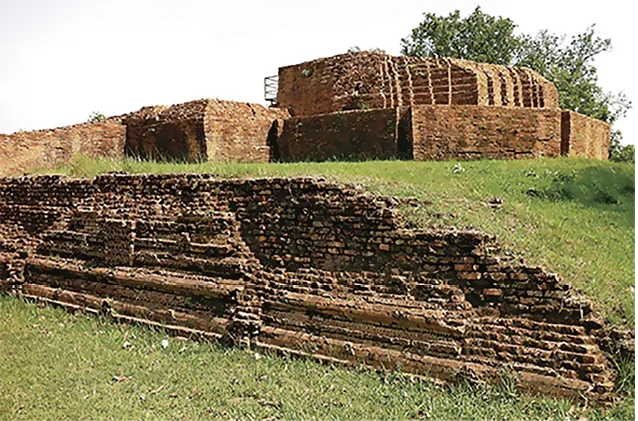

100多公里后，路过奇特旺国家公园（ཅི་ཏུ་ཝན་གཅན་གཟན་ཁང་།，Chitwan National Park），它在当地比较有名，西方人喜欢去那里骑大象游览。

过了动物园之后，路特别难走，沿着长长的河流，是一条非常狭窄的山路。这条路上经常有堵车，而且一堵就是几个小时。幸运的是，当天我们没有遇到这样的路况。

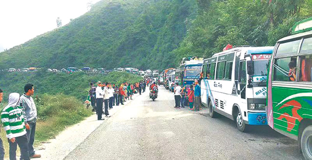

现在的堵车状况

中午，我们在路边看到很多小餐馆，就找了一家吃午餐，点了当地的咖喱饭。

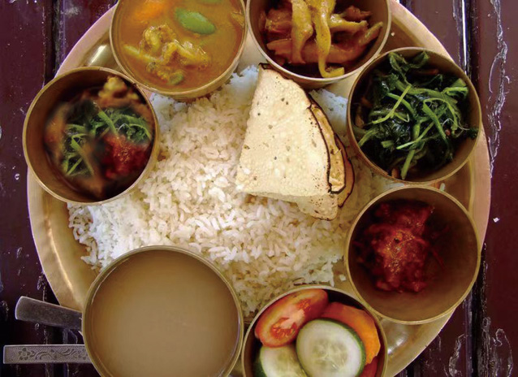

用餐后，我们继续赶路。经过9个多小时，很晚才到达加德满都的宗囊寺。每个人都觉得很累。

1990年11月10日

在宗囊寺休息一天。

1990年11月11日

上午，法王请到了一尊非常特别的文殊菩萨像。这个过程在法王著作中是这样描述的：

“我一直精进地持诵文殊赞偈颂：‘文殊金刚尊，真诚而祈祷，加持胜智慧，遍满我相续。’刚圆满30万遍的那一天，从附近博达哈大佛塔的塔顶射出一道光，一直照到我的房间。我立即起身，前往佛塔那里去转绕。

在转绕时，一位藏族人对我说：‘仁波切，如果您想请一尊好的佛像，可以去那边的佛具店。’

于是我走进一家佛具店，柜台上摆放着一尊立式的文殊菩萨像，手持八大菩萨的标志。当我见到他时，他冲着我微笑，我怀疑是不是眼花了，使劲揉揉眼睛再看。结果，文殊菩萨像心间放射出耀眼的光芒，融入我的心间，我当下安住于无分别的境界中。

之后，我诵出一首道歌：

恒住圣地五台山，八菩萨等万佛子，

智慧总集于一身，顶礼文殊金刚尊。

为初业障所迫我，蒙您善巧大悲护，

此铸像赐大安慰，深恩厚德谁能量。

为令父您生欢喜，乃至虚空世界尽，

我持如海佛子行，报答无碍大恩德。

接着，我一直念诵文殊赞偈颂。后来依靠弟子们和许多藏族人的努力，把这尊菩萨像请了下来。

之后，我坐车去朝拜释迦牟尼佛因地时舍身喂虎的佛塔。一到那里，我阿旺罗珠宗美便将此经历口述出来，由堪布索达吉立成文字。第十七胜生周铁马年九月二十四日（公历1990年11月11日）。”

这段经历非常奇妙，对我来说，至今仍然历历在目——

那天上午，法王突然提出要去转绕佛塔。匆匆去了以后，本来没安排时间逛佛具店，但法王信步就走了进去，整个过程让我有点措手不及。

到了那里，法王长时间盯着一尊一尺高的文殊菩萨像，然后用手擦擦眼睛又继续凝视。我们非常困惑，不解地看着上师。上师很高兴地说：“这尊像有特殊缘起，一定要将它请下来。”店里的女老板一开始说什么也不肯出售。我们费了好一番口舌，出了很高的价钱，才最终说服了她。法王一直坐在外面等着，后来我们出去说“文殊像已请到了”，法王显得很高兴。

那时，我并不清楚这是怎么回事，只是觉得幸不辱命，自己也很开心。由于在佛具店耽搁了一些时间，我们赶紧坐上车赶路，前往南摩布达（སྟག་མོ་ལུས་བྱིན།， Namo Buddha）。

南摩布达是释迦牟尼佛因地时舍身饲虎的圣地。《贤愚经》中记载：世尊往昔转生为一个小王子时，曾在此地将身体布施给一只饥饿的母虎。他的哥哥得知后悲痛不已，于是把他的残骸收集起来，建造了一座施身塔。

南摩布达的山顶，就是佛陀舍身饲虎之处，现有纪念佛陀的浮雕、塑像等。山下是古老的施身塔，塔前有一间供灯的小屋。

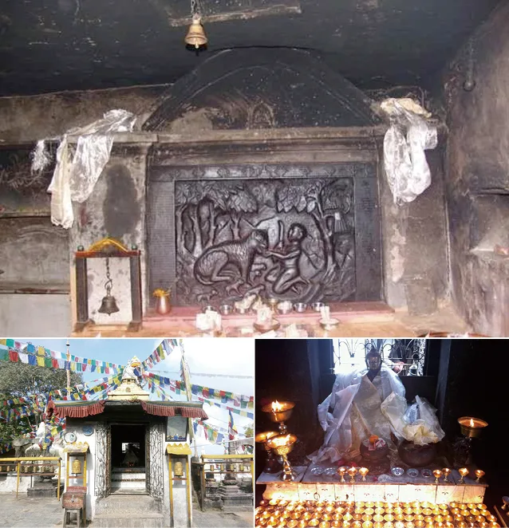

通往施身塔的山路崎岖不平，幸好我们的吉普车底盘高，才能一路翻山越岭，很费劲地“爬”上那里。刚到施身塔，还没有发愿，法王就把我叫过去，记录了文殊像的来历，也就是上述那段文字。这时，我才意识到这尊文殊像如此殊胜。

法王告诉大家：“这尊文殊像非常重要，可称之为说话文殊或法轮文殊。来，我给大家做加持！”然后一边念文殊赞偈颂，一边把文殊像放在我们头上加持——从那以后，我更加珍视这尊文殊像了，坐飞机都不敢托运，过海关时，行李再多也要背在身上。回到佛学院后，他一直陪伴在法王身旁。

在施身塔前，法王讲起佛陀行菩萨道时舍身喂虎的感人事迹，泪流满面，哭了很长时间。他说：“本师释迦牟尼佛为了利益我们浊世众生，因地时无数次布施自己的身体。作为修学大乘道的我们，也应该追随佛的足迹，修持六度万行。特别是，首先要慷慨解囊、广发布施……”

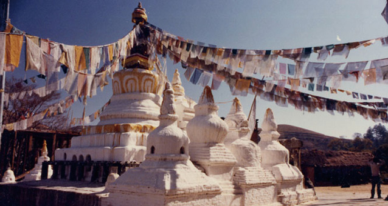

当时我也一直在流泪，心里默默发愿：“虽然跟佛陀相比，我的慈悲心差得很远，但作为佛陀的追随者，愿我未来在生生世世中，也能将自己的身体、受用、一切善根，无有吝啬地布施给众生！”

之后，法王带现场所有人共诵《普贤行愿品》发愿，并念了《释尊仪轨》传承。当念到“顶礼、供养、皈依本师、出有坏、善逝、应供、真实圆满正等觉释迦牟尼佛”时，他老人家反复念诵了很长时间。

1990年11月12日

当天，法王没有外出，一直待在自己的屋里。趁着这个机会，我向法王请教了一个问题：“1988年您在藏地传授密法时，从觉性中流露出一个偈颂：‘一旦空中雷声响，地上孔雀起舞时，愿您作传喜讯雨，令叶繁茂结硕果。’它似乎带有授记的隐意，能否请您明确地解说一下？”

法王告诉我：“当年这个偈颂出现时，我也不知道具体会应在什么事情上。但实际上，它是对未来的一种授记，后来成为我与班禅大师、世自在大师会晤的缘起。”法王详细讲述了一些内容，由我来做笔录，现收录在《法王全集》中。其中，最后一段是这样的：

“关于此偈第四句的意思，具慧者若通过正在发生和将要发生的事情详细观察，可以大致了知，暂不详加解说。

此授记偈所宣说的，尽管还有四种比喻、四种意义的许多同法，但它们很容易理解，因此这里不再赘述。

离戏光明大圆满，以心安住之后得，

觉空广界镜中现，三世所知诸影像。[^1]

于尼泊尔大塔附近、宗囊活佛与贝诺法王创建的宗囊寺之楼上自屋内，经堪布索达吉劝请后，阿旺罗珠宗美叙述，由堪布本人笔录，以此愿弘法利生具广大义。第十七胜生周铁马年九月二十五日。”

我常常会随身带着纸笔，所以当法王娓娓道来时，很快就能将其记录下来，并能跟得上他的语速。法王用词非常准确，中间不会有什么改动。当我写下这些内容时，感觉法王的表述除了浅显的字面意思外，还有更甚深的密意可以进一步挖掘。这也是圣者与普通人不同的地方。

在速记时，我通常写的是草书，记完以后，晚上再用正楷字仔仔细细地抄一份。那时候没有电脑打字，只能一个字一个字写。然后再出去复印几份，先给法王一份，再给随从人员每人一份。有时候找一个可以复印的地方并不容易。如果是马上要念的修法，又找不到地方复印，我会拼命抄写几份给相关人员。

1990年11月13日

距离宗囊寺4公里，有一个达塘佛学院，法王被邀请到那里灌顶、传法。这个佛学院虽然没有固定的寺庙，只是租借了一个场地，但他们系统闻思显密教理，在当时的尼泊尔很有名。那里的堪布对弘法、闻思非常重视，私下也与我探讨了一些法义。但后来听说由于种种原因，这个佛学院解散了，如今已经没有了。

下午，去附近参观了仰卧龙（ཀླུ་གན་རྐྱལ།，Narayanthan）的庙宇。往昔尼泊尔是一个大湖时，里面的龙王就是仰卧龙。所以，仰卧龙是尼泊尔的地神，凡是到尼泊尔的人，通常会去朝拜。据说他特别灵验，供奉他可以逢凶化吉、消灾解难，这方面有许多传奇故事。仰卧龙的形象是大自在天，但头顶上是阿弥陀佛。此像被印度教管理后，他们不想让人看到阿弥陀佛，就用花鬘将其盖住了。

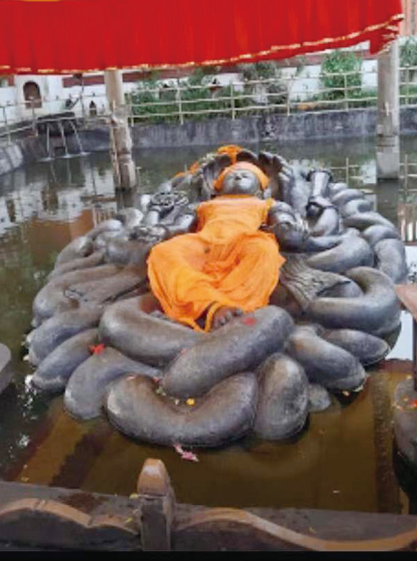

1990年11月14日

在尼泊尔的朝圣计划中，原本有一站是去玛拉蒂卡山洞（མཱ་ར་ཏི་ཀའི་ཀེའུ་ཚང་།，Maratika Cave）。据《藏密佛教史》记载，莲师在此山洞修行了三个月的长寿法，感得无量寿佛亲自降临并赐予灌顶，由此证得了长寿持明果位，成就了无生无死的金刚身。

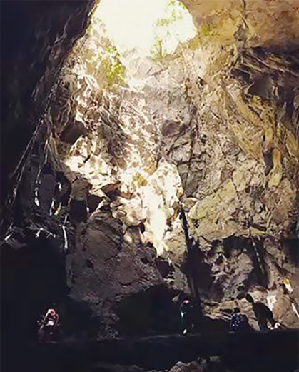

玛拉蒂卡山洞

法王本来想去朝拜，但那里只有直升机才能抵达，当时天气一直不好，无法达到起飞的条件。所以，为了等天空放晴，我们在尼泊尔多待了几天，并尝试了各种方法，后来签证快到期了还是不行，我们只能取消了这个行程。其实如果法王能去那个山洞，住世时间可能会更长一些，许多大德也建议法王去那里，但遗憾的是，这个因缘没有成熟。

为了再次促成这个因缘，从1990年到1995年，我们一直努力，没有放弃。1995年，法王被批准再次出国，原计划是下半年去尼泊尔，慈诚罗珠堪布、索顿喇嘛和我一起陪同。但当我们到达成都时，手续突然又办不下来了，百般努力也没办法，最后还是没有去成。

过了不久，法王就开始生病，显现上病得非常严重，从秋天到第二年春天，在成都治疗了五个多月。我们很担心因为去不了长寿洞，法王会不会示现圆寂。还好后来度过了那场危机，法王由此写下了《胜利道歌》。

从那次以后，直到圆寂，法王再也没有出成国。

一般来说，普通人不能出国，不能朝拜某个圣地，不算什么太大的遗憾。然而，作为持教大德，一些行程与众生的慧命息息相关，如果没有如期成办，还是特别可惜。

其实，我们两次都非常努力，很希望就算不批准法王出国弘法，只要能去一下那个山洞也可以。但或许是众生的福报不够吧，最后还是没有成功，这也是我们弟子最大的遗憾！

1990年11月15日

离我们住处不远的地方，有一个道场叫贝若林（བེེ་རོ་གླིང་།），是色达的贝若活佛建造的，他和法王是老乡。当天，贝若活佛邀请法王到他的道场，为僧俗弟子做加持，并传授了佛法。

中午，法王和我们随行人员在贝若活佛的精舍里用餐。他用藏地食物来招待法王，包括糌粑、人参果、酥油、酸奶。这些可能是他托人从藏地买来的，味道很正宗。由于我们一直在印度吃咖喱和米饭，突然尝到了熟悉的食物，还是非常高兴。法王也显得很欢喜，跟大家聊了世间、出世间的一些话题。

其实，我在国外时，适应能力还是比较强，只要有时间，经常会去小餐馆吃点当地的食物。起初我还担心钱不够，但印度、尼泊尔的物价不高，还是没问题。当时的我，每去一个国家，就有强烈的好奇心，对各种食物、水果都想尝尝，而且还喜欢与当地人交往，经常学一些方言进行交流。这些行为现在看来很幼稚，但年轻时的气脉，可能比较喜欢散乱吧。

下午，在博达哈大佛塔附近，法王为许多当地的出家人和在家人做了一个大型的“金刚橛”灌顶。

1990年11月16日

顶果钦哲仁波切在尼泊尔有一座寺院，名为钦哲寺（Shechen Monastery），仁波切吩咐该寺僧众邀请法王莅临他的寺院。上午，法王来到这里，在大殿里为所有僧人传授了“护法格萨尔王”“文殊大圆满”灌顶。

下午回来后，法王对我们随行人员说：“尼泊尔是佛像的故乡，我想在这里请一些佛像。我需要一尊大威德像，堪布索达吉去帮我请；阿里美珠需要一尊莲师像，索顿喇嘛去请；门措需要一尊文殊菩萨像，热巴医生去请。”于是我们三人分头行动，去不同的地方请佛像。

在尼泊尔，释迦牟尼佛像、莲师像、度母像、文殊像比较常见，而大威德像非常难找，据说几天都找不到合适的。所以，我带了一个懂尼泊尔语的人，直接去制作各种佛像的工厂里找。稀有的是，当我一进去，就发现了一尊很大的大威德像。谈妥价钱后带回来，法王非常高兴，说这个缘起很好。

那时候，无论我到哪里，都想着法王长久住世该多好，很希望创造一些善妙的缘起。在尼泊尔期间，听说萨迦法王也住在当地，我偷偷去问他法王有没有寿障，需要念些什么经。萨迦法王告诉我，法王的寿命没有大的障碍，需要多念《十六罗汉礼赞文》和一些其他经文。我仔细地记录下来，回佛学院后做了安排。

在印度的南卓林时，我也做过同样的事情。当时听说有一位老喇嘛是非常有名的圆光师，就私下去问他法王有没有寿障。他住在一个昏暗的小房子里，屋内只有一束光透过窗户照进来。他对着光线观察圆镜，说镜中显现出一棵参天妙树，枝繁叶茂，树上有许多鸟。他没有观察到不吉祥的征兆，说法王的事业应该非常广大，但要求念《十六罗汉礼赞文》越多越好。我回到藏地后，印了大量的《十六罗汉礼赞文》，请佛学院和其他寺院的僧众念了很多。

当时因为我比较年轻，经常为上师到处打卦、念经，问这个问那个。现在看来，这种行为不一定可取。作为有智慧的弟子，应该比较稳重。如果弟子之间非常和合，闻思修行特别精进，让上师不生起厌离心，这才是让具德上师长久住世的最好方法。

1990年11月17日

找到法王需要的佛像之后，我也请了几尊自己有信心的佛像：

我本身很喜欢文殊菩萨。从五台山回来后，就一直祈祷文殊菩萨，再加上当时正在闻思，想要开启智慧，所以就想请一尊文殊像。在许多佛具店找了很久之后，我看到一尊镶有白银的文殊像，非常非常庄严。请回来后，我展示给一位老喇嘛看，他赞叹不已，说如果是在古代藏地，这尊文殊像值一匹马的价钱。但后来被小偷偷走了。

此外，我还在拼命找无垢光尊者像。我对无垢光尊者非常有信心，每次逛佛具店时，都想找一个可以随身携带的小像，最好是持心性休息手印的。但去了所有店铺，根本找不到。直到第二天要离开尼泊尔了，我还是有点不死心，又出去逛了一下，仍然找不到。当我满怀失望准备回去时，突然在一家很小的佛具店里看到了一尊，完全是我心目中的样子。我高兴坏了，觉得这一定是无垢光尊者的加持，把它视如伏藏品一样。这尊像有很大的加持力，后来我还用它作为模型，制作了一批尺寸相同的小像，并发给不同的人，作为传承加持的缘起。

2000年，我发愿翻译《上师心滴》，法王当着全体僧众的面特别开许、郑重交付，也赐予了一尊无垢光尊者像。这尊像至今我一直保存着，在传讲一些重要的密法时，会给部分有缘者展示，并讲述祈祷传承上师的重要性。

无垢光尊者的《三解脱》《三休息》《七宝藏》《上师心滴》，三十多年来我一直在翻译并传授，在这个过程中，始终感觉到一股强大的力量在背后支撑着。自无垢光尊者的色身融入法界，客观说，用其他语系传播尊者智慧的，我们可能算数一数二。这是源于对无垢光尊者的不共信心，同时也是一种特殊的缘起。

[^1]: 此偈的意思是，安住在大圆满的境界中，以此入定的后得智慧，过去、现在、未来发生的事情，就像在镜子里一样可以显现出来。这应该是法王描述自己的智慧。
