# 第六站 归来

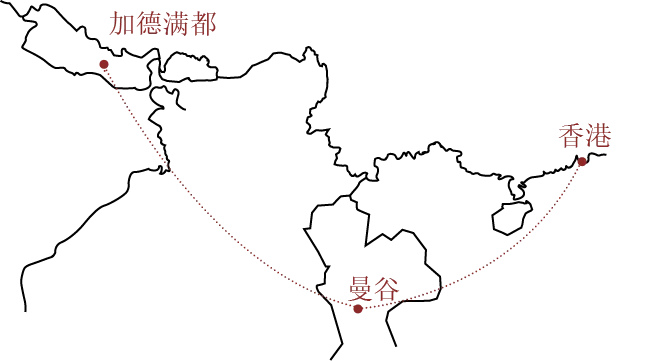

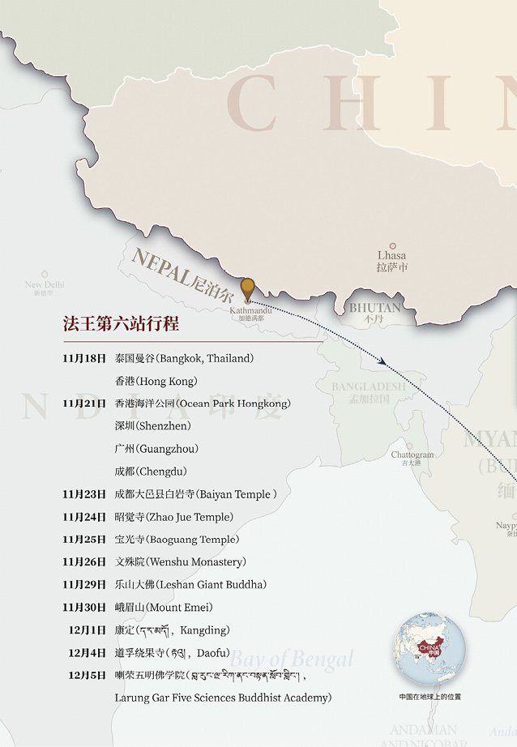

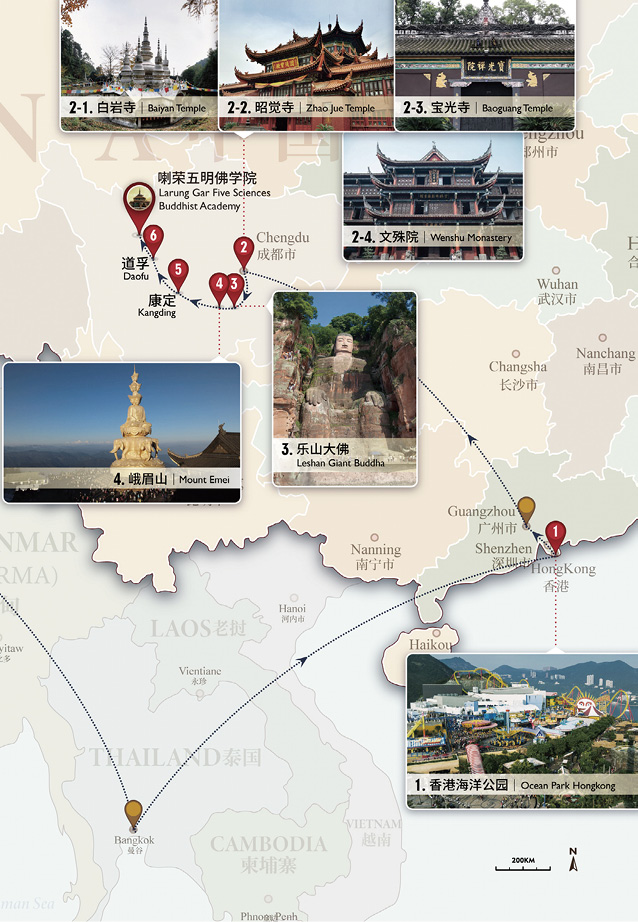

1990年11月18日

尼泊尔、印度、不丹之行已经圆满。当天，我们从加德满都国际机场出发，飞抵泰国的曼谷机场。之后又花了半个小时转机，最终飞往香港国际机场。整个航程是六七个小时。

由于法王在印度和尼泊尔请了很多佛像，有些是自己的，有些是送给佛学院堪布们的礼物，坐飞机带不了太多，所以需要找人提前帮忙。后来，正好贝诺法王前往香港举办法会，坛城用品将通过航空托运，因此，我们就请他的随从将一些佛像、唐卡、檀木直接运到香港。其余的由我们自己携带。

我们有很多行李。每个人都请了一些佛像。我还帮几位堪布在印度请了几个大海螺，特别重。为了减少行李并帮助法王多拿一些东西，我把自己在尼泊尔请的很多佛像都送人了，只留下一尊小小的无垢光尊者像，以及那尊镶银的文殊菩萨像。因为尼泊尔不允许磁带出境，为了保存法王的讲课资料，我把磁带的黑色胶片取出来，将其缝在每个人的裙子里。

热巴医生喜欢印度布的僧衣，一口气买了好几件。为了减少托运的重量，他把所有衣服全套在了身上，一层一层的披单、一层一层的裙子，看起来特别滑稽。法王打趣他道：“你今天也太胖了吧。”我们都笑得前俯后仰。

在尼泊尔过海关时，边检人员又找理由刁难。我们塞了一些钱，好不容易过去了。

抵达香港后，过海关也比较麻烦。当时香港还没有回归，我们是大陆护照，入境需要办理一系列手续，排队、填表、盖章都很费劲。用了四个小时才办好一切，然后乘车到达贝诺法王在香港的中心——香港密宗宁玛派白玉佛教中心。

该中心位于九龙柯士甸路，不是太大。大殿不到100平米，用于日常开法会、做会供等。此外还有一两间工作室，以及一间贝诺法王的房间。贝诺法王没有在中心住，法王就住他的房间，随行人员在大殿里打地铺。

1990年11月19日

我们把法王这次取的伏藏、唱的道歌，编辑成了一本薄薄的册子。听说香港的拍照技术特别好，顺便请法王在香港拍一张照片，加上那个册子，算是回佛学院后给僧众的礼物，法王也同意了。

我们去了香港比较著名的照相馆，并带上了白玉中心的法座。法王戴着在印度南卓林得到的莲花帽，安住于一种特殊的等持中，加持见闻、接触这张照片的人得到利益。照相馆的要求非常高，反反复复拍了很多次，最终效果令人满意。拍完照片后，我们仔细收好胶卷，到成都后冲洗了很多张。

在我的记忆中，法王有几张照片是特意安住在一种境界中拍的：

第一张是1984年法王在佛学院传授“四心滴”灌顶时，有人要给法王拍照，法王叮嘱他先别拍，自己要在大圆满中安住一会儿，这样拍出来的照片会有特殊的加持力，并希望将来得到它的人能发愿放生。那时，我还没有来佛学院。正是因为这张照片，我第一次认识了法王。

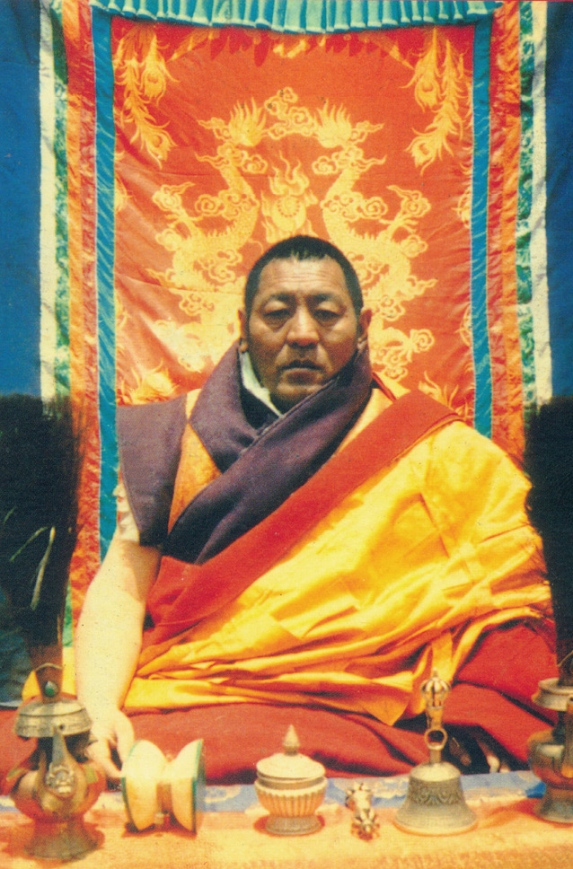

第二张是1987年在五台山的那罗延窟，法王开取伏藏“文殊大圆满”时拍的。

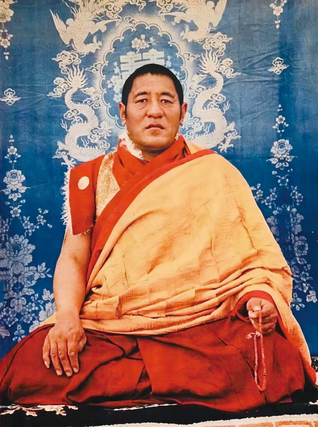

第三张是这次在香港拍的。

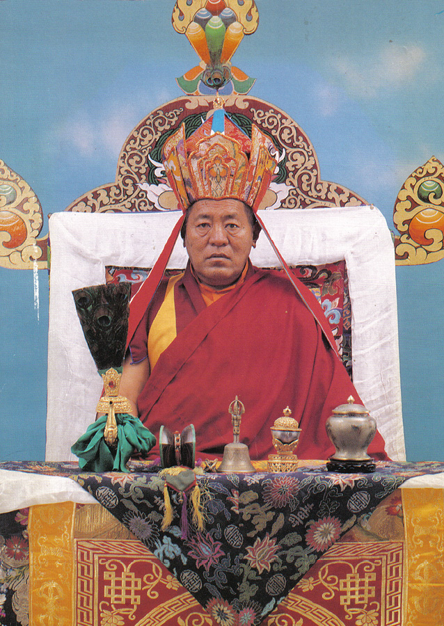

第四张是1993年法王去西方弘法时，在加拿大拍的。

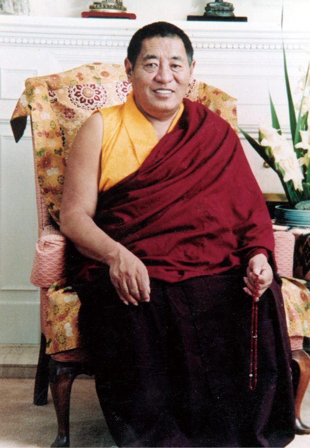

后来，在成都、佛学院也拍过一些。但早年这几张是我印象最深刻的。

法王每次拍这样有特殊加持的照片，都有放生的要求，有时候还会在照片的背面按上手印。我刚来佛学院时，若要得到有法王手印的照片，并没有规定放生数量。但后来要照片的人越来越多，只能规定每个手印要放一万个众生。依靠这种善巧方便，藏地和汉地的许多人纷纷放生，从而拯救了无数生命。单单是这个功德，普通人几生几世也难以完成。

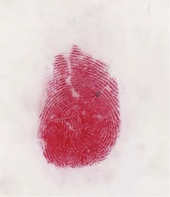

如今，按有法王手印的照片，仍保留在许多信徒的手中。对有信心的人来说，这是一份无上至宝。且不说法王本人示现的神奇事迹，单单是依靠这些照片，也发生过许多稀有、奇妙的故事。

1990年11月20日

当时，贝诺法王也在香港。他每天都来到白玉中心，和法王一起用餐，由不同的施主轮流供斋。白玉中心的住持经常在早上向法王报告：“今天，某某小姐请客。”那时，我对世间了解不多，以为“小姐”很年轻，结果到了下午，见到的是一位白发苍苍的老太太。

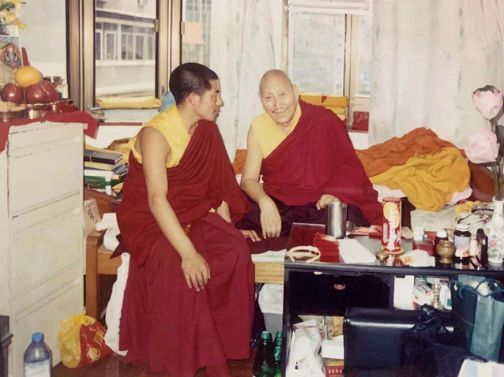

和香港白玉中心的住持在一起

在这几天里，法王参加了该中心的“三根本”会供法会，并为香港的佛教徒灌了顶，做了简单的佛法开示。我在印度时没办法翻译，到了香港，就可以给法王当中文翻译。但是，当时香港的语言与现在不太一样，我的语言他们听不懂，只好又找了一个懂香港话的人再次翻译。

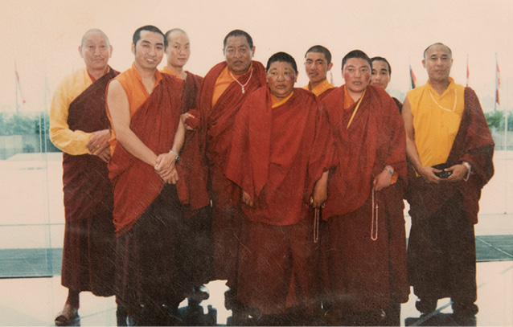

在香港逗留期间，我看到每一次贝诺法王外出弘法，都会将所有供养汇给他在印度的道场以维持僧众的生活，非常有感触。印度的道场与藏地不同：藏地僧人的生活是家人供养，道场也受到信众的护持；在印度，当地人几乎不信佛教，信仰佛教的藏族人也条件不太好，因此，很少有人供养道场。上师们维护一个道场并不容易，所有费用必须自己想办法。许多高僧大德都很辛苦，他们经常去欧美、东南亚等国家传法，获得一点钱后，再用来修建寺院、塑造佛像、培养僧才，包括支付水电费。

当时，贝诺法王在香港、台湾和新加坡设立了佛教中心，所有的供养都用来维护道场，自己的生活很简单。他道场中的僧人主要来自藏地和不丹，没有生活来源，甚至僧人的衣服也都由上师来发。有时我跟他们开玩笑说：“藏地是弟子供养上师。而你们这边，是上师供养弟子。”不过，这些僧人在学习上非常精进，无论是辩论、造论，还是相当不错。由于经历过磨难，许多人特别珍惜这样的机会。

在那个特殊的时代，贝诺法王为弘扬宁玛派教法做出了巨大贡献。特别是在培养僧才方面，贝诺法王、法王如意宝确实与众不同，对延续佛教的慧命功不可没。

当看到这些上师的发心，我深受感动，并发愿，将来无论遇到什么困难，都会随学他们的伟大行为。后来，在过去的30多年里，为了培养汉族僧才，我在传讲佛法、翻译法本、修建经堂、安排住宿、凑集生活费等方面，默默花了一些精力和心思，可以说是尽心尽力。即使在今天，法王已离世16年了，我仍然坚守在这个岗位上。我希望将来很多人也能延续传承上师的传统，继续培养僧才、传递佛法、利益众生。

1990年11月21日

因为是第一次来香港，很多人说应该去海洋公园看看，所以我们安排了时间去那里。

当法王和我们第一次看到海底世界时，深深感到众生的业力不可思议。法王说：“由于前世造了什么样的业，这些众生转生为这样的身体，真是很可怜。”当导游在每一站介绍动物时，法王会默默为它们念经加持，有时还会大声持诵释迦牟尼佛的圣号。

之后，有人推荐我们坐过山车。其实，法王血压很高，按理说不能坐，但那些人也没有制止。法王和我坐在同一个车里，往上的时候比较舒服，突然下冲时，我感觉心脏都要跳出来了。法王下来之后，显现上不停地呕吐、头痛。

然后，我们坐车去深圳海关办理入境手续，花了三个多小时。通过海关后，我们发现法王买的沉香小茶几少了一个。我回去找了很久，结果在边检人员办公室找到了它——他们组装了小茶几，将它放在自己屋里，上面还摆着一些水果。我和他们交涉了半天，好不容易才要回来。

在这次折腾之后，我最喜爱的念珠掉在那里了。念珠是木质的，有一颗珊瑚隔珠，我用了好几年，法王也加持过很多次，自我出国以来，就一直用它念文殊心咒，还在扬列雪念了10万遍金刚橛心咒。虽然茶几找回来了，但念珠丢了，回来后我伤心了半天。尽管也可能是前世欠他们的，今生必须给点东西来偿还，但茶几他们应该用得上，念珠肯定用不上。

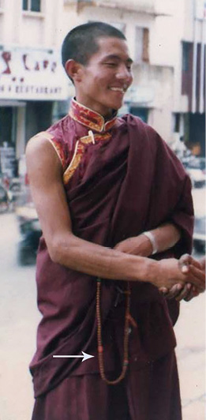

遗失的那串念珠

然后，我们赶到广州机场，飞机晚点两三个小时。当法王在候机时，因为坐过山车一直头痛，非常难受，所以到外面呼吸新鲜空气。当时正在下雨，我给法王打伞，法王拒绝了，说这样淋着很舒服。我想为法王买一碗面条，没想到平时1元的面条，机场居然卖15元，我们吓坏了，第一次感受到机场的东西很贵。但还是买了，法王勉强吃了几口。

法王长时间坐在雨里。因为刚从印度那么热的地方回来，穿得很薄，我们担心法王着凉，又买了一条毛毯。法王披着毛毯，一直坐在大雨中……这个场景至今记忆犹新，我每次去广州机场都会想起。

飞机很晚才起飞，晚上12点多到达成都，飞行了2个多小时。

之前我在香港时，给色达县的人发了第二封电报，请他们转告佛学院：法王要回来了。听到这个消息后，许多弟子下山前往成都迎接。因为通讯不发达，他们只知道法王返回的大致时间段，但不知道具体的日期，所以在成都等了好几天。

得知法王当天会到达，他们激动不已。那时，成都的机场比较破，很多地方都不规范，有些弟子通过找关系，前往下飞机的地方接法王。另一部分弟子求机场人员放他们进去，被拒绝后，他们看到旁边是铁丝网围栏，就硬闯了进去，机场人员也没拦住。结果，法王一下飞机，看到下面全部是弟子，每个人都捧着哈达，含泪等在那里。为了平复大家的情绪，法王看到他们之后的第一个动作，就是将怀里的小狗拿出来，笑着问道：“这是我在印度得到的，它叫布廓，可不可爱？”

在广州机场，我们的一些行李被扣，因为超重。到达成都后，我正在想办法时，遇到了一位商人，他问我是否需要帮助。我谈到了这个情况，他连夜飞到广州，把东西带回来了。我记得，他夹着一个黑色的包，手里拿着一个“大哥大”。这是我第一次看到“大哥大”。

1990年11月22日

在成都休息一天。

法王外出时，每到一站，都会给随行人员开个小型会议，以交代相关事宜。当天的会议，算是一次总结性会议。

法王告诉所有人：“这次前往尼泊尔、印度、不丹的朝圣，非常顺利圆满。在回到佛学院之前，我打算在成都附近转一转。几年前我去五台山时，也顺路去了成都附近的有些圣地，但是南珠堪布、吾智喇嘛没有去过。这次出国他们非常辛苦，再加上汉地有些寺院一直邀请我去传法，所以这几天我有一点时间，想再去朝拜周围的寺院、圣地。这样的话，朝圣就更加圆满了。”

因此，我们安排了一个新的朝圣之旅。

1990年11月23日

在80多岁惟印老和尚的邀请下，法王去了他的寺院——成都大邑县白岩寺。

惟印老和尚是诺那活佛、贡嘎上师的弟子，后于101岁圆寂。白岩寺是一个修学藏传佛教的寺院，历史悠久，据说是东汉时期印度高僧迦叶摩腾、竺法兰所建。这个寺院位于一座山上，没有通公路，所以法王去的时候，需要用人力轿抬上去。

到达白岩寺后，法王给寺内僧众和随行人员传授了“文殊大圆满”灌顶，并为当地人做了佛法开示。之后，惟印老和尚把该寺供养法王作为弘法道场。

去白岩寺传法，因为交通不便，需要坐车、换车，还要爬山，来回折腾花了一天时间，法王显得也比较累。但只要能让众生从佛法中受益，这些辛苦对法王来说再正常不过了。

1990年11月24日

应88岁清定上师的邀请，法王去了昭觉寺。昭觉寺是藏传佛教寺院，清定上师在汉地非常有名望，也是法王的好朋友和好弟子，他经常介绍自己的弟子去依止法王。

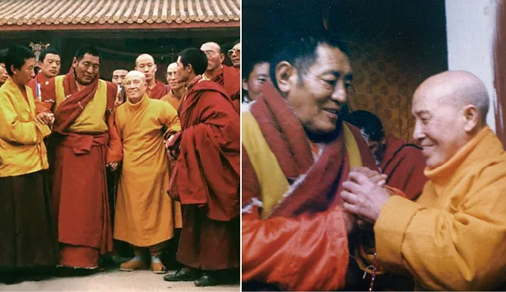

法王与清定上师

法王与清定上师进行了简短的佛法交流。之后，朝拜了寺庙里的佛像，并给僧人们一一摸顶加持。

当天闻名而来的信众特别多，法王用佛法与他们结上了善缘。

1990年11月25日

法王去了宝光寺，朝拜了寺内的佛塔、五百罗汉像。

1990年11月26日

上午，法王去了成都的文殊院。

之后，有一位近百岁的汉族老和尚，叫云登嘉措，他修学藏传佛教，再三祈请法王去他的小精舍。法王答应后，去待了一会儿，做了加持和简单开示。

1990年11月27日—11月28日

法王参加了四川省委、省统战部的几场会议。

他们要求我们提供出国期间的所有资料、行程、照片，并以书面形式向有关部门汇报。同时，还询问了法王去尼泊尔、印度、不丹的一些事情。

1990年11月29日

朝拜了乐山大佛。但我们没有爬山，只是在河对岸发了愿。

抵达乐山市后，当地佛教协会迎请法王共进午餐。当天我们住在那里。

1990年11月30日

去了峨眉山。同行的，还有20多名从佛学院来接法王的弟子，在成都期间，他们一直随法王朝圣。

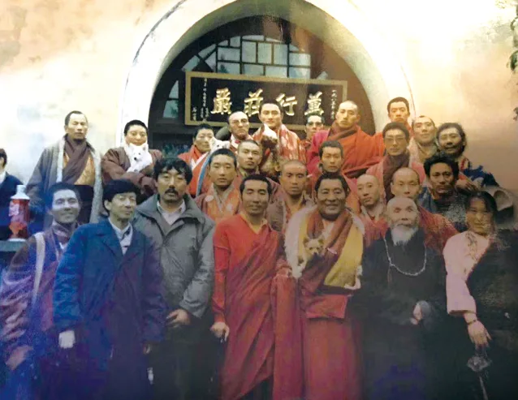

法王一行在峨眉山

法王没有去山顶，只是朝拜了山腰的万年寺。那里有一尊高大的普贤菩萨像，还有迦叶佛的牙舍利。法王带大家念了《普贤行愿品》发愿。

1990年12月1日

南珠堪布、吾智喇嘛离开成都，返回印度。

法王启程回藏地，经过雅安、二郎山，很晚才到康定。

1990年12月2日—12月3日

在康定，参加了甘孜州宗教局、统战部的相关会议。

1990年12月4日

从康定出发，晚上到达道孚的绕果寺。当地的僧俗信众很多，法王给他们做了一些佛法开示。

1990年12月5日

从绕果寺出发，返回喇荣五明佛学院。一路上，从佛学院下来的弟子们在道孚、炉霍等地，一站一站地迎接法王。

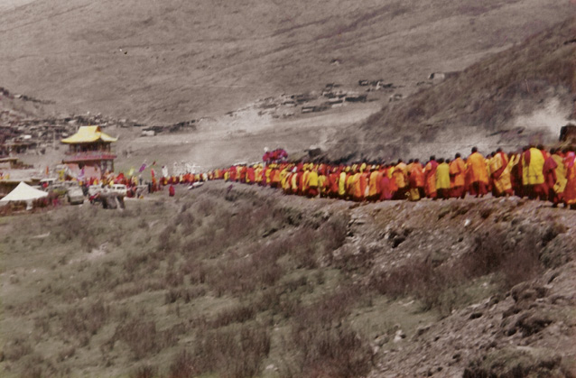

到达佛学院后，以嘎多堪布为主的众弟子热泪盈眶——期待已久的法王终于回来了！

每当法王外出归来，都会给大家做一个简要的总结。当时，佛学院只有一个甘多拉经堂。法王首先去了经堂，给僧众简单汇报了这六个月零三天的出行情况：自离开佛学院后，先去了成都、拉萨，再到尼泊尔、印度，去不丹，又返回印度、尼泊尔，后经过香港到成都，朝拜成都附近的圣地，今天顺利地回到佛学院。

尽管已是寒冬腊月，但弟子们看到了久违的法王，感觉温暖又回到了自己身边，激动之情无法言喻。

再次回到佛学院，我也像回到了家一样，特别开心。既然我没有留在印度，回来后就要为汉族四众弟子好好传法。当时我的中文不太好，翻译水平还不够，所以从香港带回来《大圆满前行》《藏密佛教史》的一些译本。直到汉语水平提高后，我自己才开始翻译法本，并不间断地讲经说法。

当时的汉僧，条件比较艰苦，没有法本，没有经堂，没有住房，我一直在努力改善他们的闻法条件，甚至亲自帮他们修建一些土坯房。后来，汉僧的数量日益增多，1991年评选出第一批堪布、堪姆，法王亲自颁发了证书。

1990年12月6日

法王去了色达县。有关部门举行座谈会欢迎法王归来。在会议上，法王有点不高兴：“当我下山时，你们答应在我回来之前给佛学院供电，但现在还没有做到。”许多领导听后有些尴尬，立即答应安排人去解决这个问题。

当时已是天寒地冻，许多工程很难施工。特别是插入电线杆时，必须先烧牛粪以融化地面上的冰，然后才能将土挖出。虽然他们只安装了一部分电线杆，但过了一段时间后，喇荣终于通上电了。

在过去的10年中，喇荣没有电。我来佛学院后的5年里，只能依靠煤油灯、酥油灯学习。第一天来电时，每个人都欢呼雀跃，感到在电灯下学习是最幸福的事情了。

之后，佛学院又通了电话线。法王说，整个佛学院可以有三个座机：一个在法王的家中；另外两个，放在男众区和女众区。女众区的，在日雪堪姆的家里。男众区的座机，也许法王去印度时对我各方面比较满意，说可以放在我家中。

我记得那是一个红色的座机。放在我家之后，我整天都提心吊胆，因为法王随时会打电话给我，让我通知一些事情，或是去找一些人。法王在电话中的声音，似乎比平时更威严。每当我拿起电话，法王都会习惯性地问：“啊咧，你在做什么？”我一听法王的声音就特别紧张，浑身发抖，不知道该怎么回答。

1990年12月7日—12月9日

我请了几天假，回炉霍去看望父母。

父母是牧民，住在拉嘉山谷的帐篷里。在过去的六个月中，我们没有任何联系。他们不知道我回来了，突然看到了我，非常惊讶，就像看到复活的人一样，母亲甚至高兴得泪流满面。

在我出国之前，我只是告诉他们去印度，并委婉地暗示这次时间可能有点长，但他们不知道我打算在印度待三年，也不知道我要去哪里。

这次见到父母，我也很高兴，在家里住了两天。

1990年12月10日—12月11日

我去朵芒寺拜见了帝察活佛、德巴堪布，汇报了这次出行情况，并给他们带了一些加持品。帝察活佛很高兴地说：“我们朵芒寺的人和法王一起去了印度，这是寺院的荣耀。当你出国时，我们什么也没给，但你回来后，却没有忘记我们。”

我过去只是朵芒寺的小僧人，从那以后，他们对我寄予了期望。帝察活佛反复说：“现在，你在法王身边闻思修行，将来一定要多关照朵芒寺。我们这些老人，不知道还能活多久。这么大的寺院，为这么多部落传法的重任，如今都在德巴堪布一个人肩上，将来你要多帮帮他。”我也答应了。因此，在这些上师离世后，我对朵芒寺尽心尽力直到今天，这也是原因之一。

当时，德巴堪布为朵芒佛学院的20多名僧人在讲中观。寺院的条件很差，大家辅导时没有教室，就坐在墙角的土堆旁边。但是，他们闻思非常精进，包括帝察活佛也在听小僧人的辅导。研讨期间如果有任何疑问，活佛说他不敢去找德巴堪布，让小僧人去请教一下。

实际上，帝察活佛是朵芒寺最大的住持，也是一位伟大的上师，1986年法王还请他用五个月时间给喇荣僧众传过《大藏经》的传承。但是他一点架子也没有，仍然在小僧人面前听法。这一幕给我留下了深刻的印象。当我遇到一些非常傲慢的活佛时，常常会想到他的行为。

1990年12月12日—12月25日

我回到了喇荣。在过去的几天中，法王将他这次所取的“项袋金刚橛”等伏藏，全部传授给了佛学院僧众。

法王见我回来了，说从国外买来的木制家具已从香港运到成都，我能不能去拿一下。我立即答应并动身下山。

由于这次不是跟法王一起，因此没有专车。诺尔巴堪布陪我从喇荣走到色达，等了一天也没有车去成都。第二天中午，终于找到了一辆邮车。我们跟许多信件一起挤在后车厢里，非常憋闷，再加上道路特别颠簸，晕车严重，不断呕吐。到八美时，吐得都快虚脱了，只好下车，改坐拖拉机。坐了一会儿后，发现了另一辆车，然后辗转到了康定。

我认识康定的一些老居士，他们帮我们买了去成都的大巴车票。抵达成都后，拿到了法王的家具，东西不多，大约一二十斤。回去时又转了几次车才到佛学院。前后总共花了十几天。不像现在，只需打个电话，一两天内快递就送上山来了。

看到印度的这些家具后，法王还是很高兴。尽管高僧大德断除了一切执著，但显现上也有自己需要的缘起物。对我来说，无论上师要什么、做什么，都不会以分别念判断它是否有必要。只要上师需要，就肯定有密意，我一定会想方设法把它做好。

1990年12月26日

回到佛学院后，法王把我叫过去说：“这次我们出行非常顺利，我对你还是很满意。你做事很勤快，与周围的人相处融洽，包括整理文字等，都非常好。特别是在保密方面，很多事情能守口如瓶，什么该说、什么不该说，很有分寸。虽然我们也没什么不可告人的事情，但能守护秘密是重要原则。再过三年，我准备去美国、加拿大等西方国家，如果你愿意，我想带你一起去。但我不知道此行能否顺利，所以你不要对任何人讲，而且私下还要做一些准备，包括办理去美国的手续等。”我也答应了，然后开始做各种各样的事情，其间非常低调且保密。直到去美国之前，包括签证在内的所有手续都已办完，法王才向僧众公开。

当时，慈诚罗珠堪布感到非常惊讶：“你们手续办完了我才知道，为什么不早点告诉我？”我说：“法王要求保密，跟谁都不能说。”他说：“你保密太严了。”但他的心很宽广，不会斤斤计较。

法王去美国时，只带了我一个弟子。在那个年代，能去印度和美国是很不寻常的，尤其是与法王一起去，大家都非常羡慕。对我来说，一方面觉得特别荣幸，同时也感到压力巨大。由于邀请方的费用有限，因此陪同人员很少。不像去印度时，有人专门做饭、有人医疗护理，而去美国时，这些都落在我一个人肩上，许多事情必须事先考虑，随时随地不敢松一口气。

由于法王带我去过一些国家，有人就说法王认定我是谁的转世。但事实并非如此。法王从来不会认定谁是活佛，这也不符合法王的性格。法王圆寂之前，只是在大众中说：“索达吉堪布在我的事业中从未破坏过缘起。将来，有些事情若与他商量，应该可以圆满成功，这对成办事业很有帮助。因为师徒之间的缘起非常重要。”我觉得这是法王对我的一种认可。除此之外没有说过什么。

1990年12月27日

我收到了雅绕寺的来信，他们敦促我尽快请购《麦彭仁波切全集》。正好我在师范读书时的同桌，就在德格印经院。我把钱寄给了他，让他帮忙请一套邮寄到佛学院，然后我再想办法转给雅绕寺。

我这次出行没有花很多钱，主要是因为贝诺法王的资助，以及一些人的供养。所以我回来之后，钱比较宽裕。我就拿出1400多元修了一间半的木头房子，这也是佛学院很早的绷壳房。直到今天，我仍然住在里面。

1990年12月28日之后

法王依次传讲了《上师心滴》的“前行修心七法讲义”“正行光明藏讲义”“直断本住讲义”。

此后，法王评选了63位堪布，并颁发了证书。这是喇荣五明佛学院成立以来的第一次——以前我们只有“堪布”的称号，但没有正式证书。从那时起，佛学院也开始有了五部大论的分班。

之后，佛学院成立了一个理事会，分管教务、财务、后勤等部门。

之后，法王给僧众传授了“文殊静修大圆满”灌顶。

之后，法王传授了自己著作中的一些密法。

之后，法王说他将在佛学院建造一座万人大经堂（现为喇嘛大经堂）。经堂所在的位置，当初是一片很大的空地，周围有铁丝网拦着。法王选了一个吉祥的日子亲自去勘测地基，色尔坝的工人用绳子在测量，我们新成立的理事会成员也在场。

法王带大家念了“八吉祥”“大自在祈祷文”等。此时，在整个喇荣山谷的天空上，白色的祥云一条条发散出去，从西向东延伸。

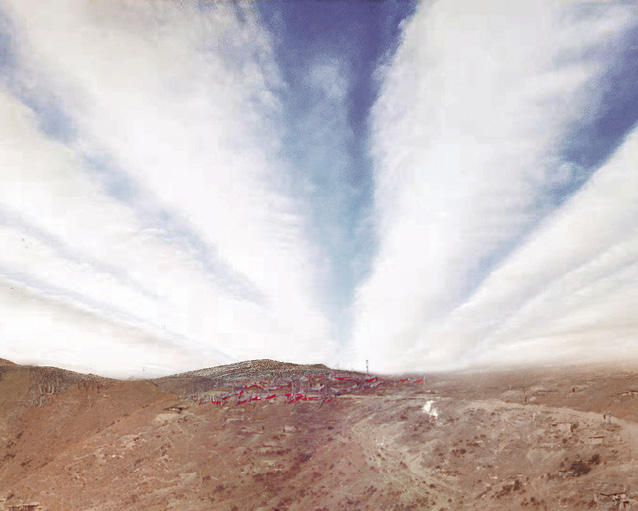

法王很高兴地说：“我在佛陀初转法轮的鹿野苑时，天上也出现过一模一样的祥云。看来，我们建造大经堂的缘起非常好！未来佛法会继续兴盛，僧团日益壮大，持教大德也会长久住世。我的寿命本来是66岁，但现在看来，可能就像诸大德授记的一样，寿命会得以延长，至少可以摆脱寿障。

我希望我们师徒暂时不要分离。大家都安心住在这里，守持清净戒律，以知足少欲的心精进闻思修行。如果能这样，未来你们一定能弘扬正法、利益有情。

尽管我的眼睛现在看不清文字，但我仍会尽最大的努力传授显密教法。尤其是密法的传讲，我相信，会给你们很多堪布带来利益。至少，我不会欺骗大家。

我们喇荣曾出现过十三位虹身成就者，是一个清净而神圣的地方，没有被破誓言的晦气所染污。今后，这里将继续涌现大成就者。即使我离开了世界，我相信喇荣教法将在一段时间内，在全球范围内越来越广泛地传播。那时，我希望你们不要忘记喇荣和老父亲我……”

法王对未来做了一些授记。由此，正式拉开了弘法利生事业的帷幕……

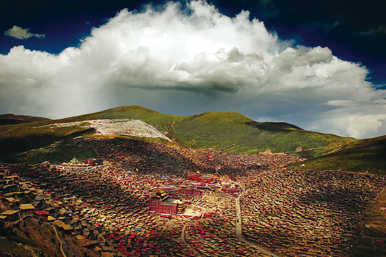

附录（一） 仪轨

7月3日 - 开启金刚橛伏藏的道歌 ｜ 064

7月13日 - 文殊菩萨祈祷偈颂 ｜ 085

7月27日 - 莲师略传 ｜ 115

9月11日 - 远来新客歌 ｜ 177

9月12日 - 莲师多吉卓罗修法•成就一切事业 ｜ 186

9月21日 - 紫玛护法神仪轨•怀诛电索 ｜ 223

10月29日 - 愿海精髓•普贤刹之杲日 ｜ 259

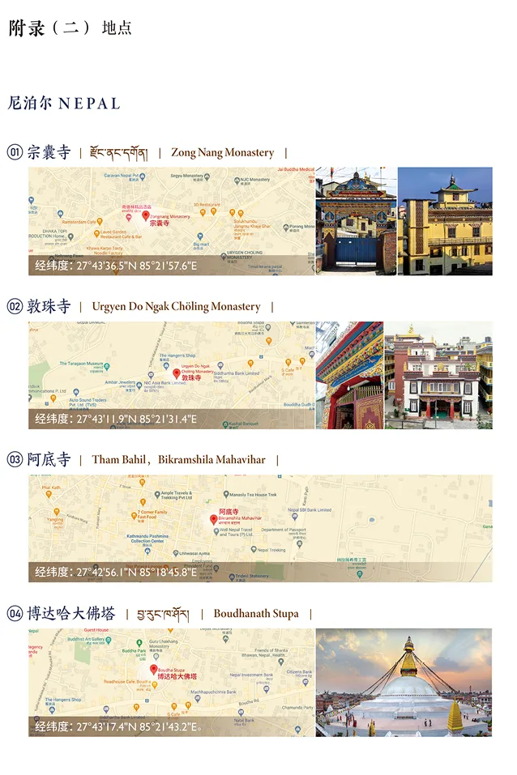

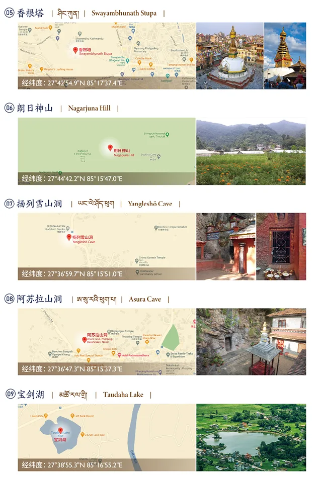

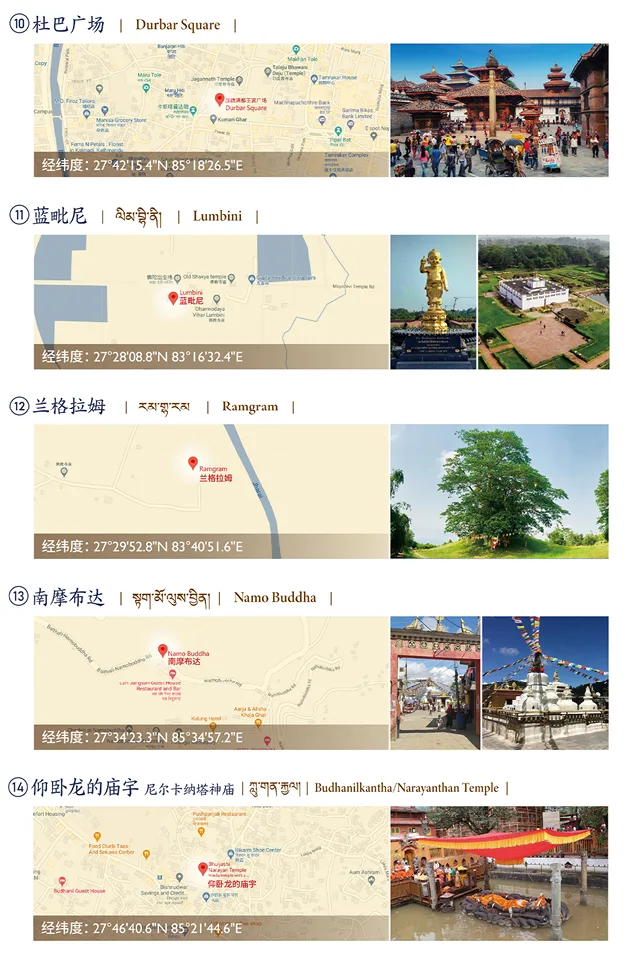

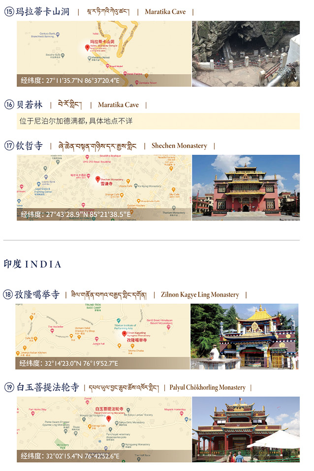

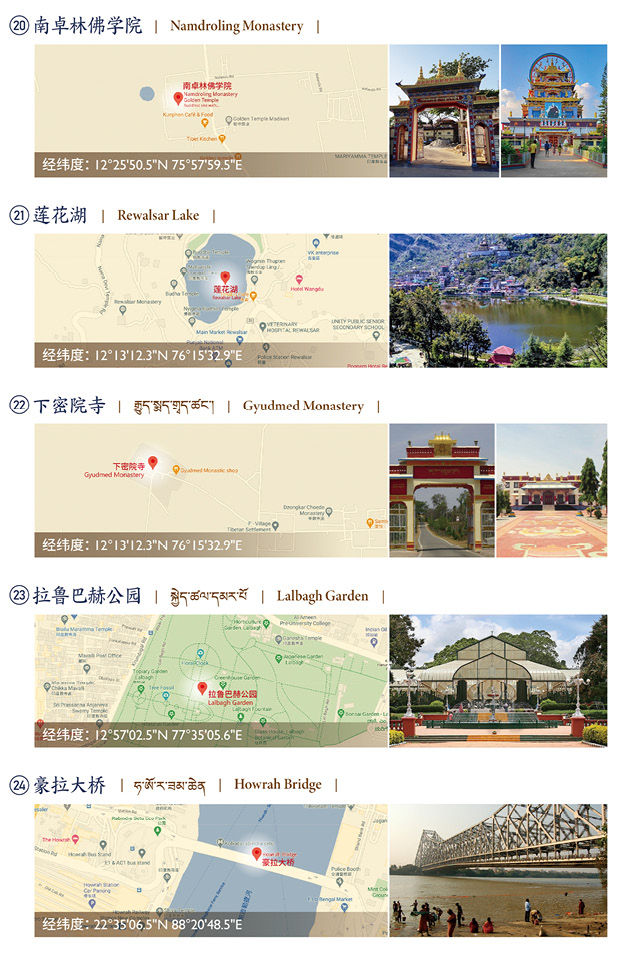

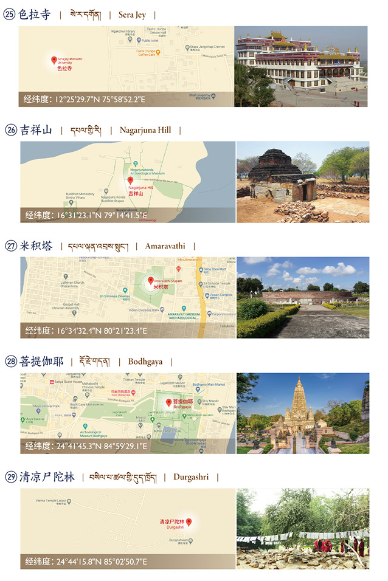

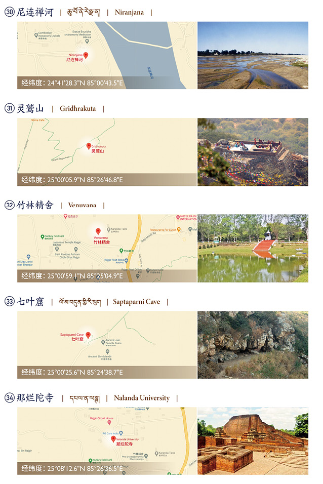

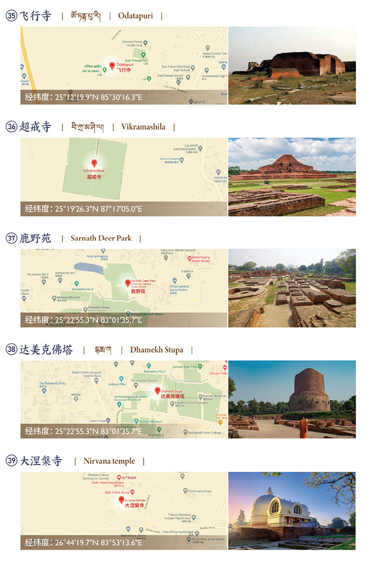

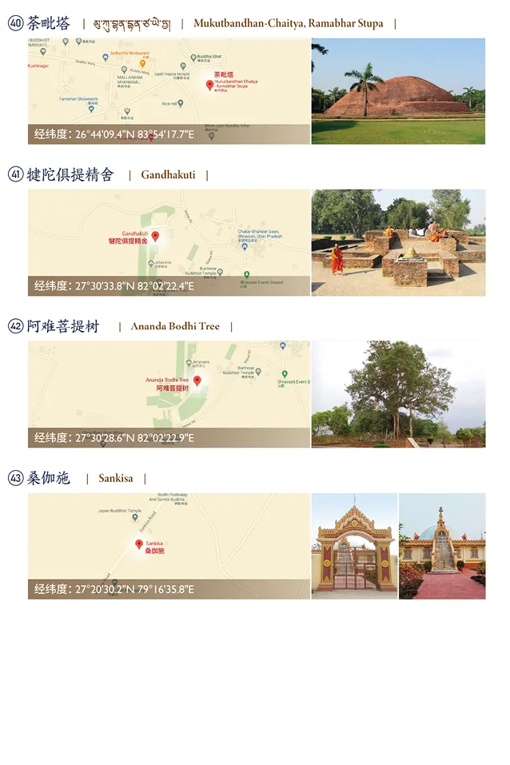

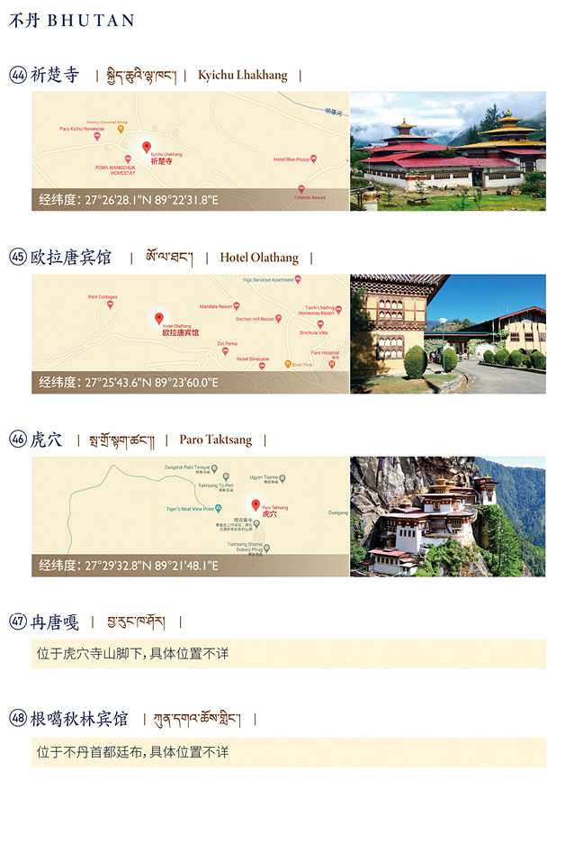

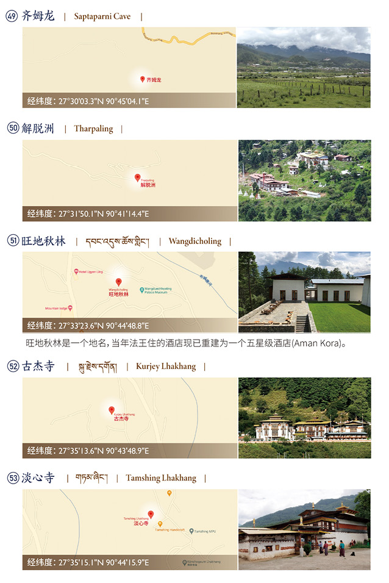

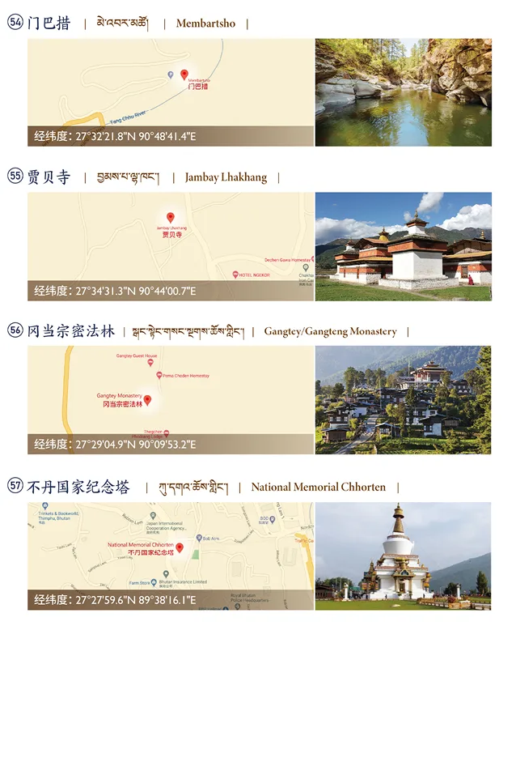

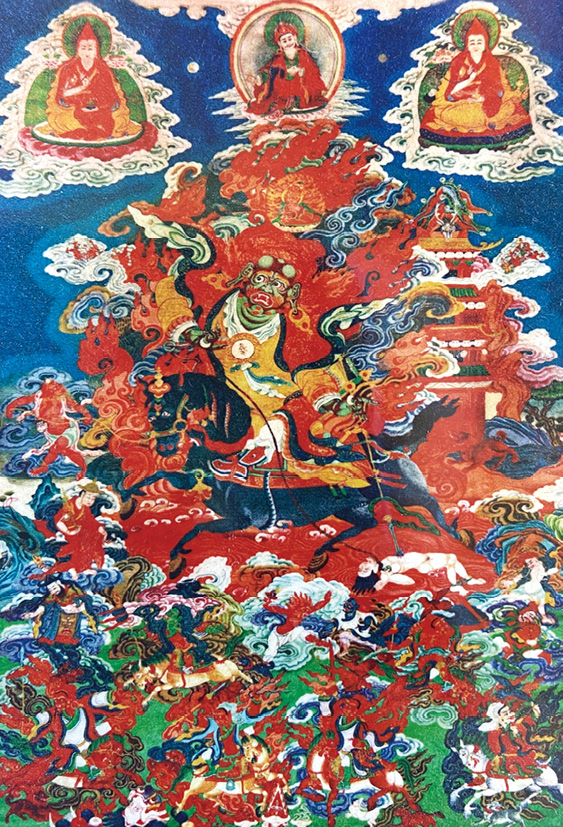

紫玛护法神
