# 第四站 印度

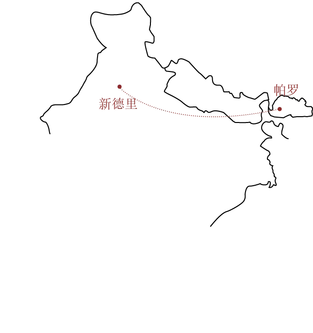

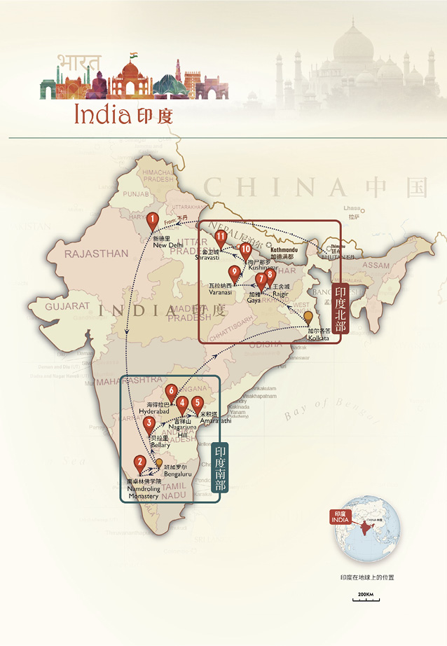

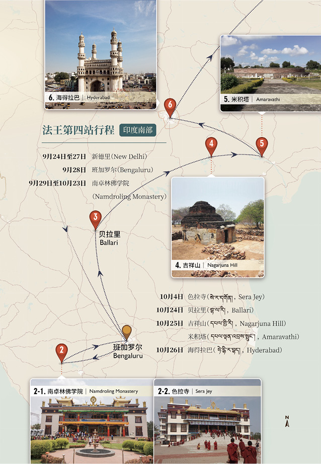

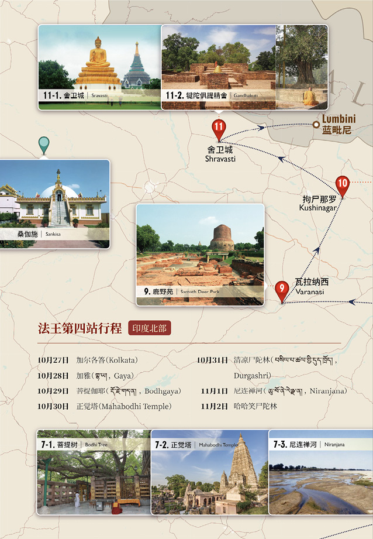

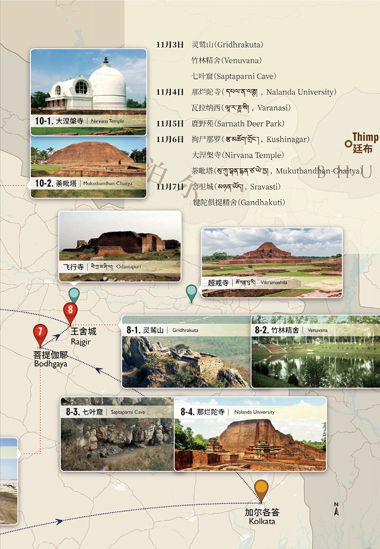

1990年9月24日—9月27日

早上抵达不丹的帕罗机场，并乘坐7点的飞机前往印度新德里，航程2小时20分钟。

本来，到了新德里后，下一站是去敏珠林寺[^1]。但是，由于紫玛护法神的交代，此行被临时取消，我们就在新德里停留了四天。

来印度之前，我答应去敏珠林寺三年。对方一直在催促，希望我去讲中观、因明等五部大论，我说等法王回去后就过去。但是，法王既然不去了，我觉得自己留在那里也不合适。随着时间越来越近，我越来越不想去，特别想和上师一起回藏地。

我告诉了法王自己的想法，法王说：“如果我去跟他们提，可能会不方便，因为我之前已经答应过。但是如果你能和我一起回去，我会很高兴，因为这次朝圣我们是一起来的，如果你能一起回去，一个人都不落下，这是很好的。现在佛学院的汉族弟子也越来越多，我希望你能给他们讲讲课。而且，印度的饮食和生活习惯跟我们不同，不知道你能不能适应，我也比较担心。”当时，法王妹妹阿里美珠也不忍心把我一个人留下，特别不想让我去。

但是，南珠堪布和敏珠林寺的态度比较坚决，希望我能尽快过去。左右为难之际，正好佛学院的秋巴堪布穿越冈仁波齐山来到印度。他是洛若寺的，也是法王的重要弟子。我跟他商量了一下，他愿意代替我去，因为敏珠林寺是很好的道场。之后，我又找敏珠林寺协商，他们勉强同意，但态度上不是很高兴。

在新德里的四天中，当地许多藏族人听说法王来了，络绎不绝地赶来拜见。法王慈悲地给他们摸顶加持，并传了一些法。其中一个新龙人叫嘉日尼玛，在当地很有名望，因为法王的前世列绕朗巴也是新龙人，跟他算是半个老乡，所以他对我们非常照顾。

法王想在新德里请一些佛像，因为印度是佛陀的圣地，其佛像具有不同寻常的意义。而且在那个年代，藏地除了一些古老的佛像，很少见到新的佛像。当我们在新德里看到许多精美佛像后，感觉特别稀有，法王说要请一些带回去。

嘉日尼玛就找人带我们去了一家造佛像的工厂，那里有各种各样的黄铜佛像，都是手工制造的，非常庄严且符合度量，一见就令人欢喜。我们花钱请了一些，他还供养我们每人一尊。这些佛像比较重，因为过几天法王还要去印度南方朝拜佛陀圣地，一路上带着不太方便，我们就请他代为保管，等法王到最后一站鹿野苑时，再请他把佛像带过去。他非常爽快地答应了。

当时，中国驻印度大使馆还让法王和我们陪同人员去一趟，汇报我们在印度期间的所有行程，并提供一切活动的照片和资料。我们去递交了相关的文字和照片，他们赠送了法王一个看似宝瓶的纪念品。

大使馆有四五名工作人员，其中一位对法王很有好感，真诚地赞叹法王的弘法之举。他知识渊博，思想开放，几年后他回到中国，直到退休都跟我保持联系。

1990年9月28日

早上8点，从新德里乘飞机到班加罗尔，航程两个半小时。

1990年9月29日

从班加罗尔乘车238公里返回南卓林。

1990年9月30日

休息一天。

南卓林庭院有一个大广场。为了表达对法王的崇高敬意，当地藏民表演了精彩的藏族传统歌舞，僧众也跳了金刚舞。

当时，法王和堪布、活佛们坐在前排，他们面前有一些饮料。每个人都很高兴地欣赏了节目。

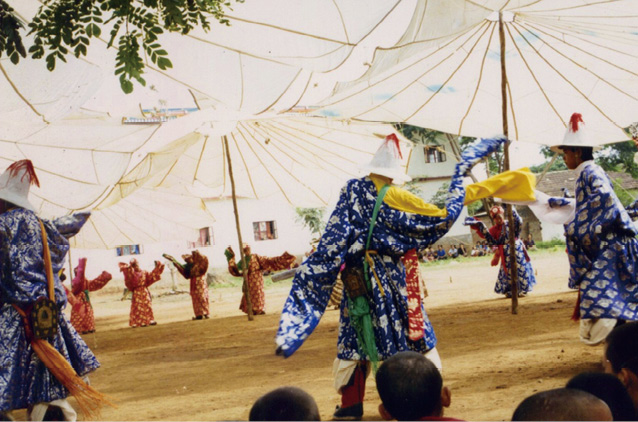

1990年10月1日—10月11日

法王在南卓林正式传法。首先要讲的是《定解宝灯论》。这次法王讲得比较快，此论共有七个问题，第一天差不多讲了两个，在11号完成了所有课程，共有9节课。之后，法王传授了“格萨尔王护法”灌顶。

在法王讲《定解宝灯论》之前，我比较担心。因为南卓林的僧人非常有辩才，并且有一些寻思者，《定解宝灯论》的一些颂词很难理解，如果我只是录一遍，法王讲起来会不会有点困难。像我备课的话，通常要看一些注释并对照颂词，如果法王什么都没有，我担心到时候会讲不好。所以我去问法王：“要不要把《定解宝灯论》的注释和科判也给您念一下？”

法王摸摸我的头，慈爱地说：“乖，好孩子，我讲了一辈子的佛法，你想现在再驯服老马，有必要吗？不用了吧。你录音就可以，其他的不必担心。”

我说：“虽然大的方面您肯定没有问题，但有些词句要不要过一遍呢？因为有些年轻僧人的分别念很重。”

法王说：“你知道吗，有一种说法叫老马识途。马老了以后，虽然身体虚弱，但是对路很熟悉。不管怎么样，我对这条路还是有把握，不会有事的，别担心。”

后来，法王向大家传《定解宝灯论》时，窍诀性的讲法入木三分，赢得了所有人的好评。整个南卓林，上至贝诺法王、大活佛、大堪布，下至普通僧人，都被法王的智慧折服了。我对此感到非常震撼。毕竟，这部论典相当深，只靠录音边听边讲，一般人很难分析得透彻。过去，法王在佛学院讲得很好，我以为是备课充分，没想到这种智慧是自然流露的，并不需要提前死记硬背。

在传法期间，法王4号还去了附近的色拉寺（སེ་ར་དགོན།，Sera Jey）。它是格鲁派的三大寺之一，距离南卓林很近，从南卓林的屋顶就可以看到它。这座寺庙有近2000名僧人，还有许多德高望重的老格西、老僧人看起来很威严。在大殿里，法王给他们传授了“长寿佛”灌顶，讲了《三主要道论》，并念了广本的《莲师遣除道障祈祷文》传承。

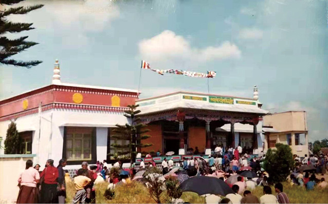

那次是秋巴堪布给法王提前录音。他没有经验，语速太快，咬字不清楚，法王只能含含糊糊跟着念。此后，法王让他不要再录了，还是叫我录音。实际上，每次录音时我都做了很多准备工作，尽管读得不是最好，但还是能让法王满意。因此，除了那次，法王在尼泊尔、印度、不丹的所有传法，都是让我录音的。

除了给法王录音外，我还会把法王的传法用磁带保存下来。为了确保录音的质量，我买了一些进口磁带，专门用于录制法王的课程。我自己录音时用国产磁带，用完就抹掉，可以反复用好多次。幸好我录音机的质量还不错，每次都能保证音效。

1990年10月12日—10月15日

法王为南卓林僧众传授“上师心滴”的甚深灌顶：

1990年10月12日，有戏灌顶。

1990年10月13日，离戏灌顶。

1990年10月14日，极无戏灌顶。

1990年10月15日，最极离戏灌顶。

同时，法王密集地传了很多法，包括《上师心滴》的“前行七种修行”、“正行光明藏”以及《文殊大圆满》。

有时，如果上午不忙，需要买东西的话，我会去附近的格秀那卡（Kushalnagar）小镇。那里距离南卓林4公里，可以坐三轮车去。为了方便沟通，我还学习了简单的印度语，不需要找翻译，自己就可以买东西、吃饭、坐车等。

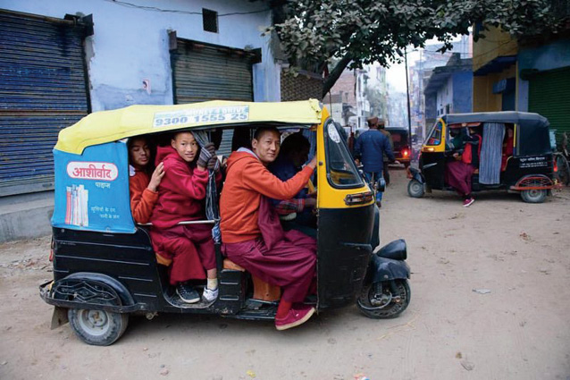

印度的三轮车

格秀那卡有一些印度餐馆，南卓林的小活佛、僧人们经常约我一起吃饭。他们大多数是藏族人，因为在印度待太久了，饮食习惯几乎与印度人相同。刚开始我对印度食物不习惯，但吃了几次后就能接受了。那时，我性格比较活泼，容易接受新事物。因为年轻，对买东西或吃东西也感兴趣。我记得有一种将米饭和辣椒混合在一起的食物，像土豆泥一样，用叶子包起来吃，味道很好。

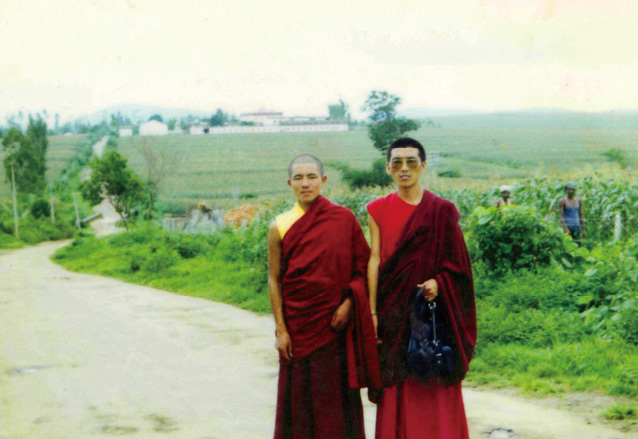

南卓林在僧众管理方面非常专业。贝诺法王结合了印度的英式管理模式，在佛学院建立了一个理事会，并设立不同部门来管理财务、教务、办公等。法王对此非常感兴趣，详细了解这种管理方法后，让我们记录下来，说回到喇荣可以借鉴。

早年喇荣的管理与现在不同，只是一种普通的寺院管理模式。从印度返回后，法王开始成立理事会，并建立了财务、教学、后勤等部门。从1990年至2014年，我一直担任佛学院的七位理事之一。虽然从2014年起已经卸任，但仍在不断参与佛学院的大小事务，甚至比以前更加忙碌。

1990年10月16日—10月20日

法王传了《大圆满愿文》及麦彭仁波切的《三根本念修法》。

17日晚，南卓林最优秀的僧人来到法王面前，以讲考、背考的方式做了法供养。其中有一位仁果活佛，从显宗的角度辨析了阿赖耶与如来藏之间的区别。他思路清晰，引经据典，发挥得有理有据，自宗要点也掌握得非常到位，在所有讲考者中，他讲的是最精彩的。我私下与他关系很好，经常讨论一些法义。在我的记忆中，他对无垢光尊者非常有信心。

听完每个人的讲考后，法王非常欢喜地赞叹：“如今在印度，依靠贝诺法王的慈悲摄受，这么多智者聚集在这里，未来佛法弘扬于全球大有希望。在藏地，虽然弘法有种种不易，但多年来我一直很重视人才的培养，喇荣也培养了许多优秀的僧才。只是在时间上，贝诺法王比我们更早，他始于六七十年代，我们是八十年代才开始的。我相信，这两所佛学院将会为未来的佛法做出一些贡献。”

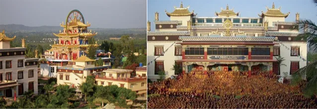

现在的南卓林

1990年10月21日

贝诺法王在南卓林的全体僧众面前，供养了法王一顶莲花帽，并为法王颁发了证书，证书上写着：“晋美彭措吉祥贤，是对经教伏藏和显密窍诀圆满闻思修行、智慧现前正觉、智者成就者顶戴的善知识、具三金刚持明者。第十七铁马年十月二十三日。”下面是贝诺法王的亲笔签名，这是藏传佛教界公认的最高荣誉。同时，他还亲自给门措空行母、秋巴堪布和我三人发了堪布帽。

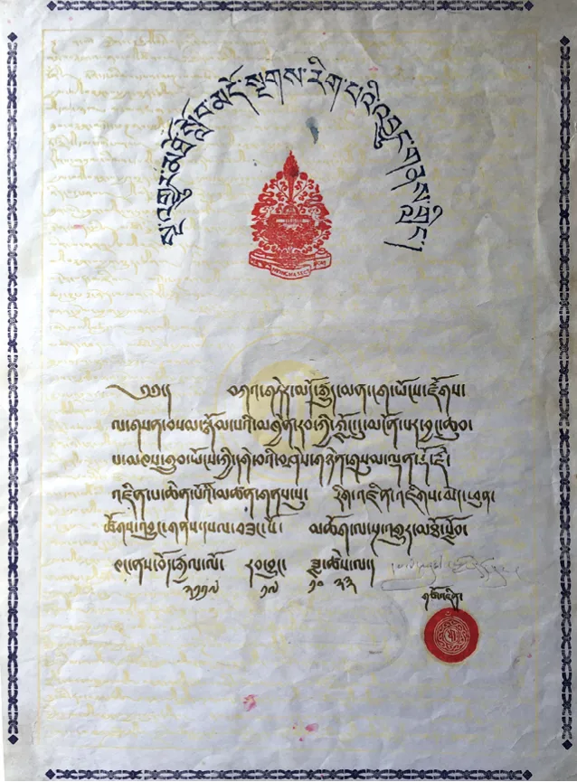

贝诺法王为法王如意宝颁发的荣誉证书

我来自朵芒寺，属于白玉派，根据我们寺院的传统，从白玉派祖寺获得堪布帽是相当难得的殊荣。但是我觉得，如果自己没有真才实学，即使有一顶伟大的帽子，也没什么了不起。反之，如果有了真修实证，就算没帽子也完全可以。所以，在此之前，我跟法王说自己不想接受这个堪布帽，但法王说：“还是接受吧。你们寺院的德巴堪布、帝察活佛肯定很高兴。这对你来说，也是一个很好的缘起。”

于是，在南卓林的大殿里，我们三个人坐在比法王略低的法座上，戴上了贝诺法王赐予的堪布帽。僧众们也为我们念了很长时间的长寿仪轨。

下来过后，我看了看那顶堪布帽，帽子里盖了贝诺法王的私人印章。回到藏地后，德巴堪布他们确实很欢喜，觉得这是一种无上荣耀。我想如果这可以成为弘法利生的缘起，也未尝不可，除此之外，并没有太放在心上。

这个帽子被我保留了一段时间，一次也没有在正式场合戴过。十多年前它似乎还在，但现在应该找不到了。可能我在结缘衣物时，顺便把它也送出去了。

1990年10月22日

法王传授了“忿怒莲师”灌顶，传讲了《文殊语狮子》修法，并给僧人们讲了如何清净戒律、闻思修行、利益众生等教言。

1990年10月23日

南卓林的所有行程，当天全部圆满了。

在法王离开之前，南卓林按照印度最高贵的送行仪式，将白檀木薄片制成木花，然后串成花环，戴在法王的脖子上。贝诺法王和所有堪布、活佛都依依不舍，非常感激法王在过去三个月传授的显密教法。

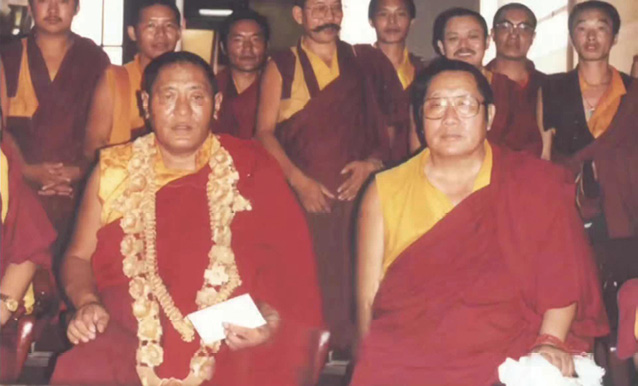

他们从藏地邀请法王并不容易，所以一次性求了许多大法，法王也传了很多甚深教言和窍诀。我随法王到印度，除了有机会朝拜佛陀圣地，还听到这么多深法，感觉非常珍贵。我把这些法录在磁带上，担心出境时不让带，就把磁带的黑色胶片单独取出，缝在大家的衣服里，平安地通过了海关。回到藏地后再恢复，仍然可以播放。但是，由于某些技术问题，个别磁带的内容有点缺损，尤其是《七句祈祷文》的前面部分。为了修补这段内容，最近我还在向南卓林打听，但他们找不到这些录音。

法王在南卓林传完法，已是10月底，印度的天气不是很热，比较适合朝圣。所以，法王决定开始朝拜佛陀的圣地。

我们坐车238公里，从南卓林到了班加罗尔。

1990年10月24日

如果从班加罗尔直接去印度北部的佛陀圣地，各方面都比较方便。大多数去印度朝圣的人也会选择这条路线。

但是，这一次，除了佛陀三转法轮的圣地，法王还希望朝拜佛陀传授无上密法之地。因此，我们决定费些周折，绕道先去米积塔。

当天从班加罗尔出发，坐车313公里到了贝拉里（བྷ་ལ་རི།，Ballari）。晚上住在那里。

1990年10月25日

从贝拉里出发到吉祥山（དཔལ་གྱི་རི།，Nagarjuna Hill）[^2]，全程429公里。

吉祥山，是龙树菩萨在晚年广转显密法轮的圣地，他也是在那里离开了人间，往生极乐世界。佛经中有一段对龙树菩萨的授记：“南方碑达国，有吉祥比丘，其名呼曰龙，能破有无边，于世弘我教，善说无上乘，证得欢喜地，往生极乐国。”其中的“南方碑达国”就是吉祥山。

吉祥山上有许多跟龙树菩萨有关的圣迹，但离此不远处，印度政府开发了一个人工湖，淹没了通往山上的道路。我们不得不把车停在湖边，隔湖对着吉祥山做了礼拜、发愿。

之后，继续坐车143公里，下午到达米积塔。

米积塔（དཔལ་ལྡན་འབྲས་སྤུང་།，Amaravathi），是佛陀传授《时轮金刚》《真实名经》等殊胜密法之地。由于历史的变迁，如今只剩下一个丘状塔基，附近有一些残破的石围栏，据《印度佛教史》所载，这是龙树菩萨为防止大象损害佛塔所建。

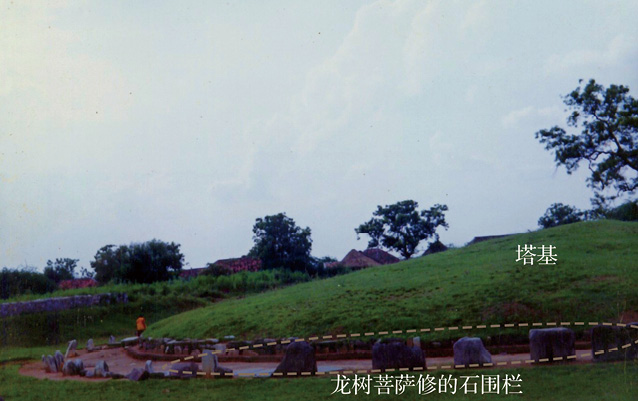

法王一到米积塔，觉性海中顿然流露出《时轮金刚略修法》，当下给所有人传授了“时轮金刚”灌顶，并要求大家多念时轮金刚心咒，数量不限。

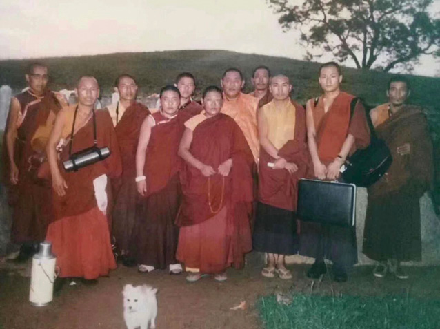

晚上，我们住在米积塔附近的一家旅馆。待法王安顿下来，我去转绕了米积塔。转绕很长时间后，又借着路灯的光念了一遍《真实名经》。

1990年10月26日

天不亮时，我就早起前往米积塔，转绕了几圈后，在佛塔前一直磕大头。因为米积塔是佛陀传授密法的圣地，所以我在这里发了许多跟密法有关的愿，希望有生之年尽可能地弘扬密法，遣除众生对密法的怀疑、邪见等。太阳出来后，我还拍了几张照片。

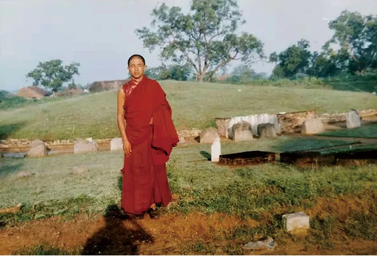

上午，法王又去米积塔前转绕，并发愿与结缘众生一同往生清净刹土。

下午离开了米积塔，驱车272公里到达印度南部城市——海得拉巴（ཧེ་དྷི་ར་བྷད།，Hyderabad）。海得拉巴是印度第六大城市，居民多是印度教、伊斯兰教的信徒。由于受到多种文化影响，那里的建筑颇具特色，有古代文明的许多遗迹，整个城市非常有魅力。

1990年10月27日

从海得拉巴乘飞机抵达加尔各答，全程1495公里。

1990年10月28日

当天，从加尔各答前往加雅（གྷ་ཡ།，Gaya）。

加尔各答是印度第三大城市，提供各种交通工具，搭乘火车或飞机非常方便。考虑到费用和其他问题，我们大多数人决定坐火车前往加雅。但为了让上师舒服一点，我们为法王等少数人买了飞机票——从加尔各答到巴特那（པཊ་ཎ།，Patna），全程648公里、40分钟左右，之后再坐车98公里前往加雅。

我是坐火车过去的。火车上设施陈旧，挤满了人，卫生状况不是很好，但来印度体验一次坐火车的滋味，也是挺新鲜。火车上有各种食品可供出售，吃午饭时，还有餐车推来推去，卖各式各样的盒饭，很受大家的欢迎。

晚上，我们到达加雅山下的一家旅店。法王一行早就到了。

加雅山是佛陀成道后早年传法之地，《伽耶山顶经》就是佛陀在这里宣说的。因为时间太晚了，我没办法到山上去，只是透过旅店的窗户远远地看着加雅山，感受佛陀留下来的气息。

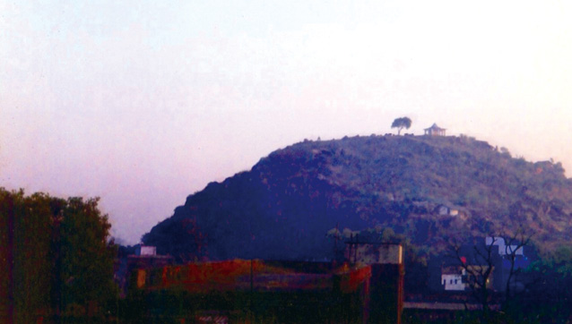

1990年10月29日

佛经中说，如果以信心朝拜释迦牟尼佛的四大圣地——降生地、成道地、转法轮地、涅槃地，其功德不可思议。如《毗奈耶经·杂事》云︰“此地方所有其四处，若有净信男子女人，乃至尽形常应系念生恭敬心。云何为四？一谓佛生处；二、成正觉处；三、转法轮处；四、入大涅槃处。若能于此四处或自亲礼，或遥致敬企念虔诚，生清净信常系心者，命终之后必得生天。”还有些经典说，以此功德能净除五无间罪；也有说，这跟亲见佛陀没有差别。所以，法王这次来印度，最重要的事情就是朝拜佛陀的四大圣地。

从加雅到佛陀的成道处——菩提伽耶（རྡོ་རྗེ་གདན།， Bodhgaya），只有15公里。法王一到菩提伽耶，就立即前往菩提树下，念了《普贤行愿品》发愿。

想到有生之年能来到佛陀的悟道地，法王显现上有点激动。看着那里的一草一木，想起佛陀因地时为度化浊世众生发下慈悲大愿，并无数次布施头目脑髓，法王泪流满面，不能自已。

下午，朝拜了菩提树下的金刚座。此时，法王的智慧海中顿然流露出《愿海精髓》，以金刚歌的方式唱了出来，我在旁边做了录音和记录。

愿海精髓·普贤刹之杲日

无边二资功德所成身，具足六十支分梵音语，

十力功德周遍圆满意，天中胜天仁王祈垂念。

佛以广大慈悲近摄受，极剧三苦摧残之众生，

为欲二利所愿如意成，而发无上殊胜菩提心。

我亦乃至等空众生尽，不贪自利寂乐之享受，

依于利他如饰胜意行，从而趣入三有之大城。

所有生世慧藏唯一父，文殊勇识欢喜而摄受，

由从普贤行愿品所说，如海菩萨行愿皆圆满。

未来导师九百九十六，于此刹中示现成佛时，

恒时随行愿成胜弟子，愿获广弘事业威猛力。

一切贤劣业系众有情，此生命终往生极乐刹，

获得无量光佛语授记，智悲力之威势愿圆满。

无垢圣教兴盛常住世，无偏众生享受胜利乐，

意中所愿恒时唯有此，祈赐谛语加持成办之。

祈愿一切众生生存因，圆满四德宝藏皆成就，

遍寻不得违逆与衰败，善妙光照三地增吉祥。

如是于中土金刚座，菩提树庄严之世尊法座前，阿旺罗珠宗美口述，愿诸佛菩萨加持如是成就。弟子索达吉由录音立成文字，并亦如是发愿。善矣！

铁马年九月初十

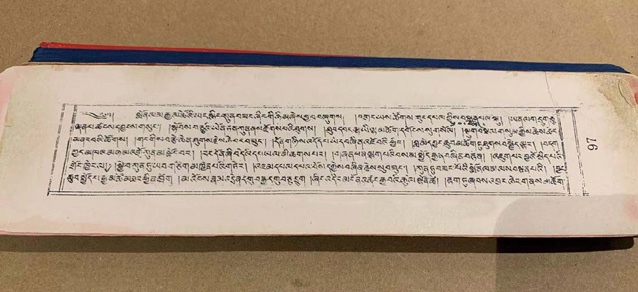

当年我手抄的《愿海精髓》

《愿海精髓》文字不多，但流传得非常广。后来我去世界各国传法时，发现许多佛教道场都念这个来发愿、回向，足见大菩萨的愿力不可思议。

当法王诵出该愿文最后的结文时，让我写下“三藏法师堪布索达吉”，但我认为头衔太大，记录时改成了“弟子索达吉”。法王调侃我说：“让别人记录时，我没有提头衔，人家也会主动加上。可你倒好，我让你写，你都不写。”

之后，法王朝拜了释迦牟尼佛的脚印。佛陀脚印有真品也有仿品，我们有幸拜见了真品，并用一些黄布将其拓下来，带了回来。

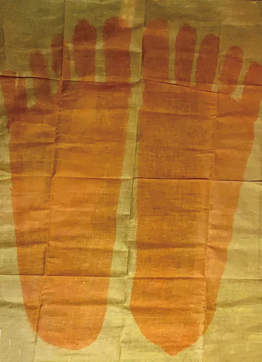

在菩提伽耶期间，除了每天朝拜附近的圣地，法王早晚只要有时间，就会到正觉塔前念《普贤行愿品》。有时还会带我们一边转绕正觉塔，一边大声念诵《普贤行愿品》的一偈：“清净一切善业力，摧灭一切烦恼力，降伏一切诸魔力，圆满普贤诸行力。”

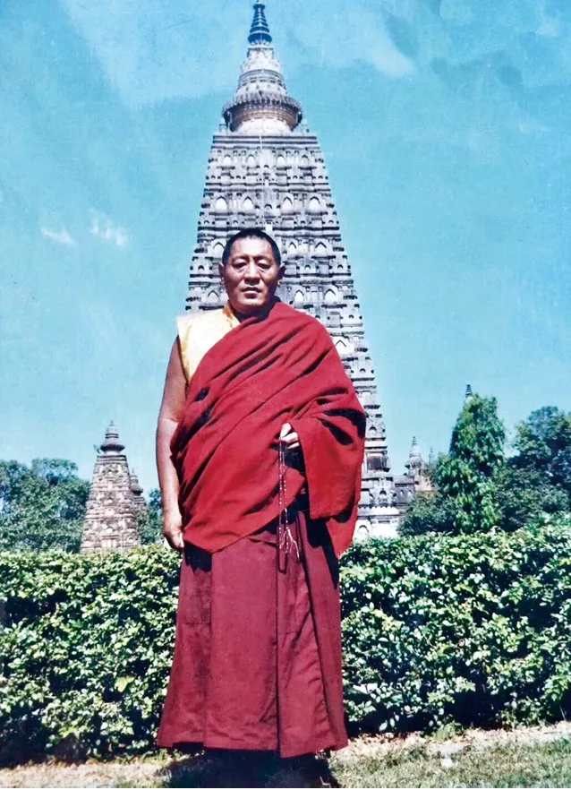

印度非常热，法王胃口不是很好，加上之前的行程太辛苦，体重减轻了二三十斤。法王开玩笑说：“现在我已经很瘦了，不需要别人搀扶也可以自己走路，甚至还能磕头。”所以，在转绕正觉塔时，法王走得特别轻快，我们随行人员见了也很开心。我跟随上师这么多年，那是上师最瘦的时期，胳膊都非常细，但仍然很健康。

有一次，法王在菩提树下，召集我们陪同人员说：“将来，我会在此地成佛，佛号光明吉祥如来。谁愿意和我一起弘法利生？”所有人都欢喜踊跃地举手报名。法王微笑着说：“缘起非常好！愿力是不可思议的，今天你们在这里发愿，当我成佛时，将成为我的首批眷属。即使你们在轮回幻化城里暂时会感受一些苦乐，最后也定会集聚于此，与我共享大乘妙法。”

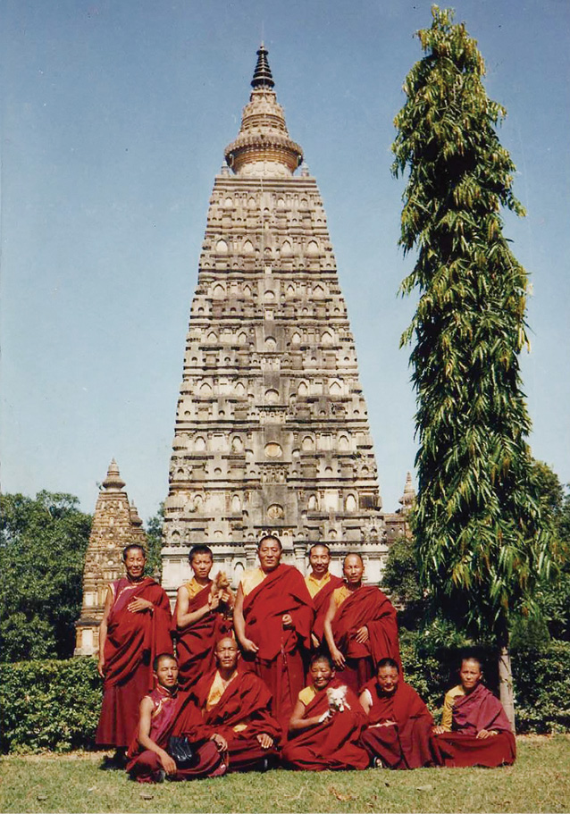

法王在菩提伽耶住了五天。因为这里是最重要的佛教圣地，以后能不能再来也很难说，所以，我觉得不能浪费这个机会，白天有空就去正觉塔前念《普贤行愿品》，并转绕附近的圣殿；晚上待法王休息后，又去正觉塔前发愿、转绕、礼拜。

菩提伽耶于晚上11点锁门。我一直在里面念经发愿，没有出去。如果困了，就靠着墙睡几分钟，醒了赶紧继续用功。在那五天里，除了最后一晚因为第二天要出发，我怕时间来不及而没有过去，其余每晚都是这样度过的。

那时的我非常精进，对佛陀和上师的信心特别足，用了自己所有的时间、精力去发愿。在半夜，我一边念释迦牟尼佛圣号，一边转绕佛塔，除了自己的脚步声，听不到任何声音。有时候想起佛陀的恩德，我泣不成声，然后跑去菩提树下或是佛陀脚印那里，一遍又一遍地磕头……那种信心真的很强烈。

菩提伽耶的蚊子特别多，我被咬得浑身是包，密密麻麻，脸上也都布满了。当时有一个来自泰国的朝圣队，统一穿着白色衣服，晚上也住在那里。他们每人有一个蚊帐式的帐篷，我看了特别羡慕。

菩提伽耶很早就会开门，我来得及赶回去侍候法王起床。因为晚上太精进了，白天有点没精神，但即便如此，我也很开心。上师看到我满身蚊子包，甚至眼皮被叮得都睁不开了，对我的信心非常赞叹，也曾公开表扬过，有时还会打趣我道：“昨天被蚊子咬得怎么样？”

那几天是我最快乐的时光。之前的行程都是没日没夜地赶路，难得有一点属于自己的时间可以用来好好发愿。如果将来有因缘，我真的很想再去那里，修一遍加行，念一百遍《普贤行愿品》和《真实名经》……这方面自己有很多想法。当年我在菩提伽耶时，看到许多藏民在那里发愿，晚上就住在附近，白天带点干粮，一整天都在磕头或念经。这样的修行让我特别羡慕。

那个年代，去菩提伽耶的汉族人较少。现在，那里每年都会举行各种法会，朝觐的汉族人数不断增加。在我看来，其他圣地虽然也很重要，但若能去菩提伽耶，应该是最殊胜的。毕竟，它是释迦牟尼佛成佛的地方。

从很小的时候起，我就对释迦牟尼佛有坚定的信心。随法王朝拜菩提伽耶之后，这种信心更加强烈。后来法王在佛学院传讲了《释迦牟尼佛广传》，每每提及佛陀的大慈大悲，法王经常哭得无法自已，这个场景很触动我。十几年前，我住院时被下病危通知，所以用剩下的时间翻译了《释迦牟尼佛广传》。没想到，依靠对佛陀的信心，我由危转安，一直活到了现在。

1990年10月30日

上午，法王来到了菩提伽耶的正觉塔（Mahabodhi Temple），塔内供有释迦牟尼佛的等身像。

根据历史记载，在2500多年前，工匠之神毗首羯摩熔化了天界五宝和人间五宝，塑造了佛陀的8岁、12岁、25岁等身像，佛陀对其亲自开光，并授记这三尊像与自己无二无别。其中，佛陀25岁的等身像就供奉在此塔之内。

当然，对于这尊佛像的来历有不同说法。13世纪的藏地大智者觉顿·如比绕智（བཅོམ་ལྡན་རིག་པའི་རལ་གྲི།）在《说菩提伽耶·庄严之花》中记载[^3]：佛陀涅槃100年后，王舍城有一位120岁的匝色婆罗门女，她20岁时在佛陀面前受过居士戒，是当时唯一亲眼见过佛的人。她有三个儿子，大儿子、二儿子信仰外道，小儿子对佛陀有信心。他们经常辩论内道和外道谁更殊胜，但始终得不到答案。后来，母亲让他们去北部的雪山，询问那里的大自在天。他们千辛万苦到了雪山，看到大自在天在供养五百阿罗汉。他们问了很长时间以来一直困惑的问题，大自在天回答：“如果只想获得善趣安乐，可以选择外道；如果还想获得解脱，则应该选择佛教。”

三个儿子回去后，都成为了佛教徒，并发愿要为佛陀造像。大儿子模仿佛陀的等身像，在王舍城造了一尊佛像。二儿子在鹿野苑造了一尊持说法手印的佛像。小儿子准备在菩提伽耶造佛像。这时，有人在梦中告诉他：尼连河边的沙子底下藏有造像原料——檀香木，如果让七位清净的婆罗门女把檀香木和各种珍宝堆在菩提树下，密封起来不让人看到，七天后，将自然化现出一尊与佛陀无别的佛像。

小儿子来到尼连河边，把睡在沙子上的牛赶走后，挖到了檀香木。他按照梦中指示，将所有东西放在菩提树下，虔诚地等待七天的圆满。

到了第六天，母亲来对他说：“今晚我就要死了。除了我以外，没人见过佛。所以，这尊佛像是否像佛陀，只有我知道。你去打开封印，让我看看。”

小儿子不得不打开封印。只见一尊佛像已然形成，佛像的身体、发髻、眼睛、耳朵等部位的种种相好无不具足，令人见而生喜。母亲仔细观察后说：“佛陀的身体真的让人百看不厌！我当时看不清佛的发髻，但是佛像的发髻很清晰；佛陀身上有金光，但佛像没有；佛陀有行住坐卧四种威仪，但佛像做不到；佛陀能亲自说法，但佛像无法开口。此外，这尊佛像和佛陀一模一样。”

但遗憾的是，由于七天时间未满，佛像头发的右旋纹路和一个小脚趾没有形成完整。

玄奘在《大唐西域记》中，也提到这尊佛像非人类所造，但所描述的情节与此略有不同：当年，僧众为了在菩提伽耶修造佛像，招募了很长时间的工匠，但没人敢来应聘。后来，不知从哪里来了一个婆罗门，说自己擅长修佛像。当问到他需要什么时，他说只要香泥就够了，但是在造像期间，必须关闭门窗，只留下一盏灯照明，六个月后才能开门。僧众同意了他的要求。

剩下四天时间就满六个月时，一些僧人感到好奇，偷偷打开门进行窥视。结果，屋内空无一人，只有一尊佛像，相好具足宛若真佛，唯剩右乳没有涂好。这时，僧人们才知道这位婆罗门不是凡人，后悔莫及，殷切地进行忏悔、祈祷。当天晚上，一个清净的沙门梦见了婆罗门。婆罗门告诉他自己是弥勒菩萨，因为担心工匠无法揣测佛陀真容，所以亲自来塑造佛像，并解释了佛像触地手印的来历。

尽管这两个故事的情节不同，但都承认这尊佛像与佛陀真身无别。若以信心朝拜、发愿，如睹世尊真容，将得到不可思议的加持。

安放这尊佛像的正觉塔，有些史料说是那个小儿子所造，也有说是阿育王所造。但不管是谁建造的，我们今天看到的正觉塔，应该不是它原来的样子。

根登群培在《印度圣迹》中记录：“在一千多年前，正觉塔遭受过一次破坏，后来被摩揭陀国的施主修复了。六百多年前，它又遭受了第二次损坏，后由缅甸的佛教徒作了修缮。”如今的正觉塔，据说就是十二三世纪时缅甸国王所修，塔高53米，四面刻有佛像佛龛，佛塔外观九层，内部仅有两层。有史料记载，拉萨大昭寺的觉沃佛以前就供在第二层，后来外道入侵时，佛像被扔了出去，后来被人保护并辗转流传至汉地，最后被文成公主带到了藏地。

但是，根登群培在书中并未记录正觉塔还遭受过第三次更大的磨难：13世纪，伊斯兰军队入侵印度。为了保护正觉塔和佛陀等身像，僧人们连夜用土将其掩埋，伪装成一个小山包，此塔才得以幸免。它在地下沉睡了六百多年后，英国考古学家亚历山大·卡宁厄姆（Alexander Cunningham）根据《大唐西域记》的描述，1861年发现了正觉塔的所在地，并对其进行了重新挖掘，震惊世界。

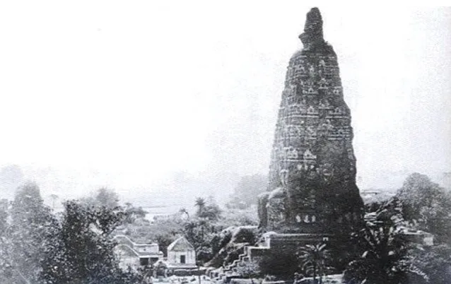

必须提到的是，这位考古学家还根据《大唐西域记》提供的信息，利用25年时间，发现并挖掘出鹿野苑、蓝毗尼、拘尸那罗、那烂陀寺、祇树给孤独园等圣地的遗址。作为一名佛教徒，我谨向这位考古学家致以最崇高的敬意！

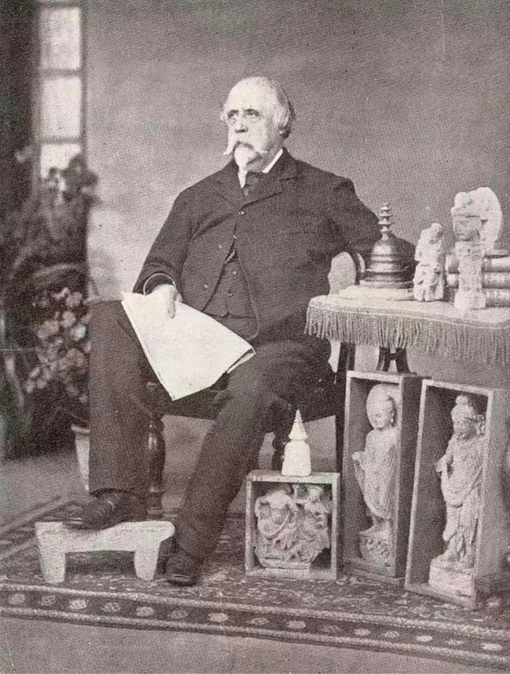

英国考古学家亚历山大·卡宁厄姆

正觉塔被发现并修复后，一段时间内曾被印度教所占用。根登群培在《印度圣迹》中写道：“塔内除了供有佛陀的等身像，还新修了一些印度教殿堂，用血肉供奉大自在天。当时，一个叫法护的居士心生不忍，为了夺回佛教圣地的保护权，他通过法律手段提出上诉，结果不幸被害。”20世纪初，斯里兰卡佛教徒达摩波罗（དྷརྨཱ་པཱ་ལ།，Dharmapala）在印度复兴佛教时，多次呼吁各国佛教徒支持收回菩提伽耶的运动。最后，经由全印度会议委员会和比哈尔之印度教徒大会居间调停，决定由印度教和佛教共同管理菩提伽耶。

法王在顶礼了佛陀的等身像后，沉默良久，神情凝重，仿佛在回忆什么。塔内的香灯师看法王气度非凡、异于常人，虽然不知道他的真实身份，但对法王非常有信心，特地给我们留很长时间在那里发愿，并送给法王一大根菩提树的粗壮树枝，以及许多菩提叶——在印度，当地政府对菩提树保护甚严。许多人为了得到一片菩提叶，经常在树下等很长时间，一旦树叶随风飘落，无数人就一哄而抢。法王得到菩提叶之后，私下分给了我们一些，我们每个人都如获至宝。

香灯师对我也很好。有一次我去朝拜后，他送给我一件完整的等身佛法衣和一个供在佛像前的钵盂。当时法衣特别难以得到，我非常开心。回来时行李超重，又舍不得放弃，很矛盾，最后还是想方设法带了回来。

当天，法王在转绕正觉塔时，还朝礼了塔旁一尊被称为“说话度母”的佛像。昔日阿底峡尊者在绕正觉塔时，这尊度母像对他说：“如果你想迅速成佛，修菩提心是最快的途径。”由此而得名。当法王看到这位“说话度母”时，立即将手中的红宝石念珠挂在佛像的脖子上作为供养。下午再去转绕时，念珠就不见了，我们以为被路人拿走了。

稀奇的是，三年后的一个早晨，法王在喇荣的家中突然发现了这条念珠。其中原委，法王给我讲了一些，但现在有点记不清了。

1990年10月31日

法王朝礼了清凉尸陀林（བསིལ་པ་ཚལ་གྱི་དུད་ཁྲོད།， Durgashri），它位于菩提伽耶以东数公里处，印度人称之为“德噶希日”。法王带我们念了《断法仪轨》，并做了一些发愿。

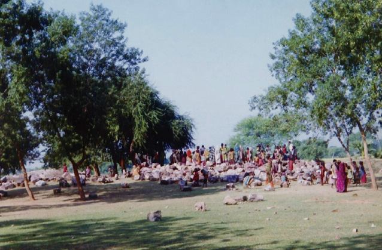

当年莲师放弃王位后，直接来到这里修行，并摄受了无量空行、非人。但如今这里找不到任何遗迹，只有很多大石头零星分布着，一些树木长在周围。如果不了解这段历史，许多人可能会认为这只是一个普通的地方。[^4]

在不远处的山腰上，有一个山洞，是印度八十四大成就者之夏瓦日面见本尊玛哈嘎拉的地方。洞口有一棵檀香树，据说是玛哈嘎拉的魂树。莲师也在这里修行过12年。法王去那里作了礼拜并发愿。

1990年11月1日

印度的尼连禅河（ཆུ་བོ་ནེེེ་རེཉྫ་ན།，Niranjana），在菩提伽耶以东，其附近是佛陀六年苦行的地方。这条河是恒河的支流，在雨季，河水会淹没两岸的村庄、田野；在枯水季，它会干涸成一片沙滩，人们只能从三四十米宽的河床，联想到它昔日的气势不凡。

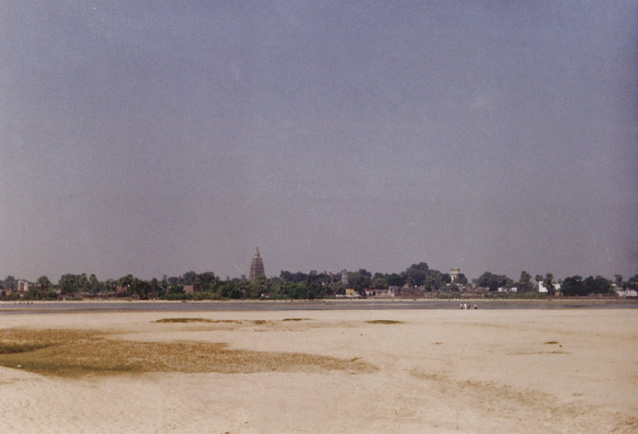

法王去时，河水比较丰沛。我们的车底盘很高，可以直接开到河的对岸。

在佛陀苦行的地方，有一棵菩提树，后人在树下修了一个法座。法王到了那里之后，给大家讲起佛陀苦行的经历，说：“佛陀在共同所化众生面前，示现了六年苦行，终获大彻大悟。作为佛陀的追随者，我们也应该为求正法，不惧任何苦行。在修行中遇到任何磨难，都要有坚强的毅力。”

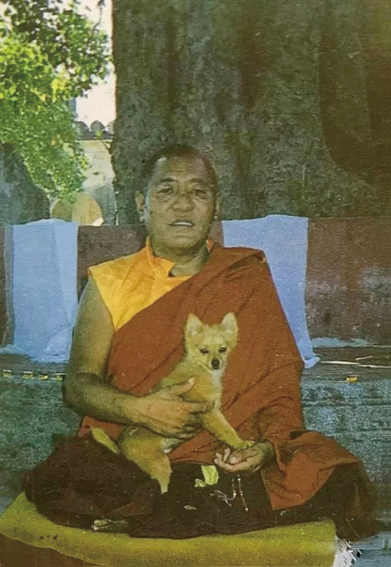

法王在菩提树下入定了很长时间。之后，带大家一起念了《普贤行愿品》。

离尼连禅河不远，有一片郁郁葱葱的森林，那里有牧羊女供佛的塑像。法王向所有人讲了这个故事，并念了一些比较短的愿文。

之后，我们朝拜了河岸上的其他圣迹，并做了发愿。

当时，法王还以开取伏藏的形式，得到了佛陀苦行时的一件物品，但我们周围的人都不知道，也没有觉察到。回到佛学院后，有一次法王在僧众面前拿出一个小小的黑色器皿，像一个杯子，说：“我前一段时间去尼连禅河时，在树林中得到了它。这也许是佛陀苦行时喝水的东西。”然后，法王将水倒入器皿，给身边的许多人喝。相信老道友都记得这一幕。

1990年11月2日

在正觉塔东北侧的院墙外，有一个著名的哈哈笑尸陀林，周围环绕着许多小佛塔。尽管已荒废了很长时间，但身处其中，仍然有一种威猛的感觉。有人说，把自己的头发埋在这个尸陀林中，将净除罪业而不堕恶趣，所以我们剪了一些头发并放在那里。

旁边有一个小房子。我走进去，看到一块刻着坛城图案的石头，纹理不是很清晰。根据藏地文献，这是桑吉益西大师制作的时轮金刚坛城。这间小房子在当地很出名，许多人都前来朝拜。

当天恰好是藏历十五号，法王带我们在菩提伽耶的菩提树下，念了很长时间的《普贤行愿品》，并做了会供。参加活动的人比较多，有随行法王的人，也有附近的藏人。

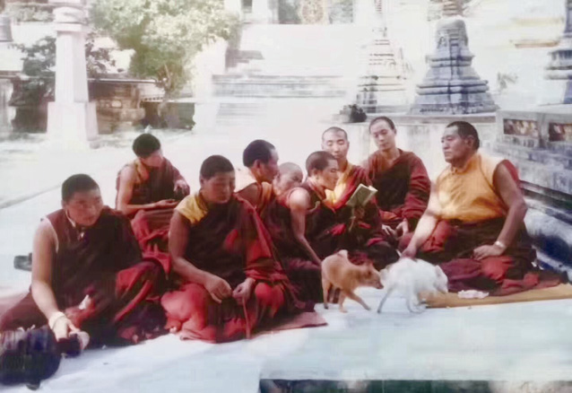

我在菩提伽耶为法王读《印度游记》

菩提伽耶是千佛成道的圣地，因此，我在这里请了一些易于携带的小佛像，其中一尊保存至今。此外，我们还拓印了一些佛陀的脚印，并将它们带回去当作很珍贵的加持物。

1990年11月3日

早晨，我们离开了菩提伽耶，驱车前往70多公里外的灵鹫山（Gridhrakuta）。

我坐在车上，依依不舍地看着正觉塔，看着它越来越远，直到看不见为止。我合掌一次又一次地祈祷，希望有生之年可以再来朝拜这个佛陀证悟的圣地。但是从那以后已经三十年了，我没有机会再去朝拜。也许一辈子都不会有了。

实际上，朝拜诸佛菩萨、高僧大德加持的圣地，以及礼拜佛像、佛塔、佛经等三宝所依，是非常有意义的。这些殊胜对境会给我们带来一种特殊的感染力。在朝圣过程中，如果用非常真诚的信心、恭敬心、欢喜心祈祷和发愿，自然会得到上师三宝的加持，使大悲心、菩提心、无二慧等功德不断增上。因此，我很珍惜这次的朝圣机会，每一站都非常认真地朝拜、发愿，没有任何散乱和懒惰。

之后，我们到了灵鹫山。灵鹫山附近有一个大山洞，当地人说这是第一次结集三藏的地方。但是，它并不是以大迦叶为首的上座部的结集之处——七叶窟，可能是大众部结集的地方吧。

法王朝拜了这个山洞。一位印度人说，有授记说将来会有大德在这里开取伏藏，法王应该就是这位大德。但法王没有对此特别关注，只是带我们在这里发了愿。当时，洞壁突然流下了甘露，法王用手接着喝了一些，然后抹到了头上，并且让我们也喝了。后来我听说，这个山洞以前从来没有水，以后也没有过。

然后，法王来到灵鹫山。灵鹫山是一座不太陡峭的小山丘，山上草木丛生，有许多岩石。有一段路无法通车，法王下车走了一会儿。当天太阳特别强烈，好像要把人烤熟了一样。休息时，法王坐在一个地方，对所有人说：“灵鹫山是佛陀第二转法轮的圣地。我们可以来到这里，是很有福报的。第二转法轮的主要教义，是大、中、小《般若经》；而以显义、隐义的方式诠释《般若经》的，分别是中观、现观。今天没有太多时间谈论这个，我就给大家传一下《心经》吧。”然后，法王背着念了《心经》的传承，还念了一个《般若愿文》[^5]的传承，并带大家共诵《普贤行愿品》。

发愿过后，法王说：“六世达赖来到这里时，看到山上满是经书。我现在看到的一切都是光明，真正现前了‘佛陀无涅槃，佛法无隐没’的境界。你们去山顶吧，我就不去了。佛经说，佛陀在山上传法时，不喜欢爬山的比丘经常受伤。我今天会不会绊倒也不知道，所以在山下发愿就可以。如果你们脚力不错，可以上去转转，但不要拖延太久，今天还有许多地方要去朝拜。”

佛陀在灵鹫山传过《法华经》《般若经》《稻秆经》等，但是具体在哪里传了哪部法，问了很多人都不知道。我们请了一位藏族导游，在爬了一段山路后，他指着一块大石头说：“这就是佛陀转法轮的地方。”我们在那里简单发了愿，拍了几张照片，担心上师一直在等，就尽快下山了。

一路上，许多人都在卖念珠，说是用当地菩提树的果实制成的，而且不太贵。我买了十几串，带回藏地送给道友当礼物。

然后，法王继续赶路。在去王舍城的路上，看到了佛陀居住多年的一座山，叫加桑山。我们远远地做了礼拜、发愿。

之后，到了竹林精舍（Venuvana）。它是频婆娑罗王为佛陀建造的，佛陀住了很长时间。这里有个池塘，据说佛陀曾在其中沐浴，加持很大。法王和我们在这里做了象征性的沐浴，洗了洗脸、手、脚等，念了一个短愿文。

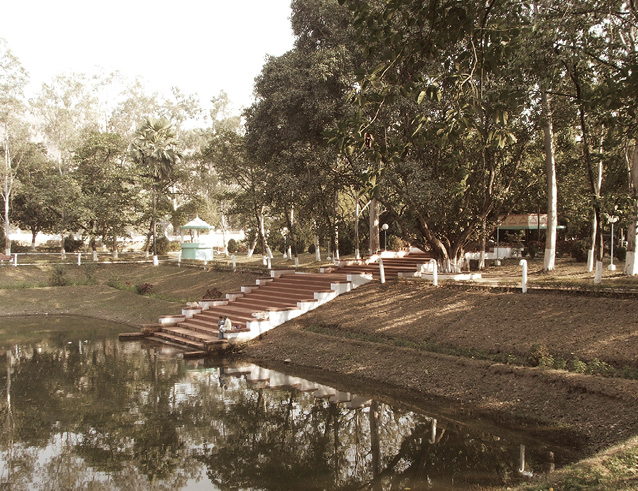

接着，法王去了七叶窟（Saptaparni Cave）。这是佛陀涅槃后第一次结集三藏的地方。从这里开始，佛法正式以文字的方式传播出去。法王给我们念了《三十五佛忏悔文》的传承，并简要介绍了第一次结集的过程，以及频婆娑罗王、阿阇世王的一些故事。

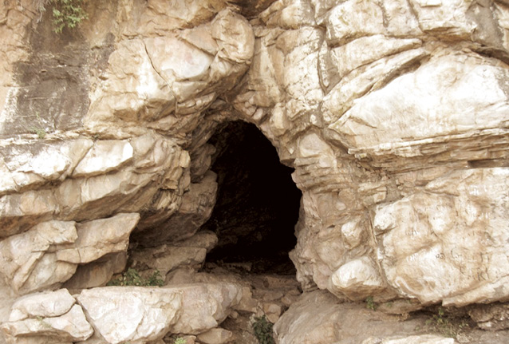

晚上住在那烂陀附近。

1990年11月4日

在古印度，佛教达到最鼎盛时，有那烂陀寺、戒香寺、飞行寺三个最高的佛教中心。

那烂陀寺（དཔལ་ན་ལཎྚ།，Nalanda University），由帝日王于5世纪建成，后来屡加扩建，成为一个规模宏大的佛教道场。它有超过九百万卷的藏书，龙树、月称、圣天、寂天、无著、世亲、陈那、法称、莲师、静命、贝若扎那、玄奘、义净等大德都在那里修学过，曾有上万僧人聚集于此。在7世纪，它是全印度瞩目的大乘佛教中心。12世纪，被伊斯兰军队占领并一炬烧毁，其藏书持续焚烧了六个月。如今，那烂陀寺只有废墟。当考古学家在20世纪初挖掘该遗址时，发现它的面积为100万平方米。

距离那烂陀寺约11公里处，是飞行寺（ཨོ་ཏནྟ་པུ་རི།， Odantapuri）。它也被称为“欧丹达布梨”。这是一个重要的密宗佛教道场。它建于公元8世纪，由波罗王朝的国王达磨波罗建造，是仅次于那烂陀寺的印度第二古老大学。根据西藏文献，昔日有多达12000名学子到这里求学。帝洛巴、那若巴曾住锡于此，阿底峡在这里跟法护学《大毗婆沙论》十二年，玛尔巴和阿底峡在寺内也曾多次见过。12世纪末，就像那烂陀寺的命运一样，飞行寺也被伊斯兰军队摧毁。

在飞行寺200多公里外，是超戒寺（བི་ཀྲ་མ་ཤི་ལ།， Vikramashila）。它被藏传佛教称为“戒香寺”，是国王达磨波罗于8世纪所建。这位国王为佛教做出了巨大贡献，他先在那烂陀附近建了飞行寺，继而又建超戒寺，其规模胜过那烂陀寺。超戒寺在400多年中受历代国王保护，共有一百多个僧院、六处研究院，四方的每个大门都有一位护门班智达，接受来自各方的问难、辩论或挑战。13世纪初，伊斯兰教军队烧毁了印度仅存的佛教中心——超戒寺，标志着佛教在印度本土宣告绝迹。

这三个伟大的寺院，藏地大德在著作中经常提到，对它们的名字我们耳熟能详，所以在安排朝圣时，法王很想去朝拜。然而，多方打听之下，当地人说只有那烂陀寺可供瞻礼，而超戒寺被淹没在帕格尔布尔附近的河中，遗址已不可寻；飞行寺被摧毁后，也找不到具体位置。因此，我们不得不改变计划，只去了那烂陀寺。

当法王到达那烂陀寺时，看到昔日辉煌的佛教重镇，只剩下一片废墟，特别伤感。法王站在一片空地上，给大家讲述了那烂陀大德的无上法恩，并念了那烂陀五百班智达共造的《文殊礼赞》传承，还带大家发了愿。

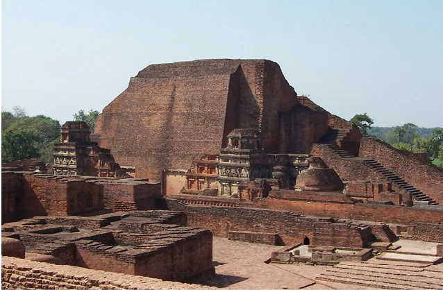

我抚摸着那里的残垣断壁，转绕着大大小小殿堂的遗址、僧众寮房的地基，不禁涌出浓浓的悲伤。想起曾经在这里求学的龙树、月称等圣者，不知道废墟中是否有他们的住处，于是我蹲在地上用手挖，挖到了一块古旧的瓦罐碎片，不知道是不是他们用过的，就把它带回来了。

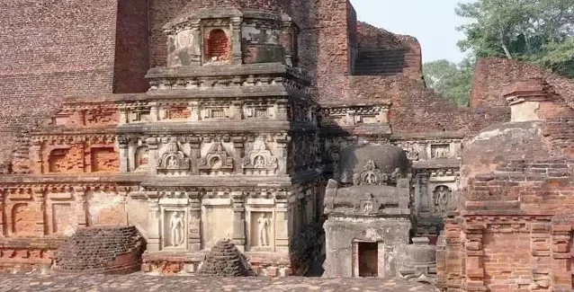

在写这本书的时候，为了找到飞行寺和超戒寺，我还询问了印度的学者，并查阅了很多资料。但是，由于印度不太重视历史记录，因此很难在这方面找到特别可靠的依据。

后来，在根登群培的书中，我发现了《玛尔巴上师全集》的一段文字，有助于确定飞行寺的位置。书中说飞行寺位于一座山上，山顶的形状很奇特，向西藏方向倾斜。原因是：玛尔巴在给米拉日巴传法后，又去了一趟印度的飞行寺，向上师那若巴求取更殊胜的密法。有一次，他请上师传授迁识夺舍法，上师问他为什么求这个法，他说：“我有一个弟子，名叫闻喜（即米拉日巴），是他得到空行母的授记和指点，想求这个法。”听了这话，那若巴双手合掌，赞叹道：“北方黑暗处，如日照雪山，名为闻喜者，顶礼彼尊者。”然后闭目向西藏俯首并点头三次。此时，山和树也一同俯首点头三次。直到现在，这座山和树木的顶部，仍然向西藏微微弯曲。

如今，据说在比哈尔谢里夫（བྷི་ཧར་ཤཱ་རིབ།，Bihar Sharif）车站以西，有一座扁平的石山，离那烂陀寺不远，应该是飞行寺的所在地。近代一位藏族学者去朝拜时，那里荒无人烟，杂草丛生，只有一条小路。在过去，伊斯兰教占领了印度的佛教寺院之后，要么彻底摧毁，要么变成埋葬尸体的地方。时至今日，飞行寺仍由外道管辖，埋葬信徒的尸体，不允许外人朝拜。那位学者透过门缝偷偷往里看，发现中央大殿的附近有坟墓，坟墓上覆盖着伊斯兰教的绿色旗帜，附近还有寺庙的一些遗迹。

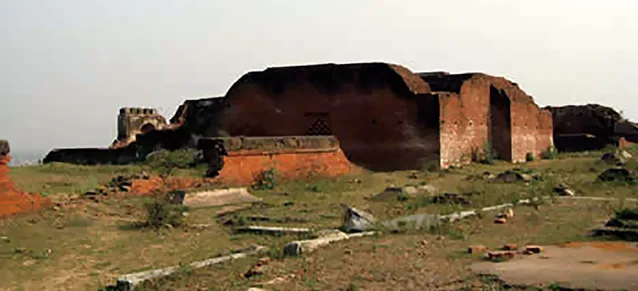

后来，我通过卫星地图，在比哈尔谢里夫，果然找到了一个扁平石山——巴里帕哈里山（Bari Pahari），海拔约100米。山上有一处像是寺庙的废墟，大殿位置的中央有个巨大的坟墓，据说是穆斯林国王马利克·易卜拉欣·瓦亚之墓。根据这些细节，估计这里就是飞行寺的所在地。

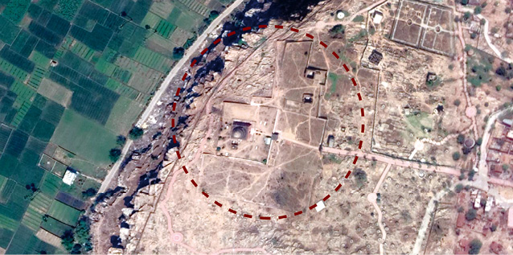

至于另一座寺院——超戒寺的位置，在根登群培的游记中不是特别明显，当地的藏族人也不知道。后来我了解到，近年来印度学者在帕戈尔布尔（བྷ་གལ་པུར་གྲོང་དང་ཐག་ཉེ，Bhagalpur）附近发现了它。超戒寺在印度被称为布扎玛希拉（Vikramshila），它位于印度东北部，在帕格尔布尔东北偏东的恒河岸边，以前有许多强盗，普通人很难到达。但现在人们可以去朝拜，据说印度政府打算修复它。

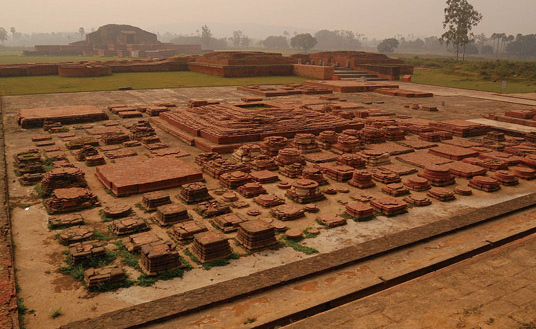

法王在世时，非常重视飞行寺和超戒寺，经常向我们提起：飞行寺是印度的密法道场，被外道彻底摧毁后，该寺许多僧人将密法带到了藏地；国王赤松德赞在建造桑耶寺时，跟莲师和静命论师商量，将其根据飞行寺的布局进行修建[^6]；阿底峡尊者来西藏之前，曾担任超戒寺的住持……所以去印度时，没有因缘朝拜那两处圣地，对法王来说是一大遗憾。

当天，法王离开那烂陀寺之后，驱车前往300多公里外的瓦拉纳西（ཝཱ་ར་ཎཱ་སི།，Varanasi）。途中路过一片大草原，当地人介绍这是广严城。法王下车后看了一下，没有逗留太久，也没有发愿。后来我才了解到，佛经中的广严城不在那里，而是在印度的另一个地方。

晚上，我们住在鹿野苑（Sarnath Deer Park）附近。

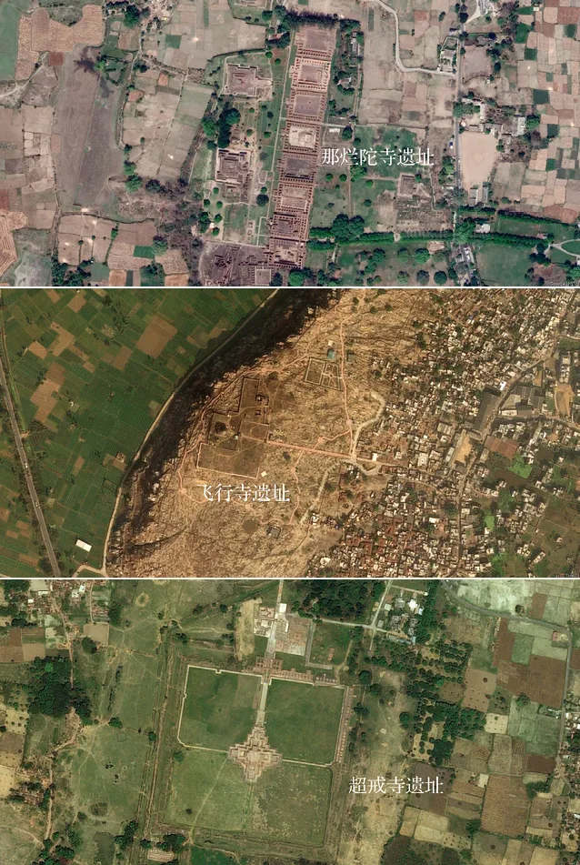

1990年11月5日

鹿野苑是释迦牟尼佛初转法轮的圣地，也是解脱智慧在世界上最早开启的地方。阿育王曾在这里建造了佛陀的纪念塔，但100多年前，瓦拉纳西的一个恶臣将其破坏，到目前为止，只有少数遗迹存留。

历史上，佛教被外道摧毁后，一度在印度堙没了几百年。在这期间，耆那教的信徒们还在鹿野苑修过殿堂，并将周围的佛教圣地变成了猪圈。那时候的鹿野苑，很难找到佛陀转法轮的遗迹。

19世纪末，斯里兰卡居士达摩波罗来到鹿野苑，克服重重困难，建造了佛教寺院。同时，他从斯里兰卡迎请出家众前往印度，重建僧团，开创了印度佛教的后弘时期。鹿野苑还有一棵高大的菩提树，是他从菩提伽耶的菩提树上折枝移植的。后来，他在鹿野苑的寺院出家，并圆寂于此。为了纪念这位伟大的佛教徒，人们在鹿野苑建造了他的雕像。

当年我们去印度朝圣时，无论去哪个佛教圣地，都能听到“达摩波罗”的名字和他保护圣地的行为。回到藏地后，法王还在课堂上讲过他全力护持佛教的感人故事。

那天，法王到了鹿野苑后，第一个地方就是直接去佛陀的初转法轮处。那里有后人建造的一组塑像：佛陀以说法手印传法，五比丘在一旁恭敬聆听。整个场景非常生动。附近还有佛陀传法的法座，我们在那里念了《普贤行愿品》发愿。当时有许多藏族信徒闻名而来，法王给大家讲了佛陀初转法轮的故事，并做了一些简单开示。

之后，在当地人的推荐下，法王参观了鹿野苑历史博物馆。博物馆的大部分藏品，都是穆斯林摧毁佛教圣地后所留下的残缺佛像。其中，阿育王在鹿野苑所立的石柱特别有名。石柱高约12.8米，柱身已断裂，但柱头保存完好。柱头上有四只狮子，背靠背，面向四方。据说石狮背上原本驮着代表佛法的法轮，但已经遗失。印度国徽上的图案，就是石柱上的这四只狮子。

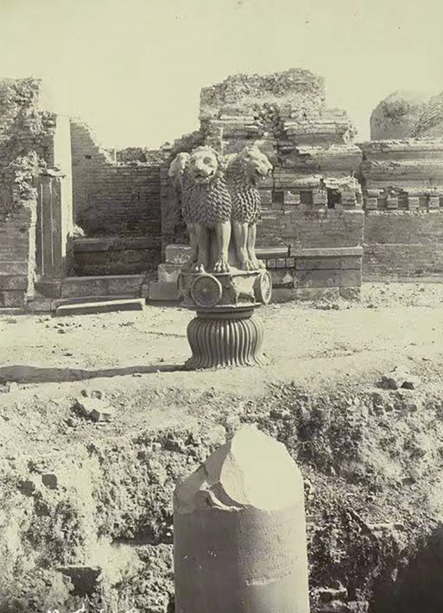

阿育王石柱的狮子柱头

下午，法王转绕了达美克佛塔（དྷརྨ་ཀ，Dhamekh Stupa）。这是鹿野苑最大、最引人注目的建筑。塔高43米，直径28米，是圆筒形二层建筑物。在过去的历史中，鹿野苑的所有建筑都被穆斯林破坏殆尽，但这座塔却很幸运地保存了下来，属留存极少的阿育王时期建筑。

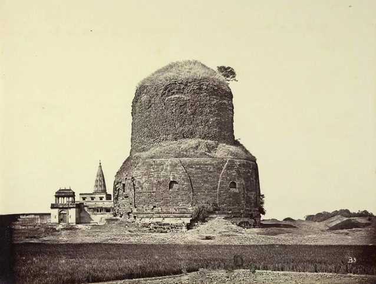

达美克佛塔

法王转绕佛塔之后，应瓦拉纳西高等研修中央学院的邀请，给该校师生传授了“文殊智慧勇识”灌顶，并讲了佛陀初转法轮的四圣谛教言。法王提醒他们，作为一所世间学校，若要探索万法的真相，应结合科学来研究佛教的奥秘。

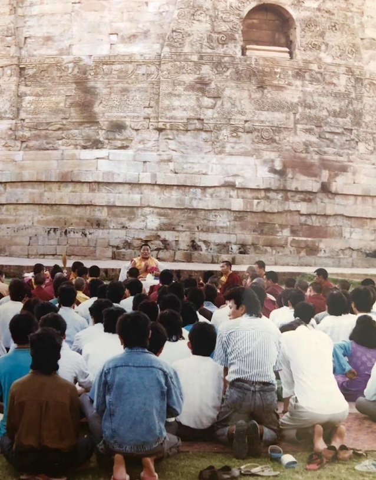

这时，突然天现祥云，就像一条条白色哈达延伸至四方。法王高兴地说：“我在佛陀初转法轮的圣地讲法，出现了这样的祥云，缘起很吉祥。虽然我现在眼睛不好，几乎看不清文字，但依此看来，我将来还需要继续转法轮。”后来法王回到佛学院，打算修建大经堂。在规划地勘的第一天，法王召集有关人员商议时，天空中也出现了一模一样的祥云。法王告诉大家，这是我们应该不断弘扬佛法的缘起。

当天，我拍了很多照片。晚上回去后，法王批评我：“去圣地应该以发愿为主，不是以观光为主。你不要经常拍照，否则，就像《莲苑歌舞》中所说：为了旅游而朝拜神山，为了享乐而住在静处，这些表面的行善，没有任何意义！”

看到上师显得不高兴，我特别害怕，在上师面前哭着忏悔。但从第二天上师的语气来看，上师并没有生气，反而对我更加慈爱。也许依靠上师的这种示现，消除了我未来传法的许多违缘。30多年来，我弘扬佛法一直比较顺利，这应该是上师赐予的最大加持。

不管怎么样，后来朝拜几个圣地时，我收起了相机。一段时间内，一张照片都不敢拍。我心里觉得：如果上师不高兴，拍这些有什么用呢？

1990年11月6日

早上7点从瓦拉纳西出发，经过200多公里，下午3点多，到了拘尸那罗（རྩ་མཆོག་གྲོང་།，Kushinagar）。

拘尸那罗是佛陀的涅槃地。法王到达之后，立即前往佛陀最后传法的地方。然而，由于历史的变迁，佛陀涅槃时的娑罗双树已经消失。只有后人象征性地种了两棵娑罗树，树龄约有二三十年。

离这儿不远，有一棵不太高的树，据说是佛陀宣讲《涅槃经》之处。法王告诉所有人，当佛陀接近涅槃时，先传讲了《时轮金刚》，之后是《涅槃经》，然后在娑罗双树下示寂。《涅槃经》是佛陀最后讲的一部经典，所以，法王在这棵树下念了一些短的发愿文。

法王还说：“拘尸那罗跟其他圣地不同，这是佛陀最后传法的地方，也是度化最后一个众生的地方。佛陀在涅槃前对阿难说：‘我马上要离开人间了，你有什么问题应该尽快问。’但阿难因为特别伤心，泣不成声，再加上魔王作梗，使他没有听清楚，所以错过了这个机会。本来戒律的开遮持犯在后世可随顺当地做一些开许，但他没有问。”

然后，法王去了大涅槃寺（Nirvana temple）。寺内有一尊巨大的佛涅槃石像，虽然这是后人所雕，但佛陀的神态慈悲安详，宛如在世。法王靠近佛像的上半身，一边磕头一边含着泪说：“佛陀入灭是为了向众生展示无常。佛陀涅槃之前，把法衣拉下来露出上身，告诉阿难等人：‘诸比丘请看，一切有为法是无常。’这是佛陀的最后一次教导。”

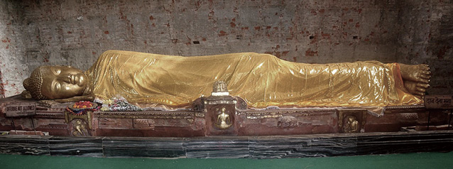

当时法王显得特别伤心，泪流满面地说：“大慈大悲的佛陀，他的色身在具有常执的众生面前已示现隐没。对娑婆世界的众生而言，光明的太阳已落入了西山，我们所有众生在黑暗中多么可怜！”之后非常悲伤地念了《普贤行愿品》。

我跪在法王的旁边，看着佛陀涅槃像，不知不觉被带到了佛陀涅槃的现场，感受非常强烈。后来，我问了其他去朝拜的人，他们似乎没有这种感觉。

法王的朝圣，确实不同于世人旅游。一般人来到这些圣地，只是拍拍照片、看看风景、听听历史故事。而法王的心与佛陀连在一起，佛陀的慈悲和智慧深深植根于他的骨髓，融入他的修行和生活。因此，依靠法王的巨大加持，我瞬间回到了过去的佛陀时代。

从大涅槃寺出来，太阳快要落山了。旁边是一座白色的大涅槃塔，法王带我们做了转绕。

大约一公里外有佛陀的荼毗塔（མུ་ཀུ་བྷན་དྷན་ཙ་ཡེ་ཏྱ།， Mukutbandhan-Chaitya），是佛陀荼毗后八大国王分舍利的地方。在记忆中，法王没有去，我去那边转了几圈很快就回来了。

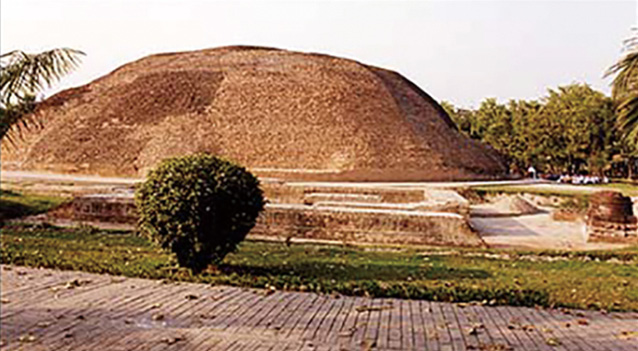

当离开拘尸那罗时，天完全黑了。天气特别闷热，我的心情也很沉重，觉得心中的太阳已经消失了。黑夜中，在附近找了一家旅馆住下。

写到这里，我不禁想起人生中的另一次“太阳”隐没：当法王还在世时，每次出去都会带我，只有一次没有带，结果就是最后一次。那次，法王下山去成都看病，我在居士林目送他的车渐行渐远，从此就再也没有见过上师。那天法王的笑容，是我最后一次看到法王的色身；“莫舍己道、勿扰他心”，是我最后一次听到法王的声音。后来在喇荣，看着法王法体荼毗的火焰，我仿佛被无边黑暗吞没。如今，我只有把法王的骨舍利戴在脖子上，当作心中的太阳。

当然，无论是佛陀还是上师，色身虽已融入法界，但他们的法身——佛法，比色身更重要。因此，我要以利益众生为终极目标，把佛法以闻思修的方式一直弘扬下去。这样，他们的智慧身永远不会消失。

1990年11月7日

早上7点，离开了拘尸那罗，然后坐车319公里，于下午5点到达舍卫城（མཉན་ཡོད།，Sravasti）。

舍卫城是佛陀居住时间最长的地方，前后加起来总共待过25年。《楞严经》《阿含经》《大宝积经》《阿弥陀经》《金刚经》等佛经，就是佛陀在这里宣说的。舍利子、目犍连、迦叶、五比丘、十六阿罗汉等比丘，也在这里生活了很长时间。因此，舍卫城在佛教中具有非常特殊的意义。

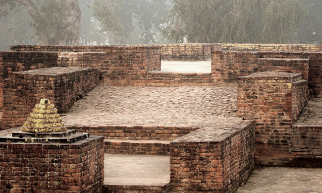

犍陀俱提精舍

法王去朝拜的地方，主要是佛陀住过的四个房舍。其中一个被称为犍陀俱提精舍（Gandhakuti），位于祇园精舍一带，这是佛陀传讲《阿弥陀经》的地方。

在精舍附近，有一棵印度最古老的菩提树，树枝被一些桩子支撑着。据说这棵树是阿难因为怀念佛陀，请目犍连尊者从菩提伽耶的菩提树取下一个枝丫带回来，再由给孤独长者亲自种下，因为这棵树与阿难有关，因此，它也被称为“阿难菩提树”。法王在菩提树旁边做了开示，之后念了《普贤行愿品》发愿。

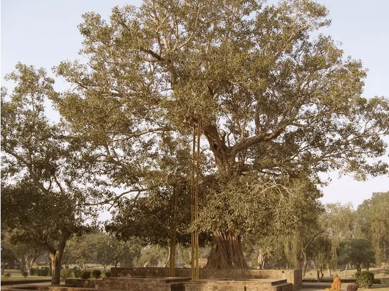

然后，我们去朝拜了指鬘悔改证果处、给孤独长者故宅、提婆达多陷入地狱的大坑。还有一个地方，是佛陀去忉利天为母说法的升天之处，但我们没有过去，只是远远地看了一下。

本来，法王想要去佛陀从忉利天降临人间的地方——劫比那国（今桑伽施），但它离得比较远，因为时间紧，实在没办法。据说那里是一座小山，山上有殿堂，野鹿、孔雀等动物很多。当地人说，它的环境非常舒服，站在山上，似乎离天特别近，有一种与众不同的加持。

当天，我们朝拜完所有的圣地后，天都黑了。晚上住在附近的地方。

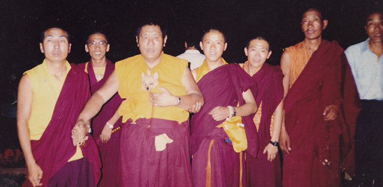

[^1]: 敏珠林寺：宁玛派的六大传承之一。当时该寺有300多名僧人。
[^2]: 吉祥山现位于著名的水坝（Nagarjuna Sagar Dam）所在的湖中央。
[^3]: 这个故事，与恰译师去印度朝圣后所记录的故事，在个别细节上略有出入，但大致情节都一样。
[^4]: 也有人认为，历史上的清凉尸陀林不在这里，而在另一个地方。
[^5]: 不知道当时传的是哪个《般若愿文》。
[^6]: 建有经藏传规之大坛城、律藏传规之经堂、论藏传规之须弥山及四大部洲、日月等象征建筑。
