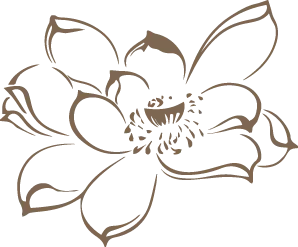
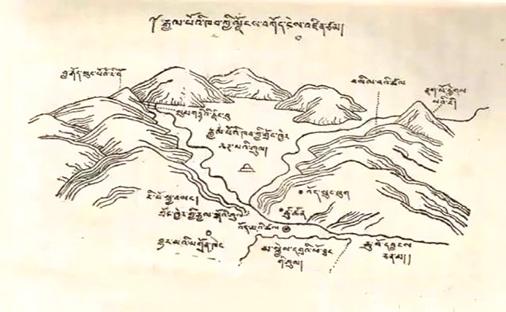
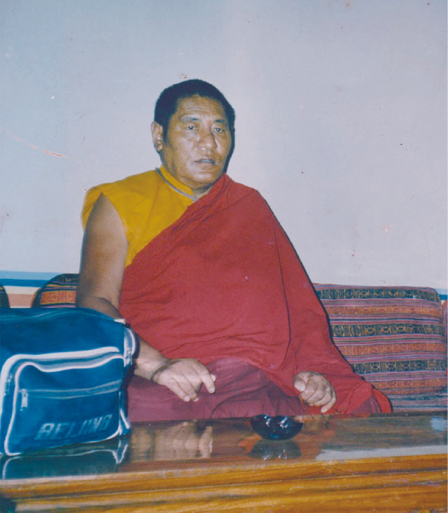
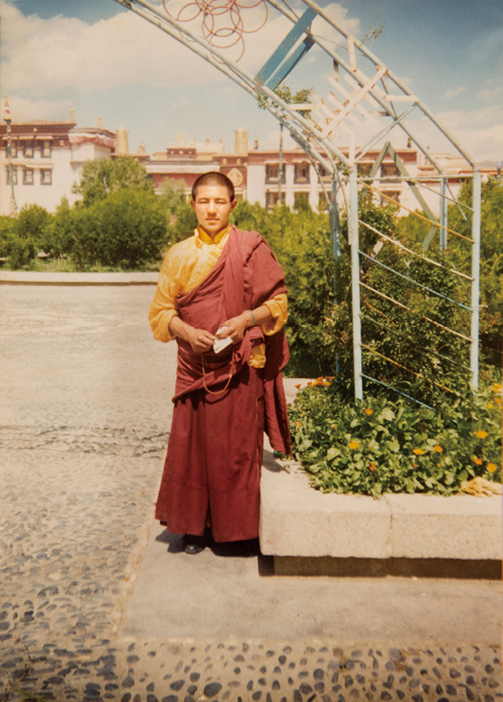
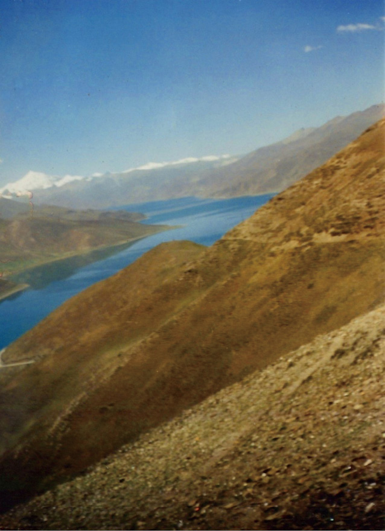
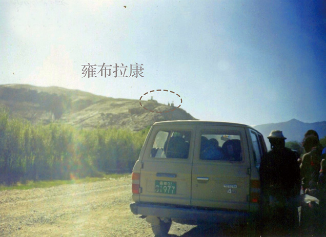

# 缘起

1990年春天，法王住在一间小平房里，向大众传讲敏朗大师的《普贤行愿品释》。课余时间，我给汉僧讲《入中论·善解密意疏》，给藏族喇嘛讲《智者入门论》。同时，来自印度的南珠堪布也给堪布们讲授《入中论》。

有一天，法王把我叫过去，突然问：“你想去印度吗？”我本能地脱口而出：“当然想啊。”

法王说：“印度有一座敏珠林寺，他们需要一位堪布讲经说法。如果你去了，能在那里待三年吗？”

那段时间，有传言说法王要去印度，每个弟子都渴望和上师一起去。南珠堪布经常说印度有多美、气候有多舒服，即使在冬天，也不需要穿厚衣服，这让大家更加向往。突然听到法王这样问，我不假思索地回答：“如果能去，待三年也没问题！”

法王点点头说：“先不要告诉别人，你把身份证交给某人申请护照。”

当时法王是边喝茶边说的，手里拿着一个从北京买来的白玉碗，身边围着许多小狗，一只叫内悟类的大狗正在酣睡……这一幕我记得清清楚楚，纵然时隔多年，也像发生在昨天一样。

法王和我聊天的时候问：“你看过关于印度的资料没有？”我回答说：“看过一点。我很喜欢根登群培的《印度游记》、多罗那他的《印度佛教史》。”

法王问了一些细节，我一一回答。我还提到根登群培在《印度游记》中引用过一段佛经教证：“如果能朝拜佛陀的四大圣地——降生处、成道处、初转法轮处、涅槃处，那和亲见佛陀没什么区别。”法王听了之后非常高兴，说：“如果这次去得成，我们应该朝拜这些圣地。”

根登群培手绘的印度地图

后来我随法王去印度，就带了一本《印度游记》，封面已磨得破破烂烂。

那一年，法王58岁，我29岁。

很难想象我能有这样的机会！虽然我知道许多经论的作者，如莲师、龙树菩萨、寂天论师、月称菩萨，都来自印度，我也对印度心生神往，但从未敢奢望能和法王一起去。这么意外的惊喜从天而降，我甚至怀疑是不是因为我1986年和上师出去时做过一段时间的侍者，可能我当时比较勤快，跟上师身边的人都合得来，从来不跟别人吵架，所以上师才选了我？

兴奋过后，接下来的就是压力。毕竟像法王这样伟大的人物，我随侍在身边的话，如果有些事情做不好，各方面都有一定的责任。

1990年5月8日—5月30日

从那天起，我开始做各种准备工作。

当时，佛学院许多僧人去法王的出生地建造佛塔，我也很想去，但是抽不出时间，一直在给汉藏僧众传讲未完成的课程，同时在查阅印度的相关资料。

春天过后，法王去青海果洛传法。我回了趟家，想准备点钱。那时候父母没有多少钱，我去朵芒寺找负责财务的管家借，他说没有——可能确实没有，因为当时大家条件都不好；也可能是有钱不想借，怕我以后还不了。

我又去炉霍县城找一位老领导借钱。他给了我120元，说：“如果你和慈诚罗珠堪布都去，就供养你们每人60元；如果只能去一个，120元就归这个人了。”后来，这些钱就都给我用了。

1989年我去丹巴的雅绕寺安居时，寺院负责人给了我1600元，让我帮忙请一套《麦彭仁波切全集》。我问他能不能先把钱借给我，一年后再帮他请书。同意后，我把这笔钱带上了。

另外我平时也有点积蓄，又跟道友借了点钱，一共凑了3000多元。为了记录法王朝圣的珍贵时刻，我准备了一台170多元的海鸥相机，还买了一些质量最好的柯达胶卷。

那个年代，出国申请护照很难，尤其是藏族人去印度，更是难上加难。5月8日，出国手续终于全部办妥了。

这次法王去印度，带了索顿喇嘛、热巴医生和我三个弟子。

索顿喇嘛，是跟随法王多年的侍者。尤其在法王晚年的时候，都是他在身边承侍。如果有非常重要的客人来见法王，都是他来决定和安排。

出国时，他负责法王的饮食。因为他要给法王做酥油茶，所以经常背着一个酥油桶，就像背着枪一样。有一次上飞机，因为酥油桶太大，横着进不去，他很着急，使劲往里塞，在机舱门口耽搁了很长时间。

他还有一个煮茶的电茶壶。这个壶的插头是三脚的，但印度很多旅馆的插座上只有两个孔。他以为插座坏了，然后拼命挖，结果没有用。

现在他70多岁了，在一个寂静的山里闭关。

热巴医生，是法王最重要的私人医生之一。他负责法王的健康多年，法王去印度、新加坡时都带着他，法王晚年的医生也主要是他。他的医术很好，虽然没有上过正规的医学院，但他不仅学了一点藏医，还学了西医，经常给法王量血压、听诊、打针。出国的时候，他每天晚上都会打开药箱，摆弄形形色色的药。

他非常有智慧，经常提醒我一些重要的事。比如法王第二天要见一位大德，他会问我要不要准备哈达，我立马觉得有必要。如果法王想回赠对方哈达，我却没有准备，场面会非常尴尬。

他对法王特别有信心。刚到印度的时候，他激动地说：“有些大德的传记里说，大德带着身边的人飞走了。看看我们，前两天还在藏地，现在就和法王飞到了印度，这是很多人做梦也想不到的。这是上师的神变吧！”当时坐飞机的人很少，而且我们是第一次出国，所以他很认真地说了这些话。

现在他也70多岁了，在道孚的一座山上闭关。

而我，是法王出行时的秘书和翻译。和他们的工作相比，我面对的变数更多，每天发生的事情也不确定，经常要根据现场情况随机应变。

1990年5月31日—6月3日

法王从果洛归来后，给僧众灌了“文殊静修大圆满”和“缘起除障法”的顶。

灌顶结束后，法王宣布了出国计划，说：“这次印度之行对我很重要，因为我要开取一些伏藏，朝拜一些圣地，会晤一些大德。在我离开佛学院的日子里，希望大家一如既往地精进闻思修行，不要到处乱跑。我之前给你们传讲的一些显密佛法已经圆满，为了庆祝，我们明天开始耍坝子。”

之后，法王带领大家在紫青朵搭帐篷耍坝子。僧众供养了金刚舞，表演了格萨尔王传。

当时，洛若乡的僧俗弟子要跳七大护法的金刚舞。然而演出当天，扮演红黑仙巴夜叉护法的僧人突然生病，卧床不起，其他人都不会跳，于是，表演时只出现了六尊护法神。他们特别担心破坏法王此行的缘起，没人敢告诉法王这件事。没想到，法王看完表演后，高兴地对大家说：“红黑仙巴夜叉护法今天没来，因为他要留在喇荣保护僧众。其他六位护法，这次会和我一起前往印度。”

耍坝子期间，我白天去那里，晚上回来做各种出行准备。因为马上就要去印度了，法王随时会问我当地的人文历史，所以一定要提前查各种资料。当时没有网络，信息也不发达，查这些内容特别不容易，有时候我不得不从其他堪布那里借书看。

在此期间，嘎巴堪布圆寂了。他是法王去石渠求学时的忠实道友，我在他面前听过《大幻化网》的传承等很多法。这个消息让我伤心了很久。关于他的修行事迹，我后来写在了《密宗虹身成就略记》里。

耍完坝子，法王去色达参加了一些会议，都是关于出国的各种注意事项。

1990年6月4日

清晨，在下山之前，法王给僧众讲了很多教言，让大家在佛学院好好闻思。但是众弟子不知道法王能不能回来，就哭着在车后拼命追，一直追到了很远的地方。

有个喇嘛还写了一首诗，大意是，他送法王离开的时候，最初是用身体送，渐渐地，身体追不上了；又换成用眼睛送，慢慢地，眼睛也看不到了；最后只能在心里送，让自己的心陪法王越过万水千山。他的描述相当感人，法王从印度回来后，在课堂上提到这个表达很有意思。

离开佛学院后，法王顺道去了霍西。当时，色达县政府正在那里修建水电站。打过山隧洞时，有一条隧洞打至阿拉神山便停滞不前，用尽各种技术仍纹丝不动。无奈之下，色达县领导和水电站负责人去佛学院求法王加持。法王用开玩笑的口吻说：“让我加持没问题。但是，我们佛学院没有电。等我从国外回来，很想看到这里也通电了。”他们一再承诺会做这件事。于是，法王路过霍西水电站时，特地下车在阿拉神山前念了一段经，然后继续赶路。

据说在法王的加持下，难关很快被攻破，隧洞顺利开通了。

1990年6月5日—6月15日

一路上，法王去了炉霍、道孚的几座寺院，向当地百姓传授佛法。

1990年6月15日—6月18日

法王到达康定，参加了甘孜州公安局、宗教事务局、政协和佛教协会的会议。

会议期间，一些宗教人士对法王去印度提出质疑，并制造违缘。

当时公安局有一位领导，是法王多年的好朋友。他喜欢喝酒，长得胖胖的，说话很有分量。我下午去找他，把情况相告后请他帮忙。他刚喝完酒，醉醺醺的，大着舌头答应：“这事包在我身上，没问题！”我怕他有点迷糊，醒来就忘了。没想到第二天早上再去时，他已经把内部关系都协调好了。

他不仅在法王去印度时帮了大忙，1993年法王去美国时，他也一路开绿灯，给出行提供了很多便利。要不是他，那两次出国将机会渺茫。

从那以后，我有事经常去找他，有些是法王的私事，有些是道场的事情，他都帮着调解了不少。

其实他私下也有自己的信仰和修行。几年前他已离开了人世。

1990年6月19日

我们一行三辆车离开康定，前往成都。紧跟其后的还有几辆车，是专程来送法王的。

穿越二郎山时，那条路很难走。与现在有隧道和水泥路不同，当年只有一条山路，是单行道，上山的车下午放行，下山的车上午放行。由于下大雪，道路非常滑，交通事故频频，很多车都不敢开，只能停在路边，道路变得特别拥挤，我们的车开不过去，所以延误了很长时间。

越过山顶时，路况变得更加危险。山上雾很大，能见度极低，地面特别滑，道路也更窄了。路上有很多车子翻了，甚至有一辆当场翻下了悬崖……我们把链条绑在车轮上，但车身还是不稳，只能一点点地挪动。

很晚才到达成都。那个年代没有宾馆，我们住在四川省民委招待所，条件算是比较好的。它有两层楼，法王住二楼，我们随行人员住一楼，几个人挤在一个小房间里。

六月的成都，天气闷热无比，和佛学院的冰天雪地完全是两个世界。因为房间里没有风扇，我们一直不停地冒汗。旅馆里有许多蚊子，我们没有蚊帐，被咬得浑身是包。好在法王的屋里有一个蚊帐。每天法王入睡前，我都会压好蚊帐的边角，仔细检查有没有蚊子，然后再为法王关灯。

法王晚上有灯光会睡不着，律藏中也说比丘在灯下睡觉不如法，所以我会关掉所有灯，把手电筒放在法王的枕旁。如果法王不舒服，他会告诉我需要什么药，我就把药片和开水放在他触手可及的地方。

接下来的六个月，我每天都是最后一个离开法王屋子、早上第一个进去的。

清晨法王起床前，我会提前等在门口，听到法王咳嗽或诵经声时，就用钥匙打开门。进去后，经常看到法王捻着手中的念珠，久久不说话。

法王起来穿僧裙时，我会为他老人家系腰带。法王的腰带是一条黄色的毛纺腰带，腰间别着一枚金刚橛。法王非常高大，我系腰带时很难双手交叉过来。刚开始我不敢碰法王，习惯了之后稍微好一点，但还是特别紧张。

这个过程中，法王经常问我各种问题，比如：

“我们今天去哪里？这个圣地有什么历史？行程是怎么安排的？”

“我们今天要去见谁？这个人是什么情况？”

“随行的某某在做什么？他说了什么？”

“今天几号？星期几？我们离开喇荣多少天了？”

“你最近听到了什么消息？这里有哪些文化习俗、饮食习惯？”

……

法王经常说，人应该多了解这个世界，不能像装在袋子里一样，对什么都一无所知。所以无论走到哪里，他都想知道世间、出世间大大小小的事。而且法王的记忆力非常好，他记得的东西，很多年后重复的时候，基本上一模一样。

作为在法王身边的我，压力不可谓不大。1990年代我唯一能用的方法就是翻书或者打听。特别是在国外，因为语言不通，往往需要向当地的藏族人询问各种情况，然后早上一边给法王系腰带一边讲。

系好腰带后，我在脸盆里倒上水，恭恭敬敬地端给法王。法王直接用双手洗脸，再用毛巾擦干净，然后简单地刷牙。

用餐时，根据藏族习俗，法王有自己的专用碗。白玉碗是法王最常用的，无论走到哪里，都用它喝水喝茶。我每天随身携带，轻拿轻放，就怕把它碰坏了。每次法王用完，我都小心翼翼地接过来，用专用的毛巾擦干净，套上碗套，然后轻轻地放进包里。当法王从印度回来时，把那条毛巾给了我。我将其一直珍藏到现在，因为上面有法王的味道。

当年，我每天都是这样承侍法王的。现在想来，整个过程就像做梦一样。

1990年6月20日

法王虽然以前也到过汉地，但对那里的食物不太习惯，吃的主要仍是糌粑。有时候在米饭里拌一点酥油，法王也会吃几口。法王吃饭时不用筷子，像印度人一样直接用手，吃完我们会递纸巾给法王擦手。在汉地，这个习惯有点与众不同，但去了印度之后，就变得非常自然了。

因为出远门太辛苦，为了让法王吃好一点，有一次我在招待所旁边看到一家小餐馆，就让他们炒了一盘小白菜，除了盐和油以外，没有放任何调味料。没想到法王吃了之后很喜欢，竖起大拇指说：“这个很好吃！你从哪里带来的？”

终于有法王能吃的菜了，我特别高兴！后来，每到一个地方，我都尽量找饭店炒这样的小白菜。只是到了印度以后，找了几次也找不到特别满意的。

为了保证法王出行健康，成都的一位中医还开了很多中药。我们每到一站，就先找地方煎药，装在瓶子里随身带着，然后按时送到法王面前。那些中药开得比较多，法王到印度很长一段时间才全部吃完。

法王偶尔也会服用西药，如胃舒平、安定、止痛片，以及调理心脏的药。这些药虽然有副作用，但法王身体不好的时候，显现上也要依赖它们。

六个多月的朝圣之旅，好在法王身体不错，没有生很严重的病。

1990年6月21日

四川省藏胞接待办、宗教局专门为法王举行了欢送会。宴会有两大桌，分别坐着两个部门的领导。

他们向我们敬酒时，倒的饮料是可口可乐。当时除了政府内部，市面上很难看到这种饮料。这是我人生中第一次看到可口可乐，刚开始以为是酒，反复问了别人确认没有酒精后，才试着尝了一口。它口感有点奇怪，但是很好喝。也许是因为年轻，接受新事物的能力强，从那以后我就爱上了可口可乐。直到很多人劝我不要喝，说不健康，我才渐渐放弃了对它的渴望。

宴会上，一位梳着大背头的老领导对法王非常恭敬。他端着一杯可口可乐，祝法王去印度旅游圆满顺利、早日归来——当时我们申请出国的理由是：去佛教圣地“旅游”。

那天也有个别领导对法王不是很有信心，看法王的眼神有点不屑一顾。但法王有个特点：对人心有敏锐透彻的洞察，看到态度不同的人，会用另一种语言点化他。一场宴会下来，法王对每个人的心态了如指掌，让大家都很开心。

晚饭后，法王把我叫到身边，告诉我：“从明天开始，我们将正式开始朝圣。在接下来的几个月里，你来帮我收拾衣服、经书等行李，同时做一些文字记录。因为这次我们要去很多圣地朝拜，尤其是到了莲师圣地，我的觉受中可能会显现一些有价值的仪轨或清净法类。如果不马上记录下来，它就会像彩虹一样瞬间消失，所以你必须为此做好准备。另外，对我妹妹阿里美珠也要多加照顾。虽然她不让出家人帮忙提行李，但如果上飞机等，你也应该帮助她。”

图中的蓝色包装有法王随身法物

听了法王的交代，我非常激动，很快就要去向往已久的佛国了，不知道自己能不能让上师满意？不管怎么样，从那天起，我每天早上都会为上师收拾衣服，出门的时候经常背着上师必须携带的法物：比丘的法衣、一本小小的念诵集、装有许多伏藏品的嘎乌盒，以及《上师心滴》。每次去一个地方，我都会提前检查，把这些法物收在一个蓝色的包里。背上之前，我会怀着无比的恭敬心，把它放在头上顶礼一下，感受无形的加持融入自心。

除了这些法物，法王还有三件宝贝从不离身：装有《系解脱》的嘎乌盒、腰间的金刚橛、一串红色念珠。从我第一次见到法王直至他老人家圆寂，这些始终由法王贴身带着，从来没有交给其他人。

1990年6月22日

法王在成都双流机场向大家告别，准备前往拉萨。送行的人有法王的亲戚、朋友，也有一些弟子，他们都含着泪，非常依依不舍。

因为是第一次出国，没有经验，所以带了很多糌粑粉、麻花、酥油糌粑团，以至于托运时行李超重，不得不拿掉一部分。然而，即便是带出去的食物，后来因为印度太热，大部分也坏了，只好在南卓林佛学院扔掉。我们打趣道：“这些东西千里迢迢背过来，就是为了扔在这里的。”

那个年代，坐飞机的人不多，我们不知道有一种叫做“行李箱”的东西，所以把所有物品都塞在袋子里。到站取行李时，一大堆袋子五颜六色，在传送带上非常醒目。

登机后，我们也不知道有“头等舱”。所以，高大魁梧的法王挤在经济舱的座位上，不是很舒服，还必须加一条安全带，不然扣不上。

我坐在法王旁边，既紧张又开心。对于起飞前的安全说明和旅途中分发的饭菜，法王很有兴趣了解，我就一一做了翻译。

对藏族人来讲，有生之年去拉萨朝拜觉沃佛，是最有福报的事情。古大德说，朝拜觉沃佛就不会堕落。作为一个没去过拉萨的人，我不仅可以去拜佛，还可以和上师一起发愿，心里觉得无比幸福。

飞行中，法王望向窗外，口中喃喃念着什么。我看着藏地的雪山白云，觉得特别美。因为是第一次和法王坐飞机，感觉这是人生的巅峰时刻，以至于现在每次坐飞机看到雪山白云，总会想起那一幕。

两个多小时后，飞机抵达贡嘎机场。西藏接待办的人来迎接法王，安排我们住在一个两层楼的宾馆。

拉萨很多人听说法王到来，纷纷赶来拜见，宾馆里里外外挤满了人。法王顾不上休息，就给大家摸顶加持，传授佛法。好在1986年我跟着法王去过炉霍、甘孜、道孚、丹巴、康定的72座寺院，1987年又跟着法王去过五台山，所以面对大量信众的拜见，我还是比较有经验，一方面可以满足大家的愿望，另一方面能照顾上师不要太累。

其实，只要有人想拜见上师，我都会尽力满足他们的愿望，不会只关心上师而不考虑他们。在我看来，一个人如果以信心来见法王，哪怕只看一眼、被摸一下头，也是最重要的解脱之因。所以，如果没有特殊情况，我都会尽量安排。有时候让他们在外面等，法王出来的时候，我提前给法王说一下。法王非常慈悲，不管什么众生，都会赐予加持。

1990年6月23日

上午，法王去大昭寺参拜觉沃佛。有人告诉我们，如果能给佛像贴金，就可以在里面待久一点。于是我去找负责贴金的管家。

来到二楼，我看到一位格西坐在小木屋里，一边喝着酥油茶一边看书。在他面前，有一个长长的经函，桌上摆放着佛像，旁边的书架整整齐齐供着三宝所依。看到他生活如此简单清净，悠然与书为伴，我不禁心生羡慕。

我没跟他提法王的名字，只说有位堪布从康区来，想给觉沃佛贴金，不知能否尽快安排。他人很好，马上站起来说没问题，看起来办事能力很强。

我们一行人的钱不多，东拼西凑，才凑足了贴金钱。贴完金，法王带我们念《普贤行愿品》。在这个过程中，我对觉沃佛生起了无与伦比的信心，觉得能在觉沃佛前和上师发愿，是一生中最幸运最有意义的时刻。

觉沃佛的大殿中还供有一尊文殊菩萨像。法王告诉我们：“1989年我来朝拜时，文殊菩萨不接受我的哈达。也许是因为当年我去中国藏语系高级佛学院传《定解宝灯论》时，看到各教派的大德都在，就随顺他们的观点讲解，没有揭示宁玛派的甚深密意，所以文殊菩萨显现上不太满意。为了忏悔，同年在喇荣，我又依照自宗的不共观点，重新讲了一遍《定解宝灯论》。这一次，我献的哈达，文殊菩萨应该会收吧。”随后，法王一边念《入行论》的偈颂“何时欲相见，或欲问法义，愿我无障碍，面见文殊尊”，一边将手中的哈达抛向文殊菩萨。这时突然出现一股强大的吸力，把哈达吸到文殊菩萨心间，稳稳地挂在那里。

法王非常开心，笑着说：“文殊菩萨终于接受了！1987年，我在五台山发了一个愿：‘伴随长子文殊尊，云游种种诸世界，必将亲睹极欢喜，以及忧伤之游戏。’所以，从现在开始，希望我能在文殊菩萨的加持下，环游世界弘法利生。在未来，无论遇到欢喜的事情，还是悲惨的遭遇，我都会把它当成利益众生的机会。”同时，法王让我们随行人员也这样发愿。

下午参拜了历代达赖喇嘛的夏宫——罗布林卡。当管理员得知法王是伏藏大师列绕朗巴[^1]的化身时，特意打开了十三世达赖喇嘛的寝宫。这是一个不对公众开放的屋子，里面有达赖喇嘛使用的床和坐垫，所有摆设都和当年一样，仿佛达赖喇嘛刚刚离开。

我们礼拜后，法王突然说：“我想一个人在这里待会儿，你们先出去把门关上吧。”因为法王的前世和十三世达赖喇嘛发过许多大愿，我们以为法王有伏藏要取，就立刻退了出去。

大约十分钟后，法王出来了，什么都没说，我们也没发现什么伏藏。看到法王面带悲伤，我们一句话都不敢问。

那里的管理员对法王很有信心，法王给他们做了摸顶和加持。

1990年6月24日

法王朝拜了小昭寺，那里供奉着释迦牟尼佛八岁等身像。法王去的时候，闻名而来的人越来越多，所以，我们只好简单礼拜了一下，不方便一直站在那里发愿。

之后本想去布达拉宫，但上师显得身体不适，就没有去成。

一直以来，我很希望在布达拉宫和大昭寺前与上师合影。但是上师不太喜欢拍照，到了拉萨之后眼睛越来越差，我担心闪光灯会让上师更不舒服，所以没提这个要求。

法王在佛学院的时候，眼睛还能看清文字，但是到了拉萨，看人还可以，看文字开始模糊。如果普通人遇到这样的情况，很难坚持讲经说法，但法王并没有退缩。因为他能背诵大多数仪轨，给人灌顶的时候不需要看书；他每天要念的《般若摄颂》等日常功课，也能背得下来；如果在传大法时必须要看文字，法王会让人把法本全部录下来，传法时听一段就按下暂定键，然后开始讲解……从1990年眼睛不好到2004年圆寂，15年来法王都是这样传法的。光是这种精神，常人都难以想象。

考虑到法王的眼睛，我在拉萨买了一个索尼随身听（Walkman），做好录音的准备。包括后来跟法王去美国、新加坡，每次法王传一些大法，我都会提前录好音。在佛学院，丹增活佛、秋阳尼玛堪布、诺尔巴堪布、齐美仁真堪布等也给法王录过音。

1990年6月25日

西藏接待办安排了两辆白色越野车，一辆给法王，一辆给随行人员。我们从拉萨出发，一前一后开往尼泊尔边境。一路上尘土飞扬，坑坑洼洼，非常颠簸。

路过羊卓雍措湖时，法王下车看了看。从山上往下看，整个湖很大，据说面积678平方公里，湖岸线250公里。司机介绍了羊卓雍措湖的由来。当时法王忆起黑马喇嘛的公案，感慨道：“《前行》中记载，黑马喇嘛转世的大鱼，躯体遍满整个湖。现在看来这个身体真的很大，众生的业力不可思议！我们一定要牢记因果不虚，警惕造恶业的果报。尤其是没有功德的人，如果妄用信财，这种过失是极其严重的。”

本来我想和法王还有其他人合影，但上师好像不喜欢拍照，我只好自己拍了一张留念。

路过雍布拉康时，法王要求在路边停车，下来念了一小段经文。雍布拉康是第一任藏王拉脱脱日年赞的皇宫，也是佛法在藏地发源的地方。远远望去，山顶的宫殿似乎只剩残垣断壁，让人顿生无常之感。法王念经的时候，我不敢上前打扰，就以雍布拉康为背景，拍了一张法王车子的照片。

路过江孜县时，法王远远礼拜了藏地著名的江孜大塔。

晚上我们到了日喀则，住在扎什伦布寺附近的招待所。据说当地治安不太好，不久前，班禅大师刚在这里圆寂，其中原因众说纷纭。所以，法王睡着之后，我们把屋里的床抬了出来，堵在法王门口。服务员见后特别不高兴，让我们赶紧搬回去。随行的南珠堪布也说：“萨迦法王和贝诺法王外出的时候，都住这种宾馆，不会有事的。”然而，我们认为上师不同于其他人，万一出了什么事，谁也担不起责任，还是安全为好。所以不管别人怎么说，我们都在法王门口守了一夜。

当然，这一切是悄悄进行的，法王显现上并不知道。

1990年6月26日

早上，我们继续赶路。路过萨迦寺时，法王远远作了礼拜。

然后来到吉隆县。那里海拔5000多米，天气越来越冷，地方越来越荒凉。法王说莲师初到藏地时，降伏很多鬼神的地方可能就在这一带。法王看起来有点不舒服，他下了车，量了血压，准备吃药。当时风很大，法王看到路边有一家牧民，就过去要些热茶。

那家养了几只山羊，院子特别简陋，房子也很破旧，似乎在强风中摇摇晃晃。那些牧民又黑又瘦，说着和我们不一样的语言。他们虽然见到法王比较热情，但因为生活贫困，只能供养一点白开水。法王坐在那里，直视虚空，默默念了一些经。我们不知道念了什么，只觉得这家人和法王非常有缘。

之后我们前往中尼边界。到达吉隆口岸中国海关之前，沿途有几个检查站，当经过其中一个检查站时，我们的车可能没办理相关手续，所以不能开过去。此时距尼泊尔边界线1000多米。

我们不得不下车，取下所有行李，准备扛过去。刚卸完行李，不知从哪里冒出十几个尼泊尔小伙子，穿着短裤，又高又瘦，手脚特别长。我是第一次见到尼泊尔人，发现他们的肤色比藏族人还黑，感觉很新鲜。正看着，他们突然冲向我们，开始抢行李。我们使劲护着行李，怎么劝也不管用。这时，法王突然大吼一声，声音震耳欲聋。因为法王身材高大、气势威猛，那些人有点慌神，不由得放下行李，四散而去。

当时天还在下雨，路特别滑，行李又多，我们只好一边扶着上师，一边扛着行李，先在附近的吉隆镇找了家旅馆住下，准备第二天早上再出境。

[^1]: 伏藏大师列绕朗巴：第十三世达赖喇嘛的经师。
