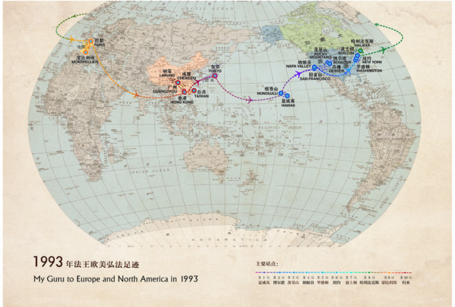
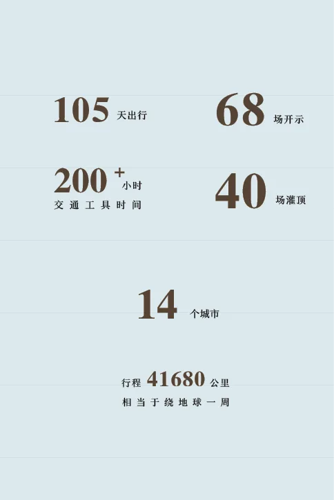

# 序

这本《西游回忆录》，主要记录了法王1993年去欧美弘法的珍贵教言。从信息闭塞的藏地，前往科技发达的美国、加拿大、法国，听众的根基与以往完全不同，讲法方式也存在巨大的差异。如果是一个普通人，对陌生的环境会感到很不适应，但法王却在那里游刃有余，以他过人的智慧和超群的境界，让一大批欧美人深深折服。

在法王71年的一生中，很少有人知道此行的详细历程。我有幸与法王同行，作为见证者，有必要将法王的风采展现给大家。很长一段时间，我都想把当年记录保存的资料整理出来，后来又通过各种渠道收集了更多内容，但是因为讲课忙、琐事多等原因，一直拖到现在。

今年正好是法王赴欧美弘法30周年，也是法王圆寂20周年。在这个特殊的时刻，我把其他事情都放在一边，从2022年12月开始，同步编辑藏文和汉文，并让国际翻译小组翻译成英文、日文等。我经常一天工作十几个小时，其间身体不适，做了一次手术。之后在强烈无常观的驱使下，刚出院就继续写作，直到2023年4月底完稿。

6月份，当我请慈诚罗珠堪布仁波切预阅这本书时，他说：“今年，在上师如意宝圆寂20周年的纪念法会上，最好将它作为礼物发给僧众。”尊珠塔西堪布、翁修泽甲堪布等今年院寺主管对此也非常重视，建议在涅槃法会期间，将其作为纪念品发给所有传承弟子。此外，涅槃法会筹备组的负责人也对这本书进行了校对，并承诺负责印制。尤其是丹增嘉措活佛，不仅十分细致地校对此书，而且根据自己撰写法王传记的经验，对一些内容的完善提出了宝贵意见。

7月上旬，我收集了大家的反馈，仔细观察和抉择，然后圆满定稿。

在编辑这本书的过程中，我听了很多遍法王的原声音频，先用藏文整理，再翻译成汉文手稿。遇到讲法中提到的一些公案，会去查史料求证，务求真实准确。排版的时候，根据当时的日期，把各站的照片放在相应的位置。这些照片中有一部分来自当年的录像，虽然不太清晰，但都是真实的历史镜头。

前辈大德说，讲法和辩论是允许出错的，而编辑文字要做到严谨无误。但我发现，哪怕是法王的讲法，在付诸文字后也很少需要调整，字字珠玑、出口成章，让人深感佩服。在这些教言的基础上，我还加入了一些回忆，以“即使对上师也不能妄言吹嘘”的原则来描述，内容尽可能真实，如果有些情节记不清楚，宁愿选择不写。至于灌顶部分，这次没有收录进来，希望以后能单独编辑一本法王灌顶仪轨的实录。

从书中可以看出，在外出的三个月里，法王没有休息过一天，要么在弘法利生，要么就在弘法利生的路上，105天里有40场灌顶、68场开示，仅坐汽车和飞机的时间就超过200个小时。如此高负荷的行程，没有利益众生的大悲大愿，一般人根本做不到。

当时，法王通过观察西方人的根基，把即使在藏地僧团也很难得到的密法，毫无保留地传给他们。这种破例应该是第一次，也是最后一次。其中涉及的无上密法，如果将来有人想修，必须在具有传承的上师面前，先求得此法的灌顶、传承和引导文，然后方可实修，否则有害无益。

这个时代，习惯了手机和网络速读的读者，可能没有耐心看完一些长篇的开示，他们更喜欢简短的语录和神奇的经历，以满足自己猎奇的心态。但是对于真正希求解脱的人来说，法王从智慧海中自然流露的甚深教言，是超越一切的无价之宝。尤其是对于从未见过法王的人，读了它就相当于亲眼见到了法王，亲耳听到了他的教诲。

这本书是一代佛教大德的第一手弘法记录，对世间人来说，可以从另一个视角了解佛教；对修行人来说，可以从中获得自己需要的实修窍诀；对弘法者来说，可以从一些经历中得到启发；对本传承弟子来说，可以更多地了解法王的弘法足迹，学习他老人家的弘法精神。

感谢参与《西游回忆录》的每一个人，无论是打字、编辑、校对、排版、印刷，还是提供音频、视频、照片，他们让这本书更精彩，让这段历史更生动。

书中若有错谬之处，我在上师、本尊面前诚心忏悔。以此善根，回向普天下的一切众生，迅速获得了义上师的果位！

索达吉书于极具殊胜加持之莲师伏藏圣地虹光洞

水兔年五月十七日（2023年7月5日）

东京：1天，开示1场

夏威夷：4天，开示4场，灌顶3场

博尔德：8天，开示5场

落基山：7天，开示10场，灌顶2场

纳帕谷：16天，开示11场，灌顶9场

华盛顿：9天，开示6场，灌顶2场

纽约：8天，开示6场，灌顶3场

波士顿：8天，开示4场，灌顶5场

哈利法克斯：6天，开示6场，灌顶2场

蒙彼利埃：8天，开示7场，灌顶3场

香港：4天，开示1场，灌顶3场

台湾：7天，开示5场，灌顶5场

成都：7天，开示2场，灌顶3场

顶礼具无缘大悲的至尊上师！

法王如意宝晋美彭措1993年去欧美弘法的所有行程，在本书中分为十个章节进行叙述。祈请上师、本尊、护法开许并赐予加持！
