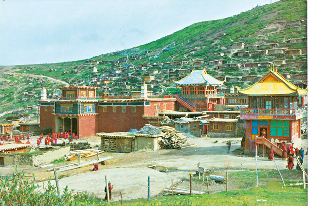

第10站 归来

Return 8/31-9/24

行程

8月31日，离开列绕林

9月1日，在巴黎转机

9月2日，抵达香港

9月3日，“文殊静修大圆满”灌顶

9月4日，“缘起除障法”灌顶

9月5日，“项袋金刚橛”灌顶和开示

9月6日，飞抵台湾

9月7日，莲师灌顶和开示

9月8日，“甚深精藏橛”灌顶和开示

9月9日，“文殊智慧勇识”灌顶和开示

9月10日，传授破瓦法和开示

9月11日，“文殊静修大圆满”“项袋金刚橛”灌顶

9月12日，“忿怒莲师”灌顶和开示

9月13日，回到香港

9月14日，到达深圳，后飞抵成都

9月15日，上午为清定上师传“长寿佛”灌顶

下午住院体检

9月16日至17日，体检

9月18日，出院

9月19日至20日，在茶店子为信众传法灌顶

9月21日至22日，到康定，向有关部门汇报行程

9月23日至24日，从康定出发，回到喇荣

经过香港

8月31日，法王离开列绕林，乘车到蒙彼利埃机场，飞了一个半小时到巴黎，晚上住在那里。第二天下午，我们在巴黎转机。飞行十个多小时后，9月2日抵达香港，住在香港白玉中心。

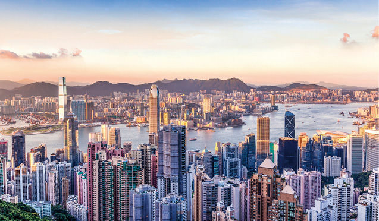

贝诺法王为了广利众生，在世界各地设立了许多佛教中心，香港白玉中心成立于1990年初。1990年底法王从尼泊尔回来路过香港，在那里住了两三天。该中心直接隶属于贝诺法王在印度的南卓林寺，寺庙的优秀僧人被派往那里，住持道场并宣扬佛法。

刚结束了在欧美的弘法，法王虽然特别累，但并没有休息，而是在香港举行了三天的传法活动。这期间，我做汉语翻译，其他人做粤语翻译。

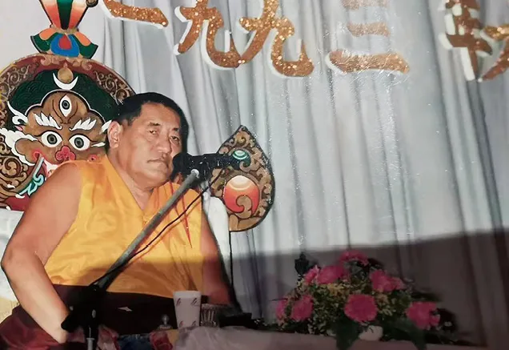

9月3日至4日，给白玉中心的一些内部弟子，做了两场灌顶和开示。第一天是“文殊静修大圆满”灌顶，第二天是“缘起除障法”灌顶。

9月5日，在一个千人大会场，法王举行了普巴金刚法会，给大家灌了“项袋金刚橛”的顶，做了皈依，讲了大悲菩提心的教言。从表情上也可以看出，他们对法王很有信心，主办方还穿插了抽奖活动，现场气氛十分热烈。

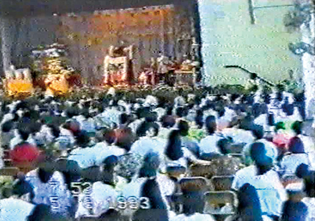

这次在西方待了三个月，我发现东西方人的性格差异很大，感动他们的泪点不一样，笑点也不一样。虽然当时香港受英国管辖，还没有回归，但香港人的性格还是比较东方，感性、热情、开朗，有什么就直接表达出来。在他们喜悦的眼神中，法王传法更加轻松，讲了很多对他们有利的教言。

去台湾

9月6日，法王坐飞机一个多小时，从香港飞抵台湾桃园机场。许多当地信徒，包括藏传汉传、在家出家，手捧鲜花和哈达来机场迎接。

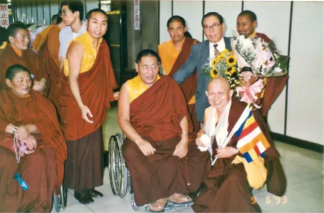

离开机场后，法王直接前往台北的新店白玉中心，这是贝诺法王在台湾的七个白玉中心之一，全称是“白玉祥丘达吉林佛法中心”。在台期间，法王一直住在这里。

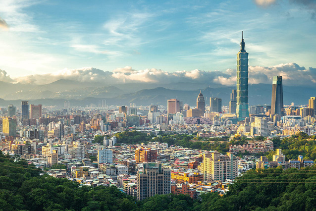

接下来，法王要进行为期六天的弘法活动，我负责每天的汉语翻译。

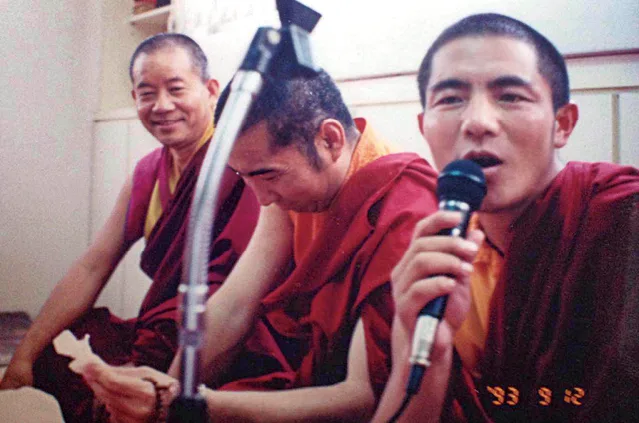

9月7日下午，在新店白玉中心，法王传授了莲师灌顶，讲了皈依方面的教言。门措上师传授了观音灌顶。

9月8日上午，在新店白玉中心，法王传授了“甚深精藏橛”灌顶，讲了菩提心方面的教言。

9月9日，坐了三个小时的车到台中，在田璧双居士1985年创立的密藏院，法王传授了“文殊智慧勇识”灌顶，并讲述了修密法的重要性。当天乘车返回台北。

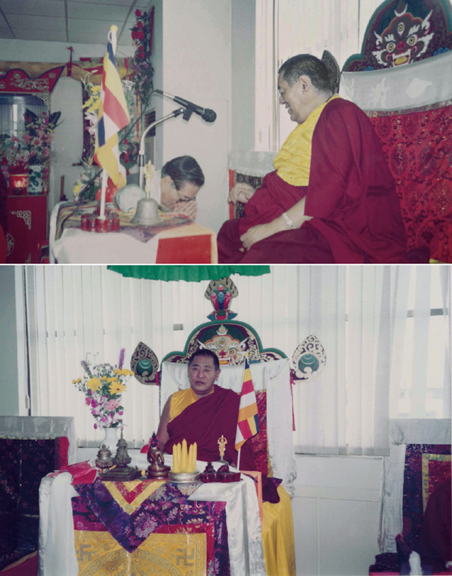

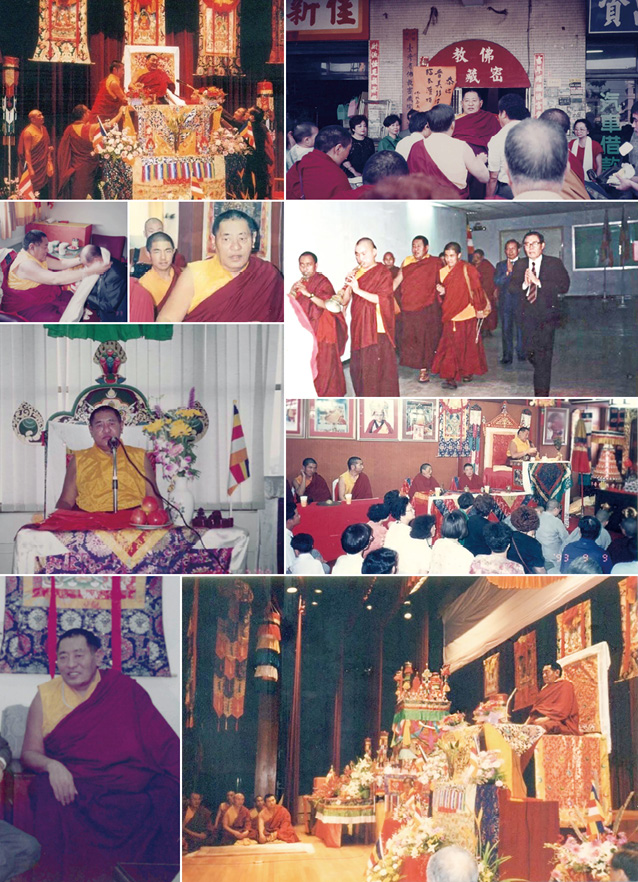

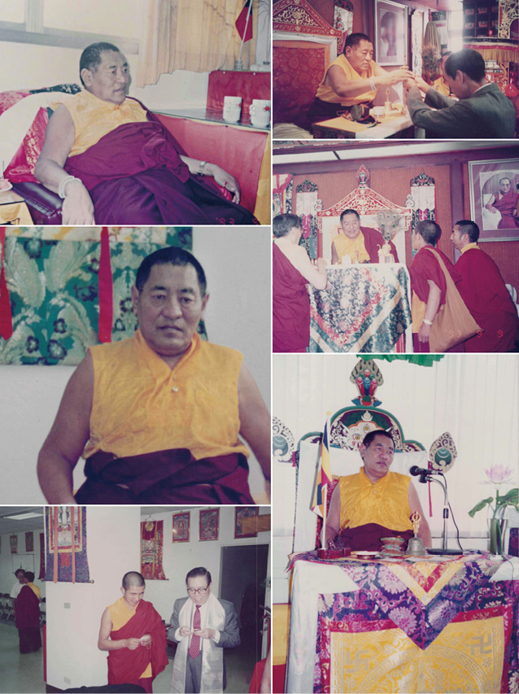

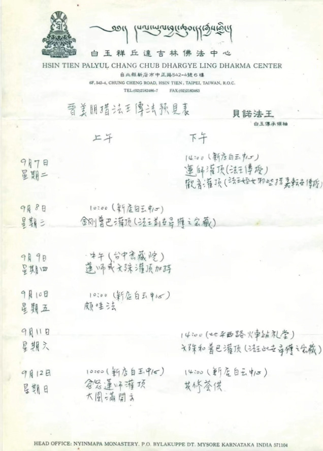

9月10日上午，在新店白玉中心，法王传授了破瓦法。

9月11日下午，在台铁大楼演艺厅，法王传授了“文殊静修大圆满”“项袋金刚橛”灌顶。

9月12日上午，在新店白玉中心，法王传授了“忿怒莲师”灌顶，讲了大圆满的来历和功德。下午和大家一起举行会供，然后接见了筹备方的相关人员。

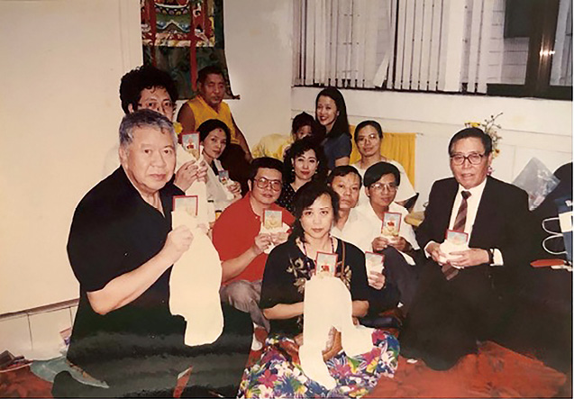

9月13日飞回香港。

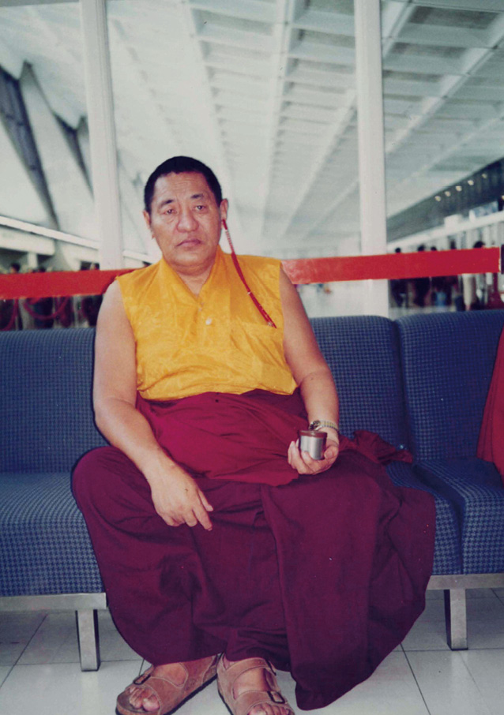

上师的上师

最近，我们采访了丁乃竺，她是法王去台湾的主要筹划者之一，也是最早的一批藏传佛教弟子，曾于上世纪80年代邀请了许多藏传佛教大德赴台弘法。在谈起法王时，她回忆道：

“我在台湾大学哲学系读书时，就接触了藏传佛教，在朋友的介绍下加入了五峰山南方宝生佛刹中心，那是台湾最早期的一个藏传佛教中心。80年代中期，我开始邀请一些仁波切来台弘法，也有幸邀请到了宁玛派的教主贝诺法王。贝诺法王第一次来台是住在我家。那之后，贝诺法王又来过几次，短短几年就建立了白玉中心，摄受了众多弟子。

1990年左右，贝诺法王来台弘法时，亲口对我说：‘晋美彭措法王是我的根本上师，他来台湾时请你一定要尽力接待、好好护持。’听到贝诺法王的话，我有点惊讶，因为他是如此了不起的上师，又是如此有份量的证悟者，那么他的根本上师会是什么样的人物呢？

受到贝诺法王的嘱托，我们非常重视晋美彭措法王来台弘法，与新店白玉中心、密藏院一起，为迎接法王的到来做了充分准备。1993年9月，晋美彭措法王如约来到台湾，我们也见证了法王在台弘法的盛况。

无论法王在台北还是台中的活动，都有很多佛弟子慕名而来，有藏传弟子，也有汉传弟子，虽然他们秉承的传承不同，但都是为了与法王这样伟大的上师结上法缘而聚集在一起。期间，有一场大型的灌顶活动，在台铁大楼演艺厅举行。为了那天的灌顶法会，我们特意提前为法王定制了一个近2米高的法座，并用八吉祥、各种鲜花等供品装饰会场。

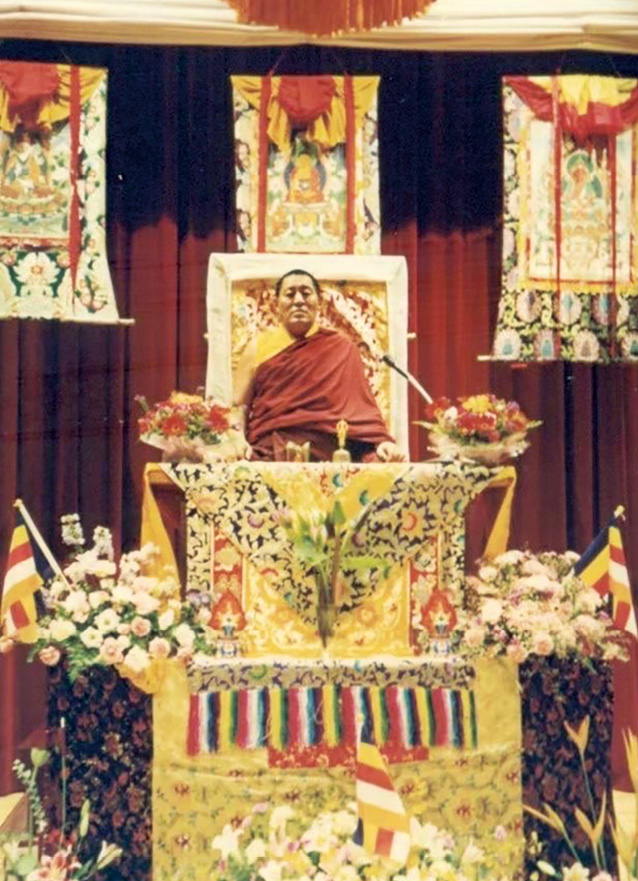

第一次见到晋美彭措法王，我就深深感觉到他是一位非常有力量的上师。他的能量如此强大，让我感到震撼。在见到晋美彭措法王之前，我有幸近距离接触过敦珠法王和顶果钦哲法王。这两位上师也散发出巨大的能量，但相比敦珠法王那种极致柔和、近乎母性的能量，顶果钦哲法王那种高大、威严的气势，晋美彭措法王整个魁梧的身躯透露出一种如利刃般直接、锋利的强大气场。这种能量让我印象非常深刻。

与晋美彭措法王同行的，还有两位尼师，一位是他的妹妹，另一位是他的外甥女，也是益西措嘉空行母的化身。随行的还有几位喇嘛，其中一位是索达吉堪布，当时我很惊讶，这么年轻的一个藏族出家人，中文竟然这么好。他那时很年轻，有点不苟言笑，让我们觉得有一些严肃，但又非常庄严。

法王在台的行程几乎都是灌顶，我们也非常珍惜在他座下求得的每一个法。让我感到特别的是，法王灌顶后，经常由他的外甥女来赐予灌顶相关修法仪轨、引导文的口传。他的外甥女很年轻，很庄严，很安静，全身上下透着一种如水般极其柔和的气场。那个年代，不仅在台湾，就是在西方，也很少有女性上师传法。所以这一幕，直至今天，我还记得清清楚楚。

灌顶期间，法王会时不时给大家讲讲他的一些经历。我记得法王好像提过一次神奇的取伏藏经历，那个伏藏是在飞机飞行过程中出现的，当时法王睡着了，然后取到了伏藏，细节记不清了。

我还从别人口中听说过法王年轻时的一段经历。当时的法王非常精进地闻思修行佛法。一天，一个年轻美貌的女人来到他面前，告诉法王，她是与法王具有宿缘的业手印，请他接受。法王想了想没有同意，于是女人告诉法王，她会在某个地方等他一个月。结果一个月过去了，法王依然没有改变主意。据说那个女人就消失不见了。后来，法王遇到他的一位上师时提到此事，上师叹了一口气，说：‘你只了解法庄严的一面，却不懂它的另一面。’

法王的这段经历对我启发很大，尤其是他上师的那句话。作为一个修行人，不是只有出家才可以成就，在家也同样可以。依靠佛法的加持，无论出家、在家，都能获得殊胜成就。

作为接待方之一，我很荣幸能有机会单独拜见法王。当时我带着小女儿一起接受法王的摸顶加持，让她种下善根。法王把他大大的手掌放在我头顶，念着经文，一股暖流盈满了我全身。那时，我得知法王患有眼疾，应该看不清周围的一切。但在近距离接触法王的过程中，完全看不出他是一个有眼疾的人。

其实，当时我白天要工作、照顾两个女儿，工作之余还要协助先生赖声川一起处理表演工作坊的事务，非常非常忙。但是，晋美彭措法王来台弘法时，我尽全力调配了一切时间，参加了法王在台北的所有佛事活动。对于法王的到来，我们每个人都觉得非常幸运，非常感恩。

虽然法王已经圆寂近20年了，但每次想起他，一股强大的力量就会自然而然将我包围。”

采访结束时，丁乃竺摸了摸自己的头发，半开玩笑地说：“我的头发染成了彩虹色，因为我非常喜欢彩虹。即使这辈子不能成就虹光身，也要把‘虹光’戴在头上，时时提醒自己，总有一辈子要成就虹光身。”

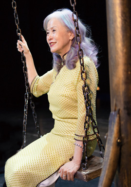

现在的丁乃竺

回成都

9月14日一早，我们从香港坐车通过海关到达深圳。那时候每次过海关都有点紧张，担心各种刁难或者检查。还好，这次回来时比较顺利。

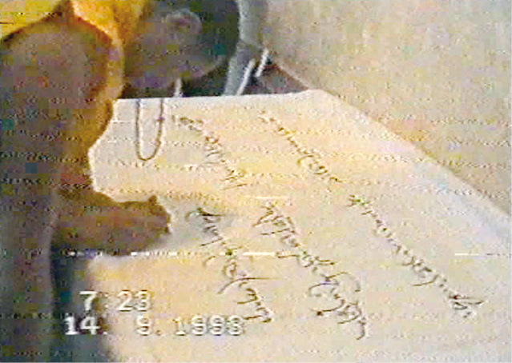

通关后，法王去一家餐厅吃早饭。一些人专程从香港赶来送行，并请法王为他们题词。法王用藏文亲笔写了一首偈颂，翻译过来就是：“佛法遍十方，吉祥功德盛，施主康长寿，受用福禄增。”法王说，这也是对此次弘法所有结缘众生的一个祝福。

在深圳机场登机后，两个多小时飞抵成都双流机场。成都的天气特别热，但是再热也比不上众弟子的热情。学院里很多出家人听说法王要回来了，已经在这里等了好几天了。丹增活佛、慈诚罗珠堪布、希阿荣博堪布、齐美仁真堪布等高僧大德也从学院赶来迎接法王。来自全国各地的许多佛教徒，这一天也聚集在这里，人山人海，热闹非凡。当他们期盼已久的法王出现在面前时，100多个日日夜夜的思念顿时化为泪水。他们大声而激动地欢呼着，用各种方式表达着对法王的思念，据说这是机场建成以来最热闹的一天。

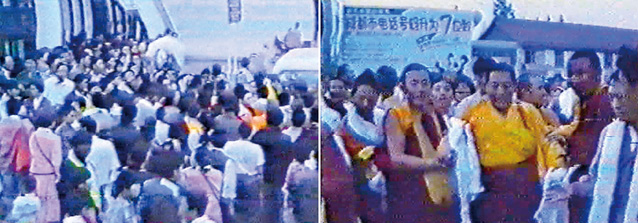

之后，法王前往康定酒店（今甘孜宾馆）休息。坐车去的路上，我和齐美仁真堪布、诺尔巴堪布在一辆车上，我们愉快地聊着各种经历。因为这三个月不方便通讯，我就问他们我父母怎么样了，想知道他们是否健在。答案是：“他们还在学院，一直在等你回来。”

来到酒店，看到法王身边围绕着这么多老弟子，我觉得非常安心，不然，我一个人在外面还是会有各种担忧。现在，法王在国外没出什么意外，平安归来，我也可以松一口气了，身上的重担终于卸下来了。

那天晚上，我睡得特别香，这是我三个月来睡得最踏实的一次。

不变的信心

这次随法王出去，我对他老人家的信心更大了。

在法王身边，常常能感受到他非凡的智慧。依靠某种因缘，他自然会流露出一些不可思议的境界。这些都是法王与生俱来的，并不是通过今生努力才有的。它也是前后世存在的铁证。

在我心目中，真正的善知识，就应该像法王一样，除了他老人家，不会有更好的上师了。即使是莲花生大士、龙钦巴尊者等祖师大德，也只是与法王生活的时代不同而已。如果法王身处那个时代，肯定和他们一模一样。我经常生起这样的信心。

这种信心不需要刻意观清净心，从法王的言谈举止哪方面看，他都超越了常人的境界。不管是谁，只要看到法王的身体，就能迅速转变自己的心；只要听到他的声音，就会不由自主地被吸引；只要祈祷他的心，就会得到巨大的加持。这是佛菩萨与众不同的地方。

在我依止法王的19年里，从1985年第一次见到他，到2004年初最后与他分离，从来没有产生过一刹那的邪见。现在想想，这应该是我这辈子最大的成就。

法王常说，弟子即使不愿意，终究也会离开上师。法王离世后，我就像一个失去父母的孤儿，孤独地留在这个世界上，每次想起他老人家，心里总是空落落的。我经常安慰自己：“上师的色身虽然融入了法界，但他的法身永远不会离开。”即便如此，现在除了在视频里看到上师的身影，在录音里听到上师的声音，在梦里接触到上师的身体，这个世界上，再也找不到上师了。

对很多人来说，越接近上师，越觉得他像普通人，越容易发现他的过失。然而，我越接近法王，信心就越强，通过多年的依止，这种信心丝毫没有改变，而且一天比一天坚固。父母离世后，对他们的思念可能会随着时间而淡化，但上师离世后，那种思念越来越强烈。正如法王所说：“我一旦离开，你们可能会对我更有信心。”确实是这样。

疾病消失了

我们1991年在绵阳、重庆等地建立了多个道场，在当地弟子的邀请下，法王答应9月15日前去传法。但当天突然得知清定上师病危，阿里美珠也病重，法王不得不临时取消行程，并派遣慈诚罗珠堪布、丹增活佛等四位弟子代替自己前去。

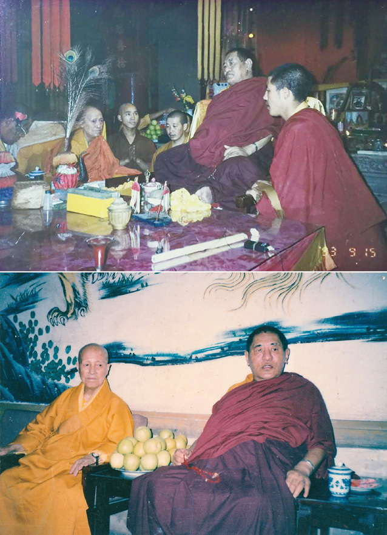

上午，法王前往成都昭觉寺探望了清定上师。当时，清定上师面容憔悴，病得很重。法王给他传授了“长寿佛”灌顶，依靠这个缘起，清定上师的健康状况逐渐好转。

阿里美珠到陆军总医院检查后，确诊为急性阑尾炎。因为法王在国外很累，回来后也需要检查身体，当天他们都住在医院，我来做翻译和陪护。阿里美珠原本需要手术，经过复查，医生说可以先输液消炎。结果输液一天后，症状基本消失。法王体检了一两天，没发现什么异常。两天后，他们一起出院了。

出院后，法王住在茶店子，用中药调理身体。与此同时，许多信徒从全国各地赶来，天不亮就在那里排队，楼道里挤满了人。法王为了满大家的愿，从早到晚给他们摸顶加持、灌顶传法。

这期间，法王为了学院僧众方便，还给男女众买了两辆东风大卡车。车上装满了一袋袋大米，准备回去分发给大家。

我冲洗了一些法王在西方的照片，作为法王回去后送给僧众的礼物。

回到喇荣

9月21日从成都出发，到达康定。法王在那里待了一天，向有关部门汇报了行程，并参加了一个座谈会。

23日离开康定。路过塔公时，受到塔公寺的迎请，为舍利宝殿开光。随后，在塔公觉沃佛像前，法王带领大家念诵《普贤行愿品》，并给寺内僧众和当地信徒进行加持。

到达八美后，龙多活佛在路边搭起帐篷，也就是现在寺庙所在的地方，迎请法王休息。期间他供养法王两个大海螺，法王当场吹了一下，然后送给了我们降魔胜利洲。

傍晚时分，到达龙灯草原上的燃姑寺。因为法王的弟子很多，寺内每个僧人带一个人去自己房间休息，其他人就睡在大殿里。

24日早上从寺院出发。车队抵达道孚时，法王为大白塔开了光，给信众做了加持、开示。

这一路，随处可见各个寺院的僧众和信徒。他们有些在路边搭起帐篷，祈请法王进去歇息，有些在路边熏烟，欢迎法王归来。法王时而摇下车窗，给他们摸顶加持，时而给他们做个简单开示……

下午，终于回到了喇荣。身披黄色袈裟的僧众在道路两旁列队，到处燃着熏烟、奏着法器，举行了非常隆重的欢迎仪式。法王直接去了大经堂，向僧众介绍了这一次的出国经历。然后，在师徒重逢的喜悦中，法王回到了自己的住处。

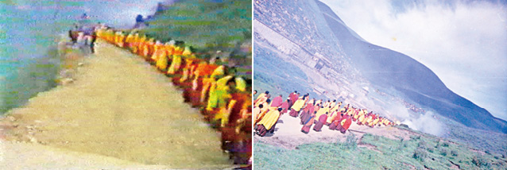

至此，归来的弘法行已经圆满。

后记

10月底，我和丹增活佛一起到色达县城，花了五天时间剪辑我从国外带回来的音像资料，并配以藏汉两种语言的旁白，制作了一部关于法王西行弘法的纪录片，时长约三个小时，然后做成VCD在学院里流通。

之后，法王根据在美国时一髻佛母的授记，为了利益和自己年龄相仿的老年人、没有缘分出家的在家人，决定建立一个藏族居士林，并着手修建居士林经堂。最早报名的有四户人家，我父母是其中之一。后来随着规模越来越大，居士林的人越来越多，覆盖了喇荣沟下方的阳山和阴山。过去藏地没有建居士林的传统，法王的这一创举无疑开启了藏传佛教的新篇章。

其实，不仅仅是居士林的建立，法王这一生还有很多不可思议的创举。比如，“文革”后整顿僧团内部的弊病，违背戒律和誓言者不得与僧众共住；在喇荣建立大规模的尼众道场，广泛摄受尼众；去汉地传播佛法，摄受汉族弟子……这一个个佛教史上不可磨灭的里程碑，彰显了法王伟大的远见和非同凡响的愿力。

法王回到喇荣后，继续按部就班地为僧众传法。冬天，讲了龙钦巴尊者的巨著《大圆满心性休息大车疏》。虽然藏地的天气非常冷，但围在法王身边享受大乘妙法，聆听法王的谆谆教诲，每个人都觉得无比温暖。

此后，在法王座下，我们一如既往地不断闻思修行……

师教甜美甘露滴，加持温度未消散，

为令有缘智者喜，设此盛宴回忆录。

身之青春日日衰，心之杲日时时明，

此乃以信依师教，所尝妙法甘露果。

大恩上师言教义，只言片语不忍失，

发心精进立文字，具缘诸众令欢喜。

意义之要无错谬，措辞若有欠妥处，

于三根本护法众，及诸道友前忏悔。

撰此若有少善根，回向老母诸有情，

愿彼获得上师果，无余直趋本来地。

此《西游回忆录》，名为索达吉者于水兔年二月二十五日（2023年4月15日）撰著圆满。

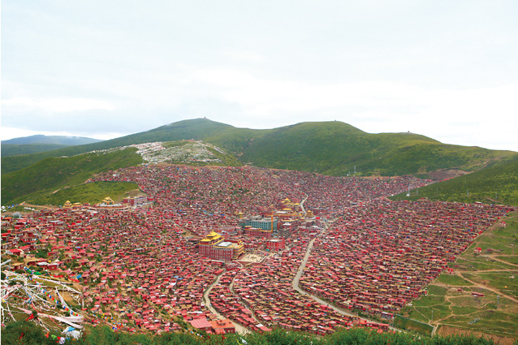
