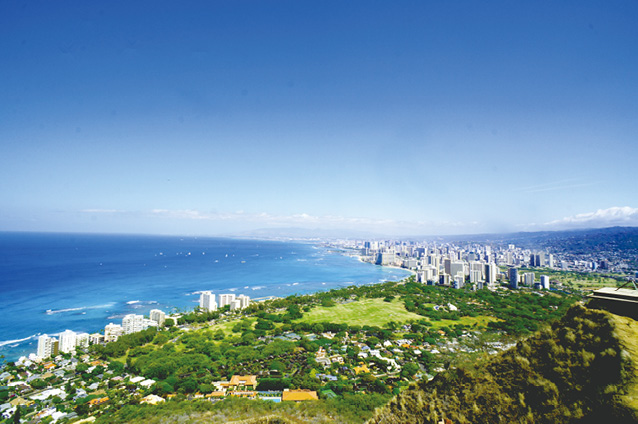

第1站 美国·夏威夷

Hawaii, USA 6/18-6/21

行程

6月18日，上午在乃琼寺传授菩萨戒

晚上介绍大圆满法

6月19日，上午传授“文殊静修大圆满”灌顶

下午传讲《文殊静修大圆满·手中赐佛》

6月20日，上午传授“缘起除障法”灌顶

下午传讲《文殊静修大圆满·手中赐佛》

之后，观看太平洋处的火山，参观夏威夷

火山国家公园

6月21日，上午传授“项袋金刚橛”灌顶

下午参观黑沙滩公园

糌粑引起的风波

夏威夷是一个迷人的岛屿，许多名人喜欢去度假。曾听说那里有葱郁的檀香林、美丽的珊瑚礁、银色的沙滩、碧蓝的大海、翩翩起舞的孔雀，和煦的海风让人心旷神怡。但当我在飞机上看地图时，这个岛就像掉进茫茫大海的小虫，给人一种孤独害怕的感觉。

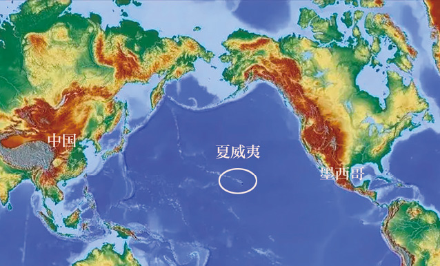

在这里过海关的时候，发生了一场令人啼笑皆非的风波：我们带的糌粑粉被警犬发现了。这一大包白色粉末，在海关人员眼里，无疑是毒品，他们误把我们当成了走私团伙，于是马上来了许多警察。

我们解释了半天，他们还是不信。只好当着他们的面吃了几口糌粑，他们才放心地放我们走。临走前还提醒我们：美国为了人们的健康和安全，禁止某些外来食物入境，下次最好不要带这些。

由于这件事的耽搁，我们错过了原计划从檀香山到希洛的航班，改乘了下一趟航班。法王之前坐了很久的飞机，在这里又等了很长时间，再加上夏威夷和藏地有18个小时的时差，昼夜颠倒，所以法王显得比较疲倦。

我们坐上下一班飞机后，飞了近一个小时，傍晚到达乃琼寺（Nechung Dorje Drayang Ling）。

“国际长途很贵的！”

我们一安顿下来，法王就对我说：“你能不能给佛学院打个电话，告诉他们我们已经顺利到达美国了？然后再给我康定公安局的朋友也说一下。”

那时候没有网络，没有微信，只能用电话。天已经很晚了，出去找电话亭不方便，我只好问住持喇嘛罗桑顿单（Lobzang Dhonden）有没有办法。他说他有一部大哥大可以用。我给佛学院打了很多电话，都联系不上。给法王的朋友打，就打通了，我请他帮忙转告佛学院。

那天他有点醉了，但还是很清醒地告诉我：“你们刚走，6月16号就接到上级通知，不准你们出国。既然你们已经到了，那就好……”我还没来得及说什么，南珠堪布就打断我说：“别打了，别打了，国际长途很贵的！”

第二天，法王也给这位朋友打了电话，聊的时间稍微长了一点。南珠堪布看了好几次，却不敢提醒法王。我在旁边看着，暗暗偷笑。

法王这次在美国的英语翻译，是一个叫桑吉堪珠（Sangye Khandro）的美国人，她曾经为很多藏地大德做过传法翻译。那天她从加利福尼亚飞来，拜见了法王。翻译到位后，法王在美国的正式弘法就要开始了。

第一次传法开始了

6月18日上午，法王在乃琼寺给大家传授菩萨戒。因为是第一场传法，寺庙作为主办方，为法王唱了一些吉祥偈，然后做了如下开场白：

“在这个吉祥的时刻，我们欢聚于此，因缘极其特殊。虽然法王不能在此久留，但在接下来的四天里，在这短暂而宝贵的时间里，我们要全心全意地领受佛法，并强烈发愿要好好受持，因为机会非常难得。

在藏地，那些朝圣者为了能在法王面前得法，要从印度或藏地其他地方千里迢迢赶去，吃很多苦。而且法王所在的地方很冷很穷，去那里都非常难，更别说住在那里了。而那些求法者，忍受着极大的磨难，就是为了能在法王座下听法。

现在，我们这里的所有人，这么容易就能遇到法王，坐在这里看到他的金容，听到他的甘露妙法，这是因为往昔的愿力和祈祷。

虽然你们生活非常忙，有很多重要的事情要做，但这几天一定要把它们放在一边，让这次学法达到最好的效果。其实这个时间并不长，我们应该抛开那些世俗的追求，认真地接受佛法，尤其是在法王这样的大德面前。同时也要注意，我们这么多佛弟子一起接法，应该保持善妙的发心，希望这个法能被真正受持和广泛传播！”

此时，法王慈悲地坐在法座上，于传法之初，自然流露出一首从未听过的吉祥偈：

> 天穹吉祥天女遍彩虹，大地吉祥众人享十善，

> 世间吉祥寂猛圆坛城，于此吉祥圆满增吉祥。

之后，法王为大家送上了“扎西德勒”的祝福，并解释道：

在开始闻法之前，你们为我唱了一些吉祥偈。因此，在传法之前，我也要为你们诵一段吉祥偈。

这首偈颂是什么意思呢？第一句是，在这个吉祥的活动中，天上的吉祥天女非常欢喜，抛撒彩云充满虚空，彩虹萦绕遍满苍穹。

第二句是，在这个吉祥的地方转法轮，每个人都会享受行持十善的快乐。

第三句是，夏威夷这个地方，像极乐世界一样，圆满了寂静坛城之相；它还有燃烧的火山，圆满了忿怒坛城之相。

最后一句是，这个地方非常吉祥。希望这里的吉祥延续下去，更加吉祥！愿一切圆满，永远吉祥圆满！

这首偈颂是我临时想到的，事先没有任何准备。听到你们美妙的吉祥赞颂，我突然有了灵感，很自然地为你们唱出了这首吉祥的旋律。

听到这里，大家都感到万分喜悦，法王的话就像一抹暖阳照进了每个人心里。寺庙前草坪上悠闲漫步的几只孔雀，也不失时机地发出响亮的鸣叫，似乎在向大家传递吉祥。

然后法王正式传授菩萨戒——

> 顶礼根本上师：

> 于三时诸佛之本体、如海部坛城之遍主无等恩德至尊吉祥怙主根本上师仁波切之无垢足尘下稽首恭敬顶礼、皈依，祈赐加持。

> 顶礼释迦牟尼佛：

> 观不厌足妙颜含笑光彩灿，

> 相好威光明蕊成众目甘露，

> 大悲花瓣纤长周遍三世间，

> 佛陀白莲足莲今护我意海。

> 顶礼莲花生大士：

> 诸佛智慧力体性，善持无数坛城轮，

> 此刹受持大士相，胜乘无等莲师王。

> 顶礼无垢光尊者：

> 法尽界中证法身密意，光明界中见报身刹土，

> 所化者前现化身利众，遍知法王尊者前敬礼。

> 顶礼麦彭仁波切：

> 语狮子智现心中，修行普贤之大愿，

> 持佛菩萨之事业，文殊上师足下礼。

> 顶礼三根本：

> 意传表传耳传持明师，持寂贪怒形相诸本尊，

> 三处空行三续护法众，浩瀚三根本诸尊前礼。

> 祈祷文殊菩萨：

> 一时我以利他心，心间莲观童子汝，

> 传扬善说甘露声，文殊我心赐吉祥。

> 汝尽了知三有苦，熄灭地狱烈火等，

> 我速精勤利生时，祈祷圣众赐威力。

> 召请众生闻法：

> 于诸十方世界中，所有善逝佛弟子，

> 今降本师妙法雨，诸欲闻者请至此。

> 为了利益天边无际的一切众生，请大家发无上菩提心！

今天，我非常非常欢喜。之所以欢喜，是因为今天讲法的处所、时间、本师、眷属、法都十分圆满。

・五圆满

一、时间圆满：

对于这个时间，我尤为欢喜。根据藏历，这个月是佛陀诞生、成佛、涅槃、事业开始和结束的月份（萨迦月），所以这是最吉祥的时候。

我还很高兴的是，在这个月来这里之前，我与30万藏民和1万多名僧众聚集在一起，发愿要往生西方极乐世界。以这样一个吉祥的聚会为开端，大家都种下了往生的种子。这正好就在我出发之前。

二、处所圆满：

然后，我来到美国，这个世界上最强大的国家之一，为大家传讲佛法。这个缘起非常吉祥，所以我很欢喜。

三、法圆满：

对于法，我也很欢喜。虽然世界上有很多善妙的宗教给人们带来安乐，但作为佛教徒，能值遇佛法并知道佛法可以给我们带来永恒的安乐，这是非常幸运的，也是懂得什么是光明劫的标志。我们修持佛法的人，都知道这是真的，不仅仅是因为我们信佛。

虽然小乘的自我解脱道也很好，但其发心只为了自己。我们大乘的追求更加远大，动机是为了所有众生的利益，而不仅仅是自我解脱。所以，遇到大乘是非常幸运的。尤其是大乘中的金刚乘或密乘，具有让我们迅速即身成就、认识心性的潜力，遇到它就更幸运了。而我们恰好拥有这一切。

四、本师圆满：

我自己的话，一出生就遇到佛法，14岁开始讲经说法，一直到现在。以前我讲经说法的水平还比较不错，但是现在年纪大了，健康状况有所衰退，眼睛也看不清文字了，所以讲法的质量不如以前了。

我个人而言，对各国的政治、科技、传统知之甚少，甚至不了解你们的饮食习惯。所以，在这里向你们宣讲佛法，不一定能完全满足你们的意乐，我有点不好意思，只能解释为这是前世的业缘吧。如果我讲的有什么错误，你们可以纠正。

五、眷属圆满：

今天，你们大多数人都是佛教徒，来自不同国家和民族，具有一定的信心和智慧。

以上就是五种圆满。

・共同加行

在讲正行之前，我先讲一下“人身难得”。

现在，我们获得了具有修法机缘的人身宝，这是非常难得的。为什么呢？首先，从因方面来说非常难得：这个人身是我们多生累劫积累资粮、断恶行善的果，而不是通过其他方式得到的。

其次，从比喻方面来说非常难得：如果我们往墙上撒豆子，豆子留在墙上的几率很小，而我们得到人身的几率比这还要小。

再次，从数量方面来说非常难得：佛陀在经中说，行持非法的人，数量相当于整个大地上的微尘，而得到暇满人身、行持善法的人，数量相当于拇指甲上的微尘。

得到这样一个难得的人身，意义重大。如果你这辈子想获得长寿、健康、财富、名声，靠这个人身修行是有可能的。想为来世好好修行，获得不可思议的身心没有任何痛苦的佛果，依靠这个人身也是有可能的。

获得这样的人身时，如果不尽快为自他而修行，死亡可能会突然来临（寿命无常）。死亡之时，在业力的牵引下，漂泊于其他世界（因果不虚）。那时候，修持善法没有自由，想获得快乐也没有自由（轮回痛苦）。因此，当我们现在自由自在的时候，应该行持清净的善法。

至于行持善法的方法，大慈大悲的本师释迦牟尼佛讲了很多，并将其比作普通金属、黄金、钻石、如意宝。在所有这些修法中，最殊胜的就是如意宝。所以，佛陀说了这么多，你们喜欢哪一种？是一般的、中等的、较好的，还是最好的？

（回答：“最好的！”众笑）

哈哈，好吧，既然你们想修最好的法，那么在佛陀的八万四千法门中，没有什么比菩提心和大圆满更好的了。

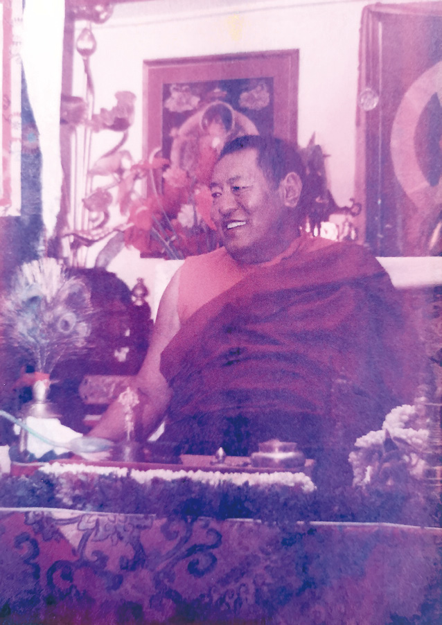

菩提心，是所有大乘行人都可以修的法。而大圆满，是大乘中密宗金刚乘的法，必须是特别利根的人才能修，并非只要是大乘行人就可以。

你们是两个都想修，还是只修其中一个？

（回答：“两个！”众笑）

很好，你们想修两个，非常好！藏地的高僧大德们，大多数也是修这两个法，没有单独修一个的。你们有这样的发愿，非常非常好！

今天，我在这里首先讲菩提心，并给大家传个菩萨戒。

・菩提心之功德

下面，我开始简要介绍什么是菩提心。

关于菩提心，大慈大悲的我等本师释迦牟尼佛用了无数劫反复观察什么对众生最有利益，并能最好地帮助众生净除痛苦，经过再再推敲，佛陀发现没有比修珍宝菩提心更好的方法了。菩提心可以暂时带给众生人天安乐，究竟使我们获得无上佛果。因此，这个世界上想要摆脱痛苦并获得快乐的人，必须依靠菩提心。

一旦菩提心在一个人的相续中生起，这个人就不再是凡夫了。菩提心生起的那一刹那，从名称上，这个人的名字已经成为“菩萨”，是如来家族的继承人，完全超越了凡夫的范畴；从意义上，自那时起，这个人就成为天人、龙、罗刹、药叉、乾达婆、人非人等礼拜的对境。因此，我们要修持菩提心。

举个例子，一两的点金剂能瞬间把千两的铁变成黄金，原来的普通铁依此会转化成金。同样的，菩提心可以很快将我们不清净、不悦意的这个身体，变成相好圆满、令人见而不厌、恒时利益众生的佛身。

如果没有菩提心，身体的磕头转绕、口中的念经诵咒等善法，会像芭蕉树一样，成熟一次果实就灭尽了。而以菩提心摄持的善根，则如天界的如意树和人间的果树，一直接连不断地成熟果报。它可以让你获得人间的转轮王、天界的帝释和梵天等果位，乃至获得无上佛果，恒常、周遍、任运地利益众生。

有了菩提心，我们无始以来造过的杀生、不与取等小不善业，就像干草堆起火一样，刹那会被焚尽无余。即使是杀父杀母等非常严重的罪业，也将在堕入恶趣后，弹指间即获得解脱，不需要在恶趣感受无尽的痛苦。

因此，想要清净罪业的人，也应该修持菩提心。

以上是菩提心的一部分功德。若想广泛了知，《华严经》中通过一百多个比喻进行了宣说。

如果你们想以最略的方式了解菩提心的功德，必须记住以下三点：第一，生起菩提心就不会堕入三恶趣；第二，生起菩提心后，不需要精进也可以无勤地转生人天善趣；第三，如果生起菩提心，可以获得不老不死的佛果。

今天我们有缘聚在一起。接下来，让我们一起受持菩萨戒。

・受戒之前行：皈依

首先，在皈依之前，要清晰地观想：在前方的虚空中，遍满了十方诸佛、十地菩萨摩诃萨和传承金刚上师。以他们为见证，我们将在他们面前发菩提心。

如是观想后，你们跟我念一遍：

> 祈请十方一切出有坏正等觉、

> 十地菩萨摩诃萨众

> 及诸位大金刚持上师垂念我。

在发菩提心之前，我们必须受皈依戒。如果没有皈依，任何佛法都不可能修成。所以要先皈依。

皈依三宝时，首先是皈依佛。就是说，从现在起，乃至生生世世，我都皈依本师释迦牟尼佛。任何其他与此相违的导师，我都不会皈依。要发这样的誓言，这是皈依佛。

其次是皈依法。也就是说，我要修持佛陀所说的法，除此之外，我将不再修其他法。这就是皈依法。

最后是皈依僧。即文殊菩萨、金刚手菩萨、观音菩萨、莲花生大士等佛陀的追随者，我要以他们为榜样，与他们的见解和行为一致，以此修学解脱道。这是皈依僧。

简而言之，纵然我遇到生命危险，永远也不会舍弃三宝，并发誓要一直依止他们。

下面，你们和我一起念三遍皈依偈：

> 乃至菩提果，皈依诸如来，

> 正法菩萨众，如是亦皈依。

现在你们已得到了皈依戒。你们知道吗？

从今天开始，你们已经皈依并成为真正的佛教徒。佛教徒与非佛教徒之间的区别，就在于是否皈依。

你们还需要知道，从现在开始，无论你修学什么法，都会有非常明显的效果，产生的力量肯定非常强大；从现在开始，当你有任何恐惧和痛苦时，只要一心祈祷三宝，必定会得到护佑；如果你希求世间的名声、快乐、权力、地位，只要真诚地向三宝祈祷，也会得到相应的利益。

皈依三宝之后，我们何时何地都不能伤害任何众生，而必须真心实意地利益众生。这是最根本的！

・受戒之正行：发菩提心

接下来，进入正行——发起菩提心。它分为愿菩提心和行菩提心。

愿菩提心，是通过发愿和祈祷，希望一切众生获得佛果。行菩提心，则是在此基础上，为了实现这一愿望，于实际行动中行持布施、持戒、安忍等六度万行。

下面，和我一起念三遍受菩萨戒的偈颂——第一遍念完时，观想自己生起了愿菩提心；第二遍念完时，观想生起了行菩提心；第三遍念完时，观想这两种菩提心同时生起。之后，你们获得了菩萨戒，可以称为“佛子”或“菩萨”。

> 如昔诸善逝，先发菩提心，

> 复此循序住，菩萨诸学处。

> 如是为利生，我发菩提心，

> 复于诸学处，次第勤修学。

现在，你们已经得到了菩萨戒，相续中生起了珍宝菩提心，名字也变成“菩萨”了。特别是，如果在愿菩提心的基础上，用身体和语言将利益众生付诸行动，就会成为行菩提心。

在愿菩提心和行菩提心这两种菩提心中，行菩提心是最好的。尽管愿菩提心也具有上述一切功德，但是行菩提心生起之后，即使并没有真正地行持善法，反而恒时在放逸和睡眠中无意义地度日，善法的功德也会像江河的相续一样连绵不断，并且蒸蒸日上。因此，行菩提心的功德连虚空都无法容纳，它的利益不可思议。在这两种菩提心中，我们主要修持行菩提心更重要。

菩提心为什么有这么大的功德呢？比如，虚空是没有边界的，众生像虚空一样也无边无际。菩提心以一切众生为对境，希望他们拥有一切快乐、远离一切痛苦，因为它是一种使这么多众生受益的发心，因此，依靠推理也可以了知，它能产生如此巨大的功德。

当然，发愿利益一切众生的菩提心具有不可思议的功德，还可以通过公案进行说明：在许多劫之前，有一个叫匝哦之女的商主。由于业力的牵引，他转生于恶趣，这是他生前用脚踢母亲的头的果报。由此，他感受了铁轮在头上飞转、脑浆四处飞溅的痛苦。那时，他心想：“感受这种痛苦的众生非常可怜！希望所有这些痛苦都由我承担，他们的痛苦立即消失。”当他萌生这样的念头时，铁轮腾空而起，他立即摆脱了痛苦，享受悦意的安乐。

他仅仅希望一类众生远离痛苦的发心，尚且有如此难以置信的功德，那么，我们希望普天下的众生远离痛苦、具足快乐的菩提心，有无量功德就更不必说了。

此外，假设有人在数亿年中以七宝、饮食、服饰等供养三世诸佛，他的功德自然很大。但如果一个人哪怕生起一次“愿所有众生获得佛果”的善心，其功德远远超过前者。

・受戒之后行：自他欢喜

这种菩提心，像如意宝一样珍贵难得。所谓的如意宝，是在初劫出现的，但现在没有。转轮王出世时，如意宝将出现，它可以在一由旬内给众生降下衣食雨、珍宝雨等。但贫穷的人通常无法获得它。

与这种如意宝相比，菩提心更重要。现在我们每个人都已生起了菩提心，应该发自内心地欢喜和随喜。下面，在这样的心态下，大家跟我念一遍自己生欢喜心的偈颂：

> 今生吾获福，善得此人身，

> 复生佛家族，今成如来子。

> 尔后吾当为，宜乎佛族业，

> 慎莫染污此，无垢尊贵种。

> 犹如目盲人，废聚获至宝，

> 生此菩提心，如是我何幸。

接下来，我们要令其他众生欢喜。也就是说，世间的天龙八部、大力鬼神等非人，都应该生起欢喜心，并请尽力地帮助我、护佑我。我已发愿并承诺让你们摆脱轮回的痛苦，将你们安置于佛陀的果位，你们应该对此感到高兴。特别是，统治夏威夷并具有燃火身相的火山女神佩利（Goddess of Volcanoes and Fire: Pele），以你为主的一切护法土地神，也应该值得欢喜并随喜。我将尽心尽力饶益你们，你们也应竭尽全力为我遣除违缘、创造顺缘、护持道场，尤其是要保护修学菩提心的人。

一边这样观想，一边跟我念一遍：

> 今于怙主前，筵众为上宾，

> 宴飨成佛乐，普愿皆欢喜。

> 菩提心妙宝，未生者当生，

> 已生勿退失，展转益增长。

这节课已经圆满了，让我们一起回向功德。

听完开示，我很开心，觉得这段教言太宝贵了。因为法王在传授菩萨戒的时候，把相关的功德、窍诀、传戒流程讲得清清楚楚，整个传戒环节简单易行。以后无论是自己受戒，还是为他人传戒，都可以按照这种方式。

法王传完戒稍事休息，大众迫不及待开始提问——

问：我还是不知道怎么皈依三宝，请您再解释一下。

法王：皈依三宝的方式是，观想佛陀是唯一的无上导师，佛法是唯一的无上妙道，僧众是唯一的无上助伴。用这样的决心皈依。

问：当您谈论行菩提心时，提到了六度中的布施、持戒、安忍这三度。那么，其他三度是什么样的呢？

法王：其他三度分别为：精进度，是对善法的一种欢喜心；静虑度，是心不散乱的禅修；智慧度，是现见空性的境界。

问：什么是乘？显宗因乘与密宗金刚乘有什么区别？

法王：“乘”的字面意思是坐骑。依靠坐骑将众生送到目的地，这个过程叫“因乘”。所到达的目的地，叫“果乘”。

《般若摄颂》中说：“何名菩提之大乘？乘之令众趋涅槃，此乘如空无量殿，得喜乐安最胜乘。”

显宗因乘认为，一个凡夫人只有通过修道才能成佛，并承许道与果是分开的。而密宗果乘（金刚乘）认为，众生本来是佛，只不过需要重新认识而已，并承许道与果无二无别。

问：您到这里来，我们很高兴！据说现在藏地遭到了严重的破坏。一个地方有一点小麻烦很正常，但藏地的佛法这么兴盛，是具有加持的地方，人们也有菩提心，为什么还要受这么多苦？

法王：一般来说，发了菩提心的菩萨受到伤害是非常难得的，也是值得欢喜的。依靠这种逆境，有很多修行的机会。像我等本师释迦牟尼佛，在因地时遭受那么多损害，才有机会布施头目脑髓以利益众生。

当然，受到一些破坏，还有其他一些原因。但是现在，这个理由就足够了。

问：相续中出现的菩提心属于心，对吗？这对身体有什么影响？

法王：菩提心当然是一种觉悟的心。只要身体还活着，这种心就会对身体产生作用。

文殊菩萨给的文殊菩萨

当天下午，法王传完菩萨戒后，本该好好休息以消除时差，但当地很多人慕名而来，都想见见法王，希望得到他的加持。特别是西方人，喜欢问很多问题，有关于法王本人的、关于喇荣的、关于藏地的。

记得有一个人问法王：“文革期间，听说您在藏地的山洞里修行，红卫兵想把您拖出去，但您一下子把身体变得又大又重，他们根本拖不动。您是怎么做到的？”法王笑道：“这是那些人自己的显现而已。我只是在跟他们玩游戏。”

还有一个叫米格尔·施瓦伯（Miguel Schwabe）的西方人，他代表乃琼寺接待我们，略懂藏语。他经常在法王不上课时，去找法王聊天，问各种问题，据说法王还给他示现过神变。2017年10月20日，我找人采访了他，他是这样回忆的——

“我对法王说：‘你们去五台山朝圣怎么样？’

法王说：‘那次的人特别特别多。在去五台山的路上，人们听说我们要去五台山，火车上的人越来越多，周围的警察都有点紧张。当时，汉地很多人对藏传佛教没什么概念，只想跟着我朝圣。但我不想去，我只想闭关。’

我问：‘您见到文殊菩萨了吗？’

法王说：‘是的。在善财洞闭关快结束时，我亲眼见到了文殊菩萨。我知道那次闭关非常成功。’

我又问：‘文殊菩萨给过您什么吗？’

法王说：‘有啊。’随即在自己的头顶一摸，一尊这么大的佛像出现在他手上。他没有在包里找，也没有在桌上找，只是很自然地摸了摸自己的头顶，就从虚空中取出一尊文殊菩萨像。

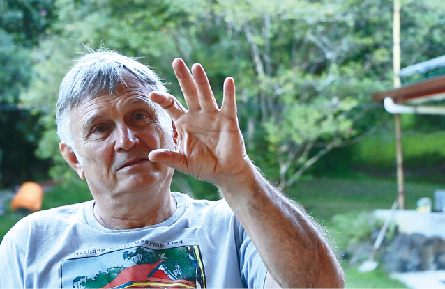

米格尔用手比划文殊像的大小

法王递给我，我双手接过它，在头顶上碰了碰，然后目不转睛地盯着这尊像，激动地想：‘这太特别了！我居然有机会捧着文殊菩萨亲手赐予的文殊菩萨像。’那尊像非常精致庄严，拿在手上沉甸甸的，完全不是幻觉。

我捧了三四分钟，然后还给法王。这时，文殊菩萨像又从他手里消失了。

见此情景，我心想：‘这是在示现神通吗？’以前我和很多喇嘛闭关时，见过他们示现神通，但法王的这个不太一样，感觉有点震撼。这可能与他是伏藏大师列绕朗巴有关。

这样的事情，现在不太能有机会见到了。我很幸运！”

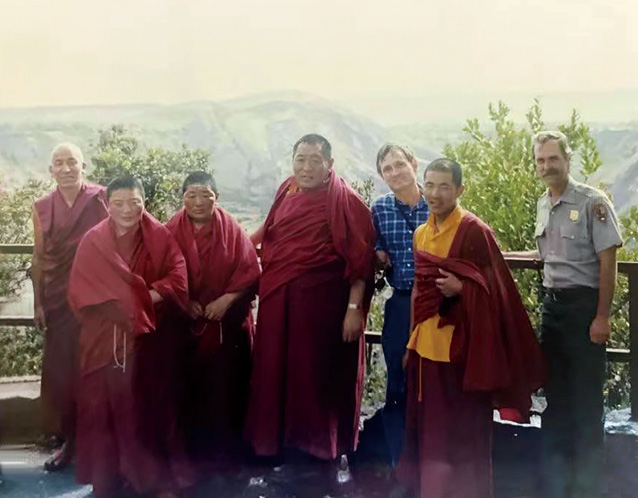

右三是米格尔·施瓦伯

介绍大圆满法

法王在讲课中提到，藏传佛教的两大修行是菩提心和大圆满。其中“菩提心”是上午以传菩萨戒的方式向大家宣讲的，而“大圆满”则是第二天的课程，即传授《文殊静修大圆满》的灌顶和引导法。为了让大家了解大圆满，对它生起信心，法王在当天晚上讲了这段内容——

> 诸佛智慧力体性，善持无数坛城轮，

> 此刹受持大士相，胜乘无等莲师王。

无论是外道徒还是内道佛教徒，在讲法、听法、修行任何时候，首先都要礼赞自己信奉的本尊，这是受持宗派者的普遍做法。根据这一点，现在我也先礼赞自己的本尊，立誓为所化众生转法轮。

我之前说过，按照佛教不共的大乘宗轨，在讲闻、修行正法的时候，发殊胜菩提心是必不可少的。就听法的态度而言，要在“我是为了将一切众生安置于佛果”的前提下听闻此法，这一点很重要。

那么，听法者如何才能具备让一切众生获得佛果的能力呢？

对此，世尊说：“修行九年，不如讲闻一次法的功德大。”意思是说，我们九年的实地观修，也比不上在上师面前闻法并思维其义。对成办众生利益的人来说，听闻正法尤其重要。

不仅如此，佛陀还在经中说，为了表示传授佛法的时间，要先击法鼓、吹海螺、敲法锣。即使旁生中的飞禽走兽，仅仅听到这些声音，尚且能阻挡恶趣生门，不再受生如今这么低下的身体，那么直接听受正法的话，有不可思议的功德就不言而喻了。通过听法，可以遣除自己的愚昧无知，当你遇到智者时，最好的礼物也是这一听闻，依此，今生中会得到不可思议的收获。

再想想来世所获得的功德。经中说：“多番上供三宝福田，多年下施恶趣众生，不如听闻一次佛法。”此外，经中还说：以七宝造各种佛塔、佛像遍布人间，不如听受一四句偈的大乘正法。许多经论也曾宣称，对住于十方浩瀚刹土的诸佛菩萨，每天以种种资具供养、做种种承侍，比不上听闻大乘一四句偈的功德大。

因为听闻大乘法有如此大的利益，所以大家要怀着“以我听闻此法的善根，祈愿一切众生离苦得乐”的善心来闻法。

・佛陀出世

这里要传授的法是什么？

无量劫之前，当我等本师——无与伦比的大悲尊释迦牟尼佛在因地时，看到了出现在这个世界上的大释迦牟尼如来。他供养如来一双靴履、一把嘎西嘎布伞、五百个海贝，第一次发下了“我为利益众生而学修菩萨道”的殊胜菩提心。之后，他依次修行布施、持戒、安忍、精进、禅定等有缘福德资粮，以及证悟无我空性的无缘智慧资粮，也就是圆满两种资粮。在第一大阿僧祇劫中，经行凡夫位的资粮道与加行道二道；在第二大阿僧祇劫中，依靠积累资粮、净除障碍，逐渐现证见道的极喜地，乃至修道的不清净七地；在第三大阿僧祇劫中，获证了八地、九地、十地等清净三地。

在十地末尾，他生为兜率天的圣贤——白顶天子，为兜率天的天人广转法轮。土羊年仲夏箕宿月六月十五日，为了调化赡部洲的一切众生，他从兜率天入于人间迦毗罗卫国摩耶夫人的胎中。十个月圆满后，于蓝毗尼花园，从摩耶夫人右胁下无有任何痛苦而诞生（蓝毗尼花园如今在尼泊尔境内）。二十九岁以前，净饭王执政期间，一直住在迦毗罗卫国。二十九岁时，对一切轮回生起厌离而于清净塔前削发出家。在尼连禅河畔，每天只喝一滴水、吃一粒米，历经了六年苦行，这也是为了教诫后来的诸位行人实修正法需要坚毅的苦行才如是示现的。季春萨迦月十五日，在印度金刚座，现前正等觉。七七四十九日后，在鹿野苑初转四谛法轮，后于灵鹫山二转无相法轮，于广严城等所有不定地点三转善分别法轮，最后在上茅城为遣除所化众生的常执而示现涅槃相。

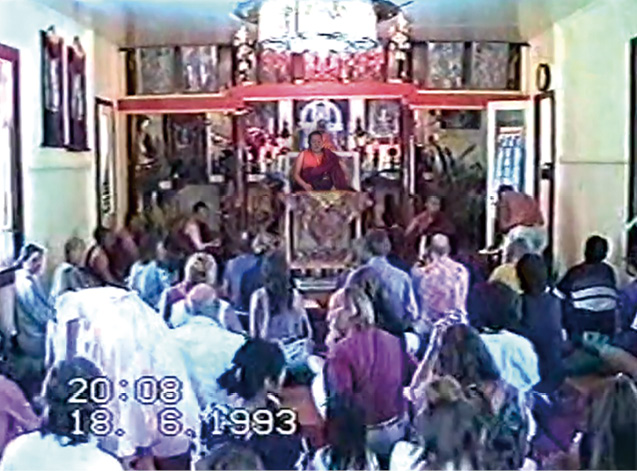

以上按照显宗的观点，讲述了佛陀出世的大致情况。

・授记之理

密宗金刚乘教法是如何兴盛起来的？

佛陀住世期间，在乌仗那国，为恩札布德传授了《吉祥密集续》；在印度南部的具德米积大塔前，向香巴拉法王达瓦桑波等不可思议的集聚者，宣说了续部《文殊真实名经》和《时轮金刚》；此外，在天、龙、夜叉、乾达婆等的境域，为少数有缘众生都宣说过密宗金刚乘的法。如来临涅槃之际，亲口授记道：“以前我对众多所化众生广说因相乘法，而并没有普遍宣说密宗金刚果乘。但未来时，密宗法会广兴。”至于转密宗法轮者，世尊授记道：“在我灭度二十八年后，由圣种五贤劝请，将广讲密宗法。”而且还有一个关于地点的授记：“圣种五贤在斯里兰卡的布息山宣说密法。”还有授记说：“佛灭度八年时，邬金海生金刚出世，他所说的密法会更广兴。”现在许多人都认为，邬金莲花生大士出生于巴基斯坦的乳海。

此外，《无垢天女请问经》中明确授记道：“此佛法将由北向北，于北方雪域境内广兴。”也有授记说，此佛法由南向南兴盛起来。如今，佛法广泛兴盛的核心就在斯里兰卡和藏地。在斯里兰卡，共同乘的法得到了广泛弘扬；在藏地，大乘密宗法弘扬得很广。

再有，佛经中授记：印度会出现龙猛、萨绕哈巴等很多智者、成就者。还有授记：藏地雪域吐蕃的众多法王将相继出世。不仅如此，旧派的邬金仁波切莲花生大士，新派的至尊宗喀巴大师、萨迦派的诸位前辈，还有米拉日巴等，都是佛经里授记的。

想想这些，我等本师佛陀的确与众不同。现在世界上有许多科学家，他们以前做过很多研究，现在正在做研究，将来也会做研究，但是，像我等本师释迦牟尼佛一样，能通达并宣说所有真实义要点的，在整个世界上寥寥无几。根据具足如此神通、大悲的佛陀所授记，密宗教法逐渐在许多地区会盛行。

・大圆满兴盛之理

本来密法也有弘扬外三续、内三续的很多情况可以讲，但因为不是你们请求的法，所以这里就不讲了。这次要讲的是大圆满法的弘扬情况。

那么，大圆满教法是怎么弘扬开来的呢？

起初，一切佛陀的初始，法身普贤如来，现前正等觉。之后由普贤如来的加持妙力中，自然出现了身所依——与人寿百岁时的身量等同、以101种珍宝所成的金刚萨埵佛像，语所依——自然显现出用金墨写在琉璃纸上的《佛一子续》四指经函，意所依——自然生出人寿百岁时人一手臂大小的一枚水晶金刚杵，这被誉为佛教之“三最”或“三补处”。无论这三者出现在哪个刹土，那里的众生都会具足快乐、远离痛苦，密宗金刚乘的佛法自然会兴盛，许多众生无需精勤而自然获得成就。

因为这“三最”的加持，十二位大圆满本师已在其他刹土出世。而密严刹土中自然出生“三最”时，普贤如来的意妙力中，只是以自己对自己交付密意的方式，将此大圆满法传授给五部佛。在报身密严刹土中，这部自生的《佛一子续》降到金刚萨埵手中。这一大圆满法，遂在天界、人间、龙宫等地兴盛起来。这部自生的《佛一子续》在化身刹土，金刚座上方的虚空中，现今也伴着自声而真实存在着，它将在未来许多年安住于金刚座的虚空中。那期间，这一大圆满教法不会隐没，而是会发扬光大。这个世界上任何一个众生修持它，都会获得成就，证得殊胜悉地。此外，身所依与意所依也正在其他刹土利益众生。

依靠《佛一子续》的加持，嘎绕多吉大师不靠父亲的因缘而在西方邬金境内诞生。他一弹指间就到了密严处金刚萨埵面前，圆满得受了大圆满640万续和妙力王权灌顶等全部灌顶、引导法及窍诀。嘎绕多吉大师在金刚萨埵前得受的640万续，就是他心中所记并结集的大圆满法。

正当嘎绕多吉大师转法轮时，印度有一位精通十明的论师，名叫蒋花西宁。他听说有一个人宣扬无因果之法，就要和那个人辩论。于是他去找嘎绕多吉，但他无论从高低哪一乘辩论，都赢不了嘎绕多吉，于是显示各种神变，结果也无法与之抗衡。他意识到自己错了，于是在嘎绕多吉面前祈求宽恕，并追随他，无余得受了大圆满法。

当嘎绕多吉大师的所有事业圆满，在一个叫单特河的地方示现涅槃时，蒋花西宁悲伤地痛哭，说：“您若趋涅槃，佛法灯熄灭，众生陷苦处。”当时，嘎绕多吉大师的身体已化光消失不见，但又在晴空的光蕴中现出右手臂以上的部分，将他的遗教《击要三句》交付给蒋花西宁。后来，蒋花西宁结集了嘎绕多吉大师的640万续，将其分为外心部、内界部、密窍诀部三个部分。

当蒋花西宁在索萨林大尸林为所有人和非人转法轮时，汉地吉祥门（今西安）有一位大师叫西日桑哈。他八种共同成就都获得了自在，是一位无碍通达十八明处的大智者。观世音菩萨亲口对他授记：“善男子，你生生世世的上师现住在印度索萨林大尸林，去他跟前吧。”西日桑哈依靠神变力，脚离地一尺，用了七天时间到达印度，在蒋花西宁面前无余得受了教言。

后来，蒋花西宁的身体化作一束光，消失了。当西日桑哈悲伤哀泣着祈祷时，从空中降下《六修觉受》的遗教。西日桑哈仅以读诵它，就与上师的密意成为无二无别。

西日桑哈回到故土，在汉地五台山附近的清凉大尸林专心入定修行时，印度东部有两位大班智达，一位叫嘉纳思札，一位叫布玛莫札，他们是五百世一起求法的友伴，志同道合。有一天，他们在一个花园里消遣时，金刚萨埵从空中降临，授记说：“善男子，你们两个五百世都是班智达，但还是没有获得佛果。要想即生成佛，就去汉地的清凉大尸林吧。”布玛莫札性子急，有勇猛心，马上回家穿上法衣、拿上钵盂，往汉地去了。在九年中，他圆满得受了西日桑哈的灌顶、引导法和教言。九年后，嘉纳思札去依止西日桑哈，用二十一年的时间，得到了比前面更殊胜的许多灌顶、引导法、教言等。

西日桑哈住在汉地清凉大尸林时，莲花生大士、大译师贝若札那也来到他面前，得受了大圆满法。西日桑哈涅槃时，将遗教《七钉》交付给嘉纳思札，他们师徒的密意成为无别。嘉纳思札涅槃时，在光蕴中，将遗教《四安住方便》交给了布玛莫札。

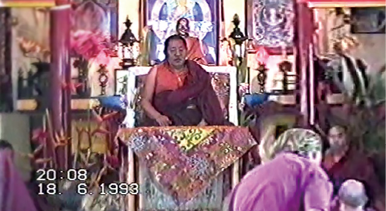

以上所有以人相出世的上师，全是身体化光而消失不见的。邬金仁波切莲花生大士，现在并没有涅槃，而是住在西南方妙拂罗刹洲，统治着所有的罗刹。布玛莫札住在汉地五台山，不舍肉身，现今仍住世着，每隔一百年向藏地投生一位他的真正化身，而且他平时的化身也不间断出世。1987年，我们上万名藏族人前往五台山，朝拜布玛莫札。当时有的人在空中看到布玛莫札、文殊菩萨，有的人看到狮子，有的人看到彩虹，有的人看到人和鸟的形象，诸如此类看到了不可思议的瑞相。如今也有很多人见过这样的瑞相。

布玛莫札的真实智慧幻身，后来也来到藏地，给杰珍桑给旺修圆满赐予了灌顶、引导法和窍诀。杰珍桑给旺修在十万空行母中做会供时，身体消失而化为光团。诸位空行母向他祈祷，他将《三品遗教》交付给她们。

就这样，所有上师依次出现于世，也出现了很多实修此法的修行人。比如康区的噶陀寺，同一时间就有十万虹身成就者。不仅如此，那些将身体化为彩虹与光芒的不可思议的虹身成就者，至今仍在不断涌现。比如，有一位修大圆满法的老人叫索甲，他也成就了虹身，第二世敦珠法王的《藏密佛教史》中有记载，你们大多数人应该记得吧？如今我们佛学院的所在地，就是第二世敦珠法王前世（即第一世敦珠法王）的道场。那里，同一时间曾出现过十三位虹身成就者。在藏地各个寺院里，成就虹身、身体缩小的修行人层出不穷，直到今天。现在我们的很多传承弟子，在临终的时候，身体化光、缩小等瑞相多之又多，以前出现过，现今也在出现。总而言之，实修大圆满的诸位行者中，大约60%的人不同程度现前了明显的成就验相。

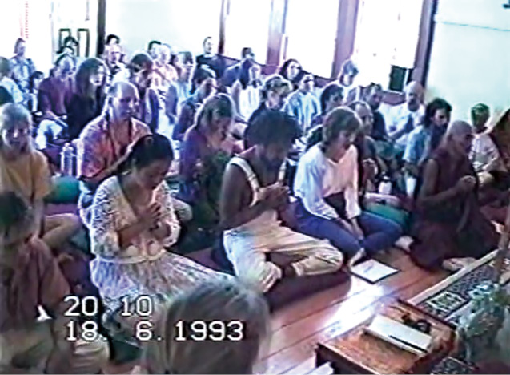

以上是为了让大家对大圆满法生起诚信，稍微讲了一点历史。一个法是不是真实清净，要看实修此法的修行人有没有出现验相。时至今日，持明传承的成就者接连不断地涌现，这就是“大圆满是清净法”最有力的证明。

・大圆满的不共特征

如果有人问：“那么，大圆满法需要通过什么途径来了知呢？”

若要广泛了解，就要通过十一句义来了知。归纳它们的要点，实修的核心就是本来清净直断法、任运自成顿超法这两种实修法。

所谓的“本来清净直断法”，指的是了知诸法是空性的实修法。所有教派，如萨迦派、宁玛派、噶举派、格鲁派等，基本上都有自己的实修窍诀。以新派宗喀巴大师的《甘露妙药》为例，其实它的初中末与宁玛派的大圆满法完全一致。不仅如此，新派宗喀巴大师法脉中的章嘉国师等许多行人，也是实修大圆满而证得成就的。

所谓的“任运自成顿超法”，在其他任何一个宗派基本都没有。大圆满有四大类特有的法——蒋花西宁把640万续归集为外心部、内界部、密窍诀部三部来宣说，西日桑哈将密窍诀部又分为四类：外类、内类、密类、极密类。除了极密心滴类，其他大圆满法都没有宣说实修顿超法的。

就实修方法而言，需要通过直断与顿超来实修。莲花生大士的《莲花心滴》和布玛莫札的《布玛心滴》两种心滴兴盛于世，心滴教在藏地最初是由莲花生大士与布玛莫札传下来的，因此，这两部法共称为“母心滴”。后来，全知龙钦绕降尊者造了《布玛心滴》之子《上师心滴》、《莲花心滴》之子《空行心滴》，以及这两者深要之合集《甚深心滴》。两种“母心滴”与两种“子心滴”，合称为《四心滴》。

所有佛法的实修，都可以分为两种：讲传和耳传。

所谓的“耳传”，是指对少数有缘智者所讲的密类以上的法。所谓的“讲传”，是指如果针对的是有缘者，那么弘扬给大众也可以。

全知龙钦绕降之前的上师们，只把这种大圆满法独传给弟子，而没有广传给许多人；全知龙钦绕降之后，由于弟子越来越多，所以如果弟子堪为法器，上师也是成就者，那可以一次性传授给成千上万的人。如今，藏地许多获得成就的上师都在向大众传法。同样，在印度等其他地方弘法的第二世敦珠法王、顶果钦哲仁波切、贝诺法王等诸位大德，也在许多众会中传授“大宝伏藏”“四心滴”的灌顶。

如果有人问：“这样传授的原因是什么？”

这是因为，在过去，堪为法器的弟子少，而现在，堪为法器的弟子多。

那么，大家可能会有这样的怀疑：“按照内道佛教的观点，明明是说弥勒佛出世之前，时间越来越恶劣，劫越来越污浊，众生的业和缘分越来越下劣，而不是越来越好。那么，正法怎么会变得越来越殊胜呢？”

这是总续部的观点，也就是，随着烦恼越来越多，佛法需要越来越深。佛法越深，表明烦恼越炽盛，所以，正值众生放逸无度之时，佛法一定要击中要害。通常来说，事续在人寿无量岁时兴盛，是所有续部中最低的；人寿八万岁时，行续兴盛；人寿三万岁时，瑜伽续兴盛；具诤五浊猖獗时，无上瑜伽续兴盛。时间越来越浊，对所化众生宣说的续部越来越深。随着劫越来越浊，最后，到了人寿最多只能活到十岁时，大圆满法比以往弘扬得更普遍，一位名叫持德的空行母宣说此法，令见闻忆触的所有众生均得解脱。而其他所有的法，却随着时间越来越浊，威力变得越来越弱。正如全知麦彭仁波切亲口所说：“浊世衰败罩如暗，莲师事业明如月。”

佛经中也说，佛法分为果期、修期、教期、唯持形象期，其中果期和修期都已经过了，现在正值教期，除了讲法和闻法以外，显宗的深法几乎没有了。就总的佛经而言，佛法的威力每况愈下，站在公正的立场上思考，真的是这样。比如往昔莲花生大士、大班智达布玛莫札他们两位，不仅走遍了印度东南西北的所有地方，还来到了藏地，即便如此，大圆满在当时也没有广泛弘扬开来。当今时代，单单是藏地，就有很多上师到国外讲经说法、授予灌顶。以世界第一强国美国为例，大圆满法在这块土地上普遍兴盛，就是其加持力越来越强的象征。

如果看看在座各位的信心，也可以推测得出来。想必你们对总的佛法有信心，对支分的藏传佛教有信心，尤其是对大圆满，更有信解欲乐，这就是你们相续中得到大圆满加持的前兆，也说明你们是大圆满的所化法器。你们也是这样认为的吗？

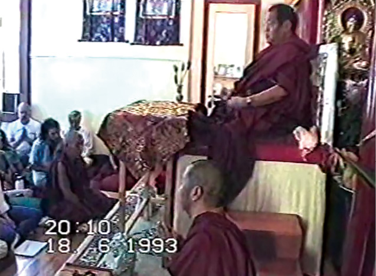

在小小的藏地雪域，虽然人们对现代科学之类的了解不多，知识渊博的人也不多，但因为具加持的甚深法大圆满盛行，现在藏地的很多上师都在世界各国各地区广弘总的佛法，尤其是大圆满法。可见，“总”的大乘法、“别”的大圆满法有多么不可思议的加持和功德。

再者，你们诸位可能会有这样的疑问：“是啊，以前大圆满瑜伽士都是不舍肉身而前往持明地，他们现在真正住于净土，基本都是虹身成就的。但如今实修大圆满的大德，如第二世敦珠法王、顶果钦哲仁波切等上师们，却将肉身遗留下来，这是为什么呢？”

实际上，他们的遗体没有虹化有两个原因：

第一，他们的身体虽然可以成就虹光身，但却留下来作为所化众生起信心的所依处。也就是说，如果他们的身体完好无损能够利益众生，就会完整地保留下来；如果只留头发、指甲能利益众生，那么除了头发和指甲，肉身就会化为虹光。当今一些上师有留下头发、指甲的，也有留下整个身体的，这都是考虑到依靠自己的遗体能使虔信、顶礼、转绕的一切众生不堕恶趣的殊胜必要。

第二个原因是，就所有弟子而言，如果上师有很多业力不清净的弟子，那么他们的晦气会沾染上师，导致其遗体无法完全化为光，也有这种情况。

还有人可能会问：“在所化界中故意留下遗体，和不能把遗体化为光有什么区别呢？”

比如，以第二世敦珠法王、顶果钦哲仁波切为例。敦珠法王是莲花生大士特意降生到人间的，即使整个世界都是破誓言者，也不能障碍他的法体。顶果钦哲仁波切是法王赤松德赞的化身，他也是一样，纵然全天下一切众生和弟子都破了誓言，也不可能遮障他那样的大德。可见他们两位大德的遗体保留下来，只是为了作为今天以你们为主的信徒们顶礼、供养、转绕的所依对境。

然而，像我们这样的普通初学者，要想修行大圆满，通达其意而成就虹身，就必须小心选择弟子。否则，一般的身体本来就是苦谛和不清净的蕴，如果有弟子违背了誓言，受到他的遮障，就无法成就虹身，肉体只能遗留下来。在座的各位，虽然我无法衡量你们的心相续，但是像我这样的人，如果选择弟子不小心谨慎，是不可能成就虹身的，会被弟子破誓言的晦气所染污。

这以上是对大圆满法的简单介绍。

・大圆满之加持

只是耳边听到大圆满法，再怎么拖延，七世后也不可能不成佛。如果得受了大圆满的灌顶，获得了引导法，对上师没有生起邪见、没有进行诽谤，对法没有退失信心，那再怎么耽误，也必定会于中阴解脱。

得到大圆满的灌顶、引导法后，如果你了知其中意义，并认真修行，具上等信心者，就有了六个月成佛的方便；具中等信心者，七年成佛；具下等信心者，十二年一定会获得佛果。

虽然你获得了灌顶和引导法，但如果没有修行，只要做到不破誓言、大圆满的法本接触身体，你不久也会解脱。如果在临终众生的耳边宣说大圆满法，这个众生很快会成佛。把大圆满法本放在枕边，对它顶礼、转绕、供灯，此人不久也会成佛。

大圆满是一切乘之顶，原因是什么呢？

大圆满与九乘次第的任何法完全不同，一切见闻忆触的众生，都不会耽搁太久而成佛。这就是为什么大圆满被称为“闻解脱”和“触解脱”。大圆满是如此不可思议的一个法，所以从现在开始，如果我们对法和上师不起邪见，没有进行诽谤，那么很快就会解脱轮回的苦因、苦果而获得佛果。

那个时候，身心没有任何痛苦，你们喜欢吗？（众笑）

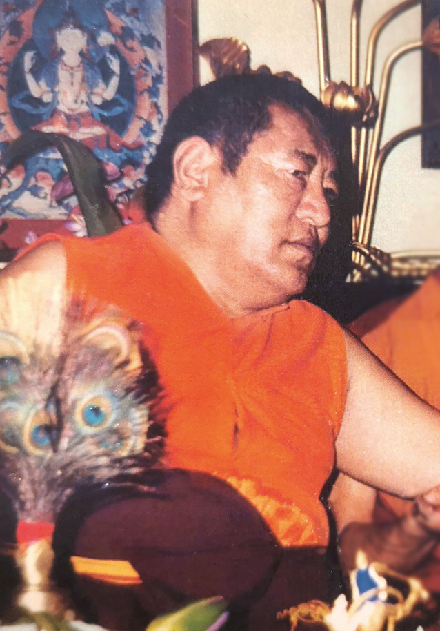

修行的基础

6月19日上午，法王将自己的伏藏法——“文殊静修大圆满”灌顶，传授给寺庙信众和外来求法者。在灌顶之前，法王是这样说的：

今天接受灌顶之前，你们应该这样想：“为了利益天下一切众生，我会用心聆听，并传播此法。”

我在此开许大家将这部法翻译成各国文字，用不同的语言进行传播，尽一切努力在世界各国广泛推广。

事实上，弘扬佛法是你们所有人义不容辞的责任。比如南珠堪布，不仅向众多居住在印度的藏族僧人广泛传播佛法，还在台湾、香港等地推广此法，成办了弘法利生的广大事业。同样，你们也一定具备这种能力，要大规模地把这个法发扬光大。大乘的主要学处就是以大心帮助一切众生，不要以为自己没有这个义务，每个人都不应该忽视这一神圣的职责。再比如索达吉堪布，他一直在为中国大陆的许多出家人与居士广传此法。同样，你们也不要忘记尽自己的一份力量，在各个领域弘扬这部法。

灌完顶，法王准备用两天的时间讲《文殊静修大圆满·手中赐佛》。第一天，从开头的偈颂讲到“发菩提心”。法王所讲的内容，这里没有逐字记录，只是摘录了一部分与大家分享：

如前所述，当你们听到这部法的时候，应该想到：“我是为了普天下一切众生获得佛果，来听受这一微妙法并修行其义的。”请先怀着这种发心来听。

所听的法，就是即将要讲的《文殊静修大圆满·手中赐佛》的修行次第。如果你想实地修行这一道法，它分为两部分内容，一是总说修道的次第，二是分别讲修道的窍诀。

首先总说修道的次第，其实这在我的《忠言心之明点》里已经讲得很清楚了；其次，关于修道的窍诀，则在引导法《手中赐佛》里有明确宣说。关于这两部论，《忠言心之明点》是广大班智达派的解说方式，引导法《手中赐佛》是甚深古萨里派的解说方式。

无论实修这两派中的哪一个，都是一个人现前圆满佛果的完整无误之道。这一次，我要讲的就是《手中赐佛》，首先需要补充《忠言心之明点》的一些内容，我以概括的方式给你们讲一下。

・知足少欲

要想修行清净的法，首先必须具备的一点，就是知足少欲。具体来说，对于别人拥有的丰富财物、显赫权势、名望声誉等，如果能从根本上断除“我能得到这些该多好啊”这种心态，那就是少欲。所谓知足，就是不管你吃的喝的好，还是吃的喝的不好，都有“这就可以了”的满足感，不会为了寻食求财而贪得无厌去搞无数的琐事。如果知足少欲，就不会贪恋今生的荣耀与功名，否则，一味地贪恋这个世界，就不可能有清净修行的机会。原因是，无论你享受了多少欲妙，那只是在增长贪爱，而不会有满足的时候。比如一个人有一斤黄金，他还想有两斤；成为一个地区的主人时，还想成为两个地区的主人；当上了一个国家的元首，还想成为两个国家的元首。欲望的坑不会有填满之时，所以，要学会少一点欲望。

无论你怎么做这个世界上的琐事，这辈子也不会有做完的时候。人的一生，为了获得快乐、财富和名声，每天都会付出无尽的努力，但往往结果是一无所获，生命也就走到了尽头。所以，要放弃大大小小的所有事，唯一成办永久的安乐。

想想世间的幸福、财富、名声，就像在梦里做买卖，有时盈利了会很开心，有时亏损了会很沮丧。其实这只是一场梦，你从来没有做过生意，又怎么会有盈亏和得失呢？同样，今生的快乐、财富、名誉等都不是真的，和梦中的显现没有区别。我们在座诸位想想自己的一生，从出生到现在，有些人的前半生过得无比幸福，有些人却历经多次磨难，有些人则苦乐交织。但其实这一切和昨晚的梦没什么区别，今天除了只剩回忆以外，不会再去感受那些苦乐。

有人可能会想：“虽然过去的事都过去了，但现在的苦乐却是真实存在的。”

事实上，这也像梦中的场景一样，不管你是在梦里享受快乐而欢喜，还是遭受痛苦而悲伤，第二天醒来，一切都没有了。同样，我们今天感受到的苦也好、乐也好，等到明天天亮时，一切都将不复存在，所以说，就像梦一样毫无实义。

同理可知，明天、后天的显现，和明天的梦、后天的梦并没有什么不同，它都不是常存的、坚固的。因为这些苦乐感受根本就没有成立过，是迷乱的，所以不应该贪。

不管是谁，从想修正法开始，就需要知足少欲，“没有冻着、饿着就挺好了”。否则，如果你花很多功夫做很多事情，是不可能成就清净正法的。所以，有吃有穿就足够了。事实上，即使我们成为世界之王，除了衣食住行，也没有机会享受一切。因此，再多的财产受用、美名声望、荣华富贵都是没有任何用处的。

只想修行正法，此生与一切世俗琐事无关的人，才是最上等的佛教徒；如果做不到这一点，一边在修持正法，一边在希求今生的荣华富贵，二者同时并行，只能算是中等的修行人；虽然很贪求今生的快乐和荣耀，但是对正法也有一点点欢喜心，这是下等的修行人；如果只是贪图今生的平安富贵，而没有修持正法的欲乐，那就永远无法成为修行人，也永远无法加入佛教徒的行列。所以，大家观察一下自己的相续，假如你以前根本不是修行人，那要从现在开始，努力成为一个下等修行人；如果你曾经是一个下等修行人，就要千方百计上升到中等修行人的位置；如果你曾是一个中等修行人，那就看看能不能成为一个对今生一点都不贪著的上等修行人？

・依止上师

作为一个真正的修行人，最开始要尽可能做到知足少欲，这是非常重要的。在知足少欲的基础上，还需要依止一位上师。原因是什么呢？因为自相续中一切不符合佛法的过失都要灭尽，一切前所未有的功德都要生起。

那么，所依止的上师需要具备什么条件？

用佛教的术语来说，上师要具足法相，要依止一位具有资格、功德丰富的上师。上师的功德，就是他有希望一切众生具足安乐的慈心、希望一切众生远离痛苦的悲心，也就是以慈悲为本，而且能解释佛法的教义，这样的人才叫具相上师。我们要依止这样一位上师。

那么，弟子要如何依止上师呢？

上等者，必须实修上师所传的正法；中等者，为了令上师欢喜，要尽己所能地承侍上师；下等者，为了报答上师的恩德、让上师满意，用自己的财富供养上师。这是以三欢喜来依止上师。

紧接着，需要在上师面前得受法。所求的法，最好是佛陀传讲的经典、生于印度的二胜六庄严等大德所造的解释佛经密意的论典，以及藏地雪域修传八大派等智者成就者所造的论典，这些都需要在上师面前求得。

当然，求法不能只是在上师座下听听，然后就置之一旁，而必须把所有法句、法义都记在心里。假设你实在不能知道那么多，至少也要掌握自己实修的那个法。以这次讲闻的《文殊静修大圆满》这一深法为例，在上师面前听完它的完整内容后，一定要遣除对句义的疑惑。否则，只是读读文字，揣测一下教义，是无法从根本上理解此法的。

特别是密法，法本读得再滚瓜烂熟，词句和窍诀的诸多密意在书本里也没有明说，因此，务必要依止具有法相的上师。

一般来说，由于众生的界性、根基、信心、意乐、烦恼完全不同，讲法方式也要因人而异，不能千篇一律。否则，给所有病人开一种药，不仅大多数人的病治不好，而且肯定是有害的。不过，如果一门心思修持《手中赐佛》这个引导法，无论是什么样的修行人，都会从中受益匪浅。藏医中，诃子有消除404种疾病的功效，配药的时候，如果根据病情以诃子为基础，加入其他药物作为补充，就会有立竿见影的效果。同样，《手中赐佛》就像诃子一样，传给弟子的时候，要以它为基础，加上上师的窍诀作为补充。否则仅仅依靠一个教言，很难让所有人成佛。

……

神奇的力量

中午，法王坐在寺院附近的草坪上，欣赏着周围的风景。奇妙的是，这时来了30多个棕头发、黄眼睛的北美游客，另一方向来了近70个黄头发、蓝眼睛的南美游客。看到法王寂静调柔、不同寻常的神情，他们聚集在他面前，恭敬地坐着。法王饶有兴趣地说：“今天，你们北美洲棕头发、南美洲黄头发和我这个来自亚洲的黑头发老人欢聚一处，真是吉祥的缘起！”并给他们讲了人生价值方面的教言。最后，这100多人全部皈依了佛门。

下午，夏威夷南部一座城市的火山爆发。一些当地人非常害怕、不知所措，去法王住处祈请加持。法王对身边的人说：“一千多年前，藏地的黑波日山发生了一场大火，是降魔金刚依靠神变熄灭的。现在我也有降魔金刚化身的假名，希望能把这火扑灭。”说完取出金刚橛，安住在一种境界中，口诵密咒。听说没多久火就停了。

第二天，一些地质专家特意来拜见法王，以表达他们的感激之情。他们发自内心地赞叹：“藏传佛教的威力，您的加持力，真是不可思议！”喇嘛罗桑顿单告诉我，这件事在当地新闻有专题报道。

证悟的另一种表相

有一次，法王私下对我说：“这次我们来到西方，和以往有点不一样。以前去藏地、印度、尼泊尔、不丹的圣地，我经常会取伏藏；到了汉地五台山，也会出现一些净现觉受法。而西方很多国家只有几百年的历史，佛陀和莲师都没来过，不可能有伏藏。况且西方人倾向于理性，崇尚现实主义，不一定接受超胜的境界。所以，这一次，我打算把重点放在灌顶和传法上，你不需要像以前一样随时准备录音、记录。”

之后，确实如法王所说，在整个出国期间，法王除了灌顶和传授佛法，没有示现什么神通，也没有取出各种地伏藏、意伏藏，只是以藏传佛教修行者和学者的身份与西方人交流。

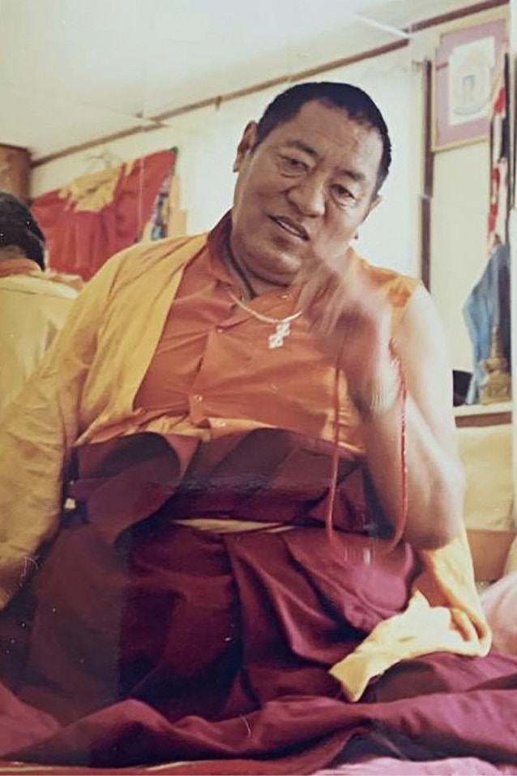

但即使没有超凡的行为，也可能是大成就者的甚深愿力吧，只要看到他的色身、听到他的法音，大多数人都会有很大的变化，法王赢得了西方人的欢喜。所以，具有真修实证的高僧大德，哪怕是简单的行为、普通的语言，也能改变众生的心态，这是常人无法想象的，应该是他内在证悟的一种表相。

与乃琼护法神的因缘

在乃琼寺时，由于寺庙方的祈请，法王为乃琼护法神造了一个简短的祈祷文：

> 圆镜智相护法尊，乃琼王及眷属前，

> 祈祷供养令欢喜，嘱托事业顺速成。

为满足位于美丽海岛之乃琼寺内以喇嘛罗桑顿单为主的众弟子的祈请，阿旺洛珠宗美欢喜撰写，善哉！

1993年6月19日

这段文字是我记录下来的，寺庙住持把我的字迹至今仍保存在护法殿里。

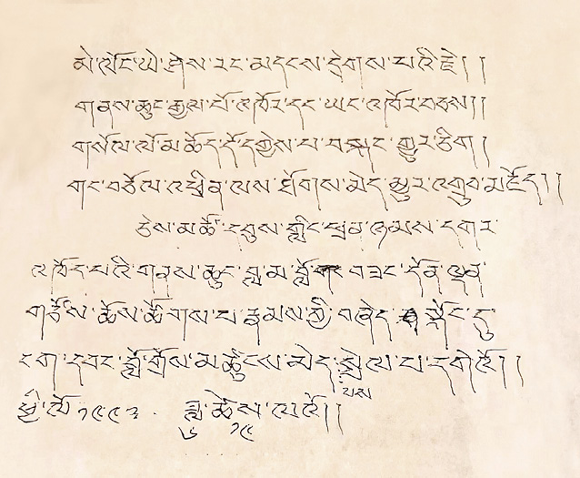

当年我亲笔写的乃琼护法祈祷文

6月20日上午，法王给大家传授伏藏大师列绕朗巴“缘起除障法”的略灌顶。在正式灌顶之前，法王提到了乃琼护法神和自己的关系：

这里我简单说一下《伏藏大师列绕朗巴（或酿喇索甲）传》中关于乃琼护法神的情节。

列绕朗巴，是雪域持橛咒师之首的密咒师降魔金刚的身化身、空行金刚亥母的语化身、莲花生大士的意化身。他是一位不可思议的伏藏大师，可以像鸟一样在空中飞翔，像鱼一样在水中畅游，可以毫无阻碍地穿过岩壁，具有无碍的他心通和能消除雪域一切衰败的威神力。特别是，他也是第十三世嘉瓦土登嘉措的不共上师。

他和乃琼多吉札丹护法神，可以像人与人之间的对话一样互相交谈，他们也互相授记、说一些取舍学处。他和乃琼护法神的关系非常密切。下面简单介绍一下它的由来：

前两年，我去印度北部的达萨时，乃琼护法降神所依的那个僧人来找我。一提到伏藏大师列绕朗巴与乃琼护法神有着誓言的密切关系，乃琼护法神就清晰地想起了前世。他泪如泉涌，身体颤抖，喜不自禁。

这位乃琼护法神，无论是对前世的列绕朗巴，还是对现在的我，一直都是有着大恩大德的护法神。在过去，列绕朗巴虽然被别人认为是宁玛派的老密咒师，是康区德高望重的大德，但实际上他当时在卫藏，是一个没有名气的普通密咒师。有一次，他去卫藏拉萨的集市，乃琼护法神突然降临，手里还拿着哈达。在大庭广众中，他拜见了列绕朗巴，口称其为莲花生大士，然后献上哈达，恭恭敬敬地顶礼。正因为如此，列绕朗巴受到卫藏人民的广泛尊重和拥戴。从此，他也因为护法神的牵线，与嘉瓦土登嘉措结上缘，最后两人成为师徒关系。后来，让列绕朗巴的广大事业蓬勃发展的先驱，就是乃琼护法神。

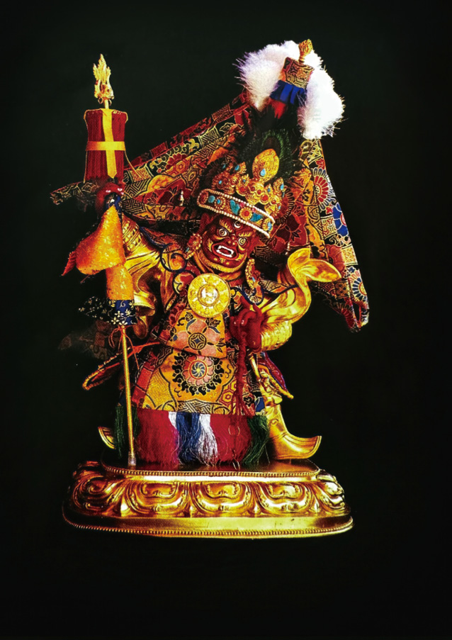

夏威夷乃琼寺供奉之乃琼护法神

同样，我本人到达萨寺传授“项袋金刚橛”灌顶时，乃琼护法神也突然降临了。他先是虔诚地向我顶礼，然后供养了佛像、佛经、佛塔，还讲了过去的事，预言了一些未来的事，做了各种各样的赞美。因为这件事，我也得到了生活在那里的藏族人民特别的尊重和爱戴。他成了我做任何事不出违缘障碍、事业广大兴盛的助手。现在想来，乃琼护法神对我的恩德真的非常非常大。

在藏地雪域的时候，我心里曾想：“据说美国有一个乃琼的道场，如果能去那就太好了。但是它不在最初的日程安排里，看来这次是去不成了。”后来听说太平洋中间的夏威夷岛上有乃琼护法神的道场，并且确定要去那里。当时我的心里充满了喜悦。

本来，护法神分为智慧护法神、世间护法神。世间护法神，也和我们普通人一样，有业，有烦恼。而乃琼护法神是莲花生大士从大悲妙力中显现的五大神王中的事业王，是真正的智慧护法神。在所有护法神中，乃琼护法神是莲花生大士任命的守护藏地整个佛法、给予众生幸福安宁的主要护法神。任何修行人平时若求助或修行这位乃琼护法神，一切不幸和灾害都会消除。

在这里，你们的道场成了整个佛法的中流砥柱。这个道场以后要争取更加稳定、长久兴盛。尤其是对乃琼护法神尽心尽力地供养和赞美也是非常重要的。

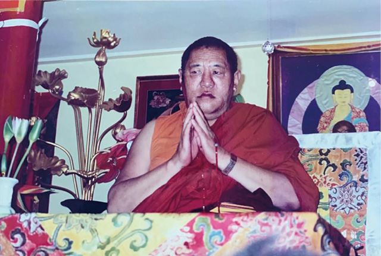

很高兴这次来到乃琼道场，因为我在西方国家的第一站，就有机会在这个乃琼道场传法，是一个非常好的缘起。我相信从现在开始，我所做的一切都不会出现任何障碍或违缘。

另外，从今以后，你们所有人都要虔诚祈祷莲花生大士，尤其是要在修莲师的生起次第和圆满次第等法上多下功夫。

总的来说，莲花生大士是一切佛陀事业的行持者，所以向他祈祷，他的大悲和加持比其他佛陀都快。尤其是在这个地方，我们所有人的皈依处就是莲花生大士，乃琼护法神的究竟皈依处，也唯一是邬金莲师仁波切。所以，如果通过护法神和人志同道合的方式来祈祷莲师，就会得到特殊的悉地。前面说了，安排乃琼护法神成为众护法神主尊的人，最开始也是邬金莲师仁波切。而且在很多乃琼护法供仪轨中，都有把自己明观成邬金莲花生大士的修法。我之前去印度的时候，乃琼护法神曾对我说，他以前从来没有违背过誓言，现在和将来也不会违背，还力劝我广弘以莲师事业为主的佛法。

关于这些，现在也有文字记载，你们可以参阅……

观修文殊上师瑜伽

下午，法王传讲《文殊静修大圆满·手中赐佛》，从“上师瑜伽”讲到“圆满次第”。之后的“大圆满”部分只念了传承，没有详细讲解。

在讲“上师瑜伽”时，法王说了这么一段话：

有些人会把上师当成真人，认为自己接触的是一个有血有肉的身体；在有些人眼里，上师就是文殊菩萨，如果接触到他，就是在接触文殊菩萨。那么，这二者当中，应该将上师观成哪一种呢？

把上师看成文殊菩萨是正确的。这里面有很多原因，但是如果我今天解释太多，恐怕时间不够了。

上师其实就是文殊菩萨，这就是为什么我们需要将上师视为文殊菩萨。但之所以将其本体观成根本上师，是因为如果我们把形象和本体都观成文殊菩萨，文殊菩萨离我们似乎有点远。他是汉地五台山的菩萨，以前大悲佛陀住在印度时，文殊菩萨多次去过印度，跟我们这个地方没什么关系，即使我们向他祈祷，好像也不可能得到多少加持。而根本上师，已经亲自来到这里，为我们灌顶传法，祈祷他会得到更大的加持。因此，其本体需要观成根本上师。

如果你想生起一种前所未有的大圆满境界，最好的方法就是祈祷上师。如果你之前生起过大圆满的境界，要想进一步提升觉受和证悟，让它越来越增上，早日获得佛果，也没有比祈祷上师更好的方法了。因此应该观修上师、祈祷上师。

观修的方法，就是把根本上师观在你前方的虚空中，心想：“从今以后，除了您，我绝不寻求任何其他的皈依处，甚至晚上做梦时也唯一祈祷上师您。”怀着对上师的虔诚信心，观想将自己的身体、受用、三时一切善根，全部供养上师而供曼茶罗。再观想从无始以来生生世世累积的一切罪障恶堕，在上师面前发露忏悔，发誓从今以后纵遇生命危险也绝不再犯，这是清净罪业的对治法。还要观想：“我要祈祷的，唯有上师您，请赐予我灌顶、窍诀，令我的相续得以成熟和解脱。”还要思维：“请加持我修习此光明大圆满之道，让我变得像根本上师您一样。”需要虔诚地祈祷。

下面的祈祷文是佛语，所以有特别大的加持。接下来是这个祈祷文：

> 具有童子身，庄严智慧灯，

> 能除世痴暗，祈祷文殊尊。

“具有童子身”的意思是，文殊菩萨到底是什么样的？他是有着16岁韶华的童子身。“庄严智慧灯”的意思是，一切佛陀的遍知智慧所显现的圣尊就是文殊菩萨，所以他是以诸佛智慧灯所庄严的。“能除世痴暗”的意思是，就像明灯会驱散所有黑暗一样，文殊菩萨的大智也能遣除一切众生的愚昧无知。在这样的怙主文殊菩萨面前诚心祈祷，请加持我的相续。需要这样来观想，一心一意念诵这四句祈祷文一千遍、一万遍、十万遍等等。

最后，观想上师的眉间、喉间、心间放出白光、红光、蓝光，依次融入自己的眉间、喉间、心间，从而清净身语意的一切罪障，获得上师三身的功德。最后，上师化光融入自己，自己与上师成为无二无别，专注于以大圆满见解摄持的境界中，放松，安住。当再度起心动念时，观想一切器情世界都是上师的身体，一切声音都是上师的语言，一切忆念分别都是上师的智慧，在这种清净观下，将一切善根回向于无上菩提。

观修莲师上师瑜伽

之后，法王传授了麦彭仁波切造的莲师上师瑜伽：

首先，不需要把自己的身体观成本尊，现在你是什么样，就观想成那样，平常安住。然后，在你前上方的虚空中，观想邬金无垢达那够夏海，也就是莲花生大士诞生的那个充满八功德水的海。再观想海中央有一朵千瓣莲花，在莲花中间的月轮上坐着邬金仁波切莲花生大士。他的身色白里透红，光彩奕奕，右手持着金刚杵，左手托着托巴和宝瓶，身体以绫罗和珍宝等报身装束严饰着，与右手握弯刀、左手持托巴的白色益西措嘉佛母双运。同时，观想自然续部坛城的一切圣众。需要观得了了分明、非常清晰。

再观想，自己在莲师面前，心里想：“无论我是高是低、是苦是乐、是凶是吉，莲花生大士您都知晓，恳请您加持我。”要满怀着强烈的信心、恭敬心，真情实意地虔诚祈祷。然后通过身体恭敬合掌、语言恭敬祈祷、心里恭敬忆念莲师功德而作礼。

再观想，将自己最执著的身体、受用、三时积累的一切善根，全部供养莲花生大士。需要这样观想做供养。

再观想，自己无始以来生生世世直到现在，在贪嗔痴烦恼的驱使下所造的一切罪业，统统在莲花生大士面前发露忏悔——对过去犯下的罪业感到后悔，发誓以后即使遇到生命危难也绝不再犯，恳请莲师加持自己的所有堕罪得以清净。这样一边观想一边忏悔。

再观想，对于他人的善根，也就是从上到下所有外人行持的善法，自己不嫉妒、不怀恨地随喜。如果能真正随喜，你自己不仅会得到同样的善根，甚至会得到胜过它的善根。所以，要发自内心地随喜上中下其他人的一切善法。

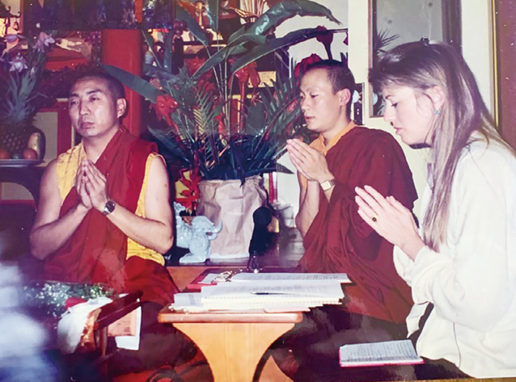

左一是南珠堪布，左二是吾智多杰，左三是翻译桑吉堪珠

再观想，在这个虚空没有穷尽之前，莲花生大士的金刚身是不生不死的，本不需要祈祷他长久住世，但他的化身随着众生意乐而有不同示现，所以还是要祈祷他久住世间。

再观想，祈请莲花生大士的化身在轮回未空之前，一直为所有众生转法轮。

再观想，将自己积累的一切善根，为了得到莲花生大士的果位而作回向。

再观想，祈请莲花生大士加持，令自己身语意的一切罪障、恶堕得以清净。莲花生大士身语意的所有功德融入自相续，自己可以成办弘法利生的广大事业。

最后观想，依靠这样的祈祷，从上师莲花生大士心间放射出五彩光芒，如蛛丝延伸般融入自己的心间，自己获得了莲师身语意的所有功德。然后，尽力念诵七句祈祷文和莲师心咒。

当然，要解释七句祈祷文，也可以从它涵盖了所有佛法的角度来讲。全知麦彭仁波切在《七句祈祷文释》中有详细讲解，但这次就不解释它的句义了。

简而言之，七句祈祷文是一个特别有加持力的法，完全不同于其他任何法。正因如此，这次我也给大家念一下它的传承。

吽 哦坚耶杰呢香灿  吽 邬金西北隅

巴玛给萨东波拉 莲花蕊茎上

雅灿巧格悟哲尼 稀有成就尊

巴玛炯内益色扎 共称莲花生

括德夸卓芒布果 空行众围绕

切杰吉色达哲吉 我随汝修行

辛吉拉协夏色索 祈临赐加持

格热巴玛色德吽 格热巴玛色德吽

嗡啊吽 班匝儿格热巴玛色德吽

你们平常念诵的时候，要尽量多念莲师心咒和七句祈祷文，之后观想从上师莲花生大士的眉间、喉间、心间分别发出白光、红光、蓝光，融入自己这三处，依此，上师身语意的一切加持入于自己的相续。最后上师化为光，变成一个白里透红、圆溜溜的光明点，中央以“吽（ཧཱུྃ）”字庄严，融入自己的心间。观想上师的智慧与自己的心成为无二无别、一味一体。在无所思维、自己与莲花生大士的心完全无别的境界中专注入定，阿阿……

之后，法王传授《七句祈祷文会供仪轨》时，说了这么一段话：

你们有什么饮食，可以陈设在三宝所依前，也可以单独摆放在其他地方，一边念诵会供略轨，一边观想供养莲花生大士与持明空行会众。他们享用后剩下的部分，自己以取悉地的方式来受用，依此无勤中就能圆满资粮。平时最好多念这个会供仪轨。

它的念诵方法，可以按照我讲的那样念，也可以依照麦彭仁波切的仪轨逐字逐句念，怎么方便就怎么念，都可以。

尤其是在用餐时，念诵会供仪轨“吽 由阿于等法界颅器中，由嗡陈设现有欲妙供，以吽转成大乐智游舞，以舍喜酬三根本尊众……”，那么吃饭也就成了善法。本来，我们吃饭并不是善法，但念诵这个会供仪轨，观想供养莲花生大士，用餐也可以圆满广大资粮。所以希望大家经常念诵它。

一直追逐法王的彩虹

在乃琼寺附近的岛屿与太平洋交汇的海域，有一座非常活跃的火山，它位于夏威夷火山国家公园（Hawaii Volcanoes National Park）。下午，法王去那里参观。在经过一些山谷时，当地人说这里几十年前就有火山爆发，还向我们展示了岩浆凝固的狰狞痕迹。

到了公园，我们在游客中心看了夏威夷几次火山爆发的纪录片，听了相关的介绍和历史。

然后开车去海边。这是我们第一次离一望无际的太平洋这么近，可以远远看到岩浆流入大海的地方翻滚冒烟，海水在汩汩沸腾。据说这种热水里甚至还有鱼类生存。法王感慨道：“众生的业力真是不可思议！”

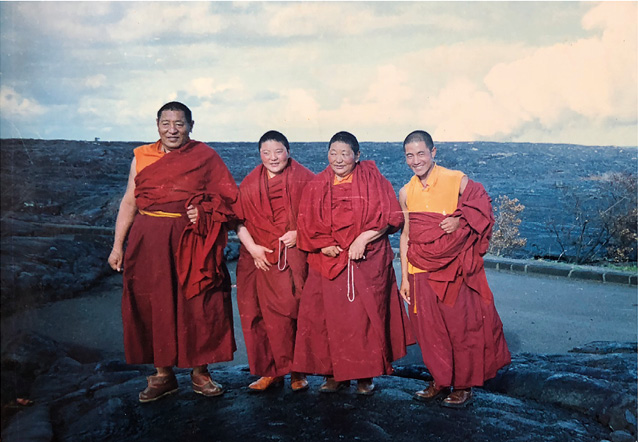

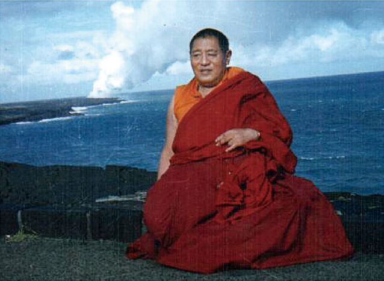

回来的路上，发生了一件神奇的事情：一条彩虹一直跟着法王，车到哪里它就跟到哪里。夏威夷也被称为“彩虹之州”，彩虹在这里并不罕见，但这道彩虹有点不寻常。在很长一段路途中，它一直跟随法王，不离不弃。于是法王停下车，以它为背景拍了一张照片。过了一会儿，它才慢慢消失了。法王似乎在默默地念着什么，不知道是不是和火山女神佩利有关。

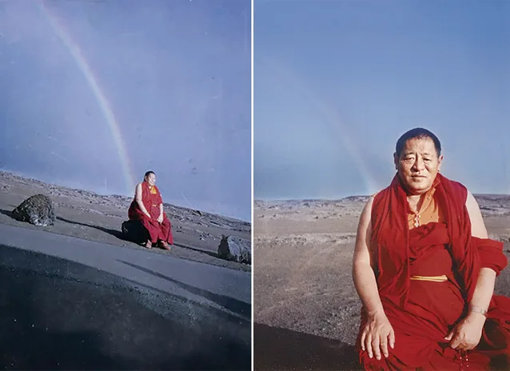

留下一双鞋子

法王从藏地来的时候，虽然准备了单薄的衣服，脚上还是穿着一双毛靴。在夏威夷这个热带岛屿，一直穿这种鞋不太方便，而且很热。

于是，我就找机会，请乃琼寺的人带路，去了附近的希洛购物中心。在那里，我第一次惊讶地发现，美国的超市没有售货员和柜台，我可以随意挑选任何东西。

经过精挑细选，我买了一双质量很好的凉鞋。这双鞋售价70多元美金，当年折合人民币近800元，价格特别贵。不过法王的脚十分厚实，国内最大码还是小了点，这次能在美国买到合脚的鞋子，多花点钱也很开心。

回到寺院，法王试穿了一下，穿起来刚刚好，很舒服。后来出国期间，包括回藏地后的一段时间，法王经常穿这双鞋，一直到最后，都没坏过。

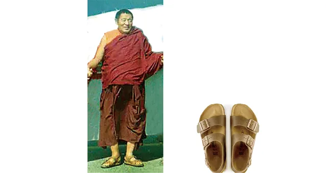

法王的凉鞋

法王换下的毛靴留在了乃琼寺。住持喇嘛一直视之为珍宝，用黄布包裹，锁在柜子里，很少给别人看。

这双鞋在岛上放了将近30年，后来我托人问能不能花钱把它请下来。经过多次讨论，他们终于同意了。

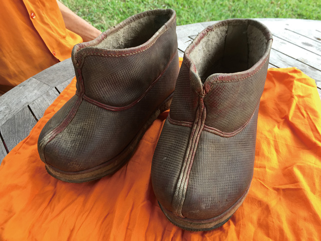

当年留在夏威夷的毛靴

2017年，夏威夷当地的学校和寺院邀请我去传法。我本想再次造访乃琼寺，但由于某些原因，出国被取消了，最后没有去成。

再次提到乃琼护法神

6月21日上午，法王在“项袋金刚橛”灌顶之前，又提到了乃琼护法神与自己的关系：

过去，邬金仁波切莲花生大士在藏地弘扬佛法，犹如阳光普照大地。在他来藏地传法之前，为了消除一切违缘障碍、如愿成办顺缘，他先将这个金刚橛的修法装在一个小袋子里，挂在脖子上，因为是对谁都不外传的特殊窍诀，所以也叫“项袋金刚橛”。

一般来说，再深的佛法，如果它的缘起没有很好地聚合，也不会那么有益于众生；即使法没有那么深，但如果缘起聚合得十分到位，也会给众生带来极大的利益，这是法的普遍规律。而这个法，外、内、密的缘起都是恰到好处，从来没有出现过一点不好的缘起。

这部法的法主，是丹嘉仁波切和众护法之首的乃琼护法神，当时法已交到他们手中。那么，是怎么交给丹嘉仁波切的呢？我并没有劝请仁波切“我有这样的法，您最好实修一下”，仁波切本人主动对我说：“既然您有这个金刚橛法，请先为我传授它的灌顶和引导窍诀。”我就以供养曼茶罗的方式，为他灌了顶，并讲了引导窍诀。不仅如此，他还极其欢喜地造了一个传承祈祷文，里面提及了我的不同前世。此外，当我心里浮现出此法的一个火供仪轨时，他也执笔亲手写了下来。丹嘉仁波切是世界和平的导师，很难想象他会亲自记录，但这一举动也是他的宿愿和缘起所促成的。

至于此法交付给乃琼护法神，是他降神时直接得受了这个法的灌顶。通常来讲，他属于威猛降神，威猛降神一般没有时间接受灌顶和得法。然而，在传授此法的灌顶期间，他一直满怀虔诚的信心，恭敬地听着，听法时还向我供养了佛像、佛经、佛塔，并劝请我说：“您要依靠此法更广泛地利益众生。还要造一个降伏事业或诛业的仪轨。”当时我正在酬谢乃琼护法神，因为他按照我的意愿成办了所求事业，所以我在达萨地方造了一个乃琼护法供。

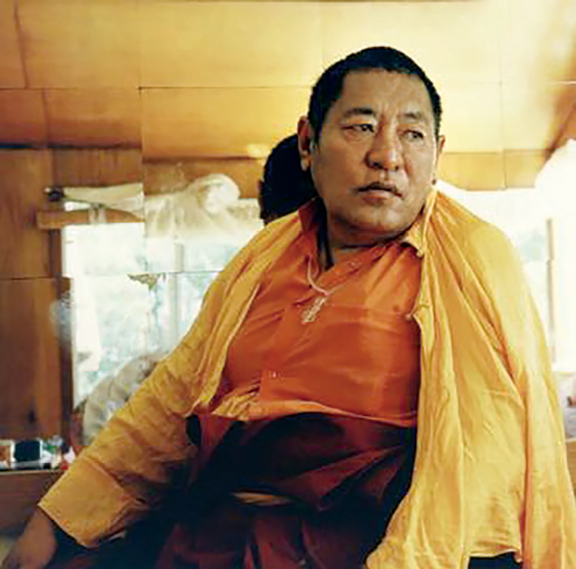

我这次刚到这里，也应乃琼护法神和你们众弟子的劝请，造了一个四句的乃琼护法供。如果你们平时念诵这两个护法供，那么乃琼护法神一定会对你们鼎力相助，赐予与众不同的庇护。

这位护法神和我之间的缘分不是新建立的，一定是多生累世中就很有缘。以前伏藏大师列绕朗巴对乃琼护法神讲过法、灌过顶，授予了许多教言。乃琼有时也对伏藏大师授记，像向导一样给他讲明有伏藏的地方，有时为第十三世土登嘉措尊者和伏藏大师列绕朗巴牵线搭桥。正如我昨天所说的，我到达萨地方时，乃琼降神所依的那个人来到我面前。当时，我正在简单地讲述前世的事迹，他见到我就像父子相见一样喜不自禁，怀着无比的信心来到我面前，泪流满面，表情自然流露出无比的虔诚和恭敬。第二天我去乃琼寺，乃琼寺的僧人问：“您今天要不要迎请护法神降临？”当时我心里想：“如果他预测的是政治方面的东西，恐怕不太方便，以后我回去会有些麻烦。”于是回答说：“不用降神。”乃琼寺的僧人说：“即使您没有迎请他降神，但从护法神对您虔诚的恭敬、喜悦的神情来看，很可能他会降临。”所有神装都准备好了。

第二天灌顶的时候，乃琼护法神真的突然降临了。他刚降神，寺院僧人们就为他穿上了所有的神装。护法神怀着无比的敬意和虔诚，向我献上了佛像、佛经、佛塔。他也顺应我的想法，对政治方面只字不提，只是说一些“佛法兴盛、众生安乐”“丹嘉仁波切如何长久住世、事业广弘”之类的话。如今你们也有文字记录，正如其中所描述的那样。

此外，还有很多缘起聚合的情节。如果你们都想听，那就需要很长时间了，还是不讲了吧。总之，我在这里给大家简单介绍了这个法交到法主丹嘉仁波切与乃琼护法神手中的善妙缘起。正因如此，这个法有着不同于其他任何法的巨大加持力。莲花生大士在藏地宣讲众多法的开端、如母亲般的法，就是这个项袋金刚橛。无论谁修持它，都会善妙吉祥，消除一切不幸，实现一切愿望。

那么，我现在给你们灌“项袋金刚橛”的顶……

下午，法王去了黑沙滩公园（Punaluʻu Black Sand Beach Park）。那里的地貌是火山喷出的岩浆流入大海冷却后，经过自然风化和海水冲刷形成的。这里的沙滩在当地非常有名，旁边还有一个美丽的公园，很多人经常去游玩，环境令人心旷神怡。在那里，法王欣赏了美景，放松了一下。至此，夏威夷的弘法行已经圆满。

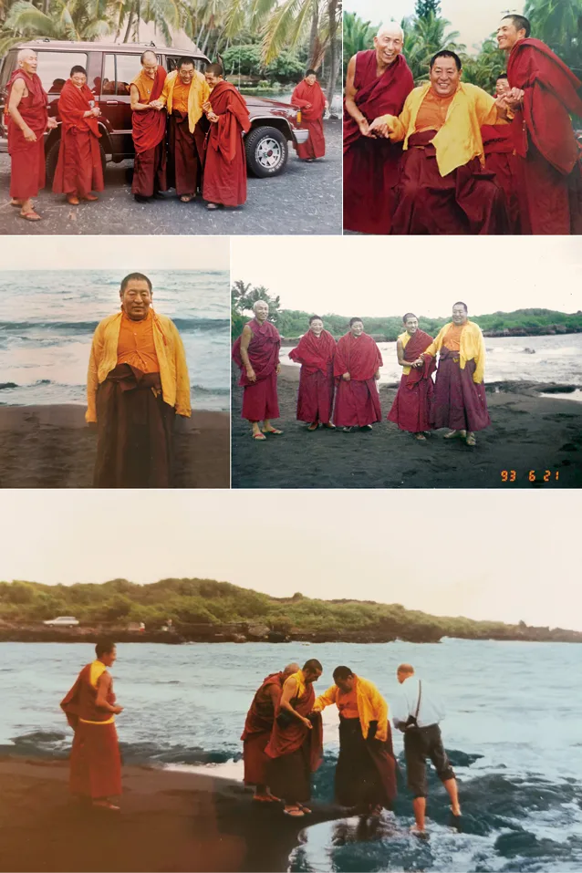

神奇的国度

这次来夏威夷，给我印象最深的是西方国家的科技和经济。

比如，我们房子门口有个感应灯，人来了就亮起来；人走了，它就灭了；稍微咳嗽一下又亮了。那时候的我，除了电灯泡，从来没有见过这样的东西，感觉很新鲜，以为有人在暗中操纵。后来问了很多人是什么原因，他们只是知道如何使用它，但不了解技术原理。

而且来这里听佛法的人都是拿着大哥大、开着小轿车，这也让我觉得不可想象。要知道，当年藏地最富裕的万元户，家里只有自行车，连摩托车都很少见。除了政府部门的最高领导会配备轿车，还必须由专门的司机驾驶，很难想象每个人都有一辆私家车，而且可以自己开。

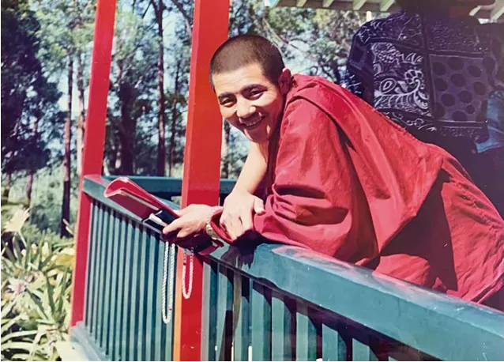

刚到这里的时候，看到很多新鲜的东西，特别难忘。习惯了之后就没什么感觉了。但是对于法王来说，他并没有特别在意这些东西，他老人家更关心的是如何断除众生的烦恼，如何让众生解脱。

藏在海螺里的加持

我们采访了一位当年见过法王的美国弟子，他叫格雷格·赫伯斯特（Greg Herbst）。他对法王信心很大，非常虔诚。在接受采访时，他回忆道：

“法王来我们这里时，我在夏威夷国家火山公园工作，乃琼寺的喇嘛罗桑顿单是我的老师。除了学习佛法，我还参加过很多夏威夷土著的宗教仪式。

夏威夷土著也在仪式中使用海螺，所以我很会吹海螺。法王讲法之前，我就按佛教习俗吹海螺。法王传法的时候，我把这个大海螺放在法座附近，根据夏威夷人的说法，这样可以通过法王的声音，把好的能量储存在海螺里；按照佛教的观点，也能得到加持吧。

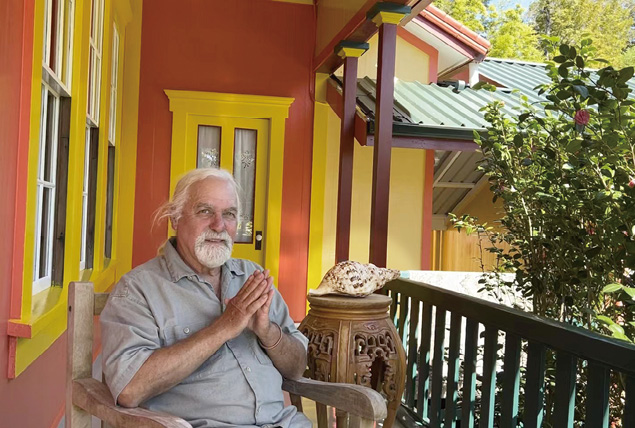

现在的格雷格·赫伯斯特，旁边是海螺

法王在夏威夷期间去了国家公园。因为我在那里工作，我把法王带到我们督导的办公室，那里有一块夏威夷人认为有医疗功效的石头。法王似乎对这块石头感兴趣，笑着问：‘可以治疗我的身体吗？’根据这个，我推测法王可能法体欠安。

此外，我们还参观了火山口，在那里拍了一张有彩虹的照片。然后开车去了海岸线，看岩浆流入大海，浓烟滚滚，法王他们都惊叹。这张照片就是在那里拍的，法王坐在我和米格尔中间。

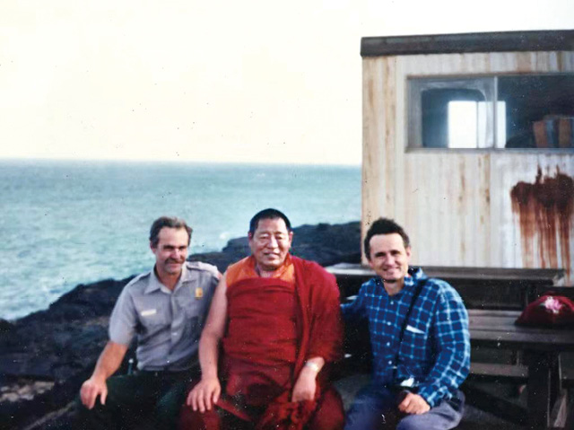

左一是格雷格，左三是米格尔

这么多年过去了，法王的到访给我留下了深刻的印象。一方面是法王直接的加持力，另一方面也可能是这个海螺存储了法王的声音，所以我就带过来了，可以给你吹一下。嘟呜——嘟呜——

不过，我至今仍感动不已的是，像法王这么伟大的一位大德，居然会辛辛苦苦大老远从藏地来到我们这个小庙，眷顾我们，真的很难想象。”
