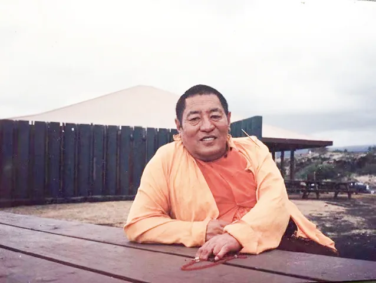

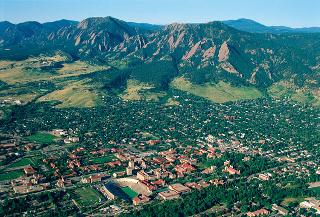

第2站 美国·博尔德

Boulder, USA 6/22-6/29

行程

6月22日，到博尔德

6月23日，在噶玛堡禅修中心讲《佛教的慈悲观》

6月24日，到科罗拉多大学医院体检

6月25日，在孤鹰农场讲《密宗的明心见性》

6月26日，在迈海教堂讲《米拉日巴的修行次第》

6月27日，在噶玛堡禅修中心讲《谈谈香巴拉》

6月28日，接见道场管理人员和当地信众

6月29日，告别开示

来到了博尔德

在结束了夏威夷所有的行程之后，我们马不停蹄地赶往下一站：金刚界中心（Vajradhatu）。

6月21日下午，从希洛（Hilo）机场飞往檀香山机场，约一小时；然后连夜飞旧金山，大概五个小时。当飞机降落在旧金山机场时，天刚刚破晓。

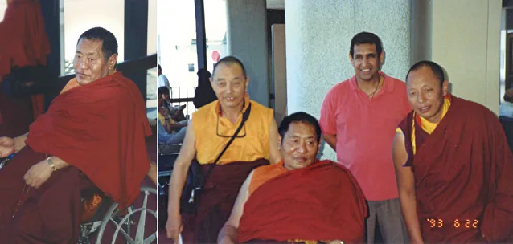

在旧金山机场

6月22日，短暂休息后，继续飞往科罗拉多州的丹佛，飞行时间大约是两个半小时。终于，飞机在连绵的群山上空开始缓缓下降，最后降落在丹佛的斯台普顿（Stapleton）机场。

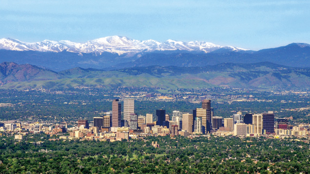

丹 佛

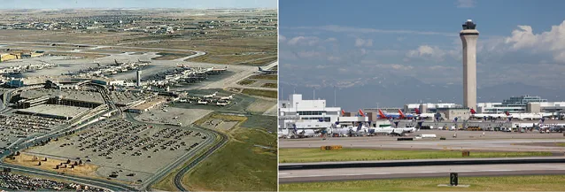

斯台普顿机场，1995年关闭

不过，我们的最终目的地是博尔德，离这里有近一个小时的车程。

博尔德是落基山脚下的一个小镇，环境安静而又充满活力，整个城市就像一个巨大的公园。我们从机场一路开车过来，感觉从平原开进了山里。车子爬过一个个山坡，沿途参天大树下，一栋栋别墅各具特色。最后到达了12街891号的玛尔巴宫（Marpa House），金刚界中心的所在地。许多大德都被邀请来此居住，宣扬佛法。还有很多修行人住在这里，他们离开了生活多年的城市，辞掉工作，常年在这里专心修行，过着知足少欲的简单生活。

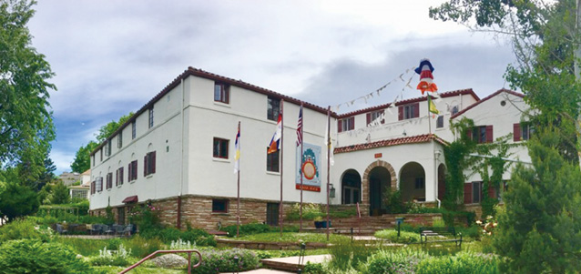

玛尔巴宫

金刚界中心，由创巴仁波切（Chogyam Trungpa Rinpoche）一手创立。当年很多美国人都加入了这个中心，其声势之浩大非常惊人。他们在美洲、欧洲等地设有100多个分中心，并在许多地方建有修行院，是美国最大的佛教中心。

该中心也是法王这次出国的主要邀请方。他们依托强大的公关能力，打通了中美大使馆和相关部门，为我们出国做了大量工作，提供了很多便利。

这一次，法王计划在博尔德待六天，在不同的地方举行传法活动。

佛教的慈悲观

6月23日，法王来到噶玛堡禅修中心（Karma Dzong Meditation Center）。该中心专门举办了一场盛大的法会，与会者有来自多个国家的大德、僧人、信徒和非宗教人士，人数众多。在庄严的大厅里，法王坐在高高的法座上，主办方在开场介绍法王时，记得有一段话是这样说的：

“法王是当今藏地无与伦比的大学者、大成就者，他精通四大教派的所有显密教法，是一切佛陀的总集。仅仅怀着信心听闻法王的教授、见到法王的面容，就可以关闭三恶道之门。而这种机会，完全是源于我们累世的福德……”

之后，根据现场众生的根基，法王传授了以下教言：

> 大悲摄受具诤浊世刹，尔后发下五百广大愿，

> 赞如白莲闻名不退转，恭敬顶礼本师大悲尊。

首先以此礼赞开始，为了表示我以什么心态和行为来说法而顶礼自己的本尊。

这一次，我要给大家讲的是佛法的精髓，即博大的慈悲观，这和基督教等宗教的意趣也不相悖。之所以讲这个内容，我是有明确原因的：之前我在雪域也确立了这个观点，即藏传佛教的四大派及其内部的很多小派，彼此之间并不相违。本来，能开显这些教法的诸位持教大德，在建立同一意趣的事情上，都有义不容辞的责任。与其他持教者不同的是，我还承担了特殊的一份。我在雪域各教派互不相违、持教大德团结和谐的事情上，做出了一些努力，取得了不错的效果，所以得到了持教大德们的一致称赞。我这次来西方国家，也有必要确立这样一种观点，就是世界上兴盛的四大宗教以及其他很多宗教都有同一意趣。

总的来说，无论什么宗教，在不伤害众生的前提下尽力帮助众生是一致的。特别是，以四大宗教为主的所有宗教的信徒们，如果思想和行为都统一起来，世界和平的根本大事也可以实现，从而给整个世界带来幸福与安宁。所以大家要清楚，所有宗教的宗旨都是一样的。

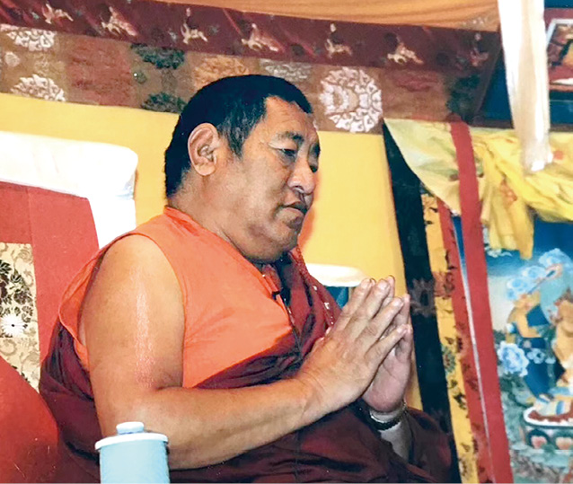

下面，我就从佛教的角度来谈谈这个道理。

可能有人会问：“如何才能贯彻佛陀所说的佛法？”

佛陀亲口给出了答案：“诸恶莫作，诸善奉行。”断恶行善涵盖了整个佛法的要点。所谓“恶”，是指伤害自他的恶心和恶行，应该从根本上断绝，如果做不到这一点，那么痛苦就会不断增长。所谓“善”，就是尽可能做对自他身心有益的事。这种行善与断恶的完美行为和完美思想，包含了佛法的所有要诀。

・佛教的完美行为

所谓的完美行为，主要包含在六度之中。

第一，布施：

布施就是为了利益一切众生，而付出自己的身体、受用、三时善根。

有人会问：“身体、受用、善根要一次性都布施吗？”

如今，恐怕没人能做到。正因为做不到，所以要按照佛经中所说的“渐渐学修”，根据自己的心力逐步串习布施。就像《入菩萨行论》中说的“佛陀先令行，蔬菜等布施，习此微施已，渐能施己肉”，刚开始的时候，我们把蔬菜之类的廉价物品或低等食品这些微薄的东西送给别人。渐渐地，随着进一步的学修，可以布施自己的衣服、用品等所有昂贵的财物。不仅如此，还要看能不能连妻子儿女等也布施给一切众生。

这种布施很重要。佛陀说，如果你认为“布施给别人了，那我享受什么”，考虑到自己的利益，那就是饿鬼道，是下劣的行为；如果你觉得“我自己享受了，拿什么布施给众生”，考虑的是成办众生的利益，就是天人道，是善妙的行为。《入菩萨行论》也说：“若施何能享？自利饿鬼道。自享何所施？利他人天法。”

学修了这样的善心、断除了恶心后，自己就要为了一切众生今生和后世的安乐而布施，并进行回向。坚持这样修行，总有一天会得到圣地。当你获得了圣地，就会有“身体也只不过是像蔬菜和劣等财物一样”的心态。到那时，必然能做到为他人的利益而布施自己的头颅、肢体等。

第二，持戒：

佛教戒律有三种，分别是声闻戒、菩萨戒和密乘戒。“声闻戒”，首先要杜绝杀生等害他之事。“菩萨戒”就是尽可能直接或间接帮助他众，尽可能救护他众免受伤害。如此修行之后，一旦神变、禅定得到自在，每天都会利益数亿众生，我们肯定会有这样的时刻，这就是快速成办广大他利的“密乘戒”。

第三，安忍：

遵循佛陀所说的“自净其意”，不扰乱别人的心，尽可能守护自己的心，这是根本。还有，不要说伤害别人的话，不要做伤害别人的事，以免扰乱别人的心。观察自己的内心，在此基础上，断除嗔恨他人等恶心歹意。

第四，精进：

所谓精进，就是乐于行善。“善”就是喜欢无害寂静的行为。

那么，如何精进于寂静的行为呢？

就是要修慈悲心。其中，“悲心”是指平时看到身体有病痛或内心有不幸的众生时，要生起“愿这些众生远离一切痛苦”的善心。“慈心”就是怀有“众生都能拥有安乐该多好啊”的心态——暂时的安乐是指长寿无病、受用丰厚、美名远扬等，希望所有众生都有这些安乐，需要培养这样的善心。这种修行的最终结果是，一旦离开这个人世，就能往生极乐世界，那里的安乐是这个世界上任何快乐都无法形容的。所以，要怀着“愿一切众生都往生极乐世界”的意乐，精进修习往生的方便法。

而往生极乐的方便法，就是祈祷佛陀、实修佛法、恭敬承侍僧众等。如果这样做，随着年龄的增长，你会越来越快乐。原因是你很快就会往生西方极乐世界，那里比这个世界快乐百倍千倍，你会为此感到无比的欢喜。

一般来说，无论是谁，随着年龄的增长，都会离死亡越来越近，身心也越来越痛苦。而精进修持往生法门的行人，不但心中没有痛苦，反而对死亡越来越欢喜。佛陀曾经说过，那些发愿往生极乐世界的人，在生命的尽头会很快乐。为什么？就像一个人得了很严重的病，摆脱那个病会特别高兴，同样，如果往生到极乐世界，所有的痛苦都会被完全断除，这在除了佛教以外的世界各个层面都是很少见的事情。比如我们这样的普通人，明天成为世界首富会很开心，而解脱的安乐比它超胜百倍千倍，所以越接近生命的尽头，就会越欢喜。

这在现实生活中也是显而易见的。所有优秀的佛教修行者，都是越老越幸福、越老越快乐，而大多数普通人则是越老越焦虑。单看这二者对待老年的态度，就可以直接推断出佛法的功德。

可能有人会想：“极乐世界是普通人也能往生的吗？”

这一点没必要怀疑。如果你能拿出这辈子为了吃穿所付出的努力和勤奋的一半来修持佛法，并且不忘祈祷三宝，我保证你一定能往生极乐世界。

第五，禅定：

就是心不散乱地祈祷佛、实修法、恭敬僧，恒常精勤地修行。

至于禅修的方式，基督教、伊斯兰教、佛教等有很多不同。不管怎样，根据佛教的观点，禅定的要义就是让心一缘安住。你们平时念念不忘释迦牟尼佛，这就是禅定。

第六，智慧：

关于行善断恶的做法，首先要在上师面前听闻，中间是思维所闻之义、解除疑团，最后将思维之义结合自相续真修实证，才能从内心确定那些道理是否千真万确。

在佛教中，思所生慧和修所生慧越高，就越容易通达世界高端的科技知识。虽然世界上很多宗教不会长期和科学并行不悖，但佛教却可以和科学共依共存。随着对佛法的了解越来越多，你会相应地相信科学；随着对科学的认识越来越广，也可以对佛法生起诚信。所以，如果能深入研究佛法，就会明白世间流行的科学奥义，都在佛法中有所描述；世界上以前发现的许多规律，其实佛陀早就说过。同样，想在现阶段提升自己精神财富和物质财富的人，如果能够学佛修行，也会得到很大的利益，这一点一定会在实践中得到检验。

除此之外，我没有时间做长篇大论了。如今在藏地兴盛的《甘珠尔》和《丹珠尔》有三百多函，其中有关于此理的详细宣说，你们仔细去看就明白了，我在这里只讲这么多就可以。

・佛教的完美思想

佛说渴望快乐、逃避痛苦是一切众生的同等诉求，这是世界上任何其他宗教都没有的特征。其他许多宗教帮助大多数众生，却伤害个别众生，比如，他们造福全人类却伤害动物的生命，利益某些众生却忽视了另一些众生的身体和生命。但是佛教和他们完全不同，佛教是利益“一切”众生。

佛在经中也说：“以自身为例，莫害于他众。”比如对自己有利的，应该对别人也有利；对自己有害的，应该对别人也有害。众生都想拥有快乐，不想遭受痛苦，这是一模一样的。所以，如果总结佛教的要点，它都包含在唯一利益“一切”众生中。只要一个人喜欢换位思考，就不可能不喜欢佛教。

给大家举个例子，如果你有两个同伴，你更喜欢总是帮助你的那个同伴，还是经常加害你的那个？我想每个人都会选择对自己有利的人，根本不会喜欢对自己有害的人。就像这个例子一样，众生也是喜欢帮助别人的人，却不喜欢伤害别人的人。而佛法对所有众生唯一只有利益，这一点根本不会有错，所以，如果你是一个理性思考过佛法真理的人，在这个世上，不可能不爱上佛教。

随行佛陀的那些上师也是如此，有优秀上师、中等上师、下等上师三种分类。那么，这三种上师是什么样的呢？最好的上师是广泛利益一切众生，绝不伤害他们；既利益众生，也稍稍加害众生，为中等的上师；不利益一切众生，反而严重伤害他们，始终自私自利，是下劣的上师。随行佛陀的上师是好是坏，要以是否利益众生来区分。

同样，现实中也需要关注这一点。比如，美国某地有一个精明强干又心地善良的人，他一定会造福美国人民；如果有一个特别能干的人，但他一肚子恶心，损害所有人，恐怕也不会给美国带来安宁。所以，你们美国人，我们藏族人，或者世界其他角落的任何人，都喜欢对自己有利而不是有害的人，这是有目共睹的。

在座的大多数人一定是佛教徒，明白这个道理后，希望所有佛教徒都能比以前更加热爱佛法，更加精进地修行佛法。

一些加入了基督教的人，应该也会喜欢这种利他的佛教。因为最早创立基督教的耶稣在受刑时，感受到了难以想象的痛苦，当时他以自己的苦难推及其他众生的苦难，希望一切众生离苦得乐，于是开始建立新的宗教，这是后来它蓬勃发展的根源。所以，这个宗教也是成办众生利益的。

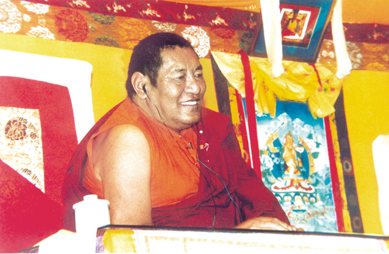

这个听法行列中没有信仰的自由主义者，如果带着审视和好奇的态度来，也会对佛法有极大的欢喜心。原因是，如果你想快乐，帮助别人会给你带来快乐；如果你伤害了他众，就不会有快乐可言。比如你如何帮助你的朋友，会有那么多的喜悦和利益回报给你；如果你当面或背后伤害了你的朋友，就不可能有快乐的机会。

一个人仅仅为了口中吃的、身上穿的，以欢喜的心态尽力修持无害寂静的佛法妙道，也是非常重要的。

我真心希望在座的各位，以及其他与你们有缘的朋友，都能实修这唯一不害众生的和平之道。祝大家吉祥如意！

一次体检

这次出国，除了一些基础疾病，法王没有什么不舒服。但既然来到了医疗水平先进的美国，所有弟子都迫切希望法王做一次全面的身体检查，尤其是看看是否有机会恢复视力。所以我们特意把体检列入日程，提前与医院做了预约。

6月24日，我们去了科罗拉多大学医院（UCHealth University of Colorado Hospital）。这家医院成立于1989年，在全美数千家医院中名列前茅，尤其擅长治疗眼病。

医院不仅干净，而且安静。医护人员个个和蔼可亲，看不到他们脸上的严肃和不耐烦，也听不到他们说一些不好的话来刺激病人。他们有条不紊、不慌不忙地按步骤进行。先是护士用几个仪器进行常规检查，并记录结果。然后医生仔细询问，再用大型仪器检查。当法王被要求配合检测时，他们的语气也很温和：“现在，请向左看，很好……现在，请向右看，您做得很棒……”整个过程轻松愉快，给我留下了深刻的印象。

那天，阿里美珠因为心脏不好，经常需要吃药，也顺便做了个检查。

经检查，法王的健康状况并无大碍。但遗憾的是，因为众生福报不够，眼睛依然无法恢复。

思念故乡

下午，法王在屋里休息。刚好有一点空闲，我和阿里美珠、门措上师坐在道场外的草地上，晒着温暖的阳光，看着蓝天白云，望着远处的雪山，这种熟悉的感觉让我们想起了藏地。

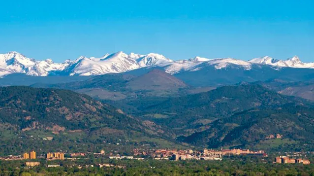

虽然离开藏地不到半个月，但也许是因为第一次越过无边无际的大海，心理上感觉去了很远的地方，所以难免有思乡情结，大家都在聊藏地。门措上师手里还拿着一个黑色的小录音机，播放着从藏地带来的道歌。

聊着聊着，我不禁有感而发道：“其实我这次各方面压力都很大，也怕自己做不好，但是特别感谢上师带我来，我很珍惜这个机会。就我个人而言，法王和你们对我有着难以想象的恩情。且不说法王给我传了多少佛法，我刚来喇荣的时候，尤其是第一年（1985年）的冬天，生活上很拮据，日子过得特别紧。法王和你们从新龙回来后，给了我50块钱，帮我渡过难关，让我安心地闻思修行。而且过年的时候，你们还给我送吃的。我一辈子都不会忘记，非常感谢！”

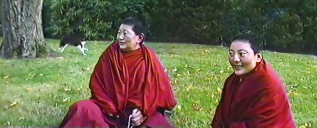

阿里美珠笑着说：“晋彭不仅会给你东西，还会给很多弟子。只不过你比较乖，不会每次都推三阻四，不像某些弟子，死活不肯收，推来推去，让我在中间很为难……”

我们也聊到了去印度的各种经历。门措上师话不多，但也讲了一些小时候的见闻。

密宗的明心见性

6月25日，法王受邀来到泽噶贡智仁波切（Dzigar Kongtrul Rinpoche）的道场——孤鹰农场（Lone Hawk Farm），做了一场关于心性的开示。

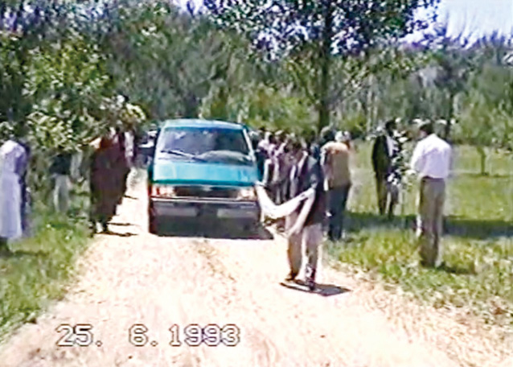

首先是泽噶贡智仁波切的开场白：

“嗡 萨瓦斯德！（愿获一切悉地）

正式开始前，请允许我说几句话，同时介绍一下法王晋美彭措仁波切。

在这种场合，按照传统，我们要讲一下‘五圆满’。

处所圆满：处所是科罗拉多州的博尔德，这里是第十六世噶玛巴、创巴仁波切、顶果钦哲仁波切等大德加持过的地方。

时间圆满：这是我们第一次聚集在这个国家，举办较长时间的宁玛夏季课程，正是在这样一个微妙的时刻。

本师圆满：本师是法王晋美彭措仁波切。仁波切这次专程从藏地来弘法，他在藏地可以说家喻户晓。众所周知，仁波切不仅是一位真修实证的大圆满成就者，也是一位尊贵的伏藏大师。而伏藏大师们，都是莲花生大士的真实化身。所以，我们今天非常幸运能听到仁波切的传法。

眷属圆满：这里有晋美仁波切、嘉哲仁波切，还有我们在座的与会大众。

法圆满：因为具足以上圆满，我祈求仁波切为我们转大圆满阿底瑜伽的直指法轮。希望仁波切能满足我们的愿望，给我们直指心性。

这次接受仁波切传法，是我们生命中的一个重要印记。接下来，我们向仁波切供献曼札，并祈请仁波切转法轮。”

接下来，法王这样讲道：

今天，我们欢聚一堂，我想从佛教的起源入手，用归纳的方式简单讲一下心性的教言。

・佛法从印度到藏地

我等本师，善巧方便、大慈大悲的佛陀，就了义而言，早已成就了本初怙主普贤如来的果位，但显现上，还要在三大阿僧祇劫前发下殊胜的菩提心，积资净障，最后在印度菩提伽耶十二相成佛。

十二相中最重要的一相，就是依次转了三转法轮，利益所化众生。第一转四谛法轮，宣说了与共同乘相应的法；之后的大乘不共法，是第二转无相法轮、第三转善分别法轮，这是为普遍所化众生转的法轮。除此之外，还在天界、龙宫、夜叉境、人间等处，为一切殊胜所化众生，转了相应的密宗金刚乘法轮。

小乘的所有法，是由声闻大迦叶、阿难尊者等七代付法祖师，逐渐在世界上弘扬开来的。共同的大乘法中，所有甚深法由文殊菩萨结集，所有广大法由弥勒菩萨结集，进而兴盛于整个世界。不共的密宗金刚乘法，是由总的三部怙主，尤其是吉祥密主金刚手发扬光大的。二胜六庄严等高僧大德，也使佛法在印度圣境如阳光普照般长久兴盛。

佛陀曾亲自授记：“此佛法从北向北兴盛。”此外，佛陀还授记过，在他灭度八年后，胜过他的莲花生大士将会降生，之后去北方雪域弘法。后来，正如佛陀授记的那样，莲师来到了藏地。

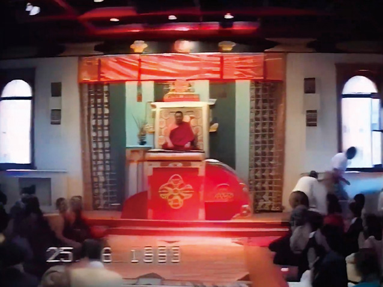

这位密咒师海生金刚，或者莲花生大士，是极乐世界阿弥陀佛、普陀山怙主观世音菩萨、菩提伽耶无等释迦牟尼佛三身合而为一的主尊，他是三域中广行佛法事业、降伏一切恶魔和破誓鬼、无与伦比的一位大士。最初是莲花生大士降伏了藏地所有凶残的妖魔鬼怪和破誓鬼，扫除了佛法兴盛的一切障碍和违缘。同时大堪布菩提萨埵也来到藏地，使显宗的佛法弘扬开来。后来，印度的布玛莫札、寂藏等108位大班智达应邀入藏，藏地的贝若札那、噶·瓦拜则、焦·若鲁坚赞等108位译师被派往印度，将印度留存的佛法无有遗漏地全部翻译成藏文。当时藏传佛教的兴盛，即使在印度这片神圣的土地上，也应该是前所未有的。

后来，无量光佛特意化现的善知识——吉祥燃灯智或阿底峡尊者来到藏地时，是这样说的：“我曾以为，我对印度兴盛的所有佛法，还有邬金空行洲、夜叉和乾达婆等境域的诸位空行母从空中显示的许多经函，也就是浩如烟海的佛经和密宗续部，是无所不通的，我也听受过许许多多这样的法。但是当我看到桑耶寺存放的梵文书籍时，发现我连所有密宗经函的百分之一都不了解。密宗续部真是无穷无尽啊！所以，过去藏地佛法兴盛的情况，恐怕在印度也从未有过。”

大成就者邬金巴，即修传八大教派之一的开创者，他曾感慨地说：“现在藏地宁玛派所有密宗续部的名字，比完整的《甘珠尔》《丹珠尔》还多。密宗宁玛续部真是无所不有、不可思议啊！”

当时兴盛的法，就是前译宁玛教法。此后，萨迦派、噶举派、噶当派等教派也相继兴起。噶当派又分旧派和新派两种，其中，旧噶当是指由阿底峡尊者开创的教派，新噶当是由宗喀巴大师开创的教派。

・前译宁玛派的不共特点

想想噶当派等藏地修传八大派教法的兴盛，以及诸位祖师的功德，他们的确是邬金仁波切莲花生大士的化现。

比如，萨迦派萨迦班智达的传记、邬金仁波切莲师的授记中，都说萨迦班智达是莲花生大士的化身。就噶举派而言，无等冈波巴月光童子也在传记中说过，他是莲花生大士的幻化。还有噶当派的阿底峡尊者和宗喀巴大师，也有传记说他们是莲花生大士的化身。再看觉囊派，有些传记说觉囊朵洛瓦和多罗那他这两位众所周知的大智者，也是莲花生大士的化身。《噶当祖师问道语录》中，阿底峡尊者说：“在这藏地，所有让佛法最初兴起、中间兴盛、最后长久住世的持教大德，皆是邬金莲花生大士的幻化。”连莲师自己也曾说过：“在你们对我有信心的期间，佛法会住世。从你们对我没有信心、无人祈祷我的时候起，佛法就快消失了。”

就实相而言，生于藏地的持教大德祖师的心相续都是一个。从现相来看，像邬金仁波切莲花生大士、大堪布菩提萨埵、布玛莫札那样的大德，在藏地雪域从来没有出现过。不仅没有出现过他们那样的班智达，像那个时代的大译师，后来也不曾出现过。

为什么这么说呢？在南岩玛尔巴译师时代，所有的后译译师中，首屈一指的是鄂·罗单西绕。他把弥勒菩萨的《大乘经庄严论》从梵文翻译成藏文时，有一品里有很多“阿绕嘎”。“阿绕嘎”从梵文翻译成藏文的意思是不贪，所以他只能把那一品中所有的“阿绕嘎”直译为“不贪、不贪”，除此之外，没办法把它翻译成别的，也没有真正理解它的意思。无奈之下，他去翻看前译大译师们翻译的教法。结果他发现，在译文中，每个“阿绕嘎”都有不同的用法，分别用于布施、持戒、安忍、精进、禅定、智慧，而且六度的每个“阿绕嘎”也区分了过去、现在、未来，比如布施就有过去的布施、现在的布施、未来的布施。当他看到“不贪无贪亦未贪，贪欲本体亦非贪”这种结合语境的意译时，摧毁了自己的傲慢，倍感稀有地造了一个赞颂句：“贝若札那如虚空，噶焦二人如日月，宝贤则如启明星，彼前我如萤火虫。”意思是说，贝若札那的翻译智慧广如虚空，噶·瓦拜则、焦若·鲁坚赞二人则如天上日月，大译师仁钦桑波如拂晓的启明星，而我们今天的译师就像萤火虫。可见，单单是前译的译师们，也有与众不同的特点。

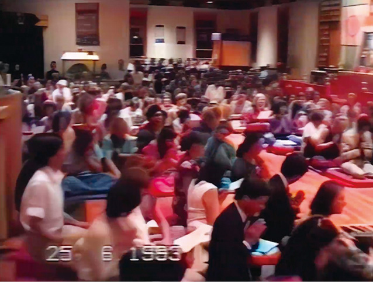

再以班智达为例，邬金莲花生和布玛莫札这两位大师，从古至今都没有身体上的衰老。邬金仁波切现今住在西南方妙拂罗刹洲，为所有的罗刹转法轮。布玛莫札现居汉地五台山转法轮。

所有邬金莲师、布玛莫札、菩提萨埵的追随者，统称为“宁玛派”。实修完整无缺的经续，是宁玛派的独特之处。

那么，有人会想：“新派等其他教派，也会实修完整的经续。这真是宁玛派独有的特色吗？”

如今在藏地，有三百多函的《甘珠尔》和《丹珠尔》，主要是前译时期翻译的，而后译派译师依靠自力翻译的经文很少。实修总的经续、别的内三续约嘎，尤其是其中的大圆满，被称为“宁玛派”。鉴定是不是真的宁玛派，需要以这一点为依据。你们这个中心是宁玛派的道场吗？如果是的话，这个根本要点就要牢记在心。我再重申一遍：完整无误的经续，是宁玛派独具的特法，除此之外，其他教派都没有完整的实修法。其他所有教派，如萨迦派、噶举派，都只是实修父续母续的无上续部，根本没有玛哈、阿努、阿底内三续约嘎。实修这三者中能最快成佛的阿底约嘎，唯一只在宁玛派有。

最初，将宁玛派大圆满法理弘扬到藏地的，只有邬金莲花生、布玛莫札两位大师。中间，荣索大班智达和全知龙钦巴二位，使这一教法发扬光大。后来，蒋扬钦哲旺波和全知麦彭仁波切，使宁玛教法再次兴盛起来。这就是大圆满教法的前弘、中弘、后弘时期。

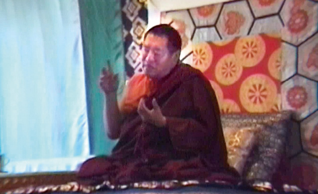

在前弘时期，邬金莲花生大士的大圆满法，被共称为“新大圆满”或“伏藏大圆满”。布玛莫札的大圆满法，一般命名为“旧大圆满”或“圣教大圆满”。这样，就有了新、旧两种心滴。

在中弘时期，全知龙钦巴广泛抉择了自性光明的部分，他主要根据《甚深精华十七大续》来解释。荣索大班智达抉择了本体空性的见解，他是根据《母子二十一心部》和《白黑花三界部》广说的。

后弘时期，蒋扬钦哲旺波为了摄受有缘者，宣说了甚深窍诀。全知麦彭仁波切为了折服持邪见者，阐述了广大教理。

如果你想了解宁玛派的大圆满法，必须追随这六位大师来详细抉择。

・大圆满的实修窍诀

关于大圆满的实修，一般来说，有续、教、窍诀的很多讲法，但是今天，不讲续和教的广大法。你们的修行境界应该已经达到了比较高的水准，对窍诀也有了实修的体验，所以，我就按照窍诀方式简单说一下：

解说窍诀有两种方式，一种是基以本来清净为准、道以直断护持、果清净为微尘，另一种是基以任运自成为准、道以顿超护持、果解脱成虹身。

前者叫懈怠者无需勤奋就能解脱的法，后者叫精进者依靠勤奋而得解脱的法。

前一种法有见、修、行、果四个方面：

1．见：主要是将现有器情所摄的一切法的根本，断定为这颗心的幻现，而这颗心的本体，也是本来远离生住灭、如同虚空般的空性。这就是见解。

认清见解有两种方法：由寂止门引导、由胜观门引导。“由寂止门引导”叫做从修上寻找见。主要是根据噶举派的讲法，自心专注于一缘安住，次第实修四瑜伽，依靠安住、动念、明觉的窍诀来认识心的自性。大手印的直指法，主要是噶举派的解说方式。噶举派的总法是方便道那若六法和解脱道大手印，别法是噶玛乔美仁波切在《山法》等中明确解说的独特甚深窍诀，需要从中去了解。

“由胜观门引导”是从见上寻找修。按照宁玛派的普遍引导方式，让修行人认识到心是无生无住无灭的，然后依靠安住方便的窍诀去修持。当今，宁玛派的大部分讲法，都是“由胜观门引导”进行传讲的。

宁玛派和噶举派的大多数人，将这两种方法结合起来进行实修和传讲。其实要直指这二者的究竟见解，就要懂得自己的心是空性。显宗所说的“大佛母般若波罗蜜多”，也指的是它。大中观、大手印、大圆满这三大，都是要了知自己的心是无生。

对于这个道理，宁玛派的许多智者都做过抉择，但在这里我想谈谈噶玛巴自生金刚的观点。

噶玛巴自生金刚的《愿文》说：“远离作意大手印，远离诸边大中观，此乃总集大圆满，一通皆通得开悟。”意思就是，远离一切执著法，是大手印；远离一切边，是大中观；总集九乘次第的一切法理要点，是大圆满。他发愿要靠大手印、大圆满、大中观，认识自心的本来面目。

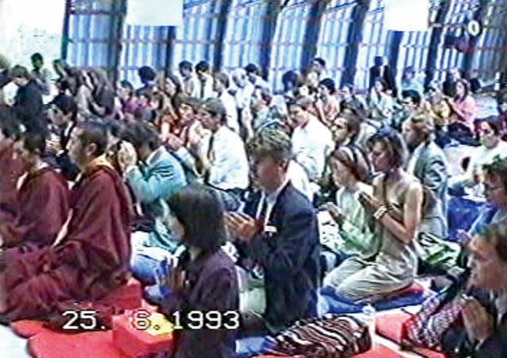

2．修：是指不作意任何其他分别执著，不忘失而处于这一境界中。

关于它的道理，大量的宁玛派智者、成就者都已做了抉择，但我主要讲讲噶玛乔美仁波切的观点。

噶玛乔美仁波切曾说：“现今反观自之心，观心不见之空性，见彼境中悠放松，大手印法别非有。”意思是，我们专注观察自己的这颗心，在观心的当下，发现它是根本无所见的空性，这就是见解。在明明了了见到它的境界中，不忘失而放松安住，这就是修持。

虽然大手印向外印持了轮涅一切法，但反过来说，谁也没有印持它，所以轮涅一切法就是大手印。这是关于修。

3．行：就是无论产生什么好的坏的念头，都要观它的本体，让修行的境界越来越提升。

关于行为，虽然宁玛派的续部和窍诀中讲过很多，但我还是简单总结一下噶玛乔美仁波切在《山法》中所说的道理。

他是怎么说的呢？当出现称心如意的善缘时，观一观它，实修的境界会有小小增进。当遭遇病痛、死亡、诋毁等恶缘时，观一观它，修行境界会有大幅提升。总之，平日里，行住坐卧都不忘修行，以此提升自己的境界，这叫行为。

4．果：所谓果，应遵循至尊米拉日巴所说的进行抉择。米拉日巴尊者说：“我内大圆满病痛，外以大手印病痛，不仅病痛甚至亡。”意思就是，他的里面以大圆满疾病而疼痛，外面以大手印疾病而疼痛，他不仅仅疼痛，甚至会死亡。他想表达的意思是，认识到自己的心是无生，就是大圆满；在这种境界中如如不动，就是大手印。如果修持这两者，不仅如疾病般的暂时的恶分别念会清净，而且如死亡般的究竟的涅槃佛果，也可能会轻松、快速地获得。

以上讲了直断的见、修、行、果。

这种讲解方式中，实修要诀是基于宁玛派自宗的见解；引用的教证，不管见修行果的哪一个，都是基于噶举派的教法。之所以这样讲解，也是因为随顺今天的一个缘起。

从我自身来讲，今天从噶举派的道场来到了宁玛派的道场，这也是我将噶举派和宁玛派结合起来讲的原因。

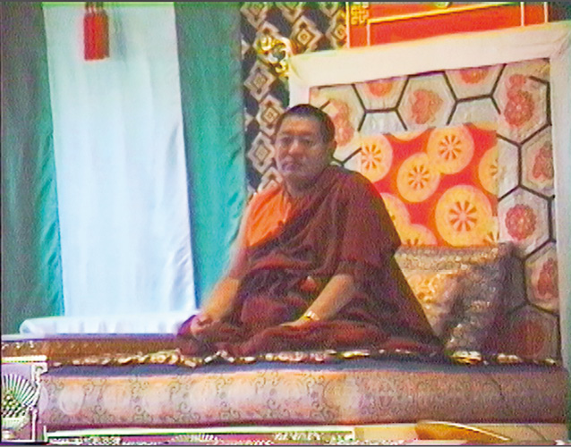

就你们这边来说，之前一直在学修噶举派的法，现在又有机会学修不共的宁玛派自宗的实修法，所以我将噶举派和宁玛派结合起来讲。

而且，噶举派和宁玛派两派，有着不同于其他修传的密切关系，这也是我这样讲的原因。

如前所述，冈波巴月光童子也说他是邬金莲花生大士的化身。第二世噶玛巴、德松钦巴的化身——噶玛巴巴协，到汉地当国师时曾说“时而我是莲花生，时而大圣萨绕哈”，亲口承认自己是邬金莲花生大士的化身。第三世噶玛巴是噶玛巴自生金刚，在当今时代，如果你想修宁玛派的《四心滴》，绝对需要依靠噶玛巴自生金刚的言教，因为他是全知龙钦巴的上师。就噶玛乔美仁波切而言，他的上师是白玉派的天法不变金刚，他的弟子是受持白玉派教法的持明根桑西绕，他自己大概既要属于噶举派，也要属于宁玛派。由此可见，噶举派与宁玛派在那时候就有着密切的关系，正是因为这个原因，我今天将噶举派与宁玛派合在一起讲解。

我估计，你们实修正行需要印证的界限，应该是到这里吧？

第二种任运自成顿超的实修法，祈愿今生我们还会再见，倘若此生不能再相见，后世在净土重逢时，可以讲闻此广大法。为了创造这个缘起，我就不讲这个实修引导法了，今天到此为止。

学会喝咖啡

法王此次出访西方国家，与此前去汉地和印度有所不同，他老人家对西餐比较适应，我们基本不用担心邀请方怎么安排餐食。

我的工作主要是给法王当侍者，按时送药、服侍洗漱、清洗衣服、准备传法录音、每站收拾行李、处理突发问题等，零零散散的事情特别多，每天都要全神贯注，一点都不敢放松。南珠堪布负责与主办方沟通各种事情，也忙得不可开交。每天，只有在法王等人都睡了之后，我们俩才有机会喘口气，休息一下，念诵当天不能间断的课诵——堪布念的是《文殊真实名经》，我不仅要念这个，还要念许多其他经文。

我们经常在念经的时候打瞌睡，困得眼睛都睁不开。这个时候，南珠堪布会让吾智多杰给我们煮咖啡提神。我以前从未喝过咖啡，起初对它的味道有点困惑，但随着时间的推移，也渐渐喜欢上了这种饮料。

当然，睡前喝咖啡是个坏习惯，但对于当时的我来说，要做的事情林林总总、层出不穷，在国外期间，我每天晚上只睡三四个小时，喝咖啡可以让我清醒，身体也有一点力气。

米拉日巴的修行次第

6月26日，法王在丹佛著名的迈海教堂（Mile Hi Church），为金刚界中心的弟子和部分非佛教徒，做了一场以噶举法脉为主线的开示：

顶礼供养皈依法海雷音如来、应供、正遍智、明行足、世间解、无上士调御丈夫、天人师、佛、世尊！

> 愿以法海雷音佛，往昔所发四大愿，

> 无量智悲力加持，今我等众得受用。

好了，我先礼赞了自己有信心的本尊，尤其是为了让你们相续中生起真实的正道，念诵了七遍法海雷音如来圣号。

接下来，我今天在这里要讲的法，就是佛教修行的核心要义。之所以讲这个，是想让刚入佛门、以前不懂佛教的人，这次对佛教有所了解；已经了解的，进一步提升修行境界；信仰其他宗教的人，或者根本没有信仰的人，可以知道佛教是一个什么样的宗教，并认真仔细地思考要不要入佛门。如果是经过深思熟虑后进入佛门的，那么渐渐地，你们的境界就会得到提升。

・噶举派诸上师的简介

这一次，我想着重谈谈佛法。我等本师，善巧方便、大慈大悲的佛陀，最初发下殊胜菩提心，中间用三大阿僧祇劫积累资粮，最后在印度菩提伽耶示现成佛，此后在不共所化的众生面前，于密严刹土等处现为金刚持，广泛宣说了密宗法门。这样的佛法在哪里兴盛呢？以我们这个世界为例，佛法始于印度菩提伽耶，犹如初升的太阳，逐渐传遍整个印度。后来，正像佛陀授记的那样，佛法在藏地雪域兴盛，经久不衰。在藏地，有修传的八大教派、讲传的十大教派，许多法脉都非常兴盛。

在修传的八大教派中，首先兴起的是前译宁玛派，代表人物有邬金金刚持莲花生大士、布玛莫札大师等。后来，南岩地方一个叫玛尔巴的人，是著名的大译师。玛尔巴译师认为，需要一种比以前法脉更完整的新法，以使新派的弟子们受益。于是他历尽艰辛，三次前往印度圣地。最后一次去的时候，他见到了后来前往藏地的无等阿底峡尊者。在印度期间，玛尔巴译师多次拜访大成就者那若巴——金刚持亲自摄受的大成就者帝洛巴的大弟子、那烂陀寺北门班智达，得受广泛的教言。此外，他还依止了梅智巴等很多大成就者，使新派密宗的大量法理在藏地兴盛起来。

当玛尔巴译师即将辞别上师那若巴时，上师给他赐予了“喜金刚”的灌顶。那若巴在空中清晰展示了喜金刚坛城的所有尊众，他仍然坐着不动，问玛尔巴译师：“你今天是先顶礼上师，还是先顶礼坛城本尊？”玛尔巴译师心想：“我在上师面前已经获得了许多法，今天要在本尊面前得受。”然后回禀说：“我想先顶礼本尊。”他的话音刚落，所有本尊都化光融入了上师心间。

玛尔巴译师心想：“看来我今天在这件事上犯了错。其实所有本尊都是上师的幻变，除了上师没有别的本尊。真正需要恭敬承侍的是上师，所以我错了。不过，我一直把上师看得比本尊还重要，修本尊的时候也是把上师观在头顶，从来没有把本尊看得更重，所以缘起破坏得不会那么严重吧？”

后来那若巴以神通照见，对他授记道：“因为你选择不先顶礼上师而先顶礼本尊，这多少破坏了缘起。但是，依靠你平时视上师为主尊的缘起，你的法脉传承仍会像太阳升起一样，遍照世界的每一个角落。”

玛尔巴译师郑重地请求上师：“我有达玛多德等七个儿子，您有没有办法恢复缘起，特别是让子系后嗣也能弘扬佛法？”但那若巴说：“缘起已经破坏了，可能无法恢复。”

如果当时玛尔巴译师的缘起善妙，他的子系传承在噶举派中肯定会起到比法脉传承更重要的作用，噶举派的法也会胜过今天百倍千倍。所以作为弟子，把上师视为主尊，对他有信心、虔诚心、欢喜心、恭敬心，这一点格外重要。

当时，玛尔巴译师又问上师：“那么，谁来传承弘扬我的法脉呢？”

那若巴反问他：“你最器重、最心爱的弟子是谁？”

玛尔巴译师禀告说：“那要属阿哦特钦或闻喜（米拉日巴）了。我把他当成比我心脏更重要的弟子。”

那若巴听了，双手合十，赞叹道：“北方黑暗处，如日照雪山，名为闻喜者，顶礼彼尊者。”说完向西藏方向稽首作礼，此时，山和树也一同稽首作礼。当时，那若巴住在巴里帕哈里山的飞行寺，在那烂陀寺附近。直到现在，这座山和树木的顶部仍然向西藏微微弯曲。

后来，玛尔巴译师对米拉日巴说：“你要观察一下梦，看看噶举法脉未来会如何弘扬。”

那天晚上，米拉日巴梦见四个方向有四根柱子，尤其是北方的柱子上落了一只鹰。那只鹰生了一只小鹰。然后有许多小鹰遍布虚空。

玛尔巴译师为他解梦道：“你梦见四根柱子，预示着我会有四大弟子，分别是藏荣的美敦村波、朵地的慈敦旺诶、雍地的偶敦秋多、贡塘的米拉日巴你。落在北方柱子上的鹰，就是你。生下的那只小鹰，是你座下如太阳般的弟子冈波巴月光童子。许多小鹰遍布虚空，表示受持冈波巴月光童子的法脉者，将使噶举派教法遍天下。”

正如玛尔巴译师所解的梦一样，在冈波巴时代，他最杰出的弟子是噶玛巴德松钦巴（1110-1193）和众生怙主帕莫竹巴（1110-1170），两人同龄。他们的弟子传承中，跋绒噶举、帕竹噶举、噶玛噶举、采巴噶举，共称为“噶举四大派”。直贡噶举、竹巴噶举、达隆噶举、雅桑噶举、绰普噶举、修赛噶举、耶巴噶举、玛仓噶举，被称为“噶举八小派”。噶举派的教法遍布世界各地。

如果思考佛法的弘扬状况，单从竹巴派的教法来讲，人们都说它的覆盖面就算老鹰飞十八天也见不到边际。后来红帽噶玛巴和黑帽噶玛巴的教法弘扬得更广。至于黑帽和红帽，历史上记载：黑帽噶玛巴在净现中，十万空行用头发编织成黑帽供养他，后来元朝皇帝也做了一顶黑帽供养，一直传到现在的噶玛巴手中；红帽噶玛巴的红帽，是汉地皇帝赐给扎巴桑给，以此传下来的。红帽和黑帽的名字由此而来。另外，在我们藏地，据说木雅的绕谛崩宗地方同一时间出现过十万名会飞的僧人。噶举派上师的传承，就像有序排列的金山，在世间不断地出现，直到第十六世噶玛巴和你们的上师之间，所有上师接连不断地问世。

以上是对噶举派主要持教大德的简单介绍。如果讲得再详细一点，恐怕每个上师的生平事迹，几个月都讲不完。

接下来，讲讲诸位传承上师的实修之法。他们修法的传承有三种：第一种是，大成就者帝洛巴从一开始就直接修行不共的密宗，从而获得了金刚持果位；第二种是，南岩玛尔巴译师将噶举派所修之法分为两种：显宗大手印与密宗大手印，或者实相大手印与乐空大手印，即大乘显密共修；第三种是，至尊米拉日巴从初学者的断恶行为开始，先修小乘的法，再修大乘显宗的法，对拙火定和幻身的境界获得稳固后，自然证悟大手印的本体，修成大乘密宗金刚乘的法，终其一生成就金刚持果位。

下面要讨论的主题是，遵循至尊米拉日巴的传承，简单讲一下上上下下所有人都可以修持、简单易行、次第完整的修行之道：

首先要知道，生死轮回都是痛苦的自性，由此发起出离心；中间需要爱他胜过爱己，为利一切众生发起殊胜菩提心；最后要修行与金刚持意传无二无别的清净见解，从而获得佛果。

・小乘的实修法

那么，先要如何修出离心呢？

你们应该在心里思维：其实能修持正法的人身非常难得，得此人身之后，这辈子一定要修持清净善法，由此立下真实的誓愿。接下来再想：虽然我得到了暇满人身，但它根本不具备任何永久性和稳定性。现在世界上所有的人，再过一百年左右都会死，恐怕一个都不剩，所以要思维自己决定死亡而好好修行。不仅仅是决定死亡，而且什么时候死也不确定。就我们在场的人而言，很难保证明年的今天大家都在，明年死亡的人当中，谁也不知道自己会不会在其中。所以，我们不知道明年和后世哪个先来。不仅是明年，甚至没有人能确定下个月我们所有人都还活着，死亡也不知道什么时候会降临，所以一定要尽快修行善法。

死的时候，除了正法，其他什么都没用。你想想，地位高有用吗？即使是统治整个世界的国王，死的时候也没有权利带走一个助手，只能孑然一身前往另一个世界。再想想，财富多有用吗？即使一个人拥有一个大国的财产，他死的时候也无权带走哪怕一口饭、一块补丁，只能一个人趋往后世之地。再想想，名气大有用吗？即使是举世闻名的人，死时名气也毫无用处，只能一个人无助地漂泊到一个陌生的世界。仔细想想这些，真的需要赶紧修行善法了。否则，等很久以后才生起想修行的念头，可能已经来不及了。

人死了，不像火灭了、水干了，一定会带着善业和恶业离开，没有理由说死后什么都没有。我给大家讲几个发生过的公案：以前有个外道的班智达，他和具德法称论师辩论，但一辈子都没赢过。他下辈子投生之后，18岁成为一名辩论师，与法称论师辩论，仍无法获胜。他死后再转世，7岁就成了一名辩论师，后来与具德法称论师辩论，结果还是没有取胜。最后，他自己皈入了佛门。所以在外道宗派中，也有很多承认前后世存在的人，也有很多能回忆前世的人。

在佛教中，前后世存在的情况是怎样的呢？据史料记载，在印度南部，曾出世过一个叫旃札古昧的论师。他上辈子是佛教的班智达，和一个不承认前后世存在的外道智者有过激烈的辩论，结果难分胜负。后来，旃札古昧的前世说：“为了证明后世的存在，现在我将死去。请用配制好的圣物，把我的身体保存在棺材里不坏。”他口里含着一颗珍珠，发愿道：“愿我转世后，精通今生所知的一切法。如果将来有人含着这颗珍珠，说明他是我的转世。”然后他就圆寂了。依靠先前的愿力，旃札古昧出生时口含珍珠，棺材里的珍珠不见了。这时，那个与他辩论的外道智者生起了“前后世可能存在”的合理怀疑，进而追问旃札古昧这方面的法义。旃札古昧通达诸法的智慧比前世更加无碍，经过解释，外道智者确认了前后世的存在，相信佛法教义是真实的，所以追随旃札古昧，最终成为佛教的大班智达。

接下来简单介绍一下和你们有关的历史。就说说噶玛巴吧，第一世噶玛巴是德松钦巴，第二世噶玛巴是巴协，第三世是自生金刚……依次到第十六世噶玛巴热毕多吉。所有的噶玛巴，都在宁玛派的《集上师密意》等教典中被直接授记了寿量等。第一世噶玛巴德松钦巴，授记了第二世噶玛巴的父母等，就这样，一直到热毕多吉，每一个前世都是如此授记后世的。这也是证明前后世存在的依据。

以上是通过历史对前后世存在的道理做了简单说明。当然，通过推理来证明前后世存在的真实性，佛教经论中有很详细的解释，但这次我就不广说了。

业因果与前后世存在的观点，是佛教中不可或缺的根本。一般来说，在这个世界上，很多人对业因果与前后世是否存在持怀疑态度。在座的诸位可以想想，比如，就想想噶玛巴的转世，正是因为有了前后世，他的前世才能授记后世。假设前后世不存在，那么后世就不可能按照前世授记的那样出现，也不可能回忆起前世的所有事迹，流利地说出前世的行为和事业，就像我们记得昨天和前天的行为一样清晰。这是前后世存在的确凿依据。

另外，正因为有因果，做好事一定会得到安乐和幸福，而做坏事则会转生为苦难者和下劣者。如果随着不善业堕入三恶趣，那里的痛苦是无法用现在这个世界的痛苦来形容的，那是一种范围广、持续时间长、难以忍受的痛苦。所以，从现在开始要小心谨慎。

如果行持善法，就会往生极乐世界等净土。净土的功德是世间任何幸福都比不了的，有不可思议的安乐。为此，我们必须从现在开始努力行善。

那么，什么是应该断除的不善业，什么是应该行持的善业呢？所有对其他众生造成伤害的业，都叫做不善业，比如，杀害别人的生命、盗取别人的财物、说欺骗迷惑别人的话、挑拨别人的和谐关系，等等。这些都需要从根本上断除。而一切不伤害他众、守护自己身语意的业，就叫善业。

就像至尊米拉日巴，起初依靠伯父、姑母等对自己恨之入骨的因缘，明白了整个轮回没有实质可言的真相，断除了包括最细微的不善业在内的恶业，踏上了真正的行善之路。

・大乘显宗的实修法

大乘法的根本，需要自己先受持宁舍生命也不舍三宝的皈依戒。随后，为了一切众生而学修菩萨道时，需要学习爱惜他众胜过爱惜自己的行为。那么，要怎样学修呢？藏传佛教中是这样说的：“亏损失败自取受，利益胜利奉献他。”意思是，所有利益、胜利、幸福、快乐的事，都要让别人获得，所有痛苦和不幸都要自己来承担。当然，这种行为一开始是很难100%做到的，但是需要循序渐进的学修。

那么，要怎么学修呢？

最开始要观修自他平等。什么是自他平等？就像自己希求快乐一样，所有众生也都希求快乐；正如自己不愿受苦一样，所有众生也都不愿受苦。所以，自己和别人一模一样。我们要像对待自己一样，想方设法令众生快乐、不受痛苦，尽心尽力修慈悲心。

做到这一点以后，就要修自轻他重的心态。关于这个修法，这里只是举一个有代表性的例子来说明：对于一个没有血缘关系的外人，自己对他比对亲生儿子更宠爱呵护，但对方却常常把我当成敌人，进行各种各样的加害。即便如此，我也不恨他，反而像母亲怜爱患有精神病的独生子一样，不管儿子怎么伤害母亲，母亲只想这个儿子什么时候康复，不会因为儿子伤害了自己而生他的气。同样，对于加害自己的众生，也需要这样观修利他心。

即使一个外人在成百上千人中出言不逊，用刺耳的话百般指责自己，自己非但不反驳、不报复，反而带着欢喜和恭敬的心情想：“那些明确指出我缺点的人，我应该像恭敬上师一样对待他。”

再有，自己虽然没有给对方造成任何伤害，他却反过来殴打我、鞭打我，甚至砍下我的头。即便如此，自己不但不恨他，还希望这个加害者拥有幸福，远离苦难，需要这样来观修。

至尊米拉日巴也是这样做的。他在依止了南岩玛尔巴译师后，相续中生起了真实的菩提心，摄受了姑母等以前和他反目的人，为他们宣讲正法和教言，使他们步入正道。

所以，在座的各位，你们要用心思考一下。我在前面说过，我讲这些的目的，就是为了今天聚集在这里的所有佛教徒——以前没修行过的人可以修行，以前修行过的人可以提高修行境界。所有的非佛教徒和完全没有信仰的人，依此自然对佛法生起欢喜心。

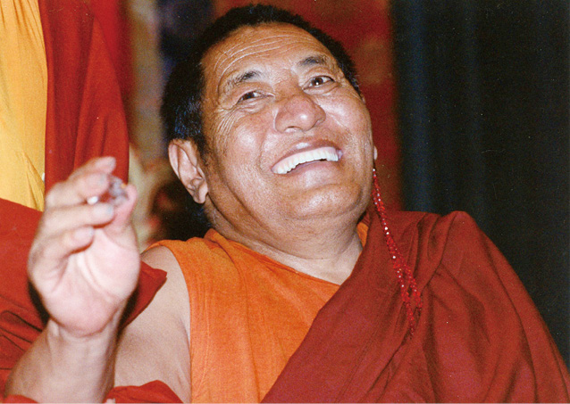

就拿我们来说，我们更喜欢那些乐于利他的人，而不是那些乐于作害的人。所以佛法如果切入内心，就是真正安住在无损恼的寂灭道中。心中的愤怒少了，身体和语言就不会伤害别人，反而会尽力帮助别人。八万四千法门的修行要点，归根结底都集中在这一点上。如果深入思考它的意义，不可能不对佛教生起欢喜心。

再讲一个公案：有一个被大自在天摄受的外道班智达，他过去是外道，但后来成了佛教徒。在他的一部作品中，他说：“外道之宗义，反复深思维，如是于怙您，我心更起信。”意思是，对外道思维得越多，对佛教就越有信心和欢喜心。他这么说也是事实。以前有些外道说杀人是善法，尤其是战场上杀了很多人是善法，佛陀却说这是不善法。事实上，如果你做了对众生有害的事，造什么业就会感受什么果。所以，害众生的话，果报除了痛苦，不会有任何好处。

如果与有妇之夫邪淫，破坏别人的家庭，外道说是善法，佛陀却说是不善法。因为身心和睦是善，不和睦、伤害他人，不可能是善法。

外道论典里说用谎言欺骗成千上万的人，将其引入邪道，这是善法，但佛陀说，讲诚实正直的语言才是善法。佛说的应该没错，他们的说法肯定不是善。

所以，内道的大悲本师释迦牟尼佛是唯一的真语者、实语者。佛陀先后授记的一切，从古至今都是绝对真实的，没有一句不真实的语言。凡是说“你修这样的法，就会得这样的果”“你修学这个甚深法，多长时间就会得果”，这一切都是千真万确的。

以我们西藏雪域为例，虽然是个小地方，但生长在那里的人唯一修行佛陀的言教，按照佛陀的言教去修行，得果的人也非常多。目前世界人口约有五十多亿，藏地人口只有六百万，但如果以修行成就者的比例来衡量，世界上其他民族很难与藏族相比。你们如果不相信，以后可以去藏地看一看、逛一逛，到了那里就什么都明白了。

藏地有许多教派和法脉，我只是简单说了一下噶举派的教法。就算你们不能走遍藏地，也要深入阿里，去看看米拉日巴住过的那个小地方。他扔进水里淹不死，抛到火里烧不死，毫无阻碍地穿越山岩，像鸟一样在空中翱翔，有诸如此类许多具足成就验相的历史圣迹，如今可以直接朝拜。

仔细想想，至尊米拉日巴的所行所作，在佛教以外的其他宗教和民族中也是罕见的。我没有胡编乱造，除了个别我不了解不知道的情节，我没有刻意说一句谎话。所以，希望大家好好地深入研究佛教。若能如此，即使是以前没入佛门的人，也不可能不喜欢上佛法。

・大乘密宗的实修指南

最后讲一下实修清净观。这是释迦牟尼佛或金刚持相续中拥有的法，直接修持它的方便法，就叫做清净观。它有寂止和胜观等许多修行方法，也是至尊米拉日巴实地修行而最终成就的不共之道。

这样的密宗金刚乘，不能对任何人都讲，只能对少数人讲。就像你们上师之前说的，这个法特别好、特别妙，但一开始要从浅显处入手，最后达到密宗的最高境界。说到密宗法，除了少数人之外，不是所有人都能得到的，这也符合佛教的次第。我也由衷地随喜这一传统和做法。如果你们对此有任何疑问，明天和后天按规定的时间到场，我们可以再探讨一下。

诸位非佛教人士，你们可以想一下，密宗是因为有不可告人的过失才需要保密吗？其实不是的。它不仅没有过失，而且如果真的讲起密宗的要点，它比小乘、大乘显宗这两种法都殊胜，是会让所有人生起信心、欢喜踊跃的法。正因为如此，大部分住在藏地的上师，还有到了印度的噶玛巴和他的四大补处，以及贝诺法王，都在弘扬这唯一究竟的实修法。

有人可能问：“那么，这么令人欢喜的深法为什么要保密呢？”

就像佛经上说的“密宗非是有过失，密修成就故保密”，密宗从来不是因为有重大过失才需要保密，而是因为保密是迅速得果的最快途径。

有人可能会想：“保密就会得成就吗？”

如果保密，是会成就的。就像藏药一样，如果把其中几味药的药名、配制方法等告诉病人，这个药就容易失去功效。如果对病人保密，效果会立竿见影。这种现象在很多地方都有。密宗也是如此，正因为保密会成就、不保密不会成就，所以保密是很有必要的。

当然，我还希望你们都能像至尊米拉日巴那样，修持完整的道次第。过去，佛法起源于印度圣地，而现在，正如佛陀授记的那样，佛法的根本在藏地雪域有完整的传承。为此，以后你们应当恭敬承侍的，是拥有这些传承、具有慈悲心的上师。这样的上师无论是谁，都应该去依止，这对你们只会有利，不会有害。

好好想想住在这个美国的很多高僧大德，为你们讲经说法、传授教言，给你们带来了极大的利益和安乐，这是有目共睹的。所以，以后这些上师来了，你们要真正地承侍他们。现今，你们的上师仁波切和我们是同一个法脉，如果他没有来这里，即使这里有一些藏民，但他们大多不懂正法，他们的心和行为造了很多恶业，对自他不会有太大利益。你们的上师到了这里以后，不仅创办了这个中心，而且听说还有100多个中心，把佛法传授给很多人，使他们今生后世离苦得乐。这也是藏族上师的恩德。

像我这样的人，对你们不会有太大利益。因为我年事已高，加上重病在身，除了这次，恐怕不会再有机会来美国了，所以很难能利益到你们。这里有很多上师与你们朝夕相处，这也是你们的福报所感召的，每个人都应该恭敬地承侍他们，按照他们所说的去实修善法。不仅是我，许多上师很难直接从藏地来到美国，因为在藏族人中，如果各方面条件不具足，要来这么远的地方是很难的。

另外，希望大家也要恭敬承侍从藏地出去、现居印度等地的上师们。这些来自印度的上师，也和你们有着密切的关系，当然，和你们同一法脉的噶举派上师，就更不用说了。丹嘉仁波切是佛教的教主，是圣者世间自在王的化身，能亲眼见到他、聆听他的教诲，非常有意义。如果你们能和他结上缘，会有广大的利益和广大的果报。

此外，现居印度南部的贝诺法王，很可能计划明年来美国。他是前译派整个教法的教主，而我，只是他法脉中的一个小上师。他在藏地住持着数百座寺院，在印度培养的身披袈裟的出家僧人遍布大地，像他那样的大德是非常罕见的。从他的人格来看，他是唯一只帮助众生而不做一点一滴损害的好上师；从宗教角度来说，他可以和世界上所有的宗教和睦相处，尤其对佛教的宁玛派、噶举派、萨迦派、格鲁派，他尽可能地服务和支持，想方设法致力于弘扬整个佛教，现已被大仁波切等人任命为宁玛派教主。虽然他是宁玛派的教主，但他对所有教派一直都同等关心和尊重。如果将来有这么伟大的上师来到这里，你们一定要满怀信心地去请法，和他结上善缘，这对你们有非常大的利益。

如今在美国的这些上师们，和我来自同一个地方，我对他们也很熟悉。他们唯一按照佛说的去利益众生，不会伤害任何众生。如果你们遵循他们的教导，如理修行，这也是我的希望。

总之，希望你们的所想所行，都成为利乐一切众生的因，特别希望你们相续中生起一颗善良的心。扎西德勒！

法王最后讲密宗的时候，并没有具体讲大手印的修法或大圆满的修法。他只是说，在守护密宗誓言的基础上，要依止在密法方面有修行、有经验的美国上师们，要从他们那里得法。

因为密宗的实修需要长期依止善知识，一些不共的修行，更需要善知识的引导。所以法王虽然没有直接讲密法，但是为他们指明了一个修习密法的方向。

唤醒生命

几年前，当我在美国演讲时，遇到一位美国佛教徒，叫莉·格柔诗（Lea Groth）。她在懵懂年少的时候，曾见过1993年来美国的法王，听过法王在迈海教堂的那场传法。她说，从那天起，她的人生发生了不可思议的变化。

她是这样描述的：

“那一年我13岁，有点喜怒无常，喜欢把自己藏起来，不太友善。

我父母是欧裔美国人，都是藏传佛教徒。他们的佛教中心邀请过许多宁玛派上师，经常举办各种佛事活动。作为这个组织里的二代，我没有兄弟姐妹可以让我干点别的，也没有其他亲戚可以帮父母照看我。别无选择，我只能和父母一起参加这样的活动。

有一次，听说一位仁波切从藏地来到美国传法，我们开了半个小时的车去了一个教堂。那个教堂的内部，没有任何出乎意料的地方。真不敢相信那是一个教堂，因为看不到一个十字架，也看不到悬挂的圣子像。

我天生喜欢批判，在进到那个教堂之前，我是性情乖戾、疑心重重的。记不清当天是怎么开始的，甚至弄不清楚要来见的最重要的人物是谁，只记得那次活动没有特别典型的藏族色彩。我看惯了金光闪闪和锦缎装饰的法器，还有唱诵，但那一次什么都没有，非常朴实。讲法者坐在一个靠背椅上，其他人坐在普通的椅子上，直到主讲者开口讲话之前，我都觉得没有什么印象深刻的地方。

讲法者的声音洪亮而富有磁性，仿佛钻进了我的心里。虽然我听不懂他说的话，但却让我有一种极其深刻的感受。

不得不承认，刚开始，我觉得有点无聊。但我不是那种一直让自己无聊的人，所以我开始观察台上的每一个人，尤其是那位在讲话的藏族老人。我现在仍然记得，他当时在看着我——也许只是我的自以为是，或者记错了。然而，那一刻，我确实慢慢感受到了一种豁然开朗，深刻的体悟在我心中生起：教堂里的地毯、墙壁、椅子都变成空空的，透明的，不真实的。我那情绪缠身的思虑漩涡，被降服了。我那青春期被荷尔蒙压抑的大脑，终于暂时平息下来，甚至安静了……

讽刺地说，从那个教堂走出来之后，我变成了一个真正的佛教徒，不再是一个探求者；我变得确定了，不再那么迷惑了。虽然我忘记了法会的内容，甚至不知道那位伟大老师的名字，但我从未忘记我内心经历的巨大转变。

我问过母亲很多次那位老师是谁，但她从来不擅长记藏族名字。所以很长一段时间，这个名字都是个谜。

后来，也许是因缘所致，因为我的编辑工作，我和喇荣又接上缘了。我才发现，让我内心发生巨大变化、定下我人生方向的伟大老师，就是法王晋美彭措仁波切。是他，摄受了我的心，让我回到了我的真实皈依处——佛法！”

发生在她身上的这段经历，足以说明法王的加持不可思议。作为大成就者，不仅能通过传法改变众生的心，还能通过他的声音和眼神让众生有翻天覆地的变化。特别是，如果父母带着孩子去拜见一位具德上师、参加一场佛事活动，对于善缘深厚的孩子，他的轮回篇章可能从此改写。

谈谈香巴拉

6月27日，法王再次来到金刚界的噶玛堡禅修中心，向大家讲述了香巴拉的历史和起源，以及这个道场与香巴拉之间的因缘：

我从藏地雪域来到美国，今天，又到了这个被称为“第二香巴拉”的地方。

事实上，真正的香巴拉是世界著名的五大佛教圣地之一。五大佛教圣地有哪些呢？一是印度菩提伽耶，它位于世界中央，是三世诸佛成佛的圣地；二是五台山，东方怙主文殊菩萨现在居住的圣地；三是普陀山，南方圣者观世音菩萨真实安住的地方；四是邬金空行洲或铜色吉祥山，西方邬金莲花生大士真实安住的圣地；第五个，就是北方的香巴拉。

那么，香巴拉在哪里呢？

在一个需要以神足通十二年才能到达的地方。过去的很多智者，比如印度圣地的则勒巴班智达，都去过。那个城市的外观是一朵八瓣莲花。那么，它是如何以八瓣莲花的形状存在的呢？中央是名为嘎拉巴的香巴拉城，在所有的花瓣中，有960百万个小香巴拉城。香巴拉的所有河流，都流向中央的嘎拉巴城。

就香巴拉从古至今的王权体系而言，先后有七位法王、二十五位具种王应世。

七位法王的第一位，叫法王达瓦桑波（月贤），是释迦牟尼佛临涅槃时在印度南部具德米积大塔处宣说《时轮金刚》的首座眷属。他结集的法叫《吉祥时轮根本续》，梵文是“西日嘎拉匝札”。这部法有多少呢？月贤法王记在心里的，归纳起来有一万二千偈。他的后代主要是轮流讲闻这部法。

七代法王期间，香巴拉城也像古印度一样，分为刹帝利种姓（王族）、吠舍种姓（商人）、首陀罗种姓（平民），也出现了“大部分种姓不准听佛法，部分种姓允许听”的传统。后来，这些种姓被废除，合成了一个种姓，即法胤种姓。所有法胤中的第一位，是具种王妙吉祥称，他为日车等数十万眷属传授了《时轮金刚根本续》的略要，此法也叫《时轮略续》，一共有五品。他的太子白莲具种王，造了一个名为《吉祥无垢光》的大疏，以解释此续的意义。

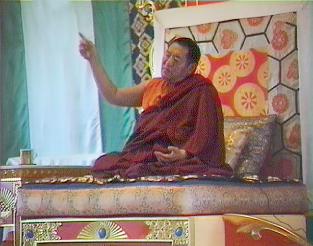

后来，《根本续》《略续》《略续大疏》这三部法，在印度兴盛起来。在藏地，《根本续》、《略续》完整版、《略续大疏》完整版，也已翻译成了藏文。

《时轮金刚略续》在印度出现、《时轮金刚》在藏地出现的那一年（1027年），被称为“胜生周”。“胜生周”在藏语中有出现法的意思，因为是《时轮金刚》教法出现的殊胜时间，故而得名。结合汉族的历算，每六十年就叫一个胜生周。自《时轮金刚》在藏地兴起以来，今年（1993年）是第十七胜生周的第七年。

所有的法王或具种王，当上一个国王的统治结束，下一个就会马上继承王位。每位具种王的任期通常为100年，但也并非一成不变，除了难胜、胜海两位具种王，其余二十三位都是一样的。自从他们登基以来，只要在位，100年之内就要向香巴拉960百万城的人们宣讲《时轮金刚》教法。难胜具种王和胜海具种王的总任期是403年，其中胜海转了182年法轮，难胜转了221年法轮。

那么，现阶段是哪位具种王在执政呢？

他是第二十一代不灭具种王，今年是他在位的第67年。接下来的第二十二代、第二十三代、第二十四代具种王将依次出世。

之后是第二十五代勇武轮具种王。当时全世界的佛法都被灭了，人们连佛法的名字都听不到了。不仅如此，香巴拉被雪山环绕的内外两城中，所有外城都被边地魔军占领了。当边地魔军向内城入侵时，勇武轮具种王显现上勃然大怒，他全副武装，以神变骑上石战马，在空中挥舞着铁轮，带上各种兵器，右绕南赡部洲、东胜身洲、西牛货洲一圈，进行了为期一年的战争，消灭了边地所有的邪教魔军，在四大部洲重新树立佛教法幢。他统治的时间是100年。他有两个儿子，梵天和天王。这两位王子会使《时轮金刚》教法兴盛数千年，经久不衰。

以上只是简单介绍香巴拉的历史和起源。

据说你们的上师仁波切，就是香巴拉未来的勇武轮具种王。在这一生中，他也创造了这方面的缘起，显现上像军官样一样穿着军装，并安排了许多护卫军。

在座各位能接受他的教法和法脉，真的很幸运。一般来说，凡是修行噶举派等佛法，尤其是他所实修的佛法，都会转生为他手下的将领。他实修的佛法是什么？如我昨天所说，是至尊米拉日巴完整的修行次第。尤其他最重要修行的是，佛教中共许的无害寂静的唯一妙道——慈悲心。

你们中的一些人可能会想：“我们上师是一位与众不同的伟大上师，但他主要修行慈悲心，这是从哪里体现的？”其实，他的行为就是唯一在贯彻慈悲心。如果他是一个追求名利的人，那他生活在印度和藏地雪域，将获得超过这里许多倍的名闻利养。在藏地和印度，住着许多持教大德，但是在美国，以前除了少数人，大家甚至听不到佛陀的名号，听不到一句佛法，也看不到任何僧众。正因为他来到了这里，建立了这个根本道场和100多个分支道场，成就了过去上师们谁也没有完成的广大事业，所以，单单以这一点，就足以说明他相续中的慈悲心。

当然，我给你们讲你们上师的功德，可能有点不太合适，就像外人给你介绍家人一样。但不管怎么说，我对他在一个遥远国度的事业，很早以前就有所耳闻，这次来到这个地方，对他的事迹更生稀有心、欢喜心、信心，所以这些话忍不住脱口而出。我们藏族有句俗话：“就像到做针的人家里卖针一样。”意思是如果你把针卖给做针的人，就卖不出去了，同样，在你们弟子面前说这些，可能有点多此一举。如果我说得不准确，也请你们见谅。

之后，法王给大家念了《佛子行》的传承，说：

一切佛法的精髓若总结起来，就是这个《佛子行三十七颂》。凡是看到它、听到它、读诵其文、实修其义的人，都会今生长寿无病、受用丰富、名声远扬、得偿所愿，后世很容易往生西方极乐世界，身心毫无痛苦，拥有不可思议的安乐。

想必你们真正想要的，就是今生来世都安乐，不再痛苦。我这次来西方，也主要想看看有没有办法让很多众生离苦得乐。我们都有同样的愿望，而我用藏语念传承，也是为了实现这个愿望。如果你们以信心听受，即使不明白意思，只是听到了词句，也有不可思议的利益。

此法在藏地兴起以来，宁玛派、噶举派、噶当派、觉囊派、萨迦派等各教派一直都在实修，没有任何区别。

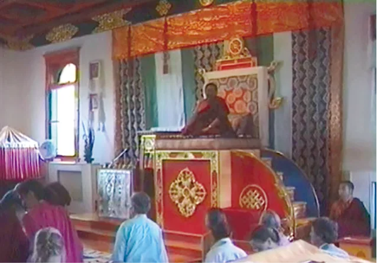

这个法的要点是什么？它融合了佛陀和他的随学者——印藏等地所有持教大德的一切修行要领。那么，它最核心、最究竟的要点是什么呢？就是培养慈悲心，不伤害一切众生。

如果你们通达了这个法，那就足够了。如果还没有通达，可以请别的上师为你们讲解它的句义。我在心间双手合十，祈祷大家都来修这个法！

我做了一件衣服

每次跟法王出国，和自己一个人出行完全不一样，无论是衣服还是其他行李，我都尽量少带。所以这次来美国，早晚比较凉，白天阳光特别强，我觉得我非常需要一件外套。

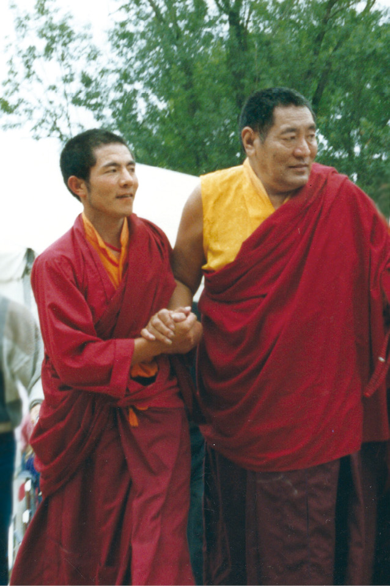

然而，美国不同于印度和尼泊尔，在这里很难买到僧衣。一天下午，趁着还有点时间，我去了博尔德附近的城市，但找了半天也没找到适合出家人穿的衣服。无奈之下，只好想去买块布，找人来做，可是红布几乎看不到。好不容易买到了一块，我拿着它去裁缝店，裁缝却说他从来没做过，所以做不出来。

好在我以前做过衣服，所以当场把布裁了，教他怎么缝，不一会儿就做好了。衣服很合身，尺寸也合适。有了这件衣服，在之后的每一站旅途中，它都发挥了不小的作用。

我一直有把多余衣服送人的习惯，但是从国外回来之后，有点舍不得处理这件衣服了。直到今天，我每次出门都经常穿着它。这衣服的面料很好，虽然已经穿了30年了，却没有褪色变形。只是我比那时胖了一点，衣服也小了一点，但还是能穿。

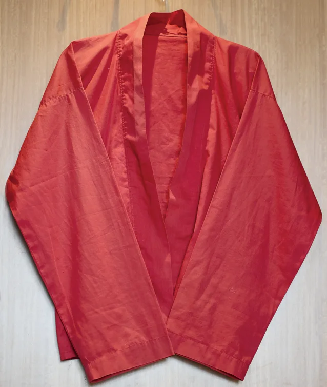

当然，这点个人的事，跟上师和佛法比起来，不值一提。但是写到这里，我就想起了这件事，所以也就没有取舍，想到什么就写下来了。

告别金刚界

6月28日，法王接见了金刚界中心的管理人员和其他道场的高僧大德，并给予开示、加持。

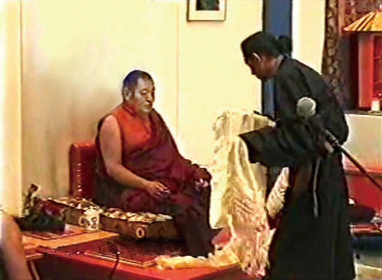

6月29日是在博尔德的最后一天。当法王准备告别时，他对所有人说了一段话：

这个城市不同于其他城市，它相当于第二个香巴拉。到了这个香巴拉城，和你们信众交流佛法，感觉缘分很好，我非常开心。

我住在藏地的时候，也希望有机会来美国。后来承蒙住在印度和美国的持教大德们的关心，以及这些道场提供的顺缘，才让此次行程得以实现。之前听说有个道场叫“金刚界”或“瓦吉达德”时，我的心里充满了喜乐，这并没有说妄语。所以，我觉得我应该和这个道场有宿世的善缘。

你们凭借自己强大的公关能力，协调了中美两国大使馆及相关部门的关系，在邀请我方面做了很多事情，也为我的机票和食宿支付了很多费用。给你们添了这么多麻烦，我从心底表示深切的感谢！

最后，我想说，我们今生最好还能再见面。如果这辈子不能再相见，也要发善愿，希望要么去西方极乐世界，要么去北方的香巴拉，下辈子再相逢。

法王讲完后，南珠堪布总结了这次行程，然后说：

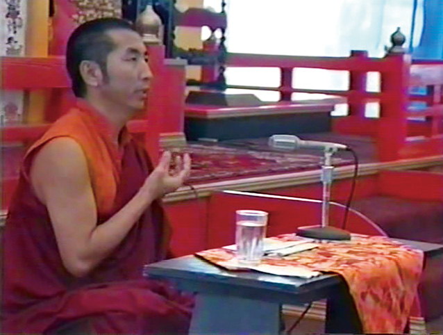

“这几天法王传了非常殊胜的法，大家一定受益匪浅。我是印度南部南卓林高级佛学院的老师，为了提升学生们的佛学水平，先后三次去了藏地，依止法王晋美彭措学习显密佛法。这一次，我是贝诺法王派来承侍法王的。

看到你们的道场，无论是信心、恭敬心，还是对佛法的意乐，都很不错。可能你们中的一些人，学得、修得非常好，但是和藏地佛学院的水平相比，应该还有一定的提升空间。

在藏地，依止上师必须遵循经论的要求，而在西方，很多人只看上师怎么说。其实上师也有各种各样的，如果上师不精通显密教理，依止他就会有点危险。

很多年来，大家一直如理如法地修行。过去你们对宁玛派和噶举派的法一视同仁，希望以后仍能一如既往地修行大圆满和大手印。”

之后，金刚界中心的代表向法王表示感谢：

“法王，您说您收到金刚界的邀请函时，心中充满了喜乐。当我们听到您的名字，看到您的照片，心中也同样充满了喜乐。您能来这里真是个奇迹。

当我们开始了解您的惊人成就时，既兴奋又有一点困惑，原来这世界上最甚深、最难行的奇迹，是对他人的慈悲。如果您将来成为香巴拉王国勇武轮王麾下的将军，我们都自告奋勇成为您的勇士。非常非常感谢您！”

最后，门措上师给大家传授了文殊灌顶。至此，博尔德的弘法行已经圆满。
