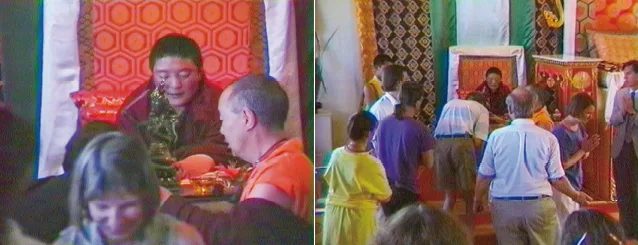

第3站 美国·落基山

Rocky Mountains, USA 6/30-7/6

行程

6月30日，抵达落基山佛法中心

7月1日，“文殊静修大圆满”灌顶和开示

7月2日，上午《大鹏展翅》第一节课  
下午《大鹏展翅》第二节课

7月3日，上午《大鹏展翅》第三节课  
下午《大鹏展翅》第四节课

7月4日，上午《大鹏展翅》第五节课  
下午在大塔前开示

7月5日，上午“项袋金刚橛”灌顶和开示  
下午做了公开演讲

7月6日，上午接见道场管理人员和金刚护法军队  
下午传授《文殊静修大圆满》要义，并做告别开示

落基山下

6月30日，我们离开了美丽的博尔德，一路向北，像过山车一样翻山越岭。两三个小时后，到达了落基山佛法中心（Rocky Mountain Dharma Center）。

落基山就像藏地的喜马拉雅山，是北美最大的山脉，绵延起伏数千公里。山上的雪水向西流入太平洋，向东流入北冰洋和大西洋。

7月的落基山，气候不冷不热，舒适宜人。这里有森林、湖泊、草原、冰川。天空是明亮的，风是干净的，河水清澈剔透，闪闪发光。在这样的环境中，内心自然变得清净，仿佛置身于藏地前辈大德闭关修行的寂静处。

法王住的木屋

这个道场是藏传佛教噶举派的法脉，修行者大多是美国人。他们在山上搭建木屋或帐篷，远离喧嚣的尘世，常年修行寂止法门，很多人已经闭关六年多了。他们对法王的到来欢欣踊跃，非常渴望得到甚深的灌顶和密法窍诀。

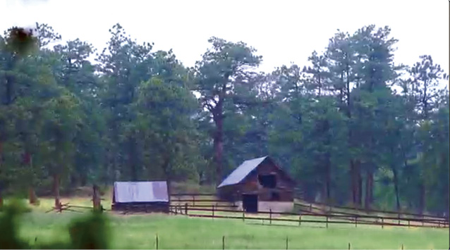

轻松的聊天

刚到落基山的当天下午，法王做了一个简单的开示，并为大众摸顶加持。

休息过后，法王坐在木屋外，望着远处的森林和群山，欣赏着周围的美景，与嘉哲仁波切等人轻松地聊天。

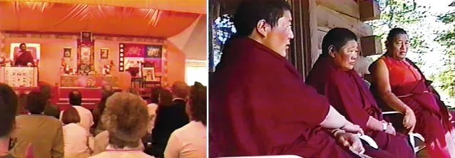

嘉哲仁波切从小就被朵芒寺认定为活佛，后来又去了美国弘扬佛法，所以聊天的时候就谈到了朵芒寺：“以后还是想去色达和朵芒寺看看。之前因为扬唐活佛的委托，我去过一次朵芒寺，到了炉霍就直接去了。帝察活佛看到我出现在他面前，问：‘你怎么突然来了？我都没想到你会来。’我说：‘我不喜欢提前通知大家，不然会有各种接待。我还是以前的我，甚至比以前差了一点，没必要提前告诉你们。’那时候朵芒寺刚刚开始恢复重建，有二三十间僧舍，五六十名僧人。我想帮忙建一个佛学院，但是因为种种原因，没能做到。祈祷上师三宝加持，以后会好起来。”

法王说：“如果有关部门批准，朵芒寺的建设应该没有问题。罗科玛部落比较大，相对于部落的人数，寺院并不算大，但总体来说，还是很兴盛的。上下罗科玛有1000多户人家，他们非常团结，无论上师们说什么，他们都会依教奉行，不会违背一个字……”

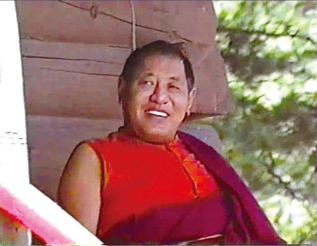

法王还向他询问了美国的佛教现状，聊了一些其他话题。

西方人的时间观念

美国的每一个佛教道场，都非常擅长时间管理，大到几年的规划，小到每天几个小时甚至几分钟的安排，列得清清楚楚、井井有条。我们每到一个地方，道场都会给每个房间发时间表，如果有什么调整或变动，也会提前打招呼。

而且他们时间观念极强，非常在意准时正点。比如法王传讲佛法时，包括翻译和念诵，每节课是两小时。如果超时了，听众会立刻举手提醒法王，时间到了，他们该走了，否则要补交停车费等等；如果法王讲不到两个小时，哪怕只差四五分钟，也会被要求继续讲下去，因为他们付了两个小时的钱——在西方听法和东方不一样，那里是要收费的。

有一次，法王为大家灌“杰珍宁提”的顶时，因为仪轨太长，两个小时无法结束，只能诚恳地向他们道歉，说自己没办法按时完成，但灌顶不能中断，请他们允许延长半小时。

刚开始，我们都有点不适应。毕竟在藏地，传法是很随性很自由的，有时候发挥得广，一口气可以讲几个小时，有时候没什么感觉，讲几十分钟也没事。但是，西方人对时间的要求一板一眼，绝对不能多也不能少。

经过询问才知道，在西方人眼里，守时是一种尊重他人的表现，如果经常不准时，说明这个人的人格有问题。尤其是在正式场合，守时更重要，否则会给很多人带来不便。因为每个人已经安排好了一天的时间，如果一个地方超时，后续的一系列事情都会受到影响。所以，时间表是必须遵守的。

后来法王也入乡随俗，看着手表，卡着时间传法、灌顶，尽量严格按照规定时间完成。而我从那以后，也变成了一个有时间观念的人，不管是讲课、开会，甚至是和人吃饭，无论大事小事，预定的时间几乎从不迟到。

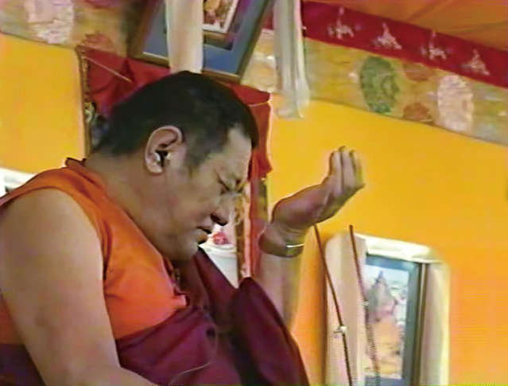

开启法门的三个原因

在落基山的这个佛法道场，法王给修行者传授了七天的密法。

7月1日，法王传授“文殊静修大圆满”的灌顶。在此之前，嘉哲仁波切（Gyatrul Rinpoche）讲了一段话：

“首先欢迎大家，尤其是专程赶来参加法会的各位。这么美妙的聚会，是过去无数劫中积资净障的结果，我们应该重视这样的弘法活动。特别是有幸能请到法王这样的成就者，他是莲师在当代的真实化身，是真正的见解脱、闻解脱、触解脱。依此活动，我们有机会见到自心本具的佛性，得到生生世世的利益和安乐。

看到法王，是自己的福德使镜子清净，才映现出这么慈悲的影像。虽然影像出现在你面前，但你可能不知道这个影像是谁，所以我来帮忙介绍一下，但也不过是以盲导盲。

大家要珍惜福报，不能让法王太累，因为他年岁已高加上车马劳顿，还要以种种加持利益众生，所以我们要察言观色，让他及时休息。与其关注手表上的时间，不如关注自己的来世。法王的法体是最重要的，不能把入场费当成买卖上师。收取闻法门票是美国道场的一大特色，但我们不要把法王的教诲看成应得的服务，更不要对闻法有种做生意的期待，而应该认为这是一个积累福德的黄金机遇，是今生难得一遇的可贵机会。

不能说太多了，莲师坐在那里等着，我已经开始紧张了。就到这儿吧。”

接下来法王开始灌顶，讲了他这次传密法的三个原因：

今天，在这个吉祥圆满的时刻，是时候开启甚深密法的大门了。

一般来说，这个密法是不可以给所有人都传讲、灌顶的，它是有教印的一个法。要传或听密法，上师要观察弟子很多年，弟子也要观察上师很久，才能听他教授。但是，我这次给你们传授甚深的灌顶、传讲甚深的教言，主要有三个原因。是什么呢？

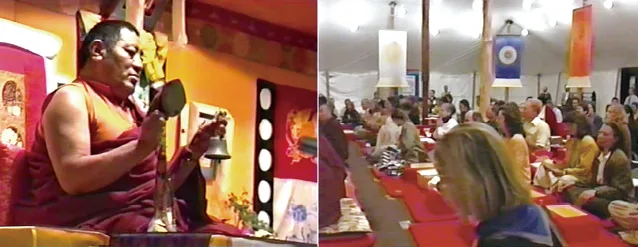

第一个原因是，你们都遵循你们上师仁波切的教导，从寂止开始，逐渐修持完整的道，并不是一开始就好高骛远，而是在完成所有的共同道之后，才到了修不共道的时候。他这种做法是值得信赖的，也是令人欢喜的，所以，我才为你们传授能使心相续成熟的灌顶、能得以解脱的教言。

第二个原因是，你们和我有着宿世愿力，缘分很好。考虑到这一点，我开启了这个法门。

凭什么推断我们师徒宿缘很好呢？

我在藏地给数千僧众讲经说法、与数十万信众结上法缘时，受到了我同乡和同一法脉的众人的邀请。当收到你们的邀请函时，我的内心莫名欢喜。在我看来，这一定是和你们有缘的象征。从你们的角度来看，应该也和我有宿缘，为什么呢？你们道场邀请上师并不是随随便便，据说你们刚听到我的名字和简介，就生起了无比的欢喜心，也多次向东方的亚洲国家发出邀请。从这样的事情可以判断出我们师徒的宿缘一定很好，所以这次我开启了法门。

第三个原因是，自从你们上师来到美国，花了几十年的时间为你们的修行打下了完整的基础。之后，他的事业暂时回归法界。但他是否也为那些护持他余下事业的人，比如我，提供了与你们结缘的机会呢？想到这一点，我这次开启了密宗灌顶法门。

依靠这三个原因，我先给你们传授能成熟的灌顶。请怀着“为天边无际的一切众生获得佛果，而接受密宗甚深灌顶、实修所有教言”的发心来聆听。

你们要得的法是：1987年，我带着一万名藏族人，还有汉族、蒙古族的很多人，去了东方五台山，在怙主文殊面前多次发下普贤大愿。最后，在文殊菩萨的意加持下，显现了这个“文殊静修大圆满”的灌顶……

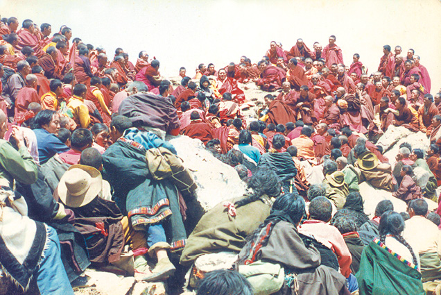

法王在五台山给众弟子传法

《大鹏展翅》第一节课

7月2日到7日4日，法王分五节课讲《大圆满直断见歌·大鹏展翅》。每一课只是简单的字面解释，没有广泛讲解。所以，我在这里并没有把所有内容都整理出来，只是摘录了部分教言。

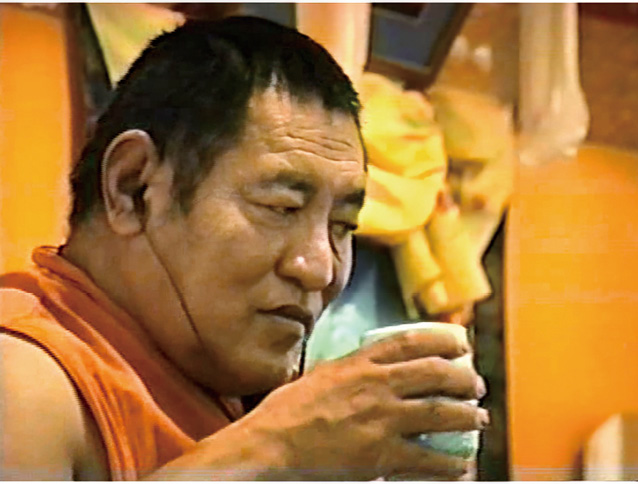

7月2日，正式传法之前，法王先讲了一段话提醒大家：

接下来我就讲讲和你们有缘的法。

平时做任何善事，无论是听法、修法、顶礼、转绕、忏悔等，都要先发殊胜菩提心，这是不可或缺的。那么，如何发殊胜菩提心呢？要在心里默默地想：“为了普天下一切众生，我要早日成就永恒安乐的无上正等觉佛果。而要想轻松快速地成就佛果，必须实修这种深法。”这就是发殊胜菩提心。

讲课前，我对你们有两点希望：第一，日常修行要由低到高循序渐进，切不可错乱行持。换句话说，初学者不能做上层瑜伽士做的事，上等者不能做下等者声闻的事，《无垢光大疏》说：“初学者不做瑜伽士之所为，瑜伽士不做成就者之所为，成就者不做遍知之所为。”按照这里说的去修，是我的第一个希望。

第二，你们之前一直无差别地兼修大手印和大圆满，以后还要继续实修这两个法。这是我的第二个希望。

要知道，大手印就像走路的脚，大圆满就像看路的眼。为什么呢？大手印是让人一心安住的方便法，大圆满相当于看到了真正的道，所以两者缺一不可，离开其中任何一个，都不能趋入佛地。就像没有眼睛或脚，哪儿也去不了，同样，没有大圆满的见解，只修大手印的安住方便，断不了轮回的根；大圆满也是如此，如果没有大手印的安住方便窍诀，仅仅通过理证分析也到不了佛地。

所以，印度和藏地所有智者、成就者的口传中，都有将这两者结合起来讲的传统。文殊怙主萨迦班智达曾说：“愚者修行大手印，多数说为旁生因，抑或转生无色界，或堕声闻灭尽中。”意思就是，没有胜观的寂止是无记法，只会让人轮回，无益于解脱。此外，持明晋美朗巴也说：“执著寂止明空心，伺意胜观散动者，无记法界之无作，此三已离大圆满。”也就是说，没有寂止的胜观，只会让人散乱在对境中，也不会证得胜道。因此，我建议你们在现在和未来的日子里，以大手印和大圆满不分离的方式修行。如前所说，这就是我的第二个希望。

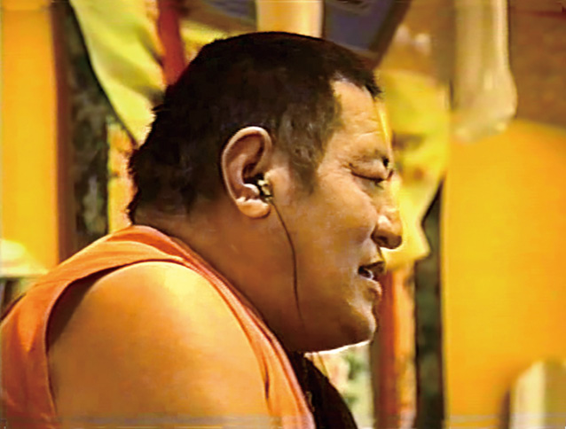

当然，这种修行，你们靠自力无法成办，还需要依止一位具足法相的好上师。

大家都比较熟悉噶举派的上师，而住在近处的宁玛派上师，各方面也有不可思议的功德，迎请他们来讲法，恭敬地聆听教诲，也会有非常大的利益。否则，要请一个住在很远地方的藏地上师，是很难具足顺缘的。就拿我来说，我年纪大了，病得不轻，考虑到我道场的眷属众多等里里外外的因缘，除了这次来美国，恐怕不会再有机会来这里了。即便如此，我还是希望我们的缘分比以前更近更深，也就是在佛法方面，可以互相交流、提问、分享修行心得等等，让彼此受益。这和参与世间政治等完全不同。我的弟子将来可能会和你们有很好的缘分，我也真心希望你们能建立良好的关系。这是一个善意的祝福，完全没有任何政治或经济目的。

以上是由纯净之心引发，我从与佛法、上师结缘的角度，给你们提了归纳性的建议。接下来要传讲的法，是措周壤卓尊者的《大圆满直断·大鹏展翅见歌》……好了，哈哈哈，因为我眼睛看不清，需要用耳朵代替，边听录音边传讲。

然后法王打开黑色录音机，开始正式讲法。

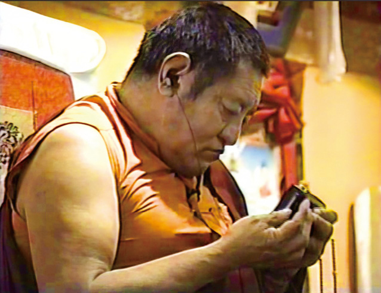

上午从开头的“那莫革日贝！普明智悲日轮中，尽放无量大悲光，顿除三界众痴暗，行此法王尊前礼”，讲到“此乃抉择基心性，实相自性之直指”。接近尾声时，法王总结道：

当你们修寂止时，仅仅安住是不够的，还必须在一心安住时，断定安住者的本心是怎样的。这就是大手印道。

然后，观察心自己的本体，要了知心的实相是怎样的。这就是大圆满道。

所以，无论修大手印、大圆满哪一个道，都是一个要点。自己的心如果有，就断定有；如果没有，那就断定没有。要追根究底，仅此而已。

《大鹏展翅》第二节课

下午，法王继续从“奇哉！具缘心子复谛听：最初法身普贤王，尘许未修解脱理，六趣众生毫未造，不善罪业漂轮回”，讲到“一切自心之幻变，无而显现空自色，彻底断定平然住”。在讲课的开头，他说：

这一次，我们传讲和听闻这个光明大圆满法，你们大部分人应该是真的懂了。即使有人不能原原本本理解其义，也应该对这个法怀有信心和恭敬心，并确信自己证悟法义的时刻总有一天会到来。

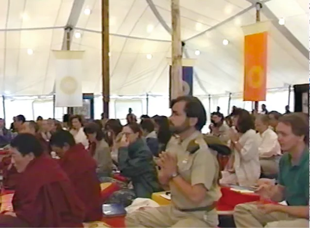

尤其是这次你们想实修“文殊静修大圆满”，这个法里还有它所属的《手中赐佛》，以后也要去实修它，如此一定会带来极大的利益。

我以前就非常确信，这个法对西方人会有很大的帮助，尤其你们在座很多人都是它的所化众生。这次来美国太晚了，让我留下来讲经说法直接给你们带来大利益，恐怕是很难了。不过，我可以为你们祈祷，祈愿大家以后会修行这个法。

从这个法本身来说，应该会给你们很多帮助。为什么呢？因为它所说的意义是归纳要点，实修起来也简单易行。以你们这个发达国家的人为例，虽然有很多工作要做，但即使你边工作边修这个法，也有办法可以轻松做到。所以我相信，它主要适合西方发达国家的人修行。

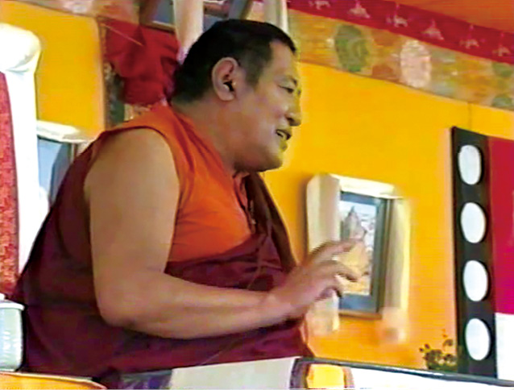

特别是我之前自己写的一个预言里，也有一句是关于此法对你们更有利的授记。我来读一遍这个预言，“普利之日轮，虽从东山起，光芒照西方，无知众小山，莫思我高傲，自前影遮蔽，汝虽暂自由，终为光普照。”

意思是什么呢？这个法是我在印度菩提伽耶的东方——汉地五山台写的，但所化众生大多在西方国家，也就是指对你们会有利。就像太阳虽然从东方升起，却在西方放射万丈光芒，这意味着在不久的将来，许多西方人将受益匪浅。我想这个预言这次得到了证实。

《大鹏展翅》第三节课

7月3日上午，法王讲了从“能仁毗卢遮那佛，手中莲花一尘上，具有三千娑婆界”到“实修住动觉性一，动住直指无有二”之间的颂词，并进一步阐述：

认识到一切都是心的幻化，明白心的本体是什么，这是根本。

如果你想了解它，首先需要从寂止中来。你必须修行寂止，否则不可能知道心的实相，所以心要长时间一缘专注。

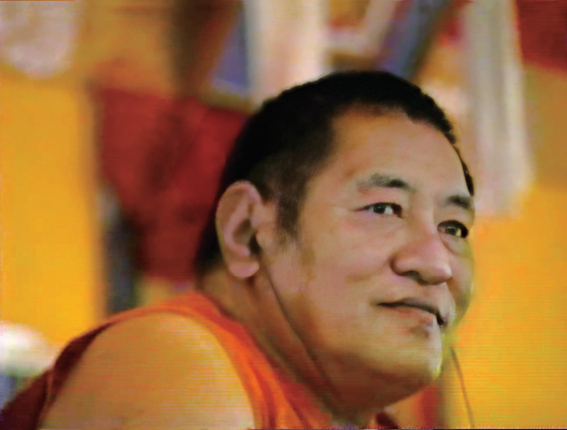

但是具体来说，心里什么都不想、只保持单一的无念，这没有什么意义，就像沉睡或昏迷一样，这种寂止是达不到任何境界的。我们要在寂止的基础上修行，也就是，不要失去一缘安住的境界，同时自然地观察心的自性。

在观察心的自性时，就会了知心是空性，没有形状、颜色，无所成立，这就叫胜观。懂得这一点，那就可以了。

我们必须在寂止的基础上寻找胜观，然后修行止观双运。一旦现前了止观双运的果，这就是至高无上的究竟道。所以，你们平时要尽可能地修止观双运。

《大鹏展翅》第四节课

下午，法王从“奇哉！唯一具缘之心子，汝等勿散悠然听，六聚自解舍事我，动听歌声记心中”，讲到“不随取舍希忧转，今识明觉任运性，现前三身自明空，即是本来正觉果”。临近结束时，法王说：

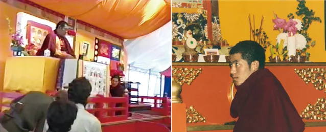

这一次，措周壤卓的《大鹏展翅》一字不漏地传到了你们耳朵里，你们应该全神贯注，生起真诚的信心。平日里，要看看自己懂不懂这些，要多下功夫。有了措周壤卓和这个法的加持，你们一定会很快证悟其中的意义。

在这里，根据你们的根基，我把这部论的所有要点归纳为三条：平时不要任由分别妄念产生，要让心自然安住下来，这是第一条；当心无分别安住时，悠然放松地去观它，就会明白它的本体是空性，这是第二条；在日常生活中，安住在这种境界中，或者说护持它的相续，是第三条。

我再重申一遍：心自然安住，了知心的自性，在这种境界中护持相续。这三条包含了大手印和大圆满所有续、教、窍诀的要点，要持之以恒去修行。

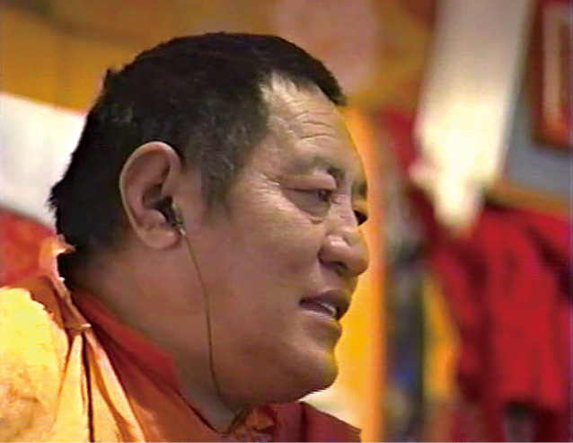

《大鹏展翅》第五节课

7月4日上午，法王从“奇哉！今善男子复谛听，最初无散而护持，中间放任真义上，最终放纵无来去”，一直讲到最后的“愿以此善具缘众，无明烦恼妄念垢，速净本净本法界，即生之中得正果”。在结尾，法王这样说道：

这次讲闻《大圆满直断见歌·大鹏展翅》，今天是第五节课。我们已经讲了十多个小时了。这次传法的目的是进一步增上你们的觉受和证悟，也是为了清净我自己的语障，所以，我把所有句义不增不减地传了一遍，所有要点也以归纳的方式都解释了。

这个法的所诠义，主要是光明大圆满，它也涵盖了大手印、大中观等一切道要。一般来说，佛陀所讲的无量法理，究竟要点只有大中观、大手印、大圆满这三个。如果你修行完整正确的大中观道，那就包括了另外两个要点。同样，如果你修的是真实完整的大手印道或大圆满道，也会分别涵盖其他两个。

所以，大手印、大圆满、大中观同步实修是关键。许多噶举派和宁玛派的成就者，如噶玛巴自生金刚、全知龙钦巴，都是这样修行的。我们师徒平时也要尽量把三者融为一体来修，这是很重要的一点。

那么，如何修呢？

专注入定于寂止的境界，其中心不动摇的那部分，就是大手印；心在外中内何处也不成立，这种空性称为大中观；心一缘安住于空性的当下，产生一种明知明觉之见，这种定解就叫大圆满。

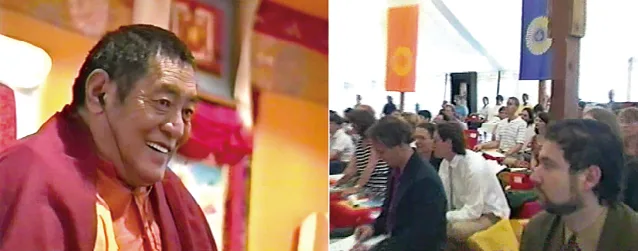

噶玛巴自生金刚在《了义大手印愿文》中也说：“远离作意大手印，远离诸边大中观，此乃总集大圆满，一通皆通得开悟。”意思就是，远离伺察意是大手印，离边的空性是大中观，圆满具足一切道的要点是大圆满，希望众生彻底证悟这样的实相。

自从来到这个道场，我也再三劝勉你们不加区别、无有取舍地实修宁玛派和噶举派。你们也要这样发愿，并多创造顺缘来实现此愿，谢谢！

遇见光亮

很多听过法王教授的美国弟子，以前也见过不少高僧大德，听过各种珍贵的教言。然而，他们对法王身上的威德力，却有着不一样的感受，即使过了很多年，他们也无法忘怀。有一个人叫乔舒亚·慕德尔（Joshua Mulder），他是这样回忆的：

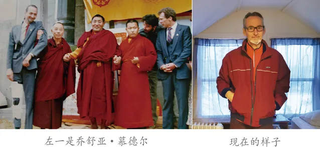

“我们每个弟子都被法王深深震撼了。因为那一年距上师仁波切圆寂已经六年了，大家都有些缺乏动力，没什么士气。而法王的到场，像一个强有力的宣言，证实了修道的真实性。

他威严有力，气宇轩昂，身上散发着古老又超越时间的特质。这种特质是由内而外呈现出来的，是一种被佛法彻底浸润的强大气场，像喜马拉雅高原一样辽阔，仿佛穿越到了另一个时空。法王安如磐石，充满真诚和荣耀，圆满展示了高贵的尊严。

法王让我受益匪浅的一点是，他展现了修行的真实不虚。我27岁开始主修金刚瑜伽母，遇到法王的时候是41岁。那时候，我已经观修自己是金刚瑜伽母14年了。在我见到法王的那一刻，所有观想立刻变成了具象的现实——他就是真实的金刚瑜伽母，突然以人的形象出现了在我面前！

后来，在灌顶的某个时刻，法王大喊一声‘啪的’，从法座上飞了起来。这是一次非常直观的体验，是一种超越语言、直接斩断一切妄念的教言。他生动地向大众展示了雪域的古老传统，在美国这片土地上，可以说意义非凡。”

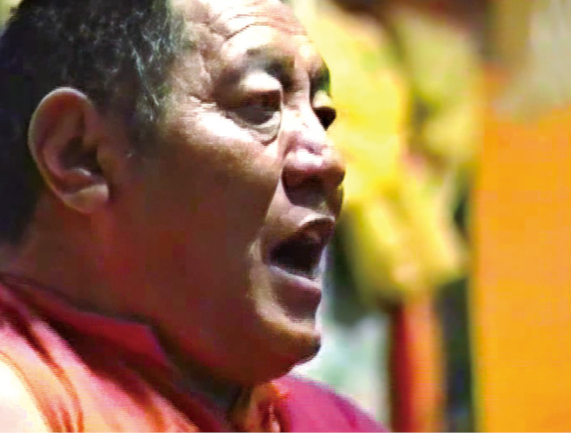

“我觉得特别幸运”

茱迪斯（Judith Simmer-Brown）曾在那洛巴大学担任宗教系主任，出版过《空行母的温暖呼吸：藏传佛教中的女性本质》等书籍。当年，她也在现场听过法王的传法，她是这样描述的：

“1993年夏末，我带着丈夫、婆婆、两个3岁和6岁的孩子，参加了落基山佛法中心举办的周末闭关活动。这次课程的客座上师我从未听说过，据传他是一位重要而不寻常的上师，刚从东藏地区来。

当至尊堪千晋美彭措仁波切带着随从走进来的时候，我被他的出现震惊了：他身形魁梧，穿着简单粗糙的僧袍，看不到锦缎。他的脸饱经风霜，极其宽阔，散发着一种开放的证悟力量。他在装饰精美的佛台前传法，原始而质朴的直率让我的妄念停歇。

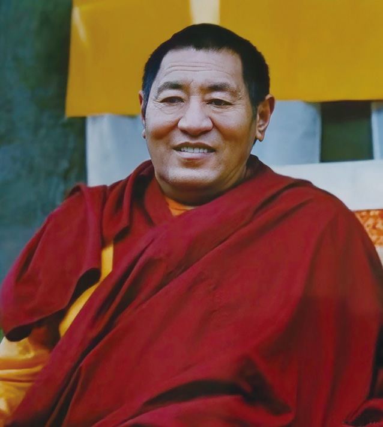

虽然我不太记得法王传法的细节，但他的教法是基于时轮金刚法对即将到来的黑暗时代的预言、弘扬佛法的重要性和紧迫性，以及保护佛法的完整性。他提醒我们无畏地克服佛法的障碍，并称赞我们上师以不可思议的善巧和远见，将珍贵的教法带到了美国和加拿大。

数百名参与者，庞大的金刚乘团体的成员，似乎同样被法王的超凡魅力所震惊。我们的根本上师六年前去世了，没有他的指导，道友团体有点支离破碎，我们渴望他的直率、慈悲、幽默。

由于之前上师仁波切的热情邀请，我们有机会接待许多其他伟大的上师，包括最著名的宁玛派和噶举派的大德。他们每个人都有自己独特的品质和教法，也赐予了我们美国第一代金刚乘修行人不共的加持。但这些老师都没有法王所表现出的那种特殊的胆识、远见和魅力。

在接下来的几年里，我从零星的信息中更多地了解了法王，关注了他在喇荣佛学院所扮演的非凡角色。得知在他圆寂后，他依然给许多藏族修行者带去了新的活力。

我觉得特别幸运，我曾面见法王，并在他面前接受了传承。法王具有如此非凡的魅力，对现代藏传佛教产生深远的影响，也是意料之中的。”

大塔前的开示

当天下午，法王为一座即将建成的大塔开光加持，并出席了庆祝美国国庆节的燃灯法会。他是这样说的：

本来今天我没有太多的话要说，也没有这方面的准备，但还是按照你们的要求简单说几句。

想必今天聚集在现场的都是佛教徒，而且是修密宗金刚乘的，我估计在座的大部分人都对创巴仁波切有信心和欢喜心。如果是唯一随学他的，那么仁波切一生的事业就有两点，一是示现威猛的行为，不久转生于香巴拉刹土，依靠军队度化刚强野蛮的众生；二是实修大手印等即生成佛的方便法。你们也都是这么修行的，基本上都是佛教徒。

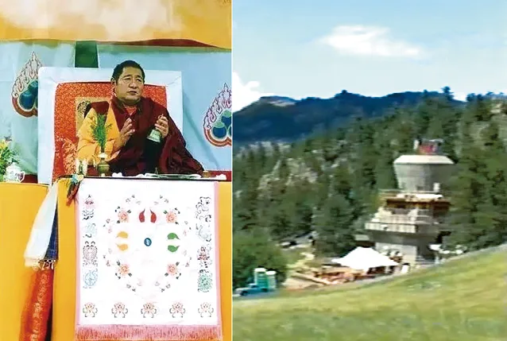

当然，修行如此大乘法的行人，都会有两个愿望：一是暂时享受人间天界的安乐，二是究竟获得佛果。在这方面，佛陀宣说了许多方便法，能成办这种增上生和决定胜。这些方便法成就的主因是积资净障，它有四种核心。哪四种呢？一是在以前没有佛塔的地方建佛塔；二是供养僧众精舍；三是调解僧团分裂；四是修持慈心。在整个佛法中，没有比这四点更好的特殊方便法了。

这四种方法中，最殊胜的一种，是在以前没有佛塔的地方建佛塔。佛陀在经中说，且不论真实建造佛塔的功德，即使小孩子为了游戏用沙子做成佛塔的形象，哪怕没有其他积资净障的行为，也会无欺而逐渐获得佛果。

至于建造佛塔的量，经中也有讲，如果建成规模大、质量高的塔，其功德就不用说了，即使修了一座像藏诃子那么小的佛塔，也会暂时获得转轮王不可思议的财富和快乐，不久将会获得佛果。如果能给佛塔捐大量财物，其功德不言而喻，哪怕你只供养一日三餐的百分之一来造塔，生生世世也不会受生为贫穷丑陋的众生，而会相貌堂堂、受用丰厚，很快就得到佛果。

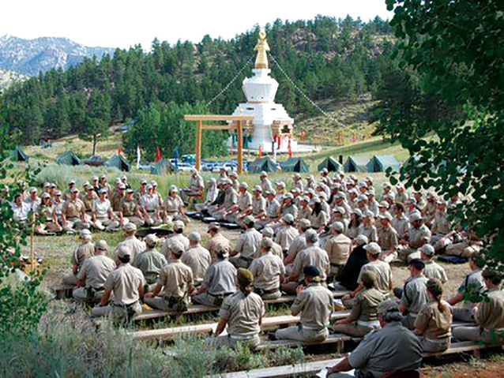

再想想那些辛辛苦苦建佛塔的人。如果不辞辛劳建了很久的建塔，福德无量就不用说了，哪怕只是在茶歇时为建塔做了点事，比如搬一块石头，也将得到那块石头中所有微尘数的转轮王位，之后获得究竟寂灭、远离痛苦的圆满安乐。

这以上是总的建塔功德。具体来说，与上师有关的塔的功德胜过它百倍千倍。原因是所谓的根本上师，身是僧伽、语是妙法、意是佛陀，他是三宝总集的本性。如果建造了根本上师的遗塔，将获得与在十方广大刹土中建造诸佛遗塔相同的功德。即使你用普通的土石建造根本上师的遗塔，也会得到用七宝为诸佛菩萨造塔的无量福德。

你们现在建这个塔，会得到和建造上述佛塔一样的无量福德和善果，这是间接与莲花生大士、赡洲格萨尔王、勇武轮王结上殊胜善缘，依此会获得广大的福德。哪怕你只供养少量财物，或者用身体语言参与修建，也会拥有无量福德。凡是为建塔付出心血的人，今生都会长寿无病、美满幸福，后世无疑会往生极乐世界等净土，或者转世于北方香巴拉刹土，成为勇武轮王的首批眷属。

今天是美国的国庆节。这一天，嘉哲仁波切先对你们提醒了“很快会死”的无常教言，而我为你们说了“获得暂时究竟美满安乐”的吉祥话。（众笑）

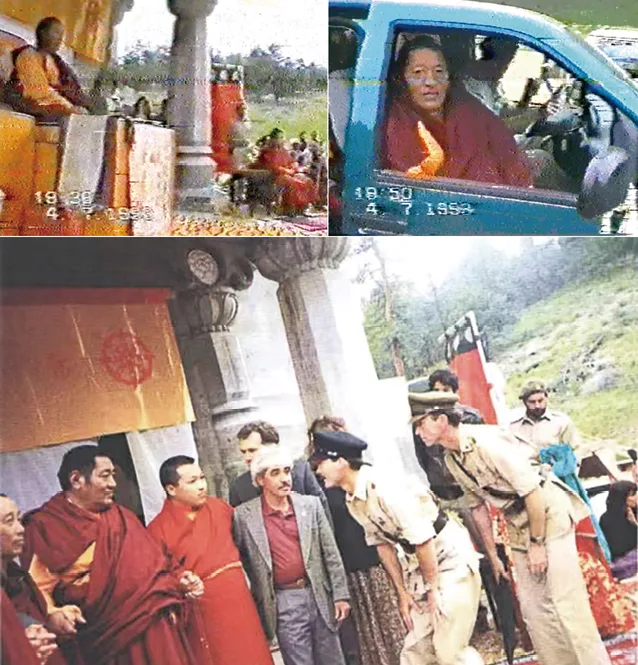

据说有预言提到“1999年是世界末日”。总的来说，在不久的将来，世界各地也可能发生疾病、饥荒、战争等灾难。但是，没有忏悔净化不了的罪业、没有药物消除不了的疾病、没有积资摧毁不了的恶缘。如果你们建造了这样一座精美、坚固、壮观的塔，它不仅会给你们带来安乐，也会给美国乃至全世界带来吉祥。这座塔的功德不可思议，将来它圆满竣工后，如果能精进地顶礼、转绕、赞颂，自他都会万事顺利、如愿以偿。扎西德勒！

给上师拔胡子

很长一段时间，法王不是在灌顶传法，就是在奔波赶路，几乎没有休息。到了落基山，上午一节课，下午一节课，中午还要接待各种各样的人，所以法王显现上身体不适，特别是脚疼，走路需要搀扶或者坐轮椅，还经常吃些止痛片。

有一天，道场请来一位擅长足部按摩的医生。法王之前没在藏地做过按摩，一开始也没有这个概念。后来渐渐习惯了，感觉舒服多了，有时候会睡着。看到法王睡着了，医生的力度也会减小，尽量让他睡一会儿。

按摩的时候，法王会让我给他拔胡子——过去藏地没有剃须刀，胡子长出来后，习惯上是用黄铜镊子把它拔掉。起初我非常紧张，不敢去摸法王的脸，也不敢用力拔，经常累得满头大汗，也没拔几根。尤其是法王睡着后，我怕弄痛法王，更不敢用力了。有一次，我在摸脸找胡子的时候，法王突然睁开眼睛，低声说了一句“阿咧”，我吓得不知所措。

拔了一段时间后，我才慢慢放松下来。每天下午不忙时，医生都会来给法王按摩脚，我也同时给法王拔胡子。拔的时候，我发现法王的胡子有些白了，还是有点心疼。一般来说，法王的胡子是不会给别人的，拔了之后必须全部归还。

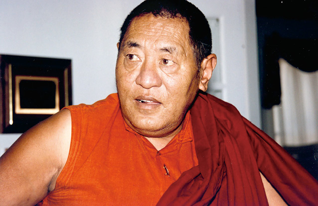

医生建议法王多运动减肥，并供养了一种茶，说：“这种茶很好，可以促进消化、燃烧脂肪，你们那里也有。”法王习惯喝这种茶，有时会加点牛奶做成藏族奶茶。后来才知道它叫普洱茶。回藏地后，法王一直喝，我也有机会一直供养。

接近离开落基山时，在按摩的帮助下，法王的脚好多了。

项袋金刚橛的独特之处

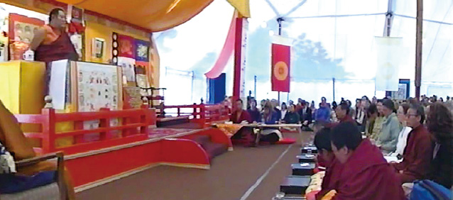

7月5日上午，法王在“项袋金刚橛”灌顶之前是这样说的：

你们在听法时，要怀着“为了普天下一切众生而得受能成熟的灌顶，如理实修能解脱的道次第”的菩提心。

所听闻的“项袋金刚橛”，是1990年我们师徒八人去印度的途中，我在尼泊尔阿苏拉山洞开取的伏藏。此法是以前“邬金第二佛”莲花生大士为了让佛法在藏地黑暗洲兴起而前往那里，途中住在阿苏拉山洞，尼泊尔国王则那莫札助他遣除身体违缘、成办无余顺缘，莲师极其欢喜而珍重赐予他的。它是在莲师没有给藏地传任何法之前宣说的。

正如莲师传记中所描述的“尼境扬列秀岩洞……金刚橛降诸魔障”，这是消除一切魔障违缘的事业引领法。它将金刚橛众多续部的究竟要点合而为一，是藏地六十四种共同、三十二种不共金刚橛法类的如母本源，依靠它，十二永安地神等藏地所有鬼神得以降伏，并立誓成为护法。

这部法是通过回忆前世而开取的，是邬金莲花生大士不舍得广为流传的窍诀，因为是他经常挂在脖子上的小袋子里携带的特殊深法，所以称为“项袋金刚橛”。如原文所述，开取此法后，缘起无不齐全、圆满善妙、恰到好处。

这个根本法交到法主手中的情况是：就像丹嘉仁波切在传承祈祷文的最后亲口说“宿愿相系的释迦比丘丹增嘉措撰写”，他是所有法主中的根本法主。在没有传给其他人之前，我修行此伏藏法的同时，到了丹嘉仁波切的住处，将此法交给他。他无比重视，把它视为如意宝，当天就立即郑重劝请，于是我完整奉上了它的灌顶及引导窍诀。

交到护法神手中的情况是：过去，乃琼多吉札丹护法是嘉瓦土登嘉措和伏藏大师列绕朗巴之间的使者，前后所有授记也是他传递的，此外他还请求了许多法，依靠这样的缘起，才有了这部法。当此法刚问世时，乃琼护法神以威猛降神的方式突然降临，当时就接受了这个法的灌顶和引导。不仅如此，我还依靠丹嘉仁波切和乃琼护法的亲自劝请，后来造了一篇降伏事业文。写它的烧施仪轨时，我就在丹嘉仁波切的旁边，心中顿然显现此法，他作为执笔者将其立成文字。

然后，就像伏藏大师列绕朗巴时代一样，此法也交到了萨迦派、噶举派、宁玛派三大法主的手中。就宁玛派而言，因为大成就者贝诺法王的历代转世都是法主，所以这次也交到了他手里，我为他灌顶并讲解了完整的引导。就萨迦派而言，以前伏藏大师列绕朗巴不需要保密的两位法主，是嘉瓦土登嘉措和蒋扬钦哲旺波，这个法也交给了蒋扬钦哲旺波的转世——顶果钦哲仁波切，我为他奉上了灌顶、传承、引导的所有次第。就噶举派来讲，在伏藏大师列绕朗巴时代，根本法主是第十五世噶玛巴卡恰多吉（遍空金刚）。现在第十六世噶玛巴已经圆寂，所以我开取此法后，没能立即交到他手中。但我相信，在不久的将来，噶玛巴热毕多吉的转世不管在哪儿，都会交到他的手中。

这个法，无论从外内密哪方面来看，它的缘起从未被破坏，善妙都是具足的。可以相信，它是任何人实修都会善妙吉祥、完全灭除一切违缘障碍、前所未有、至高无上的殊胜甚深法。

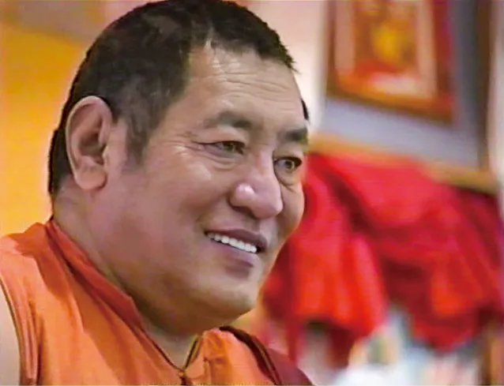

无需多说，这个法门刚开启时，藏地雪域就和过去不一样了，给众生带来了极大的幸福快乐，佛法也弘扬得欣欣向荣。不仅如此，藏地以外的人遇到它，也是诸事圆满、内心和乐等，变得吉祥顺遂，这也是事实。特别是遇到此法的持教大德，他们的一切事业都如上弦月般蒸蒸日上，单从这一点，就可以推断这个法会给众生带来善妙吉祥。

以上简单讲了“项袋金刚橛”的由来和独特之处，现在开始灌顶……

佛陀与佛法

当天下午，法王给大家做了一场公开演讲：

在这个吉祥圆满的日子里，我简单说一下我心里想说的话。

如今，我们聚集在这里的所有人，都有一个圆满的人身，这是首先应该知道的。既然有了人的身份，在利己避害的方式上就有了不同于动物的勇力和智慧，这也是一开始就需要认识到的。

在我们拥有殊胜人身和智慧的此时，不应该像动物一样不分好坏，浑浑噩噩地活着，而要想方设法让自己受益，不让自己受害。希求利益，不管是谁，想必都是一样的，都是得到快乐就开心，遇到痛苦就难过，不可能有喜欢痛苦、不喜欢快乐的人。而创造快乐的方式，除了少数人，几乎没有人不勤于寻觅。没有宗教信仰的在家男女中，有些人基本像动物一样，只是趋利避害、日夜忙碌。与他们不同的是，真正寻求安乐的人，都是有宗教信仰的人。

在这个世界上，有基督教、伊斯兰教、佛教等多种宗教。有些宗教只是尽力追求今生的幸福；有些宗教致力于今生和来世的利乐；有些宗教更着重来世的快乐，而不是今生。对于所有的宗教，每个人都应该仔细选择哪些好、哪些不好，否则，随随便便、马马虎虎就加入，是不可能带来任何利益的。

当然，三大宗教和其他很多宗教，都有追求今生安乐、不受痛苦的方法。有些宗教通过祈祷造世主，获得今生和来世的安乐；有些依靠祈求太阳、月亮、自在天、象鼻神，成就今生的幸福；有些通过皈依三宝，来寻求利乐。所有宗教在信奉并祈祷本尊、坚定自己的宗教信仰方面，大概都是一样的。但各个宗教的本师，能否视为无欺的正量、其教义是否正确，则需要深入细致的思考和分析。

如果问：“他们的本师都是什么样的呢？”

有些宗教的本师专事自己的利益、自己的眷属、自己的信徒，伤害其他大多数众生；有些只利益自他所有人类，不关心所有非人类；有些不仅造福人类，还造福一切众生，使其免受伤害，尤其是本着爱他胜于爱己的宗旨，想设方法利益他众。那么在所有这些本师中，到底是完全自私好，以自利为主好，还是成办自他二利好呢？我们需要思考这个问题。

在教义上，有些宗教伤害除了自己和少数眷属以外的一切众生；有些只造福人类，伤害其他有情；有些广利无量无边的众生，救护他们免受伤害。这三者哪个更合理、更相应自己？这也需要深入思考。

还有一些宗教，是古代历史上没有的，也不是真正的圣教，而是个别人凭自己的分别念建立的，如果用科学的正理来分析，它不仅经不起观察，而且漏洞百出；有些宗教起源于几千年前，是可靠的圣教，如果分析的话，完全经得起推敲。这些都应该认真、深入、细致地研究，在加入各大宗教之前好好观察。否则仓促加入，或者只看哪个势力大、哪个有本事就加入，是不会得到什么利益的。

藏族有句俗话说“就像饿狗遇到肺”，饿狗遇到动物的肺时，根本没时间闻它香不香，就一口气吞下去了。同样，不加思索地加入任何宗教都是非常愚痴的。因此，你们要通过其他上师和其他行人的语言，去更多了解世界上所有兴盛的宗教。

下面，我从一个佛教徒或讲法师的角度，向你们简单介绍一下佛陀和佛法。

・佛陀的功德

我们的本师是什么样的呢？他是一位圆满具足智、悲、力的圣者。

就智慧的功德来说，他对一切什么都知道，尤其是未来会发生什么、我们现在正面临什么、来世会出现什么样的苦乐等，佛经里说得很清楚。

不仅是佛陀，还有随行他的修行人，尤其是在我们藏地，出现过很多如邬金莲花生大士、米拉日巴等上师，他们都曾宣说过这个地球上外器世界的种种变化、内情世界的不同苦乐，而这些都依赖于众生的业感显现。

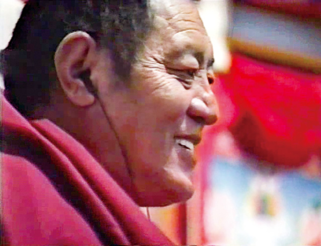

以前佛陀和高僧大德说的话，我们现在可以通过游历世界来证实。简单来说，科学家并没有对世界上相同和不同的业感现象，做出特别准确的分析。佛陀和他的追随者认为，一切都是业和心的显现。比如同样的火，有些众生觉得它热，有些觉得它冷，有些觉得它是食物，有些觉得它是住处；对于这同一个世界，有些众生看它是方形，有些看它是球形，有些看到太阳围着地球转，有些看到地球围着太阳转，诸如此类有不可思议的业感显现。如果要衡量当今世界所有众生的业感显现，只有把佛语作为正量，那些才解释得通，用其他观点很难讲明白。

本师佛陀和追随他的所有藏族上师，不仅对藏地的现状、未来会发生什么、人类的苦乐等讲得很清楚，甚至很多藏族上师会在国外设立道场，他们也明确提到过，现在也都得到了证实。光是想到这一点，我们就可以知道，佛陀和追随他的高僧大德能够预知未来，这在世界上所有其他宗教中，恐怕是比较罕见的。

再说说慈悲。我们的本师佛陀，爱他人胜过爱自己。为了利他，不仅毫不吝惜地献出自己的财物受用，还千百次地把自己的头颅、手脚等布施给众生。因此，大慈大悲的佛陀自始至终都更重视利他而非利己。

佛完全是利益他众的，不会做一丝一毫害他之事。既然如此，他是否应该受到所有人的喜爱呢？这是值得深思的。

再看他的能力。佛陀和追随他的圣者们，在短短一弹指间，就能周游全世界的每一个角落。在所化众生面前，如果有必要，他可以把这个世界和芸芸众生放在一粒芥子里，有如此不可思议的神变。特别是他最重要的能力，就是向众生传讲正法。在所传的法中，有消除疾病的法，有延寿发财的法，有使相貌端严的法……如果你一个一个去修，它们都会在相应的时间内实现。

虽然佛陀的功德数不胜数，但最让所有佛教徒欢喜的是智、悲、力三大功德。不管是哪个宗教的本师，他自己有没有功德对我们无利无害，谁能给我们带来安乐，谁就是我们最喜爱的人。

若想利益众生，就要有智慧。否则，一个什么都不懂的愚人，即使想努力造福天下苍生，也根本不知从何下手，所以必须先有智慧。为此，我先讲了智慧的功德。

他虽有智慧，但如果对众生有恶劣的用心和行为，勤于使一切众生不快乐，那不仅对众生无利，反而特别可怕。我们的本师佛陀不是这样，他不仅有智慧，而且富有慈悲心。他的慈悲心，远远超过了母亲对独子之爱的百倍千倍，无有偏颇地关爱一切众生。

佛虽然有智慧、有慈悲，但也要有能力。如果没有能力，那也无济于事。就像一个没有手脚的智慧老妇，她的儿子被水冲走了，如果她知道救人的方法并且有手，就可以依靠手和绳子救儿子。然而，尽管她很爱儿子，但没有手，没有脚，没有能力，什么都做不了。

总之，只有佛陀具足了智、悲、力，其他人只有类似的功德，我们的本师，和其他来到这个世界的本师有着完全不同的特点。当然，你们不应该仅凭我说说就认准了。这个世界上有很多本师，你们应该看看他们的传记，他们说过的话、写过的书，深入理解什么是合理的、什么是不合理的，而不能只听一个人的，否则未必是正确的。

以上是对佛陀的简单介绍。

・佛法的功德

接下来，介绍一下佛法：

佛教认为今生后世是存在的。其依据是，比如小马和小牛，刚出生就会吮吸母乳、跟随在母亲身后、知道自己喜欢母亲、懂得如何躲避天敌，这一切都是因为前世的习性。没有之前的习性，就不可能有出生后的那些行为，所以这证明了前后世的存在。

现在我们每个人都有不同的苦乐，这也是前世业力造成的，并不是拜某人所赐。如果快乐和痛苦不是业力所致，而是某个人一一赐予的，这根本没办法成立。

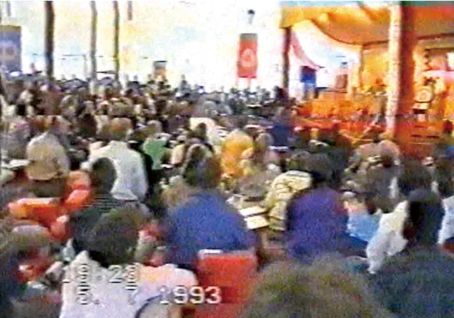

虽然有人说前后世不存在，也有人说前后世确实存在，但根据佛经进行长时间分析，就会对前后世真实存在生起定解。你们可以想一想，站在前后世存在的立场上寻求快乐更好，还是站在前后世不存在的立场上寻求快乐更好？如果我们站在后世存在的立场上，去为今生做事、为后世做事，即使后世不存在，也不会有很大的损失。如果站在后世不存在的立场上只求今生，那么当我们将来死的时候，一旦后世存在，那就后悔莫及了，自己大大地欺骗了自己。要知道，地狱里的每一个痛苦都是极其难忍的，寿命也是无穷无尽的，所以大家要慎重考虑。

如果是真正的佛教徒，关于前后世的存在，有很多可靠的教证和理证，对此不需要了解更多，因为他坚信前后世是存在的，即使世间的天神来说前后世不存在，也不会改变他的想法。如果不是真正的佛教徒，就不太相信佛道，只是觉得“有前世吗”——虽然没有证据证明后世根本不存在，但还是有很多人怀疑它存在与否。

以后世存在为基准行事，那一定是最保险的，就像我们藏族谚语说的“即使马镫一侧断了，另一侧还是好的”。站在后世存在的立场上做取舍，不容易出错；站在后世不存在的立场上，则会自欺欺人，结局一定很悲惨。所以大家最好是承认后世存在，好好努力。

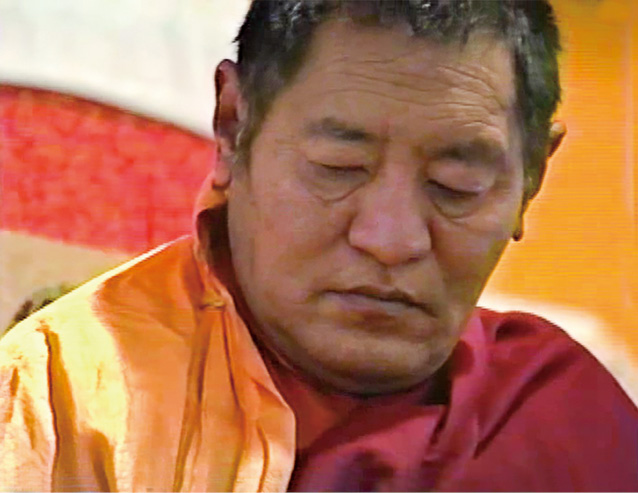

在后世存在的基础上，佛教更看重今生还是后世呢？更看重成办后世之事。原因是什么呢？这辈子追求的广大快乐只是短暂的，即使自己有再大的成就，也不会长久。就算你能成为今天的世界之王，如果不为这个位置努力一二十年，福报再大也不可能成功。而且，接下来也就二十年左右能享受人间的幸福，所以得到幸福是短暂的。同样，此生的痛苦也是短暂的。在座各位都是二三十岁以上的人了，从现在开始能再活五六十年的人应该不多，今生的快乐和痛苦都是短暂的，所以不应该成为主要的奋斗目标。

相比之下，后世的痛苦和快乐，是漫长而广大的。以痛苦为例，如果你转生于地狱，身体躺在燃烧的铁地上，被箭、矛、锯等切割锯断，上半身被截时下半身复原了，下半身被截时上半身复原了，哪怕这样受苦几十万年，也没有尽头。再看看快乐，如果你往生极乐世界，在人间享受几十万年不可思议的幸福安乐，也抵不过极乐世界的一天。那里的幸福安乐，是这个世界上任何快乐都无法相比的。

如果你抛开后世、只求今生，应该如何形容呢？比如，为了一天有吃有喝而努力，和为了一辈子有吃有喝而努力，恐怕没有人会选择前者。不管你觉得快乐还是痛苦，一天很短，一生很长，所以一定要尽可能争取自己一生的幸福。同样，今生短暂，后世漫长，如果不努力争取后世的安乐，则是愚蠢中的愚蠢，我们藏族人把这种人叫做“长着上牙的大笨牛”。反之，如果希求后世，就会给今生带来与众不同的利益，自然会长寿无病、受用丰厚、相貌庄严等，就像木头点燃后会自然产生木炭一样。

以在座各位为例，如果不考虑未来，人会越老越痛苦，身体会越来越虚弱，一想到要离开这个世界，自己就会感到无比悲伤。相反，如果成就了后世的广大善法，我们会越来越幸福、越来越快乐。就像修行佛法的上师们，正如《毗奈耶经》所说：“寿尽则欢喜，犹如离疾病。”他们的人生越到最后，越像健康无病的人一样，有着不可思议的安乐。

所以，你们可以看看，大部分不修行的人，年纪大了笑容就没了，整天黑着一张脸。而佛教里所有的清净修行人，除了我这种有心脏病的，都会越来越有笑容，越来越有幸福感，越来越乐观，这就是今生的利益。

你们不妨观察一下，比如像嘉哲仁波切，他越老越觉得幸福。而与他同龄、肆意造业的普通人，随着年龄的增长会越来越痛苦。这是最鲜明的一个对比。我说得对吗？看看他现在的脸，正满面笑容；再看看其他不修行的人，都在愁眉苦脸。（众笑，掌声）

可能有人会问：“佛教徒如何成办今生后世的利益？”

我们要想成办后世的安乐，只有通过无害寂灭的妙道来造福自他众生。当然，无害寂灭之道是利益一切众生的，而不是只利益那些喜欢佛法的人，却伤害不喜欢佛法的人。佛教是广利群生，无论对什么样的众生，都会无偏给予帮助。

佛教并非只帮助对自己有利的人，却加害对自己有害的人，而是会更帮助那些伤害自己的人。佛教利益的对象，也不是那些高高在上、声名显赫的王族和婆罗门，却忽略贱种、平民之类的人，而是以慈悲心更加爱护下等者；不是只利益人类，却伤害其他众生，毕竟其他众生同样有身体的病痛和心灵的苦恼，从人间的马牛等动物也可以推断出，众生都希求快乐而不愿受苦，只不过动物不知道如何成办利乐，所以比人类更需要慈悲关爱。

所谓好上师和坏上师也是一样。我们把那些有利他心、利他行的人称为好上师，做不到的就是坏上师，利他利己一般的是中等上师。总之，上师好坏的标准也是看谁能真正行持无害寂灭之道，那样的人就是好上师。

从我们藏地的上师来看，只在藏区利益众生是小利他，在外面佛法不兴盛的地方利益众生，才是非常了不起的功德。原因是什么呢？藏地所有人都喜欢善法，就算把所有藏人都摄为眷属，也不会太难，给大家讲经说法也很容易，所以只能算小利他。而在佛法不兴盛的地方，要想讲经说法，很难聚集众人；即使聚集了，他们也很难理解法义；即使理解了，也很难引导他们趋入正道。因此，住在国外的上师们，利生事业是不可思议的。我们藏地是佛法兴盛的地方，在那里讲经说法、利益众生，只能算是下等利他。以一种更广大、更艰难的精神去成办他利，才被认为是非常伟大的。

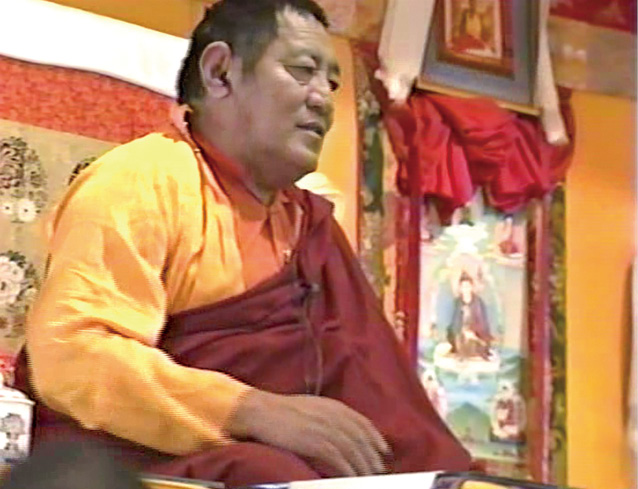

我之所以讲这些，是为了让已入佛门的人对佛陀和佛法生起诚信；让那些还没皈依佛门的人，也深刻剖析一下我说的话，逐渐走向佛门。

关于佛陀和佛法的功德，不要说智者难以完整描述，即使是我这么差的人，讲几个月也讲不完，这次只能大概讲这么多了。

・皈依戒

接下来，再讲讲如何皈依三宝。

皈依佛，就是心中的本师只有佛，别无其他。皈依法，就是只遵循佛传授的教义，不修持与之背道而驰的法。皈依僧，就是只把佛陀的追随者当作修行助伴，绝不依止对佛有邪见、妄加诽谤的众生。特别是，集三宝于一身的就是根本上师，要祈祷根本上师，听从根本上师的教诲，修学根本上师的意趣，这是皈依师。

如果你们有这样的意乐，就跟我一起念“皈依师、皈依佛、皈依法、皈依僧”，依此会得受皈依戒。

（法王诵三遍，给大家传授皈依）

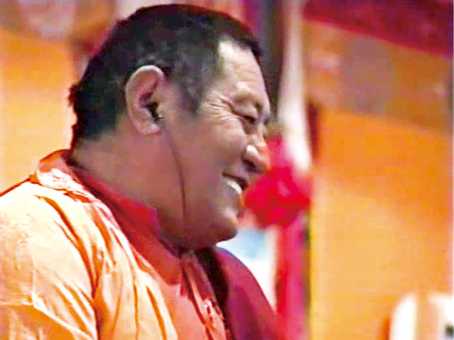

从今以后，你们的名字将成为佛教徒，无论修什么法，都会获得不同于以往的大功德和大威力。只要不违背皈依戒，此生就能长寿无病，从根本上消除一切鬼魔的危害损恼，后世也不会遭受恶趣之苦。从现在开始，你们会生生世世转生为人，种姓高贵、相貌端严、受用丰足、美名远扬，还可以往生极乐世界等净土，究竟生起佛陀的一切功德。这就是皈依的功德。

另外，皈依还有一个学处：皈依佛后，平时不能放弃对佛菩萨的祈祷；皈依法后，不能对上中下的一切有情怀有恶心，施以邪行；皈依僧后，必须随顺佛的追随者，共同努力修学菩提道。尤其是皈依上师之后，应该恭敬地承侍上师，听从上师的教导，恒时按照上师的心意做事。

从现在开始直至获得菩提果，你们需要承担两个义不容辞的责任：时时刻刻想办法利乐一切有情，这是第一个责任。如果佛法不存在，就没办法利乐一切众生，所以要努力弘扬佛法，这是第二个责任，比如，要想方设法在没有道场的地方新建道场，或者让现有的道场更加兴旺。

现在，你们已经成为三宝弟子了。请不要忘记这个名字，也不要忘记三宝！（众笑）

文殊大圆满要义

7月6日上午，法王接见了道场管理人员，并给他们做了开示。之后，金刚护法军队来拜见法王，他们穿着统一的军装，唱着时轮金刚的歌，创造了香巴拉以威猛相降伏违缘的善妙缘起。

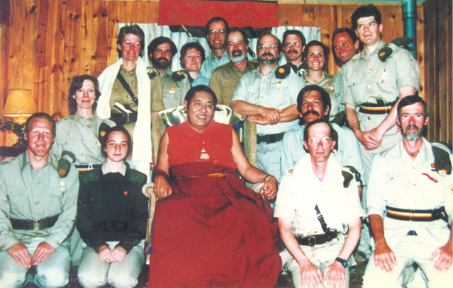

下午，法王给大家念了《文殊静修大圆满·手中赐佛》的传承，然后随口讲述了它的根本要义。

《文殊静修大圆满》本身就是所有大圆满的精华，具有许多不共的殊胜之处。不过法王这次讲的就更稀有了，完全是《文殊静修大圆满》的浓缩版。他轻描淡写用简单的语言，准确地描述了每一个引导文，非常具有窍诀性，也有特别强大的加持力。法王从智慧海中流露出来的金刚语，是一般人苦思冥想多年也造不出来的。

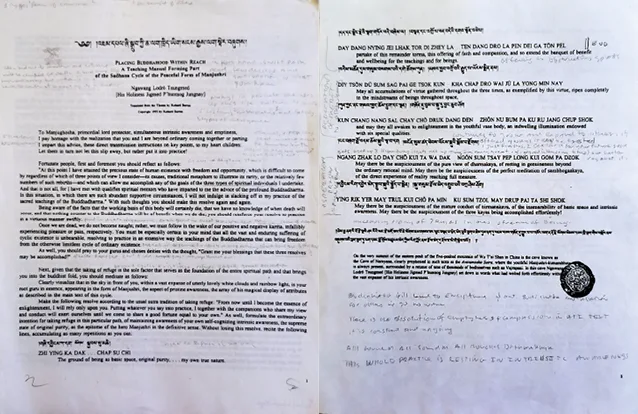

当年《文殊静修大圆满·手中赐佛》和《文殊静修仪轨》的资料

法王当时是这样讲的：

总的来说，这个引导文是一个修行次第。你们不需要从头到尾都用藏语来修，如果理解清楚了英文的意思，就不需要参考藏文了。但是念诵仪轨和发愿文，作者是以什么语言加持的，最好用那种语言念。

以《文殊静修仪轨》为例，它是藏文写的，藏文更有加持，所以主要用藏语念。当然，如果这种语言得到了成就谛实语者的加持，用英语、梵语等任何一种语言念都可以。就像佛经和印度智者们的论典，虽然都是用梵语讲的，但后来翻译成藏语时，贝若札那等译师成就了谛实语，所以念诵仪轨基本都是用藏语加持的。如果有这样的成就谛实语者作加持，用什么语言来念都可以。

那么，谛实语什么时候才能成就呢？

利根者在加行道，会成就谛实语；中根者在一地；就算是下根者，八地也一定会成就谛实语。

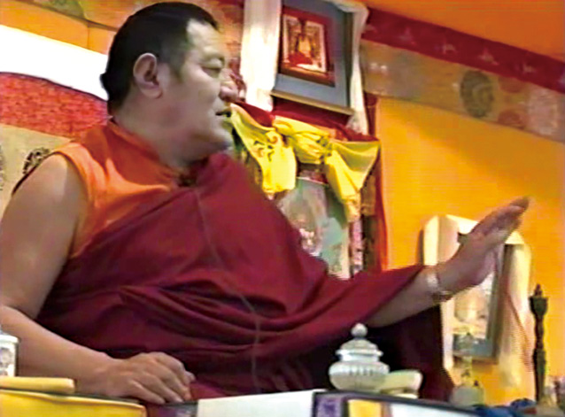

成就谛实语的标准是，比如一座城市被火焚烧，成就谛实语的人一说“愿火熄灭”，火焰就会熄灭；当有人病重时，如果有特殊的必要，那么说一句“愿病消除”，疾病就会立即消除。

我个人认为，这个文殊静修法，是怙主文殊菩萨加持的词句；项袋金刚橛等念诵仪轨，是邬金莲花生大士加持的词句。所以，最好这样来念。

・《手中赐佛》的内容

《手中赐佛》引导文里讲了什么呢？

它完整宣说了从初学者趋入前行开始到修行究竟之间的整个道要。

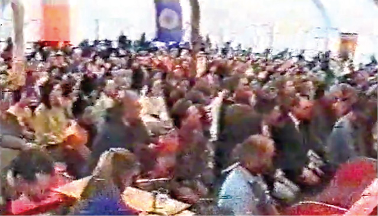

入道之初，尽可能观修四种厌世心是非常重要的。这四种厌世心，分别是共同前行中的暇满难得、寿命无常、因果不虚、轮回痛苦。

第一，在心里思维：这个暇满人身宝，无论从因、比喻、数量来说，都是极其难得的。得到了，特别值得高兴。所以任何时候都不要虚度人生，而要修持清净善法。这就是思维“暇满难得”之理的引导。

第二，虽然获得了暇满所依的人身，但我肯定会死，死期不定。死的时候，任何非法都是完全没有用的，所以我决定要修善法。这就是思维“寿命无常”之理的引导。

第三，人死后不会像火灭了、水干了一样不复存在，而是行善会享受广大快乐、积罪会遭受无边痛苦，所以要真正做到断恶行善。这就是思维“因果不虚”之理的引导。

第四，如果积累了不善业，无论转生于三恶趣的哪一处，这种痛苦都是范围极广、时间漫长、难以忍受的。所以，在这样的痛苦降临到自己头上之前，现在就要非常精进地断恶行善。这是思维“轮回痛苦”之理的引导。

这四种厌世心，已入佛教的大小乘行人都应该这样实修，所以叫“共同外前行”。

其次，不共内前行分二：第一，皈依。我唯一信奉佛是本师，唯一实修佛所说之法的道，唯一依止圣者僧众为助伴，以此修成究竟的佛果，这就是显宗所说的皈依。在了知自己本来就是佛的见解中，专注在入定上下功夫，这是密宗不共的皈依方式。

第二，发菩提心。在心里思维：所有感受无边痛苦的众生，确实可怜，但是可怜他们还不够，要把他们安置于佛地，这叫愿菩提心。不需要长时间的艰辛就能轻松快速成佛的方便法是光明大圆满，正因如此，我要实修这一光明大圆满之道，护持大圆满见解的境界，这就是行菩提心。

以上皈依和发心二者，是相应不共大乘经藏的道，故称“不共内前行”。

之后是上师瑜伽：观想自己前方的虚空中，在极其美妙的彩虹光和白云中央，安住着与文殊智慧勇识无二无别的根本上师，他所有的服饰和庄严都要按照《文殊静修仪轨》中描述的那样来现量明观。这是明观福田。

心想：在这样的大恩根本上师前，我要毫不吝惜地供养身体、所有受用、三时善根。这是“供曼茶罗”的引导。

前方虚空中，将上师与文殊菩萨观成无二无别，这是所依对治力；对自己过去犯下的所有罪业，生起强烈的后悔心，这是厌患对治力；发誓以后纵遇命难也绝不再造这样的罪业，这是返回对治力；为了清净一切堕罪而猛厉祈祷上师，这是现行对治力。通过具足四力而认真净治堕罪，这就是“净除障碍”的引导。

就这样，先是供曼茶罗和净除障碍的观想次第，再正式修上师瑜伽：祈祷一切皈依处的总集大恩根本上师您，垂念加持我的相续，以能成熟的灌顶来成熟我相续，以能解脱的教言来解脱我相续，加持我相续中生起甚深大圆满殊胜道，直至四相得以究竟，这就是祈祷。最后，上师化光融入自己，使自己的身语意和上师的身语意成为无别一体，在这种境界中专心安住。这就是“上师瑜伽”的引导。

接下来，首先观想：在自己平庸的身体中央，以风脉的作用燃火，让自身所有不清净的部分清净于法界。这就是净化不净的圆满次第。

再将自己观为文殊童子身，在身体的中央，如理明观风脉明点的所有庄严。这就是风脉明点的观想次第。

依靠从脉道中引风的作用，脐间燃火，甘露从顶间的“杭”字降下，遍满全身，在空乐无二的境界中入定。这就是真实的“圆满次第”的引导。

上师瑜伽和圆满次第这两个引导，是相应总密宗续部的前行引导。依靠寂止、胜观等诸多方便，抉择自心的法性，是大圆满不共自宗的前行。

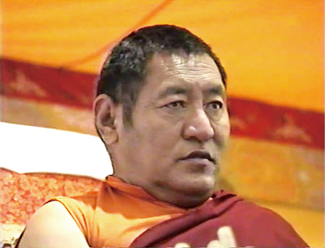

一旦对于心的法性，不仅仅是依靠伺察意和推理通达，而是现量见到了。这是“直断”的引导。

使自己的身体清净为佛身、语言圆满为佛语、明点成熟为大智慧的殊胜方便，就是“顿超”的引导。

依靠修行此道的力量，逐渐圆满四相，现前拥有四身五智的自性，就是总大圆满的果。

以上这些是“即生解脱”的引导。

临终解脱的教言是：当你临近死亡时，把自己明观成文殊童子身，在心间明点的中央，将心识观成一个白色“阿”字，用悦耳的声音念诵“阿”，并观想这个“阿”越升越高，从头顶冲出去，融入住于顶上的上师金刚文殊的心间。上师也越升越高，去往极乐世界。如是反复观修，就是“临终往生”的引导。

人死后，在法性中阴，会出现难以想象的声响、光芒、光线、本尊像。那时，如果不执著一切相为真实，自然地安住，就会解脱于佛地。这是“法性中阴”的引导。

当自现中出现如梦般的六道景象时，要祈祷上师，记起之前修炼的所有临终窍诀，就会解脱于自性化身刹土。这是“转世中阴”的引导。

以上已经明确讲了上根者即生解脱、中根者法性中阴解脱、下根者于自性化身刹土中解脱的三种引导。

这些就是《手中赐佛》引导文的全部内容。

・《手中赐佛》的特点

这个引导文有三个显著特点，即言简、意赅、具甚深加持。其中，“言简”是指能诠的词句很少，浅显易懂，这样的法理似乎从未在印度、藏地出现过。所谓的“意赅”是指，总的来说，在实修所有佛典的要点时，没有比这更殊胜的法了，尤其是它宣讲了从前行四厌世心开始到正行实修完整之道，是一个人修行成佛完整无误的方便法。“具甚深加持”是指，就像总大圆满的任何法理都不可思议，是见解脱、闻解脱、触解脱、忆解脱一样，这个法也完整具足了那些功德。

特别是，这一法理具有三个殊胜性，即传承近、无破誓垢染、是应时之法。其中，“传承近”的殊胜性是指，你们与怙主文殊菩萨之间，只有我一个人，没有其他人把你们分开，因此有着近传的殊胜性（众笑）。“无破誓垢染”的殊胜性是指，这个法一代代辗转相传，如果中途上师与弟子之间、金刚道友与金刚道友之间出现矛盾，法的加持力就会退失，但这部法自弘扬以来，从未有过一个破誓言的，有着这样的殊胜性。“是应时之法”是指，不同的法应该针对不同的时间分别宣说，比如有些法是针对劫初人们长寿、无烦恼的时间说的，有些是针对众生短命多病、烦恼深重的时间说的，而这个法只是针对当下，就像对症下药一样，是应时无误之法。

当然，针对总的、分别的不同地点的法也有很多。这个法，就像我前两天说的，是为总的全球、分别的西方国家宣说的——以印度菩提伽耶为中心，东南西北四个方向分为四大地域，它主要是为西方人宣说的。这一点在此法的授记中已经说得很清楚了：太阳虽然在东方国家升起，但它的万丈光芒照耀着西方国家。所以我认为，比起东方人修习此法，西方人实修它会更快得到加持和悉地。

从授记的语句中也可以推断，与接近西方的印度等国的人相比，真正西方诸如美国的人修行它，功德利益更大——这只是我个人的看法，授记里并没有提及。

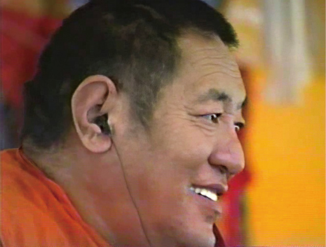

所以，我觉得这个法真的是你们不共的有缘法。

本来你们这个发达国家的人就事情繁多，没有空闲去学习、研修佛法。但是如上所述，这个引导文简单易懂，又便于实修，因此会对你们有帮助的。（众笑）

以后实修的时候，如果能直接理解这个引导文的所有句义，那就这样修行。在座的各位都是我的亲传弟子，我已经把这个法交付给你们了，这就可以了。如果对这个引导文有不懂的地方，可以去找其他有此法传承的上师认真学习、研修，这个不是很难，所以不需要学修很长时间。探究清楚所有的句义后，再进行实修，会有非常大的利益。

现阶段，拥有此法传承的人也很多。例如，今天在场的上师们，以及其他许多生活在印度、藏地的上师，都有这个法的传承。汉地也有很多人有此法传承。总之，哪位具殊胜功德的上师有这个法的传承，都可以在他面前学习、研修。

以上简单讲了《手中赐佛》引导文的要义。

项袋金刚橛略修法

这个法讲完后，在众人的请求下，法王又以窍诀的方式传授了“项袋金刚橛”的观修方法：

根据你们的请求，我简单说说“项袋金刚橛”生起次第的略修法。这次你们手里的法本，我将一切要点归纳起来讲。

首先是丹嘉仁波切亲传的传承祈祷文：从法身普贤如来、报身金刚法、化身莲花生大士一直到纳南降魔金刚，要依次祈祷这些历代传承上师。从持明鹫翎尊者到班玛旺钦，是祈祷我的历代转世。之后是祈祷威猛金刚童子坛城的诸位尊众。这样祈祷的愿望是“除内外障”，也就是祈求加持不出现病魔、怨魔、厉鬼等作害的外违缘，以及所有阻碍修光明大圆满的恶分别念的内违缘。尤其是，祈祷加持现量证悟生起次第、圆满次第、大圆满的意义。

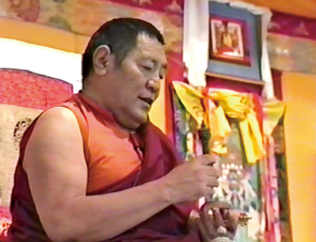

随后，宣说皈依、发心、受誓言的意义：首先要诚心皈依于觉性义智慧显现为本尊的吉祥金刚童子；为救护一切众生脱离轮回苦海而发心；想着“要如理行持一切威猛的取舍誓言”而受誓言。

真实的生起次第：首先在思维“一切法皆空”的见解境界中安住，然后在空性中，观想自己刹那变成有着忿怒姿态、一切怒尊之王的吉祥金刚童子。

那么如何观修吉祥金刚童子呢？

观想他身色蓝黑，一面二臂，双手合掌搓着金刚橛，具足威猛十饰和尸林八饰，身披人皮、象皮、虎皮等，以干湿鲜人头鬘严饰身体。要观成这样一个恐怖的身相。双足以大力士跨式，站在莲花日月中的男女鬼魔之上，于熊熊的智慧火焰中这样明观。

念诵密咒时，一切色相都是本尊，一切声音都是咒语，一切妄念分别都是智慧的游舞，在这种见解的境界中安住而观修。

结座时，心想“愿以此善根为主的所有善根，成为获得威猛金刚童子果位之因”而作回向。并且思维：愿以精进于此甚深生起次第、圆满次第实修法之善根的威德力，恒时消除十方一切不吉祥的灾难，愿善妙大光明普照三域。这是诵吉祥文。

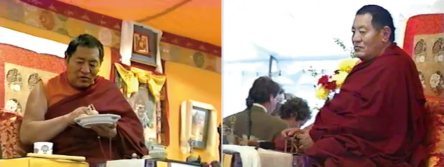

如是已经把你们手中法本上“项袋金刚橛”的整个引导法解释清楚了。

离别祝福

法王在这里传授的灌顶、传法、引导都圆满了。临别之际，法王给大家讲了一段话：

现在，到了讲闻这堂课的尾声。

你们落基山这个道场，对我有很大的恩德：首先是邀请我，中间是支付费用，最后是来了之后盛情款待。就像这位恐怖的“络腮胡子”，从我下飞机的那一刻起，他就来迎接我，直到今天这节课圆满结束，他一直很照顾我，全心全意地安排好一切。同样，你们对我的欢喜心和信心，也是令人意想不到的。非常感谢你们对我生活上的招待，甚至请医生给我治疗，这都给你们添了不少麻烦。我无以为报，只有用生生世世圆满安乐的吉祥语来深深祝福你们。

右一是“络腮胡子”

怎么祝福呢？首先，愿你们诸位道场负责人道高德重、万事吉祥，这是第一个吉祥祝福。

其次，愿所有道场兴旺圆满，这是第二个吉祥祝福。

愿各位相续中生起殊胜的觉受证悟，这是第三个吉祥祝福。

愿你们今生长寿安康，幸福美满，这是第四个吉祥祝福。

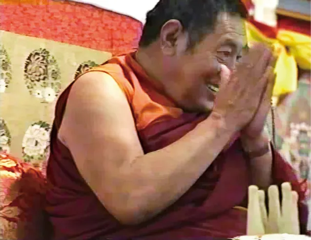

愿我们师徒今生有机会重逢，并讲闻妙法。尤其是后世往生西方极乐世界，相聚在怙主无量光佛足下，受用深广之法，这是第五个吉祥祝福。

法王念了缘起咒和很多谛实语的吉祥偈，并做了发愿回向。至此，落基山的弘法行已经圆满。
