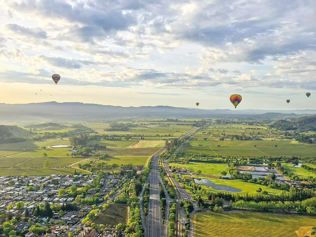

第4站 美国·纳帕谷

Napa Valley, USA 7/7-7/22

行程

7月7日，来到阿底林

7月8日，参观旧金山

7月9日，下午“缘起除障法”灌顶

7月10日，上午“杰珍宁提”灌顶  
 下午《杰珍宁提》第一节课

7月11日，“项袋金刚橛”灌顶和开示

7月12日，下午《杰珍宁提》第二节课

7月13日，上午去法国驻旧金山领事馆  
 下午《杰珍宁提》第三节课

7月14日，上午去海洋公园  
 下午《杰珍宁提》第四节课

7月15日，上午随行人员坐热气球  
 下午“文殊静修大圆满”灌顶和开示

7月16日，上午传讲《手中赐佛》  
 下午乘坐私人飞机

7月17日，下午“甚深精藏橛”灌顶和开示，传授《佛子行》

7月18日，下午长寿灌顶，举行大会供

7月19日，前往仁真林，晚上传“缘起除障法”灌顶

7月20日，前往扎西秋林，给当地信众做开示

7月21日，下午为金刚萨埵像开光  
 晚上传授往生法和长寿灌顶

7月22日，前往慧藏中心，传授“文殊智慧勇识”灌顶

到了纳帕谷

7月7日早上，我们离开落基山的道场，驱车三个小时，抵达丹佛的斯台普顿机场。在空中飞行了近三个小时后，降落在加州的旧金山国际机场。出了机场，又坐了两个半小时的车，来到著名的纳帕谷。

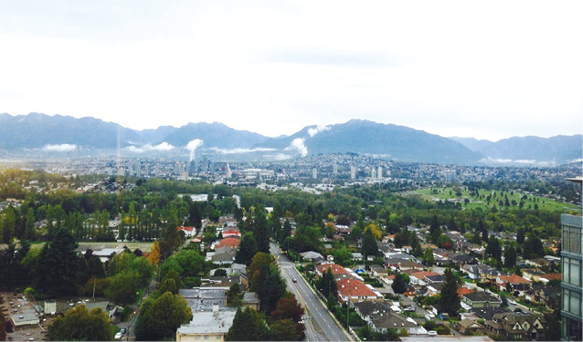

纳帕谷是美国第一个跻身于世界级的葡萄酒产地。这里风景优美，气候宜人，绵延起伏的葡萄园随处可见。20世纪80年代，随着葡萄酒品牌的打响，旅游业开始兴起，这个山谷成为加州的热门旅游景点，人们可以在这里享受各种美食，以及艺术气息浓厚的户外活动。

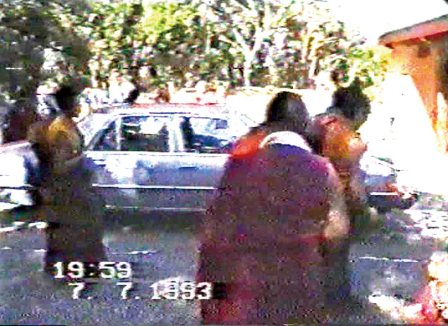

下午，太阳快落山的时候，我们到达了纳帕谷的阿底林（Ati Ling）。这个道场是由昌格晋美仁波切（Tromge Jigme Rinpoche）创建的，它坐落在一个山坡上，环境寂静宜人。道场前后都是枝繁叶茂的大树，房屋几乎被茂密的树叶淹没。阳光从树叶的间隙中投射下来，光影斑驳，如梦似幻。虽然天气非常炎热，但是一进道场大门，刚看到这片树林，瞬间就觉得凉快了许多。

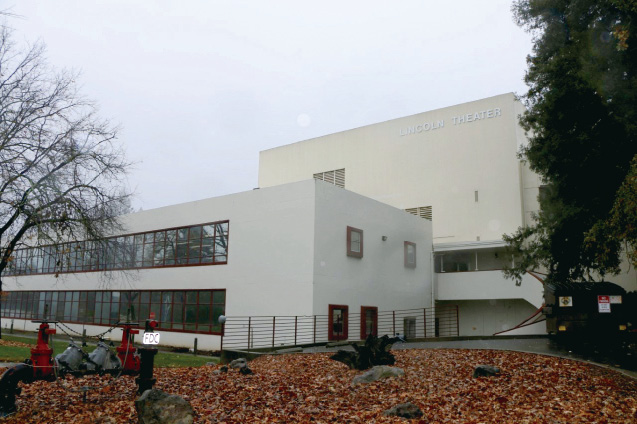

林肯剧院

法王在这里一直住到7月18日，待了11天，是此行停留时间最长的一站。离这里不远的林肯剧院（Lincoln Theatre），就是接下来几天传法的地方。

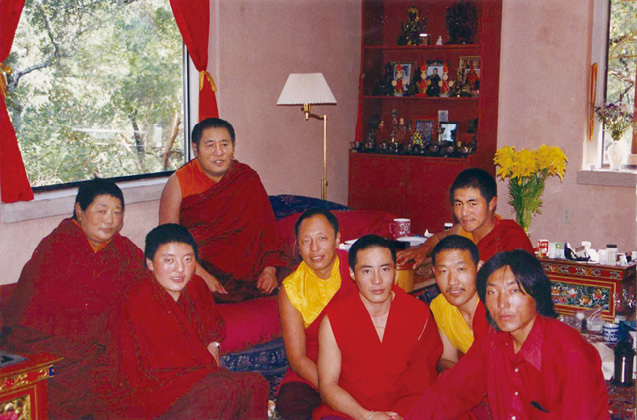

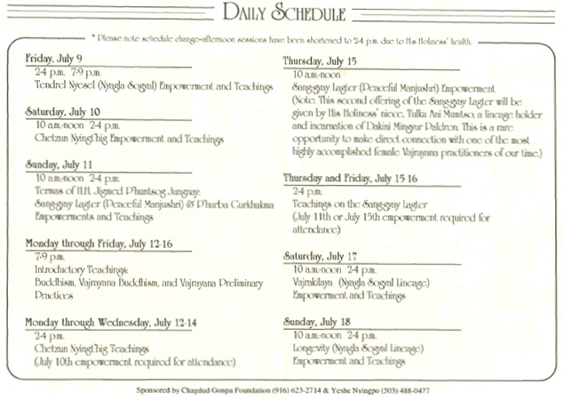

纳帕谷传法日程表

参观旧金山

7月8日，我们花了一天时间，游览了久负盛名的旧金山。旧金山是美国最有特色的城市之一，也是美国最多姿多彩的创意之城。意大利人、西班牙人、墨西哥人、日本人、中国人等各具特色的居民散布在城市各处，使之成为一个开放的文化混合体，就像画家手中的调色盘。

我们参观了整个城市的景观，不禁感叹当地文化的包容性，也见识了当地人的多才多艺。之后，我们还特意去参观了金门大桥（Golden Gate Bridge）。

金门大桥被视为旧金山的象征。建于1937年，全长约2.7公里，高227米。它是当时世界上最长最高的桥。虽然出色的设计、颜色和造型使其成为举世闻名最美观的大桥，但其75米高的桥面，也成为世界上自杀人数最多的地方。1937年大桥建成后不到三个月，一名一战老兵从桥上跃下自杀。此后，这座桥逐渐成为西海岸的自杀高发地。我们去的时候，据说有近1000人在桥上自杀了。我们默默为这些死去的人念了观音心咒。很晚才回到道场。

缘起除障

7月9日起，法王在林肯剧院正式开始了这一站的传法。

本次传法由阿底林、仁真林、扎西秋林、慧藏中心联合举办。听众主要是佛教徒，他们对宁玛教法有信心，并已修行密法多年。这些人大多来自旧金山，也有一部分来自西雅图和洛杉矶。上千人的大剧院座无虚席，不同国家、不同肤色的人们热烈欢迎法王的到来。这一站的法王翻译，是一个叫秋吉尼玛（Chokyi Nyima）的美国人。

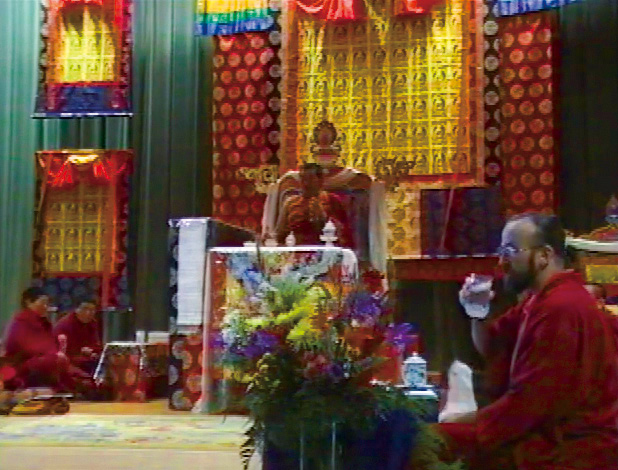

右一是翻译秋吉尼玛

7月9日下午，法王给大家传授了伏藏大师列绕朗巴“缘起除障法”的灌顶。此灌顶分为广、中、略三种，这次传的是“中”缘起除障法。

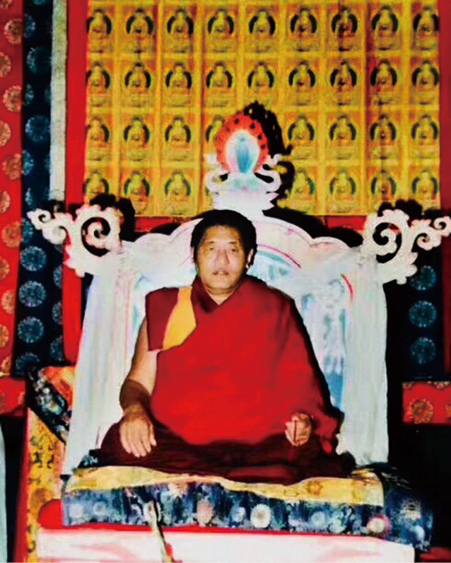

《杰珍宁提》第一节课

7月10日上午，法王根据贡智·云丹嘉措所造的《杰珍宁提灌顶仪轨·点金剂》，给大家传授了“杰珍宁提”的灌顶。

下午，开始传讲蒋扬钦哲旺波的伏藏法——《杰珍宁提》。此次传讲共四节课，这是第一节课：

> 光明四相究竟已，不变觉性现五身，

> 成大虹身清净色，无死布玛莫札尊，

> 请以慈悲垂念我，当下现量赐加持。

我等本师，大慈大悲、善巧方便的佛陀，在许多阿僧祇劫前先发殊胜菩提心，中间用三大阿僧祇劫积累资粮，最后在印度菩提伽耶示现成佛。

之后，为了摄受小乘共同和不共的所化众生，在鹿野苑，为人类的五比丘、天界的八万天人，最初转了“四谛法轮”。

后来在灵鹫山，为大乘共同的所化众生，中间转了“无相法轮”。通过宣讲广、中、略《般若经》等，抉择了从色法乃至一切智智所摄的万法皆无自性。

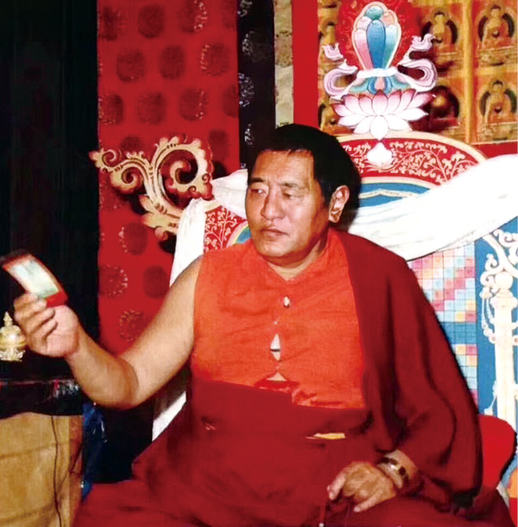

又针对大乘不共的所化众生，在莲花城等不固定的地方，最后转了“善分别法轮”。

此后，对于极利根的修行人，以秘密的方式略讲了密宗金刚乘法。例如，在乌仗那国讲了《密集续王》，在南方米积大塔处讲了《时轮金刚》，等等。诸如此类，在天人、龙、夜叉、乾达婆、迦楼罗等的所在地，为不共种姓的诸位行人，宣讲了密宗金刚乘的法。

临近涅槃时，佛陀亲口授记道：“我灭度八年后，在邬金西北的达那够夏海中，胜过我的莲花生大士将出现于世。”大圆满十二大本师之一的金刚持佛，在人寿无量岁时宣讲了《应成根本续》等诸多续部，《应成根本续》中也有授记：在五浊猖獗之具诤时，嘎绕多吉、蒋花西宁、西日桑哈、嘉纳思札等，将会开显这种最深的大圆满法。也就是，《应成根本续》中所说的“达那够夏女，无父班札黑……”授记了嘎绕多吉；“曼吉西巴德……”授记了蒋花西宁；“施主西桑哈……”授记了西日桑哈；“嘉纳思札持……”授记了嘉纳思札。此外，莲花生与布玛莫札两位大师，将成为在黑暗洲藏地弘扬光明大圆满教法的最伟大祖师。

布玛莫札的教轨是依循《甚深精藏十七大续》，著有《金文》《璁玉文》《砗磲文》《镶文》四部甚深书函，这些书函的要点归纳起来，包括在119个窍诀精华中，这就是《布玛心滴》，又称为“旧心滴”或“圣教心滴”。莲花生大士则根据《明界炽燃续》和《系解脱精藏六续》等，在圣地耶多德珠岩洞，七年中以至宝的方式传授给空行益西措嘉，这些法叫做《莲花心滴》，也称“新心滴”或“伏藏心滴”。曾有人说，凡是“圣教心滴”的法，住世时间都特别长，但是加持力没有那么快，而“伏藏心滴”住世时间短，但加持力比“圣教心滴”快很多。布玛莫札所造的“圣教心滴”与莲花生大士所造的“伏藏心滴”，是众所周知的母心滴。

为了解释这两个母心滴的密意，全知法王龙钦绕降造了完整解释《布玛心滴》所有要点、共有五十一法部的《上师心滴》，以及开显《莲花心滴》密意要点的《空行心滴》。正是这样，《上师心滴》和《空行心滴》共称为子心滴。

两个母心滴和两个子心滴，就是非常有名的《四心滴》。此外，全知上师还造了将大多数甚深窍诀汇集为一的《甚深心滴》。

在前译宁玛派中，对大圆满的讲解有两种方式，即甚深古萨里派的讲解方式、广大班智达派的讲解方式。其中，两个母心滴和两个子心滴是甚深古萨里派的讲解方式。而属于广大班智达派讲解方式的是：《甚深精藏十七大续》加上《黑护法忿怒续》《明界炽燃续》，共有十九续，这是母文字；在解释这些续的时候，不是用金刚持佛的原话来解说，而是用各大持明者的窍诀来解释，这些法统称为子文字。广大班智达派需要在这两者的基础上讲解，讲解方式是以上师言教作为补充，像全知法王龙钦巴所造的《七宝藏》《三休息》那样来讲解。

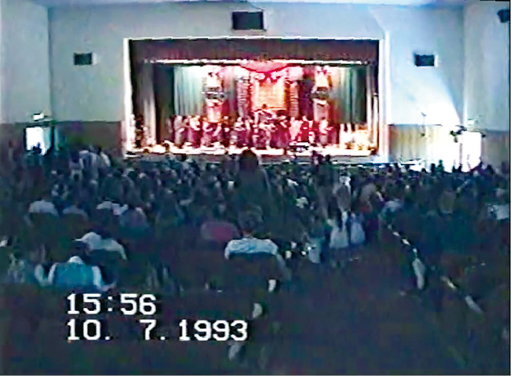

明确阐述莲花生大士密意的，主要是后来出世的一百位伏藏大师等开取的所有伏藏法。莲花生大士虽然有君臣二十五大弟子，但他最得意的弟子有三位，分别是大空行母益西措嘉、大法王赤松德赞、纳南降魔金刚。尤其是，最让莲花生大士欢喜的就是纳南降魔金刚，他是胜过大法王赤松德赞的最优秀弟子。也正因为如此，降魔金刚相继再来人间的历代转世所开取的伏藏大圆满，是超胜于其他伏藏的甚深完整法，比如，持明鹫翎尊者的《普贤通彻密意》、伏藏大师列绕朗巴的《智慧明点》等，这些大圆满法都浅显易懂且加持力巨大。

那么，我这次要讲的法是什么呢？

就是这些法中集莲花生大士的窍诀要点为根本，在此基础上主要遵循大班智达布玛莫札教轨所讲的《杰珍宁提》。

这部法的来历是：大班智达布玛莫札去了汉地五台山282年后，亲自摄受了杰珍桑给旺修，并圆满传授给他所有的灌顶和引导窍诀。杰珍大师在75岁之前没有获得究竟成就，后来成就了却没有合适的弟子，如此待了很长时间，一直住世到125岁。后来他示现涅槃，身体消失在光蕴中，完全变成了光的自性。当时吉祥慧空行母等通过祈祷，他又在光蕴中直接现身，宣说了如今这个窍诀。此窍诀被诸空行母带到了各自的刹土，暂时从人间消失了。后来，七大教派传承的教主——蒋扬钦哲旺波以回忆的方式，再度开取了这个法。

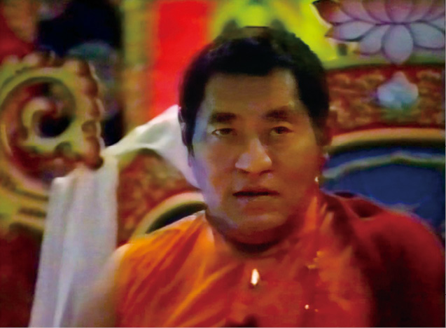

此法有三品窍诀，第一品是令相续未成熟者成熟的灌顶、实修正道的方便、解说道的分支这三方面内容；第二品宣说了真实完整的道次第，即从皈依、发心到回向善根诵吉祥文的所有仪轨；第三品按前行、正行、后行的次第解说。前行分为三个科判，正行本来清净直断分为三个科判，后行任运自成顿超也分为三个科判，就这样以三组三个科判的方式加以抉择。所以，这个法类也叫“杰珍大师布玛莫札三品深滴”。

现在我要次第解说这部法。首先是礼赞：

> 顶礼自然觉性本尊！

这句话的意思是，我们心的法性，不是由因所生的果，不是由心所生的佛，不是由教所生的窍诀，有这三个特点。因此，应该以认识本来面目的方式，来顶礼自然觉性的本尊。

其中，第一品的正文分为两部分，一部分是历史，另一部分是宣说实修窍诀。首先是历史，它包括杰珍大师如何宣说此法的情节，以及蒋扬钦哲旺波后来是如何传承的。这个环节在今天上午灌顶时已经详细抉择了，这里就不广说了。

第二部分是实修窍诀。因为这个法理的教轨是以窍诀灌顶派的方式来传授的，所以今天早上灌顶时都依次解释了。其实，无论灌顶时还是实修窍诀时，都是一样的。总的来说，首先要生起真实的出离心，不贪执轮回的一切。而要生起这样的出离心，因为有莲花生大士和班智达布玛莫札两种教轨，所以也有两种讲解方式。就莲花生大士的教轨而言，依靠思维暇满难得和寿命无常断除对今世的贪执，依靠思维业因果和轮回过患断除对来世的贪执，只有依靠这四种厌世心打下了坚实的基础后，才能进行实修。而布玛莫札的教轨中，根据《铜文如意宝》的密意，依靠七种方式来修心。至于解释其密意的方式，虽然全知法王龙钦巴在《上师心滴》中所说的与杰珍大师在三品中所说的略有不同，但这次是按照杰珍大师的教轨来讲解的。

那么，他是怎么讲的呢？

第一引导：

> 如是诸有为法皆为无常，犹如水泡。

意思是说，只要是因缘造作的有为法，在任何情况下都是无常的本性。

想想外在的器世界，须弥山、四大洲、八小洲，连同铁围山，这些广大庄严、坚实稳固的东西，总有一天会被七火一水彻底摧毁，成为一片空荡荡的虚空。所以，是无常的。

再想想内在的有情世界，同样也是无常的。比如过去这个世界上出世过很多转轮王，印度圣境也有巴拉三王、三十七占札等很多伟人，但是这一切现在连名字都不存在了。所以，众生之主，自性也是无常的。

想想那些先贤们，以前的拘留孙佛、拘那含牟尼佛、迦叶佛等都已灭度，我等本师善巧方便、大慈大悲的释迦牟尼佛，以及他不可思议的菩萨、声闻、缘觉众眷属，也都逐渐趋入了涅槃，现在只剩下末世的佛法了，所以圣者不是永远存在的。

再想想时间的迁变，也是无常的。以往初劫是圆满劫，然后是二分劫、三分劫、具诤劫等依次出现，这些并没有永远持续下去，都已经过去了。现阶段也是如此，四季的迁徙，从夏到秋，从秋到冬，从冬到春，就这样按顺序出现，显然是无常的。特别是今早、当下、今晚、半夜这四个时间段，也不会长存。比这更快的是，万法每时每刻都在变化，所以它们不是永久的。

既然作为例子的外器世界、内情世界都是无常的，那么我们自己的身体也不可能是恒常不坏的。所以，我们要在心中发起“必须赶快修行善法”的坚定誓愿。尤其是要对照自身，培养无常的观念。结合自身的观修方式是，要思维必定会死、死期不定、死时除佛法外皆无益这三方面的道理修无常。

所谓“必定会死”，也就是说，现今整个世界的众生，最终都会死，一个也不留。这个不要说宗教人士和科学家知道，任何一个正常人都知道自己会死，没有人不明白。而现在大家特别需要修的是，死期不定。

所谓“死期不定”，是指我们在座的所有人，无论是谁，都需要在心里产生“必定会死”的观念。没有它，就不会成就清净的法，而一直散乱在今生的琐事上。想想相继出生的人们，死亡时间是没有定准的。过去一百年之前的人，除了少数，恐怕现在都死了，所以我们也绝不会永远活着。一般来说，世界上所有的人，除了一两个人，一百年后很可能都不在人世了，包括我们现场的人，大部分也必定会死。想想我们小时候的亲戚、熟人，大部分已经到了后世，我们也肯定会死，而且很快。不仅如此，对于我们在座的人来说，明年这个时候，很难说每个人都还活着，会有很多人死去。不能确定死的都是老人，年轻人和小孩不会死。也很难断言这个人会死，那个人不会死。我们甚至不能断定自己不在明年死亡的人之列。可见来世并不遥远，我们必定会死，谁也不能断言下个月或者明天不会死，死亡其实就在眼前。

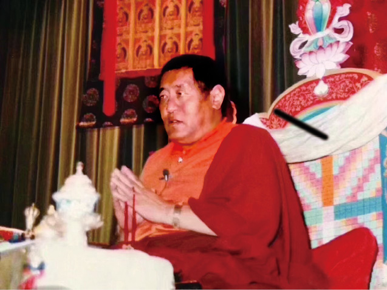

所谓“死时除佛法外皆无益”，就是人在死时，财产受用、权力地位、种姓容貌等优势都没用了。想想权力地位，就算是统治世界的大君主，死了也只能独自去往后世，而无权带走一个人。想想财物受用，即使一个人拥有了世界上所有的财富，他死时也没有权利带走哪怕一口饭，只能留下。同样，高贵的种姓、美丽的容貌等，这些在死时都不会跟随，只能带着善恶业前往后世。那时候必定有利的，就是自己造过的善业，必定有害的，就是自己造过的恶业。所以，我们现在有自由的同时，要尽力断恶行善。心里要这样发愿，身体和语言也要这样行持。

第二引导：

> 轮回诸快乐，暂现为快乐，实则为痛苦，犹如毒果成熟。

意思是说，在这个轮回里，所有快乐悦意的事物都是暂时的，虽然表面幸福快乐，但轮回中终究只能产生痛苦，除此之外别无其他。比如你吃了有毒的东西，即使是甜的，吃后也会要你的命，没有任何好处。轮回的快乐就像服毒，如果贪恋眼前的享乐而造恶业，将来会遭受无尽的痛苦，就像毒果成熟了一样。

第三引导：

> 种种外缘永无完结时，犹如追逐阳焰水。

意思是说，为了偶尔享受快乐，我们付出种种努力，千方百计避免痛苦，还为了得到嘴里吃的、身上穿的、广大的财富受用，去奋斗、去争取，这些其实都没有实质性。就像野兽为干渴所迫，把阳焰水当成了真正的水，一直追逐却得不到水，这是必须要懂的一个关键点。今生所有的荣华富贵、平安快乐、名利威望，也都是无常的自性，根本没有任何实质，我们要断除对它的贪执。

比如，有些人去年财产受用特别丰厚，今年却沦落为乞丐，而有些人去年过得苦不堪言，今年却变得富裕幸福。所以，我们不要因为拥有财富而快乐，因为没有财富而悲伤，应该认识到一切都是无常的。尤其是在观察财富有没有用时，好比今天在座的一个人有几亿美元，而另一个人只有一万美元，其实除了衣食住行，再多的钱也派不上用场。所以，多少个亿只是数字，不会有太大用处，拼命追求真的没有意义。

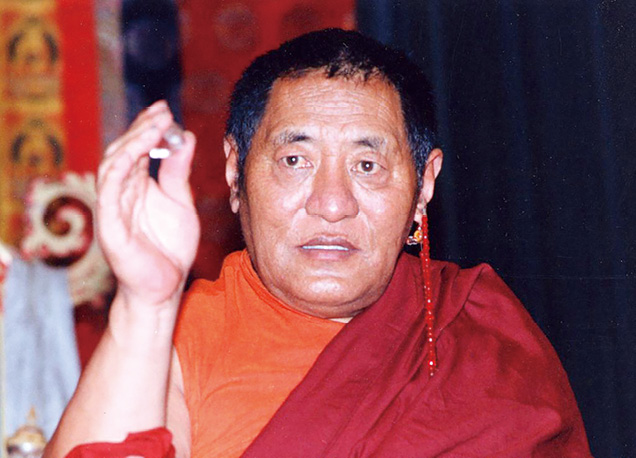

轮回中的那些快乐，再怎么成办也没有尽头。然而，世界上大多数人都在为衣食住行而夜以继日地努力着。其实，如果你以前积累了福报，自然就会成功；如果没有福报，再怎么努力也摆脱不了贫穷，所有的努力都是白费。

第四引导：

> 此生一切琐事皆无实义，犹如一夜之好梦恶梦。

意思是说，我们这辈子做的各种琐事，比如制服敌人、维护亲人、经商务农等，都没有实质性的意义，就像入睡后的梦境一样。

关于如梦的道理，有的人从出生就幸福快乐，有的人经历过各种痛苦和不幸，但现在想想，这和昨晚梦里感受到的快乐和痛苦没什么区别。昨晚梦里的喜怒哀乐，现在只成为回忆的对境，其他的都不存在了，而我们从出生到现在经历的人生悲欢，也都过去了，所以两者没有丝毫差别。同样，所有未来会出现的快乐和痛苦，都和明晚的梦没什么区别。这两个也是表面上存在，但从它们刚刚消失的那一刻起，就只能成为回忆的对境了，除此之外没有别的。

第五引导：

> 殊胜解脱之果，再也不会痛苦，犹如天花痊愈之人。

意思是说，可能有人会问：“既然轮回中的快乐、功名等都没有实质性，那有没有一个可修行的、具有实质性的法呢？”如果获得了佛菩萨的解脱果位，这种安乐就不会改变，会永远离开痛苦。例如，有一种传染病叫做天花，如果感染一次后治愈了，身体就不可能再被感染。同样，从获得解脱的时候起，就再也不会有痛苦了。所以，一定要在最快的时间内努力修行解脱的方便法。

第六引导：

> 殊胜上师之教言，乃登上解脱宫殿之道，犹如妙梯。

意思是说，摆脱这个轮回而获得解脱的道理，不是靠自力就能了知的，必须依靠殊胜上师的教言。比如要去高层建筑的顶楼，没有电梯、楼梯等，依靠自力根本上不去。同样，如果没有殊胜上师的教言，那么虽然有佛经等法宝，仅凭自力也无法领悟。因此，上师的言传尤为重要。假设没有具德的上师，那么我们所有人都不知道如何行善断恶，完全不知所措，就像牛马一样。只有承蒙具德上师的摄受，自己才会拥有今生安乐幸福、来世从安乐走向安乐的殊胜方法。这样的上师，就是十万颗如意宝也比不上，是极为难得的。

为了让上师欢喜，有三种依止方法：自己行善断恶，放下对今生的贪执，唯一追求后世的解脱，是最上等的依师方法；按照上师的指示，全心全意投入上师的一切事情，包括派遣在内，这是中等的依师方法；自己所拥有的一切财物，供养上师和道场，参与上师造佛像等善法，是下等的依师方法。这些都是必不可少的。

我再总结一下依止上师的三种方式：遇到如意宝般的上师时，最好能真正做到依教奉行，断恶行善；如果做不到这一点，那就认认真真地为上师做事，建经堂、造佛像、印经书、造佛塔等；如果这也做不到，那就毫不吝惜地把所有财物供养给上师和道场。如果做不到这三点中的任何一点，那么得到人身遇到上师就没有多大意义了。

你们各位，不要对我这种第一次来、不知道有过失还是有功德的上师过于虔诚和恭敬。你们应该恭敬承侍、为其做事的对境是，那些和你们朝夕相处、能利益到你们、你们各自道场的上师，或者居住在这里、比较熟悉的上师，他们一定能让你们受益。

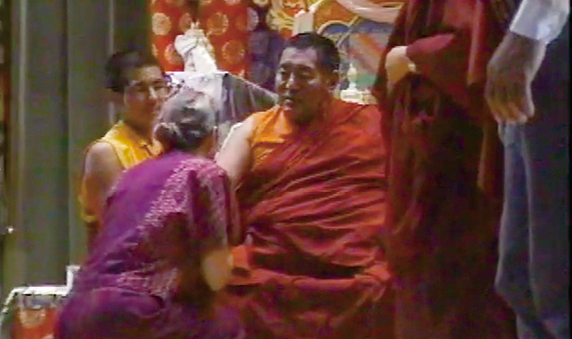

第七引导：

> 无分别之禅定，乃生起一切等持之本，犹如良田。

意思是说，要想获得佛菩萨相续中的等持功德，首先要让自己的心得以自在，一心安住在禅定中。所以一定要在禅修上下功夫。

以上讲了共同七种修心法的引导。

今天上午你们订了两个小时，但是因为灌顶仪轨的后续没有完成，延长了半个小时左右，我也没办法。所以，请原谅我。这堂课刚好两个小时结束，今天也没什么别的事，大家应该高兴了，现在回家睡觉吧。（众笑）

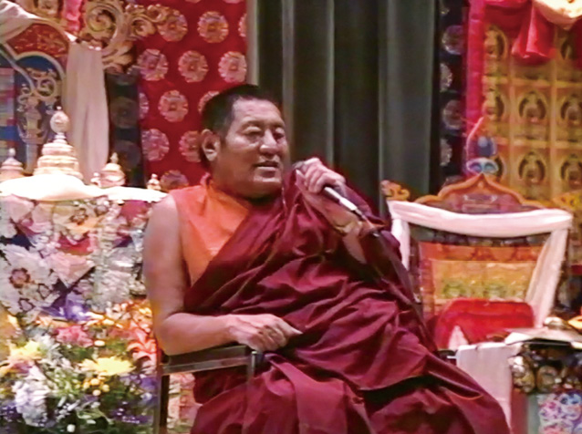

两个实修深法

7月11日，法王传授了“项袋金刚橛”的灌顶。灌顶过程中，法王讲了一段简要的开示：

“文殊静修”和“项袋金刚橛”都有一些支分法类，但没有宁玛派其他伏藏法那么多，而是非常非常少。

“文殊静修”从内容上来说是一个完整的道次第，也就是从前行到正行的实修方便法。它可以结合外教言、内授记、密窍诀来讲，也可以依续部来讲、依金刚七句来讲、依注释来讲。

总的来说，我撰著的法，大部分是我在少年时期完成的，都是经过不同人的劝请，谁劝请就交付给谁，我自己也没有去管。即便如此，还是有弟子收藏了，现在汇集起来大概有四函。这些法本，有些是藏地古代手工木刻版的，更多的是汉地机器印刷的。

其中，“文殊静修”等法，按地名归类为汉地法类。“项袋金刚橛”有广修所用的酬补忏悔，以及丹嘉仁波切和乃琼护法神特别劝请的降伏事业文、火供等法类；还有，在不丹虎穴开取的“莲师多吉卓罗修法”，在印度造的《愿海精髓》，所有这些都统称为印度法类。

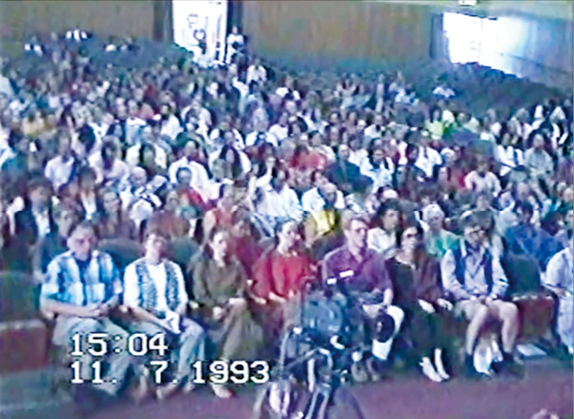

这次，我念了你们手里的“文殊静修”和“项袋金刚橛”的传承。接下来，在实修这两个法的阶段，需要具备三个不可缺少的条件：信心、悲心、空性见。第一，缘于佛宝的清净信、缘于法宝的欲乐信、缘于僧宝的诚挚信这三种信心必不可少。第二，要有一种特别的悲心，希望所有正在感受无尽痛苦的众生离开苦难。第三，无论是实修生起次第、圆满次第还是大圆满，都需要具备远离诸边的殊胜空性见。有了这三个条件，当你们修正行时，应安住于本来清净直断的见解、任运自成顿超的修行妙力中，念诵这两个仪轨。

仪轨，需要具备三个相结合，是什么呢？仪轨来源需要和续部相结合，这一续部需要和修法相结合，修法需要和上师的窍诀相结合。虽然有些内容在续部中本来就有，但如果不结合殊胜上师的窍诀，就无法按照续部来修，所以需要有一套修法的完整仪轨。

修法，需要和殊胜上师的惯例相结合。比如，以宁玛派的法为例，上需要与多杰扎、敏珠林、花日三派的惯例相结合，下需要与噶陀、白玉、佐钦三派的惯例相结合。

惯例，需要和见传相结合。一个上师的常规做法必须结合念修完整的见传，否则，随随便便一个流程和总纲，是不会让人领悟的。

一般来说，这两个法可以按照格鲁派、宁玛派、萨迦派、噶举派、觉囊派等任何教派的惯例来念。即使不明白它的明确含义，只要按照仪轨的文字去念，然后多念文殊心咒“嗡阿Ra巴匝那德”、金刚橛心咒“嗡班匝革勒革拉雅吽啪的”，最后进行回向，这也没有什么问题。

差点取消行程

当法王在落基山时，健康状况就不太好，来到纳帕谷后，他几乎每晚都睡不着，病得很厉害。我们几个弟子急得不知如何是好，私下商量了很多次，毕竟接下来的传法时间还很长，这样下去，法王的身体肯定吃不消。7月12日上午，大家一起去拜见法王，询问是否需要取消后面的传法。

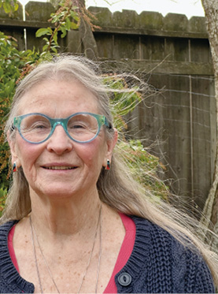

现在的凯·亨利

法王听后也没说什么，把主办方的几个负责人叫来，让大家开会讨论。于是，一部分人说法王的整个行程已经向全世界公布了，场地也都租好了，不能不去；一部分人说继续奔波传法太累，法王的法体更重要，最好取消后面的行程。双方各执一词，相持不下。

这时候我们找来凯·亨利（Kay Henry），想听听她的意见，因为她是贝诺法王、嘉哲仁波切委派的行程联络人。听到这个消息，她差点晕了过去，因为她花了几个月的时间筹划联络整个行程，还好不容易筹到了法王一行的机票和其他共同花销的费用。

她很诚恳地说：“虽然法王的法体安康最重要，如果有必要，我们可以立即取消接下来的行程，但我知道，全世界有成千上万的信众都在期待法王的到访，并为此做着各种准备。所以，如果有什么方法可以改善饮食，或者让法王身体更好，请一定告诉我们，我们会尽全力改善，让此行得以继续，让无数众生和信众受益。”

法王听了这话，沉默了一会儿，又和大家讨论了十几分钟，然后坚定地说：“我会继续这次行程。”

《杰珍宁提》第二节课

当天下午，法王在第二节课讲了这些内容：

你们所听到的佛法，是杰珍大师根本教义的三品，分为三个部分：能成熟的灌顶、真实的道、道的分支。

一、能成熟的灌顶

这在前面已经圆满了。

二、真实的道

它分为前行和正行两部分。

1．前行

前行，包括共同外前行与不共内前行。

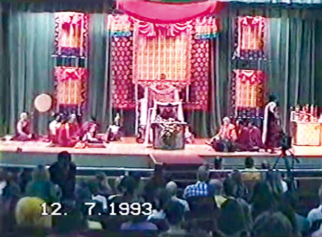

其中，“共同前行”是在前面七种修心次第的前提下，彻底放下对今生一切琐事的贪执，在没有生起唯一想成办后世利益的真实意乐之前，首先就要修心。

“不共前行”有皈依、发心两个方面。第一，皈依：皈依境，是在前方虚空光蕴的中央，观想布玛莫札被广大的诸佛、三根本眷属所围绕；皈依者，是在他们面前如集会般坐着的有信心的我，以及世间一切众生；皈依方式，是通过身恭敬合掌、语恭敬诵功德、意恭敬专心起信的方式皈依，这是一种特殊的立誓或承诺，叫做皈依。

皈依有两种，即相应共同显宗的皈依方式、不共大圆满自宗的皈依方式。“相应共同显宗的皈依方式”是，心想：我的本师只有佛别无其他，承诺佛是本师；我唯一实修的法，就是佛口中所说的法，其他法我不修；我的助伴只是佛的追随者，也就是圣僧和见行相同的人，除此之外，我不与别人见行相同。以这样的本师、道、助伴的方式皈依，叫“因皈依”。如此依靠示道者、实修的法、成道的助伴，完全修成了究竟的佛果，叫“果皈依”。自相续中一边发下这样的殊胜誓愿，一边念诵皈依偈百遍、千遍、万遍、十万遍，就叫与共同显宗相应的皈依。

“不共大圆满自宗的皈依方式”是，认识自己心性本体的空性是法身、自性光明是报身、无别大悲是化身，即三身无别于自相续中固有本住地存在，护持这一见解，就是大圆满自宗的皈依方式。

怀着这样的意乐，念诵：

> 阿

> 本净深明之法身，任运觉力即报身，

> 无别大悲即化身，了知本面而皈依。

如果把这些念诵的词句翻译成英语等，谛实语就变得无效了。因为这个颂词是杰珍大师用藏文加持的，在理解意思的基础上，应该用藏音念诵。

一般来说，所有这些念诵偈、发愿文、祈祷文，用成就谛实语者的语言文字才有加持，需要这样念诵。如果用藏语有加持，就需要照藏文原样来念。同样，如果用英语有加持，那就用英语念；梵语有加持，就用梵语念。以百字明为例，藏人也需要用梵语念诵，汉人、印度人、英国人也要这样念，如果翻译成藏语或汉语等，就没有加持了。

各种语言的念诵仪轨，对法的理解是一样的，但这个《杰珍宁提》是藏文加持的，所以要用藏语念。就像昨天的“文殊静修”，《文殊静修仪轨》也要用藏语念，因为是文殊菩萨用藏语加持的；其引导文《手中赐佛》，无论怎么念都没什么区别，关键是要理解它的意思——用英语能理解就用英语，用藏语能理解就用藏语，不一定非要用固定的语言。其他法也以此类推。

然后就是皈依戒：从皈依佛的时候起，就要一心一意祈祷佛，而不是其他对境；从皈依法的时候起，就要对一切有情慈悲，不做伤害他们的事；从皈依僧的时候起，就要致力于恭敬承侍上师和僧众等殊胜对境。

皈依的功德：皈依三宝的人，不会被恶业所控制，也不会随贪嗔痴等烦恼所转，更不会被妖魔鬼怪等所左右。今生中长寿无病、受用圆满、相貌端严、万事顺遂、心想事成、无有障碍等，后世必定不堕恶趣，从安乐走向安乐，获得大菩提佛果。

第二，发心：心想“被业、烦恼、痛苦控制的一切众生，都能远离业惑痛苦该有多好”，生起如是难忍的悲心，这是缘利他的悲心；只是悲悯他们还不够，要立誓“唯有我来将他们安置于永久解脱的安乐的正等觉果位”，这是缘菩提的智慧。具备这两个条件，就叫愿菩提心。心想“为了获得这样的佛果，我要布施、持戒、安忍、精进、禅定，真实证悟无我的智慧”，在这样立誓的同时，学修六度万行，这是行菩提心。以上是相应共同显宗的发心方式。

就不共大圆满而言，心想“一切众生虽然本具佛性，却因未悟此理而流转于轮回中，真的很可怜。为了让他们现前本住的智慧，我应该修行大直定的见解”，不离这一意乐而入定于实相义中，这就是不共自宗的发心。

在不离这个誓愿的境界中，念诵发心偈：

> 吙

> 暂时迷乱诸众生，本来清净法界性，

> 本智觉性自解脱，大直定中而发心。

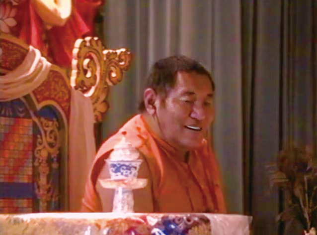

尽己所能地念诵百遍、千遍、万遍、十万遍。

发心的学处：以爱他胜过爱己的初衷，唯一利益他众，通过纯洁的思想和行为，全心全意地恒常精进，这就是菩萨的学处。

菩提心的功德：详细内容，在《华严经》中以一百多个比喻宣说过，需要如是了知；中等内容，应该翻阅《入行论》第一品；即使不能全部了解，平时也要忆念《弥勒菩萨愿文》中提到的三种功德。此愿文所说的三大功德是：从菩提心在相续中生起之时起，就从根本上堵住了地狱、饿鬼、旁生等恶趣的一切生门；自然享受人天善趣的美满幸福安乐；不难获得究竟不老不死的佛果。

无论是修皈依还是发心，结座时，都要观想皈依境的一切圣尊化光融入自己，让自己所有的罪障、堕罪彻底清净。在这种境界中一心安住，最后回向善根。

2．正行

上师瑜伽修法：《杰珍宁提》中提到的上师瑜伽，有一个超胜其他的不共特法，那就是，仅仅在上师瑜伽中，就具足了生起次第所属的内容和圆满次第的全部窍诀，并明确宣说了大圆满基道果的引导。

上面讲的皈依和发心，昨天灌顶时都讲过了，今天我又做了明确解说。对此，你们在家的善男信女，尤其是僧人们，要认真观察、思维。如果有不明白的，以后问我，我可以解释。

下面讲“真实的道”，我从文字上读下去，边讲边做交传翻译。

> 以上师加持而修道，于寂静处严格闭关，前行修炼净化相续。

修上师瑜伽时，首先要在寂静处修皈依、发心，以此来清净相续。

> 排除垢气，心识本住。

通过除三次垢气，观想清净了病魔和罪障。心一缘安住，处于休息或悠闲放松的本住状态中。

> 于本来清净之境界中，将与基位本尊、上师无别之自己，观成桑黑修绕尊。

在万法皆空、本来清净的境界中，观想自己的本性与基位本尊、上师无别，形象为桑黑修绕。

> 于狮子莲花日轮中，瑜伽行者，忿怒、微笑、妩媚姿态，红色，定印，跏趺。

要这样观想：在狮子莲花日轮的坐垫中央，身著瑜伽行者的装束，具有忿怒、微笑、妩媚的姿态——怒目而视的忿怒姿态，面带微笑的妩媚姿态。全身红色，双手结定印，双足金刚跏趺坐。

> 以绫罗、珍宝、骨饰庄严。

除了报身的飘带，全身赤裸，以骨饰庄严。顶间有骨饰冠，头发束于冠中央，饰以32条骨饰。喉间戴着与脉瓣数等同的16条骨饰，以璎珞和莲花为严饰。心间的骨饰，胸前是金刚状，背后是莲花状，有与心间脉瓣数等同的8条骨饰，骨饰之间以骨串珠相连。中间系着络腋，饰以珍宝和绫罗。脐间有64条十字金刚杵状的骨饰，也等同于脉瓣数。下半身穿着类似短裤的阿绕。观想成这样的红色身相。

> 所有毛孔迸射金刚智慧火及微怒尊众，以此焚烧一切魔障。

观想从身体的毛孔中迸射出火焰和微怒尊众。所谓“金刚”，具有对外摧毁一切而不被一切侵害的本性。观想成以这般迸射来焚毁一切魔障阻碍。

> 周围由三传上师、勇士、空行众会围绕。

观想周围是如来密意传、持明表示传、补特伽罗耳传的三传上师，以及勇士、空行。

> 眉间法源内喜旋猛转。

观想眉间的三角法源，一角朝上，另外两个角朝左和朝右，其根部越来越细，插入中脉。法源中有一个喜旋，急剧向左旋转。

> 其正对前方虚空中，部主布玛莫札喜盈盈安坐。

观想桑黑修绕眉间向外一尺所正对的虚空中，布玛莫札身色洁白，一面二臂，双手以定印托着充满甘露的托巴，身著三法衣，以及蓝色绸缎上衣或蓝色班智达密衣。有一个白色“阿”字，接近触及鼻尖。

> 明观一切现相彩虹光芒明点荡荡悠悠动摇。

观想现有一切器情都充满了彩虹、光芒、明点、微明点等各种相。布玛莫札安坐在彩虹光的中央。

> 迎请智尊融入。

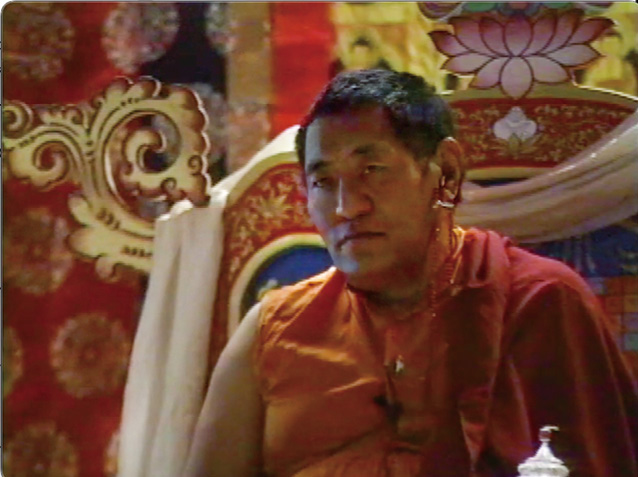

从法界中迎请所有如来和菩萨等智慧尊者，尤其是从汉地五台山迎请白色、黄色、红色、绿色、蓝色形相的无数布玛莫札，从空行处迎请白色、黄色、红色、绿色、蓝色形相的无数杰珍大师。所有的布玛莫札全部降临，融入前方虚空中的布玛莫札，杰珍大师完全融入自己。

> 祈祷前方上师。

需要祈祷安坐于前方虚空中的布玛莫札。

> 光明四相究竟已，不变觉性现五身，成大虹身清净色，无死布玛莫札尊，请以慈悲垂念我，当下现量赐加持。

这个祈祷文要念诵百遍、千遍、万遍、十万遍。如前一样，主要是用藏音念。

> 嗡啊吽 革热布玛拉莫札吽吽

“嗡啊吽”是与诸佛身语意无别；“革热布玛拉莫札”是梵语，意思是无垢友上师。“吽吽”是请布玛莫札您赐予我殊胜和共同两种悉地。此咒要念数百遍、数千遍、数万遍、数十万遍。

> 生觉受之际，受四灌，最终化光。

在结座时，或者当对上师生起无比的信心和恭敬心时，受四灌顶。

受四灌顶的观想次第：观想从上师额间的“嗡”字，放射出如月光般的白色光芒，融入自己的额间，从而清净身与脉的障碍，有资格修持生起次第，获得宝瓶灌顶与有戏灌顶，相续中安置了究竟化身的果位。

再观想从上师喉间的“啊”字，放射出无量红色光芒与元音辅音“阿勒嘎勒”串，融入自己的喉间，从而清净语与风的障碍，有资格持诵密咒，获得秘密灌顶与无戏灌顶，相续中安置了究竟报身的果位。

然后观想从上师心间的“吽”字，放射出无量蓝色光芒与蓝亮“啊”字，融入自己的心间，从而清净意与明点的障碍，有资格观修明点，获得智慧灌顶与极无戏灌顶，成为相续中安置究竟法身果位的有缘者。

最后观想从上师的三处和心宝藏中，放射出一寸许的五光团，融入自己的三处与心间，从而清净智慧障，获得句宝灌顶与最无戏灌顶，成为获得究竟本性身果位的有缘者。

> 观想融入眉间的喜旋中央而变成豌豆大小由阿字严饰之白明点。

在四灌顶之后，观想前方虚空中的布玛莫札化为光，融入自己眉间明点中央那个急剧向左旋转的喜旋。将代表布玛莫札的白色“阿”字，观成用毛绘画的那样。之前自己已观成桑黑修绕，在前方虚空中观想布玛莫札，然后向他祈祷。

受四灌顶的全部观想次第，是与祈祷相关的生起次第的引导。

> 若喜戏论，则作供养、赞颂等。

如果喜欢广修，可以在灌顶后观想眉间的上师而进行供养、赞颂等。

> 本尊明相如彩虹般，长久入定。

在如彩虹般现而无自性的自性中入定。

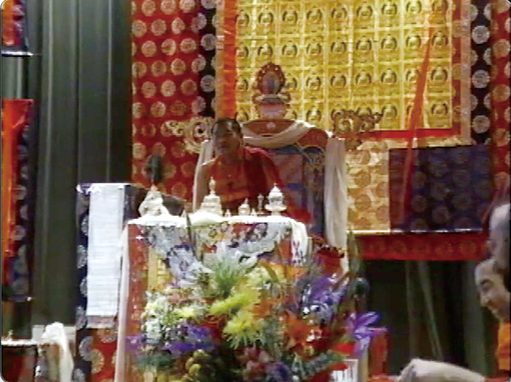

> 此后持心于明点。若广行，则伴妙音或随意念诵：嗡啊吽 班匝革热桑黑修绕斯德吽吽吽。

自己观成桑黑修绕，持心于眉间那个由“阿”字严饰的明点。

“嗡啊吽 班匝革热”是与三世诸佛身语意无别的上师桑黑修绕或桑给旺修。“桑黑修绕斯德吽吽吽”是祈请赐予殊胜和共同的微妙悉地。这个咒语需要持诵数百遍、数千遍、数万遍、数十万遍。

这以上，心专注于前方的布玛莫札而祈祷，是前生起或前观想；从“将自己观成桑黑修绕”直到“在所有显相、声音、心识三者分别是本尊、咒语、法性的自性中专心持诵”，是自生起或自观想。这主要是生起次第的引导。自观想和前观想二者，唯一依靠修上师瑜伽就可以了。

如果想要广修，就以念诵上师瑜伽的桑黑修绕等为基础，然后修行时，按照第二品中所说的，勤行广大依修事业。

> 最后，持心于缓慢金刚诵。

在缓慢的金刚诵中持心，观想风向内吸入时，变成白色“嗡”字的形相进来；安住于内时，观想变成红色“啊”字，以声音和文字的自性安住；向外呼出时，观想变成蓝色“吽”字，伴随着声音而去。

这样持续结合气息进出而观修，就是金刚诵。

> 若疲厌，则观想眉间明点放射光芒，遍及所有浩瀚净土。迎请安住于彼处之一切皈依处三宝海，尤其是一切光明心滴传承上师。彼等之三密加持以身、文字、标帜的形相，如天降暴雨般融入明点，依此周遍全身。

观想从眉间明点放光，迎请十方浩瀚刹土中安住的一切佛菩萨，尤其是从法身普贤如来到现在根本上师之间的秘密心滴传承上师。他们以身手印、语文字、意标帜的形相，如大雨倾盆般融入自己眉间的明点，从而加持自相续。

> 复观想放光周遍一切浩瀚不清净刹土，动静器情均转变为浩瀚清净刹土。

再观想放射光芒，照射所有不清净的六道内外器情。以此净化一切不清净的器情，最后全部变成清净身智的游舞。

> 其后，观想一切器情全然收摄融入自身，彼亦收摄融入眉间明点而成明亮无比，心长时安住，由此生起止息分别念波涛之无边等持。最终，彼亦如同彩虹消于空中，于无缘境界中入定。

这以上是圆满次第。也就是说，观想明点射收，供养佛菩萨、净化六道众生业障等，是有相圆满次第；最后像彩虹消失在空中一样，于无缘的境界中安住，是无相圆满次第。

这是把所有续部和修部中生起次第、圆满次第的全部要点归为一个窍诀的简要说明。接下来要讲的是，大圆满本来清净直断的见修行果所有要点，也就是明天的课程。

转变人心的力量

7月13日一大早，法王和我们一起坐车前往法国驻旧金山领事馆，解决去法国的签证问题。领事馆已经收到了我们的护照、邀请函等相关资料，但还是要求我们六个人亲自去面签。

接下来发生的事情，有点匪夷所思。时隔多年，凯·亨利依然记得清清楚楚。她是这样说的：

“为了给法王一行申请这个签证，我和领事馆交涉了好几个月，但签证官好像下定决心不给签证。

那天，我们来到了旧金山的法国领事馆。工作人员一开门，就看到六位穿着僧袍的藏族人出现在面前，他们每个人的表情都极其好笑。

我使出浑身解数跟签证官争取，但他就是不肯签，态度非常决绝。一时间，我无助地回头去看法王，法王看着我的眼睛。

就在这一瞬间，那个不好搞定的法国人，突然转变了态度，整理了一下资料，说：资料齐全，给予签证。”

《杰珍宁提》第三节课

下午，法王继续传讲《杰珍宁提》：

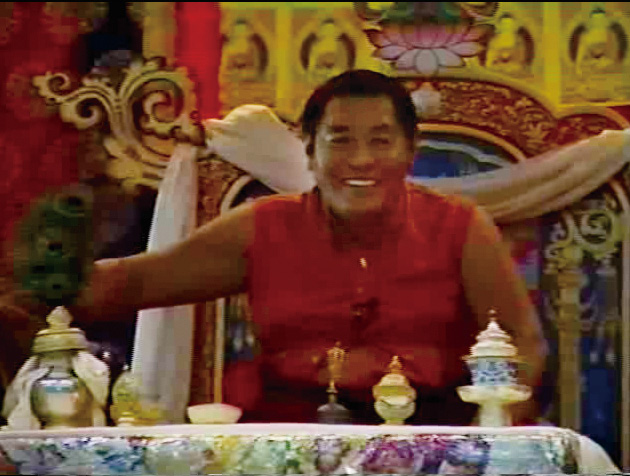

《杰珍宁提》三品总结起来，就是能成熟的灌顶、能解脱的教言，我们正在讲“能解脱的教言”。它分为前行、真实的道、道的分支，现在是抉择“真实的道”。真实的道就是上师瑜伽，它有三种实修法，分别对应生起次第、圆满次第、大圆满，其中前两种已经讲完了。

今天要讲的是大圆满。它包括抉择本来清净直断的见解、解说任运自成顿超的修法，这次主要抉择“本来清净直断的见解”。它分为以见抉择、以修实修、以行增进、以果持坚地。首先讲以见抉择：

> 尔时如是决定，此等一切显现均为心造。

首先，外境中的土石山岩、围墙舍宅等，都是随心显现的，一切都是心的幻变。

比如，梦里的高山、大河、险隘、陡岩等，无论出现什么样的场景，其外境根本没有山，没有水，没有险地，同样，马、象、男人、女人等也不存在。这些只是自心的幻变，大家都很容易知道。就像这个比喻，现在这些场景也都是一样的，虽然外在的表象看似真实，但实际上各种景象都是随心的习气所现，其本体并不成立，或者说只是自己心的幻现，没有一种实法可以在外境中成立。

再比如，同样的水，地狱众生会看成沸腾的铁水，饿鬼会看成脓血，人类会看成水，天人会看成八功德甘露，菩萨会看成玛玛格佛母。不同众生看到的，只是随自己的业和心而显现的，外境中既没有水，也没有脓，更没有沸腾的铁水，所以没什么可成立的。此外，我们现场的人和一些陆生动物跳入水中，眼睛鼻子会被淹没而看不到色法，甚至会被淹死，但鱼、鲸等水生动物却能生活在水中，清晰地看到色法，水也使它们的体力越来越强。这一切，只不过是众生的业感不同罢了，从水的角度来看，没有任何实法成立。

另外，以火为例，人和大多数动物接触到它，都会被严重烧伤，产生疼痛。但是火鼠一直生活在火里，吃穿都靠它。还有一种火净野兽，跳入大火后，它的毛不会被烧焦，反而会变得更加鲜艳。这一切都说明，火只是业和心的显现，外境中并没有自相成立的火。

如果大家还不明白这个道理，还认为世界是真实的，那么我们再做进一步的分析。比如日升月落、四季迁徙，其他宗教和很多科学家都揭示了它的真相，但对一者来说合理，对另一者来说不合理，对一者来说真实，对另一者来说不真实，然后就无从取舍了。佛教认为一切都是内心习气的显现，“不是一切”中可以显现“一切”，所以，不同的众生有不同的业感。这样分析的话，无论世界上的诸法显现多么不同，都不相违。

这是从比喻和意义两方面，给你们讲了所谓的“万法唯心造”。如果按照中观宗、唯识宗的教义，这个可以解释得更广，但是讲多了就很难理解了，所以我只是概括地讲一下。

《杰珍宁提》中讲直断只有一两句话，但那就是如心脏和眼目般的关键要诀，汇集了所有续、教、窍诀的要点。我想按照前面的讲解方式，再稍微讲广一点，但如果讲太广，一是我们的时间有限，恐怕会延误，二是怕妨碍你们真正实修者的理解，而且很多人会累得打瞌睡。所以，这次我只是用非常简略的言词，来直指直断的正行。我之前的解释方式，你们可能觉得有点太广了，但其实那是广中最略的。

这以上讲了，一切显现都是心的幻变。

> 有感受之心，是无而明现。

如果有人问：“能显现外在一切相的心，到底是什么样的？”它明明是“无”，却可以显现万法，就像镜中呈现影像。

那么，“无而明现”的这颗心，怎么会是“无”呢？它并没有眼根对境的四方形、椭圆形等形色，以及黄、红、蓝等显色；同样，也没有耳根对境的悦耳、不悦耳、中等的声音，没有鼻根对境的妙香、不香、恶臭的气味，没有舌根对境的酸、甜、苦、辣、咸的味道，没有身根对境的软、硬、轻、重等所触；意根的对境也是一样，比如贪嗔痴等烦恼产生时，寻找它的本体，了不可得，它的本性在身体内中外任何地方都无法成立，所以称为“无”。所谓“明现”，就是这一切虽然根本不存在，但东想西想、思绪纷繁的心是不灭的。两者并不相违，所以，具有感受的心是无而明现。

> 彼之法界，超离思维境。

对境不成立、有境也不成立的法界，是怎样的呢？

如果说它是“有”，那么，成立为“有”的实法根本不存在。

如果说它是单空的“无”，那么，“有”既然不成立，与之观待的“无”也没办法安立。比如瓶子不存在，观待它的“无瓶”也不可能安立。所以不是“无”。

如果说它是即“有”即“无”，但“有”和“无”是相违的。

如果说它是非“有”非“无”，那在所知法中是不成立的。

因此，法界远离了“有”“无”“即有即无”“非有非无”。从观现世量来看，除了这四种情况之外，不存在其他的思维形式，所以说，法界超离了思维的行境。

> 以各别自证智慧现见无有所依，即是诸法之实相本净深明无为法。

若有人问：“那么，它是不是根本无法成为眼见的对境，就像外道的神我？”也并不是。虽然对境和有境不存在，但我们的自性，以各别自证的智慧，通过远离一切能依所依的方式，就能看得一清二楚，如同有眼睛的人在白天看到色法一样。

这种觉空义智慧，是一切法的实相。“本净”是指对境不成立，有境也不成立，法界超离一切言思，所以是本来清净。然而，各别自证智慧可以领受一切，却又无有所依，所以是“深明”，它不是由任何因缘造作的，而是无为法的本性。

以上是直指见解。

> 如是通达故修虚空瑜伽。

这是修行的方便。“虚空瑜伽”有很多种解释方式，这里说的是要像虚空一样去实修，没有任何执著、分别、勤作。

> 以不修之方式，不离真义而修学。

也就是一无所修，不修“有”、不修“无”、不修“即有即无”、不修“非有非无”。当然，除了这四种修，也不存在其他的修。

无散乱又不离本性，但这不是自性平庸的分别念或什么都不想的状态。需要在不修而修这一点上下功夫。

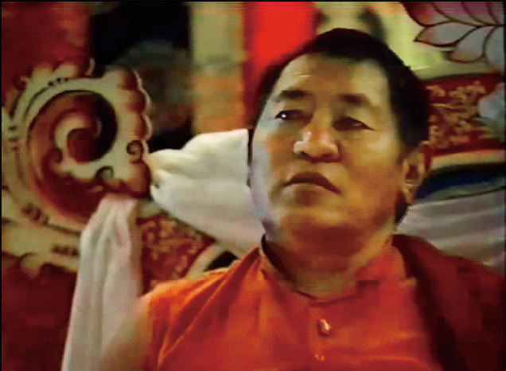

> 六聚之显现了了分明，于彼不伺察，而于法性自本体境界中，无勤作而放松，如成事之人般行持。

这是行为。所谓“六聚”，从对境而言，是色、声、香、味、触、法；从有境而言，是眼识、耳识、鼻识、舌识、身识、意识。这样的外境和心识，无论显现什么，都不跟随思维好坏的分别念，也不进行任何破立，要自然放松安住，就像完成了大事的人心安理得、泰然自若一样。不作破立和勤修而修炼妙力，就是行。

> 尔时，无勤出现成就风心之诸验相，成就光明胜观与寂止。

以心一缘安住为因，无勤会出现空色的一切验相，从而认识觉性自本体的本来面目，并圆满妙力使之稳固，如此果的一切功德会完全出现。这就是寂止和胜观的果。

以上已经明确地讲了大圆满本来清净直断的见、修、行、果。

接下来，宣说具足生起次第、圆满次第、大圆满三者实修要点的上师瑜伽修法的功德：

> 始终断除一切散乱而修此瑜伽七日，于真实、觉受或梦中，证得智慧身之大成就者布玛莫札与桑黑修绕必定加持。尔时，将无疑了知前所未知之众多甚深句义，获得等持门。

这里有一点必须要明白，那就是断除一切散乱而修七天，布玛莫札和桑黑修绕会亲自摄受。现在有些人没有通达佛法要领，胡思乱想的妄念极多，他们会觉得：“不要说七天，我都闭关修上师瑜伽一个月了，却连个好梦都没有。”其实，原文里说的是，断除一切散乱而修七天。所谓“断除一切散乱”，就是不管修生起次第、圆满次第、大圆满的任何一法，或是三者皆修，都要安住于这样的修行境界中，一刹那或一弹指间也不离开，要这样修七天。一天有二十四小时，修了七天以后，无论如何，梦中不可能不被布玛莫札摄受。

如果做不到这一点，一天只能在念一遍百字明这么短的时间里修，那什么时候才能满七天呢？有些人就算修三年，恐怕也做不到断除一切散乱修七天。

当今时代有些人，入了佛门以后，说修行佛法没有成果。其实他们一开始是进门了，但后来又退出了，这样的人也为数不少。所以这个现象值得深思。

佛陀所说的这个法，如果没有像他在教义中所说的那样成立，那么佛陀的语言就是妄语。然而，如果按照教义中所说的那样去修，结果是一定会成就的。

如果认为“七天成就根本不可能”，其实所谓的七天，是以小时来定义的。换句话说，在这168个小时里，如果你真能断除一切散乱而修行，就会有所成就。

那么，能做到这样修吗？能！绝大多数优秀的上师，都能在不起心动念的境界中修行七天，从而成就圣果。也有的用十四天，有的用二十一天，有的用一年、两年，甚至很多年。所以不是绝对不能实现，而是要以小时定量。如果能在168小时内全然无分别地修行，在此期间就会成就果。

以上讲完了“真实的道”。

三、道之分支

> 道之分支：先于脐下四指处，观想出有坏金刚萨埵，依诵咒之缘，燃智慧火遍及四轮一切处而焚毁四障。

念修金刚萨埵的引导：在脐下四指处，观想红色的出有坏金刚萨埵，依靠自己持风之缘，从其身中燃起智慧火，彻底清净自己身体的病魔、罪障、风脉明点的所有不清净部分。同时念修金刚萨埵百字明。

> 最后，触及顶上杭字而降下集诸佛智慧之甘露流，充满四轮之处，令四身上师殊胜坛城欢喜，念诵“玛哈色卡班匝萨埵阿杭”。

曼茶罗的引导：观想脐下的上师金刚萨埵身体燃起智慧火，触及顶上的“杭（）”字，从这个仅仅忆念就能生起空乐的“杭”字中，降下诸佛智慧总集的甘露流，充满顶间、喉间、心间、脐间的四脉处，令住于彼处的上师身金刚佛、上师语金刚佛、上师意金刚佛、上师智慧金刚佛欢喜，自相续生起了四喜与四空的智慧，然后念诵“玛哈色卡班匝萨埵阿杭”——“玛哈”的意思是大，“色卡”是安乐，“班匝萨埵”是金刚萨埵，“阿杭”是大乐智慧。

观想这样的大乐智慧在相续中已经生起，这就是内烧灌法的曼茶罗引导。你们实修时，结合《前行念诵仪轨》来修比较容易。

下面讲四时佛平行的修法，也就是白天、上夜、黎明、黄昏的四种修法：

第一，白天以显现印持的引导：

> 白昼，依于门、境、风、觉之要，使风心入于金刚链网，任运观修。

在白天，身体依靠三种坐式，口中禁语，心一缘安住，专注于观修顿超的要点。

第二，上夜所知入瓶的窍诀：

> 夜晚，一缘持心于心间或眉间带阿字之明点，修光明。

晚上如果想认识梦，就需要持心于眉间的白色“阿（ཨ）”字；如果想认识光明，需要持心于心中放光的白色“阿”字而入睡。这是夜晚所知入瓶的教言。

第三，黎明令觉性入本位的窍诀：

> 黎明，以“哈哈”清净风后，于虚空中央明观自然大密白色灿然阿字，意、眼、风三者直接专注于此，而令觉性入本位。

清晨时，口诵“哈哈”排三次气，之后心间的“阿（ཨ）”字也到了前方的空中，变成放射着光芒的白色“阿”字挺立着。持心在这上面，心识就没有昏沉等疲倦状态，反而会变得明清。

在所有其他的窍诀中，有一个“黄昏诸根收摄”的空乐道修法。这个可以用前面念修金刚萨埵时讲的内容来代替，其他的就不需要了。

> 一切时分，修学护持刹那性之自觉性，一切分别念如云消于空中般自解脱。

如果平时一直安住在本来清净直断见解的境界中，那么所有分别念都会像云消失于空中般，融入法界。

以上就是即生能解脱的窍诀。下面讲临终能解脱的两个窍诀，1．三层虚空的窍诀：

> 若即生未成就胜果，则以三层虚空之修行涅槃。

如果今生没有获得佛果，那么将来死的时候，一缘专注于外境的虚空、内在的眼脉虚空、秘密的觉性虚空而入定来往生，这就是三层虚空的窍诀。

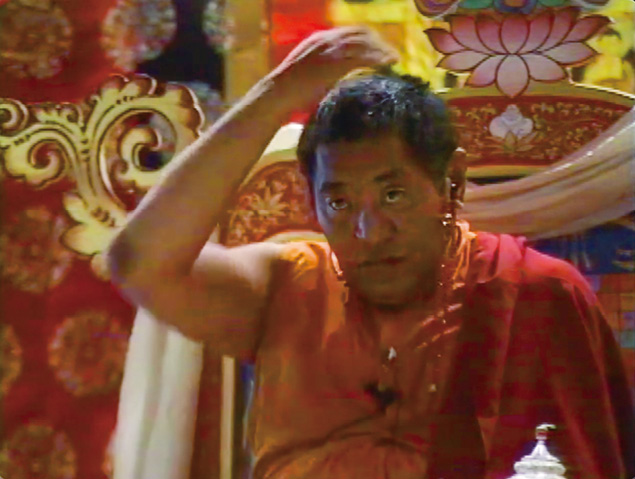

2．往生的窍诀：

> 或者心一缘收摄于风心明点及阿字，经梵净穴，融入上师心间，祈祷去往火焰山等刹土。

在死亡的时候，将自心观成白色“阿（ཨ）”字。依靠全心祈祷头顶处上师的威力，心间的“阿”字从梵净穴出来，越升越高，融入上师心间。最终上师也越升越高，去往火焰山等刹土。

之后，讲法性中阴解脱的窍诀：

> 中阴无论显现何相，皆当于觉性本位中不动摇，忆念不变如金扦之要。

中阴时，无论显现声响、光线、尊身等什么样的景象，都在直断觉性本位中如如不动、一缘安住，这叫不变如金扦的教言。

> 稍广行者，行会供轮，应时受用。

此外，广修的诸位行人，一般需要举行会供轮。真正的会供轮，除了具有殊胜证悟的瑜伽士，普通人无法行持。即使做不到，只要在每个月的上旬初十、下旬二十五举行会供，也会有无量的功德。因此，要经常举行广大的会供。

好了，今天的课就到这里。

去动物园

7月14日上午，法王去了瓦列霍（Vallejo）的海洋公园。很多美国信徒和藏族人都说那里特别好，它不是像普通动物园那样把所有动物都关在笼子里，而是用人性化的方式进行看护和训练，动物可以在指定区域自由活动，还会主动与游客互动。

当天万里无云，阳光明媚，法王坐在轮椅上，拿着一个小望远镜，在绿荫成行、鸟语花香的公园里，欣赏着美丽的园区风景，看着各种各样由专人照料、远离天敌威胁的动物，一路上心情都很好。

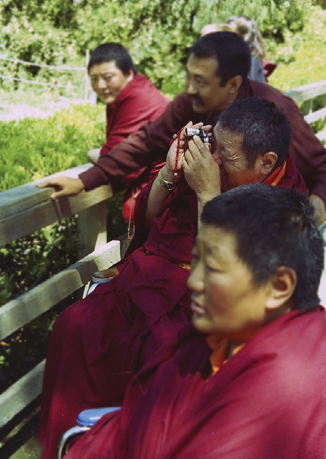

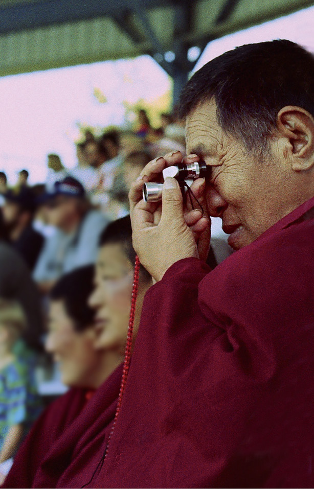

这里虽然叫海洋公园，但其实有很多陆地动物，甚至是藏族人最熟悉的牦牛。我们先参观了一个个展区，看到了许多以前只听说过名字的动物，非常有趣。后来，我们来到一个露天剧院，那里有一场精彩的海豚表演。经过长期训练，海豚的表演技巧令人惊叹，它时而和人比赛游泳，时而挺立在水面上，赢得游客的阵阵掌声。

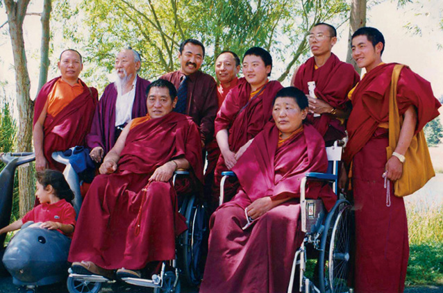

起初，法王饶有兴趣地看着，但看了一会儿，他突然皱起了眉头，看上去有些悲伤，说：“这些动物真可怜！它们不断被训练，成为人们玩乐的工具。其实人如果不懂因果，活着只是为了吃吃喝喝，那和动物没什么区别了。”

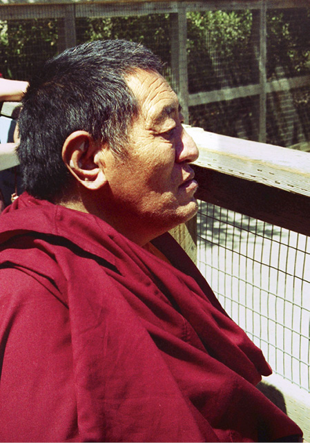

后来法王继续参观时，看到也有动物被关在铁笼子里，就像囚犯被终身关在监狱里一样，表情变得更沉重了。后半段时间，法王没怎么说话，只是不停地给动物念咒，默默加持它们。看到这一幕，我心想：“这些众生能得到法王的亲自加持，还是很有福报的。”

许多年后，听说这个海洋公园变成了游乐场，那里的动物淡出人们的视线，逐渐消失了。

《杰珍宁提》第四节课

当天下午，法王讲了《杰珍宁提》的最后一课：

今天给大家讲的法是：

就实修前译宁玛派光明大圆满的教轨而言，那些前辈持明者已经成就了虹身，在他们的身体化为虹光后，有以光明身汇集毕生甚深窍诀要点为众弟子留下遗教的传统。具体来说，当实修大圆满的修行人圆寂时，有质碍的血肉之身全部化为光，这是大圆满的独有特法。在身体化为光之后，光明身将再度在光蕴中显现，为弟子宣说教言，这也是实修大圆满的特点，而其他教派和宗教似乎没有。

当初把大圆满弘扬到人间的，是嘎绕多吉。嘎绕多吉大师在身体化为光蕴后，给弟子蒋花西宁留下了《击要三句》的窍诀遗教。蒋花西宁的身体化为光蕴后，将遗教《六修觉受》交付给汉地弟子西日桑哈。西日桑哈化为光蕴后，将遗教《七钉》传给弟子嘉纳思札。嘉纳思札圆寂时化光，将遗教《四安住方便》传给了弟子布玛莫札。此后，他的弟子布玛莫札和莲花生大士没有留下遗教。原因是，布玛莫札并没有舍弃肉身，现在仍住在汉地五台山，显现在清净的所化众生面前；莲花生大士去了妙拂罗刹洲，如今正在为罗刹们说法。所以这两位大师，乃至虚空未尽之际，一直不会涅槃而以真身利益众生。

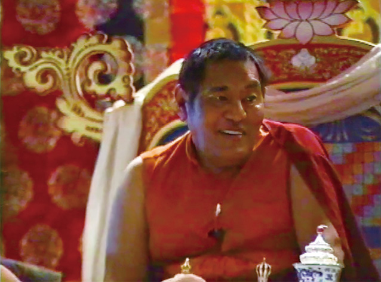

我们师徒也是如此，如果实修大圆满而达到究竟，那么就不需要接连不断地生生死死。在临近死亡时，如果以这个身体能利益众生，就可以像莲花生大士和布玛莫札一样，乃至虚空未尽，一直不舍此身而安住；如果以身体不能利益众生，那么这个身体就会化为光，之后随所化众生而示现种种幻化身。

总之，诸位前辈持明者圆寂后，又亲自显现智慧幻身的容颜而为弟子传法，这并不是古老的历史传说，而是真人真事。他们这些言教统称为《四持明遗教》，集合了大圆满所有续、教、窍诀的要点，如今收在《布玛心滴》《集上师密意》等典籍中。

后来，布玛莫札的弟子杰珍大师桑给旺修圆寂后，也是在光蕴中以智慧幻身的尊颜，直接出现在吉祥慧空行母等十万俱胝空行母面前，宣说了这部三品遗教。

吉祥慧空行母等将这些甚深窍诀，摄于五界文字中，以不忘陀罗尼铭记。五界文字是“阿啊（ཨ）”“哈（ཧ）”“夏（ཤ）”“萨（ས）”“玛（མ）”这五个字。

后来蒋扬钦哲旺波开取此法时，十亿空行同声吟诵“阿啊哈夏萨玛”的妙音。这时，布玛莫札将此法交付给他的前世杰珍大师的情景历历再现，清晰地浮现在他心中。所以，这个法的完整要点，都摄集在五个字“阿啊”“哈”“夏”“萨”“玛”中。

你们可能会有疑问：“不止五个字吧？应该有六个字。”

本来，为了度化六道众生，可以算作六个字，大圆满续部中也有将其算成六个字的情况。但《杰珍宁提》中说的是五界文字。所谓“五界文字”，是指在法界性智的本性中，小阿（འ）和大阿（ཨ）在藏文中是两个字，而在梵文中除了长短发音不同之外，并不是两个字，大阿和小阿合二为一来表示法界性智的“阿”字，所以变成了五个字。

关于这一点，有些一知半解、研学不究竟的人可能会认为，这里的小阿根本不是梵文，纯粹是藏文；所有大圆满也是藏语的法，印度从来没有出现过这样的法。

其实，大圆满法是诸位空行母与所有持明者不共的表示语，这样的表示语不一定只是藏语，或梵语。比如《时轮金刚根本续》，目前虽然在藏文《甘珠尔》中有，但它最早的版本并不是藏语，也不是梵语，而是香巴拉语。香巴拉语的表达方式，如果要像梵语一样建立，是根本没办法的，因为不同地方的表达方式截然不同。同理可知，密咒“阿啊哈夏萨玛”也不一定唯一是梵语。

还有人会想：“连印度境内都没有兴起的甚深法，藏族人不可能有办法得到。”

历史上，过去无量光佛化现为善知识的形象，就是无等阿底峡尊者。他来到藏地以后，阅览了桑耶寺的梵文藏书，彻底消除了我慢心。他心想：“我以为我对桑耶寺的所有续部了如指掌，因为我不仅曾经直接看过所有保存在天界、龙宫、人间等地的经函，也看过诸空行母从空中打开众经函之门显示的所有经文，我对这些无所不知。但当我看到桑耶寺的梵文书籍时，我才意识到很多续部是我自己当年未曾见过的。”看到当年莲花生大士、布玛莫札等大德依靠神变，从天界、龙宫、人间，以及夜叉、乾达婆等的所在地迎请的许许多多法，阿底峡尊者深有感触地赞叹道：“像藏王时期那样的佛法兴盛，在印度圣地恐怕也未曾有过。”

这以上通过讲解大圆满遗教交付的情况，说明了此教法的殊胜性，并遣除了理解“阿啊哈夏萨玛”的颠倒分别念。你们所有人都在学习大圆满，以后也要摄受有缘者、调化无缘者，考虑到这一点，我今天以归纳的方式讲了这番话，此外也没有必要说太多。同时，“阿啊哈夏萨玛”这六个字，涵盖了大圆满640万续的所有要点，所以，你们要把这个咒语记在心里。如果持诵它，将有不可思议的功德和利益。

这部《杰珍宁提》翻译成英文等其他语言时，“阿啊哈夏萨玛”要放藏文（འ་ཨ་ཧ་ཤ་ས་མ།），不能改成其他字形，因为这是表示文字，所以应该保持原样。

接下来开始讲正论，它分为教授的顺缘、解说真实的教言。

首先是教授的顺缘：

> 尤其以无伪强烈之信解，恭敬恳切祈祷上师，是一切除障与增进境界之最。

如果是其他的法或修行，遣除魔障要具备许多除障的窍诀，增进境界也要具备许多增进的窍诀。但是，在这个大圆满中，只要对上师生起不共的信心和恭敬心，虔诚地祈祷，就既能遣除魔障，也能提升境界。

这里有一点你们必须明白：总的佛法，尤其是藏地兴盛的宁玛派、萨迦派、噶举派、格鲁派、觉囊派中，修哪一派最好呢？

无论是修习其他教派的任何法，都要先依止一位非常有智慧的上师，而且要依止很多年。同时要用五六年以上的时间，反反复复地闻思。如果没有一次次地打破疑团，很难彻底斩断疑惑。期间还要结合修行次第，有时候需要许多除障的窍诀，有时候需要许多提高修行的窍诀。作为一个普通人，是非常难以成就的。

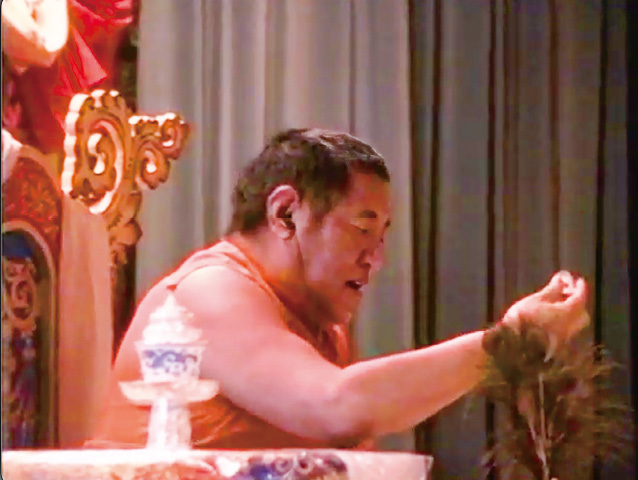

然而，就大圆满而言，依止上师并不需要长年累月，只需要很短的时间。对法也不需要特别精通，只要了知心的本来面目就可以。用不着什么其他窍诀来遣除魔障、增进境界，只要对上师有信心并虔诚祈祷，对法生起特殊的胜解，不仅能遣除魔障，还能提升境界。因此，实修大圆满是非常重要的。

> 铭记出离心。

实修大圆满的人，必须具备出离心，不贪今生的灭敌护亲、经商谋利、务农耕耘等任何事，唯一希求后世的解脱。为此，有必要修行出离心。

> 着重敬信解。

我们要着重培养对法和上师，心有信解，身体恭敬。当然，只有微乎其微的信解和恭敬是不够的，还要保持它的连续性。

> 强烈悲心生。

希望一切众生远离痛苦的发心，就叫悲心。这可不是微不足道的小悲心，它比母亲对独子的怜爱超过百倍千倍。总之，要专注于比爱自己更甚的大悲心，这种心要想办法产生。

> 依于境甘露。

比如色、声、香、味、触等一切法，本体都是空性，却可以显现形形色色的相。通过了知“这只是觉性的庄严”，从而生起觉受证悟的功德。此时，外境像甘露一样，可以让人依赖。

> 戏论收于内。

不要一直沉迷于灭敌护亲等许多琐事。只要吃饱穿暖就可以了，最好能舍弃大圆满中提到的九种琐事，至少也要断除所有恶劣的琐事，一心修行大圆满。

> 风则逸然住。

就观修风脉明点等圆满次第而言，风要向内吸、向外呼等有勤作地观修，但这种勤作在大圆满中是不允许的。

风从口中缓缓呼出，甚至感觉不到风的运行而安住，就是无勤作的道。这不需要遣除魔障、增进境界的许多窍诀，在此大圆满中，风自然运行就可以了。

> 切莫离身要。

在修直断时，初学者的身体需要做毗卢七法，以保持正确的姿势。如果一开始就躺着、靠着，会导致沉陷、昏聩、茫然三种状态。当然，直断境界彻底稳固的行人，怎么样都可以。

在修顿超时，身体的要点有法身、报身、化身三种坐式，不能离开这三种姿势。如果离开了，就无法显现法界净灯、明点空灯和觉性金刚链。

> 对向根胜界。

在修行阶段，心、眼、风三者要像融入了太阳、月亮、灯，或者像融入了虚空一样，专注于法界来修。

> 时而柔持宝瓶风。

所谓“宝瓶风”，就是吸气后，风稍稍充满腹部。所谓“时而”，就是当信心、悲心、菩提心等善分别念生起时，需要稍稍向内持风。所谓“柔持”，是指不需要像其他风脉窍诀一样用力猛持，而是柔和地持风，也就是稍稍于内持风即可。

> 恒常受持赤裸觉空本性为要点。

在直断的修行阶段，并不是什么都不想，而是要自明了知本来面目，认清觉空的本性。

在顿超的修行阶段，也是要持觉空本地来修，而不是把分别念散到外境中，或者于内不思一切安住着。

> 略摄而说。

所有这些窍诀的要点，只是简单做了归纳和解说。

> 当依心滴断除戏论增益，于上师前仔细听闻。

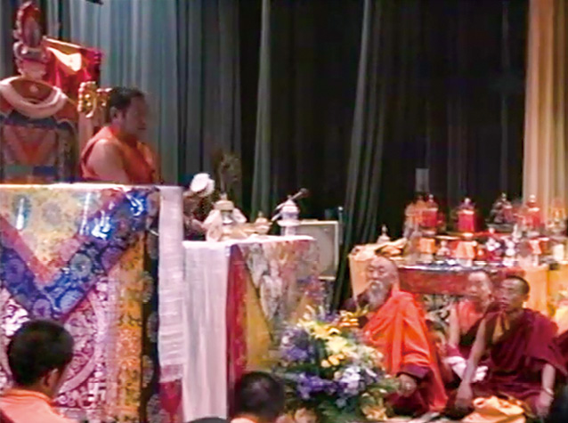

如果还要遣除很多戏论增益，必须参阅《布玛心滴》的119个窍诀，以此斩断疑惑。更深细的意义，不能只是口头上说，而要听受上师的窍诀。上师的窍诀也不会很多，只是一两句话。听受这个窍诀后，需要认识觉性。

> 如是重视、精进，上等者六个月、中等者三年、下等者十二年，可将有漏之蕴化为光。

如果修持这个大圆满，上根者、中根者、下根者将依次解脱，此道极为迅速。

> 名言词句清净于中脉，分别念清净于内明。

一切言词清净于中脉而成为佛语，一切分别念融入法界而成为佛意。

> 若有欲求，则将成就殊胜身语意。

要随顺所化众生的界性、根基、信解、意乐的差别，示现种种幻化相，成就身语意的殊胜果。

> 故当唯一如是精进。此乃未来五浊猖獗、边陲邪教入侵藏土、佛法濒临被毁，于心滴精藏义信解之瑜伽士，现似与诸普通人平等而行，秘密谁亦难以观察，通达一切有法如幻故不可胜伏，眉间饰有勇士印记，得蒋花西宁之加持，值遇流露智慧伏藏，尤其于了义获得定解，唯一坚不可摧信解我与我之无伪教轨，名为光明幻化金刚，久远后将出世，宣说此法义。是故，暂时智慧界之达革玛受持为五界文字，时机已到时，加持彼行者相续苏醒，将利益顿悟种姓具缘者。

上面提到的意义，我们在讲灌顶历史时已经详细解释过了，这里就不多讲了。简单来说就是，杰珍大师说这个伏藏法将来由光明幻化金刚或蒋扬钦哲旺波开取，依靠此法，会饶益大圆满特别所化的极利根者。它的完整词句，在之前灌顶时都解释了。

在这里，我想说几句肺腑之言：在美国这个地方，根据你们不同的兴趣、种族、意乐、智慧，分为两种人，一种是完全没有信仰的非宗教人士，一种是有信仰的宗教人士。两者之中，我们应该深入思考哪个更好，而不能没有思想。我们不是无情法，也不是疯子，还是要好好想想，到底是完全没有宗派信仰好，还是有宗教信仰好？

没有宗教信仰的人，不会思考让今生来世快乐而不受苦的方法，他们只是忙于温饱，就像今天我去的动物园里生活的动物一样，变成什么样都可以，出现什么都可以，这真的很可怜。要我说，我觉得一定要有宗教信仰。

但有些宗教只求自己幸福安宁，不惜伤害他众，这种宗教徒也特别可怜，他们今生不幸，来世受苦。也许除了佛教，所有宗教中最好的是基督教。之所以这么说，是因为基督教主要提倡慈悲博爱的理念。当然，这不能和佛教相提并论，为什么呢？因为基督教中所有好的、善的方面，佛教都讲过了，而基督教根本没有提到的自他一切众生今生来世安乐的很多方法，佛教也都讲过了。不仅仅是讲过而已，还有教证、理证、窍诀体验等可靠依据：几千年前佛陀、文殊菩萨、观世音菩萨等具有非凡智慧者的圣教；几千年来根据正确的理证分析，断定佛陀的语言没有丝毫矛盾的正理；如理如实修行正法就会获得暂时安乐和究竟佛果的体验，这是数亿人在过去通过真修实证所证实的。所以，我们对佛法诚信不疑，是通过教、理、窍诀得到验证的，不是口头说说而已。

虽然佛法有很多种，但大圆满是最好的一种。这个大圆满，不管上中下谁修，都不会不懂，而且不需要很长时间。如果你有特别大的信心，六个月也可以成就佛果。这种简单易行的道，也是任何佛经中少有的。

以上讲的，都是我长期深入研究的成果。我本人天生就具有敏锐的智慧，从14岁到现在60岁，一直在观察分析佛教和外道的宗义，所以才告诉你这些。我并不讨厌其他外道、喜爱内道佛教，而是实事求是。这也不是说给在座各位仁波切和来自尼泊尔、印度等地的上师活佛听的，而是想到你们这些在家善男信女，用几十年的分析也很难了达它们的差别，我才站在客观的立场上，给你们讲了这番话。从现在开始，如果你们不再三心二意，而是下定决心唯一实修大圆满，那么今生来世都会越来越好。

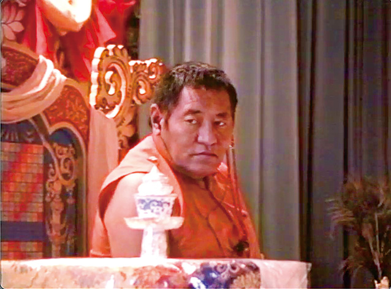

如果你还怀疑光明大圆满是否超胜其他法，认为它和其他宗教、教派是一样的，那么有空时来问我，我可以为你解惑。如果我没时间，那就去问南珠堪布和索达吉堪布，他们可以解决你所有的疑惑。如果你长时间下功夫消除怀疑，就会对大圆满生起不共的诚信。

上面已经详细解说了第一品。第二品是念诵部分，第三品是以窍诀的纲要摄义，这里就不解释了。

接下来，我念一下这个法的传承。这样《杰珍宁提》根本三品的完整内容，就一字不漏地传给你们了。

此法在引导方面，主要有广大、甚深两种。其中“广大引导”，有阿祖哲巴仁波切造的《前行引导文·持明言教》和《引导文·妙道智藏》等许多法，应当从中了解；“甚深引导”中最深的一个，是列绕朗巴的《引导文·智慧明点》。此外，结合了这两者要点的，是贡智·云丹嘉措的《引导文·圆密明点》。

如果以后你们能慢慢看、慢慢想，那当然很好。即使不能看，我这次三四天引导讲解的内容，都是他们的究竟密意要点，没有任何遗漏地给你们讲了。引导讲解的方式，是江德仁波切等作为众弟子的代表请我讲的。这一次的请法者，都是实修大圆满的人，他们心口一致，怀着极大的信心和渴求心说：“请您这次认真解释一下。”我自己已经毫无保留、无一遗漏地把所有窍诀都告诉你们了，希望你们真正去修。以前我在藏地没有这样讲过，这次只给你们讲了，原因昨天已经说了。祝大家吉祥如意！（掌声）

第一次坐热气球

7月15日上午，一些美国弟子强烈邀请法王乘坐热气球旅行，一睹美国的山山水水。但由于热气球不适合心脏病和高血压患者，出于安全考虑，法王没有乘坐，我们随行人员前去体验。

热气球是飞机发明之前西方的高空飞行载体，上半部是一个大气球，下半部是一个吊篮，由热气流和空气驱动，靠浮力在空中飞行。乘坐热气球的最佳时间，是一天中太阳刚刚升起时或者日落前一两个小时，因为此时通常风很平静，气流也很稳定。

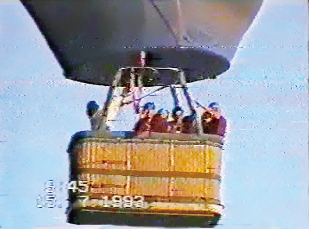

当天天气晴朗，万里无云。上午9点多，看着热气球从一块布慢慢鼓起来，然后我们被它带着升向天空，感觉有点神奇。热气球刚开始升空很快，不久就到了300多米的高空。它不紧不慢地穿过城市、田园、森林、山脉，各种美景尽收眼底，就像在画中畅游一样。飘在空中，看着天地之大，内心非常自由。每次越过高山，不知道什么原因，气流很强，吊篮晃得厉害，比飞机遇到气流还要颠簸，但我并不紧张，心里从头到尾都很平静。

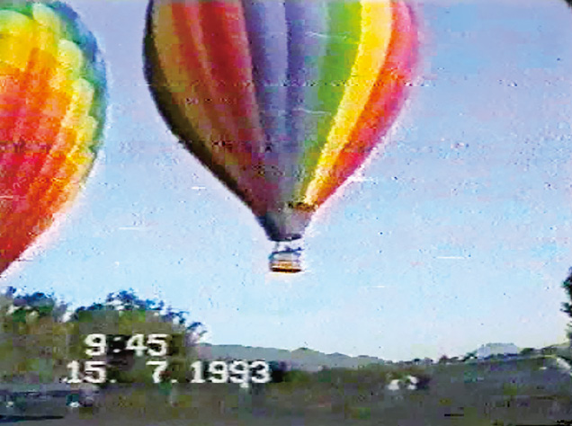

整个飞行持续了大约一个小时。这是一次非常有趣的空中旅行，我仿佛看到了世界全貌，同时也意识到了人类的渺小。之前看过热气球的照片，这次亲身经历了一次，还是感觉不一样。

密宗保密原因

当天下午，法王灌了“文殊静修大圆满”的顶。之后讲了一段话：

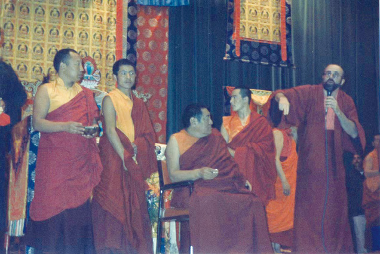

这个灌顶，是十万持明空行的心血，也相当于我自己的心髓，我已经毫不吝惜地全部传给你们了。《手中赐佛》的引导，是整个人间空前绝后、极具加持的甚深教授，我也会献给你们。这个法不仅甚深殊胜，而且有很大的利害。遇到它，有些人会受益匪浅，有些人也会招致大难。

一个修行人如果对上师有无伪、清净、虔诚的信心，对法也以特别的信解一心一意精进实修，能守护不为他人所知的甚深秘密，那么在浊世短暂的一生中，不需要长期努力就能成就佛果，获得超过十万如意宝的大利益。相反，对上师没有信心，尤其是当面赞叹、背后诋毁、两面三刀的人，一定是堕入恶趣的因。

你们都入了这个甚深法门，一定要以极大的信解来实修。否则，如果说此法不好或不清净，妄加分别、品头论足，入佛门一两年后又改信其他宗教，诋毁佛教，那就一定会堕入恶趣。所以，此法也是一个能带来很大麻烦的法。对于未受灌顶的无缘之人必须保密，除了上师和几个非常熟悉的与内誓言有关的金刚道友，它的见解和修行怎么能见谁都说呢？哪怕只是讨论它的词句，也必定会堕入恶趣，所以危险性非常大。这个大圆满法不要告诉任何人，需要保密，你们明白我的意思吗？

有些人可能会想：“大圆满这么需要保密，是不是有不可告人的过失？”

根本不是。而是因为，如果保密，就可以很容易成就殊胜和共同的一切悉地。如果不保密，到处宣扬、逢人就说，那么就是堕入恶趣的不共因，所以才要保密，而不是因为密宗有大过失。

比如，以我自己为例，从东方亚洲国家不远万里来到西方美洲国家，你们众弟子也自然聚集在这里，想必我们多生累世之前就有宿业与愿力的缘分。然而，我们不可能一次又一次地相聚，恐怕我以后不会再来美国了，只有这一次机会。想到你们既可怜又可爱，我才传了很多我以前在藏地也未曾广传的教授。我是于心不忍才讲了这个法，如果这种做法错了，你们以后到处宣扬，那对你我师徒都不利。所以，甚深密宗的灌顶和教言，如果弄不好，真的会造成巨大祸害；如果弄得好，无疑会获得巨大利益。

我再强调一次，你们应该对上师有表里如一的信心，所谓表里如一，不是当面有信心，背后没信心。对法的信解也要不松不紧、始终如一，不能一开始对法感兴趣、很喜欢，后来就没兴趣、不喜欢了，这就是所谓的松和紧。这个密宗甚深的大圆满法，如果你不向任何人宣扬，独自铭记在心而实修，那么一生就会成就佛果。这是完全与众不同的殊胜教言，请记住这一点。

・实修摄要

我这次就不从《手中赐佛》的原文解释了，因为明天会有很多新来的人，今天的很多人明天也会离开，所以我把《手中赐佛》的要点给你们讲一下。

实修此引导的方式，有初、中、后三个关键要义。

1．最初的要义是，要彻底放下对轮回一切琐事的贪念，相续中生起想修成无伪解脱道的意乐。依靠深入思维暇满难得和寿命无常，断除对今生的贪执；依靠思维业因果和轮回过患，断除对来世的贪执。总之，在没有放下对轮回的耽著之前，需要一直观修。

2．中间的要义是，成办自他的广大利益。那么，成办自他利益的方便法是什么呢？是皈依与发心。如何皈依呢？首先，自己要承诺并发誓做一个清净的佛教徒，然后在此基础上学修佛法。佛法有两种：小乘的共同法、大乘的不共法。其中，所有小乘行人纵然遇到生命危险也不能伤害他众，这一点摄于在家或出家的戒律中，必须遵守。当然，仅仅不伤害他众是不够的，还要有永不伤害他众的立誓，有了这个誓言，才称为佛教徒。否则，不立誓的话，只是不伤害他众，土石山岩也可以，但那不是佛教徒。为了不伤害他众，必须靠想皈依三宝的立誓，这就叫皈依。

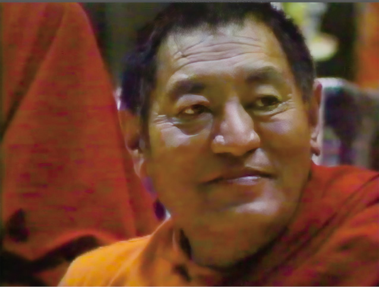

不害他众的方法，需要受一个戒，东南亚许多国家都有受戒的传统。受了沙弥戒、比丘戒的出家人，在藏地、印度、斯里兰卡有很多，但是，在美国要做到这一点还是很难的。无论如何，你们还是需要受居士戒或斋戒，最起码也要受个中戒。

什么是居士戒呢？在有生之年中，不杀害任何人类众生；不要说对他众造成极大伤害或严重欺骗的妄语；不可因贪欲与已婚妇女邪淫；不盗取别人的财物；从根本上戒酒。需要具备这些誓言。最好能将其全部断掉，实在不行的话，也要发誓在有生之年断一两个，相续中受持这样的戒律，就叫居士。

不杀生、不偷盗、不邪淫、不妄语，这就是所谓的四根本戒。承诺在今天日出和明天日出之间不犯这四条，叫做斋戒。即使不能受持这些戒律中的任何一条，你们也可以转绕、顶礼、诵经，念些观音心咒、文殊心咒、莲师心咒等，并尽可能多地念诵它们。

在藏地，我们有个规矩，鼓励别人做大事时要呐喊助威。我也在喊加油激励你们。所谓加油，就是让别人在比赛中发挥自己的潜力。那怎么喊加油呢？比如我们藏地，人口稀少，经济落后，知识水平薄弱，即便如此，不仅所有上师，就连在家的藏族男女，似乎也都念过一亿遍观音心咒或文殊心咒。而你们美国这个地方，人数众多，经济实力强，知识面又广，即便如此，你们却什么都不念，只是抱着胳膊待着。你们在我们所有的藏族喇嘛面前，有点不好意思吧？（众笑）还是要尽量多念！

我们不仅不能伤害他众，在此基础上还要慈悲利他，这才是大圆满的根本。佛法的究竟心要，唯一就是慈悲。舍弃自利，对一切众生恒时充满善意和善行，这种利他必不可少，这就是发殊胜菩提心。

3．最后的要义是，依照一个没有任何错误、具足可信正量的法而修成佛果。是什么法呢？就是密宗金刚乘，尤其是诸乘之顶的究竟光明大圆满。唯一勤修它，才是最终的关键要义。所以，一切佛法可以归结为三点：不害他众，唯行利他，能广大、不难、迅速利他。

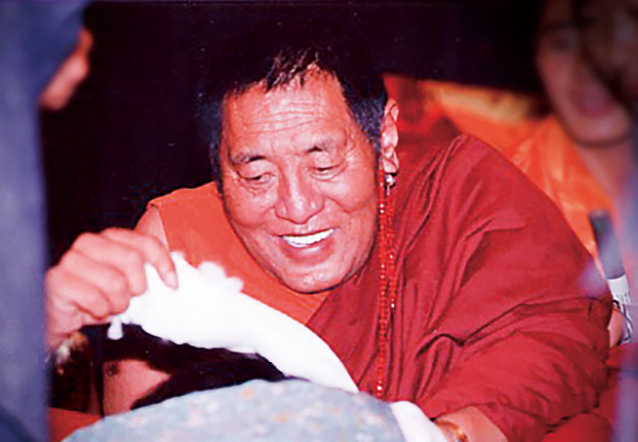

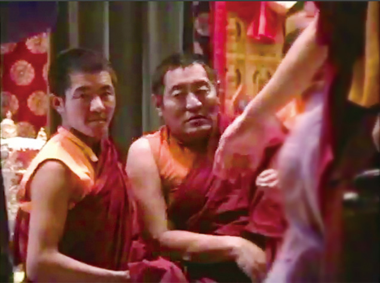

以上就是将《手中赐佛》的实修要义总结成这三点。

所有想听这个法的人，请在明天星期五下午准时到场。其他没有别的了。

加持交付印持

7月16日上午，法王从《手中赐佛》的开头，一直讲到“圆满次第”。“大圆满”部分则念了传承。其间讲到此引导文交付印持的情节时，是这样说的：

对应于共同小乘的“初善引导”讲完了，对应于共同大乘显密的“中善引导”也讲完了。现在，我们抉择对应于不共大圆满自宗的“末善引导”。它包括前行、正行、后行三部分。

其中，所谓“前行”引导，是指能净化三门迷乱的方便法，可以净除身语意的一切不清净；所谓“正行”本来清净直断引导，是指能现量见到自心无误实相的引导；所谓“后行”任运自成顿超引导，是指能无勤显现自妙力身智的境相。

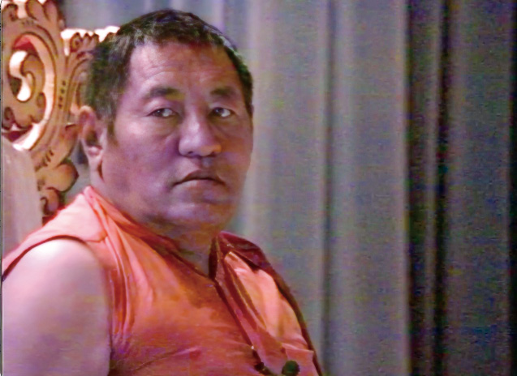

实修这些引导的方便法是：首先，依靠见传的当面指点来实修。其次，要在所有前前实修体验的基础上，进行所有后后的引导。我离开这里后，你们可以向在座的藏族上师们当面请教实修引导和觉受引导，他们会给你们明示。如果没有遇到其他上师，上面的实修法真正做到扎实稳固之后，下面的引导就可以不费吹灰之力在相续中产生。我可以对此进行加持交付印持。

所谓“加持交付印持”，是指我不仅祝愿这一境界在你们相续中产生，而且以三根本、护法神作证，我将事业托付给你们，并做“此殊胜窍诀在时机成熟时将复兴”的交付印持，于是这种境界会在你们相续中自然生起。

这次如果继续广讲这个引导，可能不会带来很大的好处。比如一个房子有十八级台阶，不依次经过第一级、第二级，是不可能直接飞到第十八级的。同样，如果你们不亲身体验前面的所有实修法，即使我日复一日、月复一月地讲后面的很多法，你们也不会懂。

不要因为正行不好懂而心灰意冷。认真修持四种厌世心、皈依、发心、上师瑜伽，当这些境界在相续中生起时，我保证就算你直接看这个引导文，也会生起真实的境界。

为了让引导文《手中赐佛》的传承不断，我用藏语给大家念一下传承。请怀着虔诚的信心谛听……

我个人认为，法王上面的这段话，其实是间接把这个法交付给了未来的有缘众生。即使你没有亲眼见过法王的尊颜，没有亲耳听过法王的教授，只要认真完成了五十万加行、对上师和法有清净的信心，依靠此法，就不难明白大圆满的意义，进而证悟大圆满的实相。

最接近文殊菩萨的法

那次在现场听过法王传法的吉米·卡尔法斯（Jamie Kalfas）告诉我们：

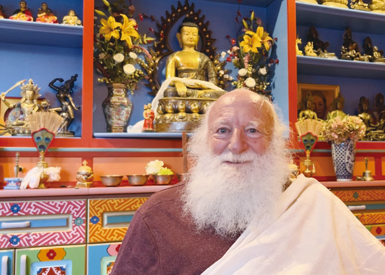

现在的吉米·卡尔法斯

“在纳帕谷，法王给我们传了他1987年，也就是6年前，刚刚在五台山开取的伏藏法——文殊静修的灌顶和修法，还有杰珍宁提，这两个法他讲得比较广。

法王讲法的时候很自在，很随意，不加修饰，让人感觉非常亲近，不是那种一本正经的样子。他有时还把一串念珠挂在耳朵上。

当时参加法会的人，有些特别喜欢文殊静修，有些特别喜欢杰珍宁提。我更喜欢文殊静修，很长一段时间每天都在修。但最近有点不够精进，还是应该再次每天修起来。我们闭关中心的一些人，也是每周一起共修。

有时候修着修着，我觉得没有比这更接近文殊菩萨的法了！我非常喜欢修这个法。每次出门，也许没带法本，也许带了，但我肯定任何一天都不会中断心咒的。”

然后，他唱起了法王祈祷文。唱着唱着，他停顿了一下，说：“这样唱，让我想哭……”很明显，法王的加持还在他心里。

乘坐私人飞机

当天下午，一位施主邀请法王乘坐他的私人飞机做加持，进行一次空中旅行，法王同意了。

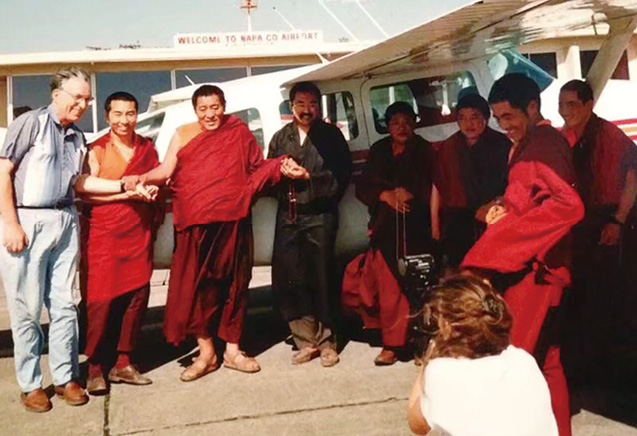

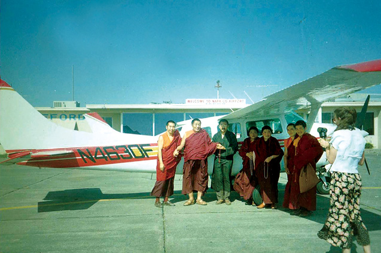

当我们到达机场时，发现许多私人飞机停在这里。在美国，拥有私人飞机的人并不少。但对我们来说，不要说私人飞机，就连拥有一辆私家车，在那个年代也是不可想象的。

因为飞机载客量有限，法王、阿里美珠、门措上师、翻译登上了飞机，我们没有上去，一直在机场等着。飞机越飞越高，在空中越来越小，最后消失在视野中了。

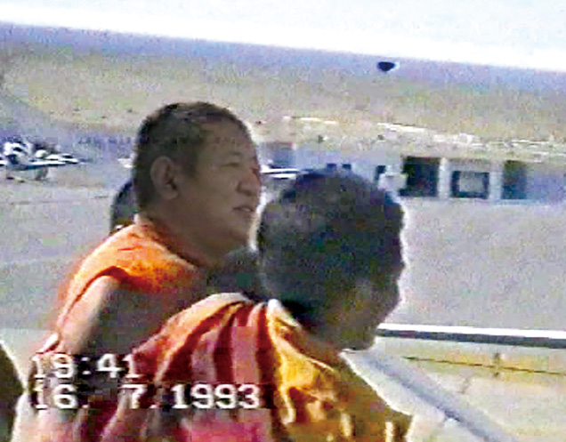

那天风很大，我有点担心，一直望向空中，盯着飞机飞走的方向。结果飞机很晚回来时，是从另一个方向回来的。不管怎么样，我这颗不安的心，终于随着飞机一起落地了。

法王看起来心情很好，说这次空中旅行很有趣。但到底去了哪里、发生了什么，我们不得而知。

甚深精藏橛

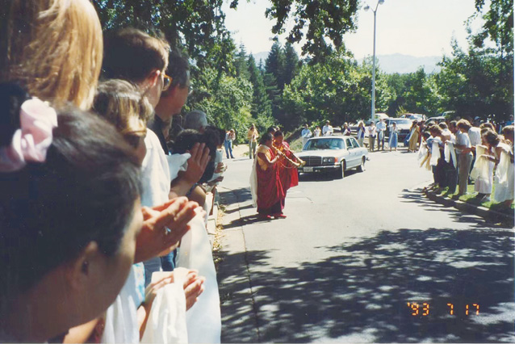

7月17日下午，传授了列绕朗巴大师“甚深精藏橛”的灌顶。在灌顶之前，法王讲了一段教言：

以前印度八大持明在乐积塔各自修持八大法行的不同法门，成为八大修派的传教大师。后来，莲花生大士从塔中央取出八大法行的总集宝箧，然后在吉祥桑耶寂静处的青普红岩格仓山洞，将“八大法行·集善逝”的完整灌顶，包括文殊身、莲花语、真实意、甘露功德、橛事业等，分别赐予了君臣九位心子。国王赤松德赞最了不起的大臣，密咒师降魔金刚，再三祈求金刚橛的付教者——空行母益西措嘉，为他宣说这个金刚橛法。空行母给他捎信说：“现在不是我传授金刚橛法教的时候。你应该直接向莲花生大士请法，要准备丰富的会供品。”当时降魔金刚准备了足以震惊四方国家的会供品，在莲师面前无余得受了金刚橛的所有教言。当他投花选抉择本尊时，也像以前益西措嘉一样，花落到了事业金刚橛本尊上。从此，降魔金刚在雪域的威力无与伦比，被委任为击鼓带橛的密咒师之首。

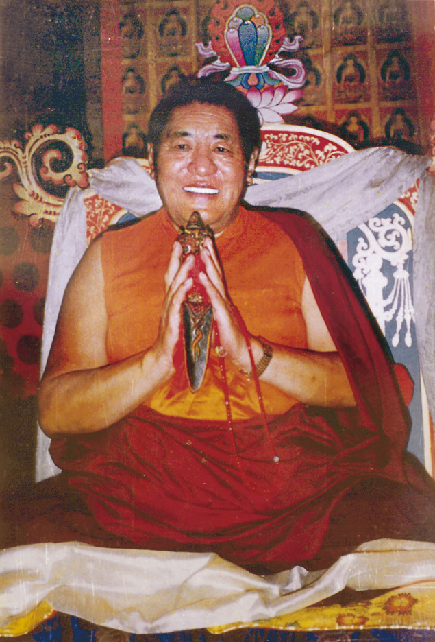

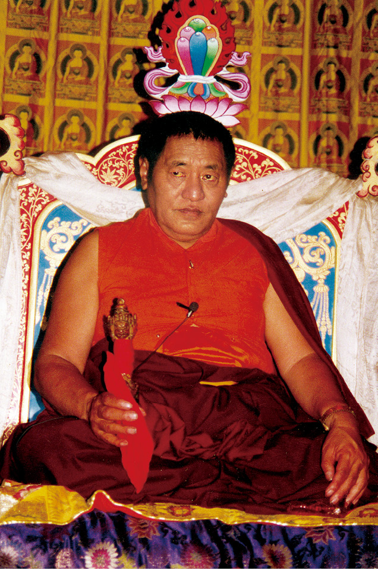

也正是因为这个缘起，后来降魔金刚的历代转世伏藏大师，似乎都有金刚橛的法教。降魔金刚曾在藏地转世为大持明鹫翎尊者、北派班玛陈列等，后在新龙地方受生为伏藏王——伏藏大师列绕朗巴，又名酿喇索甲。伏藏大师列绕朗巴，是一位智慧出众、成就斐然的大成就者，尤其能自在驾驭法伏藏和物伏藏。他所有法伏藏的精髓，就是金刚橛法类，流传下来的有“广”极密忿怒橛、“中”精藏利刃橛、“略”甚深精藏橛三部法。

“极密忿怒橛”不是每个人都能修的，也是非常难修的，除了具备誓言的人之外，任何人修行，都会受到所有空行护法的惩罚，是这么绝密的一个法教。而这个“甚深精藏橛”，加持力巨大，是任何人都可以修的开放性法教。因为这个缘起，“极密忿怒橛”如今在我们藏地，除了终生在寂静处精进修行的个别人外，不是所有人都能修的。而“甚深精藏橛”，连在家人都可以把它作为居家消灾的修法，在自己家中可以广行念诵。

一般来说，不管实修广、中、略三种金刚橛的哪一种，只要得到了其中一个灌顶，这三种法都可以修。下面要给大家传的，就是浩瀚金刚橛法行要点总集的“甚深精藏橛”灌顶……

《佛子行》的功德

接下来，法王给大家念了《佛子行》的传承，然后说：

在这九天里，我广传了大圆满能成熟的灌顶、能解脱的教言。如前所说，你们也要唯一专修此大圆满法，这是非常重要的。

如果不能或不会修大圆满，或者虽然会修但还想次第学修，这种人就需要按照菩萨道的轨则来修学。菩萨道的核心内容是《佛子行三十七颂》，下面我把它的传承传给你们。

此法作者无著菩萨，是观世音菩萨的化现。在他生活的地方，互为天敌的羊羔和豺狼、鹞鹰和麻雀，也相亲相爱、一起游戏等等，他是菩提心纯熟之相成熟于外境的大菩萨。

这个《佛子行》，且不说实修它有不可思议的功德，即使不能实修，只是耳边听到它的词句，也会在相续中播下解脱的种子。此法的词义简单易懂、便于实行，以后就算没有上师，只看文字，也应该能看懂意思。如果修以大圆满为主的密法，首先要依止上师，只有在上师面前得过灌顶、听过传承和讲解、通达意义，才能实修；若没有依止上师，没有得过灌顶引导，直接依靠自力去看密法，不仅不会带来任何好处，还会带来巨大的过患。但是像这个法，没有上师，也没得过灌顶引导等，仅凭自力实修也是可以的，因此它便于实行。

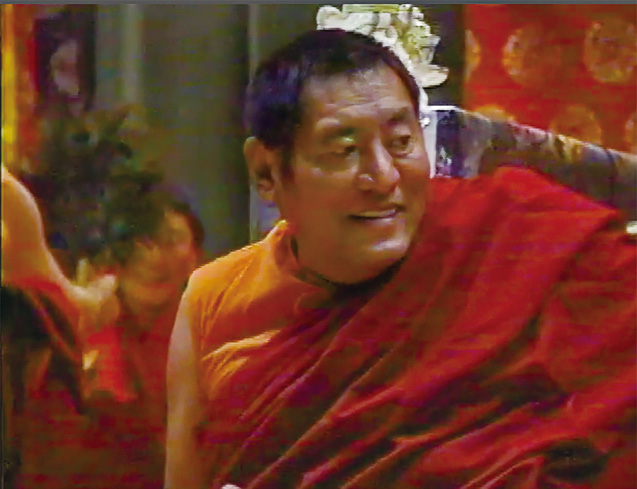

正如我昨天所说，密宗的所有法理，除了那些得过灌顶、誓言一致的道友之外，绝不能向外人宣扬。但《佛子行》是上中下所有众生听到都可以，没什么不能讲的，传得越广，利益越大。凡是此法兴盛的地方，饥荒、战乱、纷争会断绝，寿命、福祉、财富会增上，它是带来广大利乐的必要途径。

这次你们四个道场和众弟子没有请我念这个传承，但今天我要以清净的利他心，给你们念一遍这个“闻解脱”大法。此法非常甚深，从小到现在，我都把它作为实修的核心。就听受此法而言，我不止一次，而是在一百多位上师面前反复听过。另外，我也为有缘众生多次讲过，应该为几十万人讲过一千遍了吧。所以，这次我想念个传承，可能对你们也有帮助。

如果是表里如一依止我的弟子，就应该将它的所有句义背诵下来。虽然每天实修它的全部意义有点困难，但我要求，至少要发愿每天修一个偈颂。

・三句忠言

这一次，由于一些上师作为连接纽带，我们所有人的关系更加密切了，你们对法也是信心十足、兴趣充满，方方面面都非常好。如今我们即将分离，我对你们有三句忠言。

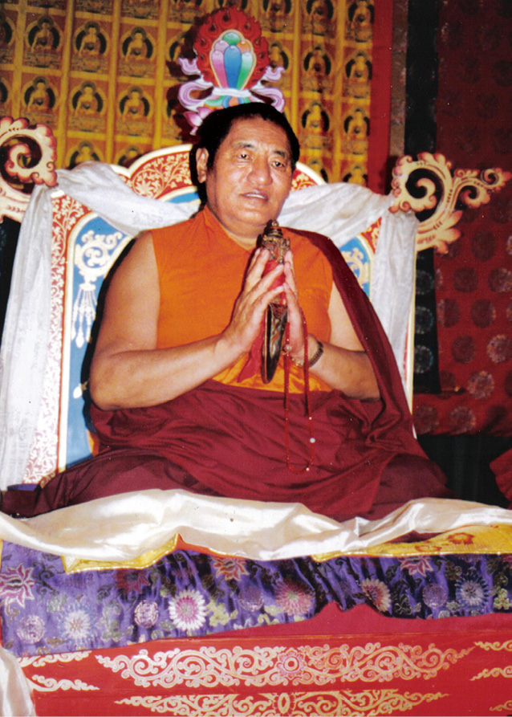

第一句忠言：

既然你们都是佛教徒，最好能用佛法来利益亲友等有缘者，甚至引导他们进入佛门，原因之前已经提过很多次了。从我自己的角度来说，来这里不是为了什么名利之类的目的，而是怀着想通过佛法饶益西方人的意愿。所以，希望大家也能完成我的心愿。

所谓佛法，即使以正理观之，也能证明其正确性。不仅如此，还可以用所有前辈大德的亲身体验来证明。就算用一百年的时间分析，你也只会对佛法越来越有好感、越来越喜爱、越来越欢喜，不会觉得它有不真实、不可信的地方。

我们今生得到了人身，来世很难再三获得，拥有这么好的缘分时，还是要用它来行持正法。如果不能行持正法，获得人身就没什么意义了，如同没有心脏的身体，或者像去金洲连一两黄金都没拿，空手而归，被人耻笑。

如果这辈子想趋入正道，学佛是一个不错的选择。所谓学佛，随随便便皈依是不够的，只有经常向佛陀虔诚祈祷，对上师、僧众等恭敬承侍，对行善得乐、造罪受苦的因果规律深信不疑，这才是真正的佛教徒。

第二句忠言：

佛教真正的核心是慈悲。在日常生活中，你们应该尽力去修“希望一切众生得乐离苦”的慈悲心。一旦生起慈心和悲心，今生世出世间的善妙心愿都会顺利实现，究竟还会获得遍知佛果。想到这样的功德，就要尽可能反反复复地修行。

第三句忠言：

平时要专修光明大圆满。原因是如果修其他教法，都会有一定程度的兴衰，但就大圆满教法而言，现在整体上非常兴盛圆满，是利益众生的好时机。尤其以美国为例，其他任何法都很难起到利益的作用，唯一能肯定让大家受益的法，就是大圆满。至少我是这么认为的。

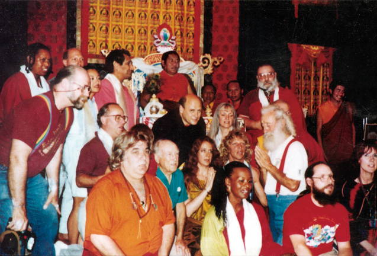

从远近缘起来看，大约三十年前，藏传佛教在美国的弘扬始于大圆满。现阶段，如果你们想修法，最好是修大圆满。原因是，你们上师的核心修法就是大圆满，这个法需要有人传讲，而他们不仅经验丰富，还非常熟悉。而且你们对这个法都很有信心，所以修它会有极大利益。

在藏地的时候，我对成千上万的弟子，甚至是如心脏般的心子，都舍不得这样广传，而现在，刚遇到你们就直接全盘托出了，这也是考虑到它对现在和未来的美国人大有利益。所以，你们要下大力气修这个法，这是我的希望！

难忘的离别

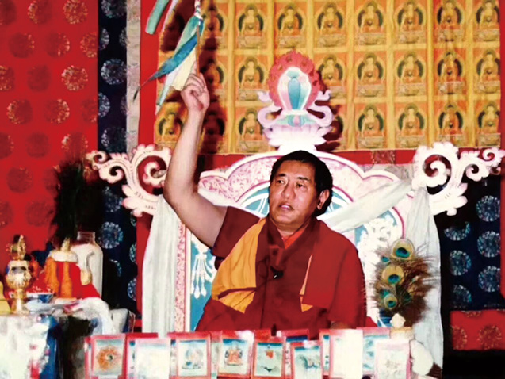

法会最后一天，7月18日下午，法王根据伏藏大师列绕朗巴的《长寿灌顶仪轨·甘露云聚》，给大家赐予了长寿灌顶。

为了庆祝此行圆满完成，法王带着大家举行了一场大会供。在此期间，大德们献上了珍贵的曼茶罗和大型朵玛；五个美国女人身穿五部空行的服饰，头戴五佛冠，用五彩哈达跳金刚舞，祈请法王长久住世；江德仁波切也代表四个道场向法王表示感谢。

结束后，在众人的依依不舍中，法王挥手离去。很多人一直含着泪鼓掌，掌声久久没有停息。通常来说，西方人比较理性和冷静，而这也是因为法王传授的甚深窍诀，给他们带来了难以置信的利益，所以他们特别舍不得离开法王。

这一站的日程安排得很紧，每天除了法王的灌顶传法，其余时间要么是门措上师的灌顶，要么是南珠堪布和我的辅导、问答，上午下午都排满了，这些内容在这里就不多说了。

对我而言，能跟上师出国弘法，见识不同的风土人情，本就是一件很幸福的事。与此同时，还能额外得到这么多稀有难得的灌顶、引导、传承，尤其是《杰珍宁提》《手中赐佛》的不共窍诀，对于一个修行人来说，没有什么比这更重要的了，即使死也无憾了。

穿越岁月的记忆

法王在纳帕谷弘法的十天里，很多美国人对心性有了不同程度的认识，也感受到了法王不可思议的加持。即使过了三十年，他们每次提到法王，信心依然非常强烈。

现在的朗·希尔

例如，当年为法王做早餐的朗·希尔（Lon Hill）说：

“我当时刚刚学佛，什么都不懂，就被安排给法王及其眷属做早餐。我紧张极了，但又觉得很荣幸。

我特别喜欢法王传授的心法，清晰、直接、入心。每次修它，都觉得活着的唯一意义就是修行。

尤其是《文殊静修大圆满》的上师瑜伽，与众不同。每次修这个上师瑜伽，我都觉得亲自见到了法王本人。”

还有一个人叫约翰·史威尔金（John Swearingen），当年担任摄影师。他讲述自己的经历时，说：

“那时候我对法王的背景不太了解。但是，当他站在你面前时，你根本不需要知道他的任何背景，就能感受到那种不一样。虽然我们这一代人特别注重理性，但那种成就者的加持力，很难用理性来解释。

作为摄影师，法王灌顶后给大众加持的那半个小时，我一直站在相机旁边看着他，有时透过镜头，有时直接看。虽然会有人从镜头前经过，但没有人打断我盯着法王看。当时觉得整个世界除了法王，什么都不存在了。那种强大的加持，现在还在我心里。

现在的约翰·史威尔金

《文殊静修》我没有作为每天的功课，但这个小小的法本，我一直带在身边，有时候会拿出来重温，然后修一下。据我所知，当年的几个道友一直在修这个法。”

约翰还提到了一次比较罕见的经历：

“有一天，很多信徒带着宠物来到道场，请求法王加持。在等待法王的过程中，那些猫猫狗狗互不相让，发出挑衅示威的叫声，甚至抓咬不放，大家都拿它们没辙。

正在特别担心的时候，法王到场了，发出一声威猛的吼声。那些上一秒钟还狂吠乱抓的猫狗们，顿时安静下来，仿佛刚才什么都没发生，个个乖得像兔子一样。

这是我最深的记忆。直到今天，很多人还记得这件神奇的事情。”

去仁真林

7月19日上午，在纳帕谷弘法圆满后，我们离开那里，驱车三个小时来到仁真林（Rigdzin Ling）。这是江德仁波切（Chagdud Tulku Rinpoche）建立的佛教道场，环境幽静宜人，周围树木挺拔茂密，非常适合修行，尤其是后山的树林里，分布着很多闭关房。

下午，法王在这里休息了一会儿。我在一些青海喇嘛的带领下参观了这里的风景，然后我们坐在草地上聊天，拍了一些照片。

晚上，法王给大家传了“缘起除障法”的灌顶。

第二天早上，在法王离开之前，许多人带着他们的猫、狗、鸟等各种宠物，请求法王加持。虽然这个活动没有写在日程表上，但是他们已经安排好了。甚至有些住得很远的人，提前把宠物带到了这里。

《三一期刊》报道法王在仁真林的法讯

这是继阿底林之后，法王第二次给宠物加持。美国人非常喜欢小动物，把它们当成家人，去哪里都带着。但有些狗的体型过于庞大，看起来很凶，出于安全考虑，我们不太愿意让法王靠近。不过法王慈悲为怀，还是给它们念了宝髻佛号、观音心咒等，让大家都十分开心。这一幕即使过了三十年，有些人依然记得，觉得这个时刻非常有趣、非常温馨。

抵达扎西秋林

7月20日上午，我们从仁真林出发，前往扎西秋林（Tashi Choling）。路上有很多森林和高山，美国西海岸的风景有点像我们藏地，看起来很舒服。

给我印象最深的是举世闻名的沙斯塔神山（Mount Shasta），这是一座每几百年喷发一次的火山，海拔4316米，山顶终年被积雪覆盖。它被美国原住民奉为万物起源的地方，其地位相当于藏族人心目中的冈仁波齐，因此深受瑜伽爱好者、灵性修炼者的青睐。附近有许多佛教中心、禅修中心、瑜伽组织，很多人在这里长年修行，说神山有着难以形容的强大能量，让他们的内心非常平静。当法王路过时，下车看了看这座山，并听当地人讲述了关于它的神奇故事。

之后，我们继续赶路。两三个小时后，到达俄勒冈州南部的扎西秋林，这是嘉哲仁波切的主寺。按照藏传佛教的仪式，寺院隆重地迎接了法王，供养三宝所依等，并请法王为大殿和佛像开光。

下午，法王给当地信众做了一些开示。

晚上，法王在寺内观看了第二世敦珠法王“金刚萨埵”灌顶的录像。法王对我们说：“本来我很想拜见敦珠法王，可是他已经示寂，今生没有这个缘分了。为了和他结上缘，我们把录像从头到尾看一遍，灌顶时需要念诵的部分，也像现场接受灌顶一样跟着念。”

这个灌顶应该发生在锡金或者印度，拍摄得非常清晰。结束后，法王看起来好像得到了真正的灌顶。

对于普通人来说，通过录像得受的灌顶、传承，没有资格给别人传授。但就个人修行而言，依靠这样的影音资料，可以获得特殊的加持。

帐篷里的笑声

7月21日上午，嘉哲仁波切供养法王一顶帐篷，搭在草坪上。法王好像很喜欢，说夏天可以在藏地用。

这个帐篷看起来很小，没想到我们十三个人都能坐进去，也不显得拥挤。为了加持这个帐篷，法王带着大家念了大自在祈祷文、观音九本尊心咒，然后又念起了黄财神的咒语。念到中间，法王突然说：“我为什么念黄财神呢？看来这是个特殊的缘起：60岁之前，我是个清贫的僧人。60岁以后，也许我的财富会逐渐增加。”的确如法王所料，从那以后，他老人家的财富越来越多。

法王以调侃的口吻说：“有财富也是很好的。我家乡有个喇嘛叫嘉阳，他总是说诸法财富生。因为佛陀说‘诸法因缘生’，‘因缘’和‘财富’在藏语中是同一个词，所以他理解这句话的原意是诸法财富生。他常说：修行佛法，一定要发财！一定要发财！”法王模仿他的语气，大家笑得前仰后合。

然后，他们为法王提供酸奶。法王说：“这是我在石渠求学时的主食。今天为了表示缘起，你们不用碗，我把酸奶倒在你们手上喝。”大家开心地伸出手，一个个接过法王倒的酸奶。

法王一边喝酸奶，一边聊起敦珠法王，说：“我是往生极乐世界的，你们有些人发愿要和敦珠法王一起去莲师的铜色吉祥山。如果我到了极乐世界，随时可以去你们刹土，《极乐愿文》也说了：‘普陀杨柳宫，邬金妙拂洲，十亿化身刹，愿见观世音，度母金刚手，莲师十亿尊，奉如海供品，求灌顶深教，速直返自刹。’但是，你们若想去极乐世界，然后轻松地返回，可能就没那么简单了。南珠堪布、嘉哲仁波切，你们都发愿去铜色吉祥山吗？其他人会和我一起去极乐世界哦。”听了这话，大家都笑了。

法王补充道：“我在藏地的时候，真的很想这辈子见到敦珠法王。后来我做了一个梦，梦里有人告诉我：‘敦珠法王的心现在专注于清净刹土，你们两个没有机会见面了。’后来才知道他两三年都不怎么说话，心好像不在人间了。果然，今生我和他没有缘分见面。”

法王忽然想起了什么，问道：“昨晚我们看的敦珠法王灌顶，那个仪轨是谁的伏藏？”嘉哲仁波切说：“应该是他自己的。”

……

就这样，法王和大家聊了很多话题，笑声不断从帐篷里传出。

我一边听，一边看着这个帐篷，一直在想回去的路上怎么带。因为它是双层的，特别重。

埋宝瓶的地方

之后，他们邀请法王坐车去了不远的地方。那有一片平坦的山坡，中间是草地，四周是树林。嘉哲仁波切指着一棵树，告诉法王：

“1980年六月初十，也就是法王您创办喇荣五明佛学院的同一天，敦珠法王从旧金山来到阿什兰，随后与他的空行母仁真旺姆、儿子贤攀、活佛班玛旺嘉，乘直升机降落在这个山坡上。那时候这里没有路，只有一片空地。

我拿着一个宝瓶，早早地在这里恭候。敦珠法王选了一个地方埋下宝瓶，随手拿一个树枝插在上面，又在树枝上挂了一条哈达，并授记道：‘此地要建的道场里，有些修行人应该会虹身成就。’然后他做了伏地仪式，念了一两个小时的经，就坐飞机回去了。

令人惊奇的是，多年以后，这个树枝长成了一棵大树。”

法王在这里也念了经，做了加持。

为金刚萨埵像开光

当天下午，他们请法王为新建成的金刚萨埵像开光。因为嘉哲仁波切是伏藏大师根桑尼玛一个金刚萨埵伏藏法的法主，以此缘起，他在这里建造了当地最大的金刚萨埵露天像。佛像左边是绿度母像，右边是白度母像，后面是百字明转经轮。

法王对佛像进行了转绕、发愿，然后念了很长时间的开光仪轨。那天阳光特别强烈，一丛丛的白花开得很灿烂。法王显现上很欢喜，觉得美国有这么殊胜的三宝所依，一定会给很多众生带来利益。

生死窍诀

晚上，法王在阿什兰市（Ashland）的一个普救派教堂，按照大家的意愿讲了往生法，做了长寿灌顶，念了长寿仪轨。一般来说，很多人都会念往生法，也得过长寿灌顶，但为了让后人了知法王的教诲，我还是将其原原本本整理出来：

如今，我们都得到了珍贵难得的暇满人身；不仅得到了人身，还遇到了具法相的上师善知识；不仅遇到了上师，还拥有在上师面前得受广大教法的善缘。即便如此，这个暇满人身也不会长久、坚固，它是必定会死、死期不定、死缘不定的本性，所以一定要反复修心，不要贪恋今生的任何琐事。否则，死的时候，财产受用、权势地位、名声威望、种姓美貌等毫无用处，没有一个人可以陪你离开，你也没有权利带走一口食物，只有双手抱臂独自前往陌生的地方。当这一刻来临时，决定有利的就是正法，决定有害的就是恶业。为此，现在就要认清利害关系，趁着自由自在的时候，不管是谁，都应该行善。

你们这里七天只有两天有空，那两天也多是在歌舞喝酒等各种娱乐中度过的。如果贪执今生，不去行持善法，当你死的时候，就会捶胸顿足、泪流满面、充满悔恨。如果一个善法都没修过，就真的成了自欺欺人的大骗子。所以，不要总想着这辈子的物质财富，一定要做自己的主人，尽可能精进地修持清净善法。

世界上有许多宗教都对今生和后世有利，但其中佛教是最超胜的，这可以通过教证、理证来证成，也可以通过修证来成立。虽然修行佛法有很多种方法，但有一种方法很容易行持，功德极大。是什么呢？就是一心一意祈祷阿弥陀佛，争取命终后立即往生极乐世界，这是佛教的精髓。而且其他宗教的修行人，如印度教、基督教等，如果能修这个法门，非但没有罪过，反而会获得无穷的利益，尤其是各大宗教所提到的成就。这是最终实现美好愿望的绝妙方法，不要因为宗教不同而有偏执，每个人都应该祈祷阿弥陀佛，发愿往生极乐世界，这是不可缺少的。

・往生法

所以，这一次，我给你们讲讲祈祷怙主阿弥陀佛能往生极乐世界的正道。

首先要观想：从现在开始直到获得究竟佛果，皈依阿弥陀佛和众菩萨，以自己积累的所有善根，愿天下一切众生往生极乐世界。然后跟我一起念诵下文而皈依、发心：

> 乃至菩提永皈依，一切殊胜佛法僧，

> 以我布施等福德，为利众生成佛果。

之后，把这里观想成真正的西方极乐世界。自己的身体也不是不清净的平庸身体，而要观成本体是空行益西措嘉，形象是金刚瑜伽母，全身红色，一面二臂，右手持弯刀，左手持托巴，以跨立式安住，这要观得一清二楚。她身体中央有一条空净的中脉，粗细如竹箭，上端在梵净穴开口，下端在脐间闭合，在心间的隔节上，有一个淡绿色风团，风团上有心或神识的红色舍字（ཧྲཱིཿ）。依靠风的力量，风团被向上吹动，似乎要飞起，似乎要消失。之后，在头上一肘的空中，观想怙主无量光和众菩萨，了了分明地现量安住着。

这些内容，我用藏语念是这样：

> 诶玛吙

> 自现任运净无边，圆满庄严极乐刹，

> 自观金刚瑜伽母，一面二臂持刀盖，

> 三目视空双足舞。

> 彼身内中脉，粗细竹箭许，

> 具空净光管，上端开梵穴，

> 下端入脐下。心间隔节上，

> 淡绿风团中，明观识红舍，

> 头顶一肘上，观佛无量光，

> 相好圆满身。

接下来，要满怀信心专注于头顶上方的怙主阿弥陀佛，祈祷加持自己当下的心融入怙主阿弥陀佛心间。以信心一缘专注地祈祷。

我代你们念阿弥陀佛圣号。你们一边听我念，一边诚心诚意地祈祷阿弥陀佛：

> 顶礼供养皈依无量光如来、应供、正遍知、明行足、善逝、世间解、无上士调御丈夫、天人师、佛、世尊！

> 诶玛吙

> 于自现义密严刹，百信虹幕萦绕中，

> 皈处总集根本师，身清澈身非平庸，

> 无量光佛本体住，强烈敬信诚祈祷，

> 加持修成往生道，加持诣至密严刹，

> 愿得法身佛果位。

接下来，当我念五遍“舍”的时候，你们观想在心间淡绿色风团上，有一个代表神识的红色“舍”字，它被风吹得越来越高。到达头顶的同时，我念诵“吼”，你们观想这个神识融入了阿弥陀佛心间。

第二次明观的时候，就像一个气泡从水里冒出来，心间又出现一个淡绿色风团。依靠五个“舍”字，神识被向上吹，借助我发出“吼”字的力量，观想神识融入了阿弥陀佛心间。

第三次还是这样观想。

> 舍 舍 舍 舍 舍 吼（三遍）

然后依靠我念五遍“啪的”的威力，将你们印持到无量光佛的五身——法身、报身、化身、不变金刚身、现前菩提身的法界中，永远与阿弥陀佛成为无二无别。带着这样的观想，听我念诵：

> 啪的 啪的 啪的 啪的  啪的

此后，观想头顶处的怙主阿弥陀佛化光，融入自己的身体。

・长寿灌顶

明观自己一刹那变成长寿佛，身色宛如红宝石，以报身服饰庄严，双手结定印，上面持有充满无死甘露的宝瓶，双足金刚跏趺坐。

> 吽舍

> 怙主无量寿，红色报身相，

> 手托长寿瓶，密意宝箧中，

> 赐密咒阿耶，愿得金刚寿。

> 嗟

> 三时诸佛之体性，引导众生胜商主，

> 莲师持明无量寿，加持所护身语意，

> 成就无死金刚寿。

> 嗡那莫巴嘎瓦得 阿巴热么达 阿耶儿嘉那色波呢则达 得作Ra匝雅 达塔嘎达雅 阿儿哈得 桑Nia桑 波达雅 达雅塔 嗡本耶本耶 玛哈本耶 阿巴热么达 本耶 阿巴热么达 本雅嘉那 桑巴若巴则得 嗡萨儿瓦桑嘎Ra 巴热协达达儿玛得 嘎嘎那 萨么嘎得 索巴瓦波协得 玛哈那雅巴热瓦瑞索哈

> 吽

> 依修坛城诸尊众，大悲威力并肩行，

> 手帜收放使者光，所缘寿命损漂夺，

> 轮涅器情寿精髓，召引光芒明点字，

> 以入自己威光增，成最无死金刚寿。

> 嗡班匝阿耶尅吽匝 才准耶准 耶才阿巴那耶准

> 嗡那莫巴嘎瓦得 阿巴热么达 阿耶儿嘉那色波呢则达 得作Ra匝雅 达塔嘎达雅 阿儿哈得 桑Nia桑 波达雅 达雅塔 嗡本耶本耶 玛哈本耶 阿巴热么达 本耶 阿巴热么达 本雅嘉那 桑巴若巴则得 嗡萨儿瓦桑嘎Ra 巴热协达达儿玛得 嘎嘎那 萨么嘎得 索巴瓦波协得 玛哈那雅巴热瓦瑞索哈

最后，这个长寿丸和长寿甘露分发给大家。你们尝一点，观想自己获得了与怙主长寿佛同缘分的无死长寿悉地。

> 嗡 身之身融身，善住五蕴中。

> 啊 语之语融语，融入胜舌根。

> 吽 意之意融意，融自然智意。

> 昼夜普吉祥，昼夜恒吉祥，

> 有缘众吉祥，日月光明照。

> 诶玛吙

> 长寿佛加持，依修究竟力，

> 四百零四疾，八万诸魔障，

> 九十一骤缘，八种横死等，

> 诸违缘寿障，无余得消除。

> 玛绕德嘎格仓洞，修行无死寿持明，

> 怙主长寿佛加持，得无生死寿持明，

> 无死莲师赐吉祥。

> 嗡啊吽 班匝儿格热巴玛色德吽

至此，不修成佛的往生法引导，以及能摆脱一切非时横死的怙主长寿佛灌顶，已经圆满了。

我们将以此善为主的三时所有善根，汇集起来发愿回向一切众生获得佛果。请一起念诵：

> 愿以此福得遍智，击败一切过患敌，

> 度众离生老病死，波涛汹涌轮回海。

> 嗡耶达儿玛 黑德抓巴瓦 黑登得堪达塔嘎多哈雅瓦达 得堪匝哟呢若达 诶旺巴德玛哈夏儿玛那索哈

> 白昼吉祥夜吉祥，日至正午亦吉祥，

> 日日夜夜皆吉祥，祈请三宝今赐予，

> 具德上师今赐予，一切本尊今赐予，

> 诸护法神今赐予，所有地神今赐予，

> 一切鬼神至于此，或居地或住空者，

> 于诸有情恒仁慈，日日夜夜行正法。

> 此依胜敌佛谛力，极其真实无妄语，

> 依彼谛实今吉祥，时时解脱大畏惧。

> 再次祈愿我等瑜伽师徒、施主、人畜眷属，均如日月脱离星曜之灾般，克胜一切魔障、损害、违缘，祝愿一切吉祥！匝雅，匝雅，色匝雅！胜利，胜利，愿一切胜利！

神奇的“啪的”

本来我们觉得法王带修破瓦法很正常，7月21日只是一次普通的法会。没想到，采访了几个听众后才发现，那晚法王念的“啪的”，居然让他们很多年都忘不了。

有一个叫凯（Kay）的秘书，也是按摩师，她说：

“法王在普救派教堂举行的法会，虽然直到最后才发出广告，但还是吸引了很多人。250个座位的教堂不仅楼上楼下座无虚席，还有不少人只能站着。当晚法王传了长寿灌顶，还带修了破瓦法。

修破瓦法的时候，他最后吼的那几声，超乎想象地强大，令人难以忘怀。那天之后的20年里，时不时就有人来找我说：‘还记得1993年在普救派教堂给我们传法的那位喇嘛吗？我永远也不会忘记他发出的那个声音……’”

还有一个叫斯班（Span）的夏威夷人，给法王开过车。他说：“法王传长寿灌顶时，我正好坐在下面听。当时他猛喝了一声‘啪的’，我所有的分别念当下灭尽，融入了法性，不知道过了多长时间。但是我发誓，我这辈子从来没有过这种状态。”

慧藏中心传法

7月22日清晨，我们离开扎西秋林，经过六个多小时的车程，来到旧金山的慧藏中心（Yeshe Nyingpo Orgyen Dorje Den）。这是嘉哲仁波切在旧金山市中心建立的佛教道场。据说是敦珠法王命名的，他的很多道场都会用“慧藏”二字。

道场虽然不大，但东西方信众来得还是很多。法王在这里给大家做了皈依，传授了“文殊智慧勇识”的灌顶。

23日，当法王前往旧金山机场时，美国信徒们为了表示法王的尊贵，也为了表达内心的感激，安排了一辆加长劳斯莱斯为法王送行，车上有电视、电话、美食等。

之后，我们乘机前往华盛顿。至此，纳帕谷的弘法行已经圆满。
