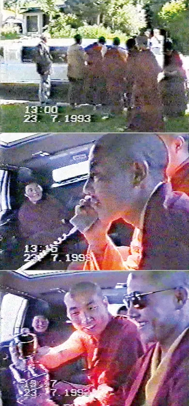

第5站 美国·华盛顿

WASHINGTON, D.C., USA 7/23-7/31

行程

7月23日，抵达华盛顿

7月24日，传讲《四谛法轮》

7月25日，下午“项袋金刚橛”灌顶

7月26日，参观国家广场

晚上“文殊静修大圆满”灌顶

7月27日，参观美国航空航天博物馆

晚上《手中赐佛》第一节课

7月28日，给出家人讲持戒功德

晚上《手中赐佛》第二节课

7月29日，晚上《手中赐佛》第三节课

7月30日，参观白宫，去中国驻美大使馆

7月31日，临别赠言

到了华盛顿

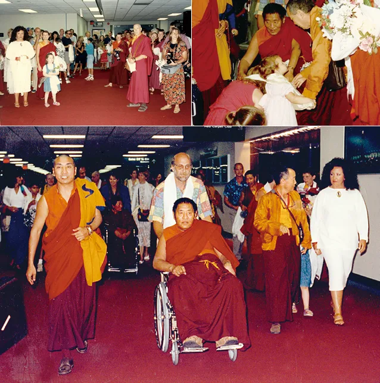

经过六个小时的飞行，我们从西海岸飞到东海岸，抵达美国首都华盛顿。刚一下飞机，就看到各种肤色的佛教徒手捧哈达，列队欢迎。他们包括白种人、黑种人、黄种人，有藏地的出家人，也有西方的出家人。每张脸上都洋溢着兴奋的表情，经过日夜的等待，他们终于盼到了法王的到来。

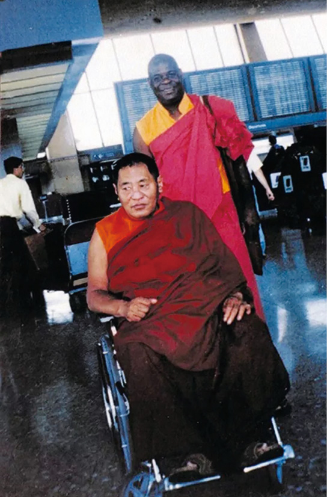

出了机场，我们发现，相比西海岸的自然风光，东海岸的华盛顿更具人文历史气息。作为美国的政治中心，虽然只有不到300年的历史，但这座城市的气势非常宏大，白宫、国会大厦等一系列建筑成为其独特的文化景观。

据当地人说，美国建国后想确定首都的位置，南方各州希望首都设在南方，北方各州希望首都设在北方，最后双方互相妥协，在南北方分界线上，规划了一个面积为100平方英里的菱形区域作为首都，并以美国第一任总统的名字命名，这就是华盛顿。

在这里，法王将有一周的弘法时间。

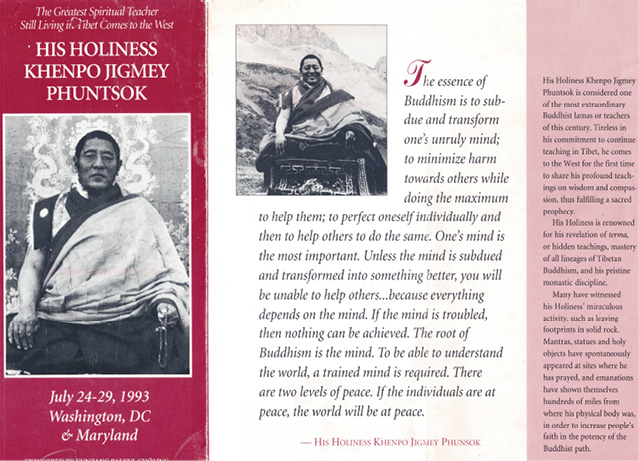

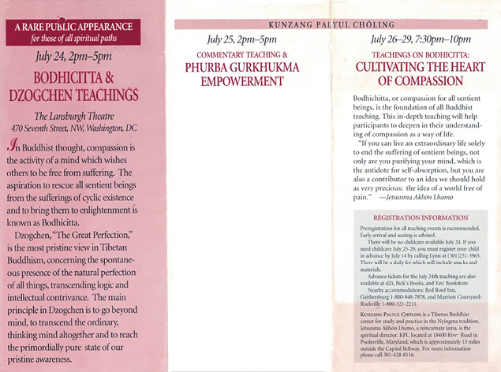

四谛法轮

7月24日，在兰斯伯格剧院（Lansburgh Theatre），法王开始了他在华盛顿的第一次演讲。这一天恰好是藏历六月初四，佛陀初转四谛法轮的节日，无独有偶，法王所讲的也与四谛有关。

演讲前，主办方先说了一段话：

“下午好！今天能在这里介绍法王晋美彭措仁波切，我感到无比的幸运和荣耀。

法王是当今世界上最了不起的大德之一，我们可以邀请他来华盛顿，亲眼目睹他的金容，不知道我们是怎么积累了这么大的福报。我希望每个人都能尽最大努力抓住这个美好的机会。

佛法中有一个初学者必学的重要教言，那就是，一旦进入佛门闻思修行，要像历经磨难来到了一个宝洲，千万不要空手而归。今天演讲的题目与四谛和大圆满有关，这些都是佛法的精髓，祝你们回家时收获满满，而不是两手空空。

最后我想说：这个机会，真的比你能想象到的最好的机会还要好。我无法用语言表达这个机会有多重要。只能再次感谢你们的到来，也感谢你们积累了这么好的业，才有机会来到这里。”

接下来是法王给大家开示：

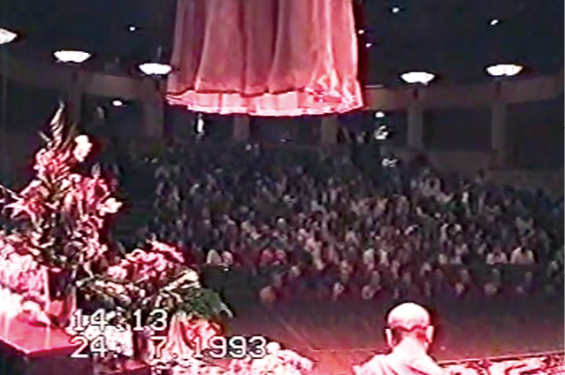

首先要讲的是，我等本师大慈大悲、善巧方便的佛陀，在多劫之前发起殊胜菩提心，中间用三大阿僧祇劫积累资粮，最终在印度菩提伽耶现前正等觉，七七四十九天后为了利乐人天等一切众生而初转法轮的吉祥日，正好是今天这个日子。这个缘起不谋而合，也是内、外、密吉祥善妙圆满的瑞兆。

在这样一个不平凡的日子里，我很高兴来到这个在全球近200个国家中首屈一指、拥有无与伦比经济实力的美国的首都。原因有三：第一，从美国领导人的角度来看，他们都有着与众不同的胆识、才智和勤奋，可以使世界全人类走上和平之路。想到这些杰出的人物住在这里，我很开心。第二，从美国公民的角度来看，你们都拥有财富、自由，享受着美满幸福，这是极其难得的。尤其是这个地方，环境非常优美，无论从山林、花园、住宅哪方面看，都仿佛天堂落到了人间，来到这里真的很欢喜。第三，我在东亚国家的时候，听说有这样一个地方，早就渴望有机会来这里。这一刻，我的愿望实现了，自然增添了一份意外的喜悦。尤其是看到你们各个道场的负责人和所有弟子对佛法有极大的欢喜心，对上师有极大的信心，甚至连神态都能做到毕恭毕敬，这种行为符合佛教徒的威仪和人类的高尚规范，所以我深受感动，也十分开心。

在美国这个地方，以丹嘉仁波切为主的藏族上师来过不少，他们长期以来对佛法做出了不可思议的贡献。所以，今天在我们聚会的这个大厅里，才有这么多身披红黄袈裟的西方僧人，让人见而生喜。

不管在什么地方，只要具备出家的比丘、比丘尼，在家的男居士、女居士这四者，就可以说有完整的佛法。这其中不管缺了哪一个，都叫不完整的佛法。如果一个地方只有出家人或在家人，那么佛法就不完整，而你们这个地方，佛法是完整的，应该可以称为佛法的中土。

尤其是出家人非常重要，原因是什么呢？所谓佛法住不住世，只看有没有出家人。当然，密宗法门没有不住世的时间，天、龙、夜叉、乾达婆、迦楼罗等的不同世界，都有实修密宗的，所以密法永远不会消失。而佛法在什么地方消失、在什么地方兴盛，唯一要观察的就是有没有出家人。正因为如此，这里有这么多的出家人是非常难得的。

或许有人问：“佛法会住世多久呢？”

住世5000年。佛陀的教典中说：“佛法临近毁灭时，由北向北而兴盛。”未来除了里地（新疆或尼泊尔）和藏地，印度等其他地方的佛法都将消失，这意味着戒律会消失。而现在，不仅藏地还有这么多人受持戒律，西方国家也是如此，说明藏地乃至整个世界的佛法会长期兴盛，有这样一个圆满的缘起。因此，如果你们以后能将佛法、尤其是出家戒律弘扬开来，真的会给整个世界带来繁荣与和平，消除一切疾病、饥荒、战争。我真诚地祈祷你们能记住这一点。

这以上是我随顺世间法则，有感而发说了几句话。现在，我结合佛教的法理简单讲一下：

从我等本师善巧方便的大悲尊者在印度鹿野苑，为人类眷属五比丘与八万天人初转四谛法轮以来，已有将近3000年了。根据吉祥普巴派的历算，今年是佛历2873年。按照全世界佛教徒的通用算法，今年是佛历2537年。下面我以随念佛的方式，简单讲讲佛所说的法。

・总说四谛

佛陀说了什么法呢？诸法因缘生，如来说是因，诸法因缘灭，是大沙门说。也就是缘起咒“嗡耶达玛黑德抓巴瓦，黑登得堪达塔嘎多哈雅瓦达，得堪匝哟呢若达，诶旺巴德玛哈夏玛那索哈”。

那么，缘起咒是什么意思呢？

这是佛陀给众眷属初转四谛法轮时讲的。一、“此乃苦谛，此乃苦集谛，此乃苦灭谛，此乃苦道谛”，这四句明确了四谛的本体。

二、“当知苦谛，当断集谛，当现灭谛，当依道谛”，这四句明确了四谛的作用。

三、“苦无所知，集无所断，灭无所现，道无所依”，这四句明确了四谛的究竟。

如是讲了三遍四谛，一共十二句。佛陀说出这十二句后，人类的五比丘等依次证悟了阿罗汉果，八万天人现量见到了法性真谛。也就是说，佛陀除了上面的十二句法之外，并没有宣说其他法，但仅仅依靠善巧方便、大慈大悲的佛力，加上其眷属都是具信心的最后有者，就现前了断证功德。所以这次我用归纳的方式简单讲一下四谛法门。

怙主弥勒菩萨，现居兜率天，是释迦牟尼佛的补处，我根据他的注释给你们解释：

佛陀通过比喻阐述了四谛。第一句是，就像身患重病的人，首先需要认清疾病之苦，这是“当知苦谛”。第二句是，如果想摆脱疾病，就要知道它是由饮食、行为等什么病因引起的，然后断除它，这是“当断集谛”。第三句是，如果病没了，身心就会舒适安乐，这是“当现灭谛”。第四句是，远离苦集二谛的灭谛，不是无因无缘产生的，就像摆脱疾病必须依靠医药一样，为了现前灭谛，必须修持正道，这是“当依道谛”。

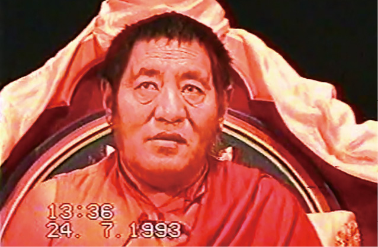

一、苦谛

就像需要认清病苦一样，我们必须认识到，无论转生到三界轮回的什么地方，都是痛苦的自性，会有苦难纷呈，如同跳进火坑、接触兵刃一样，不会有丝毫安乐的机会。

那么，轮回众生是如何陷入唯一的痛苦中的呢？

我们有身体上的病痛、精神上的苦恼，还有对物质财富、权势地位的求而不得，暂时高高在上，终究坠落于地，这些都是痛苦，谁也不会否认，这就叫变苦。

一切我们认为能带来快乐的东西，比如财富、地位、名声等，也是痛苦的自性。为什么呢？拿财物来说，有了一个，就想要两个，有了两个还想要三个，就算你掌管一个国家的所有政治和经济，还是想要其他国家的财富。贪得无厌的心总是随着欲望散乱，除了痛苦永远不会有安乐。

再想想物质财富。积累之初，你需要进行各种劳动，经历很多艰辛，这是积蓄的痛苦。中间担心被敌人、盗贼等掠夺，这是守护的痛苦。最后，你一天到晚想的都是物质财富，有了一个想两个，有了两个想三个，如此除了痛苦，根本不会依靠财富而获得快乐。

想想自己享受快乐的情况。打个比方，如果一个人拥有整个美国的所有物质财富，那么除了吃得好一点，穿得柔软一点，卧室和房子舒服一点，没有其他可以享用的地方和享用的时间。所以，除了口中吃的、身上穿的，再多的财富也没太大用处，反而是很多烦恼的起因。

另外，即使一个人拥有了世界上所有的物质财富，也没有权力在死的时候带走一针一线。同样，哪怕是全人类的领袖，也没有权力在生命的尽头带走一个人，他们只能空手独自离开，这一刻终将到来。这短暂的一生，实在没必要贪图大量的财产。佛教里说知足少欲是最大的财富，连帝释天王都难以享受。这是绝对的事实。

我们不应该迷恋物质财富，重要的是修持清净的法。虽然从表面上看，亲戚、朋友、挚交越多，越让人高兴，但真正说来，这些越多，越让人痛苦。因为要操心他们所有人的吃穿，解决他们的矛盾，维持和谐的关系，要管的事情特别多，除了徒增散乱，没有任何好处。同样，权势、地位、名声等一切都没有超越痛苦的本质。

一般来说，乞丐需要经历磨难才能得到一点财物，而普通人需要经历同样的磨难，感受同样的痛苦，才能事业有成，获得高位。即使是高高在上的人，也怕自己一落千丈，想往上爬，想升官，所以心里有很多苦。那些有声望有名气的官员，比起普通人，希求和担忧要多出百倍千倍，自然更是雪上加霜。一个底层的人只想提高衣食住行各方面的生活水平，根本不用担心官位的升降。而身居高位的人非常渴望升到更高的位置，又担心跌到更低的位置，所以有希求和担忧两种痛苦。地位低的人只有希求的痛苦，没有担忧的痛苦，所以地位高的人更痛苦。如果你是一个普通人，除了找一份好工作、衣食无忧之外，不需要太担心名声、权力、地位，晚上睡得也香。但如果你身居显位，会整天考虑自他的各种利益，会有睡不着的失眠痛苦。

即使你的财富、名望应有尽有，它们也不会恒常、稳固，所以也是痛苦的自性。比如上半生是个有钱人，下半生却成了乞丐，上半生高高在上，下半生却跌入低谷，甚至是上个月还财大气粗、一切美满，下个月却变得极其悲惨，这种现象并不少见。所以，对一切不贪执、无挂碍才是根本。

没有人不追求财富和名声，但如果你过去积累了善业，不用刻意努力就会成功；如果没有善业，哪怕在有生之年多么拼命、多么努力，都得不到名利。所以大家要学会放下，不然再怎么忙碌，轮回琐事也难有做完的时候。

我们曾经有过的快乐和繁华、名望和声誉，以及这一生所遭受的痛苦，如今都成了回忆，不会再重来，就像昨晚的梦一样。在梦里即使享受了很久的快乐，或者遭受了很久的苦难，醒后都会一切成空，这些苦乐并不真实。同样，当我们死的时候，终生的快乐和终生的痛苦都没有实义，所以不要贪图幸福、财富、名声等等。

大悲佛陀曾说：就像在不净室里，只能闻到臭味，根本闻不到香味，同样，无论转生于六道的哪一处，都只会有痛苦，根本不会快乐。你们深入思考就会明白，苦和乐都是痛苦的自性，根本没有快乐可言。如果意识到轮回处处皆苦，相续中就会生起想脱离轮回、不想住在这里的无伪意乐。

二、集谛

如果你想离开痛苦，就必须致力于断除痛苦的因，否则，痛苦本身是无法自然断除的。而痛苦的因是集谛，集谛有烦恼和业二者。

1．烦恼

烦恼有三种：贪心、嗔心、痴心。

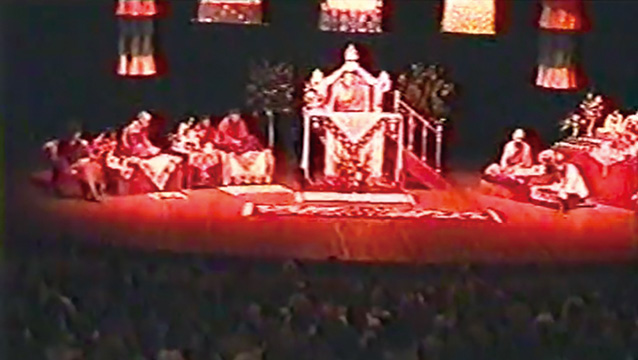

所谓贪心，是指对物质财富、权势地位、朋友爱人的贪执。简而言之，对一切悦意事物的挂碍，就叫贪。如果被它控制，就会产生无尽的痛苦，所以，首先要想方设法断除贪欲。

所谓嗔心，就是希望别人遭受苦难，在此基础上还会发怒。嗔恨的起因是什么呢？就是损害你和你喜欢的亲友，或是别人饶益你的敌人，这就是愤怒的原因。如果不从根本上斩断这一切，就会感受无尽的痛苦，所以嗔心也必须断除。

所谓痴心，是指对取舍的无知，不知行善也不知断恶，对这些一无所知。痴心分为未证、邪证两种。“未证”是指我们虽然都生在南赡部洲，转生为不同于其他众生的人类，但如果不勤于行善断恶，没有任何宗教信仰，整天无所事事、迷迷糊糊，就会像牛马一样。牛马也是只知道吃喝、逃避灾难，除了牛马是不穿衣服的，人是穿衣服的，没有什么区别。

在这个世界上，有三大宗教，也有很多不同的小宗教，大家还是要选择一种信仰，否则，只是浑浑噩噩地活着，这是一种严重的愚痴。比如我之前在加州的时候，那里有很多牛定期被杀，但它们只是在草原上快乐地吃草，没有一头试图逃跑。同样，也有人认为自己不需要信仰宗教，没有什么理想和追求，只是停留在吃吃喝喝上，这会不会连牛都不如？不能这么做。

“邪证”是指虽然有信仰，但对事物的真相并不完全了解。所以要谨慎对待自己想加入的宗教，分析真假，问问别人。否则，在没有任何观察和分析的情况下，随便加入一个宗教，并不是一件好事。我们对一天的食物都会仔细观察它香不香、干不干净、有没有毒，更何况是给生生世世带来永久大利的法了，所以一定要慎重考虑。

有些人无缘无故地爱一种宗教，恨另一种宗教，这是没有道理的。我们应该通过理证的分析，谨慎安排人生的行程和归宿。要思考什么是正法、什么是邪法，什么是有利的法、什么是不利的法，需要深入细致地研究。不做任何分析就贸然加入宗教，也叫愚蠢，所以这一点有必要断除。

在这个世界的宗教中，有的人声称与他人邪淫、偷盗、抢劫是善法，有的人则声称杀很多人、害众生是善法。仔细想想，这样的贪嗔之事，今生中甚至违反了国家的法律，更不要说是一种获得后世安乐的方法了，毕竟害人永远不会给你带来好处。

而且，有些宗教虽然在追求幸福，但只让自己、自己的亲人、皈依自己宗教的人受益，根本不考虑别人。这比世间的普通人好一点，但它只帮助自方，并不是最好的宗教。无论什么宗教，只有对自己和其他一切众生都有利，才是最好的。哪里有这样的宗教，我们就应该皈依它。

当然，仅有一颗利益自己和他人的心，并不能带来广大的利益，就像断臂老妇眼睁睁看着儿子被水冲走，除了希望儿子不要淹死，她什么都做不了。我们要有英雄父亲把儿子留在战场上一样的勇气和毅力，尽一切可能去成办自他二利，哪里有自利利他的方便法，我们就必须去学修。

利己利他的正确方法，必须以教证成立、以理证成立、以修证成立，也就是通过三量来成立。以前很多智者和成就者的选择一定是基于经论，不能仅凭一两个人的估计就下定论，所以要有教证的出处。而且，如果理证不成立，就好比一个当权的人声称“只有与我的法结缘，才会快乐幸福，否则会遭受痛苦和不幸”，这是不可信的，必须用严谨的推理来证明。接下来，要通过修证来成立，如果修了这个宗教的法，你会获得暂时和究竟的果，一定要有这样的修证体验。没有这个果，光说一大堆也没用。

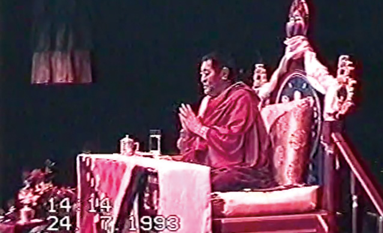

在这个世界上，所有致力于利乐有情的宗教，都是由释迦牟尼佛的事业和大悲的牵引才显现出来的。印度教认为释迦牟尼佛是遍入天的幻化，从佛教的角度来看，大自在天是观世音菩萨的化身，只看这个宗教成办今生安乐这一点，就足以说明它是佛陀的大悲化现。拿基督教来说，它的目的是培养对众生的慈悲和博爱，这也是佛教的核心，可以说是佛陀事业感召的。所以，不管你是谁，对世间上兴盛的宗教都不要偏执爱恨，所有宗教和睦共存、团结友爱至关重要。

说真的，除了佛的教义能被教证、理证、修证来证明之外，其他宗教几乎不可能。如果想了解更多，参阅各大宗教的书籍就明白了。否则，我很难在今天这么短的时间内，把佛教的特点和其他宗教的观点完全讲清楚。总之，你们把一两千年以来的书都看一遍，一定会生起诚信的。

就拿我来说，我本身是个佛教徒，生活在佛教兴盛的地方，但我从来没有因为自己是佛教徒，就对自己的宗教产生贪执，对其他宗教产生反感。依靠对所有宗教的长期深入研究，所以我能分辨好坏。当今佛教有南传佛教、汉传佛教、藏传佛教三种，其中我长期学修和研究的是藏传佛教，对佛法的殊胜性或超越性坚信不移，所以告诉你们这些。你们也要从现在开始仔细观察法的好坏，如果你想加入哪个宗教，加入之前一定要慎重考虑。不加任何观察和分析就加入，也就是我们藏族谚语说的，就像饿狗遇到肺一样。虽然动物体内的肺比其他肉都差，但饥饿的狗会来不及观察就吃掉它。同样，不加分析地盲目追随一种宗教，也是绝对不行的。

总之，认清痛苦的第一个因——贪嗔痴三种烦恼后，应该想方设法摆脱它。

2．业

接下来，痛苦的第二个因是不善业，我们也要一一断除。

第一，不杀生：不管是谁，都要杜绝杀生。虽然其他一些宗教宣称不杀人而杀其他众生，是无罪的。但仔细想想，你会发现，无论什么众生都怕死，死时都会有痛苦，所以都不能杀。比如一只小蚂蚁，它也爱惜自己的生命，为了不被伤害，会想尽办法逃跑，保护自己。众生都一样，你有什么样的痛苦，其他众生也有那种痛苦，所以首先要从根本上断绝杀生。

第二，不偷盗：如果以自私心去偷别人执为我所的物质财富，不仅会给别人带来伤害，也会间接给自己带来痛苦，所以应该断除偷盗。

第三，不妄语：如果用谎言严重欺骗别人，不仅会对他人造成极大的伤害和困扰，也会失去一个好人应有的品质，所以必须断除妄语。

第四，不邪淫：如果和别人的妻子或丈夫邪淫，如上所述，有很大过失。原因是，别人最贪爱、最执著的，没有比自己的妻子或丈夫更厉害的了，所以它的罪业大过偷盗。

第五，不饮酒：就是要断除一切罪过的根本——酒。如果喝酒，会给身体带来许多疾病，也会成为修行正法的违缘。心不受控制的话，就会失毁其他一切戒律，所以必须戒酒。

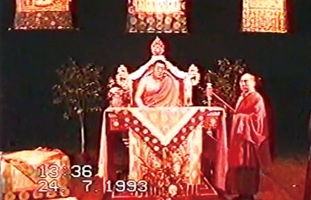

断除身语四种不善业和酒，就叫五戒。只要是入了佛门的人，最好能断除这一切，如此必有不可思议的功德。特别是在断除了这些行为的基础上，若能在他人面前受居士戒，以此护持自相续，更有百倍千倍的功德。所以，你们以后受个居士戒来行善，就更好了。

在座的所有出家人，戒律基本一样，但与在家人有两点不同：第一是平时要穿僧衣。不穿僧衣就像个在家人，没有所谓的出家相，所以，出家人和在家人的区别，就在于平时是否穿僧衣。第二，如果是在家人，与妻子或丈夫行淫，不会有邪淫的罪过。但只要是出家人，就要断除非梵行，否则就从根本上破了戒。今天这个道场有很多出家人，所以我专门讲了四根本戒和酒戒这五戒。以后你们要穿好僧衣，守护五戒。就算守不了其他大戒，也没关系。

根据藏地的律典，如果没有受出家戒，就没有资格穿僧衣。但在这个地方，如果你们暂时不具足受出家戒的顺缘，只要能穿上僧衣，护持三皈五戒，也是可以的。一旦穿上佛陀的袈裟，就会为所有看到它的众生播下解脱的种子，不会受到一切鬼魔障碍的侵害，并能顺利快速地生起觉受、证悟。总有一天，当顺缘具足时，你们一定会受出家戒的。否则，明明具足顺缘却不受出家戒，这是完全说不过去的。

三、四，灭谛和道谛

善业的究竟果是什么呢？是佛果，它是根除痛苦的无上安乐。得到佛果，叫现前灭谛；要获得这样的灭谛，就要依止道谛。

道谛，是指相续依止正道。在这个世界上，佛法有小乘和大乘两种，其中大乘分为显宗和密宗金刚乘，总共有三乘。

所谓“小乘”，就是皈依释迦牟尼佛，在此基础上断除害他的一切意乐和行为，只求成办自利。现在斯里兰卡、缅甸、泰国等地，很多人都在修小乘法。

所有的大乘法，除了自利，更注重利他。专门利他，意乐和行为只成办他利，护持将一切众生安置于佛果的慈悲心，就叫“大乘”。如果你是一个小乘行人，需要断除害他及其根源；如果是大乘行人，不仅要断除害他，还要唯一行持利他。实修这种法的人，如今在汉地大部分地区和日本能找到。

以大乘为基础，具有很多殊胜的窍诀，就叫“密宗金刚乘”。它不需要长时间的苦行，就能成就佛果，在诸多方便和智慧的帮助下，成佛是可以在一生中完成的。其中，“方便”生起次第是把自己观成本尊等，“智慧”圆满次第是将诸法观为空性等，生起次第、圆满次第这两种道，都属于密宗金刚乘。在藏地和不丹等地，有许多人实修这种密宗金刚乘。如今在美国，很多藏传佛教上师的道场和弟子也在修。还有很多藏传佛教的上师，在其他地方广兴道场，大力弘扬密宗金刚乘的法。

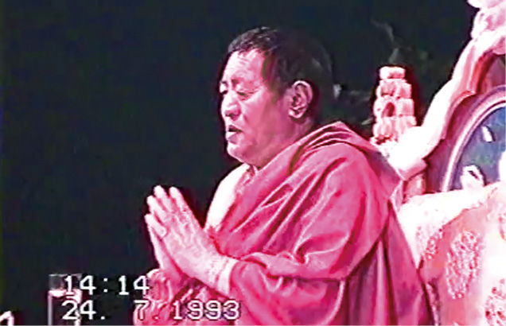

密宗金刚乘中，堪称诸道之究竟、诸佛之密意、万千佛母空行之心血精华的法是什么呢？是光明大圆满。如果你知道修持此法的殊胜方便窍诀，那么确实是日修日成佛，夜修夜成佛，具宿缘者不用修也能成佛。光是听到它的名字，就能阻挡恶趣之门；光是看到经函上的文字，接触它、忆念它，就会轻松快速地到达圆满佛地。

它像摩尼宝一样，并非时时出现。这个法即使是一个忙于理想和追求、琐事繁多、成办今生事业的人去修，也是简单易行，短时间内就能得果。但是，除了有缘人，一般人是不可能遇到这个法的。如果你遇到了，靠这个法不可能不解脱。

在藏地，最早树立密宗法幢的无与伦比的尊者，是邬金莲花生大士和布玛莫札。此法是两位尊者以至宝的方式传给诸位心子的甚深法，即使在藏地，也很难获得。在修传八大派的众多法中，光明大圆满唯一是前译宁玛派的特法。

我之前在旧金山说过，在你们美国，很多人都是大圆满的所化众生。虽然我也讲过很多其他法，但都没有那么受欢迎，而讲到大圆满的时候，大家都特别欢喜，从表情上也能看出非比寻常的信心和恭敬心。你们这里经济很发达，人们要成办各种事物，要追求很多目标，修其他的法想必难有成效，而这个简单有效的大圆满法更适合你们。我认为，西方许多佛教徒都是大圆满的所化众生，希望你们现在和将来好好实修大圆满。扎西德勒！

在根桑白玉秋林

在华盛顿的这段时间，法王住在根桑白玉秋林（Kunzang Palyul Choling）。这里环境清幽，树木葱郁，置身其中，仿佛来到了佛陀时代的鹿野苑。

这个道场是阿贡拉姆（Ahkon Lhamo）建立的。她是贝诺法王亲自认定的女活佛，虽然是在家身份，却培养了不少出家人，这在西方国家是相当罕见的。

阿贡拉姆在被认证为活佛之前喜欢收集水晶，道场里随处可见各种颜色的水晶。她特别邀请法王观看，法王想找一种纯天然的八角水晶，对大圆满修行有帮助，但是我们找了半天也没找到。

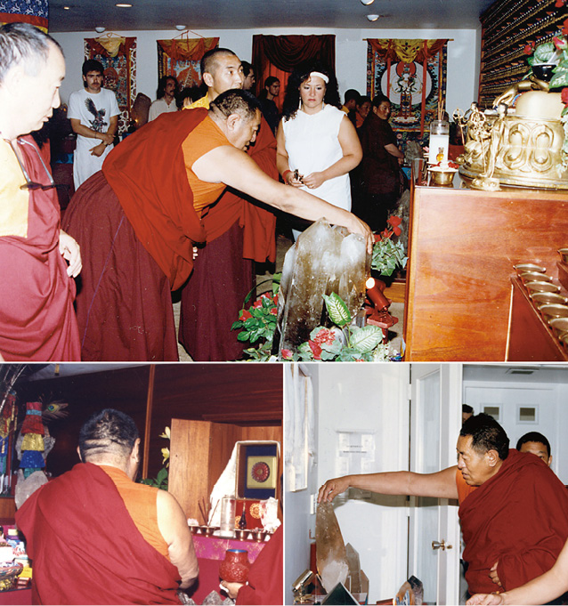

在接下来的几天里，法王经常是白天游览华盛顿的著名景点，晚上给大家灌顶或传法。

天时地利人和

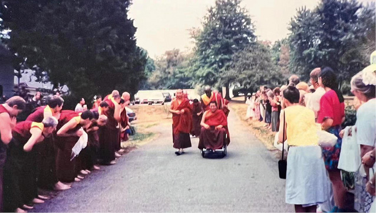

7月25日下午，法王传授了“项袋金刚橛”的灌顶。因为听众太多，所以在不同房间设置了闭路电视进行转播。期间，法王提到了这样一段话：

俗话说“吃饭前要供养，做事前要发言”，在正式传法之前，我简单说几句。

按照我们藏族的传统，首先要问候这个道场的住持、主管身体安康，送上吉祥的祝福；接下来，我要向曾经去过藏地求法、长期听受教言的美国弟子们，送上吉祥的祝福；我也要向与我同一家乡的色达僧人和来自尼泊尔的藏族同胞，送上吉祥的祝福；还有，向在场所有前来求法的人，送上吉祥的祝福。其他几位都是跟我一起来的，所以不需要祝福。（众笑）

祝你们身体健康！祝佛法兴盛！

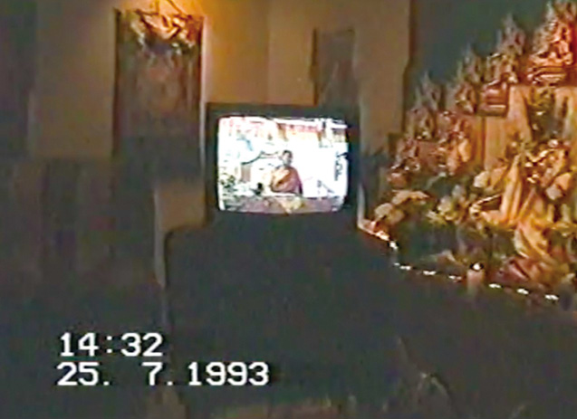

这一次，我在这里传法，也是具足了与众不同的殊胜缘起，是一件值得高兴的事。是什么缘起呢？就像我昨天说的，这是堪为世界之最的美国的首都华盛顿，在这个地方广泛传播佛法，从处所而言，是极其令人欢喜的。然后从法、本师、眷属来说，当今世界经济实力最强的是美国，佛教最兴盛的是藏地雪域，如果雪域的正法和美国的经济实力能够互补，那么整个世界将呈现一派和平繁荣的景象。而且，在这样一个吉祥的时刻，与大家欢聚一堂，更是增添了一份喜悦。

从时间上来说，昨天是我们大悲本师佛陀初转法轮的节日，本月初十是邬金莲花生大士在西南乳海不依父因母缘而以自然觉性顿现的方式诞生的重大节日，不仅如此，这也是莲师前往妙拂罗刹洲调伏众罗刹的特殊节日，恰好赶上时间圆满。在佛教中，所有出家人行持律藏三事的特殊时间，是本月十五日，此时他们开始在夏季安居三个月，依次行持布萨、开遮等广大律法行为。就密宗佛教徒而言，初十是所有勇士、空行自然聚集的特殊日子。邬金莲师也说：“上弦月之初十日，邬金降临诸藏土。猴年猴月之初十，化身不变遍藏土。”邬金第二佛会在初十踏遍以藏地为主的世界各地。在新派的密续中还提到，在这个勇士和空行自然聚集的特殊日子，也是所有密宗行者自然开启密宗坛城之门的时候。特别是从藏历六月十五日起的六个月里，恰好是所有大圆满修行人实修三层虚空等大圆满见解的特殊时间。

一般来说，无论什么时候修大圆满法，都会获得加持与悉地。不过，印度和华盛顿是非常热的地方，现阶段正好气温略有下降，身体四大平衡，在此期间，初学者从本月十五日开始修行六个月，很容易现前觉悟，也有利于修行境界的护持，因此，所有前辈持明者的常规做法，主要是定在本月十五日之后。据说正是考虑到这样一个特殊的时间，丹嘉仁波切也计划在这段时间来这里，可能会推迟一两个月。我相信他所有的佛法意愿都是为了大家能去修行。

就像藏族谚语说的“人为缘起非为妙，自然缘起即微妙”，特意安排缘起不太好，但如果是自然的巧合，就非常好了。我没想过要在箕宿月初转法轮日来美国首都讲四谛法门，你们也没有这样的安排，但是依靠上师三宝的大悲力，自然促成了这个缘起，这是自他都值得高兴的事情。

对我自己来说，从25岁到现在，成办任何弘法利生的事，也大多是从这个月开始的。我简单给你们讲了一下近年来做的事情：

1985年，我去了伏藏大师列绕朗巴的寺院坐床，发愿护持广大的弘法事业。从此，我致力于雪域每个角落的僧众团结和合、清净戒律、闻思修行，行持了难以形容的广大事业，也成办了前所未有的利他之事。

1986年六月初四，为弘法利生，我发起了殊胜菩提心，走访了多康下部二十五大圣地及各地寺院。那段时期，二十五大圣地自然出现了前所未有的文字、佛像、佛塔等，我也开取了很多甚深伏藏品，呈现出诸如此类不可思议的验相。单单从身披袈裟的出家僧团来说，“文革”时期佛教衰落到低谷时，每个地方只有一两个出家人。之后，我和我的主要弟子们到处传出家戒，现在仅仅在我的家乡周围，大约就有2万名僧人受持清净戒律。完成了这样一件大事。

1987年，我带领一万多名藏族僧俗，还有不少汉族人、蒙古人去了东方五台山，念诵了几千万遍《普贤行愿品》。每一个去那里的人，根据自己的缘分，上等者亲见怙主文殊菩萨的尊颜，听到了他的言教，得到了他的智慧加持；下等者看到彩虹、光芒、神奇的瑞相等。现前了这样的成果。

1988年，我对新龙十三座寺院的全体僧人，传授了灌顶、传承、引导，树立了讲修法幢。

1989年，在木雅古屋神山，为大约三千名弟子灌了“四心滴”的顶。

那些年，我的佛学院僧团蓬勃发展，多的时候僧众人数达到六千左右。通常在这个时候，他们正精进于发殊胜菩提心。

1990年，我按照大成就者贝诺法王、顶果钦哲仁波切等几位大德的意愿，前往印度。这个月初四那天，在座的南珠堪布、索达吉堪布、吾智多杰和我们家三人，还有两位僧人，我们师徒共八人，去了丹嘉仁波切的精舍。在古老的观音像“吉众觉沃瓦德桑布”前，我和丹嘉仁波切共坐一座，发下了殊胜菩提心。这个月初十，我去了印度南部的迈索尔，在贝诺法王的南卓林佛学院，我为一千名僧人，尤其是四十位堪布、活佛，灌了“文殊静修大圆满”的顶。从那以后，我所做的任何事都是一帆风顺，没有违缘，圆满成办。

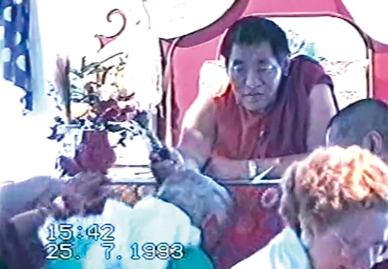

说这些的目的不是宣扬我了不起，而是为了让你们更欢喜、更高兴。所以，这次在这个地方，缘起不谋而合。通过讲法和听法，想必能成办弘法利生的大事，满足我的所有愿望。这是令人非常开心的，不是偶然的运气造成的。所以，我简单地讲这些，也是为了让你们开心。

如上所述，你们美国的经济实力相当于好食材，我们藏地的正法相当于好调料，两者缺一不可。食材再好，不加调料我们也不想吃。同样，经济实力再强，如果不与正法事业相结合，虽然此生会快乐，但后世未必幸福。现在，当好调料配上好食材，是时候享受美食了。（众笑）

如果今天来的不是我，而是一个有钱人，可能会给你们道场的所有修行人摆一桌丰盛的美食大餐，但我却设了一桌正法盛宴来款待你们。大家愿意享用吗？（掌声）

国家广场一日游

7月26日，法王来到华盛顿的中心地带——国家广场（National Mall），这里是美国国家庆典和仪式的重要场所，旅游景点相对集中。

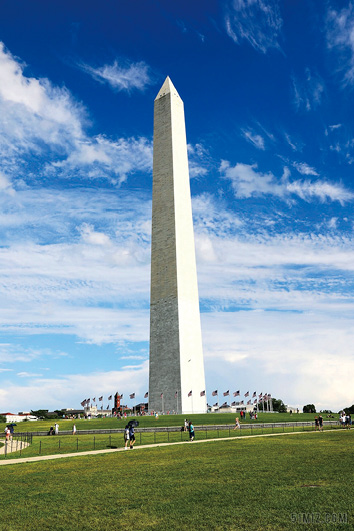

首先看到的是华盛顿纪念碑（Washington  Monument），它是华盛顿的地标，为纪念首任总统乔治·华盛顿而造，高169米。美国政府曾宣布，华盛顿的任何建筑都不能超过华盛顿纪念碑。这块碑上一个字也没有，就像武则天的无字碑一样。有人说，这意味着他的功绩无法用语言描述；有人说，这意味着他的功过留给后人去评判。

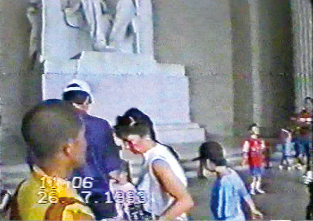

接着，去了林肯纪念堂（Lincoln Memorial）。这是为纪念美国第16任总统亚伯拉罕·林肯而建造的。一进纪念堂，就看到了中央的林肯雕像。雕像上方有一句题词——“谨以此殿堂纪念亚伯拉罕·林肯，他为全体美国人民挽救了联邦”。这里也是寻求和平者的聚集地，马丁·路德·金曾在此发表过演讲《我有一个梦想》。

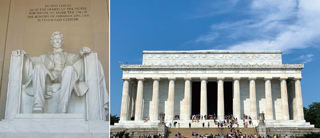

然后，我们去看了越战纪念碑（Vietnam Veterans Memorial）。它由黑色花岗岩砌成，长约500英尺，上面刻满了越南战争中阵亡将士的名字。法王在这里停留了较长时间，为那些逝去的人念了经。

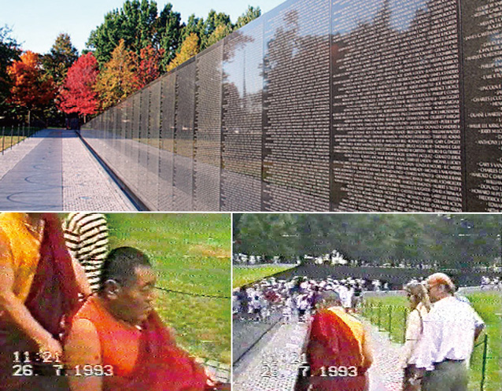

最后一站是国会大厦（United States Capitol），它是美国的心脏，大多数总统就职典礼都在这里举行。国会大厦是一座五层建筑，最引人注目的地方是中央圆形大厅，这里有气势宏伟的壁画和历史人物的雕塑，展示了美国历史上的一些重要事件。大厅的南北两侧分别是众议院、参议院，见证着美国重大决策的通过与否决。

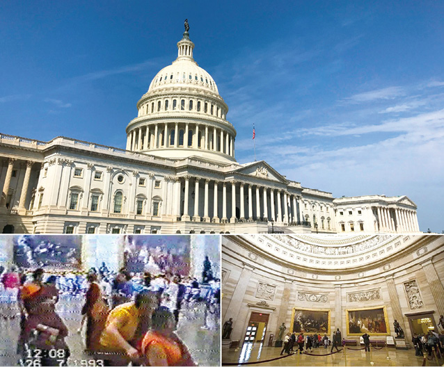

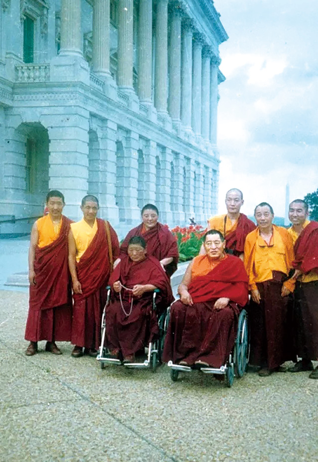

文殊静修的由来

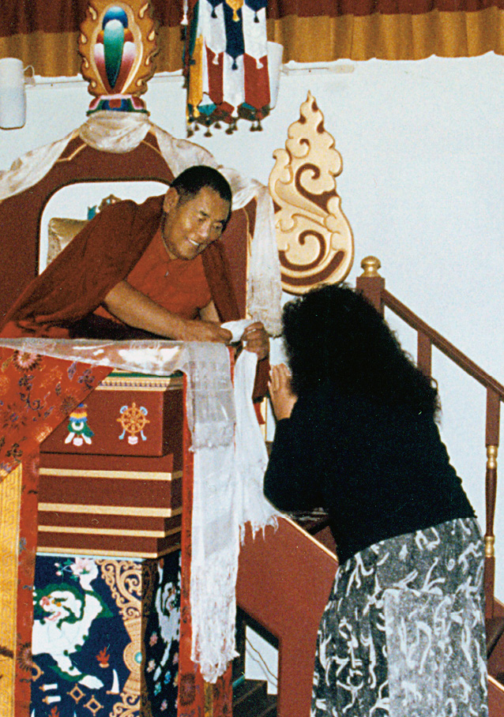

当天晚上，法王给大家传授了“文殊静修大圆满”的灌顶。灌顶前，说了这样一段话：

这个“文殊静修速赐加持”的灌顶，我简单介绍一下它的由来：

1987年，我和一万名藏族僧俗去了东方五台山，怙主文殊菩萨真正安住的地方。当时不仅有藏族人，还有汉族人、蒙古人和许多朝圣的外国游客。大家在释迦佛舍利塔前共诵《普贤行愿品》几千万遍。依靠文殊菩萨的智慧妙力，那里上上下下的人都相应自己的缘分，获得了不共的加持：上等者亲见文殊菩萨，听到了他的言教，得到了他的智慧加持；中等者在觉受中出现这些；下等者在梦中见到文殊菩萨的尊颜；最下等者也看到了文殊加持的光相等在《五台山志》中提到的十种验相，似乎无人不得加持。

发愿结束后，大部分在家人完成了今生和来世的发愿，平安返回各自的地方。五百多名想一生修成佛果的出家人，在五台山圣地住了一百天，在怙主五部文殊居住的五个台和其他菩萨、成就者去过的多个圣地修行。

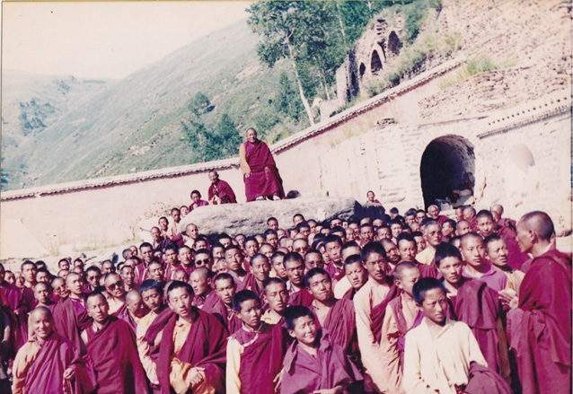

我们出家人主要住在几个地方：一个是五台山西台静处、怙主文殊示现神变的清凉石。在这上面，我于六月初四到初十给众弟子传了法。初十那天转广大会供轮时，空中出现了彩虹和光自性的文殊身、狮子、文字、手帜等，在场的五百僧人全部目睹。

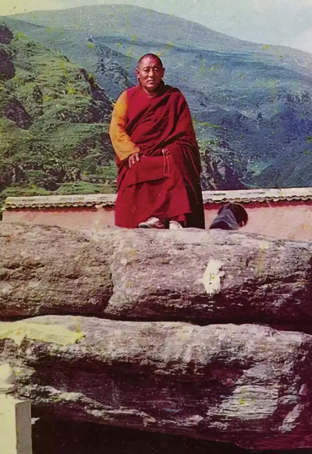

法王在清凉石

第二处是东台下方的善财洞，这是善财童子在文殊菩萨前发殊胜菩提心与如海普贤行愿的地方。我们在这里发愿的时候，现场有六百多名汉族在家信徒，大多都看到了空中的文殊菩萨，也有人看到了狮子等境象。

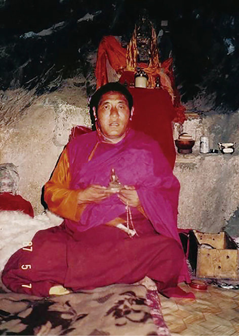

法王在善财洞

还有一个地方是东台顶附近的那罗延窟，也被称为无爱子洞，这是佛在《华严经》中授记从初劫到末劫文殊及其一万眷属恒常安住的地方。在那罗延窟，依靠文殊菩萨加持入心的力量，我将此法立成了文字。所有实修此法的人，都会无勤生起觉受、证悟，至少会生起不一样的信心、悲心等。它的加持非常明显，所以在整个雪域弘扬得很普遍。

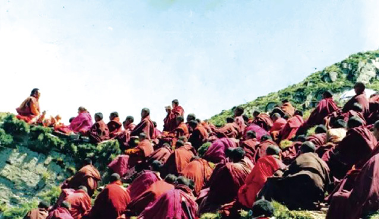

法王在东台顶传法

1990年，我去印度时，也毫无保留地为诸多智者、成就者、持教大德，献上了这个法的灌顶、引导和教言。依靠这一因缘，此法比以前传播得更广，在印度、尼泊尔、不丹及汉地普遍弘扬开来。

今年，依靠往昔的缘分和愿力，我来到了美国。一开始我并没有打算灌这个顶，但经过他们的再三劝请，再加上愿力和时机成熟，到了乃琼寺我就传了此法，每个人都充满信心、恭敬无比，似乎真的要受持这个法脉。

之后我去了科罗拉多的道场，在给众眷属灌这个顶的时候，回想起我去五台山时突然写的预言，于是当众念了出来。是怎么写的呢？虽然这个法的起源地在东方，但广泛利众的兴盛地却在西方。当时在场的那些人，由此生起了极大的诚信，全部承诺要实修它，所以，他们的信心叫做胜解信。

尤其是在加州的道场，我也传了此法的灌顶和引导。道场那些上师，拥有佛教里说的功德，以他们得受此法的缘起所感召，许多弟子都生起了胜解信或不退转信，利根者更是信心大增。

所以，你们对这个法只有欲乐信是不够的，应该生起胜解信。这种信心来源于字义里的特殊加持，否则，随便听别人讲讲而产生的信心，是很容易退失的，今天有信心，明天可能就没了。另外，你们对我的虔诚恭敬，也可以归功于胜解信。为什么呢？如果拿我和你们的上师比，无论是名声、地位、内在功德，她真的比我好百倍千倍，但这一次，她是跟在我身后，恭敬得像最低等的仆人。佛陀曾在法藏中说：“恭敬众生，当起断角牛想。”所以，她一定有特别虔诚的信心，否则不可能做到这一点。

不仅仅是她，我这次的五位眷属中，美珠、门措都是我的家人，她们虔诚的信心本就不可思议。还有南珠堪布、索达吉堪布、吾智多杰，前两年我们一起去印度时，他们做了六个月的侍者，忙前忙后，没有厌烦。今年在美国也是，日日夜夜不知疲倦，我就像转轮王，他们就像乞丐一样随侍服务，说明他们真的有不退转信。

对上师的恭敬和信心，如何才能知道是不退转信呢？从以前的历史可以知道：往昔释迦牟尼佛在世时，有一个大国王，叫波斯匿王。他对佛陀生起不退转信之后，不仅对真佛，包括见到佛的眷属，也恒常顶礼，解开头发铺路。一天，来了许多遍行者，国王以为他们是佛的随行者，于是进行顶礼，以发铺路。当地人嘲笑他不应该这样做，于是他向佛陀请示：“请开许我为您所有的声闻，供养不同于遍行者的衣服。”佛陀开许了，这就是现在出家人穿的三衣。以前在印度，对上师特别尊敬和信任，就标志着具有不退转信。

在藏地，也有这样的国王。从前，有一个法王叫赤热巴巾，是统治广阔领土的大国王。他留着长发，每当僧众到来，就把头发铺在地上，让僧人在上面走。他对僧人非常恭敬，被称为“具发髻法王”。

像这些国王一样，如果你对上师特别恭敬，说明你有不退转信。

・对持教大德的教诫

到了华盛顿以后，我希望这里的利生事业比夏威夷和加州更广大。原因是，现在贝诺法王被任命为整个前译宁玛派的教主，在宁玛派中，没有人比他更有说服力和权威性。长期以来，我对他佛法方面的功德、世间方面的做法，做了深入细致的观察和分析。从佛法方面来说，他既有智慧，又有成就，品行无与伦比；从世间方面来看，他也是心地善良、高瞻远瞩、有情有义、表里如一。像他这样的上师，恐怕当今世间已经不多见了。而被贝诺法王认定的阿贡拉姆，如今也是名气在外，事业广大。我希望她不只是一个虚名，而应该是名副其实。就算她有一百位根本上师，顶上唯一的宝珠也是贝诺法王，她要自始至终尽力实现他的广大意愿。这是第一点。

贝诺法王以无碍的智慧，照见并授记了这个地方，任命她为此地的法主。不像其他地方，这个地方是在美国的首都，所以我希望它成为一个与众不同、独具特色的佛教基地。这是第二点。

要成办这样弘法利生的事业，不可能无因无缘，首先自己必须具备功德。就她而言，我相信她有与生俱来的功德，但要维护道场、培养僧才，光有俱生的功德是不够的，还必须有学修的功德。原因有二：第一，自己虽然具备智慧和成就的卓越功德，但只有对佛法广闻博学，才能说服其他众生。这个世界上，不可能有一个人的俱生功德比释迦牟尼佛还多，但是佛陀还依止了让坡、拉修两位上师，来让世人生起信心；就悟道成就而言，不可能有人超过邬金莲花生大士，但他也依止八大成就者等很长时间；同样，布玛莫札也依止西日桑哈21年，无余得受了他的教言。所以，即使自己拥有俱生功德，也要依止上师，听受教言，尽可能地学修究竟，这是非常重要的。

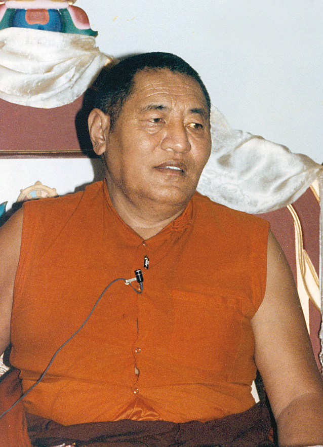

第二，虽然大部分上师前世成就了不可思议的功德，但是会被习气障、胎障等所遮蔽，为了开显它，即使他们功德丰富，也需要依止上师，广学佛法。佛陀在《摄持功德续》中说：“无有上师前，佛名亦无有，千劫之诸佛，皆由依师生。”这一点已经讲得很清楚了。

根据我在远方了解到的情况，她依止贝诺法王后，得受过《大宝伏藏》等的灌顶、传承和引导，听说她还依止过很多来自藏地的上师，所以我相信她也有学修的功德。就算有了这样的功德，要摄受弟子的话，普通功德是不够的，必须要有超越的功德。比如，阿弥陀佛亲现为人身的无等阿底峡尊者，为了培养弟子、摄受他众，一生依止了150多位上师，把所有教言研究得极为透彻。且不说他精通完整的成佛之道，而且还能相应上中下根基的所化众生宣说种种法。否则，只有一份功德的话，是做不到广泛利他的。比如对于疾病，热病要用热病的药，寒病要用寒病的药，而且要能根据各种疾病对症下药，否则单靠一种药是不能祛除所有疾病的。我觉得美国所有的药店也是针对不同的病开不同的药，而不是一种药就能消灭所有的病。所以一个教言是不够的，要通达很多教言。她也是在以前功德的基础上，还依止了很多具功德的上师，努力提升自己的功德，这一点很重要。佛陀曾说：“纵然已成无学，也要示现有学相。”很多大德就算到了佛地，也要示现学法相。所以，希望她还能广泛地学修佛法。

作为弟子，你们今生不要专注于求食、求财、求名等，而要放下一切，得受此法之后实地修行。我觉得这才是值得我交付此法的法器，我也会很开心、很欢喜。

我今天灌顶，明天讲引导。对你们要讲的，一句也不会保留，关键是你们不要浪费了。千万不要表面上修行一两天，我走了以后就不重视了，不然我传这个法就没有意义了。

这次，我对你们有三点希望：第一，一定要全力以赴去实现贝诺法王等所有持教大德的意愿；第二，想方设法让佛法在这个地方兴盛起来，发扬光大；第三，不要舍弃《文殊静修大圆满》，要好好实修它。我以后很难亲自来美国了。假设我来不了，也可以互通书信，我想清楚地了解你们的实修情况，所以希望你们继续好好修行。

你们这些富有功德的人，受教于我这个一无是处又满是过失的人，就像狮子被狗教训一样，是不应理的。美国首都的名气很大，我坐的这个法座很高，今天因为病情大有好转，很多话都脱口而出。如果有触动你们内心的，就请记住；如果没有什么触动，请见谅。

去航空航天博物馆

7月27日上午，法王参观了美国国家航空航天博物馆（National Air and Space Museum）。馆内虽然没有陈列年代久远的历史文物，因为航空航天发展的历史只有一百多年，但它展示了人类最前沿的科技成果。

在大厅中央，可以看到历史课本中莱特兄弟首飞驾驶的“飞行者”1号，还有第一代超音速试验飞机、美国第一颗卫星……这里收藏着在人类历史上留下浓墨重彩的各类飞机、火箭、导弹、宇宙飞船、宇航员用过的器物等，而且展品基本都是实物，即使有一些仿品也是等比的。在有限的展馆空间里，看到这些真的飞机、发动机、火箭等，自然会产生强烈的视觉冲击。

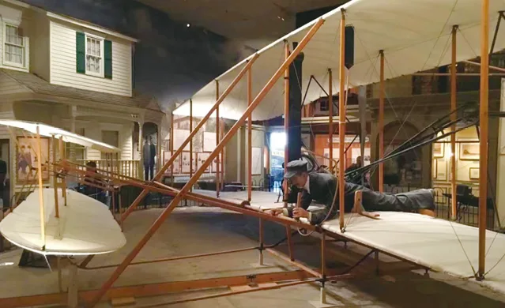

莱特兄弟的“飞行者”1号

法王专门参观了人类首次登月使用的阿波罗登月舱，这是飞船直接在月球着陆的部分。登月舱只能使用一次，下降后会被丢弃在月球表面，所以博物馆展出的是备用的阿波罗2号，而不是1969年首次登月的阿波罗11号。登月舱旁边有一台电视机，一直在播放阿波罗11号登月的纪录片。

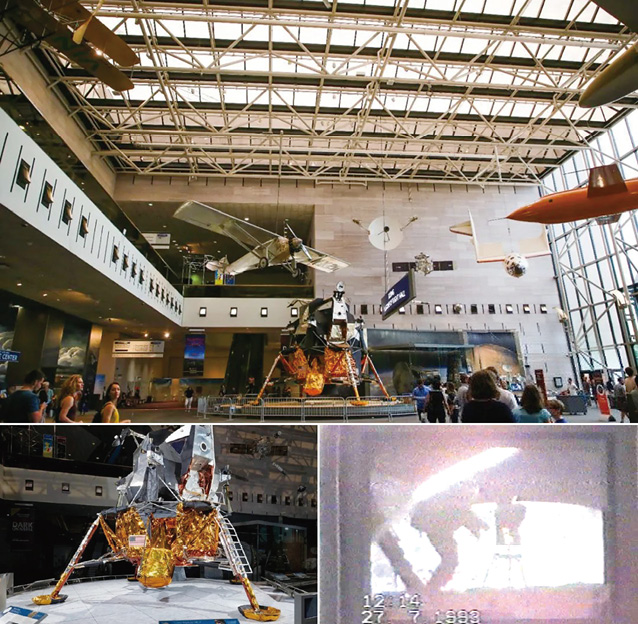

这项被载入人类史册、具有划时代意义的成就，被称为“个人的一小步，人类的一大步”。法王对此很感兴趣，详细了解了第一次登月的全过程。看完这些，我也是大开眼界，感觉美国确实是一个科技强国，他们科技创新的历史令人震惊。

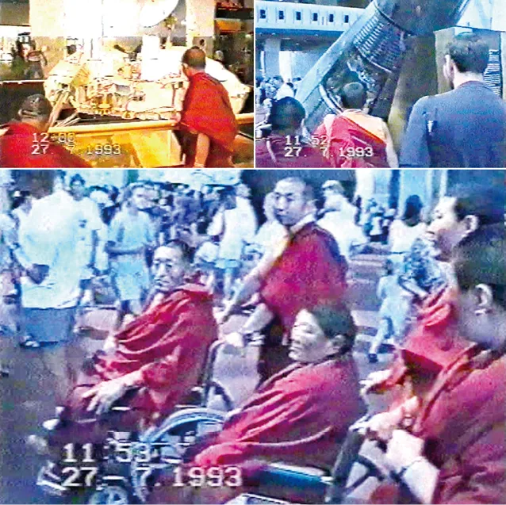

《手中赐佛》第一节课

这次欧美之行，法王先后五次讲了《文殊静修大圆满》。在其他道场讲这个法的时候，“大圆满”部分都是念传承的，但是在这里，法王是完整传授的，所以我也把这个版本的内容全部整理了一下。

这个讲座有三节课，当天晚上是第一节课：

我要讲的法是“文殊静修大圆满”引导文——《手中赐佛》。它由两部分组成：总说道次第、真正解说引导文。

一、总说道次第

在此法的分支《忠言心之明点》中，道次第是这样的：

1．知足少欲

首先，修这个法的修行人要知足少欲。对自己的物质财富感到满足，叫“知足”；没有把别人的物质财富据为己有的欲望，这叫“少欲”。今生的物质财富、美满幸福、名气声望都没有实质，越是享受，就越是助长贪婪，所以欲妙对我们没有好处。不仅如此，如果自己没有往昔的福德，再怎么努力也得不到这些。因此，要对今生的美满、安乐、名声无欲无求，唯一修行正道。

当然，不求吃、不求穿也是不可能的，除了满足吃穿之外，我们要从根本上断除对一切物质财富的贪执。同样，对于权势地位，除了是自然获得的，也不应该有想得到更显赫地位的贪念，以及想名扬十方的心态。

全知上师无垢光尊者在《四法宝鬘论》中说：“欲念穷尽彼即真圣者，欲念寡鲜乃贤圣种姓。”这里说得很清楚，少欲是圣者的种姓，灭尽一切欲望才是真正的圣者。也就是说，无论是谁，这辈子为了衣食住行、名气声望等一直散乱，就不会有修成圣道的缘分。任何人都需要知足少欲，只有不贪今生琐事，唯一想要实修正法的人，才会具有修行此法的缘分，故称为圣者种姓。

因此，在修持此法之初，你们也要观察一下自相续，看看自己是否具足知足少欲。假设以前不具足，那可以从现在开始抛开今生大大小小的一切琐事，有个真实坚定的誓言去唯一修行正法，最好是修持这部法。如果你不重视它，只是没信心地顺便修修，在衣食住行、伏敌护亲等今生琐事上却花费大量精力，那么装模作样地修行此法是不会带来太大利益的。所以，在开始的时候，一定要努力生起知足少欲的善意乐。

2．依止善知识

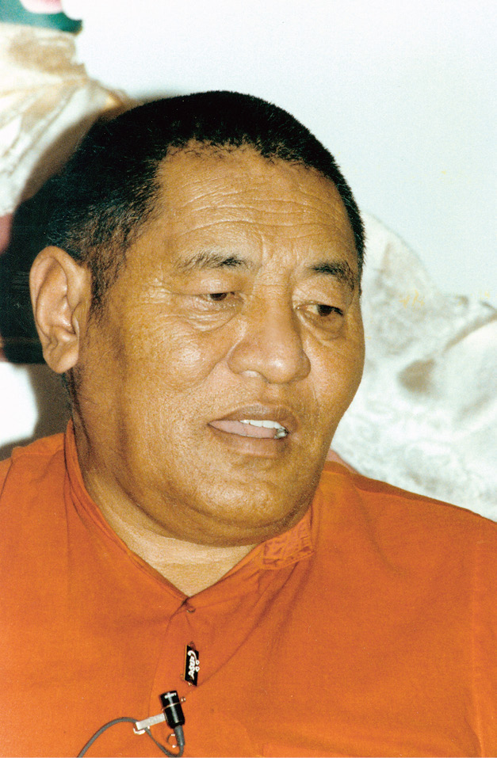

知足少欲的修行人要想趋入道，首先必须依止具法相的善知识。如果没有依止善知识，自相续中就不会拥有一分功德。当然，随便依止上师也是不合理的，因为上师也有真上师和邪上师，所以要依止的是具法相的上师，而不是不具法相的上师。

若问：“具法相的上师是什么样的呢？”

比如，如果要讲大圆满这样的法，上师的心相续中要具有它的觉受和证悟境界，这是第一点；有乐于摄受一切众生的慈悲心，这是第二点；能消除他们所有的邪分别和怀疑，具有精通教义的智慧，这是第三点。如果这三种功德都具足，就可以称之为好上师或具相上师。如果这三种功德不全或者只有一种，就不是真正的上师。如果一分功德也没有，则是根本不能依止的上师。

对于具相上师，要比自己的眼睛与心脏更珍惜，欢喜踊跃地依止。依止方式：真正让上师欢喜的，是调伏自心，勤修清净善法，所以，上等者以修行供养而依止；即使不能行持如此广大的善法，也可以尽力成办上师如法的一切事情，做中等承侍供养；如果这一点也做不到，那就对于上师行善断恶的如法事情，尽己所能毫不吝惜地供养一切财物，这是下等者以财物供养而依止。需要通过这三种方式长期依止上师。

依止上师之后该怎么做呢？

在上师面前听闻佛法。听闻方式是以清净的信心来听。

那么，需要什么样的信心呢？

如果听闻显宗的法，需要以上师与佛平等无别的信心来听；如果听闻密宗的法，需要对上师有真佛想来听；如果听闻光明大圆满这个法，就要了知上师在恩德方面胜过佛陀百倍千倍，以胜于佛的信心和恭敬心，在上师面前听法。

实修大圆满的修行人，对上师要有胜过佛的信心，但你们具不具足这一点呢？如果对根本上师比释迦牟尼佛、邬金莲花生大士更欢喜，这种信心是无与伦比的。即使没有，也要有上师与他们无别的信心。如果连这点也没有，把上师当成一个普通人，那么正所谓“视师为常人，水中无加持”，上师的加持是无法入于你相续的。即使有一点加持，也是清汤寡水，得不到其余的加持和悉地。

此处你们需要明白：这些是道次第，我前面提到的那些，每一个都要按顺序修行。也就是说，首先具备知足少欲，然后寻找并依止上师，对上师生起信心。下面要讲的内容，全部是道次第，需要在具备前前功德的基础上，才能趋入后后的修法。大家要记住这一点。

3．持戒清净

对上师有信心后，还需要什么呢？

需要受持道的所依——戒律。

如果不具备清净的戒律，怎么能获得究竟佛果呢？连暂时得到人天安乐的机会都没有。同样，破了戒的人，即使上供三宝等福田、下施乞丐等悲田数十万年，也一定会堕入恶趣，得不到人天善趣之身。所以，受戒后破戒的人，只会堕入恶趣，没有第二条出路。

要想生起菩萨乘和密宗金刚乘所讲的道之功德，也必须是具有清净戒律的人，而其他人是很难生起的。佛陀也说“戒如大地”，意思是，能走路的人和牛马等，以及不能走路的草木林苑，这一切都依赖大地，没有大地，任何生物都无法安住。同样，如果没有清净的戒律，也就没有任何生起功德的机会。

一般来说，戒律有三种：别解脱戒、菩萨戒、密乘戒。这里说的是，必须具备别解脱戒。

如果有人想：“如果不具备别解脱戒，只有菩萨戒。靠它能获得解脱或遍知佛果吗？”

这是根本没办法的，因为菩萨戒只有在别解脱戒的基础上才能获得。你要接受密宗的任何灌顶，也要在别解脱戒和菩萨戒的基础上，才能得到它所有的誓言和戒律。所以无论是菩萨戒还是密乘戒，只有具备别解脱戒才能生起。

若有人问：“既然要具备别解脱戒，那除了出家男女，其他俗家男女都没有别解脱戒，难道就不能生起功德了吗？”

其实受出家戒叫人天应供处，是最好的供养对境，而在家男女若受居士戒和斋戒，也叫别解脱戒。就地域而言，在藏地、印度、不丹等地，修行清净法的出家人可谓比比皆是。但在美国这个地方，由于环境和文化的限制，出家还是非常难的。我来美国后，从来没有说过一句“你要出家”的话，主要是说“你要受居士戒和斋戒”。但是在这个道场里，有这么多出家人，真的很少见。当然，更重要的是，出家的人数要继续稳步增加，希望住持、主管和弟子们牢记这一点。

我个人而言，在出家和在家二者中，如果出家人多，我会非常欢喜。原因是在释迦佛的教法中，出家人比在家人更重要。而且，大成就者贝诺法王、丹嘉仁波切等，以及他们的继承者和诸位心子，都是出家人。

出家受戒，必须远离生戒、住戒、胜戒的三种违缘。其中，生戒的违缘是指，不是所有人都能受出家戒。律藏中说，比如杀父杀母的人，根本生不起戒体，所以不能受戒。

住戒的违缘是指，受戒的障碍是父母未开许、配偶不同意、有权势的国王不准许，如果未经他们允许出家，将来修学就会受到阻碍，甚至不得不还俗。所以，没有这些违缘是很重要的。

如果有人问：“国王、父母、配偶若是不同意，即使受了戒，也生不起戒体吗？”

虽然不是生不起戒体，但是会对护戒造成障碍。如果不构成障碍，那么过失就不会太大，即使没有父母的允许，也可以出家；即使没有配偶的同意，也可以出家。但我们要考虑的是会不会有违缘。

胜戒的违缘是指，得了重病根本不能行善的人不能出家，世间琐事繁多没有缘分行善的人也不能出家，否则会因守不住戒而无法增上殊胜功德。如果这些不构成违缘，那就可以出家。

在你们道场里，除了出家人，其他人最好能受居士戒，或者至少想办法受八关斋戒，不然，得一个人身就没有意义了。

所应守护的戒条，我最近在华盛顿讲法时，都详细地讲解了。如果是出家人，就应该身著僧衣，从根本上断淫；如果是在家人，即使受了居士戒或斋戒，也不用穿出家衣服，当然，也不需要对配偶戒淫。除了这两点不同，基本都是一样的。

今天之所以要广讲戒律，是因为这个道场不像其他地方，出家人和在家人都非常多，所以我特意做了明确的解释。

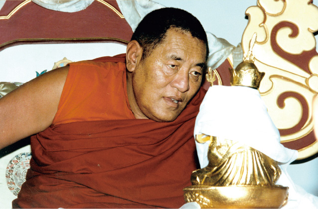

最近方便的时候也会传出家戒。没有上述三种违缘，出家也是很好的。将来上师们来到这里，可以传沙弥戒和比丘戒。如果出家人越来越多，僧团越来越兴盛，这是特别有必要的。有什么必要呢？

我们所在的地方，有佛法兴盛的中土、不兴盛的边地。其中，“中土”是指有比丘、比丘尼、男居士、女居士的地方。没有这四众眷属中的任何一个，或者四众眷属都没有的地方，就叫“边地”。这样说来，美国以前应该是边地，后来变成了佛法中土，所以，僧团的存在非常有必要。现在和将来，大家都要尽力去落实，不要忽略这一点。

4．闻思修行

如果问：“有一个清净戒律就够了吗？”

不，在它的基础上，还需要闻慧，在具法相的上师面前听受显密及明处的法，依此在自相续中播下解脱的种子，驱除一切无明愚痴黑暗，清净一切罪障。就听闻佛法的功德而言，经中说，直接听法当然有功德，甚至为了提醒闻法而击法鼓、吹法螺，旁生听到这些声音也会得到解脱。所以，精勤听闻佛经和解释其密意的论典，是非常重要的。

那么，只是听闻就可以了吗？

也不是，还要思维所闻之义而生起思慧。比如今天，你听了我的讲法，但下课后，心散乱在工作上或无所事事，这是不行的。你们要反复思考词句是怎么说的、意义是什么，对它进行观察分析，并向别人请教，最后应该做到没有任何疑惑。如果不具备这种思慧，那么我刚讲的《手中赐佛》引导文，虽然言简意赅，没有别的，但你只是听了一遍，不思考的话，实际上根本不会去修。所以，一定要真正深入思考佛经，尤其是对自己有益的法，然后再实修。否则，靠推测或想当然来一本正经地修行，是没有意义的。

修行之前一定要思考，必须做到没有怀疑、真正通达了。怎样才算通达了呢？首先要把上师亲口说的词句、它的意义、自相续的修行这三者，结合起来进行对照并实修。哪怕做一件世界上很平常的事，也需要先思考。比如开车，不经过一定时间的训练就不会开，修行比它更难，思慧相当于先把车练好，修行相当于以后真正上路，所以，在修行之初一定要非常认真地思考，否则，没有真正的思慧就装模作样修行，肯定是弊大于利。如果不具备思慧就开始修行，就像藏地上师萨迦班智达说的：“愚者修行大手印，多数趋向恶趣处。”不经思考、不依止上师，只凭着估计修行，大多数会转生为山兔和旱獭等，这没有必要。这是他非常诚恳的言教。

所以一开始就要注意，必须断定自己会修行了才能修，否则什么都不懂就直挺挺坐着，根本不是修行。如果你真的会修行，这是最好的，要努力勤修；假设不会修行，那就念诵观音心咒和莲师心咒，祈祷三宝，这是最保险的。无论什么样的观修，都不能只是直直坐着，把自己弄得腰酸背痛，一定要知道怎么修。而且，知道以后一定要修，否则，光知道不修是不行的。

二、真正解说引导文

以上已经讲了道次第，下面就是真正修行的时候了。观修方法是从前行的四种厌世心到大圆满依次进行，具体内容在这个《手中赐佛》中，你们打开法本，我按顺序解释一下：

> 文殊静修大圆满·手中赐佛

所谓“文殊静修”，一般来说，文殊修法有寂静文殊和忿怒大威德两种，而这就是寂静的修法。其中，文殊静修的灌顶和仪轨，昨天已经完成了。“手中赐佛”是指通过这个引导文，把佛果真正交到你手中。

> 觉空本来怙主妙吉祥，证悟无离无合而顶礼，

如果无误证悟了心的法性，那么它就是文殊菩萨。自己的心不存在一个有离有合的法，怙主文殊与自心本就无二无别，证悟了这一点，就叫以通达见解而顶礼。

> 我为心子开示精华要，汝亦切莫舍弃当实修。

所谓“精华要”，是指将大圆满一切续、教、窍诀的所有要点归集起来，变成言简意赅的语言，让人轻易快速地证悟。我把它传给各位如心脏般的弟子，并教诫道：“不能只是听听就把它扔到一边，要实地修行。”

> 人身难得

> 诸位有缘者首先应当思维：

有缘修持此法并对它有信心的所有堪为法器的修行人，一开始应该这样思维：

> 自己如今已获得了从因缘、比喻、数量观察都极为难得

具全十八暇满的人身宝非常难得。怎么难得呢？从因缘方面来说，不守护清净戒律，不以清净发愿衔接，不以布施等作为助伴，就不会得到它。从比喻方面来说，它比向光滑的墙上撒豆子，豆子可以粘在墙上还难。从数量方面来说，所有三恶趣的有情多如大地上的微尘，人天众生少如指甲上的微尘，其中修持正法的人就更少了。所以，无论从因缘、比喻、数量哪方面来看，这个珍贵的暇满人身都是难得的。

> 且能成就三士道菩提果位的暇满人身宝，

这个人身不仅难得，如果得到了还意义重大。那么，意义如何重大呢？

如果你只想修行“小士道”，以远离三恶趣而得到人天善趣之果，那你已经得到了这个能修此道的殊胜所依身。如果你想修行“中士道”，离开一切轮回，寻求自我解脱的声缘阿罗汉果，那也可以靠这个所依身来实现。如果想修行“大士道”，让自他一切众生获得永久安乐的佛果，也可以在这个所依身上成办。为此，能成就三士道中任何一种的这个人身宝，我们如今已经获得了。

> 并遇到了具有法相的善知识

不仅是获得了人身，更难得的是，遇到了上师善知识。

> 宣说甚深妙法。在具足此等顺缘之此时，

不仅佛陀在这个世界上已出世、宣说过佛法、佛法仍住世，上师善知识也摄受了自己，并传授与自己相应的清净法，这就更难得了。这一次，我们已经拥有了所有的顺缘。

> 应当反复思维而立誓毫不懈怠地勤修正法。

得到这个殊胜所依身之后，一定要真诚地发誓，不能让它白白浪费，必须修持清净的妙法。

以上是第一引导“思维暇满难得而立誓修持正法”。

> 寿命无常

> 思维此身也必定死亡、死期无有定准、死时除正法外一切都无有利益的道理后，

虽然获得了如此宝贵的暇满人身，但它注定会死，只要有生就绝对有死，除了死路一条，没有别的地方可去。而且死缘是不固定的，它数不胜数，病魔、怨敌、火灾、猛兽、悬崖、险地等多之又多的外缘，都会置我们于死地，能活下去的外缘却少之又少。虽然衣食是活下去的缘，但饮食不当也能成为杀手，人也会为了衣服与敌人拼死一战，所以生缘未必不会成为死缘。正因为生缘少、死缘多，所以死期是不定的。

想想过去和未来的众生，就会明白这个身体必定死亡。今天之前的世间一切众生都是无常的，百年之前的人，现在几乎一个也没有了。我们都离不开这种自性。同样，整个世界的有情也是如此，现阶段距离美国建国已经过去217年了，建国时的所有人现在都已经去世了。美国历代共42位总统，现在也所剩无几，大部分已离开了这个世界。所以，思维以前的众生，都不会长存于世；想想未来的众生，再过一百年，现在世界上所有的人，除了一两个，恐怕都会死。我们无法超越这种自性，尤其是明年这个时候，现在的很多人肯定都去了后世，谁也不能断言自己不在那群人中。

所以，必须知道自己一定会死，而且死期没有定准。佛经中说，你有多大把握明天不会死？你和死主阎罗又没约定过，不会因为你们关系好，他就给你下了不死诏书，所以你没有任何把握明天还在。为此，必须在死亡来临之前多行善法。

> 应当下定决心迅速勤修善法。

因为不知道自己什么时候会死，也不知道是不是很快就会死，所以不能想“明年后年再修法吧，这个月我好好工作，多攒点钱，下个月再请假去修法”。不能这样一拖再拖，而要想“不知道死亡何时来临，我必须尽快行持善法”。

以上是第二引导“思维寿命无常而决定迅速行善”。

> 因果不虚

> 一切众生死后都并非一无所有，而必将随黑业白业无欺感受痛苦与安乐。

如果死了像火灭了、水干了，那就好了，但事实并非如此。真相是，行善会获得人天善趣等殊胜安乐，造恶会遭受三恶趣的痛苦。为此，因果何时也没有欺惑，即使波浪离开大海，业因果也永远不会改变。所以，从小善做起、从小恶断起，诚信业因果而认真行善断恶，这是非常重要的。

以上是第三引导“思维业因果无欺而鼓励取舍善恶”。

> 轮回痛苦

> 尤其对广大、漫长、难忍的轮回痛苦生起定解后，

我们要在心里思维：“有了业因果的感召，无论转生于轮回何处，都是痛苦的自性。尤其是三恶趣的痛苦，更是范围广、时间长。”那么，轮回的痛苦范围有多广呢？以恶趣中地狱的痛苦为例，怙主龙猛说：“于此一日中感受，三百短矛猛刺苦，彼较地狱最微苦，难忍之分亦不及。”如果世界上有一个大罪人，每天被人用箭、矛、刀等砍杀，然后起死回生，继续遭受这样的折磨，我们都会觉得太痛苦了，但这连地狱里最轻微的痛苦也比不上，恶趣的痛苦比它强烈得多。尤其是如果转生于热地狱，遍地都是燃着熊熊烈火的烧铁，自己承受着剧烈难忍的痛苦。当狱卒用斧头、锯子等砍割你的上半身时，下半身会复活；砍割下半身时，上半身会复活……需要长时间感受这种无法忍受的痛苦。

思维痛苦持续的时间漫长：复活地狱是所有地狱中寿命最短的地方，但人间十万年过去了，复活地狱的一天还没有过去，用人间的寿量计算，需要连续承受几千万年的痛苦。复活地狱的痛苦是最轻的，但也要感受这样的痛苦。众合地狱、号叫地狱等其他热地狱，是在它的基础上，依次增加七倍痛苦。

此外，还有所谓的八寒地狱，那里有极其难忍的严寒之苦。所以，恶趣地狱有着无法形容的寒热之苦。

之后思维饿鬼：所有饿鬼众生，不要说食物，大多数十二年连一滴水都喝不到。虽然他们得不到饮食，但因为业力还死不了，要一直这样受苦。假设得到一点食物，它也会燃起火焰，从里到外烧遍全身。复活后，继续感受饥渴的煎熬。

再思维旁生：生活在海里的海居旁生，小旁生都以大旁生为巢，一直享用它的肉，大旁生也在吞噬小旁生，双方有互相啖食的难忍痛苦。散居旁生，如人间的野兽和家畜，有的因为肉被宰，有的因为皮被杀，有的因为骨而死，有的一直被役使，想走也没自由，想坐也没权力，只能承受驮东西、被骑等说不尽的痛苦。

其实在没有行善的众生面前，这样的三恶趣之苦一直在等着。不同的人应该想一想，你一生做过多少善事，累积了怎样的罪业？恐怕很多人只做了一两件善事，行持的善法少之又少，造的恶业多之又多，如果是这样，你的去处只有恶趣。恶趣的痛苦如此可怕，所以现在当你自由的时候，前半生已经无意义地虚度了，但是后半生，每个人都要努力去行持清净善法。

以上是第四引导“思维轮回痛苦而激励修行正法”。

> 立誓修持能解脱轮回的广大法门。

思维了轮回过患和业因果之后，就要发誓去修广大的正法。

> 猛烈祈祷上师、本尊，加持自己实现以上所发的三誓愿。

如前所述，思维暇满难得而立誓修法，思维寿命无常而立誓快速修法，思维业因果和轮回过患而立誓修广大法。祈祷上师、本尊加持，这三种誓愿可以迅速成就，并对上师的教言依教奉行，这是依止善知识的引导。

以上四种厌世心，是与小乘所有声闻缘觉共同的外前行。依靠这四种厌世心的修法，生起对一切轮回无有贪执的出离心，进而趋入大乘道。今天的课就到这里。

草地上的黄色袈裟

7月28日，法王对这个道场的所有僧人，讲了护戒的功德和破戒的过失。法王一直非常重视戒律，在藏地培养了一大批持戒清净的僧人。这个道场之前有一些出家人，法王到来后，又有一批新人剃度受戒。虽然总共有几十名出家人，不像在藏地动辄成千上万的僧众，但在美国能有这样一个出家群体，真的非常难得。

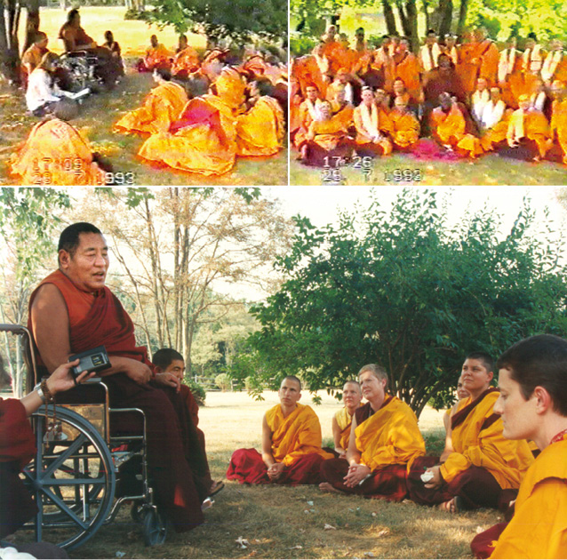

我至今忘不了那一幕：法王坐在树荫下，讲着戒律的开遮持犯，身披黄色袈裟的僧人们围坐在草地上，恭恭敬敬地听着……那种场景和气氛，宛如佛陀在鹿野苑为五比丘转法轮。我这一生也见过僧众聚会的各种场面，但是这么多西方面孔的出家人聚在一起，真的很少见，也很感人。

当天，听完法王讲的出家功德，他们感到无比喜悦，整个道场仿佛增添了一份别样的色彩。

《手中赐佛》第二节课

当天晚上，法王继续传讲《手中赐佛》：

今天是一个世界各地洋溢着吉祥气氛的好日子，也是藏地所有前译宁玛派聚在一起随念邬金莲花生大士的特殊节日。比如我们佛学院，去年的今天，三千僧众一起受用了“四臂文殊”会供轮。今年的今天，缘分也特别好，主要是依靠堪布们的帮助，这里已有三十多人出家受戒。我由衷地感谢大家！

总的来说，美国的佛教徒虽然很多，但出家人还是很少。在今天这个日子里，许多人不仅入了佛门，而且剃度出家。所谓入了佛门，是指对佛法产生信心，受了皈依戒，随行三宝而修行正法。出家僧团一旦建立，就奠定了佛法的基础。只是皈依和信佛，还是有变成其他宗教徒的危险性，但只要出了家，就成了真正的佛教徒，很少有出家人变成外道的。

我不知道在美国建立这样一个出家僧团的历史，但我猜这也是美国历史上罕见的辉煌事件。比如，说到佛法在藏地兴盛的历史，藏地最初有天赤七王、地上二王、地勒六王、水德八王、中赞五王，其中第一位国王是酿赤赞波，到了第二十八代拉脱脱日年赞时期，是佛法的开端，但当时更多的是只入佛门、对法有欢喜心和信心、受皈依戒的人，根本没有建立僧团。后来，法王赤松德赞在世期间，从印度迎请了堪布菩提萨埵，才开始有了藏族预试七人出家。从那时起，众所周知，藏地出现了一个建立佛法基础的僧团。而在你们这里，出家僧团已经建立，将来可能会出现像藏地一样佛法兴盛的圆满僧团，所以你们师徒众人都需要加倍努力。

没有出家的人，还是要深思，出家不能有三种违缘。如果你对出家有信心，最好尽快受戒。目前，我们还会再待三天。在此期间，如果有人想受戒为僧，趁着堪布们在，会比较方便。否则，以后想出家受戒，只能持出家相再等几年了，毕竟传出家戒的人直接来这里还是很难的。就算来一两位上师，也不知道他会不会传戒、有没有时间传。所以这次有时间的话，能传一两次出家戒还是很好的。

对于在家人，我的一点希望是，如果你们平时对这个僧团给予各种支持和帮助，对自己的今生来世都有利益。你们所有出家人也要认真守护学处，只要自己没有变坏，环境这个外缘还是特别好的。

前两天听说这个道场有个女尼穿着袈裟在白宫工作，这是一件很光荣的事情。在总统、副总统等行政人员面前穿僧衣上班，恐怕在全世界都是非常罕见的。怀着无比喜悦的心情，我献给她一条哈达，向她表示祝贺。吉祥如意！

（法王现场向那位女尼献哈达）

以上是课前开示，现在开始正式讲课。你们所听的法是《文殊静修大圆满·手中赐佛》，前面已经讲了四种厌世心的引导，下面讲不共前行。首先是皈依的引导：

> 皈 依

> 皈依是一切道之基础。

无论实修什么法门，皈依都是不可或缺的基础。如果没有皈依，就不能修行佛陀所说的任何法。

> 能令我们趋入佛门。

有了皈依，那么就是内道佛教徒；只要没有皈依，就不能称之为佛教徒。所以，皈依可以让我们进入佛教徒的行列。

> 因此应当依照仪轨中所说而明观皈依境：

皈依的修法是，首先要按照文殊静修仪轨中所说，如是明观皈依境：

> （空性之中，于自己前方虚空中观想：极为庄严的虹光白云中，本体为根本上师，形象为文殊智慧勇识。寂静含笑、相好庄严的童子身相，身色金黄如彩虹般，佩带珍宝、绫罗饰品，右手高擎智慧宝剑于空中，左手持执上置经函的莲花，在圆月莲花垫上，双足跏趺傲然而坐，身体每一汗毛孔中显现无数自然续部坛城，上下方隅虹光密布之中，自现的一切上师、空行、护法众如日尘般聚集。）

于自己的前方观想：在极其庄严的虹光白云中央，本体是根本上师，形象是文殊智慧勇识。

文殊智慧勇识身色金黄，一面二臂，右手持智慧宝剑挥舞空中，左手执青莲花，上面有经函。其身以绫罗、珍宝饰品庄严，双足金刚跏趺，安坐在莲花月垫上。身体圆满一切自然续部坛城本尊，上方安住着诸上师，中间安住着诸空行，下方安住着诸护法。

> 观想完毕，应当思维从今起乃至菩提果之间，我只皈依您，依教奉行，在未得怙主上师果位之前，与见行相同的诸位道友一并不断勤修。如此发誓愿，即是显宗共同之皈依法。

除了大恩根本上师您，我不仅在现实中不寻找其他皈依处、救护处、怙主、友军，甚至在梦里也不寻找，唯一依止您。这相当于对佛作本师想而皈依。

从现在起直到获得菩提果或佛果，我唯一依止与文殊菩萨无二无别的大恩上师您，除了对您的教言依教奉行，不做其他任何事。这是对法作道想而皈依。

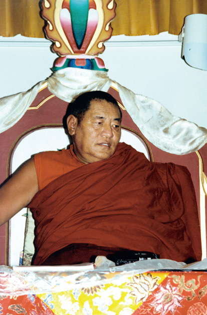

之后，与随行于您的弟子见行相同，行持菩提道。这是对僧作友伴想而皈依。

与往常皈依不同的是，这次是唯以依止上师来皈依。这种以本师、道、助伴的方式修行正道，就是因皈依。在没有获得与怙主文殊无别的大恩上师您的果位之前一直修行，这是果皈依。相续中要有这样的立誓。以因皈依、果皈依两种方式来皈依，是与显宗相应的共同皈依。

> 安住于证悟本来大清净之自心，即是了义文殊勇识之本性，护持所了知的境界，是自宗不共之皈依法，自己尽力不离此境界

我们心的自性本来就是无生空性，从了义上说，就是所谓的文殊菩萨。认识了这样的本来面目，于自心本位的境界中一缘平等安住，就是大圆满自宗的皈依。

> 而尽力念诵皈依偈：

> གཞི་དབྱིངས་ཀ་དག་གཞོན་ནུ་བུམ་པའི་སྐུ། །

> 基界本净童子瓶佛身，

> གདངས་རྩལ་མ་འགགས་རང་རིག་བྱང་ཆུབ་སེམས། །

> 妙力不灭自证菩提心，

> ངེས་དོན་འཇམ་དཔལ་དཔའ་བོའི་བདག་ཉིད་དུ། །

> 了义文殊勇识自性中，

> རང་ངོ་ཤེས་པའི་ངང་ནས་སྐྱབས་སུ་མཆི། །

> 了悟本来面目而皈依。

上面这个皈依偈，需要尽力念诵百遍、千遍、万遍直至十万遍。

皈依戒：平日不离祈祷上师三宝，对上上下下各层众生都不损害，对所有圣者僧众以虔诚的信心恭敬依止。

皈依的功德：今生会消除疾病、魔障、怨敌、猛兽等八难或十六难等一切违缘，后世不仅能远离三恶趣等一切苦难，还可以暂时在人间天境享受悦意、身体安康的所有快乐，究竟获得正遍知佛果。这一切唯一依赖于皈依，所以大家一定要勤修。

接下来是发殊胜菩提心的引导：

> 发 心

> 观想如果连续不断地感受无边痛苦的一切众生能摆脱痛苦该多好！一直观修到生起强烈悲心而流泪为止。

发殊胜菩提心是怎样的呢？

就是要思维：“天边无际的一切众生，无一未曾当过我们的父母。当他们是我们的父母时，就像今生的父母一样，最好的食物给我们吃，最好的衣服给我们穿，以无比慈爱的意乐和行为养育我们，是我们最大的恩人。然而，这些大恩父母虽然想要快乐，却不知道快乐的因是行善，虽然不想受苦，却不断造下杀生、偷盗等痛苦的因，所想与所行背道而驰。为此，所有曾当过父母的有情正无依无靠，如同被遗弃在荒野的盲人一样。”我们要对一切有情生起悲心。

所谓的悲心是指什么呢？

就是希望所有众生都远离痛苦的意乐。如果长时间观修让一个个众生远离痛苦，那么总有一天，看到一个众生受苦时就会流泪。在没有达到这种境界之前要一直修。

生起悲心的标准是怎样的呢？

今生自己亲生父母中的任何一人，如果被当权的国王抓起来，正在被箭、矛等各种利器刺杀，自己没有方法也没有能力去营救，只能心疼地情不自禁流泪。同样，在没有对无边无际的一切有情生起真实父母想之前，需要一直修悲心。

这是发心两个侧面中的第一个，以悲心缘利他的侧面。

> 我今必须修成能救度众生的佛陀果位。

这样观想：“虽然我悲悯一切有情，但还不具备救度众生的能力。现在，如果我要想救度众生，除了佛果，没有其他选择。所以，我要修成佛果。”这是以智慧缘菩提的侧面。

如此诚心诚意为了利益一切众生想修成佛果的立誓，一旦在相续中真正生起，就是愿菩提心。

> 不观待长久苦行、顺利迅速成就此佛果之道，唯有光明大圆满，因此应当实修大圆满法。

一般来说，如果修持显宗乘等道，需要很长时间才能成就佛果。但与此不同的是，几个月就能迅速成佛的方便法，就是光明大圆满。所以，我们要实修光明大圆满道，这就是行菩提心。

> 最后于边解脱直定中安住而尽力念诵发心偈：

> གློ་བུར་འཁྲུལ་སྣང་སྒྱུ་མའི་གྲོང་ཁྱེར་ལ། །

> 暂时迷现幻化之城中，

> ཨ་འཐས་ཞེན་པས་ཁོར་མོར་འཕྱན་པ་རྣམས། །

> 顽固贪恋不断漂流众，

> ཡེ་གྲོལ་ཆོས་སྐུའི་ས་ལ་དབུགས་དབྱུང་ཕྱིར། །

> 为于本解法身得安慰，

> མཐའ་གྲོལ་ཅོག་བཞག་ཆེན་པོར་སེམས་བསྐྱེད་དོ། །

> 边解大直定中而发心。

只想实修大圆满道还不足够，还要安住于边解脱直定的境界中。安住的同时，念诵仪轨中的发心偈，需要尽力念百遍、千遍、万遍直至十万遍。

> 最后观想从皈依境圣尊心间放射无量光芒照耀我与一切众生，从而无余净除罪障。自身也化光融入皈依境中。如是于无执中入定。

在皈依、发心任何一个修法的结尾，都要观想皈依境的圣众心间放射光芒，照耀自己与一切众生，依此清净了一切罪障，最终自己与一切有情都化光融入上师心间，然后在无所执著的境界中入定，最后善根回向菩提。皈依或发心结座时都需要这样来回向。

皈依和发心的戒，你们今天灌顶时已经得到了。在念诵数百、千、万直至数十万遍皈依偈和发心偈时，心里要有自己灌顶时已得到戒体的念头。得菩萨戒后，一般有许多学处，但归纳起来，都摄集在恒时修四无量心中。

四无量心是指什么呢？

相续中生起“一切众生获得内心欢喜、身体安康该有多好”的意乐，称为慈无量心。

相续中生起“一切众生身体上没有任何病痛、心里没有任何痛苦不幸该有多好”的意乐，叫做悲无量心。

对幸福美满的一切有情，由衷地生出喜悦，就叫喜无量心。

对自己的亲人朋友没有贪念，对其他敌人没有仇恨，而是一视同仁地想：“愿所有众生平等地离苦得乐。”这叫舍无量心。

日日夜夜勇猛修行这样的意乐是根本。

皈依和发心的戒都有一个舍因，所以我们要非常注意。以什么会舍皈依戒呢？无论谁认为自己不再是佛教徒，不皈依三宝，不修持正法，直接做背叛三宝的事，或者心里是这么想的，从那时起就破了皈依戒。

破皈依戒有什么罪过呢？

破了皈依戒的人，只会堕落三恶趣，根本得不到人天善趣，有无量的罪过。

破菩萨戒的因是什么呢？

自己本可以让众生安乐，却没有让他们安乐，由衷希望一切有情都有痛苦，或者实际行动中让众生痛苦，这就会失毁菩萨戒。

如果破了菩萨戒，不仅会失去自己相续中的善法，还会退失利乐一切有情的行为，因此，这种罪业是世间其他恶业无法比拟的弥天大罪，异熟果报也是极其严重的，会长久流转在轮回中感受难忍的痛苦。

接下来，我用几句简短的话来说说菩提心的功德：

如来所说的八万四千法门中，特别甚深究竟的就是唯一修菩提心。如果菩提心已经在相续中生起，就会消除轮回中身心的一切痛苦，快乐欢喜，很快就会获得无量功德。因此，它有着其他任何法不可比拟的巨大功德。

只要生起了菩提心，当下他的名字就叫菩萨。只要是这位菩萨安住的地方，不要说帝释天、梵天、夜叉等具神通者都会跪拜，甚至菩萨踩过的尘土，他们也会顶戴。未以菩提心摄持的身体顶礼转绕、口中诵经持咒等所有善根，会被嗔恨的恶心所灭，但只要被菩提心摄持，就不会被嗔恨等恶业所毁，反而会越来越增上。如果不以菩提心摄持，善法的果成熟一次后就灭尽了。但若以菩提心摄持，即使只念一句观音心咒，不仅暂时会在人间多次生为转轮王、在天界多次生为梵天帝释，最终还会获得正遍知佛果。一旦生起了菩提心，不仅普通的小罪会从根本上清净，就连杀父、杀母等定生恶趣的滔天大罪，也只需在弹指间感受恶趣的痛苦，就能得到解脱，有不可估量的功德。

所以，过去、现在、未来三世诸佛菩萨来来去去的必经之路，或者说最究竟的所修之法，唯一就是菩提心。依靠它，会获得佛菩萨的果位；只要没有菩提心，就永远得不到这些圣果。

所谓好上师和坏上师也需要这样区分：谁相续中有菩提心，谁就是好上师；如果根本没有菩提心，他就是坏上师。一位上师好不好，只以是否有此菩提心就可以划分。

一个有菩提心的菩萨，不但自己安详快乐，而且他所居住的地方，也有着不可思议的安宁和喜气，周围的一切众生幸福快乐，佛陀的证法和教法如意宝自然会广弘兴盛。就像太阳升起来了，自然会光芒普照，黑暗消散。

以上稍稍广讲了菩提心的本体、学处、破戒之因、功德利益等。之所以这么讲，是因为前两天海报上的讲座虽然写了菩提心，但是第一天讲四谛法轮时，时间都用完了，来不及详细讲解菩提心的功德和菩萨戒等。后来讲《手中赐佛》的时候，第一节课的时间也用完了，没能满足你们的愿望。考虑到今天方便，我稍微详细解释了一下。

> 上师瑜伽

> 如前明观上师

上师瑜伽的引导，正如之前皈依境时所说的，是在前方虚空中观想。

> 诚心祈祷：从今起生生世世中，我除一切皈依处总集之大恩上师您以外，甚至梦中也不寻其余指望处，只以您为皈依处，并以自己的身体、一切受用及三世善根供养您，

观想：从现在起直至获得菩提果，除了上师您，我连梦中也不去找其他的皈依处、救护处、怙主和友军。以对上师作佛想来皈依。只依止大恩根本上师您作为皈依处，将您执为最珍贵的至尊，在心里永远也不舍弃。

这到底是怎样的呢？就是将自己最难割舍的身体，也供养大恩根本上师您；比它少一点执著的，是自己的物质财富，将这些受用也供养根本上师您；其后，让自己挂碍贪执的，就是三世积累的少分善根，将三世善根也供养您。总之，就是将执为我所的三事都供养您。然后观想将世间一切有主人、无主人的悦意事物，也都供养大恩根本上师您，并真实陈设水、灯、烧香、涂香等供品。

这是与上师瑜伽相关的曼茶罗引导。

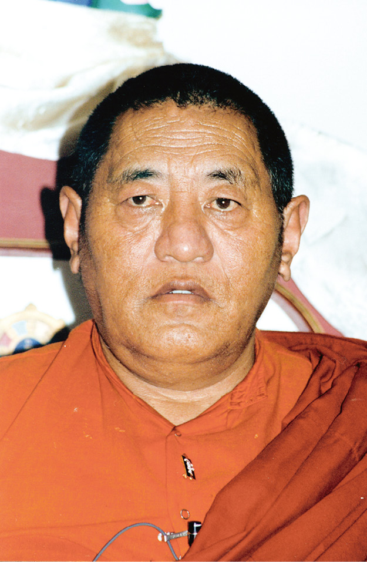

> 发露忏悔无始以来所积累的一切堕罪。

从无始轮回以来到现在，我们生生世世在贪嗔痴烦恼的驱使下积累的所有不善业，全部观想于心。然后在诸佛菩萨面前发露，对过去所造的罪业感到后悔，发誓以后绝不再犯。完全具足四种对治力来忏悔。

如是普皆忏悔，是依靠上师而清净障碍的引导。

> 祈愿成熟解脱我相续，加持我究竟证悟光明大圆满，获得殊胜导师您的果位。边观想边一心一意念诵祈祷：

依靠光明大圆满圣道，自相续中没有成熟的，以它的灌顶来成熟；没有解脱的，以它的教言来解脱。所以，祈祷加持我修持光明大圆满的本来清净直断和任运自成顿超得以究竟，最后获得与大恩上师您同缘分的果位。带着强烈的深情，念诵下面的祈祷文：

> གཞོན་ནུའི་སྐུ་ལུས་འཆང་བ་པོ། །

> 具有童子身，

> ཡེ་ཤེས་སྒྲོན་མེས་རབ་ཏུ་བརྒྱན། །

> 庄严智慧灯，

> འཇིག་རྟེན་གཏི་མུག་མུན་སེལ་བ། །

> 能除世痴暗，

> འཇམ་པའི་དབྱངས་ལ་གསོལ་བ་འདེབས། །

> 祈祷文殊尊。

怙主文殊您，外现为十六岁妙龄童子身，以佛陀无分别智慧灯而善加庄严，能驱除世间一切众生相续中未证、邪证、怀疑的黑暗，祈祷怙主文殊菩萨加持我相续。

这一偈颂需要尽力念百遍、千遍、万遍直至十万遍。

> 最后观想上师三处放射出白红蓝光融入自己三处，从而清净三门罪障，现前身语意的一切功德，最终上师也化光融入自己。于离意本性中入定。

即将结座时，观想上师从头顶或眉间放射出白光、喉间放出红光、心间放出蓝光，分别融入自己的眉间、喉间、心间三处，以此清净了自己身语意的障碍，获得了上师身语意的一切功德。其后，上师化为光团，从自己的头顶进入，向下融入心间，观想自己的心与上师的智慧融为一体，在这种境界中尽量安住。

> 从中出定时了知现有一切皆为上师之本体。善根回向菩提。

从中出定时，将现有一切观为上师，外器世界是上师，内情众生也是上师的游舞。在一切皆为清净的境界中，将善根回向菩提。

> 圆满次第：自身庸俗而住，观想正中蔚蓝色如竹箭般的中脉上端于顶处开口、下端于脐下闭合。

圆满次第的引导：自己的身体是怎样，就要观成那样，也就是自身平常而住。在它的中央，观想一条无有弯曲、端直而住的脉，它叫中脉，颜色淡蓝，带有光泽，粗细如竹箭或自己的无名指。它的上端于头顶开口，下端于脐下闭合。

> 其右方红色血脉及左方白色精脉的下端与中脉如恰（ཆ）字形相连，上端插入双鼻孔。边观想边除垢气。

中脉右侧为红色的血脉，左侧为白色的精脉。这两脉的上端分别插入左右鼻孔，下端与脐下的中脉相连，形状如藏文的恰字，三脉汇合于一处。之后，观想体内所有病魔、罪障、堕罪垢染得以清净，双鼻孔向外排三次垢气。

> 明观吸气时气从二鼻孔经精血脉而接触脐下三脉交叉处下端坚固、上端尖锐、十分炽热、青稞许的绝地智慧火，从而使火焰更旺，将一切有漏身体包括风脉明点皆焚尽无余，最后消失于无缘中。

向内吸气时，观想风经由精、血二脉进入，到达脐下三脉汇合处，触及脐下那个位置的绝地火——它下端坚固、上端尖锐、十分炽热。依靠风的力量，火焰更加炽然，从而烧尽自己的有漏身体包括风脉明点，最后这一切消失于无缘空性中。

> 又于空性中将自身观为文殊金刚身，内外通彻，如胎盘满气一般。

又在空性中，将自己观成文殊金刚身，内外透明，就像充满气的胎盘或水晶球一样。其服饰按照仪轨来观想。

这是观想外身体。

> 明观中间三脉四轮以及脐部短阿（Λ），中脉上端有集诸佛之本体、仅忆念便能生起空乐觉受倒立的白色杭字（）。

在上面提到的身体中央，观想中脉、右侧血脉、左侧精脉这三脉，以及四轮——顶上大乐轮有三十二个白色脉瓣，喉间受用轮有十六个红色脉瓣，心间法轮有八个蓝色脉瓣，脐间幻化轮有六十四个黄色脉瓣。所谓的脉瓣，像伞辐一样从每条脉向外散开，顶间的所有脉瓣朝下，喉间的所有脉瓣朝上，心间的脉瓣朝下，脐间的脉瓣朝上。

观想在顶间中脉的上端，有一个集诸佛之本体、只忆念就能生起空乐智慧的藏文“杭（）”字，将其观成白明点的形相，是这样一个接近滴落的明点。

这是观想内脉。

> 从鼻孔吸入的气触及脐部绝地火（即短阿），针尖许的火焰上升接触到顶上的杭（）字，火焰更加旺盛，从中不断降下甘露，火与明点以相互追逐的方式

从双鼻孔向内吸气，当风触及脐下三脉汇合处的绝地智慧火时，火焰从中脉向上燃起，接触到顶上的“杭”字时融化了“杭”，甘露滴落在火焰上，就像火上浇油般火焰更加炽然。当融化顶上的“杭”字时，从中不断降下甘露，依次充满各脉轮处。火与明点以你追我逃的方式下降，持心于此。

> 依次充满四轮，从而领受四喜、四空之智慧，现前空乐义智慧，于此境界中尽力安住，最后回向善根。

降下的甘露充满顶间大乐轮，然后依次充满喉间、心间、脐间的所有脉轮。依靠它的力量，分别于顶间等四处，获得喜、胜喜、殊喜、俱生喜的四喜智慧，以及空、极空、大空、一切空的四空智慧。这两种智慧是无二一体的，从大乐光明的角度，称为喜智慧；从喜不成立的角度，称为空智慧。

观想相续中生起了四喜与四空的智慧，之后于不可言说的境界中入定。

这个圆满次第，不能只修一次，在自相续中没有生起喜智慧与空智慧的殊胜觉受之前，要反反复复地观修。

最后从中出定。将此修圆满次第的善根，回向一切众生获得佛果。

加持喇荣

在华盛顿逗留期间，一天晚上，法王以梦幻身回到了喇荣。

当时，一种严重的传染病正在喇荣流行。法王去了嘎多堪布等人的僧房，清楚地听到了他们的谈话，并了解了在佛学院发生的一切。

第二天，法王对身旁的弟子说：“我昨晚依靠梦幻身回佛学院了。许多僧人正患重病，我们应当念经加持。”然后带大家共修了一些仪轨。

回来后证实：当时佛学院的确有传染病肆虐，没几天又莫名其妙地消失了，时间完全对得上。

《手中赐佛》第三节课

7月29日晚上，法王讲了《手中赐佛》最后一课：

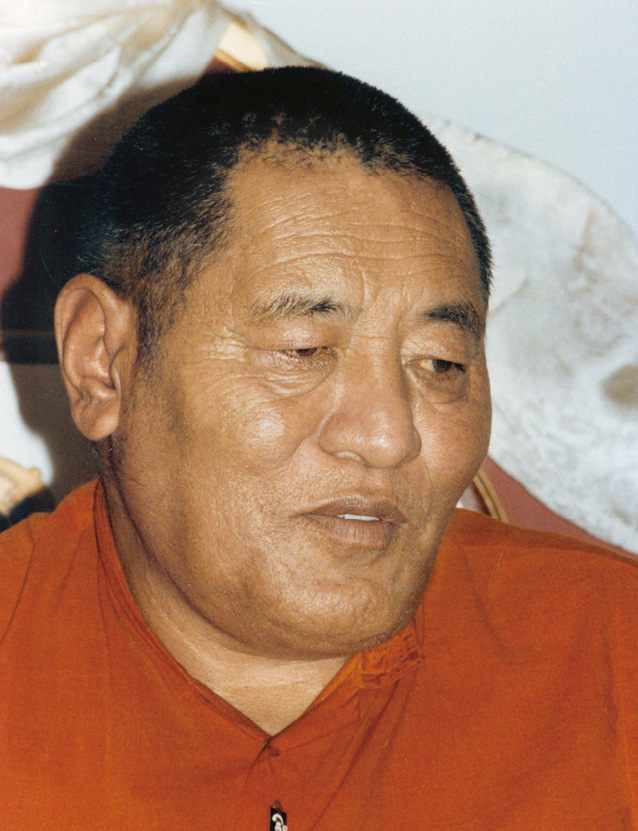

这次外内密的顺缘样样齐备时，大家不要自己欺骗自己，而要尽可能修持珍贵的佛法，这是非常重要的。但是，在修持佛法如意宝的时候，若没有认清它的本体，就不知道所入的行境。所以，第一关键是要认清：最初能打开佛教之门的是信心，中间修行的正轨是慈悲心，最后的究竟成就是成办众生利益。

首先，所谓的信心，有缘于佛宝的清净信、缘于法宝的欲乐信、缘于僧宝的诚挚信这三种。其中，缘于佛宝，完全了解佛具有无与伦比的智、悲、力功德，从而生起清净的心态，就是清净信。缘于法宝，生起想断除佛法四谛中的苦谛和集谛、想证悟灭谛和道谛的真实意乐，就是欲乐信。缘于僧宝，认为他们是所有众生中的佼佼者，不同于天人等其他世间众生，原因是僧人相续中具足戒律与觉受证悟的功德，并能从罪业中解脱，有具足与解脱两种功德，所以对僧众发自内心地信服，就是诚挚信。

中间的正轨，主要是专注于修行“希望无偏的一切有情具足安乐”的慈心，以及“希望他们远离痛苦”的悲心。

有些宗教和教派说，贪欲是法、嗔恨是法、愚痴是法，这都叫邪法或非法。有些人虽然口口声声说只有慈悲才是法，却以仁慈维护自方，憎恨他众，这只是相似的仁慈。有些人只是对全人类慈悲，却对其它动物不慈悲，这也是相似的慈悲。而佛教徒，是恒时希望一切众生与自己无有差别地离苦得乐，所以更加超胜。

佛教的究竟成就是什么呢？

就是将一切有情安置于安乐之地。想让一切众生离苦得乐，其他任何方法都做不到，只有兴盛如来的教法和证法如意宝才能做到。

所谓佛法，也就是教法和证法。通过讲闻受持教法的人、通过修行受持证法的人，在世间上共称为持教大德。除了这两种人，其他的都不叫持教大德。

我等本师，善巧方便、大慈大悲的佛陀，最初发殊胜菩提心、中间于三阿僧祇积累资粮、最终圆满成佛的究竟目的，是让一切众生安乐。要让众生安乐，唯一就是弘扬教法和证法。所以，我们也应追随具大悲心与大恩德的佛陀，最重要的是讲闻教法、修行证法。

下面接着讲《手中赐佛》，它分为初善、中善、后善三个引导。初善是相应显宗的引导，中善是相应总密宗的引导，昨天和前天已经讲完了。后善是真正大圆满的引导，它包括前行、正行、后行。

> 大圆满分三：一、前行；二、正行；三、后行。

> 一（前行）分为三门引导身语意前行、三身引导四大瑜伽前行、觉性引导区分有寂前行。

大圆满的前行内部也有三种。

> （一）三门引导身语意前行，分为身之前行、语之前行、意之前行三种。

> 身之前行：将自身观为一个蓝色迸射火花的金刚杵。

首先将自己的身体观成一个蓝色的三股金刚杵，然后长时间做金刚坐式来观修。

> 长时间做金刚坐式，结果身体不由自主地跌倒，断尽分别念时自然安住而休息。如此反复修炼。

这样长时间做金刚坐式，在身体没有不由自主地跌倒之前，一直坚持。当身体不由自主地倒下时，就让它倒下，当下观心的本体，自然安住。

> 语之前行：观想心脏内的神识以吽（ཧཱུྃ）字形象而住，

语言的前行：自己的心与风成为无别一味，观想心脏内有一个蓝色“吽”字。

> 从中接连不断地出现无数细微吽字，

以那个本具的“吽”字为源头，一个接一个放射出无数细微的“吽”字。

> 触及外境中的山洲房屋等，结果均变成了吽字，

观想“吽”字触碰到所有的山、洲、房屋舍宅，结果，这一切都变成“吽”字。

> 外面的吽字入于自身，自身也变成了吽字，最后所有的吽字皆消于法界中。自然安住而休息。

起初观想所有外器世界变成“吽”，再观想所有“吽”收回来，融入自己的身体，自己的身体也变成“吽”。所有“吽”一个接一个收回后，融入那个本具的“吽”，最后它消失于法界中。

> 修此法时应当以悦耳之音长久唱吽歌。

在观修这一切的过程中，应当一边用悦耳的声音长久唱诵吽歌“吽吽吽吽吽吽吽”，一边修持之前的观想次第。

> 意之前行：断定一切轮涅诸法均为心之幻化。

心的前行：比如做梦的时候，梦到的那些场景只是心的幻现，并不存在真实的高山、大河、险隘。同样，我们也要知道，今天的这一切景象，都只是内心习气的显现，并不存在于外界。所以，我们需要断定，一切的根本就是心。

> 观察心从何处生、住于何处、去往何处。

心最初从何处产生，现在住在何处，最终去往何处，一边想一边观察。

> 则一切粗大的无情法可抉择为微尘，微尘可抉择为无分微尘，无分微尘抉择为无基，从而可断定心无有生、住、灭。

如果认为心是从柱子等由微尘形成的粗大无情法中产生的，那就把它截成三段，但是没办法从这三段中生出三颗心。如果认为是中间那一段产生的，也可以把它分为三段，这样，所有粗大的法都可以抉择为微尘，微尘抉择为无分微尘，无分微尘抉择为根本不存在。由此可以确定，无情法中没有心的生处、住处、去处。

> 若观察心是否有形、色、声、香、味、触，则何者也不成立，甚至明觉者也只是名言宣说的而已，此外无法得到真实确定的依处。因此应当击破实执的心房，了达无我之义。

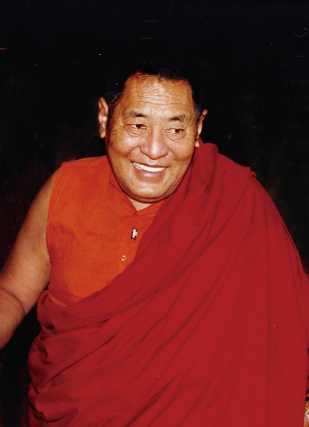

在观察心本身时，它不可能是四方形、半圆形等形色，也没有白色、红色、黄色、蓝色等显色，所以可以断定心不是“色”。同样，心也没有悦耳、刺耳、中等的声音，所以心决定不是“声”。如果观察心有没有妙香、恶香、中香的香气，它也没有，那么心绝对不是“香”。同样，心也没有舌头尝到的甜、酸、苦、涩、辣、咸这些味道，可以断定它不是“味”。接下来，心没有身识对境的柔、重、轻、暖等所触，因此它决定不是“触”。

如果说“心只有一个明觉”，这个明觉其实只是嘴上说说，实际上根本不成立。依靠它不成立这一点，来摧毁像房室一样实执的心。

以上是破心房的前行。对于这样的无我义，要引生定解。

> （二）三身引导四大瑜伽前行：自心似乎融入了地水火风之声中一般，专注此境界而安住。

比如，手拍地的声音、水流动的声音、火燃烧的声音、风在空中吹的声音，心似乎融入了所有这些声音里。专注于这种境界而安住。

> 不生任何分别执著时，应当于此境界中自然放松而认识心之自性。

不思维一切而安住时，就知道心的自性到底是怎样的。

> （三）觉性引导区分有寂前行：随意做六道众生三门的行为。妄念纷纷时猛呼一声“啪的（ཕཊ）”便可断绝妄念。观当下之心的本面，乃至未得无基离根定解前反复修炼。

区分有寂的时候，要区分轮回的边、涅槃的边这两者。要区分它们，首先要用心观想地狱、饿鬼、旁生等六道众生正在感受痛苦，口中说着六道众生的各种语言，身体做着六道众生的各种行为。然后，突然猛喝一声“啪的”，当下观心的本体，了知心没有来源、远离根本，这就叫涅槃。在这种境界中反复修持。

> 最后于三门不动摇中自然而观本住之心的本性，

所谓本住的引导，是在区分有寂的结尾，身体不动、口中不言、心不思维，就像疲惫不堪时休息一样，安住于本位，这叫本住引导。

> 从而了达无念法身之见解。

> 之后做如声缘一样的寂静行为，做如菩萨一样的中等行为，做如忿怒本尊一样的威猛行为，此三行为与观心之本性相结合。前行时应当圆满止观修法而入道，即恢复到本性中。

一开始，在寂静调柔的威仪中做毗卢七法，看自己能否处于止观的境界中；中间，只是行持行住坐卧等中等威仪，看那种状态下止观与它能不能相融；最后，做极度猛烈的行为，一边喊着“哈哈、呵呵”，一边跑跳戏耍等，这期间看谁还能处于止观的境界，如果能，那就是入道了。在此之前需要一直修行。

大家现在正在修五十万加行，因此不需要再解释了，尤其是你们修大圆满的前行，还要花很长时间。我今天讲的课并不是修行引导。在修行引导期间，每一个法都要修很多天。以区分有寂为例，以前的持明者们有过修七年的历史。现在的下等者再怎么差，区分有寂至少也需要修一百天，否则不代表区分过。身语意的前行、四大瑜伽也是一样。以后大家都要长期修行，这一点非常重要。

> 二、正行本来清净直断

正行本来清净直断，就是抉择诸法无生。

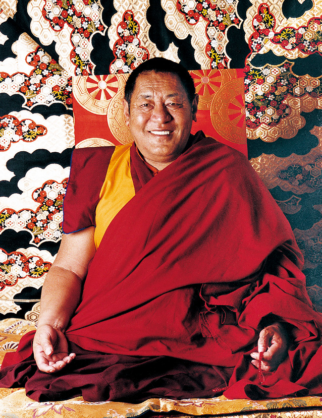

> 自心不改、自然安住

一开始，自己的这颗心无所思维，自然安住。

> 直观其本性时，彻底证悟本空离根通彻、远离内外中边、自相不灭、无有任何分别动念、不可言说之义，从而了知三世诸佛之智与不清净众生之心无有贤劣，认识一切皆圆满于明空智慧中的本面，即是所谓的见解如山直定。

认识到这颗心是无生的，是本体空性法身；无生的同时，以心断定本性，是自性光明报身；接下来，佛陀的心与众生的心没有好坏，于明空中一味，是大悲周遍化身。

以上是见修行果中的见解如山直定。

> 在认识见解本面而自然安住时，无有任何有无是非执著的所修对境，远离破立等分别伺察之染污，法性本住之禅定与自明本面之胜观双运，称为修行如海直定。

在这一见解的境界中自然安住时，没有任何有无是非的执著，没有什么可观修的，没有跟随分别念的散乱，在无修中照见法性的胜观与自然安住的寂止，也就是在止观双运的境界中护持相续，这叫修行如海直定。

> 不断修行时，显现任何六聚境心，皆不应改变、取舍，不失觉空本来自性而行持，则其妙力中所现的一切法均无利无害，如波浪融入大海，名为行为显现直定。

护持修行的相续时，显现眼耳鼻舌身意的六聚、有境的任何分别念、色声香味触法任何对境时，对一切都不贪执，也不进行任何破立，只是护持觉性本身的境界，就像波浪融入大海一样，所有分别念无利无害而融入觉性，这叫行为显现直定。

> 如此修习，最初认识觉性本面时，分别念自解脱如蛇结自解；

在修行的最初，生起任何分别念时，如果当下认清它，这个分别念的相续就不能再延续下去了。就像蛇打结，来不及打就解开了一样，会生起分别念自解脱于本地的觉受。

> 中间圆满妙力时，任何分别识聚均无利无害，如空屋入贼；

中间，了知心是空性，当证悟的根本妙力圆满时，显现好的分别念也不会欢喜，显现不好的也不会悲伤。这就像空屋子进了小偷，因为没什么可偷的，所以没什么可担心的，也不会因为没进贼而高兴。中间会得到这样的觉受。

> 最后获得稳固时，不清净之法寻而不得，现前自性义智慧，如于金洲不得土石，此名为果位觉性直定。

最后，任何平庸的分别念都不会产生，唯一产生的就是觉性。就像到了金洲，除了金子找不到普通土石，一切都变成了法身。这是直断的究竟见解——果位觉性直定。

> 三、后行任运自成顿超

> 为了现量见到非以伺察意安立的觉性光明密意，要修任运自成顿超法门。

后行任运自成顿超的引导：自心本来就安住着法身普贤如来，并不是以思维而安立它有，或以伺察意而安立很可能有，而是因为亲眼所见。为了见到它，就要修任运自成顿超之道。

> 修行时，身要：依三坐式任何一种；

修顿超时，有六种要诀。其中，身的要点是，以狮子般的法身坐式、卧象般的报身坐式、仙人蹲坐的化身坐式中任意一种来观修。

> 语要：禁语，口中缓慢呼吸；

语的要点是，口中禁语或少说话，风从口中缓慢进出。

> 心要：依直断直定自然慧灯；

心的要点是，在前面讲直断时提到的那种境界中安住，这叫自然慧灯。需要处于那一要诀的境界中。

> 境要：无云晴空及日月明灯等；

对境的要点是，专注于远离垢染的虚空，或者专注于太阳、月亮、灯中的任何一个。

> 门要：上视、平视、垂视；

门的要点是，法身看式：向上看眉间；化身看式：向下垂视；报身看式：双目平视两侧。

> 显现要：如此而修便会现前法界净灯、明点空灯与觉性金刚链。法界净灯即具有五光辐的蓝色周遍法界。明点空灯即内外多层五光圆形明点中央。觉相金刚链即如水晶珠严饰的金线般。显现此等现相时令其稳固、毫不动摇，将自己的呼吸、眼识、意识三者都融入此境界中，专注于此，无有任何伺察意相状分别识聚长久修习，从而可明显地见到法界净灯、明点空灯与觉性金刚链，即是法性现量相。

远离一切分别念，明显见到法界净灯、明点空灯、觉性金刚链，这是四相中的法性现量相。

> 彼等显现愈加明显、愈加稳固、愈加圆满并出现无量光芒，即是觉受增上相。

法界、明点、觉性都越来越明显、越来越稳固、越来越圆满、越来越多、越来越增上，这是觉受增上相。

> 法界净灯显现清净为刹土，明点空灯圆满为无量殿，觉性金刚链成熟为佛身，所现前的全部是清净现相，即是觉性如量相。

法界净灯清净为刹土、明点空灯圆满为无量殿、觉性金刚链成熟为本尊身，没有一个不清净的显现，这是觉性如量相。

> 身智等无边有法的一切显现均入于法性童子瓶佛身界中，获得不现一切的坚地，即是法性灭尽相。

虽然一切不清净的显现在觉性如量相时已经灭尽，但一切清净的身智显现，于内法界中获得坚地，不现而融入于内法界中，这是法性灭尽相。

> 之后在所化刹土中显现的一切庄严三身均是善愿聚合而产生的无欺自果。

虽已现证了法身佛的果位，但于所化界中，以佛的发愿和所化的善资粮增上的力量，显现化身和报身等一切。这是以善愿聚合的缘起而显现的。

> 倘若今生未得稳固殊胜的境界，则临终时，于心间将自心观成白色阿（ཨ）字，被风吹送而融入顶上安住的上师心间，上师也越来越高，去往极乐世界，即是自心与上师之意无二无别中入定而往生。

临死中阴的引导：临近命终时，将自心在心脏里观成一个白色“阿”字，一心一意祈祷安住于顶上的上师，观想那个“阿”字向上融入了上师的心间，上师越来越高，去往极乐世界。在自己的心与上师的智慧无别的境界中入定而往生，这就得到了法身佛的果位。

> 法性中阴时，无论出现声音、光芒、光线等任何身智之游舞显现，都应当了知是自现，并以直定见解安住于所认识的本性上。在一切妙力显现未融入本基界中之前，应当一直安住不退。

法性中阴时，会出现声音相、光芒相、光线相、圣尊身相、智慧相等许多相，此时要知道，这一切都是自现。在这种境界中安住，一切分别念就会融入法界。这是法性中阴引导的精要。

> 如梦般出现转世中阴显现时，一心一意敬信上师、本尊，实修临死中阴窍诀，则可于自性化身刹土中获得安慰。

转世中阴，显现六道众生的业感相时，祈祷本尊和上师，观修临死中阴的窍诀而迁识夺舍，自心明观为白色“阿”字融入上师心间，上师去往极乐世界，这样就会解脱于自性幻化刹土中。

> 如是修法佛赐手，吾之智慧中流露，

> 个别词句分别造，然于某些初学者，

> 会有利益而著此。以造此论之善根，

> 愿遍虚空诸有情，同于法界得安慰。

《手中赐佛》的真正要点，虽然是从觉空大圆满的境界中流露出来的，但后面的个别词句并没有在心中原原本本浮现，想到可能会给所有初学者带来一点利益，就以分别念将其立成文字。在藏地，这是初学者的一个实修法，以后还需要多看大圆满的续、教和窍诀。

但是，对于大部分西方国家来说，自始至终需要的就是这个法，别无其他。如果不能看很多、不能修很多、修行的时间很少，那么有这个就够了。

以此造论的善根，愿一切众生都获得法身果位。

> 此文是在文殊幻化殊胜刹土——五台山静处非天洞或名那罗延窟，阿旺罗珠宗美于晨息间撰著。

引导文《手中赐佛》的完整内容，已经圆满了。顺应各位的意愿，我们讲法和闻法全部善始善终了。

美国副总统的来信

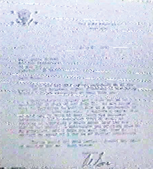

法王在寺院传法时，收到了美国副总统戈尔1993年7月23日写的一封信，内容大致如下：

“很高兴听到法王晋美彭措来访美国。不巧的是，这个周末我要去参加一个会议，7月30日和31日都不在华盛顿。这次不能和法王晋美彭措见面，真的很遗憾。不过，我已经安排了工作人员在白宫接待法王参观。如果还有其他事情，请随时和我联系。

最美好的祝福！

阿尔·戈尔”

后来，法王传法圆满后，在副总统的安排下前往白宫。

参观白宫

7月30日，法王参观了白宫（The White House）。这里是美国总统府，是美国总统居住和处理国家事务的官邸，因此，游览区仅限于部分区域，只在特定时段对外开放，而且不允许外国游客直接参观。

受副总统戈尔的委托，一名叫凯伦·威廉姆斯（Karen Williams）的工作人员带我们进入白宫。白宫由三部分组成：主楼、东翼、西翼。东翼是宴会活动厅；西翼是行政办公楼和总统办公室；主楼外观三层，其实有六层，总共132个房间。工作人员不仅作为向导对每个区域进行了详细的介绍，还向我们展示了一些平时不对公众开放的地方。有趣的是，这位工作人员是一名美国出家人，她穿着藏传佛教的僧衣，常年在白宫工作，看上去有点稀有。

白宫的墙壁上，挂着历任总统和第一夫人的肖像，以及各种小照片。无论是走廊还是房间，到处都是历史文化气息浓厚的艺术品，陈列着白宫用过的精美瓷器、玻璃器皿、金银餐具。由于当时美国的在任总统是克林顿，这里有很多他和家人的照片及录像。

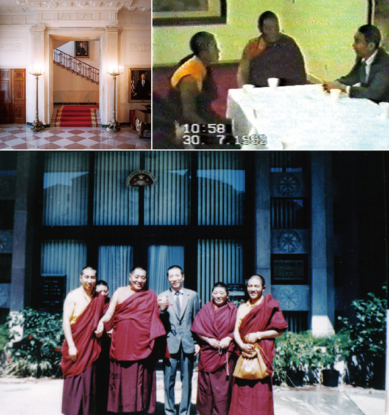

下午去了中国驻美大使馆。接待我们的大使比较和气，让我们汇报了在美的行程、出国和返程的时间等，问了一些相关细节，然后我们就回去了。

临别赠言

7月31日，法王完成所有的传法内容后，为了表示庆祝，不同肤色、不同国家的佛教徒在草地上搭起帐篷，以自助餐的形式举行了一场欢喜盛宴。那天的天气非常晴朗，树木也显得格外绿，听着鸟儿宛转动听的歌声，闻着空气中沁人心脾的花香，大家轻松悠闲地享用着美食，心情十分舒畅。

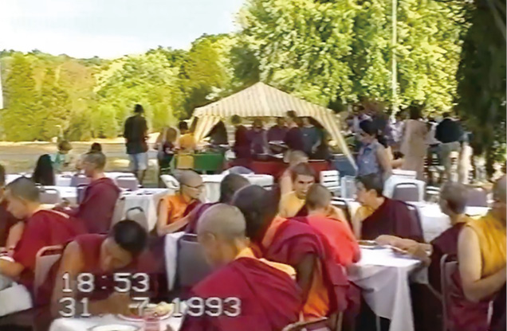

在临别之前，法王给大家讲了一段话：

今天，我有几点希望要给你们讲。

一般来说，像我这样的人，没有功德、多有过失，教导你们是不应理的。但这一次，我们被师徒的誓言紧紧联系在一起，不仅是这辈子，生生世世都要不分离，所以我也鼓起勇气说几句话：

一、对道场主管的希望

首先，我对道场主管阿贡拉姆有两点希望。她所有的功德，可以归结为两个方面：一是自相续有真修实证的功德，二是她弘法利生的事业。希望她能尽力保持之前的两种功德不退失，还要努力获得前所未有的更多功德。

二、对出家人的希望

接下来，我对你们出家人有三点希望。是什么呢？你们要团结和合、清净戒律、精进闻思修行。

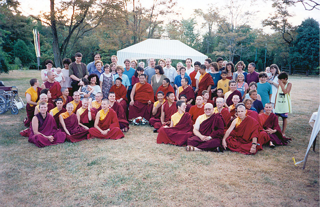

1．团结和合

说到团结和合，本来不仅是佛教徒之间，对基督教、印度教等也要做到关系和睦。相互勾心斗角、纷争不止只会有害，不可能成为安乐之因。所以我想说的第一点是，各宗教之间，尤其是佛教各教派之间，更重要的是藏地兴盛的四大教派等诸多派别之间，团结和合应该是基础，不可缺少。

与过去二三十年相比，现阶段佛教在世界上很多国家都很兴盛，但现在有一个大魔在作祟，就是不团结。说实话，如果一个地方有两位上师，很少有总是关系融洽的；如果是两个道场或两个僧团，也很难和睦相处。因此，做到团结和合是非常重要的。佛陀曾说：“僧众和合即安乐，和合苦行更安乐。”僧众和合是极大的安乐，僧众和合而断恶行善，就会更加安乐，所以这必不可少。

2．清净戒律

清净戒律是根本。你们已经受戒了，如果守护戒律，今生来世都会安乐，不会遭受痛苦。一旦破了戒，必定会堕入恶趣，没有其他出路。为此，戒律有很大的利害关系，必须小心守护。

3．精进闻思修行

所谓的修行是什么？就是认认真真、扎扎实实地实修。

所谓闻思，就是尽心尽力地讲法和闻法。如果你能为别人讲经说法，那很不错；如果做不到这一点，自己也要勤于听法。假如讲法和听法都能兼顾，那是无与伦比的；即使两者不能兼得，但其中一个必不可少。

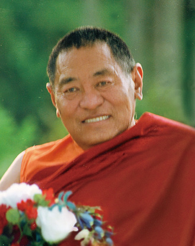

三、对在家人的希望

我对在家群体也有两点希望。不要杀生、不要偷盗，尽量做一些顶礼转绕、诵经念咒等善事，这是第一点。对于三宝，尤其是僧宝，要有信心，要向他们祈祷，要为他们服务，稍微有点财物，也尽可能供养僧众，这对自己的今生来世都有大利，这是第二点。

四、对所有人的希望

我对大家有一个共同的希望。就是你们所有人要不遗余力地维护整个佛教，尤其是这个道场，要千方百计不让它千疮百孔，成为众矢之的。如果这个道场出了什么问题，且不说在别人面前抬不起头来，甚至会让整个佛教蒙羞。所以，对此要非常小心。

你们这个道场，需要特别注意几点：第一，男女僧人之间一定要严守戒律，否则出了差错，没什么比这更糟糕的了。对于方式方法，道场主管应该制定严格的纪律。有条件的话，可以把男女僧人的禅房分开，中间隔断，从一开始就防止出现问题，这点相当重要。如果对此不太注意，出家男女和在家男女混在一起住，那是很难守住戒律的。

以我自己为例，我的佛学院有1000多名尼姑、1000多名喇嘛。当他们在听法时，要坐在不同的地方，相互之间有很长的距离，不允许坐在一起。走路时不能从同一个门进出，尼姑从一个门进出，喇嘛从另一个门进出。另外，他们的生活区相隔很远，平时也不能随便联系和见面。如果不这么做，长期生活在一起，总有一天很难守住戒。

所以你们也要从一开始就护戒，否则破戒有非常大的罪过，会堕入几十万世都脱离不了的恶趣。因此，首先要严加守护自己的戒律。

第二，尽可能提高警惕，不要破坏别人的戒律。如果你破了别人的戒，那比自己破戒还可怕。为什么呢？比起毁掉几千万座佛塔，破坏别人戒律的罪过更大。即使造了杀生、偷盗等其他罪业，虽然注定堕入恶趣，但也可以清净，而破坏了出家僧人的戒，就是近无间罪，死后会立即生于无间地狱，没有解脱的机会，所以要特别小心。

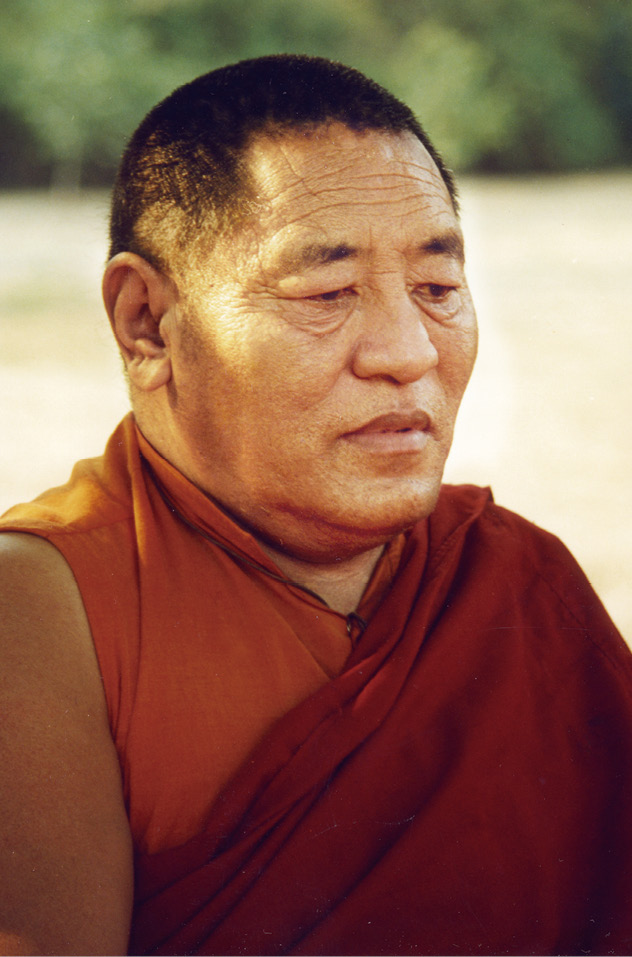

无论是谁，即使不能成办广大善法，这也不会有过失，但一定要想方设法、竭尽全力不给其他修行人守护净戒制造障碍。如果让一个具戒的人破了戒，且不说几十万世都遇不到三宝，甚至会转生到连三宝名字都听不到的黑暗边地。

可能有人认为：“虽然破了戒，但是通过修行，实修一点密法，不会有大的过失吧？”

正所谓“破戒者修密，佛说不成就”。只要破了戒，无论你怎么闻思、怎么求学、怎么修行，去处都只有恶趣，得不到任何利益，所以必须极其谨慎。

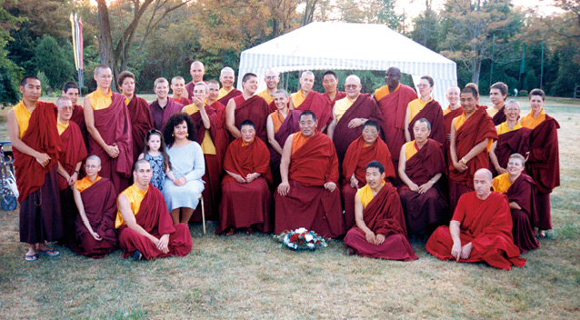

如果你实在守不住戒，也不要妨碍别人守戒，而要给他们提供顺缘，这样你也可以得到别人守戒的功德。

总之，我对你们道场的主要负责人讲了两个希望，对男女僧众讲了三个希望，对在家男女讲了两个希望，这些你们平时要记在心里，不要忽视。我走了以后，不要将其置之脑后，不要从贴身的口袋里漏出，每个人都要小心翼翼藏好，不要丢了。（众笑）

最后，我说三个祝愿：

第一，祝愿住持长久住世、事业兴盛；第二，祝愿所有僧人戒律清净、智慧圆满；第三，祝愿在家善男信女对三宝坚信不移、行持十善。祈求诸佛菩萨加持，我能实现这些愿望，同时为了圆满所有的愿望，也请你们鼎力相助。

至此，华盛顿的弘法行已经圆满。
